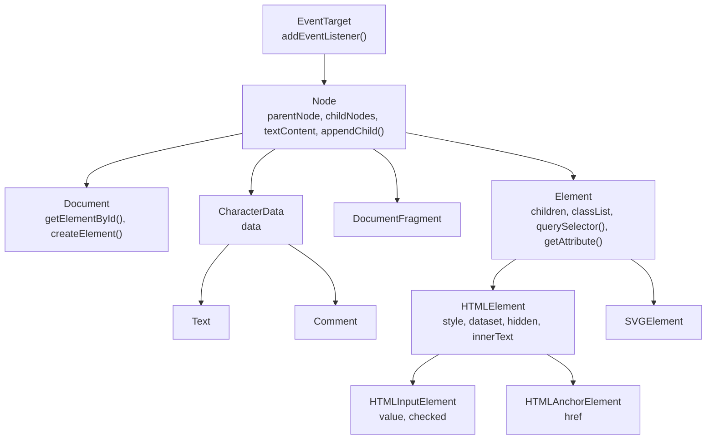

## Why learn the DOM API?

React, Vue and Svelte all end up doing the same thing: calling DOM methods to create, change and remove elements. When a list renders slowly, when an animation stutters, or when an interviewer says "do it in plain JavaScript", you need to know what those methods do and what they cost.

In [HTML fundamentals](/html/fundamentals#what-is-the-dom) you saw that the **DOM** (Document Object Model) is the live tree of objects the browser builds from HTML. This chapter is about **working with that tree from JavaScript**: finding nodes, walking between them, changing content, creating and moving elements, measuring them, and watching them change.

<Callout type="note">
The examples are live HTML previews: each one has a small `log()` helper that writes into a `<pre>` under the preview. Edit the code and the preview re-runs.
</Callout>

## Nodes, elements and the class hierarchy

Everything in the tree is a **node**: elements, text, comments and the document itself. Each kind of node is an object made by a different class, and those classes inherit from each other. That inheritance tells you which methods an object has.



So an `<input>` is an `HTMLInputElement`, which is also an `HTMLElement`, an `Element`, a `Node` and an `EventTarget`. It has `value` (from its own class), `style` (from `HTMLElement`), `querySelector` (from `Element`), `appendChild` (from `Node`) and `addEventListener` (from `EventTarget`).

Every node has a numeric **`nodeType`**. These are the five you will actually meet:

| `nodeType` | Constant | What it is |
| --- | --- | --- |
| `1` | `Node.ELEMENT_NODE` | An element: `<div>`, `<p>`, `<svg>` |
| `3` | `Node.TEXT_NODE` | Text inside an element, including whitespace between tags |
| `8` | `Node.COMMENT_NODE` | `<!-- a comment -->` |
| `9` | `Node.DOCUMENT_NODE` | `document` itself |
| `11` | `Node.DOCUMENT_FRAGMENT_NODE` | A `DocumentFragment` (see below) |

```html live
<ul id="list">
  <li>One</li>
  <!-- a comment -->
  <li>Two</li>
</ul>
<pre id="log" style="font-size:13px"></pre>
<script>
  const log = (l) => (document.getElementById("log").textContent += l + "\n");
  const list = document.getElementById("list");

  // childNodes = every node; children = elements only
  log("childNodes: " + list.childNodes.length);   // 7: text, li, text, comment, text, li, text
  log("children:   " + list.children.length);     // 2: just the two <li>
  log([...list.childNodes].map((n) => n.nodeType).join(" ")); // 3 1 3 8 3 1 3

  const input = document.createElement("input");
  log(input instanceof HTMLInputElement && input instanceof Node); // true
  log(document.documentElement.tagName);           // HTML: the <html> element
</script>
```

Three entry points are always there: `document.documentElement` (`<html>`), `document.head` and `document.body`.

## Finding elements

### querySelector and querySelectorAll

These two take any **CSS selector** (the same syntax you learned in [CSS selectors](/css/selectors)), so one pair of methods covers almost every lookup.

<Api name="querySelector / querySelectorAll" sig="root.querySelector(selectors) · root.querySelectorAll(selectors)" returns="`querySelector` returns the **first** matching element in document order, or `null`. `querySelectorAll` returns a **static** `NodeList` (possibly empty, never `null`)." mutates="no">

- `root`: `document`, any element, a `DocumentFragment` or a shadow root. Only descendants of `root` are returned, never `root` itself.
- `selectors` (string, required): one or more CSS selectors separated by commas, e.g. `"#cart .item:not(.sold-out)"` or `"h2, h3"`. An invalid selector throws a `SyntaxError`.

</Api>

```html live
<section id="cart">
  <p class="item">Pen</p>
  <p class="item sold-out">Ink</p>
  <p class="item">Paper</p>
</section>
<pre id="log" style="font-size:13px"></pre>
<script>
  const log = (l) => (document.getElementById("log").textContent += l + "\n");
  const cart = document.querySelector("#cart");

  log(cart.querySelector(".item").textContent);            // Pen: the first match
  const available = cart.querySelectorAll(".item:not(.sold-out)");
  log(available.length);                                    // 2
  available.forEach((p) => log("- " + p.textContent));     // NodeList has forEach
  log(cart.querySelector(".missing"));                      // null: nothing matched
  log(cart.querySelectorAll(".missing").length);            // 0: empty list, not null

  try {
    cart.querySelector("p[");                               // broken selector
  } catch (e) {
    log(e.name);                                            // SyntaxError
  }
</script>
```

<Callout type="mistake">
The selector is matched against the **whole document**, then filtered to descendants of `root`. So `cart.querySelector("section p")` still finds the paragraphs, even though `section` is `cart` itself and not inside it. Use `:scope` to anchor the selector to the root: `cart.querySelectorAll(":scope > p")` matches only direct children.
</Callout>

### The older getElement* methods

| Method | Called on | Returns |
| --- | --- | --- |
| `document.getElementById(id)` | `document` (also fragments and shadow roots), **not** elements | One element or `null` |
| `root.getElementsByClassName(names)` | document or element | A **live** `HTMLCollection` |
| `root.getElementsByTagName(tag)` | document or element | A **live** `HTMLCollection` |
| `document.getElementsByName(name)` | `document` | A **live** `NodeList` (form fields with that `name`) |

`getElementById` takes a plain id, **without** `#`. It is the fastest lookup because browsers keep an id → element index, but the difference only matters in very hot loops.

### Live vs static collections

A **live** collection updates itself whenever the DOM changes. A **static** collection is a snapshot taken at the moment you asked.

| You get it from | Type | Live? |
| --- | --- | --- |
| `querySelectorAll` | `NodeList` | No, static snapshot |
| `getElementsByClassName`, `getElementsByTagName`, `el.children`, `form.elements` | `HTMLCollection` | Yes |
| `node.childNodes` | `NodeList` | Yes |

```html live
<ul>
  <li class="todo">A</li>
  <li class="todo">B</li>
  <li class="todo">C</li>
  <li class="todo">D</li>
</ul>
<pre id="log" style="font-size:13px"></pre>
<script>
  const log = (l) => (document.getElementById("log").textContent += l + "\n");
  const live = document.getElementsByClassName("todo");

  // Bug: each remove() shrinks the live collection, so the indexes shift
  for (let i = 0; i < live.length; i++) live[i].classList.remove("todo");
  log("still .todo: " + live.length);   // 2: B and D were skipped

  // Fix: take a static snapshot first
  [...live].forEach((li) => li.classList.remove("todo"));
  log("still .todo: " + live.length);   // 0
</script>
```

<Callout type="tip">
`NodeList` has `forEach` but not `map` or `filter`. `HTMLCollection` has neither. Turn either one into a real array with `[...list]` or `Array.from(list)`.
</Callout>

### closest and matches: looking upward and testing

<Api name="Element.closest() / Element.matches()" sig="el.closest(selectors) · el.matches(selectors)" returns="`closest` returns the nearest element, **starting with `el` itself** and walking up through its ancestors, that matches; otherwise `null`. `matches` returns `true` if `el` itself matches." mutates="no">

- `selectors` (string, required): a CSS selector list. Invalid syntax throws `SyntaxError`.

</Api>

```html live
<article class="card" data-id="42">
  <h3>Title</h3>
  <button><span id="icon">★</span> Save</button>
</article>
<pre id="log" style="font-size:13px"></pre>
<script>
  const log = (l) => (document.getElementById("log").textContent += l + "\n");
  const icon = document.getElementById("icon");

  log(icon.closest(".card").dataset.id);  // 42: walked up span → button → article
  log(icon.closest("span") === icon);     // true: closest checks the element itself first
  log(icon.closest("form"));              // null: no <form> ancestor
  log(icon.matches("button span"));       // true
</script>
```

`closest` is the backbone of **event delegation**: one listener on a parent, then `event.target.closest(".card")` to find which card was clicked. That is covered in [Events](/browser/events).

## Walking the tree

Once you have one node you can move to its neighbours without searching again. There are two families of properties: one that counts **every node** (text and comments included), and one that counts **elements only**. You almost always want the second.

```text
                 parentElement
                       ▲
previousElementSibling ◄── el ──► nextElementSibling
                       │
           firstElementChild … lastElementChild
                 (children = all of them)
```

| All nodes | Elements only | Note |
| --- | --- | --- |
| `parentNode` | `parentElement` | Differ only at the top: for `<html>`, `parentNode` is `document` and `parentElement` is `null` |
| `childNodes` | `children` | Live collections |
| `firstChild` / `lastChild` | `firstElementChild` / `lastElementChild` | `firstChild` is often a whitespace text node |
| `previousSibling` / `nextSibling` | `previousElementSibling` / `nextElementSibling` | `null` at the ends |
| — | `childElementCount` | Same as `children.length` |

```html live
<ol id="steps">
  <li>Wash</li>
  <li id="mid">Rinse</li>
  <li>Repeat</li>
</ol>
<pre id="log" style="font-size:13px"></pre>
<script>
  const log = (l) => (document.getElementById("log").textContent += l + "\n");
  const mid = document.getElementById("mid");

  log(mid.previousElementSibling.textContent);   // Wash
  log(mid.nextElementSibling.textContent);       // Repeat
  log(JSON.stringify(mid.nextSibling.textContent)); // "\n  ": a whitespace text node
  log(mid.parentElement.id);                     // steps
  log(document.documentElement.parentNode === document); // true
  log(document.documentElement.parentElement);   // null
</script>
```

## Reading and changing content

There are three ways to read or write what is inside an element, and they differ in speed, in what they return and in safety.

### textContent

**`textContent`** is the raw text of the node and all its descendants, joined together. It ignores CSS completely, so it includes text hidden with `display: none` and the source of `<script>` and `<style>` children. Assigning to it **removes every child** and puts one text node in their place. HTML in the string is not parsed, so it is **safe for user input**.

### innerText

**`innerText`** is the text **as it is rendered**: hidden elements are skipped, and line breaks follow the layout (block elements and `<br>` become `\n`). To know what is rendered, the browser must calculate styles and layout first, so reading `innerText` can force a **reflow** (more in [the rendering pipeline](/browser/rendering-pipeline)). Assigning to it also replaces the children, converting `\n` into `<br>`.

### innerHTML, outerHTML and insertAdjacentHTML

**`innerHTML`** reads the children as an HTML string. Assigning to it **parses** the string as HTML and replaces all children. **`outerHTML`** is the same but includes the element itself; assigning to it replaces the element in its parent.

```html live
<div id="box">Visible <span style="display:none">hidden</span><b>bold</b></div>
<pre id="log" style="font-size:13px"></pre>
<script>
  const log = (l) => (document.getElementById("log").textContent += l + "\n");
  const box = document.getElementById("box");

  log(box.textContent);   // "Visible hiddenbold": includes the hidden span
  log(box.innerText);     // "Visible bold": only what is rendered
  log(box.innerHTML);     // the markup of the children, as a string
  log(box.outerHTML.slice(0, 14)); // <div id="box">: includes the element itself

  box.textContent = "<i>not parsed</i>";  // shows the literal characters
  log(box.children.length);               // 0: still one text node
  box.innerHTML = "<i>parsed</i>";        // creates a real <i> element
  log(box.children[0].tagName);           // I
</script>
```

<Callout type="mistake">
**Never put user input into `innerHTML`.** A `<script>` tag inserted with `innerHTML` does not run, which gives a false sense of safety. Event-handler attributes do run:

```js
// comment = ''
list.innerHTML += `<li>${comment}</li>`;   // ✗ XSS: onerror runs
```

Use `textContent` (or `createElement` + `textContent`) for data. If you truly must render user HTML, sanitize it first with a library such as DOMPurify. See [Browser security](/browser/security).
</Callout>

<Callout type="mistake">
`el.innerHTML += "<li>…</li>"` re-serializes **all** existing children to a string, then re-parses the whole thing. Every existing child is destroyed and rebuilt: event listeners attached to them are lost, input values reset, and it gets slower with every item. Use `insertAdjacentHTML` or `append` to add without touching what is already there.
</Callout>

<Api name="Element.insertAdjacentHTML()" sig="el.insertAdjacentHTML(position, html)" returns="`undefined`." mutates="yes (the DOM)">

- `position` (string, required, case-insensitive): where to insert, relative to `el`. Anything else throws a `SyntaxError`.
  - `"beforebegin"`: before `el`, as its previous sibling (needs a parent).
  - `"afterbegin"`: inside `el`, before its first child.
  - `"beforeend"`: inside `el`, after its last child.
  - `"afterend"`: after `el`, as its next sibling (needs a parent).
- `html` (string): parsed as HTML. The same XSS rules as `innerHTML` apply.

There are two siblings with the same `position` values: `insertAdjacentElement(position, element)` and `insertAdjacentText(position, text)`.

</Api>

```text
<!-- beforebegin -->
<ul id="list">
  <!-- afterbegin -->
  <li>existing</li>
  <!-- beforeend -->
</ul>
<!-- afterend -->
```

```html live
<ul id="list"><li>existing</li></ul>
<script>
  const list = document.getElementById("list");
  list.insertAdjacentHTML("beforebegin", "<p>beforebegin</p>");
  list.insertAdjacentHTML("afterbegin", "<li>afterbegin</li>");
  list.insertAdjacentHTML("beforeend", "<li>beforeend</li>");
  list.insertAdjacentHTML("afterend", "<p>afterend</p>");
</script>
```

| | Parses HTML | Safe for user text | Can force layout | Keeps existing children |
| --- | --- | --- | --- | --- |
| `textContent =` | No | Yes | No | No (replaces) |
| `innerText =` | No | Yes | Reading it, yes | No (replaces) |
| `innerHTML =` | Yes | **No** | No | No (replaces) |
| `insertAdjacentHTML` | Yes | **No** | No | **Yes** |

## Attributes, classes, styles and data

Attributes versus properties was explained in [HTML fundamentals](/html/fundamentals#attribute-vs-property). In short: read and write state through properties (`input.value`, `el.hidden`), and use `getAttribute` / `setAttribute` / `removeAttribute` / `hasAttribute` / `toggleAttribute` for attributes without a property. Three properties deserve their own sections.

### classList

The `class` attribute is a space-separated string. Editing it by hand (`el.className += " active"`) easily creates duplicates or breaks other classes. **`classList`** is a `DOMTokenList` that edits one class at a time.

<Api name="Element.classList" sig="add(...tokens) · remove(...tokens) · toggle(token, force?) · replace(oldToken, newToken) · contains(token)" returns="`add`/`remove` return `undefined`; `toggle` returns **whether the class is present afterwards**; `replace` returns `true` if `oldToken` was found and replaced; `contains` returns a boolean." mutates="yes (the class attribute)">

- `...tokens`: one or more class names. Adding an existing class or removing a missing one does nothing (no error, no duplicate).
- `force` (optional boolean): `true` behaves like `add`, `false` like `remove`. Useful when the state comes from a variable: `el.classList.toggle("open", isOpen)`.
- An empty string throws `SyntaxError`; a token containing whitespace throws `InvalidCharacterError`.

</Api>

```html live
<div id="panel" class="card">Panel</div>
<pre id="log" style="font-size:13px"></pre>
<script>
  const log = (l) => (document.getElementById("log").textContent += l + "\n");
  const cl = document.getElementById("panel").classList;

  cl.add("open", "shadow", "open");     // the second "open" is ignored
  log(cl.value);                        // card open shadow
  log(cl.toggle("open"));               // false: it was there, now removed
  log(cl.toggle("open", true));         // true: force add
  log(cl.toggle("open", true));         // true: still present, nothing changed
  log(cl.replace("card", "tile"));      // true
  log(cl.contains("card"));             // false
  try { cl.add("two words"); } catch (e) { log(e.name); } // InvalidCharacterError
</script>
```

### style and getComputedStyle

**`el.style`** reads and writes the element's **inline** `style` attribute only. It does not see styles from stylesheets. Property names are camelCase (`backgroundColor`), values are strings with units.

**`getComputedStyle(el, pseudoElt?)`** returns the **final** value of every property after the cascade, inheritance and resolution: what the browser actually uses. It is read-only, values are resolved (colors usually as `rgb(...)`, lengths in `px`), and the optional second argument reads a pseudo-element such as `"::before"`. Like `innerText`, reading it can force style and layout calculation.

```html live
<style>.note { color: teal; padding: 1em; }</style>
<p id="p" class="note" style="font-size: 20px">Note</p>
<pre id="log" style="font-size:13px"></pre>
<script>
  const log = (l) => (document.getElementById("log").textContent += l + "\n");
  const p = document.getElementById("p");

  log(JSON.stringify(p.style.color));        // "": the color comes from a stylesheet, not inline
  log(p.style.fontSize);                     // 20px: inline
  const cs = getComputedStyle(p);
  log(cs.color);                             // rgb(0, 128, 128): teal, resolved
  log(cs.paddingTop);                        // 20px: 1em of a 20px font

  p.style.setProperty("--accent", "orange");            // custom properties need setProperty
  p.style.setProperty("border", "2px solid", "important"); // third argument: priority
  p.style.removeProperty("font-size");                  // back to the stylesheet value
  log(p.getAttribute("style"));
</script>
```

<Callout type="tip">
Prefer toggling a **class** over setting many inline styles: the CSS stays in the stylesheet, it is easy to override, and one class change is one style recalculation. Use `el.style` for truly dynamic values (positions while dragging, a progress width) or for CSS custom properties: `el.style.setProperty("--progress", "40%")`.
</Callout>

### dataset

`data-*` attributes appear on **`el.dataset`** with the `data-` prefix removed and the rest turned into camelCase: `data-user-id` becomes `dataset.userId`. Values are always **strings**, so `dataset.count = 5` stores `"5"`, and `delete el.dataset.userId` removes the attribute. More detail is in [HTML fundamentals](/html/fundamentals#data--attributes-and-dataset).

## Creating, inserting, moving and removing

### Creating nodes

- `document.createElement(tagName)`: a new, **detached** element. It is not on the page until you insert it.
- `document.createTextNode(text)`: a text node; the text is never parsed as HTML.
- `node.cloneNode(deep)`: a copy. `deep` defaults to **`false`**, which copies only the element and its attributes, not its children. `cloneNode(true)` copies the whole subtree.

<Callout type="warning">
`cloneNode` copies attributes (including `id` and inline `onclick="…"`) but **not** listeners added with `addEventListener`, and not JavaScript properties you set yourself. Remember to change the `id`, or you'll have duplicates.
</Callout>

### Modern insertion methods

<Api name="append / prepend / before / after / replaceWith / remove / replaceChildren" sig="parent.append(...nodes) · parent.prepend(...nodes) · el.before(...nodes) · el.after(...nodes) · el.replaceWith(...nodes) · el.remove() · parent.replaceChildren(...nodes)" returns="All return `undefined`." mutates="yes (the DOM)">

- `...nodes`: any number of nodes **or strings**. Strings become text nodes (never parsed as HTML).
- `append` / `prepend`: insert inside, as the last / first children.
- `before` / `after`: insert outside, as siblings. Does nothing if `el` has no parent.
- `replaceWith`: put the nodes where `el` is and take `el` out.
- `remove()`: take `el` out of its parent. Does nothing if it has no parent.
- `replaceChildren(...nodes)`: remove every child, then append `nodes`. With **no arguments** it empties the element.

</Api>

```html live
<ul id="list"><li id="b">B</li></ul>
<pre id="log" style="font-size:13px"></pre>
<script>
  const log = (l) => (document.getElementById("log").textContent += l + "\n");
  const list = document.getElementById("list");
  const b = document.getElementById("b");

  const li = (text) => {
    const el = document.createElement("li");
    el.textContent = text;            // safe: never parsed
    return el;
  };

  list.append(li("D"), li("E"));      // several at once
  list.prepend(li("A"));
  b.after(li("C"));
  list.lastElementChild.replaceWith(li("E!"));
  log([...list.children].map((x) => x.textContent).join(" ")); // A B C D E!

  list.append("plain text <b>not bold</b>"); // a string becomes a text node
  log(list.lastChild.nodeType);              // 3
  list.lastChild.remove();
</script>
```

### The older methods

You'll see these in older code and in interview questions. They work only with nodes (no strings) and they **return a node**, unlike the modern ones.

| Old | Returns | Modern equivalent |
| --- | --- | --- |
| `parent.appendChild(node)` | The appended node | `parent.append(node)` |
| `parent.insertBefore(node, ref)` | The inserted node. If `ref` is `null`, inserts at the end | `ref.before(node)` |
| `parent.removeChild(child)` | The removed child; throws if it isn't a child | `child.remove()` |
| `parent.replaceChild(newNode, oldNode)` | The **old** node | `oldNode.replaceWith(newNode)` |

### Inserting a node that is already in the DOM moves it

A node can only have **one parent**. If you insert a node that is already somewhere in the tree, it is **moved**, not copied. There's no need to remove it first.

```html live
<ul id="a"><li id="item">I move</li></ul>
<ul id="b"></ul>
<pre id="log" style="font-size:13px"></pre>
<script>
  const log = (l) => (document.getElementById("log").textContent += l + "\n");
  const item = document.getElementById("item");
  document.getElementById("b").append(item);       // moved from #a to #b
  log(document.getElementById("a").children.length); // 0
  log(item.parentElement.id);                       // b
</script>
```

This is also the easiest way to **reorder** a list: append the items again in the new order.

### DocumentFragment and template

A **`DocumentFragment`** is a lightweight container that is not part of the page. You build nodes inside it, then insert the fragment once. When inserted, its **children move** into the target and the fragment is left empty.

```html live
<ul id="list"></ul>
<pre id="log" style="font-size:13px"></pre>
<script>
  const log = (l) => (document.getElementById("log").textContent += l + "\n");
  const frag = document.createDocumentFragment();
  for (const name of ["Ada", "Linus", "Grace"]) {
    const li = document.createElement("li");
    li.textContent = name;
    frag.append(li);                 // the page isn't touched yet
  }
  document.getElementById("list").append(frag); // one insertion
  log(frag.childNodes.length);       // 0: the children moved out
</script>
```

<Callout type="note">
In modern browsers, `parent.append(a, b, c)` with many nodes is also a single insertion, and browsers delay layout until it's needed anyway. The real benefit of a fragment is that you can build a whole subtree **in one place** and insert it in one step. The real performance killer is something else: reading layout between writes, covered below.
</Callout>

The **`<template>`** element holds HTML that is parsed but not rendered: scripts don't run, images don't load. Its `content` property is a `DocumentFragment`. You clone it for each item:

```html live
<template id="row">
  <li class="user"><strong class="name"></strong> <span class="role"></span></li>
</template>
<ul id="users"></ul>
<script>
  const tpl = document.getElementById("row");
  const users = [{ name: "Ada", role: "admin" }, { name: "Linus", role: "editor" }];
  for (const u of users) {
    const li = tpl.content.cloneNode(true);    // deep copy; the template stays reusable
    li.querySelector(".name").textContent = u.name;
    li.querySelector(".role").textContent = u.role;
    document.getElementById("users").append(li);
  }
</script>
```

## DOM performance: batching and layout thrashing

Changing the DOM is cheap. What costs time is the work the browser does **afterwards** to show the change: recalculating styles, **layout** (computing every box's size and position) and **paint**. The browser normally postpones that work and does it once, just before drawing the next frame.

The trouble starts when you **read** a layout value (`offsetHeight`, `getBoundingClientRect()`, `scrollTop`, `getComputedStyle()`, `innerText`) right after a **write**. To give you a correct number, the browser has to run layout **immediately**: a **forced synchronous layout**. Do that inside a loop and you get **layout thrashing**: one full layout per iteration instead of one per frame.

```js
// ✗ layout thrashing: read → write → read → write…
for (const box of boxes) {
  const w = container.offsetWidth;   // read: forces layout (the previous write made it stale)
  box.style.width = w / 2 + "px";    // write: makes layout stale again
}

// ✓ read once, then write
const w = container.offsetWidth;     // one layout
for (const box of boxes) box.style.width = w / 2 + "px";  // writes only
```

Rules of thumb:

- Group all reads first, then all writes.
- Change a class instead of many inline styles.
- For visual updates driven by scroll or animation, write inside `requestAnimationFrame`.
- Animate `transform` and `opacity`, which can skip layout and paint (see [rendering performance](/css/rendering-performance)).

## Measuring elements: size, position and scroll

The DOM gives several "width" properties. They differ in which parts of the box they include:

```text
┌─────────────────── offsetWidth ───────────────────┐
│ border                                            │
│ ┌────────────── clientWidth ─────────────┐ ┌────┐ │
│ │ padding                                │ │ s  │ │
│ │  ┌───────────── content ────────────┐  │ │ c  │ │
│ │  │                                  │  │ │ r  │ │
│ │  └──────────────────────────────────┘  │ │ o  │ │
│ │                                        │ │ l  │ │
│ └────────────────────────────────────────┘ └────┘ │
└───────────────────────────────────────────────────┘
scrollWidth = full width of the content, including the part hidden by overflow
```

| Property | Includes | Notes |
| --- | --- | --- |
| `offsetWidth` / `offsetHeight` | content + padding + border + scrollbar | Rounded to an integer; ignores `transform` |
| `clientWidth` / `clientHeight` | content + padding, **minus** the scrollbar | No border |
| `scrollWidth` / `scrollHeight` | the whole scrollable content | Equals `client*` when nothing overflows |
| `scrollTop` / `scrollLeft` | how far it's scrolled | **Writable**: assign to scroll |
| `offsetTop` / `offsetLeft` | position relative to `offsetParent` | `offsetParent` = nearest positioned ancestor |
| `getBoundingClientRect()` | border box **relative to the viewport** | Fractional, includes `transform` |

All of them are `0` for an element with `display: none`, because it has no box.

<Api name="Element.getBoundingClientRect()" sig="el.getBoundingClientRect()" returns="A `DOMRect` with `x`, `y`, `width`, `height`, `top`, `right`, `bottom`, `left`, in CSS pixels **relative to the viewport** (they change as you scroll). Add `window.scrollX` / `scrollY` for page coordinates." mutates="no">

- Takes no arguments. Reading it forces layout if the layout is stale.

</Api>

```html live
<div id="box" style="width:200px;padding:10px;border:5px solid teal;overflow:auto;height:60px">
  <div style="width:400px;height:150px">wide content</div>
</div>
<pre id="log" style="font-size:13px"></pre>
<script>
  const log = (l) => (document.getElementById("log").textContent += l + "\n");
  const box = document.getElementById("box");
  log("offsetWidth  " + box.offsetWidth);   // 230 = 200 + 2×10 + 2×5
  log("clientWidth  " + box.clientWidth);   // 220 minus the scrollbar width
  log("scrollWidth  " + box.scrollWidth);   // ≈ 420: content + left & right padding
  box.scrollTop = 40;                       // scroll it programmatically
  log("scrollTop    " + box.scrollTop);     // 40
  const r = box.getBoundingClientRect();
  log("rect " + r.width + " × " + r.height);  // 230 × 90
</script>
```

To bring an element into view, use `el.scrollIntoView({ behavior: "smooth", block: "center" })`. `block` and `inline` accept `"start"`, `"center"`, `"end"` and `"nearest"`.

## Watching the DOM: observers

Polling ("check every 100 ms whether it changed") wastes CPU and is always late. Browsers provide three **observers** that call you when something actually changes. They share one shape: `new XObserver(callback)`, then `observe(target, options)`, and finally `disconnect()` when you're done.

### MutationObserver: changes to the tree

<Api name="MutationObserver" sig="new MutationObserver(callback) · observer.observe(target, options) · observer.disconnect() · observer.takeRecords()" returns="`observe`/`disconnect` return `undefined`; `takeRecords` returns the pending, not yet delivered records." mutates="no">

- `callback(mutations, observer)`: receives an **array of `MutationRecord`s**, batched. It runs as a **microtask**, after the current script finishes, not after each change. Each record has `type` (`"childList"`, `"attributes"` or `"characterData"`), `target`, `addedNodes`, `removedNodes`, `attributeName` and `oldValue`.
- `options` (at least one of `childList`, `attributes`, `characterData` must end up `true`, otherwise `TypeError`):
  - `childList`: report children added or removed.
  - `attributes`: report attribute changes.
  - `characterData`: report text node content changes.
  - `subtree`: watch the whole subtree, not only `target`.
  - `attributeFilter`: an array of attribute names to watch (implies `attributes`).
  - `attributeOldValue` / `characterDataOldValue`: put the previous value in `oldValue`.

</Api>

```html live
<ul id="list"></ul>
<pre id="log" style="font-size:13px"></pre>
<script>
  const log = (l) => (document.getElementById("log").textContent += l + "\n");
  const list = document.getElementById("list");

  const mo = new MutationObserver((records) => {
    log("callback with " + records.length + " records");   // runs once, batched
    for (const r of records) log("  " + r.type + " " + (r.attributeName ?? r.addedNodes.length + " added"));
  });
  mo.observe(list, { childList: true, attributes: true, attributeOldValue: true });

  list.append(document.createElement("li"));
  list.append(document.createElement("li"));
  list.setAttribute("data-state", "ready");
  log("script finished");             // printed BEFORE the callback (microtask)
</script>
```

Typical uses: reacting to DOM changes made by code you don't control (a third-party widget), auto-initializing components that appear later, and editors that need to track changes.

### IntersectionObserver: is it visible?

**`IntersectionObserver`** tells you when an element enters or leaves the viewport (or another scrolling `root`). It is how lazy loading, infinite scroll, "fade in on scroll" and ad-view tracking are built, without a single `scroll` listener.

- Options: `root` (the scroll container; default `null` = the viewport), `rootMargin` (grow or shrink the root like CSS margin, e.g. `"200px"` to start loading early), `threshold` (a number or array between `0` and `1`: how much of the element must be visible to fire).
- Each entry has `isIntersecting`, `intersectionRatio`, `target`, and rectangles such as `boundingClientRect`.
- The callback also fires **once right after `observe()`**, reporting the initial state.

```js
const io = new IntersectionObserver((entries) => {
  for (const entry of entries) {
    if (!entry.isIntersecting) continue;
    const img = entry.target;
    img.src = img.dataset.src;   // load the real image
    io.unobserve(img);           // stop watching this one
  }
}, { rootMargin: "200px" });     // start 200px before it scrolls into view

document.querySelectorAll("img[data-src]").forEach((img) => io.observe(img));
```

### ResizeObserver: did its size change?

`window`'s `resize` event only knows about the window. **`ResizeObserver`** reports the size of **an element**, whatever the cause: a window resize, a sidebar opening, content loading. Each entry has `contentRect` and the arrays `contentBoxSize` and `borderBoxSize`. `observe(target, { box })` chooses which box to watch: `"content-box"` (default), `"border-box"` or `"device-pixel-content-box"`.

```js
const ro = new ResizeObserver((entries) => {
  for (const entry of entries) {
    const width = entry.contentBoxSize[0].inlineSize;
    entry.target.classList.toggle("compact", width < 400);   // a JS "container query"
  }
});
ro.observe(document.querySelector(".card"));
```

## Shadow DOM and custom elements, briefly

**Shadow DOM** lets an element have a hidden, separate DOM tree whose styles do not leak out and page styles do not leak in. It is what `<video>` uses for its controls, and what Web Components use for encapsulation.

```html live
<user-badge name="Ada"></user-badge>
<p class="label">Outside: page styles still apply here</p>
<style>.label { color: crimson; }</style>
<script>
  class UserBadge extends HTMLElement {
    connectedCallback() {                           // called when added to the page
      const root = this.attachShadow({ mode: "open" });
      root.innerHTML = `
        <style>.label { color: teal; font-weight: bold; }</style>
        <span class="label">👤 ${this.getAttribute("name")}</span>`;
    }
  }
  customElements.define("user-badge", UserBadge);   // the name must contain a hyphen
</script>
```

The page's red `.label` rule doesn't reach inside the badge, and the badge's teal rule doesn't leak out. With `mode: "open"` the shadow tree is reachable from outside as `el.shadowRoot`; with `"closed"` that property is `null`. `document.querySelector` does not search inside shadow trees.

## Common mistakes

- Looping over a **live** `HTMLCollection` while removing items or classes. Copy it to an array first.
- `getElementById("#id")`: the `#` is wrong there; it's only for `querySelector`.
- Checking `querySelectorAll(...)` against `null`; it never returns `null`. Check `.length`.
- `innerHTML` with user data (XSS) and `innerHTML +=` in loops (rebuilds everything, loses listeners).
- Reading `offsetHeight`, `getBoundingClientRect()` or `innerText` between writes in a loop (layout thrashing).
- Expecting `el.style.color` to show a color set by a stylesheet; use `getComputedStyle`.
- Expecting `cloneNode()` to copy children (it doesn't without `true`) or event listeners (it never does).
- Calling DOM code in a `<head>` script before the elements exist. Use `defer`, `type="module"`, or put the script at the end of `body`.

## Interview questions

<QA q="What's the difference between a NodeList and an HTMLCollection?" level="junior" n={1}>
<Answer>

Both are array-like lists of nodes. An `HTMLCollection` contains only elements and is always **live** (it updates when the DOM changes); you get it from `children`, `getElementsByClassName` and `getElementsByTagName`. A `NodeList` can contain any node type; it is **static** when returned by `querySelectorAll` and live when it's `childNodes`. `NodeList` has `forEach`; neither has `map` or `filter`, so convert with `Array.from`.

</Answer>
<Mistake>

Saying "NodeList is static, HTMLCollection is live" without the `childNodes` exception.

</Mistake>
<FollowUp>

What goes wrong when you remove items while looping over a live collection with an index?

</FollowUp>
</QA>

<QA q="textContent vs innerText vs innerHTML?" level="junior" n={2}>
<Answer>

`textContent` is the raw text of all descendants, ignoring CSS (hidden text and script contents included); it's fast, and writing it is safe because nothing is parsed. `innerText` is the rendered text: it respects `display: none` and layout line breaks, so reading it can force a reflow. `innerHTML` is the markup as a string; writing it parses HTML, which is an XSS risk with user input.

</Answer>
<Deep>

Writing any of the three removes all existing children. `insertAdjacentHTML` parses HTML without destroying the existing children.

</Deep>
</QA>

<QA q="You need to add 10,000 rows to a table. How do you keep it fast?" level="mid" n={3}>
<Answer>

Build the rows off-page (a `DocumentFragment`, or pass many nodes to one `append`) and insert them in one step. Never read layout properties inside the loop. Avoid `innerHTML +=` in a loop, since it re-parses everything each time. If 10,000 rows is genuinely too many to render, use **virtualization** (render only the rows in view and reuse them while scrolling) and show paginated or progressively loaded data.

</Answer>
<Deep>

The cost isn't the `append` calls; browsers postpone layout until it's needed. The cost is forcing layout repeatedly (thrashing) and the sheer size of the DOM: every extra node makes style recalculation, layout and memory use more expensive.

</Deep>
<FollowUp>

What is layout thrashing and how would you find it in DevTools?

</FollowUp>
</QA>

<QA q="What's the difference between an attribute and a property? Give an example where they differ." level="mid" n={4}>
<Answer>

An attribute is the text in the HTML (`getAttribute`); a property is a field on the JavaScript object. Many are **reflected** (changing one changes the other), but not all: for an input, the `value` attribute is the initial value (it's what `defaultValue` reflects), while the `value` property is the current value as the user types. `a.getAttribute("href")` returns what you wrote, while `a.href` returns the resolved absolute URL.

</Answer>
</QA>

<QA q="Write a function that returns all elements under a root having a given class, without querySelectorAll or getElementsByClassName." level="mid" n={5}>
<Answer>

Walk the tree depth-first through `children` and test each element with `classList.contains`:

```js
function getByClass(root, className) {
  const result = [];
  const visit = (el) => {
    for (const child of el.children) {
      if (child.classList.contains(className)) result.push(child);
      visit(child);                 // go deeper
    }
  };
  visit(root);
  return result;                    // in document order, like querySelectorAll
}
```

</Answer>
<Deep>

For very deep trees, recursion can overflow the call stack; use an explicit stack (an array) instead. The DOM also has a built-in walker: `document.createTreeWalker(root, NodeFilter.SHOW_ELEMENT)`.

</Deep>
<FollowUp>

Now find the lowest common ancestor of two elements.

</FollowUp>
</QA>

<QA q="When would you use MutationObserver, IntersectionObserver and ResizeObserver?" level="senior" n={6}>
<Answer>

MutationObserver: react to changes in the DOM tree (nodes added or removed, attributes, text), especially changes made by code you don't control. IntersectionObserver: visibility relative to the viewport or a scroll container, used for lazy loading, infinite scroll and impression tracking. ResizeObserver: the size of a specific element, for components that adapt to their container. All three replace polling and scroll or resize listeners, and they batch their notifications.

</Answer>
<Deep>

MutationObserver callbacks are microtasks, so they run before the next render. IntersectionObserver callbacks are computed asynchronously and don't block scrolling. ResizeObserver callbacks run after layout and before paint; changing sizes inside one can trigger another round, and the browser reports a "ResizeObserver loop" error if it can't settle.

</Deep>
</QA>

## Recap

<Recap>

- The DOM is a tree of node objects; the class chain `EventTarget → Node → Element → HTMLElement → HTMLInputElement` decides which methods an object has.
- `childNodes` includes text and comment nodes; `children` and the `*Element*` properties include elements only.
- `querySelector` returns the first match or `null`; `querySelectorAll` returns a **static** `NodeList`, never `null`.
- `getElementsBy*`, `children` and `childNodes` are **live**: copy them to an array before changing the DOM in a loop.
- `closest` walks up from the element itself; `matches` tests the element.
- `textContent` is raw and safe; `innerText` is rendered and can force layout; `innerHTML` parses HTML and is an XSS risk.
- Use `classList` for classes, `getComputedStyle` for final styles, and `dataset` for `data-*`.
- `append`/`prepend`/`before`/`after`/`replaceWith`/`remove` accept nodes and strings; inserting an existing node **moves** it.
- Reading layout properties after a write forces synchronous layout; group reads, then writes.
- Use observers (Mutation, Intersection, Resize) instead of polling or scroll and resize listeners.

</Recap>
