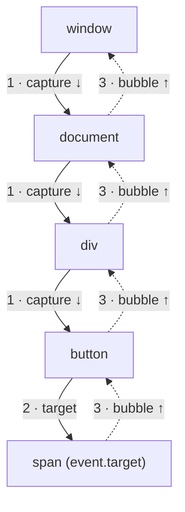

## Why events?

A web page sits still until something happens: the user clicks, types, scrolls, an image finishes loading, a network response arrives. The browser announces each of these moments as an **event**, and your code reacts by registering a function to be called when it happens. That function is called a **listener** (or **handler**).

This chapter covers how to attach listeners, the journey an event takes through the DOM tree (**propagation**), how to stop it or cancel what the browser would do by default, and **event delegation**: the pattern behind almost every efficient list, table and menu.

<Callout type="note">
The demos log into a box under the preview. Some run by themselves (they call `el.click()`), others wait for you to click inside the preview.
</Callout>

## addEventListener

<Api name="EventTarget.addEventListener()" sig="target.addEventListener(type, listener, options?)" returns="`undefined`." mutates="yes (registers the listener on target)">

- `type` (string): the event name, **without** `on`: `"click"`, `"input"`, `"keydown"`. Case-sensitive.
- `listener`: a function that receives the **event object**, or an object with a `handleEvent(event)` method.
- `options` (optional): either a boolean (`true` = `capture`) or an object:
  - `capture` (default `false`): run during the capture phase instead of the bubble phase (explained below).
  - `once` (default `false`): remove the listener automatically after its first call.
  - `passive` (default `false`, except for some touch and wheel events): promise not to call `preventDefault()`, so the browser can scroll without waiting for your code.
  - `signal`: an `AbortSignal`; when it is aborted, the listener is removed.

Adding the **same function** for the same `type` and `capture` twice does nothing the second time.

</Api>

```html live
<button id="btn">Click me</button>
<pre id="log" style="font-size:13px"></pre>
<script>
  const log = (l) => (document.getElementById("log").textContent += l + "\n");
  const btn = document.getElementById("btn");

  function onClick(event) {
    log(event.type + " on " + event.target.id);   // click on btn
  }
  btn.addEventListener("click", onClick);
  btn.addEventListener("click", onClick);          // duplicate: ignored
  btn.addEventListener("click", () => log("once!"), { once: true });

  btn.click();   // fires: "click on btn", "once!"
  btn.click();   // fires: "click on btn" only, the once-listener is gone
</script>
```

### Removing listeners

`removeEventListener(type, listener, options)` removes a listener only if you pass **the same function object** and the same `capture` value. That's why an anonymous function can never be removed this way:

```js
btn.addEventListener("click", () => save());
btn.removeEventListener("click", () => save());   // ✗ a different function: nothing removed

btn.addEventListener("scroll", onScroll, true);
btn.removeEventListener("scroll", onScroll);      // ✗ capture differs (true vs false)
```

The modern way to remove many listeners at once is an **`AbortController`**:

```js
const controller = new AbortController();
window.addEventListener("resize", onResize, { signal: controller.signal });
window.addEventListener("keydown", onKey, { signal: controller.signal });

controller.abort();   // removes both; ideal in a component's cleanup
```

### onclick properties and HTML attributes

There are two older ways to attach a handler: the HTML attribute `<button onclick="save()">` and the property `btn.onclick = save`. Both allow **only one** handler per event (assigning again replaces it) and have no options. Inline attributes also run code from a string, which a Content Security Policy usually blocks. Use `addEventListener` in real code.

| | `addEventListener` | `el.onclick = fn` | `onclick="…"` attribute |
| --- | --- | --- | --- |
| Several handlers | Yes | No (last one wins) | No |
| Options (`capture`, `once`, `passive`, `signal`) | Yes | No | No |
| Remove | `removeEventListener` / `abort()` | `el.onclick = null` | Remove the attribute |
| Works with strict CSP | Yes | Yes | No |

## The event object

Every listener receives an **event object** that describes what happened. The class depends on the event: `MouseEvent` for clicks, `KeyboardEvent` for keys and `InputEvent` for typing. They all inherit from `Event`.

| Property / method | Meaning |
| --- | --- |
| `type` | The event name, e.g. `"click"` |
| `target` | The element where the event **started** (the deepest one clicked) |
| `currentTarget` | The element whose listener is **running right now**; `null` after dispatch ends |
| `eventPhase` | `1` capturing, `2` at target, `3` bubbling (`0` when not being dispatched) |
| `bubbles` / `cancelable` | Whether this event bubbles / whether `preventDefault` has any effect |
| `defaultPrevented` | `true` if someone called `preventDefault()` |
| `isTrusted` | `true` if the browser created it from a real user action, `false` if your code dispatched it |
| `timeStamp` | Milliseconds since the page started loading |
| `composedPath()` | The array of nodes the event travels through |
| `preventDefault()`, `stopPropagation()`, `stopImmediatePropagation()` | Explained below |

Inside a regular `function` listener, `this` equals `event.currentTarget`. Inside an arrow function, `this` is taken from the surrounding scope, so use `event.currentTarget` instead.

## Propagation: capture, target, bubble

When you click a `<span>` inside a `<button>` inside a `<div>`, you also clicked the button and the div. So the browser doesn't deliver the event to the span only: it walks the whole path, in **three phases**.



<Steps>
<Step title="Capture phase">
The event travels **down** from `window` to the parent of the target. Listeners registered with `{ capture: true }` run here, outermost first.
</Step>
<Step title="Target phase">
The event reaches the element where it happened (`event.target`). Listeners on that element run: capture listeners first, then regular ones.
</Step>
<Step title="Bubble phase">
The event travels back **up** to `window`. Regular listeners (the default, `capture: false`) run here, innermost first.
</Step>
</Steps>

```html live
<div id="outer" style="padding:12px;background:#dbeafe">
  outer
  <button id="inner">inner</button>
</div>
<pre id="log" style="font-size:13px"></pre>
<script>
  const log = (l) => (document.getElementById("log").textContent += l + "\n");
  const outer = document.getElementById("outer");
  const inner = document.getElementById("inner");

  outer.addEventListener("click", (e) => log("outer capture, phase " + e.eventPhase), { capture: true });
  outer.addEventListener("click", (e) => log("outer bubble,  phase " + e.eventPhase));
  inner.addEventListener("click", (e) => log("inner,         phase " + e.eventPhase));
  outer.addEventListener("click", function (e) {
    log("target=" + e.target.id + " currentTarget=" + e.currentTarget.id + " this=" + this.id);
  });

  inner.click();
  // outer capture, phase 1
  // inner,         phase 2
  // outer bubble,  phase 3
  // target=inner currentTarget=outer this=outer
</script>
```

### Events that don't bubble

Most events bubble, but some don't, because bubbling would make little sense for them. Each has a bubbling alternative or another workaround:

| Doesn't bubble | Bubbling alternative / workaround |
| --- | --- |
| `focus`, `blur` | `focusin`, `focusout` |
| `mouseenter`, `mouseleave` | `mouseover`, `mouseout` (fire again when moving between children) |
| `pointerenter`, `pointerleave` | `pointerover`, `pointerout` |
| `load`, `error` on images and scripts | Listen with `capture: true` on an ancestor |
| `scroll` on an element | Listen on the element itself, or with `capture: true` on `document` |

<Callout type="tip">
Capture listeners catch even non-bubbling events, because the capture phase always runs from `window` down. `document.addEventListener("error", handler, true)` catches every failed `` on the page.
</Callout>

## stopPropagation and stopImmediatePropagation

- **`event.stopPropagation()`**: the event doesn't continue to the next element on its path. Other listeners on the **current** element still run.
- **`event.stopImmediatePropagation()`**: same, and the remaining listeners on the current element are skipped too.

```html live
<div id="parent"><button id="child">child</button></div>
<pre id="log" style="font-size:13px"></pre>
<script>
  const log = (l) => (document.getElementById("log").textContent += l + "\n");
  const child = document.getElementById("child");
  document.getElementById("parent").addEventListener("click", () => log("parent"));

  child.addEventListener("click", (e) => { log("child 1"); e.stopPropagation(); });
  child.addEventListener("click", () => log("child 2"));   // still runs
  child.click();          // child 1, child 2: parent never hears it

  log("---");
  const other = document.createElement("button");
  document.getElementById("parent").append(other);
  other.addEventListener("click", (e) => { log("other 1"); e.stopImmediatePropagation(); });
  other.addEventListener("click", () => log("other 2"));   // skipped
  other.click();          // other 1 only
</script>
```

<Callout type="mistake">
Using `stopPropagation()` to "fix" a click that also triggers a parent. It breaks every other code that relies on the event reaching the top: analytics, "click outside to close" menus, delegated handlers. Prefer checking `event.target` in the parent, or calling `event.target.closest(...)`, and stop propagation only when you truly own the whole path.
</Callout>

## preventDefault: cancelling the browser's default action

Many events come with a **default action**: a link navigates, a form submits and reloads the page, a checkbox toggles, a key types a character, the wheel scrolls. **`event.preventDefault()`** cancels that action. It does **not** stop propagation; the two are independent.

```html live
<a id="link" href="https://example.com">a link</a>
<form id="form"><input name="q" value="dom"><button>Search</button></form>
<pre id="log" style="font-size:13px"></pre>
<script>
  const log = (l) => (document.getElementById("log").textContent += l + "\n");

  document.getElementById("link").addEventListener("click", (e) => {
    e.preventDefault();                       // no navigation
    log("link: defaultPrevented = " + e.defaultPrevented);
  });

  document.getElementById("form").addEventListener("submit", (e) => {
    e.preventDefault();                       // no page reload
    const data = new FormData(e.currentTarget);
    log("submit: q = " + data.get("q"));      // handle it in JS instead
  });

  document.getElementById("link").click();
  document.getElementById("form").requestSubmit();  // fires submit like a real button press
</script>
```

Rules worth knowing:

- `preventDefault()` only works if `event.cancelable` is `true`. Some events, such as `scroll`, can't be cancelled.
- In a listener registered with `{ passive: true }`, `preventDefault()` is **ignored** and the browser logs a warning.
- `return false` cancels the default only in `on*` property and attribute handlers. In `addEventListener` it does nothing.

### Passive listeners and scrolling

For `touchstart`, `touchmove` and `wheel`, the browser can't start scrolling until it knows whether your listener will call `preventDefault()`. A slow listener makes scrolling stutter. Marking it `{ passive: true }` tells the browser not to wait. Browsers already treat these listeners as passive by default when they are attached to `window`, `document` or `body`; to block scrolling there, you must pass `{ passive: false }` explicitly.

## Event delegation

Imagine a list of 1,000 items, each with a delete button. Attaching 1,000 listeners costs memory, and items added later have no listener at all. **Event delegation** uses bubbling instead: put **one** listener on a common ancestor, and inside it find out which item the event came from.

```html live
<ul id="todos">
  <li data-id="1">Buy milk <button class="del">✕</button></li>
  <li data-id="2">Walk dog <button class="del">✕</button></li>
</ul>
<button id="add">Add item</button>
<pre id="log" style="font-size:13px"></pre>
<script>
  const log = (l) => (document.getElementById("log").textContent += l + "\n");
  const todos = document.getElementById("todos");
  let next = 3;

  // one listener for every current AND future button
  todos.addEventListener("click", (e) => {
    const btn = e.target.closest(".del");         // the click may land on a child of the button
    if (!btn || !todos.contains(btn)) return;     // not a delete button inside this list
    const li = btn.closest("li");
    log("delete #" + li.dataset.id);
    li.remove();
  });

  document.getElementById("add").addEventListener("click", () => {
    todos.insertAdjacentHTML("beforeend", `<li data-id="${next}">Item ${next++} <button class="del">✕</button></li>`);
  });

  document.getElementById("add").click();          // adds item 3
  todos.querySelector('[data-id="3"] .del').click(); // delete #3: works with no new listener
</script>
```

<Steps>
<Step title="Listen on the ancestor">
One `click` listener on the `<ul>`. Every click inside any `<li>` bubbles up to it.
</Step>
<Step title="Find the element you care about">
`e.target` is the deepest element clicked, which may be an icon inside the button. `closest(".del")` walks up to the button itself, or returns `null`.
</Step>
<Step title="Make sure it belongs to you">
`todos.contains(btn)` guards against matching an element **outside** the container (for example, if the list is nested inside another `.del` area).
</Step>
<Step title="Read data from the DOM">
`data-*` attributes (`li.dataset.id`) tell you which record to act on.
</Step>
</Steps>

| | One listener per item | Delegation |
| --- | --- | --- |
| Memory | Grows with the number of items | One listener |
| Items added later | Need new listeners | Work automatically |
| Removed items | Must remember to clean up | Nothing to clean up |
| Non-bubbling events (`focus`, `mouseenter`) | Work | Need the bubbling variant (`focusin`, `mouseover`) |
| `stopPropagation` inside items | No effect | Breaks delegation |

React uses this exact idea: since React 17 it attaches one listener per event type to the **root container** and dispatches to your components itself.

## Dispatching your own events

You can create and fire events from code. **`CustomEvent`** carries your own data in `detail`. This lets independent parts of a page talk without knowing about each other.

<Api name="CustomEvent / dispatchEvent" sig="new CustomEvent(type, { detail, bubbles, cancelable, composed }) · target.dispatchEvent(event)" returns="`dispatchEvent` returns `false` if the event is cancelable and a listener called `preventDefault()`, otherwise `true`." mutates="no">

- `type` (string): your event name. Use a prefix or dashes to avoid clashing with future built-in names: `"cart:add"`, `"item-selected"`.
- `detail` (any, default `null`): your payload, read as `event.detail`.
- `bubbles` (default **`false`**): set to `true` if ancestors (and delegation) should hear it.
- `cancelable` (default `false`): allow listeners to call `preventDefault()`.
- `composed` (default `false`): let the event cross out of a shadow root.

</Api>

```html live
<div id="shop"><button id="buy">Buy</button></div>
<pre id="log" style="font-size:13px"></pre>
<script>
  const log = (l) => (document.getElementById("log").textContent += l + "\n");
  const shop = document.getElementById("shop");

  shop.addEventListener("cart:add", (e) => {
    log("added " + e.detail.sku + ", trusted: " + e.isTrusted);  // trusted: false
    if (e.detail.qty > 5) e.preventDefault();                    // veto it
  });

  const buy = document.getElementById("buy");
  const fire = (qty) => buy.dispatchEvent(
    new CustomEvent("cart:add", { detail: { sku: "pen", qty }, bubbles: true, cancelable: true })
  );

  log("before");
  log("allowed: " + fire(1));   // listener runs here, synchronously → allowed: true
  log("allowed: " + fire(9));   // allowed: false
  log("after");
</script>
```

<Callout type="mistake">
Assuming `dispatchEvent` is asynchronous like a real click. It isn't: every listener runs **inside** the `dispatchEvent` call, before the next line of your code. The same goes for `el.click()`. That's why "before / added / allowed / after" print in that order.
</Callout>

## Listeners and the event loop

When the user really clicks, the browser runs the dispatch as a **task**. After each listener returns, the call stack is empty, so the **microtask queue** is drained (see [the event loop](/javascript/event-loop)) before the next listener runs. When **your code** calls `el.click()`, the listeners run inside your script: the stack is not empty between them, so microtasks wait until your script finishes.

```html live
<button id="btn">Click me (real click)</button>
<pre id="log" style="font-size:13px"></pre>
<script>
  const log = (l) => (document.getElementById("log").textContent += l + "\n");
  const btn = document.getElementById("btn");
  btn.addEventListener("click", () => { Promise.resolve().then(() => log("  microtask 1")); log("  listener 1"); });
  btn.addEventListener("click", () => { Promise.resolve().then(() => log("  microtask 2")); log("  listener 2"); });

  log("btn.click() from code:");
  btn.click();
  // listener 1, listener 2, microtask 1, microtask 2
  // Now click the button yourself: listener 1, microtask 1, listener 2, microtask 2
</script>
```

This is a well-known interview trick question, and it also explains why tests that call `.click()` can behave slightly differently from real users.

## The events you'll use most

| Group | Events | Notes |
| --- | --- | --- |
| Mouse | `click`, `dblclick`, `contextmenu`, `mousedown`, `mouseup`, `mousemove`, `mouseover`/`mouseout`, `mouseenter`/`mouseleave` | `click` = `mousedown` + `mouseup` on the same element. It also fires for keyboard activation (Enter/Space on a button) |
| Pointer | `pointerdown`, `pointermove`, `pointerup`, `pointercancel` | One API for mouse, touch and pen; `event.pointerType` tells which. Prefer it over separate mouse and touch events |
| Keyboard | `keydown`, `keyup` | `event.key` = the character or name (`"a"`, `"A"`, `"Enter"`); `event.code` = the physical key (`"KeyA"`), the same on every layout. `keypress` is deprecated |
| Form | `input`, `change`, `submit`, `reset`, `invalid` | `input` fires on every edit; `change` fires when the value is committed (blur for text, immediately for checkboxes and selects) |
| Focus | `focus`/`blur`, `focusin`/`focusout` | Only the `focusin`/`focusout` pair bubbles |
| Document | `DOMContentLoaded`, `load`, `beforeunload`, `visibilitychange`, `pagehide` | `DOMContentLoaded` = HTML parsed; `load` = images, styles and frames loaded too |
| Window | `resize`, `scroll`, `online`, `offline`, `hashchange`, `popstate` | `resize` and `scroll` can fire many times per frame: throttle them or use observers |

<Callout type="tip">
For high-frequency events (`scroll`, `resize`, `mousemove`, `input` that triggers a search), don't run expensive work on every event. Either **throttle** (at most once every N ms), **debounce** (only after the events stop for N ms), or schedule the work with `requestAnimationFrame`. You'll implement debounce and throttle yourself in [Algorithms, level 3](/algorithms/level-3).
</Callout>

## Common mistakes

- Writing `"onclick"` instead of `"click"` in `addEventListener`.
- Passing the result of a call instead of a function: `addEventListener("click", save())` runs `save` immediately.
- Trying to remove an anonymous or re-created function with `removeEventListener`.
- Confusing `target` (where it started) and `currentTarget` (where the listener is).
- Using `e.target.matches(".btn")` in delegation: it fails when the click lands on an icon inside the button. Use `closest`.
- Calling `preventDefault()` in a passive listener, or using `return false` with `addEventListener`.
- Forgetting `bubbles: true` on a `CustomEvent` and wondering why the parent never hears it.
- Adding listeners in a component without removing them on cleanup (memory leaks, double handlers).

## Interview questions

<QA q="Explain event bubbling and capturing." level="junior" n={1}>
<Answer>

An event travels in three phases. **Capture**: from `window` down to the target's parent; listeners with `capture: true` run. **Target**: listeners on the element itself run. **Bubble**: back up to `window`; regular listeners run, innermost first. That's why a click on a button inside a div triggers the div's click listener too.

</Answer>
<Mistake>

Saying all events bubble. `focus`, `blur`, `mouseenter`, `mouseleave` and element `scroll` don't.

</Mistake>
<FollowUp>

How would you catch every image load error on the page with a single listener?

</FollowUp>
</QA>

<QA q="What is event delegation and why is it useful?" level="junior" n={2}>
<Answer>

Attaching one listener to a common ancestor instead of one per child, then using `event.target.closest(selector)` to find which child the event came from. It uses less memory, works for children added later, and needs no cleanup when children are removed. It relies on bubbling, so non-bubbling events need their bubbling variants.

</Answer>
</QA>

<QA q="What's the difference between event.target and event.currentTarget?" level="junior" n={3}>
<Answer>

`target` is the element where the event originated (the deepest element clicked). `currentTarget` is the element whose listener is currently running. They are equal only during the target phase. After dispatch finishes, `currentTarget` becomes `null`, so reading it later inside a `setTimeout` or after an `await` gives `null`.

</Answer>
</QA>

<QA q="preventDefault vs stopPropagation vs stopImmediatePropagation?" level="mid" n={4}>
<Answer>

`preventDefault` cancels the browser's default action (navigation, form submit, checkbox toggle) but the event keeps propagating. `stopPropagation` stops the event from reaching further elements, but the browser's default action still happens and other listeners on the current element still run. `stopImmediatePropagation` also skips the remaining listeners on the current element.

</Answer>
</QA>

<QA q="In what order do the logs appear when a user clicks the button? And when the code calls btn.click()?" level="senior" n={5}>
<Answer>

```js
btn.addEventListener("click", () => { Promise.resolve().then(() => log("m1")); log("l1"); });
btn.addEventListener("click", () => { Promise.resolve().then(() => log("m2")); log("l2"); });
```

A real click: `l1, m1, l2, m2`. The browser calls each listener from the event loop, so the stack empties after each one and microtasks run in between. `btn.click()` from code: `l1, l2, m1, m2`. Both listeners run synchronously inside the `click()` call, and microtasks only run once the calling script finishes.

</Answer>
<Deep>

The rule is "microtasks run whenever the JavaScript stack becomes empty", not "after each listener". The same applies to `dispatchEvent`.

</Deep>
</QA>

<QA q="How do you make scroll and touch handlers not hurt performance?" level="mid" n={6}>
<Answer>

Mark touch and wheel listeners `{ passive: true }` so the browser doesn't wait for them before scrolling. Throttle work or batch it with `requestAnimationFrame` instead of doing it on every event. Avoid reading layout in the handler and then writing styles. Better still, replace scroll math with `IntersectionObserver` (visibility) or CSS (`position: sticky`, scroll-driven animations).

</Answer>
</QA>

## Recap

<Recap>

- `addEventListener(type, fn, { capture, once, passive, signal })`: the type has no `on`, and duplicates of the same function are ignored.
- Removing needs the same function **and** the same `capture`; `AbortController` removes many listeners at once.
- Events go capture (down), target, then bubble (up); regular listeners run while bubbling.
- `target` is where it started; `currentTarget` (and `this` in a normal function) is where the listener is.
- `stopPropagation` stops the journey; `stopImmediatePropagation` also skips the remaining listeners here; `preventDefault` cancels the default action. The three are independent.
- `focus`, `blur`, `mouseenter`, `mouseleave` and element `scroll` don't bubble; use `focusin`/`focusout`, `mouseover`/`mouseout`, or a capture listener.
- Delegation = one listener on the ancestor + `event.target.closest(selector)`; it covers future children too.
- `CustomEvent` carries data in `detail`, doesn't bubble unless `bubbles: true`, and `dispatchEvent` runs listeners synchronously.
- A real click runs microtasks between listeners; `el.click()` from code runs them after all listeners.
- Use passive listeners, throttling and `requestAnimationFrame` for high-frequency events.

</Recap>
