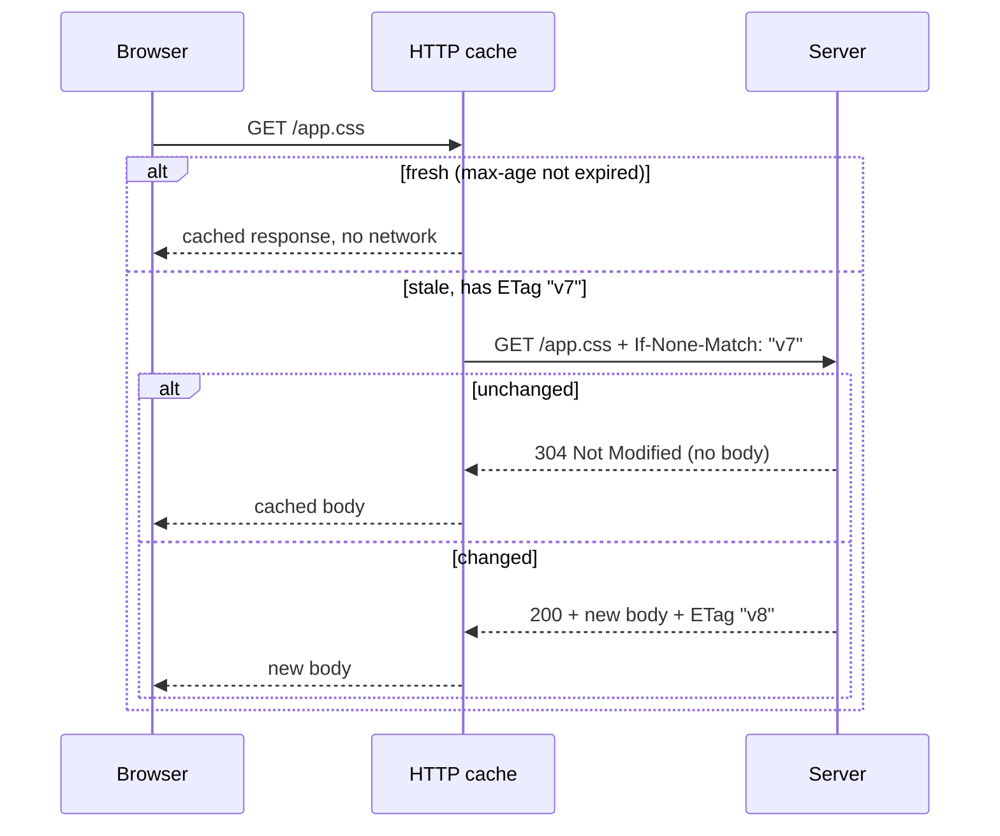
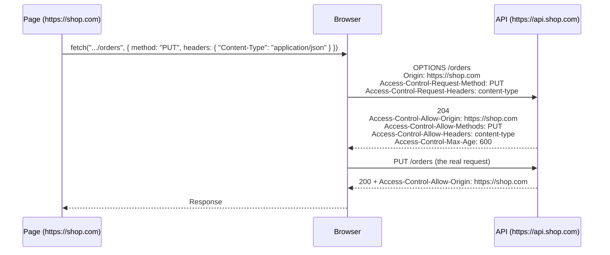

## Why this matters

Almost every frontend talks to a server: loading a page, fetching JSON from an API, uploading a file. All of it is **HTTP**. Most bugs at this boundary come from three misunderstandings: what HTTP status codes and headers mean, what `fetch` does (and doesn't) treat as an error, and why the browser blocks some cross-origin requests (**CORS**). This chapter builds all three from the ground up.

## HTTP in one picture

**HTTP** (HyperText Transfer Protocol) is a request–response protocol: the client sends a **request**, the server sends back exactly one **response**. Both are text-like messages with the same shape: a first line, **headers** (name–value pairs of metadata), an empty line, and an optional **body**.

```http
POST /api/orders HTTP/1.1
Host: shop.com
Content-Type: application/json
Authorization: Bearer eyJhbGci...
Accept: application/json

{"sku":"pen","qty":2}
```

```http
HTTP/1.1 201 Created
Content-Type: application/json
Location: /api/orders/981
Cache-Control: no-store

{"id":981,"sku":"pen","qty":2}
```

The first line of a request holds the **method**, the **path** and the version. The first line of a response holds the version and the **status code** with its text.

### Methods

| Method | Meaning | Safe | Idempotent | Has a body |
| --- | --- | --- | --- | --- |
| `GET` | Read a resource | Yes | Yes | No |
| `HEAD` | Like `GET`, but headers only | Yes | Yes | No |
| `POST` | Create something, or run an action | No | **No** | Yes |
| `PUT` | Replace a resource completely | No | Yes | Yes |
| `PATCH` | Change part of a resource | No | Not guaranteed | Yes |
| `DELETE` | Delete a resource | No | Yes | Usually no |
| `OPTIONS` | Ask what is allowed (used by CORS preflight) | Yes | Yes | No |

- **Safe** means the request doesn't change anything on the server, so browsers and crawlers may send it freely (prefetching, for example).
- **Idempotent** means sending it twice has the same effect as sending it once. Deleting order 981 twice still leaves it deleted; posting an order twice creates **two** orders. That's why a retry after a network error is safe for `PUT` but dangerous for `POST`.

### Status codes

The first digit gives the category:

| Range | Category | Codes you'll meet |
| --- | --- | --- |
| `1xx` | Informational | `101 Switching Protocols` (WebSocket upgrade), `103 Early Hints` |
| `2xx` | Success | `200 OK`, `201 Created`, `204 No Content` (success with no body) |
| `3xx` | Redirection | `301` / `308` moved permanently, `302` / `307` temporary, `304 Not Modified` (use your cached copy) |
| `4xx` | **Client** error: fix the request | `400 Bad Request`, `401 Unauthorized` (not logged in), `403 Forbidden` (logged in, not allowed), `404 Not Found`, `409 Conflict`, `422 Unprocessable Content` (validation failed), `429 Too Many Requests` |
| `5xx` | **Server** error: maybe retry later | `500 Internal Server Error`, `502 Bad Gateway`, `503 Service Unavailable`, `504 Gateway Timeout` |

`307` and `308` keep the method and body when redirecting; `301` and `302` let the browser change a `POST` into a `GET`.

### Headers you'll use most

| Header | Direction | Purpose |
| --- | --- | --- |
| `Content-Type` | both | Format of the body: `application/json`, `text/html; charset=utf-8`, `multipart/form-data; boundary=…` |
| `Accept` | request | Formats the client can handle |
| `Authorization` | request | Credentials, e.g. `Bearer <token>` |
| `Cookie` / `Set-Cookie` | request / response | See [Browser storage](/browser/storage#cookies) |
| `Cache-Control`, `ETag`, `Last-Modified` | response | Caching (below) |
| `If-None-Match`, `If-Modified-Since` | request | Revalidating a cached copy |
| `Content-Encoding` | response | Compression: `br`, `gzip`, `zstd` |
| `Location` | response | Where a redirect or a newly created resource is |
| `Origin` | request | The origin that started the request (CORS, CSRF checks) |

### HTTP/1.1, HTTP/2 and HTTP/3

| | HTTP/1.1 | HTTP/2 | HTTP/3 |
| --- | --- | --- | --- |
| Transport | TCP | TCP | **QUIC** over UDP |
| Requests per connection | One at a time | Many at once (**multiplexing**) | Many at once |
| Headers | Plain text, repeated every time | Compressed (HPACK) | Compressed (QPACK) |
| Head-of-line blocking | Per connection: a slow response blocks the next | A lost TCP packet stalls every stream | Only the affected stream waits |
| Setup | TCP + TLS handshakes | TCP + TLS | Combined handshake, faster on mobile networks |

With HTTP/1.1, browsers opened about six connections per host, and developers combined files and split domains to work around it. With HTTP/2 and 3, many small requests over one connection are fine.

## fetch

**`fetch`** is the browser's built-in function for making HTTP requests. It returns a **Promise** of a **`Response`**.

<Api name="fetch()" sig="fetch(resource, options?)" returns="A Promise that resolves to a `Response` as soon as the **headers** arrive (the body may still be downloading). It **rejects only** on network failure, CORS failure or abort, **not** on HTTP error statuses like 404 or 500." mutates="no">

- `resource`: a URL string, a `URL` object, or a `Request` object. Relative URLs are resolved against the page.
- `options` (optional object):
  - `method`: `"GET"` (default), `"POST"`, `"PUT"`, `"PATCH"`, `"DELETE"`.
  - `headers`: a plain object, a `Headers` object or an array of pairs.
  - `body`: a string, `FormData`, `URLSearchParams`, `Blob`, `ArrayBuffer` or a stream. Not allowed with `GET` or `HEAD`.
  - `credentials`: `"same-origin"` (default: send cookies only to your own origin), `"include"` (also cross-origin), `"omit"` (never).
  - `mode`: `"cors"` (default for cross-origin), `"same-origin"` (fail on cross-origin), `"no-cors"` (an opaque response you can't read).
  - `cache`: how to use the HTTP cache: `"default"`, `"no-store"`, `"reload"`, `"no-cache"`, `"force-cache"`, `"only-if-cached"`.
  - `redirect`: `"follow"` (default), `"error"`, `"manual"`.
  - `signal`: an `AbortSignal` to cancel the request.
  - `keepalive`: `true` lets the request outlive the page (analytics on page close); small bodies only.
  - `priority`: `"high"`, `"low"` or `"auto"`, a hint to the browser.

</Api>

```js run
// a data: URL contains its own response, so this runs anywhere without a server
const res = await fetch('data:application/json,{"name":"Ada","langs":["js","ts"]}');

console.log(res.ok, res.status);               // true 200
console.log(res.headers.get("content-type"));  // application/json
const data = await res.json();                 // reading the body is a second await
console.log(data.langs);                       // ['js', 'ts']
```

### Two awaits: headers, then body

`fetch` resolves when the **headers** arrive. The body is a stream you read separately, with one of these methods, each returning a Promise:

| Method | Gives you | Use for |
| --- | --- | --- |
| `res.json()` | Parsed JSON (rejects with `SyntaxError` if the body isn't valid JSON) | APIs |
| `res.text()` | A string | HTML, plain text, debugging |
| `res.blob()` | A `Blob` | Images and files (`URL.createObjectURL(blob)`) |
| `res.arrayBuffer()` | Raw bytes | Binary formats |
| `res.formData()` | `FormData` | Multipart responses (rare) |
| `res.body` | A `ReadableStream` | Progress, streaming large responses |

The body can be read **only once**. After that, `res.bodyUsed` is `true` and another read rejects. Call `res.clone()` before reading if you need it twice.

### fetch does not throw on 404 or 500

This is the most common `fetch` bug. A `404` or `500` is still a **successful HTTP exchange**: the server answered. `fetch` resolves, and you must check `res.ok` (`true` for statuses 200–299) yourself.

```js run
// new Response() builds a response by hand: handy to show what fetch would give you
const res = new Response('{"error":"not found"}', {
  status: 404,
  statusText: "Not Found",
  headers: { "Content-Type": "application/json" },
});

console.log(res.ok, res.status, res.statusText);  // false 404 Not Found: no exception!
console.log(await res.json());                     // { error: 'not found' }: error bodies are readable

try {
  await res.text();                                // a second read of the same body
} catch (err) {
  console.log(err.name, res.bodyUsed);             // TypeError true
}
```

A small wrapper turns HTTP errors into exceptions, so callers can use one `try/catch`:

```js
class HttpError extends Error {
  constructor(response, body) {
    super(`HTTP ${response.status} ${response.statusText}`);
    this.name = "HttpError";
    this.status = response.status;
    this.body = body;                 // the server's error details, if any
  }
}

async function api(path, { body, ...options } = {}) {
  const res = await fetch(path, {
    ...options,
    headers: {
      Accept: "application/json",
      ...(body !== undefined && { "Content-Type": "application/json" }),
      ...options.headers,
    },
    body: body === undefined ? undefined : JSON.stringify(body),
  });

  const isJson = res.headers.get("content-type")?.includes("application/json");
  const data = res.status === 204 ? null : isJson ? await res.json() : await res.text();

  if (!res.ok) throw new HttpError(res, data);
  return data;
}

// usage
const order = await api("/api/orders", { method: "POST", body: { sku: "pen", qty: 2 } });
```

### Sending data

| You send | Body | `Content-Type` |
| --- | --- | --- |
| JSON | `JSON.stringify(obj)` | Set it yourself: `application/json` |
| A form, including files | `new FormData(formElement)` | **Don't set it**: the browser adds `multipart/form-data` with the boundary |
| Simple key–value pairs | `new URLSearchParams({ a: 1 })` | Added automatically: `application/x-www-form-urlencoded` |
| A file as raw bytes | The `File` / `Blob` | The blob's type, or set it |

<Callout type="mistake">
Setting `"Content-Type": "multipart/form-data"` by hand when sending `FormData`. The header must include a **boundary** string that separates the parts, which only the browser knows. Without it the server can't parse the body. Leave the header out.
</Callout>

Query strings belong in the URL. Build them with `URLSearchParams` so special characters are encoded correctly:

```js run
const params = new URLSearchParams({ q: "a b&c", page: 2 });
const url = new URL("https://api.example.com/search");
url.search = params;
console.log(url.href);   // https://api.example.com/search?q=a+b%26c&page=2
```

### Cancelling and timeouts

`fetch` has no `timeout` option. Use an **`AbortSignal`**:

- `new AbortController()`: call `controller.abort()` whenever you want; the fetch rejects with an `AbortError`.
- `AbortSignal.timeout(ms)`: a signal that aborts itself after `ms` milliseconds; the fetch rejects with a `TimeoutError`.
- `AbortSignal.any([a, b])`: aborts when any of the given signals aborts (a user cancel **or** a timeout).

```js run
const controller = new AbortController();
controller.abort();                          // cancel before it even starts
try {
  await fetch("data:text/plain,hi", { signal: controller.signal });
} catch (err) {
  console.log(err.name);                     // AbortError
}

const signal = AbortSignal.timeout(10);      // aborts itself after 10 ms
await new Promise((r) => setTimeout(r, 30));
console.log(signal.aborted, signal.reason.name);   // true TimeoutError
```

Aborting is also how you prevent **race conditions** in search boxes: if the user types "re" and then "react", the response for "re" may arrive **after** the one for "react" and overwrite it. Abort the previous request whenever a new one starts:

```js
let current;
async function search(query) {
  current?.abort();                          // cancel the previous request, if any
  current = new AbortController();
  try {
    const res = await fetch(`/api/search?q=${encodeURIComponent(query)}`, { signal: current.signal });
    render(await res.json());
  } catch (err) {
    if (err.name !== "AbortError") throw err;  // an abort is expected, not a failure
  }
}
```

### When fetch does reject

`fetch` rejects with a `TypeError` when no HTTP response could be obtained: no network, DNS failure, connection refused, a blocked mixed-content request, or a **CORS** failure. The message differs by browser (`"Failed to fetch"` in Chrome, `"NetworkError when attempting to fetch resource."` in Firefox, `"Load failed"` in Safari), and for security reasons it never says **why**. The reason is only in the DevTools console.

## HTTP caching

The browser keeps an **HTTP cache** of responses and reuses them according to headers the server sends. Good caching is the cheapest performance win there is: the fastest request is the one never made.

| `Cache-Control` directive | Meaning |
| --- | --- |
| `max-age=3600` | Fresh for 3600 seconds: reuse without asking the server |
| `no-cache` | Store it, but **revalidate** with the server before every use |
| `no-store` | Never store it (sensitive data) |
| `private` / `public` | Only the browser may cache it / shared caches (CDNs) may too |
| `immutable` | It will never change: don't even revalidate on reload |
| `s-maxage=600` | `max-age` for shared caches (CDN) only |
| `stale-while-revalidate=60` | After expiry, serve the stale copy for up to 60 s while fetching a fresh one in the background |

When a cached copy is **stale**, the browser **revalidates** it with a conditional request. If the server has an `ETag` (a version fingerprint) or `Last-Modified` date, the browser sends it back as `If-None-Match` / `If-Modified-Since`. If nothing changed, the server replies **`304 Not Modified`** with no body, and the cached body is reused.



The standard strategy for a built frontend:

- **Files with a content hash in the name** (`app.3f9a1c.js`): `Cache-Control: public, max-age=31536000, immutable`. A new version gets a new name, so the old one can be cached for a year.
- **HTML** (`index.html`): `Cache-Control: no-cache`, so the user always gets the latest list of hashed files.
- **API responses with personal data**: `private, no-cache` or `no-store`.

## CORS: cross-origin requests

### The same-origin policy

By default, JavaScript on `https://shop.com` may **send** requests to other origins but may **not read** their responses. This is the **same-origin policy**. Without it, any website you visit could call `fetch("https://yourbank.com/api/balance")`, and since your browser attaches your bank cookies, it could read your account data.

An **origin** is scheme + host + port (see [Browser storage](/browser/storage#origins-who-can-read-what)). `https://shop.com` and `https://api.shop.com` are **different** origins.

### What CORS is

**CORS** (Cross-Origin Resource Sharing) is how a **server** says "I allow these other origins to read my responses". It's a set of response headers. The browser enforces it: it makes the request, looks at the headers, and either hands the response to your JavaScript or blocks it.

```http
GET /api/products HTTP/1.1
Host: api.shop.com
Origin: https://shop.com
```

```http
HTTP/1.1 200 OK
Access-Control-Allow-Origin: https://shop.com
Content-Type: application/json
```

Because `Access-Control-Allow-Origin` matches the page's origin, the browser lets the code read the response.

### Simple requests and preflight

Some requests are considered **simple**, because an HTML form could already send them before CORS existed. The browser sends them directly. A request is simple when **all** of these hold:

- the method is `GET`, `HEAD` or `POST`;
- it only sets safelisted headers (`Accept`, `Accept-Language`, `Content-Language`, `Content-Type`, `Range`);
- `Content-Type`, if set, is `text/plain`, `application/x-www-form-urlencoded` or `multipart/form-data`.

Anything else, such as `PUT`/`DELETE`, an `Authorization` header, or a JSON `Content-Type`, first triggers a **preflight**: an automatic `OPTIONS` request asking for permission.



| Response header | Meaning |
| --- | --- |
| `Access-Control-Allow-Origin` | The allowed origin, or `*` for any origin (not allowed with credentials) |
| `Access-Control-Allow-Methods` | Methods allowed (preflight) |
| `Access-Control-Allow-Headers` | Request headers allowed (preflight) |
| `Access-Control-Allow-Credentials: true` | Allow requests with cookies or HTTP auth |
| `Access-Control-Max-Age` | How many seconds the browser may cache the preflight result |
| `Access-Control-Expose-Headers` | Response headers JavaScript may read beyond the basic safelisted ones |

### Cookies across origins

Cross-origin `fetch` sends no cookies by default. To send them, **both** sides must opt in:

- the client: `fetch(url, { credentials: "include" })`;
- the server: `Access-Control-Allow-Credentials: true` **and** an exact `Access-Control-Allow-Origin` (`*` is rejected);
- the cookie itself must be allowed cross-site: `SameSite=None; Secure`.

<Callout type="mistake">
"CORS protects my API." It doesn't. CORS only decides whether **JavaScript in a browser** may read a response. A simple request still **reaches** the server and runs, even if the browser later hides the response. `curl`, Postman and servers ignore CORS entirely. Protect the API with authentication, authorization and CSRF defenses (see [Browser security](/browser/security)).
</Callout>

<Callout type="tip">
In development, the easiest fix for CORS is to avoid it: let the dev server **proxy** API calls so the browser sees one origin. In Vite: `server: { proxy: { "/api": "http://localhost:8080" } }`. In production, put the API on the same origin, or configure the CORS headers on the server. A CORS error is never fixed in frontend code alone, and `mode: "no-cors"` doesn't fix it either: it just gives you an empty **opaque** response you can't read.
</Callout>

## fetch, XMLHttpRequest and axios

| | `fetch` | `XMLHttpRequest` | axios |
| --- | --- | --- | --- |
| Style | Promises | Events and callbacks | Promises (wraps XHR or `fetch`) |
| Rejects on HTTP 4xx/5xx | No, check `res.ok` | No | **Yes** |
| JSON | `await res.json()` | `JSON.parse(xhr.responseText)` | Automatic |
| Cancel | `AbortController` | `xhr.abort()` | `AbortController` |
| Timeout | `AbortSignal.timeout()` | `xhr.timeout` | `timeout` option |
| Upload progress | Not available | `xhr.upload.onprogress` | `onUploadProgress` |
| Download progress | Read `res.body` stream | `onprogress` | `onDownloadProgress` |
| Streaming | Yes | No | Limited |
| Interceptors | Write a wrapper | No | Built in |

## Common mistakes

- Treating a resolved `fetch` as success without checking `res.ok`.
- Forgetting the second `await`: `const data = fetch(url).json()` (calling `.json()` on a Promise).
- Reading the body twice; use `res.clone()` if you need to.
- Setting `Content-Type` manually for `FormData`.
- Concatenating user input into URLs without `encodeURIComponent` or `URLSearchParams`.
- Retrying a failed `POST` automatically and creating duplicates (use idempotency keys).
- Ignoring race conditions when requests can overlap.
- Trying to fix a CORS error with `mode: "no-cors"` or front-end headers instead of the server configuration or a proxy.
- Caching `index.html` for a long time, so users never see new deployments.

## Interview questions

<QA q="Does fetch reject on a 404 or 500 response? How do you handle HTTP errors?" level="junior" n={1}>
<Answer>

No. `fetch` rejects only when no response is received (network failure, CORS failure, abort). A 404 or 500 resolves normally with `res.ok === false`. Check `res.ok` or `res.status`, read the error body if useful, and throw your own error, usually in a shared wrapper.

</Answer>
</QA>

<QA q="What is CORS and what triggers a preflight request?" level="mid" n={2}>
<Answer>

The same-origin policy stops JavaScript from reading responses from other origins. CORS lets a server allow specific origins through response headers such as `Access-Control-Allow-Origin`; the browser enforces it. A preflight `OPTIONS` request is sent first when the request isn't "simple": a method other than GET/HEAD/POST, non-safelisted headers like `Authorization`, or a `Content-Type` other than `text/plain`, form-urlencoded or multipart. The server must answer the preflight with the allowed methods and headers before the browser sends the real request.

</Answer>
<Mistake>

Thinking CORS is a server-side security barrier. The server still receives simple requests; CORS only controls whether browser JavaScript can read the response.

</Mistake>
<FollowUp>

What changes when the request needs to include cookies?

</FollowUp>
</QA>

<QA q="What's the difference between PUT, PATCH and POST? What does idempotent mean?" level="junior" n={3}>
<Answer>

`POST` creates something or runs an action; `PUT` replaces a resource completely at a known URL; `PATCH` changes part of it. Idempotent means repeating the request has the same effect as sending it once: `PUT` and `DELETE` are idempotent, `POST` is not (two POSTs can create two orders). That's why automatic retries are safe only for idempotent requests, unless you use an idempotency key.

</Answer>
</QA>

<QA q="How would you set Cache-Control for a single-page app's files?" level="mid" n={4}>
<Answer>

Hashed static assets (`app.3f9a1c.js`, CSS, fonts, images) get `public, max-age=31536000, immutable`, because any change produces a new file name. `index.html` gets `no-cache`, so the browser revalidates it every time (cheap with an `ETag` and `304`) and always learns about new hashed files. Personal API responses get `private, no-cache` or `no-store`.

</Answer>
</QA>

<QA q="How do you implement a timeout and avoid race conditions with fetch?" level="mid" n={5}>
<Answer>

Pass a `signal`: `AbortSignal.timeout(ms)` for a timeout (rejects with `TimeoutError`), an `AbortController` for manual cancel (`AbortError`), and `AbortSignal.any()` to combine them. For race conditions, such as type-ahead search, abort the previous request when a new one starts, or ignore responses that don't belong to the latest request (compare a request id).

</Answer>
</QA>

<QA q="What changed from HTTP/1.1 to HTTP/2 and HTTP/3?" level="senior" n={6}>
<Answer>

HTTP/2 multiplexes many requests over one TCP connection and compresses headers, removing the need for domain sharding and file concatenation hacks. But a lost TCP packet still stalls all streams. HTTP/3 runs over QUIC on UDP: streams are independent, so a loss only delays its own stream, and the transport and TLS handshakes are combined, making connection setup faster, especially on mobile networks. QUIC connections can also survive a network change (Wi‑Fi to cellular).

</Answer>
</QA>

## Recap

<Recap>

- An HTTP message = first line + headers + empty line + optional body; responses carry a status code.
- GET, HEAD, PUT and DELETE are idempotent; POST is not, so don't retry it blindly.
- 4xx means fix the request, 5xx means the server failed; 401 = not logged in, 403 = not allowed.
- `fetch` resolves when headers arrive; read the body with a second `await` (`json()`, `text()`, `blob()`), only once.
- `fetch` doesn't reject on 404/500: always check `res.ok`.
- Don't set `Content-Type` for `FormData`; use `URLSearchParams` for query strings.
- Use `AbortController` / `AbortSignal.timeout()` for cancel and timeouts, and abort stale requests to avoid races.
- `Cache-Control` + `ETag` control the HTTP cache: hashed assets immutable for a year, HTML `no-cache`.
- The same-origin policy blocks reading cross-origin responses; CORS headers from the server allow it, and non-simple requests are preflighted with `OPTIONS`.
- CORS is enforced by browsers, not servers: it doesn't replace authentication or CSRF protection.

</Recap>
