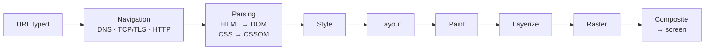
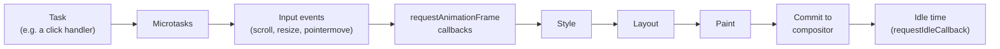

## Why learn how the browser renders?

"What happens when you type a URL and press Enter?" is one of the most common frontend interview questions, because a good answer touches everything: networking, parsing, CSS, JavaScript and graphics. Knowing the pipeline also explains everyday problems: why a long loop freezes the page, why a `transform` animation stays smooth while a `left` animation stutters, and why some changes are cheap and others are not.

Three other chapters zoom into parts of this story; this one connects them end to end:

- [HTML performance](/html/performance#the-critical-rendering-path): which resources block parsing and rendering.
- [CSS rendering performance](/css/rendering-performance): which CSS properties trigger which stages, layout thrashing, `will-change`.
- [The event loop](/javascript/event-loop): tasks, microtasks and where `requestAnimationFrame` runs.

## The big picture: from URL to pixels



Each box is a stage with its own input and output. The first two happen once per page load (parsing continues as bytes arrive). The rendering stages, from Style to Composite, run again whenever something on the page changes, up to once per frame.

## Who does the work: processes and threads

A modern browser is not one program but a group of cooperating **processes** (independent programs with their own memory). Chromium's architecture is the most documented; Firefox and Safari follow the same idea with different names.

| Process | Responsibility |
| --- | --- |
| **Browser process** | The window, tabs, address bar, bookmarks, permissions; coordinates everything else |
| **Network service** | DNS, connections, HTTP, caching |
| **Renderer process** | Everything inside a page: parsing, JavaScript, style, layout, paint. One per site (**site isolation**), so a crash or a compromised page can't read another site's memory |
| **GPU process** | Talks to the graphics card and draws the final image for all tabs |

Inside a renderer process there are several **threads** (independent lines of execution that share the same memory):

- **Main thread**: runs your JavaScript **and** the style, layout and paint steps. There is only one per page, which is why a slow script blocks everything else.
- **Compositor thread**: receives the painted layers, handles scrolling and certain animations, and sends frames to the GPU. It does **not** run JavaScript.
- **Raster worker threads**: turn paint instructions into actual pixels, in tiles.

<Callout type="note">
The key consequence: anything the compositor thread can do alone (scrolling, `transform` and `opacity` animations) keeps working **while the main thread is busy**. Everything else waits.
</Callout>

## Step 1: navigation

<Steps>
<Step title="Is it a URL or a search?">
The browser process parses what you typed. `example.com` becomes `https://example.com/`; `how to center a div` goes to the search engine. If the site is on the **HSTS** list, `http` is upgraded to `https` before any request.
</Step>
<Step title="Check the caches">
If a **service worker** controls this URL, it can answer the request itself. Otherwise the **HTTP cache** is checked; a fresh cached response skips the network entirely. Details are in [HTTP, fetch and CORS](/browser/http-fetch).
</Step>
<Step title="Find the server: DNS">
The host name is resolved to an IP address: browser cache, operating-system cache, then a DNS resolver. This takes from zero to over a hundred milliseconds.
</Step>
<Step title="Connect: TCP and TLS, or QUIC">
For HTTP/1.1 and HTTP/2, a TCP connection is opened (one round trip) and a TLS handshake encrypts it (one more round trip in TLS 1.3). HTTP/3 uses **QUIC** over UDP, which combines both in a single round trip. `<link rel="preconnect">` does this step early.
</Step>
<Step title="Request and response">
The browser sends the HTTP request with headers and cookies. The server replies with a status, headers and the body. A `301`/`302`/`307`/`308` redirect starts the navigation again at the new URL.
</Step>
<Step title="Commit">
The response's `Content-Type` decides what to do. For `text/html`, the browser picks (or creates) a renderer process for that site, streams the bytes to it, and the address bar updates. From here on the renderer takes over.
</Step>
</Steps>

## Step 2: parsing

The renderer receives **bytes**. It decodes them into characters using the charset (`<meta charset="utf-8">` or the `Content-Type` header), tokenizes them into tags, and builds the **DOM** tree. The details of the parser, and why classic scripts pause it, are in [HTML fundamentals](/html/fundamentals#inside-the-parser-tokenizer-tree-builder-and-the-stack-of-open-elements).

Three things happen in parallel while the HTML streams in:

- The **preload scanner** looks ahead in the raw HTML and starts downloading images, scripts and stylesheets before the parser reaches them.
- Each stylesheet is parsed into the **CSSOM** (CSS Object Model): the rules with their selectors, ready for matching.
- Scripts run when they arrive: classic scripts block the parser, `defer` and `module` scripts run after parsing, and `async` scripts run as soon as they download.

Parsing is **incremental**: the browser can render the first part of a long page before the rest has even arrived, unless something blocks rendering, like CSS in the `<head>`.

## Step 3: style

The DOM says **what** is on the page; the CSSOM says **which rules** exist. The **style** step combines them: for every element it finds the matching rules, runs the [cascade](/css/fundamentals#the-cascade-the-algorithm-that-picks-the-winner) and inheritance, and produces the element's **computed style**: one final value per CSS property.

This is the value `getComputedStyle(el)` returns. It costs more when many elements are affected (for example, a class change on `<body>` can restyle the whole page) and when selectors are complex.

## Step 4: layout

Knowing that a box is `width: 50%` isn't enough to draw it; the browser must calculate the actual position and size in pixels. **Layout** (also called **reflow**) builds the **layout tree** and computes the geometry of every box in it.

The layout tree is **not** the same as the DOM:

| In the DOM | In the layout tree? | Why |
| --- | --- | --- |
| `<head>`, `<script>`, `<meta>` | No | Not displayed (`display: none` by default) |
| An element with `display: none` | No, nor its descendants | It generates no box |
| An element with `visibility: hidden` | **Yes** | It's invisible but still takes up space |
| `::before` / `::after` with `content` | **Yes** | Not DOM nodes, but they generate boxes |
| Text that wraps over three lines | Yes, as three line boxes | Layout splits it into lines |

```html live
<p id="none" style="display:none">display: none</p>
<p id="hidden" style="visibility:hidden">visibility: hidden</p>
<p id="normal">normal</p>
<pre id="log" style="font-size:13px"></pre>
<script>
  const log = (l) => (document.getElementById("log").textContent += l + "\n");
  for (const id of ["none", "hidden", "normal"]) {
    const el = document.getElementById(id);
    // getClientRects() lists the element's boxes: empty = not in the layout tree
    log(id.padEnd(7) + " boxes: " + el.getClientRects().length + ", height: " + el.offsetHeight);
  }
  // none    boxes: 0, height: 0
  // hidden  boxes: 1, height: (same as normal)
  // normal  boxes: 1, height: …
</script>
```

Layout is usually the most expensive rendering step, because the geometry of one box can depend on its parent, its children and its siblings. Changing one element's width can move everything after it.

## Step 5: paint

**Paint** doesn't produce pixels yet. It walks the layout tree and records a list of **drawing instructions**, called a **display list**: "fill this rectangle with white", "draw this text at (20, 40)", "draw this image here". The order matters: it follows [stacking contexts and `z-index`](/css/positioning) so that things on top are drawn later.

Recording instructions is much cheaper than producing pixels, and it lets the same instructions be rasterized again at another zoom level without repainting.

## Step 6: layerize, raster and composite

### Layers

The browser splits the page into **layers**, a bit like transparent sheets in a design tool. An element gets its own layer (is **promoted**) when it is likely to move or change independently, for example:

- it has `will-change: transform` or `will-change: opacity`;
- a `transform` or `opacity` animation is running on it;
- it is a `<video>`, a `<canvas>` with WebGL, or an `<iframe>`;
- it is `position: fixed` or a scrolling container (so it can scroll without repainting);
- it overlaps another layer and must be drawn above it (an implicit promotion).

Layers cost memory (every one is a GPU texture), so promoting everything is a mistake. See [`will-change`](/css/rendering-performance#will-change).

### Raster

**Raster** turns each layer's display list into actual pixels. Layers are split into **tiles** (squares of a few hundred pixels), rasterized by worker threads, usually on the GPU. Tiles near the viewport go first, which is why a very fast scroll can briefly show empty (checkerboard) areas.

### Commit and composite

When the main thread finishes paint, it **commits** the result (layers, display lists, and their properties such as transforms) to the **compositor thread**. The compositor decides where each layer goes in this frame, applying scroll offsets, `transform` and `opacity`, and sends a **compositor frame** to the GPU process, which draws it to the screen.

Here is why `transform` and `opacity` animations are cheap: changing them only changes a layer's **properties**, so the compositor can produce new frames without asking the main thread to run style, layout or paint again.

### Which stages a change triggers

| You change | Style | Layout | Paint | Composite |
| --- | --- | --- | --- | --- |
| `width`, `top`, `font-size`, add/remove an element | ✓ | ✓ | ✓ | ✓ |
| `color`, `background`, `box-shadow`, `visibility` | ✓ | | ✓ | ✓ |
| `transform`, `opacity` (on a promoted layer) | ✓ | | | ✓ |
| Scrolling a composited scroller | | | | ✓ |

## The life of a frame

Screens refresh at a fixed rate, typically 60 Hz (a frame every 16.7 ms), or 120 Hz on many phones and laptops (8.3 ms). The browser tries to produce a new frame before each refresh, but only if something changed. One frame's work on the main thread looks like this:



<Steps>
<Step title="Run tasks">
The event loop runs tasks (event handlers, timers, network callbacks), each followed by all pending microtasks. See [the event loop](/javascript/event-loop).
</Step>
<Step title="Handle frame-aligned input">
Continuous events such as `scroll`, `resize` and `pointermove` are delivered once per frame, not once per hardware event.
</Step>
<Step title="Run requestAnimationFrame callbacks">
This is the last chance to change the DOM before this frame is drawn, which makes it the right place for visual updates.
</Step>
<Step title="Render">
Style, layout and paint, only for what changed, then commit to the compositor.
</Step>
<Step title="Idle">
If time is left before the next frame, `requestIdleCallback` callbacks can run low-priority work.
</Step>
</Steps>

If the tasks in one frame take longer than the frame budget, the browser can't render in time and the frame is **dropped**. Users see this as stutter (**jank**).

## Main thread vs compositor, in action

Press the button: it blocks the main thread for 2 seconds with a busy loop. The box animated with `transform` keeps moving because the compositor animates it. The box animated with `left` freezes, because every frame of a `left` animation needs layout on the main thread.

```html live
<style>
  .lane { position: relative; height: 34px; margin: 6px 0; background: #eef2f7; border-radius: 6px; }
  .box  { position: absolute; top: 4px; width: 26px; height: 26px; border-radius: 5px; }
  .t { background: teal; animation: move-t 1.2s ease-in-out infinite alternate; }
  .l { background: crimson; animation: move-l 1.2s ease-in-out infinite alternate; }
  @keyframes move-t { to { transform: translateX(240px); } }
  @keyframes move-l { from { left: 0; } to { left: 240px; } }
</style>
<div class="lane"><div class="box t"></div></div>
<div class="lane"><div class="box l"></div></div>
<button id="block">Block the main thread for 2s</button>
<pre id="log" style="font-size:13px">teal = transform (compositor), red = left (main thread)
</pre>
<script>
  document.getElementById("block").addEventListener("click", () => {
    const end = performance.now() + 2000;
    while (performance.now() < end) {}          // busy loop: nothing else can run on this thread
    document.getElementById("log").textContent += "main thread free again\n";
  });
</script>
```

## Long tasks and responsiveness

A **long task** is any task that keeps the main thread busy for more than **50 ms**. During it, the page can't respond to clicks or typing, can't run `requestAnimationFrame`, and can't render. Users notice delays above about 100 ms.

Browsers measure this as **INP** (Interaction to Next Paint): the time from a user interaction to the next frame that shows its result. It's one of the Core Web Vitals; a good INP is **200 ms or less**. See [Web performance](/tooling/web-performance).

The fix is to **break long work into chunks** and give the browser a chance to handle input and render between them (**yielding**):

```html live
<button id="go">Process 150,000,000 items in chunks</button>
<button id="ping">Click me while it runs</button>
<pre id="log" style="font-size:13px"></pre>
<script>
  const log = (l) => (document.getElementById("log").textContent += l + "\n");
  document.getElementById("ping").addEventListener("click", () => log("ping handled"));

  // give the browser a turn: finish this task and continue in a new one
  // (in production, prefer scheduler.yield() where supported: see the table below)
  const yieldToMain = () => new Promise((r) => setTimeout(r, 0));

  document.getElementById("go").addEventListener("click", async () => {
    let sum = 0;
    for (let i = 1; i <= 150_000_000; i++) {
      sum += Math.sqrt(i);
      if (i % 1_000_000 === 0) await yieldToMain();      // input and rendering can happen here
      if (i % 30_000_000 === 0) log("progress " + i / 1_000_000 + "M");
    }
    log("done, sum = " + Math.round(sum));
  });
</script>
```

| Tool | What it does | Notes |
| --- | --- | --- |
| `await scheduler.yield()` | Yields, then continues **ahead of** other queued tasks | Chromium and Firefox; feature-detect it |
| `setTimeout(fn, 0)` | Continues in a new task at the back of the queue | Works everywhere; nested timeouts are clamped to ≥ 4 ms |
| `requestAnimationFrame` | Runs before the next frame | For visual updates only, not for chunking heavy work |
| `requestIdleCallback` | Runs when the browser is idle | Low-priority work (analytics, prefetching); not in all browsers |
| A **Web Worker** | Runs code on another thread | Best for heavy computation; no DOM access, communicates by messages |

## Seeing the pipeline in DevTools

- **Performance panel**: record while interacting. The main-thread track shows yellow (scripting), purple (style and layout) and green (paint) blocks. Long tasks get a red corner. Layout shows which element triggered it.
- **Rendering drawer** (⋮ → More tools → Rendering): **Paint flashing** highlights repainted areas in green, **Layer borders** outlines layers and tiles, **Frame rendering stats** shows FPS and GPU memory.
- **Layers panel**: lists every layer, why it was promoted and how much memory it uses.

## Common mistakes

- Thinking the DOM and the layout tree are the same: `display: none` elements have no box, pseudo-elements do.
- Animating `top`, `left`, `width` or `height` instead of `transform` and `opacity`.
- Promoting everything with `will-change` or `translateZ(0)`; each layer costs GPU memory.
- One huge synchronous loop on load or in a click handler; break it up or move it to a worker.
- Using `setTimeout(fn, 16)` for animation instead of `requestAnimationFrame`, which is aligned to the real frame rate.
- Believing JavaScript runs "in parallel" with rendering on the same page: on the main thread they take turns.

## Interview questions

<QA q="What happens when you type a URL in the browser and press Enter?" level="mid" n={1}>
<Answer>

The browser decides whether the input is a URL or a search and applies HSTS. It checks the service worker and HTTP cache, resolves the domain with DNS, opens a connection (TCP + TLS, or QUIC for HTTP/3), sends the request and follows redirects. For an HTML response it commits the navigation to a renderer process. The renderer parses HTML into the DOM (the preload scanner fetches resources early, CSS becomes the CSSOM, scripts may block parsing), computes styles, builds the layout tree and calculates geometry, paints into display lists, splits the page into layers, rasterizes tiles (usually on the GPU), and the compositor assembles the frame on screen.

</Answer>
<Deep>

Mention what you can optimize at each step: DNS and connection (`preconnect`, HTTP/2 or 3), the response (caching, compression, a CDN), parsing (`defer` scripts, critical CSS), rendering (avoid layout-triggering animations, keep the DOM small), and the main thread (short tasks).

</Deep>
<FollowUp>

Where does the time typically go on a slow first load, and how would you find out?

</FollowUp>
</QA>

<QA q="Why is animating transform smoother than animating left?" level="mid" n={2}>
<Answer>

`left` changes geometry, so every frame needs style, layout and paint on the main thread; if the main thread is busy, the animation stalls. `transform` (like `opacity`) on a promoted layer only changes how the compositor places an existing layer, so new frames are produced on the compositor thread without layout or paint, even while JavaScript is running.

</Answer>
</QA>

<QA q="What is the difference between the DOM and the layout (render) tree?" level="junior" n={3}>
<Answer>

The DOM contains every node in the document. The layout tree contains only what generates boxes: elements with `display: none` (and `<head>` and its contents) are left out, while `::before`/`::after` pseudo-elements, which are not DOM nodes, are included. `visibility: hidden` elements stay in the layout tree because they still take up space.

</Answer>
</QA>

<QA q="What are the main thread and the compositor thread?" level="mid" n={4}>
<Answer>

The main thread runs JavaScript, style, layout and paint: one at a time. The compositor thread receives painted layers and produces frames: it applies scrolling, `transform` and `opacity` and sends the result to the GPU. Because it doesn't wait for the main thread, scrolling and compositor animations stay smooth even during long tasks, unless a non-passive wheel or touch listener forces scrolling to wait for JavaScript.

</Answer>
</QA>

<QA q="The page freezes for a second when the user clicks a button. How do you fix it?" level="senior" n={5}>
<Answer>

Record it in the Performance panel to find the long task and what's inside it. Then reduce or split the work: do less (memoize, avoid recomputation, virtualize long lists), break the loop into chunks and yield between them (`scheduler.yield()` or `setTimeout`), show feedback first and do the heavy work after the next paint, or move pure computation into a Web Worker. Also look for forced synchronous layouts inside the handler. Verify with INP in the field, not just in the lab.

</Answer>
<FollowUp>

Why does `await Promise.resolve()` inside the loop **not** help?

</FollowUp>
</QA>

## Recap

<Recap>

- URL → navigation (cache, DNS, TCP/TLS or QUIC, HTTP) → parsing (DOM, CSSOM) → style → layout → paint → layerize → raster → composite.
- Each site gets its own renderer process; inside it, one main thread runs JavaScript, style, layout and paint.
- The compositor thread handles scrolling and `transform`/`opacity` animations without the main thread.
- The layout tree excludes `display: none` elements and includes pseudo-elements; `visibility: hidden` keeps its box.
- Paint records drawing instructions; raster turns them into pixels in tiles, mostly on the GPU.
- Layers make independent movement cheap but cost memory; promote only what animates.
- In each frame: tasks and microtasks, frame-aligned input, `requestAnimationFrame`, style/layout/paint, commit, then idle time.
- Tasks longer than 50 ms are long tasks; they hurt INP (good ≤ 200 ms).
- Break long work into chunks and yield (`scheduler.yield()`, `setTimeout`), or move it to a Web Worker.

</Recap>
