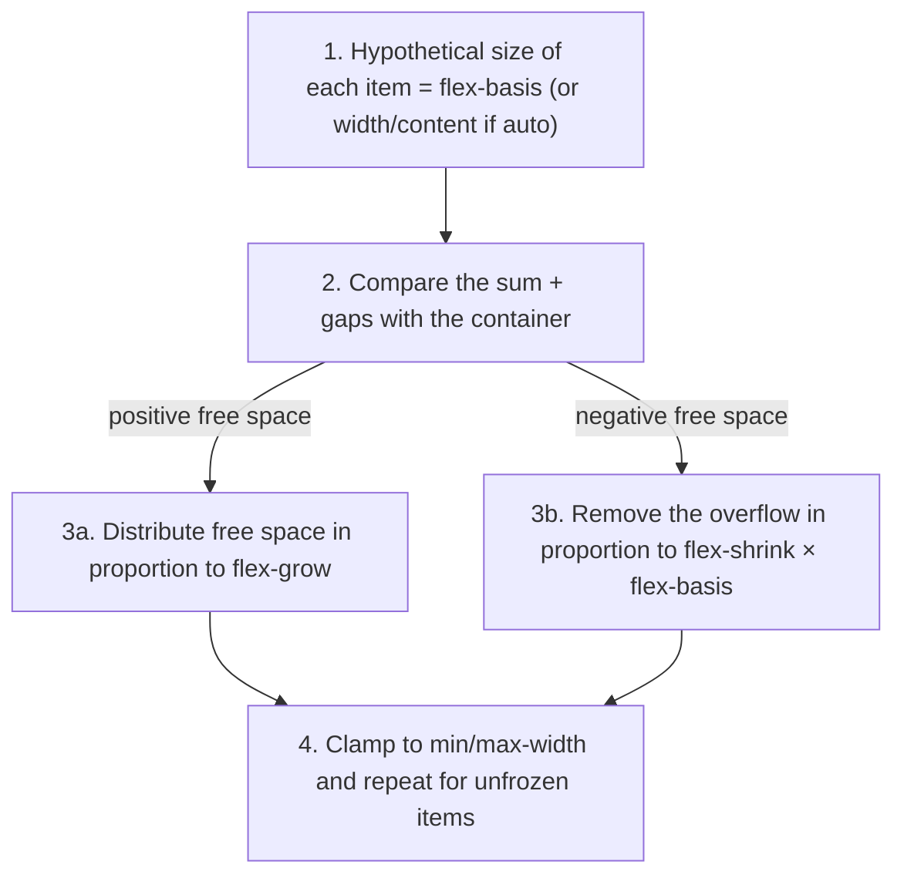

## What problem does flexbox solve?

Picture a site's top bar: a logo on one side, some links in the middle, a sign-in button on the other side, all **vertically centred**. Or three cards side by side that are **the same height** however different their text is. Before flexbox, these simple tasks took hacks like `float`, `display: table-cell` and hand-calculated widths, which broke with the smallest content change.

**Flexbox** (Flexible Box Layout) is a **one-dimensional** layout model: it lays items out in **one row** or **one column** and does two things automatically:

1. **Distributes space:** if there's room to spare it shares it between items; if there's too little it shrinks items to fit.
2. **Aligns:** it aligns items in both directions (horizontal and vertical).

"One-dimensional" means flexbox thinks about **one direction** at a time. If you need rows **and** columns at once (a table, a gallery), [Grid](/css/grid) is the better tool.

## Your first flex container

Flexbox always works on **two levels**:

- **The flex container:** the element that gets `display: flex`.
- **The flex items:** the container's **direct children**. Grandchildren are not affected.

```html live
<style>
  .nav {
    display: flex;           /* 1. this element is now a flex container */
    align-items: center;     /* 2. centre the children vertically */
    gap: 12px;               /* 3. put 12px between the children */
    padding: 10px 14px;
    background: #f6f7f8;
    border-radius: 10px;
    font: 14px system-ui;
  }
  .logo { font-weight: 800; font-size: 20px; }
  .login { margin-inline-start: auto; }  /* 4. take all the free space → pushed to the end */
</style>
<nav class="nav">
  <span class="logo">Logo</span>
  <a href="#">Home</a>
  <a href="#">Articles</a>
  <button class="login">Sign in</button>
</nav>
```

Four lines did it. Now let's see exactly what changes when you write `display: flex`:

<Steps>
<Step title="Direct children become flex items">
Every child — even a `span` or a loose piece of text — becomes a flex item. Their own `display` (block or inline) no longer matters.
</Step>
<Step title="Items line up in a row">
The default `flex-direction` is `row`. Even `div`s that would normally stack vertically sit side by side.
</Step>
<Step title="Items are as wide as their content">
In flexbox a `div` no longer takes the full width; it's as wide as its content (unless you tell it to grow).
</Step>
<Step title="Items become equal height">
The default `align-items` is `stretch`: every item is stretched to the height of the tallest. Equal-height columns come for free.
</Step>
<Step title="Items don't wrap">
The default `flex-wrap` is `nowrap`: if space is tight, items shrink, but they all stay on one line.
</Step>
</Steps>

## Axes: main and cross

The key to understanding flexbox is to **stop thinking in left, right, top and bottom**. Everything is defined around two axes:

- **Main axis:** the direction items are placed one after another. Set by `flex-direction`.
- **Cross axis:** always **perpendicular** to the main axis.

```text
flex-direction: row                     flex-direction: column
main-start            main-end          ┌───────┐ cross-start → cross-end
   ┌───┐ ┌───┐ ┌───┐  ───► Main Axis    │   1   │  │
   │ 1 │ │ 2 │ │ 3 │                    ├───────┤  │ Main Axis
   └───┘ └───┘ └───┘                    │   2   │  ▼
      │ Cross Axis                      ├───────┤
      ▼                                 │   3   │
                                        └───────┘
```

Why does this matter so much? Because each property works on **only one** axis. When you switch `flex-direction` from `row` to `column`, the axes swap, and `justify-content`, which was working horizontally, suddenly works vertically.

| | Main axis | Cross axis |
| --- | --- | --- |
| Set by | `flex-direction` | Perpendicular to the main axis |
| Aligning items | `justify-content` | `align-items` (all), `align-self` (one) |
| Aligning lines (when there are several) | — | `align-content` |
| Item size | `flex-basis`, `flex-grow`, `flex-shrink` | `align-self: stretch` |

**An RTL note:** with `flex-direction: row`, the "start" of the main axis is on the **left** in English and on the **right** in Persian. So `justify-content: flex-start` moves items to the right on a Persian page, with no extra code.

## Playground

Try every container property here. Switch `flex-direction` and watch `justify-content` and `align-items` swap roles:

<FlexboxPlayground />

## Container properties

These properties go on **the container itself** and affect all items:

```css
.container {
  display: flex;                 /* or inline-flex */
  flex-direction: row;           /* row | row-reverse | column | column-reverse */
  flex-wrap: nowrap;             /* nowrap | wrap | wrap-reverse */
  justify-content: flex-start;   /* alignment on the main axis */
  align-items: stretch;          /* alignment on the cross axis */
  align-content: normal;         /* spacing between lines when wrapped */
  gap: 1rem;                     /* space between items */
}
```

### `display: flex` vs `inline-flex`

Both lay out the children with flexbox. The difference is how **the container itself** behaves: `flex` acts like a block, taking the full width and starting on a new line; `inline-flex` sits in the flow of text like a word and is as wide as its content. For a button with an icon and a label, `inline-flex` is the right fit.

### `flex-direction`: the main-axis direction

| Value | How items are placed |
| --- | --- |
| `row` (default) | Side by side, in the text direction (English: left to right) |
| `row-reverse` | Side by side, against the text direction |
| `column` | Stacked, top to bottom |
| `column-reverse` | Stacked, bottom to top |

```html live
<style>
  .demo { display: flex; gap: 6px; margin-bottom: 10px; padding: 6px; background: #f6f7f8; font: 600 14px system-ui; }
  .demo span { padding: 8px 14px; background: #2459e0; color: white; border-radius: 6px; }
</style>
<div class="demo" style="flex-direction: row"><span>1</span><span>2</span><span>3</span></div>
<div class="demo" style="flex-direction: row-reverse"><span>1</span><span>2</span><span>3</span></div>
<div class="demo" style="flex-direction: column"><span>1</span><span>2</span><span>3</span></div>
```

<Callout type="warning">
`row-reverse` and `column-reverse` only reverse the **visual** order. Keyboard Tab order and screen-reader reading order stay in HTML order. If order really matters, change the HTML.
</Callout>

### `flex-wrap`: one line or several?

| Value | Behaviour when space runs out |
| --- | --- |
| `nowrap` (default) | Everything stays on one line and shrinks; if it can't, it overflows the container |
| `wrap` | Items that don't fit move to the **next** line |
| `wrap-reverse` | Like `wrap`, but new lines are added **above** the previous one |

```html live
<style>
  .tags { display: flex; gap: 6px; width: 260px; padding: 6px; border: 2px dashed #aaa; margin-bottom: 10px; font: 13px system-ui; }
  .tags span { padding: 4px 10px; background: #e9edfc; border-radius: 99px; white-space: nowrap; }
</style>
<div class="tags" style="flex-wrap: nowrap"><span>JavaScript</span><span>TypeScript</span><span>React</span><span>CSS</span><span>HTML</span></div>
<div class="tags" style="flex-wrap: wrap"><span>JavaScript</span><span>TypeScript</span><span>React</span><span>CSS</span><span>HTML</span></div>
```

In the first, the tags overflow the box (they can't shrink because of `white-space: nowrap`). In the second, they wrap to the next line. The **`flex-flow`** shorthand sets both at once: `flex-flow: row wrap`.

### `justify-content`: alignment on the main axis

How should the **free** space on the main axis be shared? (If the items already fill the space, this property has no effect.)

| Value | Behaviour |
| --- | --- |
| `flex-start` / `start` (default) | Everything packs at the **start** |
| `center` | Everything in the **middle** |
| `flex-end` / `end` | Everything packs at the **end** |
| `space-between` | First and last at the edges, equal gaps **between** items |
| `space-around` | Equal space around **each** item, so edge gaps are half the gaps between items |
| `space-evenly` | **All** gaps, including the edges, exactly equal |

```html live
<style>
  .jc { display: flex; padding: 4px; margin-bottom: 6px; background: #f6f7f8; border-radius: 6px; font: 600 12px system-ui; }
  .jc span { padding: 6px 12px; background: #2459e0; color: white; border-radius: 4px; }
</style>
<div class="jc" style="justify-content: flex-start"><span>1</span><span>2</span><span>3</span></div>
<div class="jc" style="justify-content: center"><span>1</span><span>2</span><span>3</span></div>
<div class="jc" style="justify-content: flex-end"><span>1</span><span>2</span><span>3</span></div>
<div class="jc" style="justify-content: space-between"><span>1</span><span>2</span><span>3</span></div>
<div class="jc" style="justify-content: space-around"><span>1</span><span>2</span><span>3</span></div>
<div class="jc" style="justify-content: space-evenly"><span>1</span><span>2</span><span>3</span></div>
```

From top to bottom: `flex-start`, `center`, `flex-end`, `space-between`, `space-around`, `space-evenly`.

### `align-items`: alignment on the cross axis

Where should items sit on the cross axis (vertically, for `row`)?

| Value | Behaviour |
| --- | --- |
| `stretch` (default) | Items fill the line's full height (as long as they have no fixed `height`) |
| `flex-start` | At the start of the cross axis (top) |
| `center` | In the middle |
| `flex-end` | At the end of the cross axis (bottom) |
| `baseline` | The baselines of every item's first line of text line up |

```html live
<style>
  .ai { display: flex; gap: 6px; height: 80px; padding: 4px; margin-bottom: 6px; background: #f6f7f8; font: 600 13px system-ui; }
  .ai span { padding: 6px 12px; background: #2459e0; color: white; border-radius: 4px; }
  .ai span:nth-child(2) { font-size: 24px; }
</style>
<div class="ai" style="align-items: stretch"><span>stretch</span><span>Big</span><span>c</span></div>
<div class="ai" style="align-items: center"><span>center</span><span>Big</span><span>c</span></div>
<div class="ai" style="align-items: baseline"><span>baseline</span><span>Big</span><span>c</span></div>
```

`baseline` helps when items have different font sizes (a large price next to a small currency label) and you want the **text** to sit on one line, not the boxes.

**The famous perfect-centring trick** now makes sense:

```css
.center {
  display: flex;
  justify-content: center; /* centre on the main axis (horizontal) */
  align-items: center;     /* centre on the cross axis (vertical) */
}
```

### `align-content`: spacing between lines

`align-content` only has an effect when there are **several lines** — `flex-wrap: wrap` and items that actually wrapped. It shares the cross axis's free space **between the lines**, with the same values as `justify-content` (`flex-start`, `center`, `space-between`, …).

| | `align-items` | `align-content` |
| --- | --- | --- |
| Moves | Items **within** each line | **The lines themselves** within the container |
| Has an effect | Always | Only with several lines |

### `gap`: space between items

`gap` puts space **only between** items — not before the first or after the last — and never collapses. It replaces old tricks like "`margin-right` on everything except the last".

```css
.list { display: flex; gap: 16px; }                       /* 16px both ways */
.grid { display: flex; flex-wrap: wrap; gap: 24px 12px; } /* 24px between lines, 12px between items */
```

## Item properties

So far everything was on the container. These properties go on **individual items** and decide how much each one grows, how much it shrinks and where it sits. The most important are the trio `flex-grow`, `flex-shrink` and `flex-basis`, which together answer one question: **"what is this item's final width?"**

```css
.item {
  flex: 1 1 0%;        /* flex-grow flex-shrink flex-basis */
  align-self: center;  /* overrides align-items */
  order: 2;            /* visual order */
}
```

### The flex sizing algorithm

Senior interviews love this. For each line the browser:



### flex-basis

The item's **initial** main-axis size before space is distributed.

| Value | Meaning |
| --- | --- |
| `auto` (default) | Use `width` (or `height` in a column); if none, the content size |
| `0` | Start from zero; all space is shared out by grow |
| `200px`, `30%` | A specific size |
| `content` | The content size (even if a width is set) |

### flex-grow

The **share** of **extra** space an item receives. Default `0` (don't grow).

Example: a 600px container, three items with `flex-basis: 100px`; free space = 600 − 300 = 300px.

| Item | flex-grow | Share of 300px | Final size |
| --- | --- | --- | --- |
| A | 1 | 75px | 175px |
| B | 2 | 150px | 250px |
| C | 1 | 75px | 175px |

Note: B gets **twice the extra space**, not twice the size. For sizes exactly proportional to grow you need `flex-basis: 0`.

### flex-shrink

The **share** of shrinking when space runs out. Default `1`. Crucially, shrinking is **weighted by flex-basis**: `shrink × basis`. Bigger items shrink more.

Example: a 400px container, A with basis 300px and B with basis 200px, both shrink 1. Overflow: 500 − 400 = 100px.

- A's weight = 1 × 300 = 300, B's weight = 1 × 200 = 200, total 500
- A shrinks by 100 × 300/500 = **60px** → 240px
- B shrinks by 100 × 200/500 = **40px** → 160px

### The `flex` shorthand

| Value | Equivalent | Behaviour |
| --- | --- | --- |
| `flex: initial` (default) | `0 1 auto` | Doesn't grow, can shrink, sized by width/content |
| `flex: 1` | `1 1 0%` | All `flex: 1` items are **exactly equal** |
| `flex: auto` | `1 1 auto` | Grows, but items with more content stay larger |
| `flex: none` | `0 0 auto` | Completely inflexible |
| `flex: 0 0 200px` | — | Exactly 200px, never grows or shrinks |

<Callout type="interview">
`flex: 1` vs `flex: auto` is a popular question. With `flex: 1` the basis is zero, so all space is shared by grow and the columns end up equal. With `flex: auto` the basis is the content size and only the **remaining space** is shared equally; an item with longer text stays wider.
</Callout>

```html live
<style>
  .row { display: flex; gap: 8px; margin-bottom: 12px; }
  .row > div { background: #e9edfc; padding: 8px; border: 1px solid #2a4bd7; }
  .one > div { flex: 1; }
  .auto > div { flex: auto; }
</style>
<p>flex: 1 — all equal</p>
<div class="row one"><div>Short</div><div>A much, much longer piece of text</div><div>Medium</div></div>
<p>flex: auto — remaining space shared equally</p>
<div class="row auto"><div>Short</div><div>A much, much longer piece of text</div><div>Medium</div></div>
```

### The min-width: auto problem

**The most common Flexbox bug:** flex items default to `min-width: auto`, meaning they **won't shrink below their content's size**. A long unbroken string, a `pre` or a large image can push the whole layout out of its container — even with `flex-shrink: 1`.

```css
.main {
  flex: 1;
  min-width: 0;        /* allow shrinking below content size */
}
.title {
  overflow: hidden;
  text-overflow: ellipsis;
  white-space: nowrap; /* now the ellipsis works */
}
```

```html live
<style>
  .layout { display: flex; gap: 8px; width: 100%; border: 2px dashed #aaa; padding: 6px; margin-bottom: 10px; }
  .side { flex: 0 0 80px; background: #ffd8a8; }
  .main { flex: 1; background: #e9edfc; }
  .fixed .main { min-width: 0; }
  pre { margin: 0; overflow: auto; }
</style>
<div class="layout"><div class="side">side</div><div class="main"><pre>const veryLongLineOfCode = "this line is so long that it pushes the layout out of its container and breaks everything";</pre></div></div>
<div class="layout fixed"><div class="side">side</div><div class="main"><pre>const veryLongLineOfCode = "with min-width: 0 the pre scrolls inside its column instead";</pre></div></div>
```

### align-self and order

- `align-self` overrides cross-axis alignment for **one item**.
- `order` changes the **visual** order (default 0). **Accessibility warning:** tab order and screen readers still follow the DOM; if the visual order differs from the DOM, keyboard users get lost (WCAG 2.4.3).

### margin: auto in Flexbox

In Flexbox, `margin: auto` **absorbs all free space** in that direction — a powerful tool:

```css
.navbar { display: flex; gap: 1rem; }
.navbar .logout { margin-inline-start: auto; } /* pushed to the end of the bar */

.center { display: flex; }
.center > .child { margin: auto; }              /* centred horizontally and vertically */
```

## Real-world patterns

```css
/* 1. Perfect centring */
.center { display: flex; justify-content: center; align-items: center; min-height: 100dvh; }

/* 2. Header: logo at the start, menu at the end */
.header { display: flex; align-items: center; justify-content: space-between; gap: 1rem; }

/* 3. Sticky footer */
body { display: flex; flex-direction: column; min-height: 100dvh; }
main { flex: 1; }

/* 4. Cards whose actions always sit at the bottom */
.card { display: flex; flex-direction: column; }
.card .actions { margin-top: auto; }

/* 5. A wrapping list of tags */
.tags { display: flex; flex-wrap: wrap; gap: 0.5rem; }

/* 6. Media object: fixed image, flexible text */
.media { display: flex; gap: 1rem; align-items: flex-start; }
.media img { flex: none; width: 64px; }
.media .body { flex: 1; min-width: 0; }
```

## Common mistakes

- Forgetting `min-width: 0`, letting long text or code overflow the layout.
- Expecting `align-content` to work without wrapping.
- Using `order` and scrambling keyboard order.
- Using `flex: 1` when columns should follow content (or vice versa).
- Building 2-D grids with Flexbox and percentage widths (that's Grid's job).
- `height: 100%` on a flex child instead of relying on `stretch`.

## Interview questions

<QA q="What are the main and cross axes? Which does `justify-content` affect, and which `align-items`?" level="junior" n={1}>
<Answer>

The main axis is the direction set by `flex-direction` (row: horizontal, column: vertical); the cross axis is perpendicular. `justify-content` aligns items on the main axis and `align-items` on the cross axis. Switching to `flex-direction: column` swaps their horizontal/vertical roles.

</Answer>
<Deep>

Main-start depends on writing mode and direction: with `direction: rtl` a row starts on the right. That's why the logical values `start`/`end` and `flex-start`/`flex-end` exist, while `left`/`right` are physical.

</Deep>
<Mistake>

Saying `justify-content` is "always horizontal".

</Mistake>
<FollowUp>

What's the difference between `align-items` and `align-content`?

</FollowUp>
</QA>

<QA q="Three items with `flex-basis: 100px` and grow 1, 2, 1 in a 600px container. How wide is each?" level="mid" n={2}>
<Answer>

Free space is 300px, split 1:2:1 into 75, 150 and 75. Widths: 175px, 250px and 175px.

</Answer>
<Deep>

Grow distributes the **extra** space, not the total. If the basis were zero (`flex: 1`, `flex: 2`, `flex: 1`), the full 600px would be split 1:2:1 into 150, 300 and 150. When shrinking, the overflow is distributed in proportion to `shrink × basis`. In both cases `min-width`/`max-width` can freeze an item and the algorithm re-runs for the rest.

</Deep>
<Mistake>

Saying "B is twice as wide as A". Only its share of the extra space is doubled.

</Mistake>
<FollowUp>

If the container were only 200px with shrink 1 everywhere, what would the widths be? (100px overflow; equal bases, so each shrinks ~33.3px → about 66.7px.)

</FollowUp>
</QA>

<QA q="Why does a flex item with long text overflow its container even though it has `flex-shrink: 1`?" level="senior" n={3}>
<Answer>

Flex items default to `min-width: auto`, which equals their min-content size. The item can't shrink below its longest word, a `pre` or an image inside it. Fix: `min-width: 0` (or `overflow: hidden`, which also zeroes the automatic minimum).

</Answer>
<Deep>

This is deliberate, to prevent content from overlapping. Grid has the same issue with `1fr`, because `1fr` means `minmax(auto, 1fr)`; there the fix is `minmax(0, 1fr)`. The bug typically appears in sidebar + content layouts containing tables, code blocks or text with `text-overflow: ellipsis`.

</Deep>
<Mistake>

"Fixing" it with `width: 0` or `overflow-x: hidden` on body, which only hides the symptom.

</Mistake>
<FollowUp>

Why doesn't `text-overflow: ellipsis` work inside a flex item until you add `min-width: 0`?

</FollowUp>
</QA>

<QA q="What's the difference between `flex: 1` and `flex: auto`?" level="mid" n={4}>
<Answer>

`flex: 1` is `1 1 0%`: the basis is zero and all space is shared equally, so items are the same size. `flex: auto` is `1 1 auto`: the basis is the content size and only the remaining space is shared equally, so items with more content are larger.

</Answer>
<Deep>

Even `flex: 1` may not give perfectly equal items when `min-width: auto` applies and one item's min-content exceeds its share. For strictly equal columns, `flex: 1 1 0; min-width: 0` or Grid's `repeat(n, minmax(0, 1fr))` is more reliable.

</Deep>
<Mistake>

Assuming `flex: 1` and `flex-grow: 1` are equivalent. `flex-grow: 1` alone keeps the basis at `auto`.

</Mistake>
<FollowUp>

What's the default value of `flex`? (`0 1 auto`.)

</FollowUp>
</QA>

## Recap

<Recap>

- Flexbox is one-dimensional layout: one row or one column. For two dimensions, grid is a better fit.
- `display: flex` only affects **direct** children; they line up side by side, content-sized, equal height and unwrapped.
- Everything revolves around the main axis (`flex-direction`) and the cross axis (perpendicular); `column` swaps their roles.
- `justify-content` shares the main axis's free space; `align-items` aligns items on the cross axis; `align-content` only applies to multiple lines.
- `gap` puts space only between items and replaces margin tricks.
- `flex-grow` shares **extra** space proportionally; `flex-shrink` removes a shortfall in proportion to `shrink × basis`.
- `flex: 1` means `1 1 0%` (equal items); `flex: auto` means `1 1 auto` (content-proportional).
- Flex items default to `min-width: auto` and won't shrink below their content; `min-width: 0` is the most common flexbox fix.
- `margin-inline-start: auto` pushes an item to the end; `order` and `-reverse` don't change keyboard order.

</Recap>
