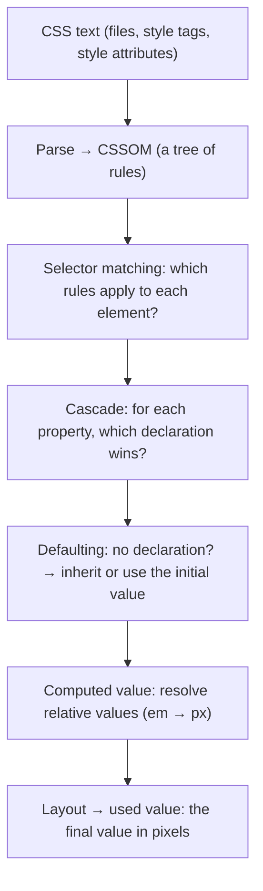
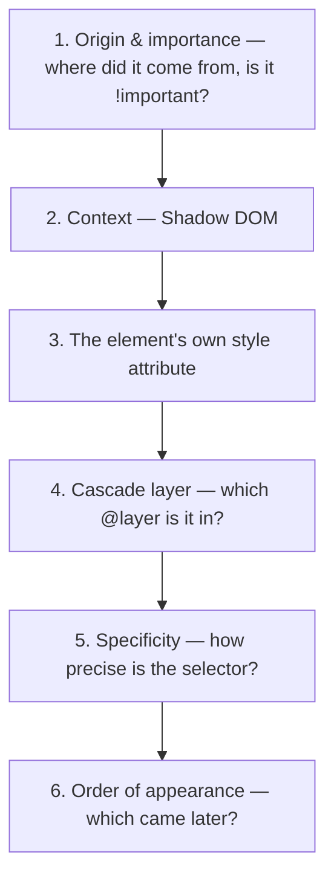

## What CSS is and why we need it

HTML only describes **structure and meaning**: "this is a heading", "this is a button". What colour the heading is, where the button sits and how it looks on a phone is the job of **CSS**.

**CSS** stands for Cascading Style Sheets. It is a **declarative** language: you don't say *how* to draw ("first draw a rectangle, then fill it"), you say *what* the result should be ("this button is blue with rounded corners"). Working out what colour each pixel gets is the browser's job.

```html live
<!-- Without CSS: structure only -->
<button>Unstyled</button>

<!-- With CSS: the same button, a different look -->
<style>
  .pretty {
    background: #2459e0;   /* background colour */
    color: white;          /* text colour */
    border: none;          /* remove the default border */
    padding: 10px 20px;    /* space between the text and the edges */
    border-radius: 8px;    /* rounded corners */
    font: 600 16px system-ui;
  }
</style>
<button class="pretty">Styled</button>
```

The most important word in the name is **cascading**. A single element can be targeted by dozens of rules from different sources that contradict each other: one says the text is red, another says blue. CSS has a precise algorithm that decides which one wins. This chapter is about exactly that algorithm, because most CSS bugs come from it: "why isn't my style applied?"

## Three ways to add CSS to a page

```html
<!-- 1. A separate file (external): the right choice for real projects -->
<link rel="stylesheet" href="styles.css" />

<!-- 2. Inside the page (internal) with a style tag -->
<style>
  p { color: gray; }
</style>

<!-- 3. On the element itself (inline) with the style attribute -->
<p style="color: red;">This paragraph is red</p>
```

| Method | Upside | Downside | When to use |
| --- | --- | --- | --- |
| External file | Cached by the browser and shared between pages; HTML stays clean | One extra network request | Almost always |
| `<style>` tag | No extra request; fast for critical CSS | Not cached; repeated on every page | Critical above-the-fold CSS |
| `style` attribute | Strongest priority in the cascade (see below) | Not reusable; no media queries or `:hover` | Dynamic values set by JavaScript |

## Anatomy of a CSS rule

```css
/* This is a comment; the browser ignores it */

.card > .title:hover {     /* ← selector: which elements? */
  color: #2459e0;          /* ← declaration = property: value; */
  font-size: 1.25rem;      /* ← a second declaration */
}
/* └──── declaration block (between the braces) ────┘ */
/* The whole thing is one rule */

@media (min-width: 768px) {  /* ← at-rule: a special instruction starting with @ */
  .card { padding: 2rem; }
}
```

Learn each part precisely, because these names come up constantly:

- **Rule:** a selector plus a declaration block.
- **Selector:** decides **which elements** the rule applies to. `.card` means "any element with the class card". Every kind of selector is covered in [Selectors](/css/selectors).
- **Declaration:** one `property: value` pair, ending with `;`.
- **Property:** the thing you want to set, such as `color`, `margin` or `width`.
- **Value:** what you set it to, such as `red`, `1rem` or `calc(100% - 2rem)`.
- **At-rule:** special instructions starting with `@` with broader effects: `@media` (screen-size conditions), `@supports` (feature-support conditions), `@layer` (layering), `@container`, `@font-face` (defining fonts), `@keyframes` (animations), `@import` (pulling in another file).

### When the browser doesn't understand something

CSS is designed so that an error doesn't break the whole page. But there are two different rules you need to know:

```css
.box {
  color: red;
  colr: blue;         /* invalid property → only this line is ignored */
  width: 100pixels;   /* invalid value → only this line is ignored */
  padding: 10px;      /* these still apply */
}

/* One invalid selector in a list → the whole rule is dropped! */
.button, .link:unknown-thing {
  color: green;       /* nothing turns green, not even .button */
}

/* :is() and :where() are forgiving: they just skip the invalid selector */
:is(.button, .link:unknown-thing) {
  color: green;       /* .button turns green */
}
```

This behaviour is the basis of an important technique — writing a fallback for a new feature. An old browser doesn't understand the second line and keeps the first; a new browser understands both, and the second wins because it comes later.

```css
.hero {
  height: 100vh;   /* for every browser */
  height: 100dvh;  /* newer browsers understand this and replace the line above */
}
```

## What the browser does with CSS

Before we get to the cascade, let's see the path from CSS text to pixels on screen:



<Steps>
<Step title="Parse and build the CSSOM">
The browser reads every stylesheet and builds a data structure called the **CSSOM** (CSS Object Model) — like the DOM, but for CSS rules. JavaScript can reach it through `document.styleSheets`.
</Step>
<Step title="Selector matching">
For every element in the DOM, the browser checks which selectors match it. An interesting detail: matching runs **right to left**. For `.sidebar ul li a` the browser first finds each `a`, then walks up to see whether it is inside an `li`, a `ul` and `.sidebar`. That way it discards unrelated elements very quickly.
</Step>
<Step title="Cascade">
Now each property of each element may have several conflicting declarations. The cascade algorithm picks exactly **one**. (Next section.)
</Step>
<Step title="Defaulting">
If a property has no declaration at all, its value is either **inherited** from the parent (for inherited properties such as `color`) or set to the property's **initial value**.
</Step>
<Step title="Compute the final value">
The chosen value goes through several conversions until it becomes pixels. For example `2em` becomes `32px`, and `width: 50%` becomes a real pixel number after layout. (Table below.)
</Step>
</Steps>

### The stages of a value: from declared to actual

You will meet these terms in documentation and occasionally in interviews. The last column follows `width: 50%` inside an 800px-wide parent:

| Stage | Meaning | Example |
| --- | --- | --- |
| **Declared value** | Every declaration that matched for this property | `50%` and `300px` |
| **Cascaded value** | The cascade's winner | `50%` |
| **Specified value** | The cascaded value or, if none, the inherited or initial value | `50%` |
| **Computed value** | Relative values resolved as far as possible without layout (`em` → px) | `50%` (a percentage width needs layout) |
| **Used value** | After layout, everything is an absolute number | `400px` |
| **Actual value** | After rounding to real device pixels | `400px` |

Despite its name, `getComputedStyle(element)` returns the **used value** (more precisely, the *resolved* value) for properties like `width` — i.e. a pixel number.

## The cascade: the algorithm that picks the winner

Say the browser found these for a paragraph:

```css
/* from the browser's default stylesheet */
p { color: black; }

/* from your file */
p { color: gray; }
.intro { color: blue; }
```

What colour is the text? The cascade asks the questions below **in order**, and as soon as one criterion produces a winner, the rest are not considered:



In the example: the browser's rule loses at criterion 1 (weaker origin). Between your two rules, criterion 5 decides: `.intro` is more specific than `p`. So the text is **blue**. Now let's look at each criterion on its own.

### Criterion 1: origin and importance

Every declaration comes from one of three **origins**:

- **User agent:** the browser's own default stylesheet. That's why an `h1` is large with no CSS and links are blue and underlined.
- **User:** the user's settings — someone who raised the minimum font size in browser settings, or an extension that injects styles.
- **Author:** the code you, the page's author, write.

`!important` after a value moves that declaration into an "important" layer. The full priority order, strongest first:

| Priority | Source |
| --- | --- |
| 1 (strongest) | Running transitions |
| 2 | Browser (user agent) `!important` |
| 3 | User `!important` |
| 4 | Your (author) `!important` |
| 5 | Animations (`@keyframes`) |
| 6 | Your normal declarations |
| 7 | User normal declarations |
| 8 (weakest) | Browser normal declarations |

Notice: **`!important` reverses the order of the origins.** Normally your code beats the user's settings, but a user's `!important` beats yours. The reason is accessibility: a user with poor eyesight must be able to force a large font on any site, whatever the site does.

### Criterion 3: the `style` attribute

Declarations written directly in the `style` attribute beat **every** selector, however specific (as long as `!important` isn't involved).

```html live
<style>
  #title.big.red { color: green; } /* a very specific selector */
</style>
<h2 id="title" class="big red" style="color: crimson">The style attribute wins</h2>
```

### Criterion 4: cascade layers

In large projects CSS comes from several sources: a reset, a UI library, your components and utility classes. Without layers the winner is decided by specificity, and a specific selector in a library can beat your simple utility. **`@layer`** lets you declare the priority of groups explicitly, **independent of specificity**:

```css
/* 1. Declare the layer order once: later = stronger */
@layer reset, base, components, utilities;

/* 2. Put rules inside layers */
@layer components {
  #main .card .title { color: blue; }  /* high specificity: (1,2,0) */
}

@layer utilities {
  .text-red { color: red; }            /* low specificity: (0,1,0), but it wins! */
}
```

```html live
<style>
  @layer components, utilities;
  @layer components { #main .card .title { color: blue; } }
  @layer utilities { .text-red { color: red; } }
</style>
<div id="main"><div class="card"><h3 class="title text-red" style="font: 700 22px system-ui">The utilities layer wins</h3></div></div>
```

Three rules about layers:

1. A layer declared **later** is stronger, no matter how specific the rules in earlier layers are.
2. CSS that is in **no layer** beats every layer.
3. For `!important` the order **reverses**: `!important` in the first layer beats `!important` in the last (the same logic as the reversed origins).

Tailwind v4 uses exactly this mechanism to separate `base`, `components` and `utilities`. You can also import a third-party library straight into a layer: `@import url(lib.css) layer(vendor);`

### Criterion 5: specificity

**Specificity** measures how "targeted" a selector is. The idea: a rule that aims at an element more precisely was probably written more deliberately. Specificity is written as three numbers `(A, B, C)`:

| Column | What is counted | Example |
| --- | --- | --- |
| **A** | ID selectors | `#header` |
| **B** | Classes, attribute selectors and pseudo-classes | `.btn`, `[type="text"]`, `:hover` |
| **C** | Type selectors (tag names) and pseudo-elements | `div`, `::before` |

**How to compare:** column by column from the left. Compare A first; whoever has more A wins and you're done. If equal, compare B, then C. So one ID beats **any number** of classes: `(1,0,0)` beats `(0,99,0)`. These are not decimal numbers to add up.

Let's calculate the specificity of `#nav .item:hover > a::before` step by step:

<Steps>
<Step title="Split the selector into pieces">
`#nav` · `.item` · `:hover` · `>` · `a` · `::before`
</Step>
<Step title="Count each piece in its column">
`#nav` is an ID → A = 1. `.item` (class) and `:hover` (pseudo-class) → B = 2. `a` (tag) and `::before` (pseudo-element) → C = 2.
</Step>
<Step title="Drop the weightless parts">
The `>` combinator has no weight. Neither do a space, `+`, `~` or `*`.
</Step>
<Step title="Result">
The specificity is **(1, 2, 2)**.
</Step>
</Steps>

Practice table:

| Selector | Specificity | Why |
| --- | --- | --- |
| `*` | (0,0,0) | The universal selector has no weight |
| `li` | (0,0,1) | One tag |
| `ul li` | (0,0,2) | Two tags; the space has no weight |
| `.nav li` | (0,1,1) | One class and one tag |
| `a:hover` | (0,1,1) | A pseudo-class weighs the same as a class |
| `input[type="email"]` | (0,1,1) | An attribute selector weighs the same as a class |
| `li::before` | (0,0,2) | A pseudo-element weighs the same as a tag |
| `#main .card` | (1,1,0) | One ID and one class |
| `#main #side` | (2,0,0) | Two IDs |
| `:not(.a, #b)` | (1,0,0) | `:not()` takes the weight of its **strongest** argument |
| `:is(.a, #b) p` | (1,0,1) | `:is()` likewise, plus one tag |
| `:where(#b) p` | (0,0,1) | `:where()` is **always zero**; only `p` counts |

Special rules:

- `*`, combinators (`>`, `+`, `~`, space) and `:where()` have no weight.
- `:is()`, `:not()` and `:has()` have no weight themselves but take the weight of the **strongest** selector inside them.
- `:nth-child(2 of .x)` weighs one pseudo-class plus the strongest selector inside `of`.

<Callout type="tip">
`:where()` is a great tool for base styles that should be easy to override. For example `:where(.card) h2 { … }` only weighs `(0,0,1)`, so any simple class can change it.
</Callout>

### Criterion 6: order of appearance

If all previous criteria tie, the declaration that appears **later** wins. "Later" means the order in the final CSS: lower in a file, or in a file linked later.

```html live
<style>
  .warning { color: orange; }
  .error   { color: crimson; }  /* same weight, but later → wins */
</style>
<!-- The order of classes in the HTML does not matter at all -->
<p class="error warning" style="font: 600 18px system-ui">Turns red</p>
<p class="warning error" style="font: 600 18px system-ui">Also turns red</p>
```

<Callout type="mistake">
The order of classes in the `class` attribute (`class="a b"` vs `class="b a"`) has **no** effect on priority. Only the order of the rules in the CSS matters.
</Callout>

### Exercise: every criterion at once

What colour is this paragraph? Think before reading the answer.

```css
/* HTML: <p id="intro" class="lead text">Hello</p> */
#intro      { color: red; }               /* (1,0,0) */
p.lead.text { color: blue; }              /* (0,2,1) */
.lead       { color: orange !important; } /* (0,1,0) + important */
p           { color: green !important; }  /* (0,0,1) + important */
```

<Callout type="interview" title="Answer: orange">
**Criterion 1** is checked first: the last two declarations are `!important`, so they move to the "important" layer, and red and blue are eliminated right there despite their higher specificity. The contest continues between the two important declarations, and we reach **criterion 5**: `.lead` at `(0,1,0)` beats `p` at `(0,0,1)`. The common trap is thinking "the last `!important` wins"; order only matters when specificity also ties.
</Callout>

Try it live. Delete or reorder declarations and watch the colour change:

```html live
<style>
  #intro      { color: red; }
  p.lead.text { color: blue; }
  .lead       { color: orange !important; }
  p           { color: green !important; }
</style>
<p id="intro" class="lead text" style="font: 700 28px system-ui">Hello</p>
```

## Inheritance

If you write `color: navy` on `body`, all text on the page turns navy, even though you never wrote a rule for `p` or `li`. The reason is **inheritance**: when an element has no declaration for a property, some properties take the parent's value.

Not every property inherits, though. Rule of thumb: **text-related properties inherit; box and layout properties don't.**

| Inherited (mostly text) | Not inherited (box & layout) |
| --- | --- |
| `color`, `font-*`, `line-height`, `letter-spacing`, `text-align`, `direction`, `visibility`, `cursor`, `list-style`, `white-space`, custom properties (`--x`) | `margin`, `padding`, `border`, `width`, `height`, `background`, `display`, `position`, `overflow`, `opacity`, `transform` |

The logic is simple: if `border` inherited, a border on `body` would give **every** element on the page a border.

```html live
<style>
  .parent { color: #2459e0; border: 2px solid #2459e0; padding: 12px; font-family: Georgia, serif; }
  .child { margin-top: 8px; }
  .child-2 { border: inherit; padding: 6px; } /* force inheritance */
</style>
<div class="parent">
  Parent: has a colour, a font and a border
  <div class="child">Child: inherited the colour and font, but not the border</div>
  <div class="child child-2">Child with border: inherit</div>
</div>
```

### Inheritance uses the computed value

This small detail causes a famous bug. The child gets the parent's **computed value**, not the text you wrote. The classic example is `line-height`:

```css
/* ✗ with an em unit */
.parent { font-size: 20px; line-height: 1.5em; }  /* computed in the parent: 30px */
.child  { font-size: 40px; }                      /* the child inherits 30px → lines overlap */

/* ✓ a unitless number */
.parent { font-size: 20px; line-height: 1.5; }    /* "1.5" itself is inherited */
.child  { font-size: 40px; }                      /* in the child: 1.5 × 40 = 60px ✓ */
```

```html live
<style>
  .box { width: 260px; background: #eef2fd; margin-bottom: 10px; padding: 6px; }
  .em   { font-size: 14px; line-height: 1.5em; }
  .unit { font-size: 14px; line-height: 1.5; }
  .big  { font-size: 28px; }
</style>
<div class="box em"><span class="big">line-height: 1.5em — the lines of this big text overlap</span></div>
<div class="box unit"><span class="big">line-height: 1.5 — the line spacing is right</span></div>
```

That's why you should always write `line-height` **without a unit**. `150%` behaves like `1.5em` because it is converted to pixels in the parent.

## Global keywords: five values every property accepts

These keywords are valid for **every** property and give you manual control over defaulting:

| Keyword | Behaviour |
| --- | --- |
| `inherit` | Take the parent's computed value, even for non-inherited properties like `border` |
| `initial` | Take the initial value defined **in the CSS specification** (not the browser's default!) |
| `unset` | Act like `inherit` if the property is inherited, otherwise like `initial` |
| `revert` | Go back to what would apply if you had written no CSS at all — the browser's or user's styles |
| `revert-layer` | Ignore the current layer's rules and fall back to the previous layer's value |

**An important trap:** `display: initial` makes a `div` **inline**! Why? Because the initial value of `display` in the CSS spec is `inline`. A `div` being a block comes from the browser's stylesheet, not from the spec. To go back to the browser's default behaviour, write `revert`.

```html live
<style>
  div { background: #e9edfc; margin: 4px 0; padding: 6px; }
  .initial { display: initial; }   /* → inline! */
  .revert  { display: revert; }    /* → block (from the browser stylesheet) */
</style>
<div class="initial">display: initial</div>
<div class="initial">display: initial</div>
<div class="revert">display: revert</div>
```

The special **`all`** property resets every property at once — for example, building a button from scratch in a design system:

```css
.my-button {
  all: unset;          /* every default button style is wiped */
  cursor: pointer;     /* now add only what we want */
  padding: 8px 16px;
}
```

## `!important`: when yes, when no

As you saw, `!important` moves a declaration into the "important" layer, where it beats almost everything. The problem is that the only way to override it is another `!important` with higher specificity. The result is an arms race where whoever writes the stronger `!important` wins, and the CSS becomes unmaintainable.

**Where it's acceptable:**

- Utility classes that must **always** apply: `.hidden { display: none !important; }`
- Overriding inline styles from a third-party library whose code you can't change.
- Accessibility styles defined by the user.

**Better alternatives:** use `@layer` to control priority, and `:where()` for base styles that should be easy to override.

## Common mistakes

<Callout type="mistake">
**Solving every priority problem with `!important` or IDs.** Each time you raise specificity, next time you must raise it further. First find out which cascade criterion decided the winner (DevTools' Styles panel shows losing declarations struck through), then fix the problem at that level.
</Callout>

<Callout type="mistake">
**`line-height` with `em`, `%` or `px` on parents.** Children with a bigger font get cramped, overlapping lines. Use a unitless number.
</Callout>

<Callout type="mistake">
**Using `initial` thinking it means "the browser default".** `initial` is the spec's value. To return to the browser's style, use `revert`.
</Callout>

<Callout type="mistake">
**Deep, fragile selectors** like `.page .content .sidebar ul li a`. They break on the smallest HTML change and carry high specificity that makes overriding hard. A direct class such as `.sidebar-link` is better.
</Callout>

## Interview questions

<QA q="What is the cascade? List its criteria in order." level="mid" n={1}>
<Answer>

The cascade is the algorithm that picks exactly one declaration out of the conflicting ones for a property. The criteria, in order: **origin & importance** → **context** (Shadow DOM) → **style attribute** → **cascade layer** → **specificity** → **order of appearance**. The first criterion that produces a winner decides.

</Answer>
<Deep>

`!important` reverses the order of origins: browser and user `!important` beat yours. It also reverses layers: `!important` in the first layer beats the last. Animations beat normal styles, and transitions beat everything.

</Deep>
<Mistake>

Saying specificity is the first criterion. Origin, importance and layers are checked before specificity.

</Mistake>
<FollowUp>

How do you import a third-party library so your styles always win? (`@import url(lib.css) layer(vendor);` and declare your own layers after it, or write your styles outside any layer.)

</FollowUp>
</QA>

<QA q="What is the specificity of `#nav .item:hover > a::before`?" level="mid" n={2}>
<Answer>

**(1, 2, 2)**: one ID (`#nav`); one class and one pseudo-class (`.item` and `:hover`); one tag and one pseudo-element (`a` and `::before`). The `>` combinator has no weight.

</Answer>
<Deep>

The comparison is per column with no "carry": 11 classes never beat one ID. `:where()` zeroes specificity and is ideal for base styles that should be easy to override (such as a reset).

</Deep>
<Mistake>

Adding it up as a decimal number ("100 + 20 + 2 = 122") and concluding that 13 classes beat an ID.

</Mistake>
<FollowUp>

Compare `:is(#a, .b) span` and `:where(#a) span`. (The first is (1,0,1), the second (0,0,1).)

</FollowUp>
</QA>

<QA q="What is the difference between `initial`, `inherit`, `unset` and `revert`?" level="senior" n={3}>
<Answer>

`inherit` takes the parent's value. `initial` takes the CSS spec's initial value. `unset` acts like `inherit` for inherited properties and like `initial` for the rest. `revert` goes back to the browser's or user's styles, as if you had written no CSS.

</Answer>
<Deep>

`display: initial` on a `div` results in `inline`, because the spec's initial value is `inline`. To restore the browser's default you need `revert`. `all: revert` is handy for building a "neutral" component inside an environment with unknown styles (e.g. a widget embedded on other sites).

</Deep>
<Mistake>

Using `initial` to "reset to the default" and being surprised when `div`s become inline.

</Mistake>
<FollowUp>

What is `revert-layer` for? (Inside a layer it ignores that layer's rules for a property and returns the previous layer's value — e.g. so a component variant leaves the base style untouched.)

</FollowUp>
</QA>

<QA q="Why do we write `line-height` without a unit?" level="mid" n={4}>
<Answer>

Because inheritance uses the computed value. With `1.5em` the parent computes a fixed pixel number and that number is passed to children; a child with a bigger font gets cramped, overlapping lines. A unitless number is inherited as a *factor* and recalculated in each element from its own `font-size`.

</Answer>
<Deep>

This is one of the few places where a computed value stays a unitless number. Custom properties behave similarly: `--space: 1em` is inherited as raw text and resolved separately in each element that uses it.

</Deep>
<Mistake>

Thinking `1.5`, `150%` and `1.5em` are equivalent. Percentages and em are both converted to pixels in the parent.

</Mistake>
</QA>

## Recap

<Recap>

- CSS is declarative: you describe the result and the browser computes it.
- A rule is a selector plus a declaration block; each declaration is a `property: value`.
- An invalid declaration drops only itself; an invalid selector in a list drops the whole rule (except inside `:is()` and `:where()`).
- The cascade checks, in order: origin & importance, context, style attribute, layer, specificity, and finally source order.
- `!important` reverses the order of origins and of layers.
- Specificity has three columns (ID, class, tag) compared one at a time; one ID beats any number of classes.
- `:where()` has zero weight; `:is()`, `:not()` and `:has()` take their strongest argument's weight.
- Text properties inherit, box properties don't; inheritance uses computed values, so write `line-height` unitless.
- `initial` is the spec's value (`display: initial` means inline); use `revert` to go back to the browser's style.

</Recap>
