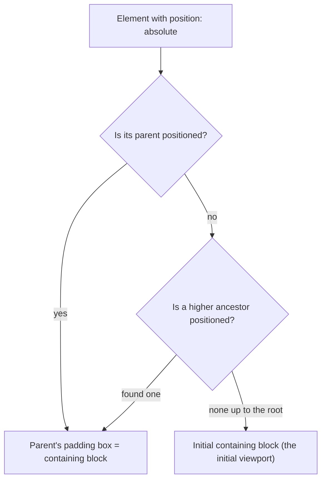
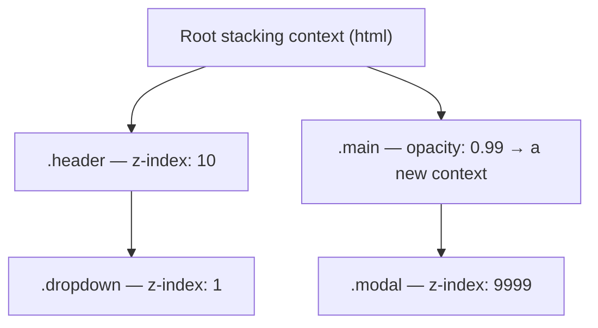

## First: what is normal flow?

Before we get to `position`, we need to know where elements go **without** it. By default the browser lays elements out in HTML order: blocks stacked vertically, inline boxes side by side in lines (see [Box model](/css/box-model-display)). This natural arrangement is called **normal flow**.

In normal flow every element **takes up space** and the others make room for it: if a paragraph gets taller, everything below it moves down.

But sometimes we want to take an element out of that order:

- A small badge sitting in the corner of a card.
- A header that stays at the top while scrolling.
- A modal that opens on top of everything.
- A tooltip that appears next to a button without shifting the rest of the page.

The **`position`** property exists for exactly this. It decides two things:

1. Whether the element **takes space** in normal flow or **leaves** it.
2. **What** the offset properties (`top`, `right`, `bottom`, `left`) are measured from.

## The offset properties: `top`, `right`, `bottom`, `left` and `inset`

These four properties set the element's distance from the **edges of its reference** (which reference depends on `position` — each section says). One thing that confuses people at first: `top: 20px` means "the element's top edge is 20px **below** the reference's top edge" — it moves the element **down**, not up.

```css
.a { top: 20px; }           /* 20px from the reference's top → moves down */
.b { left: -10px; }         /* negative values are allowed → 10px past the left edge */
.c { bottom: 0; right: 0; } /* stuck to the reference's bottom-right corner */
```

**`inset`** is the shorthand for all four and works like `margin` with 1–4 values:

```css
.overlay { inset: 0; }            /* = top: 0; right: 0; bottom: 0; left: 0 */
.box     { inset: 10px 20px; }    /* top and bottom 10px · left and right 20px */
```

On bilingual sites use the logical versions: `inset-inline-start` (left in English, right in Persian), `inset-inline-end`, `inset-block-start` (top) and `inset-block-end` (bottom).

## The five `position` values at a glance

| Value | Takes space in normal flow? | Offsets relative to | Creates a stacking context? |
| --- | --- | --- | --- |
| `static` (default) | Yes | — (`top` and `z-index` are ignored) | No |
| `relative` | Yes (its original space stays reserved) | Its own normal position | Only with a non-`auto` `z-index` |
| `absolute` | **No** | The nearest positioned ancestor | Only with a non-`auto` `z-index` |
| `fixed` | **No** | The viewport (the browser window) | **Always** |
| `sticky` | Yes | The nearest scroll container | **Always** |

"**Positioned**" means an element whose `position` is anything **other than** `static`. You'll hear this term a lot.

Try them all in the playground below. In particular, compare `absolute` with a `static` vs a `relative` parent, and scroll the page to see `sticky` and `fixed`:

<PositionPlayground />

Now let's look at each value precisely.

## `static`: the default

Every element is `position: static` by default: it sits in normal flow and `top`, `left`, … and `z-index` have **no effect** on it. You rarely write `static`, except to reset an element that was positioned earlier (e.g. inside a media query).

## `relative`: a visual shift, original space kept

The element is **first** placed at its normal spot in normal flow, **then** visually shifted from that spot by `top`/`left`/…. The key point: **its original space stays empty** and surrounding elements don't move at all, as if the element were still there.

```text
Normal flow:            B with relative; top: 20px; left: 30px
┌──────┐                ┌──────┐
│  A   │                │  A   │
└──────┘                └──────┘
┌──────┐                ┌ ─ ─ ─┐   ← B's space is still reserved
│  B   │                      ┌──────┐
└──────┘                └ ─ ─ │  B   │
┌──────┐                ┌─────└──────┘
│  C   │                │  C   │   ← C didn't move
└──────┘                └──────┘
```

```html live
<style>
  .box { width: 120px; padding: 10px; margin: 6px 0; background: #e9edfc; border: 1px solid #2459e0; font: 14px system-ui; }
  .moved { position: relative; top: 20px; inset-inline-start: 40px; background: #ffd8a8; }
</style>
<div class="box">A</div>
<div class="box moved">B (relative)</div>
<div class="box">C — didn't move</div>
```

**Its main use today:** shifting elements with `relative` is rare. We almost always write `position: relative` **without** any `top`/`left`, so that the element becomes the **reference** for its `absolute` children (next section).

## `absolute`: completely out of the flow

With `absolute`:

1. The element **leaves normal flow entirely**. Its siblings are laid out as if it didn't exist; no space is reserved for it.
2. `top`/`left`/… are measured from its **containing block** (defined below).
3. It no longer stretches to full width; it shrinks to fit its content.

```html live
<style>
  .card { position: relative; width: 240px; padding: 16px; background: #f6f7f8; border: 1px solid #ccd; border-radius: 10px; font: 14px system-ui; }
  .badge { position: absolute; top: 8px; inset-inline-end: 8px; background: crimson; color: white; padding: 2px 8px; border-radius: 99px; font-size: 12px; }
</style>
<div class="card">
  <span class="badge">New</span>
  A product card. The badge sits in the card's corner without pushing the text.
</div>
```

`.card` became the reference with `position: relative`, and `.badge` was placed relative to its corner. Now remove `position: relative` from `.card` and watch the badge escape to the corner of the whole page.

### The containing block: the offset reference

The **containing block** is the rectangle an element's position (and its percentage `width` and `top`) is calculated from. It differs per `position` value:

| position | Containing block |
| --- | --- |
| `static` / `relative` / `sticky` | The content box of the nearest block ancestor |
| `absolute` | The **padding box** of the nearest positioned ancestor; if there is none, the **initial containing block** (a viewport-sized rectangle at the top of the page) |
| `fixed` | The viewport — **unless** an ancestor has `transform`, `perspective`, `filter`, `contain: paint`, `will-change: transform` or `container-type` |

To find the reference for an `absolute` element, the browser walks this path:



**Padding box** means `top: 0` starts at the inner edge of the border; the parent's padding doesn't affect where the element goes.

<Callout type="mistake">
A classic bug: a modal with `position: fixed` sits inside an element that has a `transform` (say, a card with a hover animation). Now the modal is no longer fixed to the viewport — it's trapped inside that card and scrolls with it. Fix: render the modal at the document root (`createPortal` in React), or use `<dialog>` with `showModal()`, which renders in the **top layer**, outside all these rules.
</Callout>

### Common `absolute` patterns

```css
/* 1. Fill the parent completely: a dark overlay on an image, a skeleton, … */
.overlay { position: absolute; inset: 0; }

/* 2. Classic centring (unknown size) */
.center {
  position: absolute;
  top: 50%;                          /* top edge moves to the parent's middle */
  left: 50%;                         /* left edge moves to the parent's middle */
  transform: translate(-50%, -50%);  /* move back by half its own size → exactly centred */
}

/* 3. Centring with a known size */
.center-modern { position: absolute; inset: 0; margin: auto; width: 200px; height: 100px; }
```

Why does pattern 2 need `transform`? `top: 50%` moves the element's **top edge** to the middle, not its centre. `translate(-50%, -50%)` (percentages in `translate` refer to **the element's own size**) moves it back by half its own width and height.

## `fixed`: pinned to the screen

Like `absolute` it leaves the flow, but its reference is the **viewport**, so it stays put on screen while scrolling. Uses: fixed headers or bottom bars, chat buttons, toasts, "back to top" buttons.

```css
.chat-button { position: fixed; bottom: 20px; inset-inline-end: 20px; }
```

Three things to know:

- `fixed` **always** creates a new stacking context (explained below).
- On mobile, the viewport resizes when the keyboard opens or the address bar collapses; `bottom: 0` elements may end up behind the keyboard.
- A fixed header covers content. Compensate for it: `padding-top` on `body`, and `scroll-padding-top` on `html` so that clicking a `#section` link doesn't hide the heading under the header.

## `sticky`: normal until it sticks

`sticky` combines `relative` and `fixed`. The element takes space in the flow like any normal element, until scrolling brings it to the **threshold** you set (e.g. `top: 0`). From that moment it sticks and stays put. But there's an important condition: **only while its parent is on screen**. When the end of the parent arrives, it scrolls away with the parent.

```text
Scroll container
┌────────────────────────┐
│ ┌─ parent ───────────┐ │
│ │ [sticky header]  ← │ │  sticks at top: 0 while scrolling
│ │  ...               │ │
│ │  ...               │ │
│ │ [header leaves     │ │  when the end of the parent arrives,
│ └─ with its parent] ─┘ │  it scrolls away with the parent
└────────────────────────┘
```

```html live
<style>
  .scroller { height: 220px; overflow-y: auto; border: 1px solid #ccd; border-radius: 8px; font: 14px system-ui; }
  section { padding-bottom: 8px; }
  h4 { position: sticky; top: 0; margin: 0; padding: 8px 12px; background: #2459e0; color: white; }
  p { margin: 8px 12px; }
</style>
<div class="scroller">
  <section><h4>Section A</h4><p>Text…</p><p>Text…</p><p>Text…</p><p>Text…</p></section>
  <section><h4>Section B</h4><p>Text…</p><p>Text…</p><p>Text…</p><p>Text…</p></section>
  <section><h4>Section C</h4><p>Text…</p><p>Text…</p><p>Text…</p><p>Text…</p></section>
</div>
```

Scroll inside the box: each heading sticks until the end of its section, then the next heading takes over. It's the same pattern as the letter headings in a phone's contact list.

### Why isn't my `sticky` working? (checklist)

1. **No threshold.** At least one of `top`, `bottom`, `left` or `right` is required. Without it, `sticky` behaves like `relative`.
2. **An ancestor has `overflow: hidden`, `auto` or `scroll`.** That ancestor becomes the scroll container and the element sticks relative to **it**. If that ancestor doesn't scroll itself, sticky never activates. `overflow: clip` clips the same way without creating a scroll container, so it doesn't have this problem.
3. **The parent is the same height as the element.** There's no room left to stick in. Common in flexbox, because `align-items: stretch` makes the child as tall as the parent; fix it with `align-self: start`.
4. **The element is taller than the viewport.** It can't stick fully.

```css
/* A sticky sidebar that scrolls on its own */
.sidebar {
  position: sticky;
  top: 1rem;
  align-self: start;                      /* essential in flex and grid */
  max-height: calc(100dvh - 2rem);
  overflow-y: auto;
}
```

## `z-index` and stacking contexts: who is on top?

The page is two-dimensional, but elements can overlap, so the browser has to decide which one is drawn **in front**. This third axis (depth) is called the **z axis**.

### The default painting order

Without any `z-index`, the browser paints layers in this order, from bottom (back) to top (front):

1. The background and border of the element that roots this group
2. Positioned children with a negative `z-index`
3. Normal (non-positioned) blocks in the flow
4. `float`ed elements
5. Inline content (text, …)
6. Positioned children with `z-index: auto` or `0`, in DOM order
7. Positioned children with a positive `z-index`, from small to large

Two important consequences: a positioned element is painted over normal elements even without a `z-index`. And between two positioned elements in the same situation, **the one later in the HTML is in front**.

### `z-index`

`z-index` is an integer (can be negative) that changes the order: larger means further in front. It only affects **positioned** elements and **flex and grid children**; on a plain `static` element it does nothing.

### Stacking context: the most important idea in this section

This is where most developers get stuck. A **stacking context** is a **closed group** of layers. It has two rules:

1. **`z-index` is only compared between members of the same group.**
2. **The whole group is placed, as one unit, in the parent group using its root's `z-index`.**

An analogy: think of each stacking context as a **folder**. You can reorder the sheets inside a folder (internal z-index), but no sheet can leave its folder and land on top of another folder. If folder A is under folder B, **every** sheet in A stays under B — even one labelled "z-index: 9999".



In this structure `.modal` with `z-index: 9999` stays **under** `.header`! Because `.modal` is inside the `.main` folder, and at the root level the `.main` folder (no z-index) is compared with `.header` (z-index 10) — and loses.

See it live:

```html live
<style>
  .card { position: relative; padding: 16px; margin: 8px; border: 1px solid #ccc; font: 14px system-ui; }
  .a { background: #e9edfc; z-index: 1; }
  .b { background: #fff3bf; z-index: 2; margin-top: -40px; margin-inline-start: 40px; }
  .tooltip { position: absolute; z-index: 999; top: 30px; background: #c92a2a; color: white; padding: 8px; }
</style>
<div class="card a">
  Card A (z-index: 1)
  <div class="tooltip">Tooltip with z-index: 999 — but under card B!</div>
</div>
<div class="card b">Card B (z-index: 2)</div>
```

Card A, with `position: relative` and `z-index: 1`, created a folder. The tooltip lives in that folder, so z-index 999 only means something inside card A. Now remove `z-index: 1` from `.a`: card A no longer creates a folder, and the tooltip can compete with card B.

### What creates a stacking context?

Part of this list is obvious and part is surprising; the surprising ones are usually what cause bugs:

- The root element (`html`)
- `position: absolute` or `relative` **with** a non-`auto` `z-index`
- `position: fixed` or `sticky` (always)
- A flex or grid child with a non-`auto` `z-index`
- `opacity` less than 1 ← surprising
- `transform`, `filter`, `backdrop-filter`, `perspective`, `clip-path`, `mask` (any value other than `none`) ← surprising
- `mix-blend-mode` other than `normal`
- `isolation: isolate` (made exactly for this)
- `will-change` naming any of the properties above
- `contain: layout` or `paint`, and `container-type: size` or `inline-size`

### Why isn't my `z-index` working?

1. **The element isn't positioned.** `z-index` does nothing on `static` (except for flex and grid children).
2. **The element is inside a folder that is itself lower.** Like the tooltip above. Set `z-index` on the **folder's root**, not on the element.
3. **An ancestor accidentally created a folder.** A `transform` for an animation, an `opacity: 0.99`, a `will-change`.
4. **An ancestor has `overflow: hidden`.** Not a stacking issue, but the most common reason a "dropdown only shows halfway": anything outside that ancestor is clipped, whatever its z-index.

<Callout type="tip">
For debugging: Chrome DevTools has a **Layers** panel and Edge has **3D View**, which show layers and stacking contexts in 3D.
</Callout>

### Robust solutions in real projects

```css
/* 1. A documented z-index scale in your design system instead of random numbers */
:root {
  --z-dropdown: 100;
  --z-sticky: 200;
  --z-overlay: 300;
  --z-modal: 400;
  --z-toast: 500;
}

/* 2. Isolate a component so its internal z-indexes don't leak out */
.card { isolation: isolate; }
```

3. **Portals:** render modals, tooltips and dropdowns at the end of `body` (e.g. `createPortal` in React) so they aren't trapped in any folder.
4. **The top layer:** `dialog.showModal()` and the `popover` attribute display the element in a layer above everything, independent of any z-index or stacking context.
5. **CSS anchor positioning:** placing a tooltip relative to its button with CSS alone. It shipped first in Chromium and other browsers are adding it; check the support table before relying on it in production.

## Common mistakes

<Callout type="mistake">
**`position: absolute` with no positioned parent.** The element escapes to the corner of the whole page. Put `position: relative` on the parent that should be the reference.
</Callout>

<Callout type="mistake">
**Raising `z-index` instead of understanding stacking contexts.** Even `z-index: 99999999` won't help if the element is inside a folder that's lower.
</Callout>

<Callout type="mistake">
**`sticky` inside an ancestor with `overflow: hidden`.** Usually a global wrapper meant to stop horizontal scrolling; write `overflow-x: clip` instead.
</Callout>

<Callout type="mistake">
**Animating with `top` and `left`.** Every frame needs a new layout and the animation stutters. Move things with `transform: translate()` (see [CSS performance](/css/rendering-performance)).
</Callout>

## Interview questions

<QA q="Explain the difference between `relative`, `absolute`, `fixed` and `sticky`." level="junior" n={1}>
<Answer>

- `relative` takes space in the flow and is shifted from its own normal position; its original space stays empty.
- `absolute` leaves the flow and is placed relative to the nearest positioned ancestor.
- `fixed` leaves the flow and stays fixed relative to the viewport.
- `sticky` is in the flow until it reaches its threshold in the scroll container, then sticks until the end of its parent.

</Answer>
<Deep>

The containing block for `absolute` is the positioned ancestor's padding box; for `fixed` it's the viewport, unless an ancestor has `transform`, `filter` or `contain`. `fixed` and `sticky` always create stacking contexts. A percentage `top` for `absolute` is relative to the containing block's height, but percentage `padding` and `margin` (even vertical) are relative to its **width**.

</Deep>
<Mistake>

Saying `absolute` is positioned "relative to its parent". It's relative to the nearest **positioned** ancestor, not necessarily the direct parent.

</Mistake>
<FollowUp>

Why would a `position: fixed` element scroll with the page? (An ancestor has a `transform` or `filter`.)

</FollowUp>
</QA>

<QA q="What is a stacking context, and why does `z-index: 9999` sometimes not work?" level="mid" n={2}>
<Answer>

A stacking context is a closed group of layers; `z-index` is only compared between members of the same group, and the whole group is placed in its parent group using its root's `z-index`. If an element is inside a group that is itself below another element, no internal z-index can lift it. Also, `z-index` has no effect on non-positioned elements (other than flex/grid children).

</Answer>
<Deep>

Accidentally created contexts are very common: `opacity`, `transform`, `filter`, `will-change`. Chrome's Layers panel or Edge's 3D View help debug. The robust fix: a documented z-index scale, `isolation: isolate` for components, and portals or the top layer for overlays.

</Deep>
<Mistake>

Writing ever-larger z-indexes instead of finding the parent context.

</Mistake>
<FollowUp>

What does `isolation: isolate` do, and why is it useful for design-system components? (It creates a stacking context with no visual side effect, so a component's internal z-indexes can't clash with the rest of the page.)

</FollowUp>
</QA>

<QA q="Why isn't `position: sticky` working? How do you debug it?" level="mid" n={3}>
<Answer>

I check: is a threshold like `top` set? Is there an ancestor with `overflow` other than `visible` or `clip`? Does the parent have extra room to scroll, or is it the same height as the element (e.g. because of `align-items: stretch` in flex)?

</Answer>
<Deep>

Sticky is calculated relative to the nearest scroll container. If a wrapper has `overflow-x: hidden` (usually to prevent horizontal scrolling), that wrapper becomes the scroll container, and since it doesn't scroll itself, sticky never activates. `overflow: clip` clips the same way without creating a scroll container.

</Deep>
<Mistake>

Putting `overflow: hidden` on `body` or a global wrapper to fix horizontal scrolling and breaking every sticky element.

</Mistake>
<FollowUp>

How do you detect whether a sticky element is currently "stuck"? (An IntersectionObserver on a sentinel element, or a scroll-state container query in CSS.)

</FollowUp>
</QA>

## Recap

<Recap>

- Normal flow is the default layout; `position` decides whether an element stays in it or leaves, and what its offsets are measured from.
- `top: 20px` means 20px below the reference's top edge; `inset` is the shorthand for all four sides.
- `static` is the default and ignores `top` and `z-index`.
- `relative` shifts visually and keeps its space; its main job is to be the reference for `absolute` children.
- `absolute` leaves the flow and is placed relative to the nearest positioned ancestor's padding box.
- `fixed` is fixed to the viewport, unless an ancestor has a `transform` or `filter`.
- `sticky` is normal until it hits its threshold and only sticks until the end of its parent; `overflow` on ancestors is the most common reason it breaks.
- `z-index` is only compared within one stacking context; `opacity`, `transform` and `filter` create contexts too.
- For overlays use portals, `dialog` and `popover` (the top layer), and `isolation: isolate`.

</Recap>
