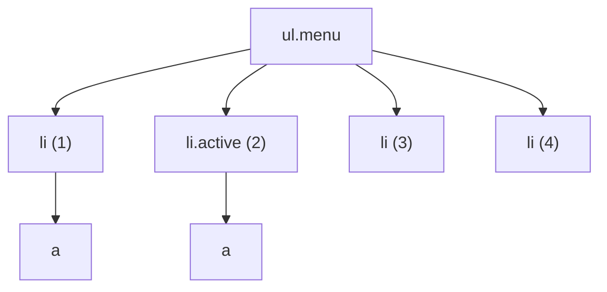

## What is a selector?

Every CSS rule starts with a question: "**which** elements should this style apply to?" The answer is a **selector**: a pattern the browser compares against every element on the page; each element that matches gets the style.

```css
/*  ↓ selector     ↓ style */
    .card    { padding: 16px; }
```

Selectors aren't only for CSS. The same language is used in JavaScript (`document.querySelector(".card")`), in tests (Playwright, Testing Library) and in tools like jQuery. So whatever you learn here pays off in several places.

We'll start from the simplest selector and work step by step up to today's powerful ones like `:has()`. For every selector we also note its specificity; if you don't know what specificity is yet, read [specificity in the cascade chapter](/css/fundamentals) first.

## Basic selectors

Five basic selectors are the building blocks of all the others.

### Type selector (tag name)

Write a tag name to select **every** element of that type. Specificity: `(0,0,1)`.

```css
p { line-height: 1.7; }      /* every paragraph */
button { cursor: pointer; }  /* every button */
```

Mostly used for base styles and resets. It is not a good fit for component styles, because it affects every `button` anywhere on the site.

### Class selector

A dot plus the class name. Selects elements that have that class in their `class` attribute. An element can have many classes, and a class can appear on many elements. Specificity: `(0,1,0)`.

```html live
<style>
  .badge { padding: 2px 8px; border-radius: 99px; background: #e9edfc; font: 600 13px system-ui; }
  .badge.success { background: #d3f9d8; color: #2b8a3e; } /* has both classes */
</style>
<span class="badge">Normal</span>
<span class="badge success">Success</span>
```

`.badge.success` (no space) means an element that has **both** classes. That is completely different from `.badge .success` (with a space), which means "a `.success` inside a `.badge`". That space is explained in the combinators section.

Classes are the main styling tool in modern projects: reusable, with moderate and predictable specificity.

### ID selector

`#` plus the `id` value. Every `id` must be **unique** on the page. Specificity: `(1,0,0)`, so it beats any number of classes.

```css
#main-header { position: sticky; top: 0; }
```

<Callout type="tip">
Avoid IDs for styling. Their specificity is so high that overriding them later takes another ID or `!important`. Keep IDs for in-page links (`#section`), connecting a `label` to an `input`, and accessibility attributes.
</Callout>

### Universal selector (`*`)

Matches **every** element. Specificity: `(0,0,0)` — no weight at all.

```css
/* The most common use: reset the box model for every element */
*, *::before, *::after {
  box-sizing: border-box;
}
```

### Attribute selector

Inside square brackets, selects elements by their attributes. Specificity: `(0,1,0)`, the same as a class. It comes in eight forms:

| Pattern | Means | Example | Matches |
| --- | --- | --- | --- |
| `[attr]` | The attribute exists (any value) | `[required]` | `<input required>` |
| `[attr="v"]` | Value is **exactly** `v` | `[type="email"]` | `<input type="email">` |
| `[attr~="v"]` | `v` is one of the space-separated words | `[data-tags~="new"]` | `data-tags="sale new hot"` |
| `[attr\|="v"]` | Equals `v` or starts with `v-` | `[lang\|="en"]` | `en`, `en-US`, `en-GB` |
| `[attr^="v"]` | **Starts** with `v` | `a[href^="https://"]` | secure links |
| `[attr$="v"]` | **Ends** with `v` | `a[href$=".pdf"]` | links to a PDF |
| `[attr*="v"]` | Contains `v` anywhere | `[class*="col-"]` | `class="col-6"` |
| `[attr="v" i]` | Case-insensitive comparison | `[type="EMAIL" i]` | `type="email"` |

```html live
<style>
  a { display: block; margin: 4px 0; font: 15px system-ui; }
  a[href^="http"]:not([href*="example.com"])::after { content: " ↗"; } /* external link */
  a[href$=".pdf"]::before { content: "📄 PDF · "; }
  [data-state="open"] { background: #d3f9d8; padding: 4px; }          /* style by state */
</style>
<a href="https://developer.mozilla.org">External link</a>
<a href="https://example.com/about">A link on our own site</a>
<a href="/files/report.pdf">Annual report</a>
<div data-state="open">Open panel</div>
```

Styling by `data-*` and `aria-*` is a common pattern in modern libraries. Radix UI, for example, puts `data-state="open"` on elements, and you write the open style with `[data-state="open"]`. The benefit: the component's **real state** and its style can never drift apart.

## Combining selectors

Before combinators, learn the two simple ways to combine:

```css
/* 1. Compound (no space): every condition applies to one element */
button.primary[disabled] { opacity: 0.5; }
/* i.e. an element that is a button AND has class primary AND has the disabled attribute */

/* 2. Comma (selector list): "or" — the rule applies to each */
h1, h2, h3 { font-family: "Geist", sans-serif; }
```

In a compound selector the type selector must come **first**: `button.primary` is valid; `.primarybutton` is something else.

## Combinators: relationships between elements

Sometimes we select an element by **its position relative to other elements**: "links inside the menu", "the paragraph right after a heading". A **combinator** is a symbol between two selectors that expresses that relationship. There are four. We'll try them all on this structure:



### Descendant: a space

`A B` means any `B` **anywhere inside** `A`, at any depth (child, grandchild, …).

- `.menu a` → both `a`s; both are inside `.menu`, even though neither is a direct child.

### Child: `>`

`A > B` means a `B` that is a **direct child** of `A` — exactly one level down.

- `.menu > li` → all four `li`s.
- `.menu > a` → **nothing**; the `a`s are grandchildren of the `ul`, not children.

When components nest (a menu inside a menu), `>` stops styles leaking into deeper levels.

### Adjacent sibling: `+`

**Siblings** are elements that share a parent. `A + B` means a `B` that comes **immediately after** `A`.

- `.active + li` → only `li (3)`.

The classic use: spacing between items without spacing the first one: `li + li { margin-top: 8px; }`

### General sibling: `~`

`A ~ B` means **every** `B` that comes **after** `A` (not necessarily immediately) with the same parent.

- `.active ~ li` → `li (3)` and `li (4)`.

### "Previous sibling" and "parent"?

Combinators only work **downward** (descendants) and **forward** (later siblings). The reason was performance: the browser builds the DOM top to bottom, and when it reaches an element it hasn't seen the later siblings yet. For years, selecting a parent or previous sibling was impossible — until `:has()` arrived (fully explained below): `li:has(+ .active)` means "the `li` immediately followed by `.active`", i.e. `li (1)`.

See them all together, and try moving the `active` class:

```html live
<style>
  li { padding: 4px 8px; margin: 2px 0; list-style: none; border-radius: 4px; font: 15px system-ui; }
  .active { background: #2459e0; color: white; }
  .active + li { background: #ffd8a8; }        /* adjacent sibling */
  .active ~ li { border: 2px dashed #e8590c; } /* all later siblings */
  li:has(+ .active) { background: #d3f9d8; }   /* previous sibling via :has */
</style>
<ul>
  <li>1 — previous sibling (:has)</li>
  <li class="active">2 — active</li>
  <li>3 — both + and ~</li>
  <li>4 — only ~</li>
</ul>
```

| Combinator | Syntax | Means | Specificity |
| --- | --- | --- | --- |
| Descendant | `A B` | B somewhere inside A | none |
| Child | `A > B` | B a direct child of A | none |
| Adjacent sibling | `A + B` | B immediately after A | none |
| General sibling | `A ~ B` | any B after A | none |

## Pseudo-classes: selecting by state

Some things aren't written in the HTML but matter for styling: "the mouse is over this button", "this checkbox is ticked", "this is the last list item". A **pseudo-class** is written with one colon (`:`) and selects an element by that **state or position** — as if the browser gave the element a temporary class and removed it again. Every pseudo-class weighs the same as a class: `(0,1,0)`.

### Interactive states (mouse, keyboard, touch)

**`:hover`**: the mouse pointer is over the element. On touch screens it is unreliable (activated by a tap and sometimes stuck on), so put it inside `@media (hover: hover)` and never show important information only on hover.

**`:active`**: between pressing and releasing the mouse button (or finger). Good for a "pressed" feel on buttons.

**`:focus`**: the element has focus, i.e. keyboard input goes to it. Activated by a click or by the Tab key.

**`:focus-visible`**: has focus **and** the browser decided the focus ring should be shown — in practice, the user is using a keyboard. This is the best place to style focus rings: keyboard users see it, mouse users don't get an ugly ring after clicking.

**`:focus-within`**: the element itself or **any of its descendants** has focus. For highlighting a whole form or card while one of its inputs is active.

**`:visited`**: a link the user has visited before. For privacy reasons only colour properties can be changed (otherwise a site could read your history by measuring layout).

**`:target`**: the element whose `id` matches the `#` part of the current URL. If the URL is `page.html#faq`, `#faq:target` is active. Handy for highlighting the section a user was linked to.

```html live
<style>
  button { font: 600 15px system-ui; padding: 8px 16px; border-radius: 8px; border: 1px solid #ccd; background: white; }
  @media (hover: hover) { button:hover { background: #eef2fd; } }
  button:active { transform: scale(0.96); }
  button:focus-visible { outline: 3px solid #2459e0; outline-offset: 2px; }
  form { padding: 12px; border: 2px solid #e4e6ea; border-radius: 10px; margin-top: 10px; }
  form:focus-within { border-color: #2459e0; }
</style>
<button>Hover me, click me, press Tab</button>
<form><input placeholder="Click me — the whole form highlights" style="width: 90%" /></form>
```

**The LVHFA order for links:** these pseudo-classes have equal specificity, so by the cascade rules the last one wins. If you write `:hover` before `:visited`, hover won't work on visited links. The correct order:

```css
a:link {}          /* L — unvisited link */
a:visited {}       /* V — visited */
a:hover {}         /* H — mouse over it */
a:focus-visible {} /* F — keyboard focus */
a:active {}        /* A — at the moment of clicking */
```

### Form states

| Pseudo-class | Active when |
| --- | --- |
| `:checked` | A ticked checkbox or radio, or a selected `option` |
| `:disabled` / `:enabled` | A disabled (`disabled`) / enabled control |
| `:required` / `:optional` | With / without the `required` attribute |
| `:valid` / `:invalid` | The value does / doesn't satisfy its validation constraints (`required`, `type`, `pattern`, `min`…) |
| `:user-valid` / `:user-invalid` | The same, but **only after the user has interacted with the field** |
| `:placeholder-shown` | The input is empty and its placeholder is visible |
| `:read-only` / `:read-write` | Not editable / editable |
| `:in-range` / `:out-of-range` | A number inside / outside `min` and `max` |
| `:indeterminate` | A checkbox in the "indeterminate" state (neither ticked nor empty; set via JavaScript) |
| `:default` | The default option of a group (e.g. a radio that was `checked` from the start) |

The difference between `:invalid` and `:user-invalid` matters a lot in practice:

```html live
<style>
  input { display: block; margin: 6px 0; padding: 6px; font: 14px system-ui; width: 90%; border: 2px solid #ccc; border-radius: 6px; }
  .a:invalid { border-color: crimson; }      /* red right away! */
  .b:user-invalid { border-color: crimson; } /* only after the user interacts */
</style>
<input class="a" type="email" required placeholder=":invalid — red before you do anything" />
<input class="b" type="email" required placeholder=":user-invalid — type something and leave" />
```

`:invalid` treats an empty `required` field as invalid from the moment the page opens, so the user faces a red form before typing a single character. `:user-invalid` waits until the user has changed the field and left it.

A common trick with `:placeholder-shown` is a **floating label** with no JavaScript:

```css
/* When the input isn't empty or has focus, the label moves up */
.input:not(:placeholder-shown) + label,
.input:focus + label {
  transform: translateY(-1.4em) scale(0.85);
}
```

### Position in the tree (tree-structural)

This group selects an element by **its position among its siblings**:

| Pseudo-class | Matches |
| --- | --- |
| `:first-child` / `:last-child` | The first / last child of its parent |
| `:only-child` | The only child of its parent |
| `:nth-child(An+B)` | A child whose position satisfies `An+B` (counting from 1) |
| `:nth-last-child(An+B)` | The same, counting from the end |
| `:first-of-type`, `:last-of-type`, `:only-of-type`, `:nth-of-type()` | The same, but counting only siblings **with the same tag name** |
| `:empty` | An element with no children at all — not even whitespace text (in most browsers) |
| `:root` | The document root, i.e. `html`, with a class's specificity. The usual place for CSS variables |

#### How does the `An+B` formula work?

The browser gives `n` the values `0, 1, 2, 3, …` in turn, and every positive result is the position of a child that gets selected. For `2n+1`:

```text
n = 0  →  2×0 + 1 = 1   ← 1st child
n = 1  →  2×1 + 1 = 3   ← 3rd child
n = 2  →  2×2 + 1 = 5   ← 5th child
...      result: the odd children
```

And for `-n+3` (less intuitive):

```text
n = 0  →  -0 + 3 = 3   ← 3rd
n = 1  →  -1 + 3 = 2   ← 2nd
n = 2  →  -2 + 3 = 1   ← 1st
n = 3  →  -3 + 3 = 0   ← there is no child number 0; done
...      result: the first three
```

| Expression | Selects |
| --- | --- |
| `:nth-child(3)` | Only the 3rd |
| `:nth-child(odd)` or `2n+1` | 1, 3, 5, … |
| `:nth-child(even)` or `2n` | 2, 4, 6, … |
| `:nth-child(3n)` | 3, 6, 9, … |
| `:nth-child(n+4)` | The 4th onwards |
| `:nth-child(-n+3)` | The first three |
| `:nth-child(n+2):nth-child(-n+5)` | The 2nd to the 5th (intersection of both) |
| `:nth-last-child(-n+3)` | The last three |
| `:nth-child(2 of .active)` | The 2nd of the elements that have class `active` |

```html live
<style>
  ol { display: flex; gap: 4px; padding: 0; list-style: none; font: 600 14px system-ui; }
  li { width: 32px; height: 32px; display: grid; place-items: center; background: #eef0f3; border-radius: 6px; }
  /* Change this line: odd, 3n, n+4, -n+3, … */
  li:nth-child(odd) { background: #2459e0; color: white; }
</style>
<ol><li>1</li><li>2</li><li>3</li><li>4</li><li>5</li><li>6</li><li>7</li><li>8</li><li>9</li></ol>
```

#### `:nth-child` vs `:nth-of-type`

One of the most frequent interview questions. Take this HTML:

```html
<div>
  <h2>Title</h2>
  <p>first p</p>
  <p>second p</p>
</div>
```

- **`:nth-child`** first counts **all** children, **then** checks the tag. `p:nth-child(2)` means "the 2nd child, if it is a `p`" → "first p".
- `p:nth-child(1)` → **nothing**; the first child is the `h2`, not a `p`.
- **`:nth-of-type`** only counts siblings **with the same tag**. `p:nth-of-type(1)` means "the first `p`" → "first p".
- `p:first-child` → nothing (same reason as `nth-child(1)`).

```html live
<style>
  .demo > * { margin: 2px 0; padding: 4px 8px; font: 14px system-ui; }
  .a p:nth-child(2)   { background: #ffd8a8; }
  .b p:nth-of-type(2) { background: #c5f6fa; }
</style>
<div class="demo a"><h4>p:nth-child(2)</h4><p>first p</p><p>second p</p></div>
<div class="demo b"><h4>p:nth-of-type(2)</h4><p>first p</p><p>second p</p></div>
```

<Callout type="mistake">
`:nth-of-type` counts by **tag name**, not class. `.item:nth-of-type(2)` means "an element that is the 2nd of its tag type **and** has class `item`", not "the second `.item`". To count by class, use `:nth-child(2 of .item)`.
</Callout>

## Logical selectors: `:is()`, `:where()`, `:not()` and `:has()`

These four pseudo-classes take a **selector list** as input and have made CSS far more powerful.

### `:is()`: shortening repetitive selectors

`:is(A, B, C)` means "any of A or B or C". Instead of repeating a pattern several times, you write it once:

```css
/* Before: repeated three times */
header a:hover, nav a:hover, footer a:hover { color: var(--accent); }

/* After */
:is(header, nav, footer) a:hover { color: var(--accent); }
```

**Specificity:** the weight of its **strongest** selector. A trap: `:is(#id, .class)` gets ID weight even for an element that only matches `.class`.

### `:where()`: `:is()` with zero weight

Works exactly like `:is()`, with one difference: its specificity is **always zero**, whatever is inside.

```css
/* A zero-weight reset — any simple class can override it */
:where(ul, ol)[role="list"] { list-style: none; padding: 0; }
```

| | `:is()` | `:where()` |
| --- | --- | --- |
| Specificity | Weight of the strongest argument | **Always zero** |
| Forgiving? | Yes | Yes |
| Use for | Shortening selectors | Base styles, resets and libraries that should be easy to override |

What does **forgiving** mean? In a normal selector list, if even one selector is invalid (say, a new pseudo-class the browser doesn't know) the **whole rule** is ignored. Inside `:is()` and `:where()` only that invalid selector is skipped and the rest still work.

### `:not()`: anything but this

Selects elements that do **not** match its list. Specificity: weight of the strongest argument.

```css
/* Every item except the last gets a divider */
li:not(:last-child) { border-bottom: 1px solid var(--line); }

/* Buttons except disabled ones and the ghost variant */
.btn:not(:disabled, .btn--ghost):hover { filter: brightness(1.1); }
```

Two traps:

- `:not(p)` on its own also matches `html` and `body`, because they aren't `p` either!
- `:not(.dark) span` means "a `span` with **at least one** ancestor without `.dark`" (and `html` is always such an ancestor), not "a `span` with no `.dark` ancestor". For the second meaning: `span:not(.dark span)`.

### `:has()`: selecting a parent by its children

For years the most requested CSS feature was: "style the card differently when it has an image" or "make the whole field red when its input is invalid". The only way was JavaScript — listen for events and add a class to the parent. `:has()` (in every browser since 2023) made it possible.

`A:has(B)` means "an `A` that has a `B` **inside** it". The selector inside `:has()` is evaluated relative to `A` itself, so it can start with a combinator: `A:has(> B)` (direct child) or `A:has(+ B)` (next sibling).

```css
/* A card that contains an image */
.card:has(img) { grid-template-rows: 200px auto; }

/* A field with an invalid input → show the error message */
.field:has(input:user-invalid) .error { display: block; }

/* The label of a ticked checkbox */
label:has(> input:checked) { font-weight: 700; }

/* Lock page scrolling while a modal is open */
body:has(dialog[open]) { overflow: hidden; }

/* A "quantity query": if the grid has more than 4 items, use 3 columns */
.grid:has(> :nth-child(5)) { grid-template-columns: repeat(3, 1fr); }

/* Previous sibling: the li immediately followed by .active */
li:has(+ .active) { opacity: 0.8; }
```

```html live
<style>
  .field { display: block; border: 2px solid #ccc; padding: 10px; border-radius: 8px; margin-bottom: 8px; font: 14px system-ui; }
  .field:has(input:focus) { border-color: #2459e0; }
  .field:has(input:checked) { background: #d3f9d8; border-color: #2b8a3e; }
  .field:has(input:user-invalid) { border-color: #c92a2a; background: #fff5f5; }
</style>
<label class="field"><input type="checkbox" /> Tick me — the parent turns green</label>
<div class="field"><input type="email" required placeholder="Enter an invalid email and leave" style="width: 90%" /></div>
```

<Callout type="warning">
`:has()` can be expensive: a change to one element may force the browser to recompute the styles of all its ancestors. Avoid `:has()` on `body` or `*` with conditions that change constantly (like a page-wide `:has(:hover)`). Nested `:has()` and pseudo-elements inside it are not allowed. For older browsers, write a fallback with `@supports selector(:has(a)) { … }`.
</Callout>

## Pseudo-elements: selecting part of an element

A **pseudo-class** selects an **existing** element in a particular state. A **pseudo-element** is different: it selects **part** of an element (such as a paragraph's first line) or a **new virtual box** that doesn't exist in the HTML. It is written with two colons (`::`) and weighs the same as a tag: `(0,0,1)`.

### `::before` and `::after`

These create a virtual **first** and **last** child inside the element. The **`content`** property is **required**; without it they aren't created at all (even for empty content you must write `content: ""`).

```text
<button class="btn">            ← the real element
  ::before                       ← virtual first child (inside the button, not outside)
  "Save"                         ← the real content
  ::after                        ← virtual last child
</button>
```

```html live
<style>
  .required::after { content: " *"; color: crimson; }
  .card { position: relative; width: 240px; height: 120px; border-radius: 12px; overflow: hidden;
          background: url("data:image/svg+xml,%3Csvg xmlns='http://www.w3.org/2000/svg'%3E%3Crect width='100%25' height='100%25' fill='%2390a4ff'/%3E%3C/svg%3E"); }
  .card::before {           /* a dark overlay on the image, no extra HTML */
    content: "";
    position: absolute;
    inset: 0;
    background: linear-gradient(transparent, rgb(0 0 0 / 0.65));
  }
  .card span { position: absolute; bottom: 10px; inset-inline-start: 12px; color: white; font: 700 16px system-ui; }
</style>
<label class="required" style="font: 15px system-ui">Email</label>
<div class="card"><span>Text over a gradient</span></div>
```

Another common pattern is the **stretched link**: the whole card is clickable but there is only one link in the HTML:

```css
.card { position: relative; }
.card a::after { content: ""; position: absolute; inset: 0; } /* a transparent layer over the whole card */
```

### The other pseudo-elements

| Pseudo-element | Selects | Example |
| --- | --- | --- |
| `::first-letter` | The first letter of a block | A large drop cap in an article |
| `::first-line` | The first **rendered** line (changes with width) | Bold first line |
| `::selection` | Text the user has selected | `::selection { background: var(--accent); }` |
| `::placeholder` | An input's placeholder text | `input::placeholder { color: gray; opacity: 1; }` |
| `::marker` | The bullet or number of list items | `li::marker { color: var(--accent); }` |
| `::backdrop` | The layer behind a modal `dialog` or fullscreen element | `dialog::backdrop { background: rgb(0 0 0 / .5); }` |
| `::file-selector-button` | The "choose file" button of `input type="file"` | Styling an upload button |

A note on `::placeholder`: Firefox lowers placeholder opacity by default, so add `opacity: 1` for the same colour in every browser.

### Rules for pseudo-elements

- `::before` and `::after` don't work on **void elements** (`img`, `input`, `br`, `hr`). Those tags have no content, so there's nowhere for a virtual child to go.
- Some screen readers read text in `content`, but users can't select or copy it. Don't put important text in CSS.
- Only **one** pseudo-element is allowed per selector, and it must come **last**: `a:hover::after` is valid, `a::after:hover` isn't.
- The legacy single-colon form (`:before`) still works for compatibility, but `::` is the standard and distinguishes pseudo-elements from pseudo-classes.

## Selectors in JavaScript

Every selector you've learned also works in these four DOM methods:

```js
document.querySelector(".card:has(img)");      // the first matching element, or null
document.querySelectorAll("li:nth-child(odd)"); // a static NodeList (does not update with the DOM)
element.matches(":focus-visible");              // does element itself match? true or false
element.closest("[data-id]");                   // nearest matching ancestor (including itself), or null
```

`closest` is the foundation of **event delegation**: one listener on the parent, and `event.target.closest(".item")` tells you which item was clicked (see [Events](/browser/events)). Pseudo-elements can't be selected from JavaScript (`querySelector("::before")` doesn't work), but you can read their styles with `getComputedStyle(el, "::before")`.

## Common mistakes

<Callout type="mistake">
**Confusing `:nth-child` with `:nth-of-type`.** The first counts all children and then checks the tag; the second counts only same-tag siblings. Neither counts by class — that needs `:nth-child(n of .class)`.
</Callout>

<Callout type="mistake">
**Forgetting `content: ""`** on `::before`/`::after`. Without it no box is created and your styles do nothing.
</Callout>

<Callout type="mistake">
**`outline: none` on `:focus` with no replacement.** Keyboard users can no longer tell where they are on the page. If you dislike the default ring, design a better one with `:focus-visible`.
</Callout>

<Callout type="mistake">
**Styling errors with `:invalid`.** `required` fields turn red the moment the page opens. Use `:user-invalid`.
</Callout>

<Callout type="mistake">
**Long selectors tied to DOM structure** like `main > div > div:nth-child(2) ul li a`. They break on the smallest HTML change. A meaningful class is more robust and readable.
</Callout>

## Interview questions

<QA q="What is the difference between a pseudo-class and a pseudo-element?" level="junior" n={1}>
<Answer>

A **pseudo-class** (like `:hover` or `:checked`) selects an **existing** element based on its state or position. A **pseudo-element** (like `::before` or `::first-line`) selects **part** of an element or a **new** virtual box that isn't in the DOM. The first uses `:`, the second `::`.

</Answer>
<Deep>

A pseudo-class weighs the same as a class; a pseudo-element the same as a tag. Pseudo-elements can't be selected from the DOM (`querySelector('::before')` doesn't work), but `getComputedStyle(el, '::before')` returns their styles.

</Deep>
<Mistake>

Saying `::before` is placed before and outside the element. It is actually the element's **first child**, inside it.

</Mistake>
<FollowUp>

Why doesn't `::before` work on an `img`? (`img` is a void element with no content for a virtual child to live in.)

</FollowUp>
</QA>

<QA q="What is the difference between `:is()` and `:where()`, and when do you prefer `:where()`?" level="mid" n={2}>
<Answer>

Both take a selector list and are forgiving. `:is()` takes the weight of its strongest argument; `:where()` always has zero weight. I prefer `:where()` for base styles, resets and library styles so consumers can override them with a simple class.

</Answer>
<Deep>

`:is(#id, .class)` gets ID weight even when the element only matches `.class` — a common trap. Forgiving means that if the browser doesn't recognise one selector inside, the others still work, unlike a normal selector list where one bad selector kills the whole rule.

</Deep>
<Mistake>

Thinking `:is()` is just shorthand with no effect on specificity.

</Mistake>
<FollowUp>

How would you build a design system whose styles never get into specificity fights with consumer styles? (`:where()` plus `@layer`.)

</FollowUp>
</QA>

<QA q="What problem did `:has()` solve? Give a real example." level="senior" n={3}>
<Answer>

It made it possible to select an element based on its descendants or later siblings — the "parent selector" that didn't exist for years and required JavaScript. Examples: `.field:has(input:user-invalid)` to make the whole field box red, or `body:has(dialog[open]) { overflow: hidden }` to lock scrolling while a modal is open.

</Answer>
<Deep>

Before `:has()` we had to listen for events and add classes to parents. Now that state stays in CSS, which in React also means fewer unnecessary renders. Performance-wise, engines use smart invalidation, but `:has()` on top-level elements with frequently changing conditions can make style recalculation expensive.

</Deep>
<Mistake>

Using `:has()` without a fallback in a product that must support older browsers (`@supports selector(:has(a))`).

</Mistake>
<FollowUp>

How do you select a "previous sibling" with `:has()`? (`a:has(+ b)`)

</FollowUp>
</QA>

<QA q="In a div whose children are `h2, p, p`, what does `p:nth-child(2)` select? And `p:nth-of-type(2)`?" level="mid" n={4}>
<Answer>

`p:nth-child(2)` selects the **first** `p`: it is the parent's 2nd child and its tag is `p`. `p:nth-of-type(2)` selects the **second** `p`: the 2nd `p` among same-tag siblings.

</Answer>
<Deep>

`nth-child` counts all children and then checks the tag; `nth-of-type` counts only same-tag siblings. With `:nth-child(2 of p.note)` you can restrict counting to any selector, including a class.

</Deep>
<Mistake>

Expecting `.item:nth-of-type(2)` to select the second element with class `item`.

</Mistake>
<FollowUp>

How do you select only the last three items of a list? (`:nth-last-child(-n+3)`)

</FollowUp>
</QA>

## Recap

<Recap>

- A selector decides which elements a rule applies to; the same language works in `querySelector`, `matches` and `closest`.
- The five basics: tag `(0,0,1)`, class `(0,1,0)`, ID `(1,0,0)`, `*` with no weight, and attribute selectors (class weight, eight forms).
- Compound selectors mean "and" on one element; a comma means "or".
- Combinators express relationships: space (descendant), `>` (direct child), `+` (adjacent sibling), `~` (later siblings). They carry no weight.
- Pseudo-classes select states: interactive (`:hover`, `:focus-visible`), form (`:checked`, `:user-invalid`) and structural (`:nth-child`).
- `:nth-child` counts all children then checks the tag; `:nth-of-type` counts same-tag siblings; use `of` to count by class.
- `:is()` takes its strongest argument's weight, `:where()` weighs zero; both are forgiving.
- `:has()` makes parent and previous-sibling selection possible.
- Pseudo-elements (`::before`, `::after`, `::marker`, …) create part of an element or a virtual box; before/after require `content`.

</Recap>
