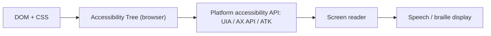

## What is accessibility?

`Accessibility`, abbreviated **a11y**, means building products everyone can use — including people with visual, hearing, motor or cognitive disabilities. That includes users who:

- listen to the page through a **screen reader** such as NVDA, JAWS, VoiceOver or TalkBack;
- only use a **keyboard** or a switch device;
- browse with heavy zoom or high contrast;
- have a temporary limitation (a broken arm, harsh sunlight on the screen).

### Why it matters

1. **Human:** about 16% of the world's population has some form of disability.
2. **Legal:** required in many countries (the ADA in the US, the European Accessibility Act since 2025).
3. **Product quality:** what's good for accessibility is usually better for everyone (captions, good contrast, keyboard navigation).
4. **Standards:** the `WCAG (Web Content Accessibility Guidelines)` define levels A, AA and AAA. The common industry target is **WCAG 2.2 AA**.

The four WCAG principles — **POUR**:

| Principle | Meaning | Example |
| --- | --- | --- |
| Perceivable | Information can be seen or heard | `alt` text, captions, contrast |
| Operable | Everything works from the keyboard | Visible focus, no keyboard traps |
| Understandable | Content and behaviour are predictable | Clear labels, helpful error messages |
| Robust | Works with assistive technology | Valid HTML, correct roles and states |

## How a screen reader works



The browser builds an **accessibility tree** from the DOM and CSS. Elements with `display: none`, `visibility: hidden` or `aria-hidden="true"` are removed from it. The screen reader reads the tree through the OS accessibility API and announces each node's role, name and state: "button, Save, dimmed".

## ARIA

`ARIA (Accessible Rich Internet Applications)` is a set of attributes that **change the accessibility tree, not behaviour**. ARIA adds no focus, keyboard handling or styling.

Three categories:

| Category | Examples | Purpose |
| --- | --- | --- |
| Roles | `role="tab"`, `role="dialog"`, `role="alert"` | What kind of element it is |
| Properties | `aria-label`, `aria-labelledby`, `aria-describedby`, `aria-controls` | Fairly static characteristics |
| States | `aria-expanded`, `aria-checked`, `aria-selected`, `aria-busy` | Changing values JS must keep updated |

### `aria-label`

Provides an accessible name as a **string**. For elements without visible text:

```html
<button aria-label="Close">
  <svg aria-hidden="true">...</svg>
</button>
```

### `aria-labelledby`

Takes the name from **other element(s)**. Accepts several space-separated IDs and wins over `aria-label` and `label`:

```html
<h2 id="billing">Billing address</h2>
<section aria-labelledby="billing">...</section>

<span id="qty-label">Quantity</span>
<span id="qty-unit">(packs)</span>
<input aria-labelledby="qty-label qty-unit" />  <!-- name: "Quantity (packs)" -->
```

### `aria-describedby`

An additional **description** (not the name). Screen readers read it after the name and role, usually after a pause:

```html
<label for="pwd">Password</label>
<input id="pwd" type="password" aria-describedby="pwd-rules" />
<p id="pwd-rules">At least 8 characters including a number.</p>
```

### How the accessible name is computed

Simplified priority order:

1. `aria-labelledby`
2. `aria-label`
3. Native labelling: `label` for inputs, `alt` for images, `caption` for tables, `legend` for fieldsets
4. Text content (for roles like button and link)
5. `title` (last resort; unreliable)

### When NOT to use ARIA

**The five rules of ARIA:**

1. If a native HTML element has the semantics and behaviour you need, **use it** instead of ARIA.
2. Don't change native semantics: `<h2 role="tab">` is wrong; `<div role="tab"><h2>…</h2></div>` is right.
3. All interactive ARIA controls must be **keyboard operable**.
4. Don't use `role="presentation"` or `aria-hidden="true"` on a focusable element.
5. All interactive elements must have an **accessible name**.

```html
<!-- bad: redundant ARIA -->
<button role="button" aria-label="Send">Send</button>
<nav role="navigation">...</nav>
<a href="/" role="link">Home</a>

<!-- bad and dangerous: hiding a focusable element -->
<a href="/cart" aria-hidden="true">Cart</a>

<!-- good -->
<button>Send</button>
<nav aria-label="Primary">...</nav>
```

<Callout type="interview">
The WebAIM Million report shows that pages using ARIA have, on average, **more accessibility errors** than pages without it. ARIA is powerful, but wrong ARIA is worse than no ARIA.
</Callout>

## Keyboard navigation and focus

Keyboard users move with:

| Key | Action |
| --- | --- |
| `Tab` / `Shift+Tab` | Next / previous focusable element |
| `Enter` | Activate links and buttons |
| `Space` | Activate buttons, toggle checkboxes |
| Arrow keys | Move inside composite widgets (radio group, tabs, menu, listbox) |
| `Escape` | Close dialogs, menus, popovers |

### tabindex

| Value | Behaviour |
| --- | --- |
| No tabindex | Only native interactive elements (`a[href]`, `button`, `input`, …) are in the tab order |
| `tabindex="0"` | Adds a non-interactive element to the natural tab order |
| `tabindex="-1"` | Out of the tab order but focusable via `el.focus()` (for programmatic focus) |
| `tabindex="1"` or higher | **Anti-pattern:** reorders tabbing independently of the DOM; practically unmaintainable |

### Visible focus

```css
/* Never do this: */
*:focus { outline: none; }

/* Do this instead: */
:focus-visible {
  outline: 3px solid var(--focus-color);
  outline-offset: 2px;
}
```

`:focus-visible` only matches when the browser decides the user needs a focus indicator (typically keyboard use, not mouse clicks).

### Roving tabindex

In composite widgets (a tab list, a toolbar) only one item has `tabindex="0"`; the rest have `-1`. Arrow keys move focus. One Tab enters the widget, the next Tab leaves it.

```js
function setupTablist(tablist) {
  const tabs = [...tablist.querySelectorAll('[role="tab"]')];

  tablist.addEventListener("keydown", (event) => {
    const current = tabs.indexOf(document.activeElement);
    // arrow keys are mirrored in RTL
    const rtl = getComputedStyle(tablist).direction === "rtl";
    const forward = rtl ? "ArrowLeft" : "ArrowRight";
    const backward = rtl ? "ArrowRight" : "ArrowLeft";

    let next = null;
    if (event.key === forward) next = (current + 1) % tabs.length;
    if (event.key === backward) next = (current - 1 + tabs.length) % tabs.length;
    if (event.key === "Home") next = 0;
    if (event.key === "End") next = tabs.length - 1;
    if (next === null) return;

    event.preventDefault();
    tabs[current].tabIndex = -1;
    tabs[next].tabIndex = 0;
    tabs[next].focus();
  });
}
```

### Focus management in SPAs

In an SPA a route change doesn't load a new page, so the screen reader announces nothing and focus stays on a link that no longer exists. Fixes:

- After navigation, move focus to the new page's `h1` (with `tabindex="-1"`) or the main container.
- Update `document.title`.
- Provide a "Skip to content" link at the top.

## Accessible forms

The rules in short (details in [Forms](/html/forms)):

- Every field has a visible `label`.
- Related radios and checkboxes are wrapped in `fieldset` with a `legend`.
- Errors are text, next to the field, linked with `aria-describedby`, with `aria-invalid="true"`.
- Correct `autocomplete`.
- Required fields marked with `required` and a visible indicator.

## Accessible buttons and links

```html
<!-- icon-only button: needs a name -->
<button type="button" aria-label="Add to favourites" aria-pressed="false">
  <svg aria-hidden="true" focusable="false">...</svg>
</button>

<!-- vague link text: bad -->
<a href="/post/1">Read more</a>

<!-- good: the link text makes sense on its own -->
<a href="/post/1">Read more about the event loop</a>

<!-- or a visually hidden suffix -->
<a href="/post/1">Read more<span class="sr-only"> about the event loop</span></a>

<!-- a link that opens a new tab -->
<a href="https://example.com" target="_blank" rel="noopener">
  Documentation <span class="sr-only">(opens in a new tab)</span>
</a>
```

The `sr-only` (visually hidden) class hides content visually but keeps it for screen readers:

```css
.sr-only {
  position: absolute;
  width: 1px;
  height: 1px;
  padding: 0;
  margin: -1px;
  overflow: hidden;
  clip-path: inset(50%);
  white-space: nowrap;
  border: 0;
}
```

| Hiding technique | Visible | Read by screen readers | Focusable |
| --- | --- | --- | --- |
| `display: none` | No | No | No |
| `visibility: hidden` | No (takes space) | No | No |
| `aria-hidden="true"` | Yes | No | Yes (dangerous) |
| `.sr-only` | No | Yes | Yes |
| `hidden` attribute | No | No | No |
| `inert` | Yes | No | No |

## Live regions

To announce dynamic changes (success messages, server errors, result counts):

```html
<div aria-live="polite" id="status"></div>   <!-- waits for current speech to finish -->
<div role="alert">...</div>                   <!-- equivalent to aria-live="assertive" -->
<div role="status">3 results found</div>      <!-- polite -->
```

The live region must **already exist in the DOM before its content changes**. If you insert the element and its content at the same time, most screen readers won't announce it.

## Colour and contrast

| Content | Minimum contrast (AA) |
| --- | --- |
| Normal text | 4.5:1 |
| Large text (24px, or 18.66px bold) | 3:1 |
| UI components and graphics (field borders, icons) | 3:1 |

Never convey information **with colour alone** (e.g. an error field that is only red). Add an icon or text.

## Testing accessibility

1. **Automated:** axe DevTools, Lighthouse, `eslint-plugin-jsx-a11y`, `@axe-core/playwright`. They catch roughly 30–40% of issues.
2. **Keyboard:** put the mouse away and complete the whole flow with Tab.
3. **Screen reader:** NVDA (Windows, free), VoiceOver (macOS/iOS).
4. **Zoom:** 200% and 400% (reflow without horizontal scrolling at 320px wide).
5. **User preferences:** `prefers-reduced-motion`, `prefers-contrast`, `forced-colors`.

## Common mistakes

- Removing the outline without a replacement.
- Bad `alt` text: "image" or the file name. Decorative images need `alt=""` (not a missing alt).
- `aria-label` on non-interactive `div`s and `span`s (most screen readers ignore it).
- `aria-hidden="true"` on an element with focusable children.
- Modals without a focus trap or focus return.
- Positive `tabindex`.
- Placeholder as a label.
- Large animations that ignore `prefers-reduced-motion`.

## Interview questions

<QA q="What's the difference between `aria-label`, `aria-labelledby` and `aria-describedby`?" level="mid" n={1}>
<Answer>

`aria-label` provides the name as a literal string. `aria-labelledby` takes the name from other elements' content by ID and has higher priority. `aria-describedby` is not a name but supplementary description, read after the name.

</Answer>
<Deep>

`aria-labelledby` can reference hidden (`hidden`) elements and concatenate several IDs in order. The name identifies the element in screen reader lists (landmarks, form controls) and in voice control ("click Save"); the description is only read on focus. Browser auto-translation doesn't translate `aria-label` — another reason to prefer visible text.

</Deep>
<Mistake>

Putting an `aria-label` on a button whose visible text is different. Voice control users say the visible text, but the name is something else (fails WCAG 2.5.3 Label in Name).

</Mistake>
<FollowUp>

How is the accessible name of a `button` containing an image with `alt` computed? (From its content, including the image's `alt`.)

</FollowUp>
</QA>

<QA q="When should you NOT use ARIA?" level="mid" n={2}>
<Answer>

When a native HTML element already has the semantics and behaviour (`button`, `nav`, `dialog`, `details`, `input type="checkbox"`). Also to change a semantic element's meaning, or when you can't implement the matching keyboard behaviour.

</Answer>
<Deep>

ARIA only changes the accessibility tree. `role="button"` promises the screen reader that Enter and Space work; if you don't keep that promise with JavaScript, the experience is worse than with no role at all. "No ARIA is better than bad ARIA."

</Deep>
<Mistake>

Adding redundant roles like `<button role="button">` or `<ul role="list">` (except special cases, e.g. Safari drops list semantics when `list-style: none`).

</Mistake>
<FollowUp>

What is the APG (ARIA Authoring Practices Guide), and what keyboard behaviour does it define for a combobox?

</FollowUp>
</QA>

<QA q="What do you need to do for accessibility after a route change in an SPA?" level="senior" n={3}>
<Answer>

Move focus to the new content's `h1` or container, update `document.title`, and optionally announce the change through a live region. Also restore or reset scroll position sensibly.

</Answer>
<Deep>

In a traditional navigation the browser loads a new page, the screen reader announces the title and focus starts at the top of the document. In an SPA none of that happens. Next.js and some routers include a route announcer that reads the page title via `aria-live`. Moving focus to an `h1` with `tabindex="-1"` is the most common pattern, so users start at the beginning of the new content.

</Deep>
<Mistake>

Moving focus to `body` or to the start of the header, forcing the user through the whole menu again.

</Mistake>
<FollowUp>

If a user goes from a filtered list to a detail page and presses Back, where should focus be?

</FollowUp>
</QA>

<QA q="How do you make an icon-only button accessible?" level="junior" n={4}>
<Answer>

Use a native `button`, give it an accessible name via `aria-label` or `sr-only` text, put `aria-hidden="true"` on the SVG, meet the minimum target size (WCAG 2.2: at least 24×24px, 44×44 recommended) and keep focus visible. A tooltip helps sighted users too.

</Answer>
<Deep>

For a toggle (like a "like" button) use `aria-pressed` and keep the name constant ("Like"), rather than switching the name between "Like" and "Unlike" while also using `aria-pressed`. SVGs were focusable in old IE/Edge, which is why `focusable="false"` still appears in some codebases.

</Deep>
<Mistake>

Relying only on `title`; it's unreliable on mobile and with many screen readers.

</Mistake>
<FollowUp>

What's the difference between `aria-pressed` and `aria-expanded`? (The first is toggle state; the second is whether a controlled region is open.)

</FollowUp>
</QA>

## Recap

<Recap>

- Accessibility means everyone — including screen-reader, keyboard and zoom users — can use the product; the common target is WCAG 2.2 AA.
- WCAG's four principles, POUR: perceivable, operable, understandable, robust.
- Screen readers read the accessibility tree; `display: none` and `aria-hidden="true"` remove an element from it.
- ARIA only changes the accessibility tree, not behaviour; you must add focus and keyboard handling yourself. If a native element exists, don't use ARIA.
- The accessible name comes, in order, from `aria-labelledby`, `aria-label`, content/`label`/`alt`, and finally `title`.
- Everything must work with a keyboard; `tabindex="0"` adds to the Tab order, `-1` allows programmatic focus only, and positive values are an anti-pattern.
- Never remove the focus ring; design it with `:focus-visible`. In SPAs, manage focus after route changes.
- Live regions (`aria-live`, `role="status"`, `role="alert"`) announce dynamic changes.
- Normal text needs at least 4.5:1 contrast and colour must never be the only way to convey information; test with axe, Lighthouse and a real screen reader.

</Recap>
