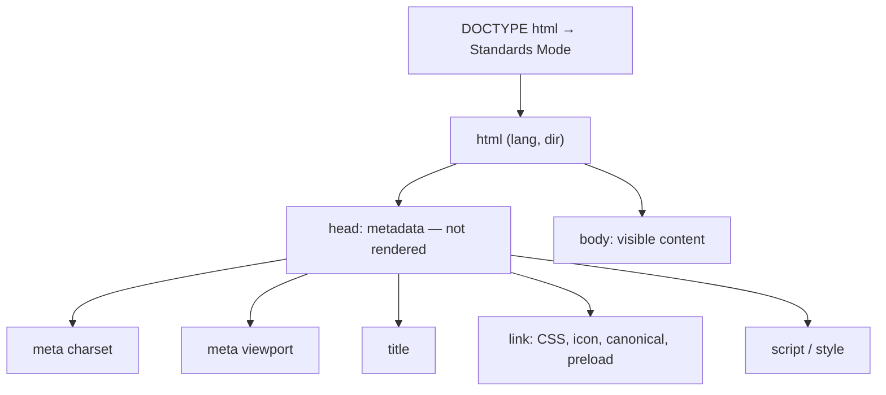

## The full structure of an HTML document

```html
<!DOCTYPE html>
<html lang="en">
  <head>
    <meta charset="UTF-8" />
    <meta name="viewport" content="width=device-width, initial-scale=1" />
    <title>Book Store | Home</title>
    <meta name="description" content="Buy books online with fast delivery" />
    <link rel="canonical" href="https://example.com/" />
    <link rel="icon" href="/favicon.svg" type="image/svg+xml" />
    <link rel="stylesheet" href="/styles.css" />
    <script src="/app.js" defer></script>
  </head>
  <body>
    <!-- visible content -->
  </body>
</html>
```



## DOCTYPE

`<!DOCTYPE html>` is **not** an HTML tag; it is an instruction telling the browser to render in **standards mode**.

### Why does it exist?

In the 90s browsers had plenty of non-standard behaviour. When they became standards-compliant, two rendering modes were introduced so old sites wouldn't break:

| Mode | Triggered by | Key difference |
| --- | --- | --- |
| Standards mode | `<!DOCTYPE html>` | Follows the CSS specs |
| Quirks mode | No DOCTYPE | Emulates old bugs, e.g. a different box model (width includes padding and border), odd table heights |
| Almost standards | Some legacy DOCTYPEs | Only differs in how images inside table cells are laid out |

```js
// In the browser console:
document.compatMode; // "CSS1Compat" = standards  |  "BackCompat" = quirks
```

<Callout type="mistake">
Leaving out the DOCTYPE doesn't produce a visible error — it produces subtle layout bugs that are hard to trace. The first line of every document should be `<!DOCTYPE html>`.
</Callout>

## The root `html` element

- `lang`: the document language. Screen readers use it for pronunciation, browsers to offer translation, CSS for `hyphens` and `:lang()` font choices.
- `dir`: text direction (`rtl`, `ltr` or `auto`). Essential for Arabic, Persian and Hebrew. Flexbox, Grid and CSS logical properties flip based on it.

## head

`head` holds **metadata**: information about the document that isn't rendered directly. Browsers, search engines and social networks read it.

| Element | Purpose |
| --- | --- |
| `title` | Tab title, search result title, bookmark name, and the first thing a screen reader announces |
| `meta` | Key–value metadata (charset, viewport, description, …) |
| `link` | Relationship to external resources: stylesheets, icons, canonical, preload, manifest |
| `script` | JavaScript |
| `style` | Inline CSS |
| `base` | Base URL for every relative URL (rare, and risky) |

## body

All visible and interactive content lives in `body`. In the DOM it is `document.body`; the head is `document.head`.

## Meta tags — deep dive

### charset

```html
<meta charset="UTF-8" />
```

**What problem does it solve?** The browser receives bytes, not characters. Without knowing the encoding it has to guess, and a wrong guess produces mojibake like "été" instead of "été".

- It must appear within the **first 1024 bytes**, because that's all the browser scans to sniff the encoding — make it the first child of `head`.
- The HTTP header `Content-Type: text/html; charset=utf-8` takes precedence over the meta tag.
- If the charset is discovered after parsing has started, the browser may re-parse the document (a performance cost).

### viewport

```html
<meta name="viewport" content="width=device-width, initial-scale=1" />
```

**What problem does it solve?** Mobile browsers assume a site was designed for desktop: they lay the page out at a virtual width of about **980px** and then shrink it. Result: tiny text and media queries that never match.

| Value | Meaning |
| --- | --- |
| `width=device-width` | Layout viewport width = device width (in CSS pixels) |
| `initial-scale=1` | No initial zoom |
| `maximum-scale=1`, `user-scalable=no` | **Disables zoom — an accessibility failure; don't use** |
| `viewport-fit=cover` | Use the full screen on notched phones, with `env(safe-area-inset-*)` |
| `interactive-widget=resizes-content` | Controls layout behaviour when the on-screen keyboard opens |

<Callout type="warning">
Disabling zoom with `user-scalable=no` fails WCAG 1.4.4. Low-vision users rely on zoom.
</Callout>

### description

```html
<meta name="description" content="A complete frontend interview guide from HTML to React" />
```

A summary search engines **may** show as the snippet under the result title. It doesn't directly affect ranking, but it does affect **click-through rate**. Roughly 150–160 characters, unique per page.

### robots

```html
<meta name="robots" content="noindex, nofollow" />
```

| Value | Meaning |
| --- | --- |
| `index` / `noindex` | Whether the page may appear in results |
| `follow` / `nofollow` | Whether the page's links are followed |
| `noarchive` | Don't show a cached copy |
| `max-snippet:-1`, `max-image-preview:large` | Control preview size |

Important: `robots.txt` blocks **crawling**, not **indexing**. If a page is blocked in robots.txt the crawler never sees its `noindex`, and the bare URL can still be indexed. To remove a page from results, allow crawling and add `noindex`. For non-HTML files use the `X-Robots-Tag` header.

### Open Graph

The Open Graph protocol (created by Facebook) controls the preview card when a link is shared on social networks and messengers:

```html
<meta property="og:type" content="article" />
<meta property="og:title" content="The event loop, explained" />
<meta property="og:description" content="Call stack, microtasks and the task queue with examples" />
<meta property="og:image" content="https://example.com/og/event-loop.png" />
<meta property="og:url" content="https://example.com/js/event-loop" />
<meta property="og:locale" content="en_US" />
<meta property="og:site_name" content="Frontend Handbook" />
```

- `og:image` must be an **absolute URL**; 1200×630 is the common size.
- It uses `property`, not `name`.
- Social crawlers don't execute JavaScript, so in a pure SPA that builds meta tags with JS they are invisible. Solutions: SSR, SSG or prerendering.

### Twitter cards

```html
<meta name="twitter:card" content="summary_large_image" />
<meta name="twitter:title" content="The event loop, explained" />
<meta name="twitter:image" content="https://example.com/og/event-loop.png" />
```

X (Twitter) falls back to Open Graph when `twitter:*` tags are missing; usually only `twitter:card` is needed.

### canonical

```html
<link rel="canonical" href="https://example.com/products/shoes" />
```

**What problem does it solve? Duplicate content.** One page can be reachable via several URLs:

```text
https://example.com/products/shoes
https://example.com/products/shoes?utm_source=newsletter
https://www.example.com/products/shoes
https://example.com/products/shoes?sort=price
```

Canonical tells search engines which one is the original, so ranking signals (link equity) are not split. It is a **hint**, not a directive.

### theme-color

```html
<meta name="theme-color" content="#F7F8FA" media="(prefers-color-scheme: light)" />
<meta name="theme-color" content="#0E1219" media="(prefers-color-scheme: dark)" />
```

Colours the mobile browser UI and the PWA window. `media` lets you specify separate values for light and dark themes.

### Favicon and icons

```html
<link rel="icon" href="/favicon.ico" sizes="32x32" />
<link rel="icon" href="/icon.svg" type="image/svg+xml" />
<link rel="apple-touch-icon" href="/apple-touch-icon.png" />  <!-- 180×180 -->
<link rel="manifest" href="/manifest.webmanifest" />           <!-- PWA icons -->
```

An SVG favicon can contain its own `prefers-color-scheme` media query and follow the system theme.

### Language and direction

```html
<html lang="en">
...
<p>The Persian word for book is <span lang="fa" dir="rtl">کتاب</span>.</p>
...
<link rel="alternate" hreflang="en" href="https://example.com/en/" />
<link rel="alternate" hreflang="fa" href="https://example.com/fa/" />
<link rel="alternate" hreflang="x-default" href="https://example.com/" />
```

- `lang` can be set on inner elements so the screen reader switches pronunciation.
- `hreflang` tells search engines where the other language versions are.
- `dir="auto"` is useful for user-generated content: direction comes from the first strong character.
- `bdi` isolates text of unknown direction (e.g. an Arabic username inside English text).

### Other important meta tags

| Tag | Purpose |
| --- | --- |
| `<meta http-equiv="Content-Security-Policy" content="...">` | A CSP when you can't set headers (limited: `frame-ancestors` doesn't work) |
| `<meta name="referrer" content="strict-origin-when-cross-origin">` | Controls the `Referer` header |
| `<meta name="color-scheme" content="light dark">` | Tells the browser the page supports both themes (scrollbars and form controls go dark) |
| `<meta name="format-detection" content="telephone=no">` | Stops iOS turning numbers into phone links |

## link, script and style

### link

`link` defines a **relationship (`rel`)** between the document and a resource. The important values:

| rel | Behaviour |
| --- | --- |
| `stylesheet` | Loads CSS — **render-blocking** |
| `icon` | Favicon |
| `canonical` | The page's canonical URL |
| `preload` | Fetch a critical resource for this page now |
| `prefetch` | Low-priority fetch for the next navigation |
| `preconnect` | Open the connection early (DNS + TCP + TLS) |
| `modulepreload` | Preload and parse an ES module |
| `alternate` | Alternate versions (languages, RSS) |

Resource hints are covered in [HTML performance](/html/performance).

### script

```html
<script src="/app.js"></script>              <!-- parser-blocking -->
<script src="/app.js" defer></script>        <!-- after parsing, in order -->
<script src="/analytics.js" async></script>  <!-- as soon as downloaded, unordered -->
<script type="module" src="/main.js"></script> <!-- deferred by default -->
```

A classic script is **parser-blocking**: the parser must stop, download and run it, because the script could change the document with `document.write`.

### style

```html
<style>
  .hero { min-height: 60vh; }
</style>
```

Inline CSS costs no extra request. The **critical CSS** technique relies on this: CSS needed above the fold is inlined and the rest is loaded later.

## Real example: the head of a product page

```html
<head>
  <meta charset="UTF-8" />
  <meta name="viewport" content="width=device-width, initial-scale=1" />
  <title>Running Shoe X | Example Shop</title>
  <meta name="description" content="Lightweight running shoe with a cushioned sole. Free shipping." />
  <link rel="canonical" href="https://shop.example/p/running-shoe-x" />

  <!-- Social -->
  <meta property="og:type" content="product" />
  <meta property="og:title" content="Running Shoe X" />
  <meta property="og:image" content="https://shop.example/og/shoe-x.jpg" />
  <meta name="twitter:card" content="summary_large_image" />

  <!-- Performance -->
  <link rel="preconnect" href="https://cdn.shop.example" crossorigin />
  <link rel="preload" as="image" href="/img/shoe-x-hero.avif" fetchpriority="high" />
  <link rel="stylesheet" href="/css/main.css" />
  <script type="module" src="/js/main.js"></script>

  <!-- Structured data for rich results -->
  <script type="application/ld+json">
    { "@context": "https://schema.org", "@type": "Product", "name": "Running Shoe X",
      "offers": { "@type": "Offer", "price": "89.00", "priceCurrency": "USD" } }
  </script>
</head>
```

## Common mistakes

- Putting `meta charset` after `title`, or beyond the first 1024 bytes.
- Disabling zoom in the viewport tag.
- The same `title` and `description` on every page (common in SPAs).
- A relative `og:image` URL.
- Relying on JavaScript to create meta tags when social crawlers don't run JS.
- Blocking a page in robots.txt hoping to remove it from search results.
- Forgetting `lang`, which hurts both accessibility and automatic translation.

## Interview questions

<QA q="What does `<!DOCTYPE html>` do and what happens without it?" level="junior" n={1}>
<Answer>

It puts the browser in standards mode. Without it the page renders in quirks mode, which emulates old non-standard behaviour such as a different box model.

</Answer>
<Deep>

In HTML5 the DOCTYPE no longer references a DTD; its only purpose is selecting the rendering mode. `document.compatMode` reports the current mode.

</Deep>
<Mistake>

Saying the DOCTYPE declares "the HTML version" or that HTML5 tags won't work without it.

</Mistake>
<FollowUp>

How is box width computed differently in quirks mode? (Width includes padding and border, like `box-sizing: border-box`.)

</FollowUp>
</QA>

<QA q="What exact problem does the viewport meta tag solve?" level="junior" n={2}>
<Answer>

Without it, mobile browsers lay the page out at a virtual width of ~980px and scale it down: text becomes tiny and mobile media queries never match. `width=device-width` sets the layout viewport to the device width.

</Answer>
<Deep>

Mobile has two viewports: the layout viewport (the basis for CSS and media queries) and the visual viewport (what is actually visible, changes with pinch zoom). `window.visualViewport` exposes the latter — useful for repositioning UI when the keyboard opens.

</Deep>
<Mistake>

Adding `user-scalable=no` for a "native feel", which breaks accessibility.

</Mistake>
<FollowUp>

Why is `100vh` problematic on mobile and how does `dvh` fix it? (See the CSS units chapter.)

</FollowUp>
</QA>

<QA q="What is canonical and when do you need it?" level="mid" n={3}>
<Answer>

`link rel="canonical"` tells search engines which URL is the original, so duplicates (UTM parameters, filters, www vs non-www) don't split ranking signals.

</Answer>
<Deep>

It's a hint; Google may ignore it if the content really differs. A self-referencing canonical is best practice. On multilingual sites each language version is its own canonical and links to the others with `hreflang` — the English page must not canonicalize to the Persian one.

</Deep>
<Mistake>

Canonicalizing every paginated page to page 1, so content on later pages never gets indexed.

</Mistake>
<FollowUp>

How does canonical differ from a 301 redirect? (A 301 moves the user too; canonical is only a signal for search engines.)

</FollowUp>
</QA>

<QA q="Why might Open Graph tags not work in an SPA, and how do you fix it?" level="senior" n={4}>
<Answer>

Social and messenger crawlers read the initial HTML and do not run JavaScript. If meta tags are created at runtime, they see an empty shell. Fixes: SSR, SSG, build-time prerendering, or an edge function that serves crawler user agents a pre-built HTML.

</Answer>
<Deep>

Googlebot does execute JavaScript (later, in a rendering queue), but Facebook, LinkedIn, Telegram and Slack crawlers don't. In React 19, `<title>` and `<meta>` rendered inside components are hoisted into `head` automatically, and they're included in the HTML output during SSR.

</Deep>
<Mistake>

Assuming social previews are fine because Google indexed the page correctly.

</Mistake>
<FollowUp>

How would you generate a dynamic og:image (e.g. with the article title)? (Render the image at the edge, cache it on a CDN, version the URL for cache busting.)

</FollowUp>
</QA>

## Recap

<Recap>

- `<!DOCTYPE html>` keeps the browser in standards mode; without it quirks mode and legacy behaviour kick in.
- `<html lang="en">` (plus `dir` for RTL) sets language and direction for screen readers, translation and fonts.
- `head` holds information about the page and is not displayed; `body` holds the visible content.
- `<meta charset="utf-8">` must appear in the first 1024 bytes so non-ASCII text isn't garbled.
- The viewport meta tag is essential on mobile; never disable zoom.
- `description` is the snippet under the title in search results; `robots` controls indexing.
- Open Graph and Twitter Cards build link previews on social networks.
- `canonical` tells search engines which URL is the original when a page has several.
- Order in `head` matters: charset, viewport, title, then preload/preconnect and CSS, and scripts with `defer`.

</Recap>
