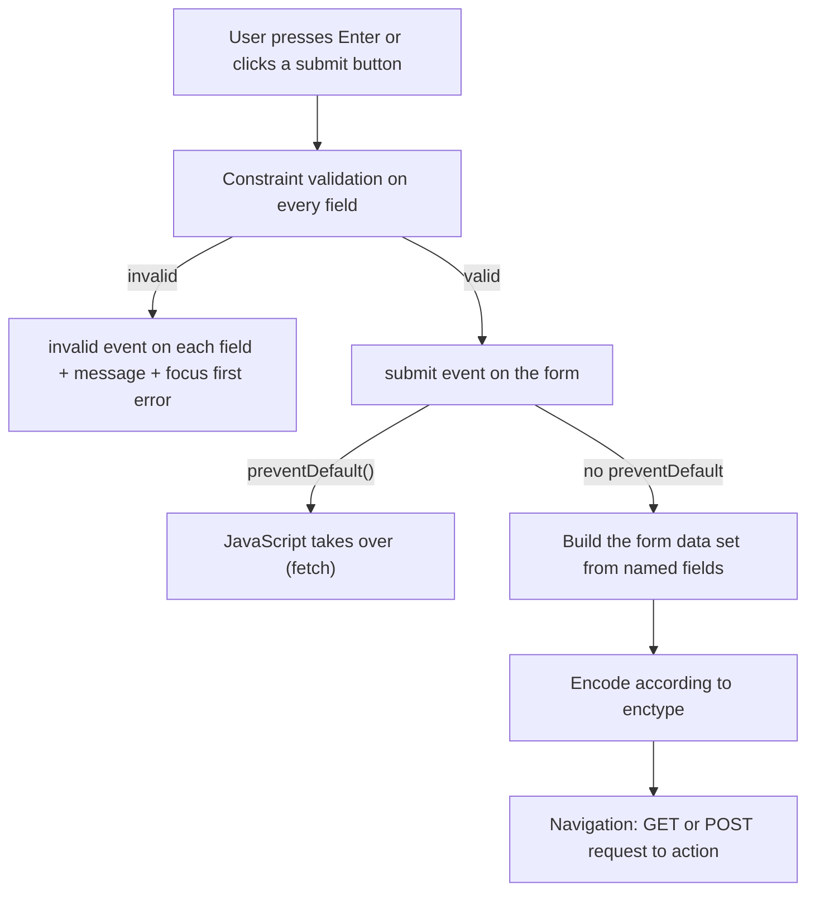

## What is a form and how does it work?

`form` is the browser's native mechanism for **collecting user data and sending it** to a server. Without a single line of JavaScript, the browser serialises, validates and submits the data.

```html
<form action="/api/register" method="post">
  <label for="email">Email</label>
  <input id="email" name="email" type="email" required autocomplete="email" />

  <label for="password">Password</label>
  <input id="password" name="password" type="password" required minlength="8"
         autocomplete="new-password" />

  <button type="submit">Create account</button>
</form>
```

### The full submit cycle at runtime



Key points:

- **Only fields with a `name` are submitted.** `id` links a field to its `label`; `name` is the data key.
- `disabled` fields are **not** submitted; `readonly` fields **are**.
- An unchecked checkbox isn't sent at all (not even as false).
- `form.submit()` in JavaScript **skips validation and the submit event**. `form.requestSubmit()` behaves like a user click.

## Form elements

### input

`type` decides behaviour, the mobile keyboard, validation and UI:

| type | Use | Native benefit |
| --- | --- | --- |
| `text` | General text | — |
| `email` | Email | Format validation, keyboard with `@` |
| `password` | Password | Masking, password-manager suggestions |
| `tel` | Phone | Numeric keypad (no format validation) |
| `url` | URL | Format validation |
| `number` | Number | `min`, `max`, `step`, spinner |
| `search` | Search | Clear button, Enter behaviour on mobile |
| `date`, `time`, `datetime-local` | Dates and times | Native picker |
| `checkbox`, `radio` | Choices | Radios grouped by the same `name` |
| `file` | Files | `accept`, `multiple`, `capture` |
| `range`, `color` | Slider, colour | |
| `hidden` | Invisible data | e.g. a CSRF token |

<Callout type="tip">
For OTP or postal codes use `type="text"` with `inputmode="numeric"` and `autocomplete="one-time-code"`. `type="number"` is wrong for "numbers you don't do maths with": it drops leading zeros, changes on mouse-wheel and accepts `e`.
</Callout>

### textarea, select, option

```html
<label for="bio">About you</label>
<textarea id="bio" name="bio" rows="4" maxlength="500"></textarea>

<label for="city">City</label>
<select id="city" name="city" required>
  <option value="">Choose one</option>
  <optgroup label="North">
    <option value="seattle">Seattle</option>
  </optgroup>
  <option value="austin" selected>Austin</option>
</select>
```

- A `required` select with a leading `value=""` option gives you a valid placeholder.
- `multiple` allows several selections.

### button

```html
<button type="submit">Save</button>      <!-- the default inside a form -->
<button type="button">Preview</button>   <!-- no default behaviour -->
<button type="reset">Clear</button>      <!-- rarely useful -->
<button type="submit" formaction="/draft" formnovalidate>Save draft</button>
```

<Callout type="mistake">
Every `button` inside a `form` defaults to `type="submit"`. A "show password" button without `type="button"` submits the form — one of the most common bugs.
</Callout>

### label

`label` provides the field's accessible name and enlarges its **click target** (clicking the label activates the field).

```html
<!-- explicit -->
<label for="agree">I accept the terms</label>
<input id="agree" type="checkbox" name="agree" />

<!-- implicit -->
<label>
  <input type="checkbox" name="news" /> Subscribe to the newsletter
</label>
```

`placeholder` is **not** a label: it disappears when typing, has low contrast, and some screen readers skip it.

### fieldset and legend

Group related fields, especially radios. A screen reader announces the `legend` when entering the group:

```html
<fieldset>
  <legend>Shipping method</legend>
  <label><input type="radio" name="shipping" value="post" required /> Post</label>
  <label><input type="radio" name="shipping" value="courier" /> Courier</label>
</fieldset>
```

`fieldset disabled` disables every field inside it at once.

## Native validation (the Constraint Validation API)

| Attribute | Constraint | Validity flag |
| --- | --- | --- |
| `required` | Not empty | `valueMissing` |
| `type="email"`/`url` | Format | `typeMismatch` |
| `pattern` | Regex (matches the whole value; no `^`/`$` needed) | `patternMismatch` |
| `min` / `max` | Number or date range | `rangeUnderflow` / `rangeOverflow` |
| `step` | Step | `stepMismatch` |
| `minlength` / `maxlength` | Text length | `tooShort` / `tooLong` |
| `setCustomValidity()` | Custom rule | `customError` |

```html
<input name="username" required pattern="[a-z0-9_]{3,16}"
       title="3–16 characters: lowercase letters, digits and _" />
```

### Validation with JavaScript

```js
const form = document.querySelector("form");
const password = form.elements.password;
const confirm = form.elements.confirm;

confirm.addEventListener("input", () => {
  // empty message = valid
  confirm.setCustomValidity(confirm.value === password.value ? "" : "Passwords don't match");
});

form.addEventListener("submit", async (event) => {
  event.preventDefault();
  if (!form.checkValidity()) return form.reportValidity();

  const data = new FormData(form);           // only named fields
  const response = await fetch(form.action, { method: "POST", body: data });
  if (!response.ok) showServerErrors(await response.json());
});
```

| Method / property | Does |
| --- | --- |
| `el.validity` | A ValidityState object with the flags above |
| `el.validationMessage` | The browser's native message |
| `el.checkValidity()` | Validates + fires `invalid`, shows nothing |
| `el.reportValidity()` | Validates + shows the native message |
| `form.noValidate` / `novalidate` | Turns off the native UI (to render custom errors) |

CSS can see validation state too. `:user-invalid` (Baseline 2023) only matches **after the user has interacted**, so fields aren't red on first load:

```html live
<style>
  input { padding: 8px; border: 2px solid #ccc; border-radius: 6px; margin: 6px 0; display:block }
  input:user-invalid { border-color: #c92a2a; }
  input:valid { border-color: #2b8a3e; }
</style>
<form onsubmit="event.preventDefault(); alert('Valid!')">
  <input type="email" required placeholder="Email" />
  <input required minlength="8" type="password" placeholder="At least 8 characters" />
  <button>Submit</button>
</form>
```

<Callout type="warning">
Frontend validation is for **user experience**, not security. Anyone can send any request with DevTools or curl. Real validation must always be repeated on the server.
</Callout>

## autocomplete

`autocomplete` tells the browser and password managers what each field holds. It directly affects conversion and accessibility (WCAG 1.3.5).

```html
<input name="name" autocomplete="name" />
<input name="email" autocomplete="email" />
<input name="tel" autocomplete="tel" inputmode="tel" />
<input name="address" autocomplete="street-address" />
<input name="password" type="password" autocomplete="current-password" />  <!-- sign in -->
<input name="password" type="password" autocomplete="new-password" />      <!-- sign up -->
<input name="otp" autocomplete="one-time-code" inputmode="numeric" />
<input name="cc" autocomplete="cc-number" inputmode="numeric" />
```

Browsers generally ignore `autocomplete="off"` on password fields — and you shouldn't fight password managers anyway.

## Submitting: GET vs POST

| | GET | POST |
| --- | --- | --- |
| Where the data goes | Query string: `?q=react&page=2` | Request body |
| Bookmarkable / shareable | Yes | No |
| Cache & history | Cacheable, kept in history | Usually not cached; refresh warns about resubmission |
| Size limit | URL length (a few KB in practice) | No practical limit |
| Idempotent | Yes (must not change data) | No |
| Use for | Search, filters | Sign-up, login, payment, upload |

### enctype

| Value | Body format | Use |
| --- | --- | --- |
| `application/x-www-form-urlencoded` (default) | `name=Ali&age=30` | Simple forms |
| `multipart/form-data` | Parts separated by a boundary | **Required for file uploads** |
| `text/plain` | Plain | Almost never |

When you pass `FormData` to `fetch`, **don't set `Content-Type` yourself** — the browser adds it with the boundary.

### The PRG pattern

`Post/Redirect/Get`: after a successful POST the server redirects with `303 See Other` to a GET page. Refreshing won't resubmit the form (no double payments).

## Forms in React 19

React 19 puts native forms back at the centre: `action` can be a function.

```jsx
import { useActionState } from "react";
import { useFormStatus } from "react-dom";

async function signup(prevState, formData) {
  const res = await fetch("/api/signup", { method: "POST", body: formData });
  if (!res.ok) return { error: "That email is already registered" };
  return { error: null };
}

function SubmitButton() {
  const { pending } = useFormStatus(); // status of the nearest parent form
  return <button disabled={pending}>{pending ? "Sending…" : "Sign up"}</button>;
}

export function SignupForm() {
  const [state, formAction] = useActionState(signup, { error: null });
  return (
    <form action={formAction}>
      <input name="email" type="email" required />
      <SubmitButton />
      {state.error && <p role="alert">{state.error}</p>}
    </form>
  );
}
```

Details in [React hooks](/react/hooks).

## Common mistakes

- Forgetting `name` and wondering why data isn't sent.
- A `button` without `type` inside a form.
- Using `placeholder` instead of `label`.
- Trusting client-side validation for security.
- `type="number"` for card numbers, phone numbers or codes.
- Manually setting `Content-Type: multipart/form-data` in fetch (the boundary is lost).
- Calling `form.submit()` and expecting validation and the submit handler to run.
- Showing errors only in red (invisible to colour-blind and screen reader users).

## Interview questions

<QA q="Why isn't a form field's value being submitted? List the possible causes." level="junior" n={1}>
<Answer>

Most often: the field has no `name`, it's `disabled`, a checkbox/radio isn't selected, the field is outside the `form` (without a `form="id"` attribute), or JavaScript called `preventDefault` and never sent the data itself.

</Answer>
<Deep>

On submit the browser builds a form data set containing only submittable elements that have a `name` and aren't disabled. The submit button that triggered submission is included if it has a `name`. Unlike `disabled`, `readonly` fields are submitted.

</Deep>
<Mistake>

Using `disabled` for a field that shouldn't be edited but must be submitted (use `readonly`).

</Mistake>
<FollowUp>

How do you associate an input outside the form tag with the form? (The `form="formId"` attribute.)

</FollowUp>
</QA>

<QA q="What's the difference between `form.submit()` and `form.requestSubmit()`?" level="mid" n={2}>
<Answer>

`submit()` sends the form directly: no constraint validation and no `submit` event. `requestSubmit()` behaves exactly like a user click: validation, the submit event, and respect for `preventDefault`.

</Answer>
<Deep>

`requestSubmit(submitter)` accepts a button as the submitter so its `formaction` and `name/value` are used. When submitting programmatically (e.g. auto-save), `requestSubmit` makes sure React or framework submit handlers run.

</Deep>
<Mistake>

Calling `form.submit()` in a handler and being surprised that the `onSubmit` logic never runs.

</Mistake>
<FollowUp>

What happens to `form.submit` if the form contains an input with `name="submit"`? (The named property shadows the method, so `form.submit` is no longer a function — a classic bug.)

</FollowUp>
</QA>

<QA q="GET or POST for a search form? Why?" level="junior" n={3}>
<Answer>

GET. Search changes nothing (it's safe and idempotent), and the result should be bookmarkable, shareable, cacheable and reachable with the Back button.

</Answer>
<Deep>

POST is for operations with side effects. Using POST for search triggers a "resubmit form?" warning on refresh, kills URL sharing and caching. Sensitive data (passwords) must not be sent via GET because it ends up in history, server logs and the `Referer` header.

</Deep>
<Mistake>

Saying POST is "more secure". Both are readable without HTTPS; only the location of the data differs.

</Mistake>
<FollowUp>

What is the Post/Redirect/Get pattern and what problem does it solve?

</FollowUp>
</QA>

<QA q="How do you design an accessible form?" level="senior" n={4}>
<Answer>

A real label for every field, radios grouped with `fieldset/legend`, correct `autocomplete`, a textual error message next to the field connected via `aria-describedby`, `aria-invalid` on invalid fields, focus moved to the first error or an error summary after submit, and never relying on colour alone.

</Answer>
<Deep>

```html
<label for="email">Email</label>
<input id="email" name="email" type="email" aria-invalid="true"
       aria-describedby="email-hint email-error" />
<p id="email-hint">We'll send your receipt here.</p>
<p id="email-error">Enter a valid email address.</p>
```

Asynchronous errors (from the server) should be announced through a live region (`role="alert"` or `aria-live="polite"`). Validate on `blur` or submit, not on every keystroke, so users don't hear errors while still typing.

</Deep>
<Mistake>

Disabling the submit button until the form is valid: users don't understand why the button doesn't work and never see an error message.

</Mistake>
<FollowUp>

In a multi-step wizard, how should focus be managed when moving to the next step?

</FollowUp>
</QA>

## Recap

<Recap>

- A form collects data and, on submit, sends it to the server according to `action` and `method`; only fields with a `name` are sent.
- An input's `type` changes the mobile keyboard and enables native validation (`email`, `url`, `number`, `tel`).
- Every field needs an associated `label` (via `for`/`id` or by nesting); a placeholder is not a label.
- A `button` inside a form defaults to `type="submit"`; write `type="button"` for other buttons.
- `fieldset` and `legend` give related groups such as radios meaning for screen readers.
- Native validation uses `required`, `pattern`, `min`/`max` and the Constraint Validation API (`setCustomValidity`, `checkValidity`); server-side validation is always required.
- Correct `autocomplete` values enable autofill and password managers.
- GET puts data in the URL (search, filters); POST puts it in the request body (creating and changing data). File uploads need `enctype="multipart/form-data"`.
- The PRG pattern (post/redirect/get) prevents resubmission on refresh; React 19 simplifies forms with `action` and `useActionState`.

</Recap>
