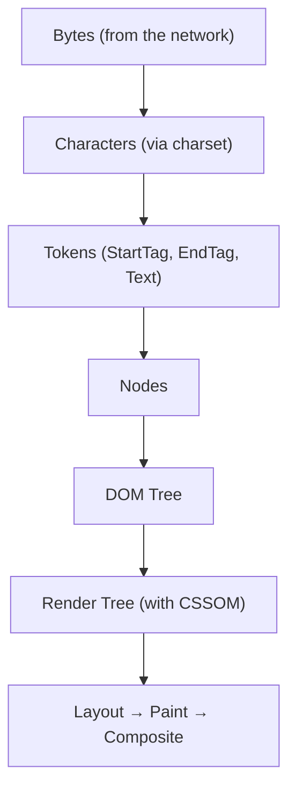
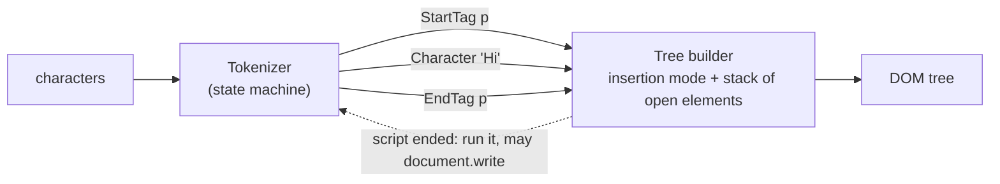
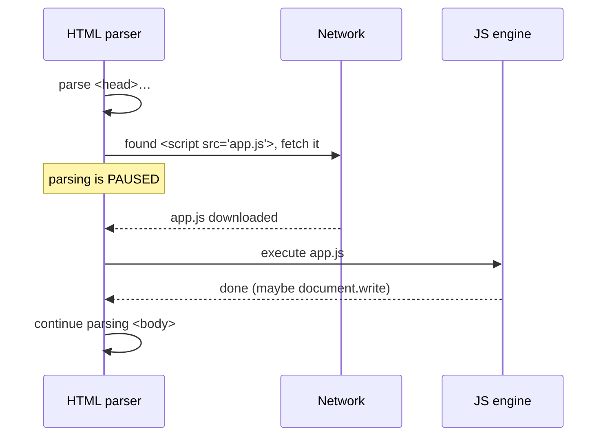
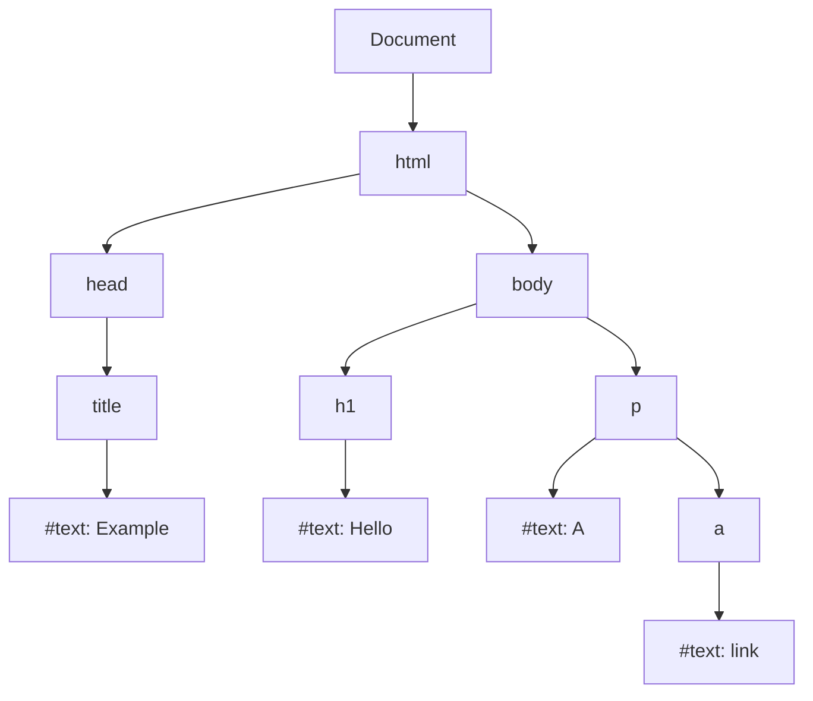
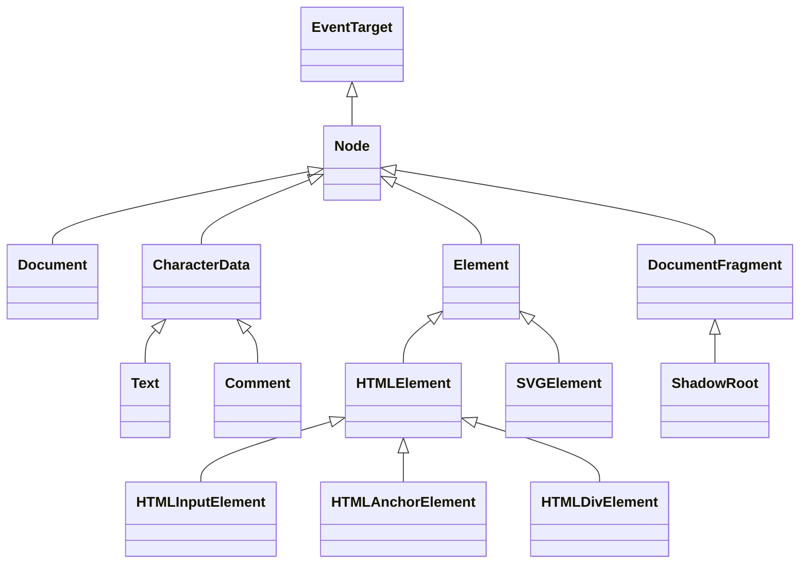

## What is HTML?

`HTML (HyperText Markup Language)` describes the **structure and meaning** of a web page's content. It is not a programming language: it has no logic, loops or conditions. Its job is to tell the browser "this is a heading", "this is a link", "this is a sign-in form".

The three layers of the frontend:

| Layer | Responsibility | Example |
| --- | --- | --- |
| HTML | Structure & semantics | This text is an `h1` |
| CSS | Presentation & layout | The colour and size of that `h1` |
| JavaScript | Behaviour & interaction | Clicking a button opens a modal |

### Why does HTML exist?

The web was created to share scientific documents. The core need was a document that could **link to other documents (hypertext)** and whose structure (headings, paragraphs, lists) could be understood independently of the device showing it. That idea still holds: good HTML must be meaningful to browsers, to `screen readers` and to search engines.

## What happens to HTML at runtime?

When the browser receives an HTML file it does not "display" it directly. It first turns it into a tree in memory:



1. **Bytes → characters:** bytes are decoded with the declared `charset` (usually UTF-8). A wrong charset produces garbled text.
2. **Tokenization:** characters become tokens such as `StartTag: p`, `Text: hello`, `EndTag: p`.
3. **Tree construction:** tokens become nodes placed into a tree — the `DOM (Document Object Model)`.
4. The HTML parser is **error-tolerant**. If you forget to close a tag, the browser repairs it following the standard algorithm. That is why invalid HTML usually "works" — but may produce a different tree than you expect.

<Callout type="interview">
If asked "how does HTML become pixels?", don't just say "the browser renders it". Walk through Bytes → Tokens → DOM, combining with the CSSOM, then Layout and Paint. It shows you understand browser internals.
</Callout>

### Inside the parser: tokenizer, tree builder and the stack of open elements

The HTML parser is a **state machine** defined in detail by the HTML Living Standard. It has two cooperating stages:

| Stage | Input | Output | Keeps track of |
| --- | --- | --- | --- |
| **Tokenizer** | A stream of characters | Tokens: DOCTYPE, start tag, end tag, comment, character, end-of-file | Its current *state* (data, tag open, attribute name, script data, …) ~80 states |
| **Tree builder** | Tokens | DOM nodes inserted into the document | The **insertion mode** (in head, in body, in table, …) and the **stack of open elements** |



The **stack of open elements** is what makes nesting work. A start tag pushes an element; its end tag pops back to it. When the tree builder sees a token that is not allowed in the current context, it follows a precise recovery rule instead of failing. That is why every browser produces the **same DOM** from the same broken markup.

#### Error recovery you will actually meet

| You write | The DOM you get | Why |
| --- | --- | --- |
| `Hello` (no `html`, `head`, `body`) | `<html><head></head><body>Hello</body></html>` | These elements are created implicitly |
| `<table><tr><td>1</td></tr></table>` | A `<tbody>` is inserted around the row | Rows must live in a table section |
| `<table><div>x</div><tr>…</tr></table>` | The `div` is moved **before** the table | "Foster parenting": invalid content inside a table is hoisted out |
| `<p>one<p>two` | Two sibling paragraphs | A new `p` start tag implicitly closes the open `p` |
| `<b><i>text</b></i>` | Correctly nested `b > i` plus a cloned `i` | The "adoption agency algorithm" repairs mis-nested formatting tags |
| `<p><div>…</div></p>` | `<p></p><div>…</div><p></p>` | `div` is not phrasing content, so it closes the paragraph |

Try it: the preview below parses deliberately broken HTML and prints the DOM the browser actually built.

```html live
<div id="out" style="font: 13px/1.6 monospace; white-space: pre-wrap"></div>
<script>
  const samples = [
    "<table><tr><td>cell</td></tr></table>",
    "<table><div>moved out</div><tr><td>x</td></tr></table>",
    "<p>one<p>two",
    "<b><i>text</b> after</i>",
    "<p><div>block</div></p>",
  ];
  const out = document.getElementById("out");
  for (const html of samples) {
    const doc = new DOMParser().parseFromString(html, "text/html");
    out.textContent += "SOURCE: " + html + "\nDOM:    " + doc.body.innerHTML + "\n\n";
  }
</script>
```

<Callout type="interview">
"Why does invalid HTML still render?" Because the HTML parser never throws: the spec defines a recovery for every error, so all browsers build the same tree. The cost is that the tree may not be the one you meant, which shows up as broken CSS selectors or React hydration errors.
</Callout>

### Scripts can pause the parser

When the tree builder meets a classic `<script>` (without `async`, `defer` or `type="module"`), it must **stop**: the script might call `document.write()`, which injects characters right back into the tokenizer's input. So the parser waits for the script to download **and** execute before it continues. A stylesheet that hasn't loaded yet can block that script too, because the script may read computed styles.



Browsers soften this with the **preload scanner**, a lightweight second parser that looks ahead in the raw HTML and starts downloading images, scripts and stylesheets while the main parser is blocked. The full loading story (`async`, `defer`, `module`, resource hints) is in [HTML performance](/html/performance).

## HTML vs XML

`XML (eXtensible Markup Language)` is also a markup language, but it is meant for **storing and transporting data**, not presenting documents.

| Feature | HTML | XML |
| --- | --- | --- |
| Purpose | Document structure & presentation | Storing & transporting data |
| Tags | Predefined (`p`, `div`, …) | Defined by the author |
| Error handling | The parser tolerates and repairs errors | Any structural error invalidates the document |
| Case | Tags are case-insensitive | Case-sensitive |
| Empty tags | `<br>` without closing is valid | Must be `<br/>` |
| Whitespace | Usually collapsed | Preserved |

`XHTML` was an attempt to write HTML with XML's strict rules. Today the standard is the `HTML Living Standard`, maintained by WHATWG.

## What is the DOM?

The `DOM` is an **object-oriented, live** representation of the document in memory, readable and writable from JavaScript. Key points:

- The DOM **is not the HTML**. HTML is the source text; the DOM is the tree built from it and can differ (the browser inserts `tbody` into tables, for instance).
- The DOM is **live**: when JavaScript adds a node the DOM changes, the HTML file does not.
- The DOM is a standard, language-independent API, exposed to JavaScript in browsers.

```html
<!DOCTYPE html>
<html lang="en">
  <head>
    <title>Example</title>
  </head>
  <body>
    <h1>Hello</h1>
    <p>A <a href="/about">link</a></p>
  </body>
</html>
```



<Callout type="note">
Whitespace between tags also creates text nodes. That's why `childNodes` usually has more entries than `children` — `children` only returns elements.
</Callout>

## Element, tag, attribute and content

These four terms are often mixed up:

```html
<a href="https://example.com" target="_blank">Visit site</a>
```

| Term | In the example | Meaning |
| --- | --- | --- |
| Tag | `<a ...>` and `</a>` | Markup in the source: opening and closing tag |
| Attribute | `href`, `target` | Extra information about the element, in the opening tag |
| Content | `Visit site` | What sits between the two tags |
| Element | The whole thing | The logical unit made of tags, attributes and content; becomes a node in the DOM |

### Void elements

Some elements have no content and no closing tag — `void elements`: `img`, `input`, `br`, `hr`, `meta`, `link`, `source`. Writing `` is allowed in HTML, but the trailing slash means nothing.

### Attribute vs property

A classic interview question: the difference between an **HTML attribute** and a **DOM property**.

- Attributes are written in **HTML** and are always strings.
- Properties live on the **DOM object** in JavaScript and can be of any type.
- Some attributes are reflected by properties (`id`), others only set the **initial value** (`value` on `input`).

```js run
// This runs in a Worker, so we simulate the browser behaviour with a plain object.
// In a real browser:
// <input id="name" value="Ali">
// input.value = "Sara"
// input.getAttribute("value") → "Ali"   (initial value, the attribute)
// input.value                 → "Sara"  (current state, the property)
// input.defaultValue          → "Ali"   (property that reflects the attribute)

const attributes = { value: "Ali" };
const input = { value: attributes.value, get defaultValue() { return attributes.value; } };
input.value = "Sara";
console.log(attributes.value, input.value, input.defaultValue);
```

#### Reflection in detail

"Reflection" means the property and the attribute stay in sync. The rules differ per attribute, and that's exactly what interviewers probe:

| Attribute | Property | Relationship |
| --- | --- | --- |
| `id` | `el.id` | Fully reflected both ways |
| `class` | `el.className` / `el.classList` | Reflected; the property has a different name because `class` is a reserved word |
| `for` (on `label`) | `label.htmlFor` | Reflected under a different name |
| `href` | `a.href` | The property returns the **resolved absolute URL**; `getAttribute("href")` returns exactly what you wrote |
| `value` (on `input`) | `input.value` vs `input.defaultValue` | The attribute is only the **initial** value; `value` is the live state, `defaultValue` reflects the attribute |
| `checked` | `input.checked` vs `input.defaultChecked` | Same split as `value` |
| `disabled`, `hidden`, `required` | Boolean properties | **Boolean attributes**: presence means true. `disabled="false"` still disables! |
| `style` | `el.style` | The property is an object (`CSSStyleDeclaration`), not a string |
| `data-*` | `el.dataset.*` | Reflected with camelCase names |
| `aria-*` | `el.ariaLabel`, `el.ariaExpanded` … | Reflected (ARIA reflection) |

```html live
<a id="link" href="/docs?page=2">Docs</a>
<label id="lbl" for="email">Email</label>
<input id="email" value="initial" />
<input id="agree" type="checkbox" disabled="false" />
<pre id="log" style="font-size:13px"></pre>
<script>
  const log = (l) => (document.getElementById("log").textContent += l + "\n");
  const a = document.getElementById("link");
  log('a.getAttribute("href") → ' + a.getAttribute("href"));
  log("a.href                → " + a.href);

  log("label.htmlFor         → " + document.getElementById("lbl").htmlFor);

  const input = document.getElementById("email");
  input.value = "typed by user";
  log("input.value           → " + input.value);
  log('getAttribute("value") → ' + input.getAttribute("value"));
  log("input.defaultValue    → " + input.defaultValue);

  const agree = document.getElementById("agree");
  log('disabled="false" → agree.disabled = ' + agree.disabled + "  (presence is what counts)");
  agree.disabled = false;   // removes the attribute
  log("after .disabled=false → hasAttribute: " + agree.hasAttribute("disabled"));
</script>
```

The practical rule: **read and write state through properties** (`input.value`, `el.hidden = true`), and use `setAttribute` for attributes that have no property, or when you need the exact source text.

## Global attributes

Some attributes are valid on **every** element. Knowing them avoids reinventing behaviour in JavaScript.

| Attribute | What it does | Notes |
| --- | --- | --- |
| `id` | Unique identifier in the document | Target of `#fragment` links, `label for`, `aria-*` references. Also creates a global `window[id]` variable (don't rely on it) |
| `class` | Space-separated list of classes | Exposed as `el.className` (string) and `el.classList` (`DOMTokenList`) |
| `style` | Inline CSS | Highest-specificity author style; exposed as `el.style` (a `CSSStyleDeclaration`) |
| `title` | Advisory tooltip | Not accessible to touch or keyboard users; never put essential info only here |
| `lang` | Language of the content | Affects screen reader pronunciation, hyphenation, `:lang()`, font choice |
| `dir` | Text direction: `ltr`, `rtl`, `auto` | `auto` picks the direction from the first strong character |
| `hidden` | Element is not relevant (rendered as `display: none`) | `hidden="until-found"` keeps it findable with Ctrl+F |
| `tabindex` | Focus order | `0` = focusable in DOM order, `-1` = focusable only by script; avoid positive values |
| `contenteditable` | Makes the content editable | Basis of rich-text editors |
| `draggable` | Enables the Drag and Drop API | |
| `inert` | Removes the subtree from focus, clicks and the accessibility tree | Ideal for content behind a modal |
| `popover` | Turns the element into a popover controlled by `popovertarget` | Top layer, light dismiss, no JS needed |
| `data-*` | Custom data for your scripts | Read via `el.dataset` |
| `translate` | `no` keeps machine translation away (e.g. brand names, code) | |
| `spellcheck`, `autocapitalize`, `enterkeyhint`, `inputmode` | Hints for text input on desktop and mobile keyboards | |

### data-* attributes and dataset

`data-*` attributes let you attach information to elements without inventing non-standard attributes. In JavaScript they appear on `el.dataset`, with names converted from kebab-case to camelCase. Values are always **strings**.

```html live
<button data-product-id="42" data-in-stock="true" data-price="19.90">Add to cart</button>
<pre id="log" style="font-size:13px"></pre>
<script>
  const btn = document.querySelector("button");
  const log = (line) => (document.getElementById("log").textContent += line + "\n");

  log("productId: " + btn.dataset.productId);          // "42" (a string!)
  log("inStock:   " + (btn.dataset.inStock === "true")); // convert explicitly
  log("price:     " + Number(btn.dataset.price));

  btn.dataset.lastClicked = "never";                    // creates data-last-clicked
  btn.addEventListener("click", () => {
    btn.dataset.lastClicked = new Date().toLocaleTimeString();
    log("outerHTML: " + btn.outerHTML);
  });
</script>
```

They are also great CSS hooks: `[data-state="open"] { … }` styles a component by its state without extra classes. Radix and Headless UI expose component state this way.

### The popover attribute: behaviour without JavaScript

```html live
<button popovertarget="menu">Open menu</button>
<div id="menu" popover style="padding:12px;border-radius:8px;border:1px solid #ccc">
  <p style="margin:0 0 8px">I'm in the top layer. Press Esc or click outside.</p>
  <button popovertarget="menu" popovertargetaction="hide">Close</button>
</div>
```

`popover` gives you the top layer (no `z-index` fights), light dismiss (click outside or Esc) and correct focus handling. Before it existed, every dropdown needed a JavaScript library.

## Nested elements

Elements can contain one another, forming **parent / child / sibling** relationships. The basic rule: close tags **in the reverse order you opened them**.

```html
<!-- correct -->
<p>This is <strong>important</strong></p>

<!-- wrong: overlapping -->
<p>This is <strong>important</p></strong>
```

Each element's **content model** also decides what may go inside it. A `p` only accepts `phrasing content`. If you put a `div` inside a `p`, the parser **closes the paragraph before the div**:

```html
<p><div>text</div></p>
```

Resulting DOM:

```text
<p></p>
<div>text</div>
<p></p>
```

This is a classic cause of `hydration mismatches` in React: the server produces an HTML string, the browser rewrites it while parsing, and React's tree no longer matches the real DOM.

## Block vs inline

Old HTML classified elements as block or inline. Today that behaviour actually comes from **CSS (`display`)**, and HTML uses *content categories* instead — but the split is still common in interviews:

| Feature | Block | Inline |
| --- | --- | --- |
| Starts on a new line | Yes | No |
| Default width | Full width of the container | Fits its content |
| `width` / `height` | Applied | Ignored |
| Vertical `margin` / `padding` | Affects layout | Padding is painted but doesn't push surrounding lines; vertical margin has no effect |
| Examples | `div`, `p`, `h1`, `section`, `ul` | `span`, `a`, `strong`, `em`, `code` |

```html live
<style>
  .block { background: #dbe4ff; margin: 6px 0; }
  .inline { background: #ffe8cc; width: 300px; height: 80px; padding: 10px; margin: 20px; }
</style>
<div class="block">div one — block</div>
<div class="block">div two — block</div>
<p>
  Text before
  <span class="inline">span (width and height are ignored)</span>
  text after
</p>
```

<Callout type="tip">
`inline-block` combines both: it stays in the text flow (no line break) but accepts `width`, `height` and vertical margins. Full details in [Box model & display](/css/box-model-display).
</Callout>

## Semantic HTML — introduction

`Semantic HTML` means choosing the element that describes the **meaning** of the content, not just its looks: `<button>` instead of `<div onclick>`, `<nav>` for primary navigation. Covered in depth in [Semantic HTML](/html/semantic).

```html
<!-- non-semantic -->
<div class="header"><div class="nav">...</div></div>

<!-- semantic -->
<header><nav aria-label="Primary">...</nav></header>
```

## Node types, whitespace and text nodes

Everything in the DOM is a `Node`, but there are several kinds:

| `nodeType` | Constant | Example | In `children`? |
| --- | --- | --- | --- |
| 1 | `ELEMENT_NODE` | `<p>`, `<div>` | ✓ |
| 3 | `TEXT_NODE` | Text, including whitespace between tags | ✗ |
| 8 | `COMMENT_NODE` | `<!-- note -->` | ✗ |
| 9 | `DOCUMENT_NODE` | `document` | — |
| 10 | `DOCUMENT_TYPE_NODE` | `<!DOCTYPE html>` | — |
| 11 | `DOCUMENT_FRAGMENT_NODE` | `DocumentFragment`, a shadow root | — |



That inheritance chain is also a **prototype chain**: `input.value` is found on `HTMLInputElement.prototype`, `addEventListener` on `EventTarget.prototype`.

```html live
<ul id="list">
  <li>one</li>
  <!-- a comment -->
  <li>two</li>
</ul>
<pre id="log" style="font-size:13px"></pre>
<script>
  const list = document.getElementById("list");
  const log = (l) => (document.getElementById("log").textContent += l + "\n");
  log("childNodes: " + list.childNodes.length + "   children: " + list.children.length);
  list.childNodes.forEach((n, i) =>
    log(i + ": nodeType " + n.nodeType + "  " + JSON.stringify(n.nodeName) + "  " + JSON.stringify(n.textContent)),
  );
  log("prototype chain of an <li>: ");
  let p = Object.getPrototypeOf(list.children[0]);
  while (p) { log("  → " + p.constructor.name); p = Object.getPrototypeOf(p); }
</script>
```

Whitespace text nodes explain several real bugs: `firstChild` returning a text node instead of the first `li`, gaps between `inline-block` elements, and `childNodes.length` being larger than expected. Prefer the element-only APIs: `children`, `firstElementChild`, `nextElementSibling`.

## Character references and escaping

Some characters have special meaning in HTML. To show them as text you use **character references** (also called entities):

| Character | Reference | Why it matters |
| --- | --- | --- |
| `<` | `&lt;` | Would start a tag |
| `>` | `&gt;` | Closes a tag (safe in text, escaped for symmetry) |
| `&` | `&amp;` | Would start a reference |
| `"` | `&quot;` | Would end a double-quoted attribute value |
| `'` | `&#39;` | Would end a single-quoted attribute value |
| non-breaking space | `&nbsp;` | Prevents a line break, e.g. `10&nbsp;kg` |
| © | `&copy;` or `&#169;` | Named or numeric reference |

Escaping is a **security** topic, not just a formatting one. If user input is inserted into HTML without escaping, it is parsed as markup: that's **XSS** (cross-site scripting).

```html live
<p>Comment: <span id="unsafe"></span></p>
<p>Comment: <span id="safe"></span></p>
<script>
  const userInput = 'Nice post!';
  document.getElementById("unsafe").innerHTML = userInput;   // ✗ parsed as HTML, the handler runs
  document.getElementById("safe").textContent = userInput;   // ✓ shown as plain text
</script>
```

The red outline proves the injected handler ran. Rules of thumb: use `textContent` (or a framework, which escapes by default) for text, and sanitize with a library such as DOMPurify (or the Sanitizer API) when you really must insert HTML. React's `dangerouslySetInnerHTML` is named that way on purpose. See [Browser security](/browser/security).

## Who defines HTML? Standards and validation

- **WHATWG** maintains the **HTML Living Standard**. There are no more numbered versions: "HTML5" was the last one, and the spec is now updated continuously.
- **W3C** works on related specs (CSS, accessibility/WAI-ARIA).
- New features ship in browsers when they reach consensus; check support on caniuse.com or MDN's compatibility tables.
- Validate markup with the W3C validator (validator.w3.org/nu) or lint it in your editor. Validity matters because the error recovery above may produce a tree you didn't intend.

## Common mistakes

- **Assuming the DOM equals the source HTML.** The browser fixes, adds and moves nodes.
- **Putting block content inside `p`**, or a link inside a link — invalid structure creates surprising DOM.
- **Using `div` for everything** and losing the free accessibility semantic elements give you.
- **Confusing attributes and properties** — e.g. expecting `getAttribute("value")` to return what the user typed.
- **Forgetting `lang` (and `dir` for RTL languages)** — required by screen readers and for correct layout.

## Interview questions

<QA q="What is the DOM and how does it differ from HTML?" level="junior" n={1}>
<Answer>

The DOM is the live, in-memory tree the browser builds after parsing HTML; JavaScript reads and modifies the page through it. HTML is the source text; the DOM is the data structure built from it.

</Answer>
<Deep>

The parser tokenizes the input and builds nodes via the tree-construction algorithm, repairing errors along the way (closing unclosed tags, inserting `tbody`). After load, JavaScript changes only the DOM. "View source" shows the original text; the DevTools Elements panel shows the current DOM.

</Deep>
<Mistake>

Saying "the DOM is the HTML code" or that the DOM is part of JavaScript. The DOM is a Web API provided by the browser; a JS engine like V8 has no DOM on its own — which is why Node.js has no `document` by default.

</Mistake>
<FollowUp>

Why do frameworks batch DOM updates (or use a virtual DOM)? (DOM writes can trigger style recalculation and layout; batching reduces that cost.)

</FollowUp>
</QA>

<QA q="Explain attribute vs property using `value` on an input." level="mid" n={2}>
<Answer>

Attributes are defined in HTML and are strings; properties live on the DOM object. On an `input`, the `value` attribute only sets the initial value (mirrored by `defaultValue`), while the `value` property holds the current state and changes as the user types.

</Answer>
<Deep>

Some attributes are reflected: setting `el.id` updates the attribute too. `value` and `checked` are not — the `checked` attribute maps to `defaultChecked`. Boolean attributes (`disabled`, `checked`) are true by their mere presence: `disabled="false"` is still disabled.

</Deep>
<Mistake>

Writing `disabled="false"` to enable a button, or using `setAttribute("value", x)` to change what the user sees (after the user has typed, it has no visible effect).

</Mistake>
<FollowUp>

Why does React have `defaultValue` alongside `value`? (Controlled vs uncontrolled inputs.)

</FollowUp>
</QA>

<QA q="What happens if you put a `div` inside a `p`?" level="mid" n={3}>
<Answer>

The parser automatically closes the `p` before the `div` starts, because `p` only accepts phrasing content. The DOM ends up with an empty paragraph, a separate div, and another empty paragraph.

</Answer>
<Deep>

This is defined by the HTML tree-construction algorithm. With server-side rendering it causes a hydration mismatch, because the generated HTML differs from the DOM the browser builds.

</Deep>
<Mistake>

Assuming the browser throws an error or keeps the element as written.

</Mistake>
<FollowUp>

How do you catch these errors? (W3C validator, React development warnings, lint rules.)

</FollowUp>
</QA>

<QA q="What's the difference between block and inline, and what problem does `inline-block` solve?" level="junior" n={4}>
<Answer>

Block elements start on a new line, take the full width and accept width/height. Inline elements flow with text and ignore width/height. `inline-block` stays in the text flow but accepts dimensions — useful for buttons side by side.

</Answer>
<Deep>

Modern CSS splits `display` into an outer display (how the box behaves among siblings: block or inline) and an inner display (how its children are laid out: flow, flex, grid). So `inline-block` is really `inline flow-root`, and `inline-flex` means inline outside, flex inside.

</Deep>
<Mistake>

Thinking block/inline is a fixed HTML property. It comes from the browser's default (user-agent) stylesheet and CSS can change it.

</Mistake>
<FollowUp>

Where does the unwanted gap between `inline-block` elements come from? (Whitespace in the HTML is rendered as a space character.)

</FollowUp>
</QA>

<QA q="How does the browser handle invalid HTML such as `<p><div>x</div></p>` or a `div` inside a `table`?" level="mid" n={5}>
<Answer>

The HTML parser never throws. The tree builder follows recovery rules defined in the spec: a `div` start tag closes the open `p` (leaving an empty `<p></p>` after it), and content that isn't allowed inside a table is "foster parented", meaning moved in front of the table. Because the rules are standardized, every browser builds the same DOM.

</Answer>
<Deep>

The tree builder tracks an *insertion mode* and a *stack of open elements*. Mis-nested formatting tags (`<b><i></b></i>`) are fixed by the adoption agency algorithm, which may clone elements. In SSR this matters: if the server's HTML is repaired differently from the tree React expects, hydration reports a mismatch.

</Deep>
<Mistake>

Assuming the DOM is a 1:1 copy of the source, then wondering why `p > div` selectors or `querySelector` results don't match.

</Mistake>
<FollowUp>

Why does `document.write` force classic scripts to block the parser, and how does the preload scanner mitigate that?

</FollowUp>
</QA>

<QA q="What are `data-*` attributes and how do you read them? What type do they have?" level="junior" n={6}>
<Answer>

They are standard custom attributes for storing data on elements: `data-user-id="7"`. JavaScript reads them through `el.dataset.userId` (kebab-case becomes camelCase) or `getAttribute("data-user-id")`. Values are always strings, so convert them explicitly.

</Answer>
<Deep>

They work well as CSS state hooks (`[data-state="open"]`) and for event delegation (`event.target.closest("[data-action]")?.dataset.action`). Don't store large or sensitive data in them: they are visible in the DOM and copied with `cloneNode`.

</Deep>
<Mistake>

Inventing non-standard attributes like `<div userid="7">` instead of `data-userid`.

</Mistake>
<FollowUp>

How would you use `data-action` attributes to implement one click handler for a whole toolbar?

</FollowUp>
</QA>

## Recap

<Recap>

- HTML is a markup language, not a programming language: it describes the structure and meaning of content.
- The browser turns HTML into the DOM with a tokenizer and a tree builder, and repairs invalid HTML using well-defined rules.
- A plain `<script>` tag stops the parser until it downloads and runs; `defer` and `async` fix this.
- The DOM is a tree of nodes that JavaScript can read and change; the HTML is only its starting point.
- An element is a start tag, content and an end tag; void elements (`img`, `input`, `br`) have no content or end tag.
- An attribute is written in HTML and is the initial value; a property lives on the DOM object and holds the current value (e.g. `value`).
- `data-*` attributes hold custom data and are read through `dataset` in JavaScript.
- Whitespace and line breaks create text nodes too; `children` returns only elements, `childNodes` returns everything.
- `<` and `&` in text must be escaped; otherwise things break and an XSS hole opens.

</Recap>
