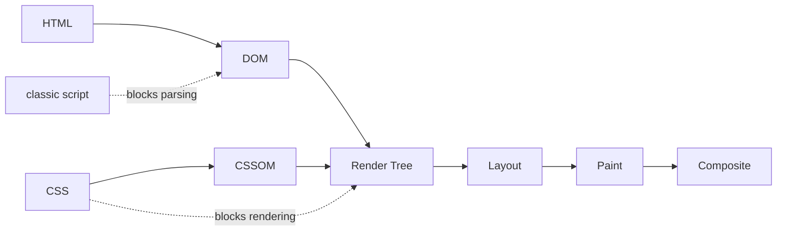
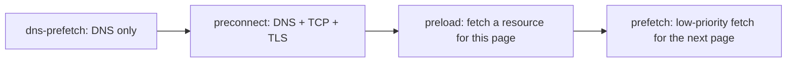

## Why HTML affects performance

The browser parses HTML as a **stream**. Every resource it finds — CSS, scripts, fonts, images — can block parsing or rendering. How and where you declare those resources decides **how soon** the user sees content.

The key metrics (`Core Web Vitals` and friends):

| Metric | Meaning | Good |
| --- | --- | --- |
| `LCP (Largest Contentful Paint)` | When the largest visible content renders | ≤ 2.5s |
| `INP (Interaction to Next Paint)` | Responsiveness to user interactions | ≤ 200ms |
| `CLS (Cumulative Layout Shift)` | Unexpected layout movement | ≤ 0.1 |
| `FCP (First Contentful Paint)` | First content rendered | ≤ 1.8s |
| `TTFB (Time to First Byte)` | First byte from the server | ≤ 0.8s |

## The critical rendering path



There are two kinds of blocking:

- **Render-blocking:** the browser **paints nothing** until the resource is ready. CSS in `head` is render-blocking by default, because rendering without it would cause a `FOUC (Flash of Unstyled Content)`.
- **Parser-blocking:** the HTML parser **stops**. Classic scripts (no async/defer) are parser-blocking. A classic script also waits for preceding stylesheets, because it might read styles (`getComputedStyle`).

### The preload scanner

Fortunately browsers have a **preload scanner**: while the main parser is blocked, a lightweight parser scans ahead and starts downloading resources (`img`, `link`, `script`) early. Resources **not in the HTML** — a background image in CSS, a font inside CSS, a script injected by JS, an image React renders later — are invisible to it. That's where `preload` comes in.

## Script loading: async, defer and module

```text
<script>          HTML ██████░░░░░░░░░░░░░██████████
                  Script      ▓▓▓▓▓▓▓█████
                              fetch    run    (parser waits)

<script async>    HTML ██████████████░░░░░███████
                  Script   ▓▓▓▓▓▓▓▓▓█████
                           parallel fetch, runs as soon as ready (parser pauses)

<script defer>    HTML ████████████████████████████
                  Script   ▓▓▓▓▓▓▓▓▓              █████
                           parallel fetch          runs after parsing, before DOMContentLoaded
```

| Feature | Classic | `async` | `defer` | `type="module"` |
| --- | --- | --- | --- | --- |
| Blocks parser while downloading | Yes | No | No | No |
| When it runs | Immediately | As soon as downloaded | After parsing finishes | Like defer (or async with `async`) |
| Order preserved | Yes | **No** | Yes | Yes |
| Before `DOMContentLoaded` | Yes | Maybe | Yes | Yes |
| Full DOM available | Only above it | Not guaranteed | Yes | Yes |
| Use for | Rarely | Analytics, independent scripts | Main app script | Modern ES modules |

```html
<!-- main application script -->
<script src="/app.js" defer></script>

<!-- independent script with no dependencies -->
<script src="https://analytics.example/a.js" async></script>

<!-- ES module (deferred and strict by default) -->
<script type="module" src="/main.js"></script>
<!-- fallback for very old browsers -->
<script nomodule src="/legacy.js" defer></script>
```

<Callout type="interview">
The classic question: "what's the difference between async and defer?" A complete answer has three parts: both download in parallel; async runs as soon as it's downloaded, in no particular order; defer runs after parsing, in order, before `DOMContentLoaded`. `defer` and `async` do nothing on inline scripts (except `type="module"`, which is always deferred).
</Callout>

### DOMContentLoaded vs load

| Event | When |
| --- | --- |
| `DOMContentLoaded` | HTML fully parsed and deferred scripts executed. Doesn't wait for images or stylesheets (unless a script is waiting on CSS) |
| `load` | Every resource (images, iframes, fonts) has loaded |

## Resource hints



### dns-prefetch

```html
<link rel="dns-prefetch" href="https://cdn.example.com" />
```

Only resolves DNS early (saves tens of milliseconds). Cheap — good for third-party origins that will *probably* be used.

### preconnect

```html
<link rel="preconnect" href="https://fonts.gstatic.com" crossorigin />
```

Performs DNS + TCP connection + TLS handshake up front — 100–500ms saved on mobile networks.

- Only for **2–4 critical origins**; each open connection costs CPU and memory, and it's closed if unused for ~10 seconds.
- If the resource is fetched with CORS (fonts always are), `crossorigin` is required; otherwise a separate connection is opened and the preconnect is wasted.

### preload

```html
<link rel="preload" href="/fonts/inter.woff2" as="font" type="font/woff2" crossorigin />
<link rel="preload" href="/hero.avif" as="image" fetchpriority="high" />
<link rel="preload" href="/critical.css" as="style" />
```

Fetches a resource **critical to this page** early, at high priority, without executing or applying it.

- `as` is **required**: it sets priority, the `Accept` header and CSP checks. Without it the resource is downloaded twice.
- Ideal for resources the preload scanner can't see: fonts, an LCP image loaded from CSS or JS.
- If a preloaded resource isn't used within ~3 seconds, the console warns. Over-preloading steals bandwidth from what actually matters.

### prefetch

```html
<link rel="prefetch" href="/checkout.js" />
```

Downloads something **likely needed for the next navigation** at the lowest priority during idle time and keeps it in the HTTP cache — e.g. the checkout chunk while the user is on the cart page.

### modulepreload

```html
<link rel="modulepreload" href="/src/main.js" />
```

For ES modules: downloads, parses and compiles the module and puts it in the module map. Vite adds these automatically for dependent chunks.

### Speculation rules (advanced)

```html
<script type="speculationrules">
  { "prerender": [{ "where": { "href_matches": "/products/*" }, "eagerness": "moderate" }] }
</script>
```

A newer Chromium API that **prerenders** the next page in the background, making navigation near-instant.

| Hint | Does | Priority | Page |
| --- | --- | --- | --- |
| `dns-prefetch` | DNS | — | — |
| `preconnect` | DNS + TCP + TLS | — | — |
| `preload` | Fetch | High | Current |
| `modulepreload` | Fetch + parse module | High | Current |
| `prefetch` | Fetch | Low | Next |
| `prerender` (speculation) | Full render | — | Next |

## fetchpriority

```html
          <!-- the LCP image -->

<script src="/non-critical.js" async fetchpriority="low"></script>
```

Browsers assign priorities themselves (in-viewport images get boosted after layout), but `fetchpriority="high"` on the LCP image requests it at high priority from the start, often improving LCP by hundreds of milliseconds.

## Lazy loading

```html


<iframe src="https://www.youtube.com/embed/..." loading="lazy" title="Tutorial video"></iframe>
```

- `loading="lazy"` defers the download until the element approaches the viewport.
- **Never lazy-load the LCP image or above-the-fold images** — the download is pushed until after layout.
- **Always** set `width` and `height`: the browser derives `aspect-ratio` from them and reserves space before the image arrives (no CLS).
- `decoding="async"` lets image decoding happen off the critical path.

### Responsive images

```html
<picture>
  <source type="image/avif" srcset="/hero-800.avif 800w, /hero-1600.avif 1600w" sizes="100vw" />
  <source type="image/webp" srcset="/hero-800.webp 800w, /hero-1600.webp 1600w" sizes="100vw" />
  
</picture>


```

- `srcset` with `w` descriptors lists candidates; `sizes` tells the browser how wide the image will be displayed. The browser picks the best one for the DPR.
- `picture` + `source type` selects a **format** (AVIF, WebP, JPEG fallback); `media` enables **art direction** (a different crop on mobile).

## Font loading

```html
<link rel="preload" href="/fonts/inter.woff2" as="font" type="font/woff2" crossorigin />
<style>
  @font-face {
    font-family: "Inter";
    src: url("/fonts/inter.woff2") format("woff2");
    font-display: swap;
    unicode-range: U+0000-00FF;
  }
</style>
```

| `font-display` | Behaviour | Risk |
| --- | --- | --- |
| `block` | Up to 3s of invisible text (FOIT) | Text shows late |
| `swap` | Fallback immediately, then swap (FOUT) | Layout shift |
| `fallback` | 100ms invisible, then fallback; swaps only within 3s | |
| `optional` | Used only if ready almost immediately | May not show on first visit; best for CLS |

`size-adjust`, `ascent-override` and `descent-override` on the fallback font bring its metrics close to the web font, eliminating the layout shift caused by swapping.

## Real example: an optimised head

```html
<head>
  <meta charset="UTF-8" />
  <meta name="viewport" content="width=device-width, initial-scale=1" />
  <title>Shop</title>

  <!-- 1. Early connections to critical origins -->
  <link rel="preconnect" href="https://cdn.shop.example" crossorigin />
  <link rel="dns-prefetch" href="https://analytics.example" />

  <!-- 2. Resources the preload scanner can't see -->
  <link rel="preload" href="/fonts/inter.woff2" as="font" type="font/woff2" crossorigin />
  <link rel="preload" as="image" href="/hero.avif" fetchpriority="high" />

  <!-- 3. Inline critical CSS, load the rest without blocking -->
  <style>/* above-the-fold CSS */</style>
  <link rel="stylesheet" href="/main.css" media="print" onload="this.media='all'" />

  <!-- 4. Scripts -->
  <script type="module" src="/app.js"></script>
  <script src="https://analytics.example/a.js" async></script>
</head>
```

<Callout type="note">
The `media="print" onload="this.media='all'"` trick downloads a stylesheet at low priority without blocking rendering, then applies it. Only use it for non-critical CSS; loading above-the-fold CSS this way causes FOUC.
</Callout>

## Common mistakes

- Classic scripts in `head` without `defer`.
- `async` on scripts that depend on each other (order isn't guaranteed).
- Lazy-loading the LCP image.
- Omitting image `width`/`height`, causing CLS.
- `preload` without `as`, or a font preload without `crossorigin` (double download).
- Preconnecting to dozens of origins.
- Using `prefetch` for resources of the current page.

## Interview questions

<QA q="What's the difference between `async` and `defer`? Where do you use each?" level="junior" n={1}>
<Answer>

Both download the script in parallel with parsing. `async` runs as soon as it's downloaded (pausing the parser to execute) and doesn't preserve order — for independent scripts like analytics. `defer` runs after parsing finishes, in order, before `DOMContentLoaded` — for the main app script.

</Answer>
<Deep>

Module scripts are deferred by default and become async with `async`. Inline classic scripts ignore `defer`/`async`. Scripts injected with `document.createElement('script')` are async by default; set `script.async = false` to keep order.

</Deep>
<Mistake>

Saying `async` "runs the script in the background". JavaScript always executes on the main thread; only the **download** happens in parallel.

</Mistake>
<FollowUp>

Why does a classic script placed after a `link rel="stylesheet"` wait for the CSS?

</FollowUp>
</QA>

<QA q="Compare preload, prefetch and preconnect." level="mid" n={2}>
<Answer>

`preconnect` only opens the connection early (DNS + TCP + TLS). `preload` fetches a critical resource for the **current page** at high priority. `prefetch` fetches a resource for the **next navigation** at low priority during idle time.

</Answer>
<Deep>

Preload is valuable for late-discovered resources (fonts inside CSS, a background LCP image, lazy chunks of the current route). Unnecessary preloads compete with critical resources and can make LCP worse. A `Link: </font.woff2>; rel=preload; as=font` header and a `103 Early Hints` response let preloading start before the server has even finished generating the HTML.

</Deep>
<Mistake>

Preloading everything, or using prefetch for resources of the current page.

</Mistake>
<FollowUp>

What is 103 Early Hints and what problem does it solve?

</FollowUp>
</QA>

<QA q="How would you improve the LCP of a product page?" level="senior" n={3}>
<Answer>

First identify the LCP element and its timing in DevTools and split it into four parts: TTFB, resource load delay, resource load duration and element render delay. Then: put the LCP image in the initial HTML (not JS), add `fetchpriority="high"`, no `loading="lazy"`, use AVIF/WebP with a proper `srcset`, preconnect to the CDN, reduce render-blocking CSS and JS, and improve TTFB with caching and SSR/SSG.

</Answer>
<Deep>

| LCP part | Common cause | Fix |
| --- | --- | --- |
| TTFB | Slow server, no CDN | Caching, edge, SSG |
| Resource load delay | Image discovered late (CSS background or client render) | `img` in HTML, `preload`, `fetchpriority` |
| Resource load duration | Heavy image | AVIF, `srcset`, compression |
| Element render delay | Blocking CSS/JS, hydration | Critical CSS, `defer`, less JS |

</Deep>
<Mistake>

Focusing only on image size when most of the time is usually *discovery delay* — e.g. the hero image is rendered by React after the bundle downloads and runs.

</Mistake>
<FollowUp>

What's the difference between lab data (Lighthouse) and field data (CrUX, RUM), and why are Core Web Vitals judged on field data?

</FollowUp>
</QA>

## Recap

<Recap>

- The critical rendering path is HTML → DOM, CSS → CSSOM, render tree, layout and paint; CSS blocks rendering and plain scripts block the parser.
- The preload scanner discovers resources ahead of the parser; resources not visible in the HTML (images in CSS or JS) are discovered late.
- `defer` downloads in parallel and runs in order after parsing; `async` runs as soon as it downloads, in no order; `type="module"` is deferred by default.
- `DOMContentLoaded` fires after the DOM is built and deferred scripts run; `load` fires after every resource, including images.
- `preconnect` opens a connection to another origin early; `preload` fetches a critical resource for this page early; `prefetch` fetches next-page resources at low priority.
- `fetchpriority="high"` on the LCP image and `loading="lazy"` for below-the-fold images (never on the LCP image).
- `srcset` and `sizes` let the browser pick an image sized for the device; `width` and `height` prevent layout shift.
- Fonts: `font-display: swap`, preload critical fonts with `crossorigin`, and use WOFF2.

</Recap>
