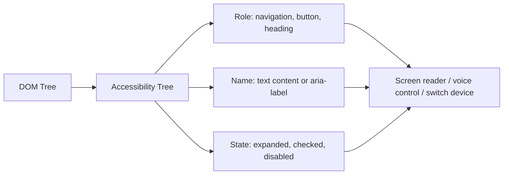

## What is semantic HTML?

`Semantic HTML` means using the element that describes the **role and meaning** of the content. `div` and `span` mean nothing — they are just containers. `nav` says "this is navigation"; `button` says "this is clickable and keyboard-activatable".

### A simple comparison

These two snippets look **exactly the same** in the browser (with the same CSS):

```html
<!-- Version 1: "div soup" -->
<div class="header">
  <div class="logo">Shop</div>
  <div class="menu"><div onclick="go('/')">Home</div><div onclick="go('/cart')">Cart</div></div>
</div>
<div class="content">
  <div class="title">Running shoes</div>
  <div class="btn" onclick="buy()">Buy</div>
</div>

<!-- Version 2: semantic -->
<header>
  <a href="/">Shop</a>
  <nav><a href="/">Home</a> <a href="/cart">Cart</a></nav>
</header>
<main>
  <h1>Running shoes</h1>
  <button type="button" onclick="buy()">Buy</button>
</main>
```

But for anyone who **can't see** the page, they are completely different:

| | Version 1 (div) | Version 2 (semantic) |
| --- | --- | --- |
| What a screen reader says | "Shop, Home, Cart, Running shoes, Buy" (just text, no roles) | "Banner. Link, Shop. Navigation. Heading level 1: Running shoes. Button: Buy" |
| Keyboard user pressing Tab | Reaches none of them; `div`s aren't focusable | Reaches every link and the button and activates them with Enter |
| Google | Can't tell what the main heading is | Recognises `h1` and `main` as the main content |
| Middle-click on "Cart" | Doesn't work | Opens in a new tab |

The second version is even **shorter** and needs no extra JavaScript for navigation. That's all semantic HTML is: choose elements by **meaning**, and leave the look to CSS.

### Why does it exist?

For every semantic element the browser puts information into the **accessibility tree**. Screen readers and other assistive technologies read that tree, not the DOM.



Each node in the accessibility tree has three main properties:

| Property | Source | Example |
| --- | --- | --- |
| Role | The element itself (implicit) or `role` | `button`, `link`, `heading level 2` |
| Accessible name | Content, `label`, `alt`, `aria-label` | "Place order" |
| State / value | Attributes | `checked`, `expanded`, `disabled` |

## Landmark elements

Landmarks mark the main regions of a page. Screen reader users can jump straight between them (in NVDA, with the `D` key).

```html
<body>
  <header>
    <a href="/">Logo</a>
    <nav aria-label="Primary">
      <ul>
        <li><a href="/" aria-current="page">Home</a></li>
        <li><a href="/blog">Blog</a></li>
      </ul>
    </nav>
  </header>

  <main>
    <article>
      <header>
        <h1>Understanding the event loop</h1>
        <p>By <address><a href="/authors/sara">Sara</a></address>
           on <time datetime="2026-03-14">March 14, 2026</time></p>
      </header>

      <section aria-labelledby="stack">
        <h2 id="stack">The call stack</h2>
        <p>...</p>
        <figure>
          
          <figcaption>Figure 1: the call stack during nested calls</figcaption>
        </figure>
      </section>
    </article>

    <aside aria-label="Related articles">...</aside>
  </main>

  <footer>
    <small>© 2026</small>
  </footer>
</body>
```

| Element | Implicit role | Use | Note |
| --- | --- | --- | --- |
| `header` | `banner` (only as a direct child of body) | Page or section header | Inside `article` it is not a banner |
| `nav` | `navigation` | A group of major navigation links | Not every link group is a nav; label multiple navs with `aria-label` |
| `main` | `main` | The page's unique main content | Only **one** visible `main` per page |
| `section` | `region` (only when it has a name) | A thematic grouping, usually with a heading | Without a heading, a `div` is usually more correct |
| `article` | `article` | Self-contained, independently distributable content | Post, comment, product card, widget |
| `aside` | `complementary` | Related but tangential content | Sidebar, tip, ad |
| `footer` | `contentinfo` (direct child of body) | Page or section footer | |
| `figure` / `figcaption` | `figure` | Self-contained content with a caption | Image, chart, code snippet |
| `address` | `group` | Contact info for the nearest `article` or `body` | Not for every postal address |
| `time` | `time` | A machine-readable date/time | `datetime` in ISO format |

## `div` vs `section`

One of the most common questions:

- `div` has **no meaning**. Use it for styling and purely visual grouping.
- `section` is a **thematic part** of the document, normally with a heading (`h2`–`h6`).

Rule of thumb: **if the block would appear in the document's table of contents, it's a `section`. If it only exists for Flexbox or Grid, it's a `div`.**

```html
<!-- wrong: section used for layout -->
<section class="flex-row">
  <section class="col">...</section>
</section>

<!-- right -->
<section aria-labelledby="pricing-title">
  <h2 id="pricing-title">Pricing</h2>
  <div class="grid">...</div>
</section>
```

### `article` vs `section`

The key question: **would this content make sense on its own, syndicated on another site or in an RSS feed?** If yes, it's an `article`. A blog post is an `article`; its comments area is a `section`; each comment on its own is an `article`.

## Headings and the outline

- `h1`–`h6` form the page's hierarchy. Screen reader users often skim the list of headings first.
- Choose heading levels by **structure**, not font size. Style them with CSS.
- **Don't skip levels** (`h2` followed by `h4`).
- The "document outline algorithm", which was supposed to re-level `h1`s inside each `section`, **was never implemented by browsers** and has been removed from the spec. An `h1` inside a section is still an `h1`.

## Semantic inline elements

| Element | Meaning | Instead of |
| --- | --- | --- |
| `strong` | Strong importance | `b` (bold look only) |
| `em` | Stress emphasis that changes meaning | `i` (italic only, e.g. a foreign term) |
| `mark` | Highlight (like a search hit) | `span.highlight` |
| `code`, `kbd`, `samp` | Code, keyboard input, program output | `span.mono` |
| `abbr` | Abbreviation with `title` | |
| `cite`, `q`, `blockquote` | Sources and quotations | |
| `del`, `ins` | Deleted / inserted text | `s` |
| `dfn` | Defining instance of a term | |

## Interactive elements: `button` vs `a` vs `div`

This matters a lot in interviews:

| | `button` | `a href` | `div onClick` |
| --- | --- | --- | --- |
| Meaning | Perform an **action** (submit, open a modal) | **Go** somewhere (a URL) | Nothing |
| Tab-focusable | Yes | Yes | No |
| Activation | `Enter` and `Space` | `Enter` | None |
| Role | `button` | `link` | `generic` |
| Middle-click / open in new tab | No | Yes | No |
| Inside a form | Defaults to `type="submit"` | — | — |

To make a `div` really behave like a button you'd need all this:

```html
<div role="button" tabindex="0" aria-pressed="false"
     onclick="toggle()" onkeydown="if (event.key === 'Enter' || event.key === ' ') toggle()">
  Save
</div>
```

And it would still be missing things (Space firing on keyup, disabled state, form submission). The simple answer: **write `<button type="button">`.**

<Callout type="interview">
Key line for interviews: "The first rule of ARIA is don't use ARIA if a native HTML element already has the semantics and behaviour you need." Native elements give you role, focus, keyboard behaviour and state for free.
</Callout>

## Why semantic HTML matters

### Accessibility

- Screen readers announce the role of each region: "navigation, list, 5 items".
- Users can jump between landmarks and headings.
- Focus and keyboard behaviour are built into `button`, `a`, `input` and `details`.

### SEO

- Search engines use the heading structure and `main`/`article` to identify the primary content.
- `time datetime` and structured data help produce rich results.
- Content in `nav` and `footer` is recognised as boilerplate and weighted less.

### Maintainability

- `<nav>` reads better than `<div class="nav-wrapper-2">`.
- CSS selectors and tests become more stable; Testing Library recommends querying by role: `getByRole('button', { name: 'Save' })`.
- Browser reader mode and translation tools work better.

## Native elements people forget

```html
<!-- An accordion with zero JavaScript -->
<details>
  <summary>Shipping terms</summary>
  <p>Free shipping on orders over $50.</p>
</details>

<!-- A modal with built-in focus trapping and Escape -->
<dialog id="confirm">
  <form method="dialog">
    <p>Delete this item?</p>
    <button value="cancel">Cancel</button>
    <button value="ok">Delete</button>
  </form>
</dialog>

<!-- A popover with no JavaScript (Baseline 2024) -->
<button popovertarget="menu">Menu</button>
<div id="menu" popover>...</div>
```

- `dialog.showModal()` makes the rest of the page `inert`, handles Escape and provides `::backdrop`.
- `popover` renders in the top layer, so there are no z-index problems, and it light-dismisses on outside click.

```html live
<details open>
  <summary>This is a native details element</summary>
  <p>It opens and closes without a single line of JavaScript and works with the keyboard.</p>
</details>
<br />
<button popovertarget="pop">Open popover</button>
<div id="pop" popover style="padding:16px;border-radius:8px">
  I live in the top layer. Click outside to close me.
</div>
```

## Common mistakes

- **Div soup:** everything is a `div` with descriptive class names.
- **`section` used for layout** without a heading.
- **Choosing headings by size** and skipping levels.
- **A link doing a button's job:** `<a href="#" onclick="openModal()">` — it goes nowhere, so it's a `button`.
- **A button doing a link's job:** `<button onclick="location.href='/about'">` — kills middle-click and open-in-new-tab.
- **Multiple `main` elements**, or `main` inside `article`.
- **`b` and `i` for importance and emphasis** instead of `strong` and `em`.

## Interview questions

<QA q="What's the difference between `div` and `section`? When do you use each?" level="junior" n={1}>
<Answer>

`div` has no meaning and is for visual grouping or styling. `section` is a thematic part of the document, normally with a heading. If it belongs in the document outline, use `section`; if it only exists for layout, use `div`.

</Answer>
<Deep>

A `section` only appears as a `region` landmark in the accessibility tree when it has an accessible name (`aria-labelledby` or `aria-label`). An unnamed section is practically a div to a screen reader; its main value is readability and structure.

</Deep>
<Mistake>

Replacing every div with a section "to be semantic", which clutters the outline with meaningless sections.

</Mistake>
<FollowUp>

How do `article` and `section` differ? (Self-contained, independently distributable content vs a thematic part.)

</FollowUp>
</QA>

<QA q="Why shouldn't you use a `div` with `onClick` instead of a `button`?" level="mid" n={2}>
<Answer>

A `div` isn't Tab-focusable, isn't activated by Enter or Space, has no role and isn't announced as a button. A `button` has all of that natively.

</Answer>
<Deep>

Rebuilding it requires `role="button"`, `tabindex="0"`, handling `keydown` for Enter and `keyup` for Space (with `preventDefault` to stop the page scrolling), managing a disabled state with `aria-disabled` and blocking clicks. More code means more bugs and more tests.

</Deep>
<Mistake>

Adding only `role="button"` and thinking the problem is solved. A role adds meaning, not behaviour.

</Mistake>
<FollowUp>

If your design system wants a button that looks like a link, which element do you use? (Decide by behaviour: navigation → `a`, action → `button`. Appearance is CSS.)

</FollowUp>
</QA>

<QA q="How does semantic HTML affect SEO?" level="mid" n={3}>
<Answer>

It helps search engines identify the structure (headings), the main content (`main`, `article`) and secondary regions (`nav`, `footer`, `aside`), producing better snippets and rich results.

</Answer>
<Deep>

Semantic HTML alone isn't a big ranking signal; its effect is mostly indirect: better crawling and understanding, better Core Web Vitals (leaner HTML), and structured data (JSON-LD with schema.org), which directly powers rich results.

</Deep>
<Mistake>

Claiming "using `article` boosts ranking". There's no direct, measurable effect.

</Mistake>
<FollowUp>

What is structured data and how does it differ from semantic HTML?

</FollowUp>
</QA>

<QA q="How do you build a modal with native HTML, and what does it give you over a div?" level="senior" n={4}>
<Answer>

With `dialog` and `showModal()`. The browser handles focus trapping, closing on Escape, `::backdrop`, rendering in the top layer (no z-index issues) and making the rest of the page inert. With `form method="dialog"`, buttons close the dialog and set `returnValue`.

</Answer>
<Deep>

A hand-rolled div modal needs: initial focus management, returning focus to the trigger, a focus trap, `aria-modal="true"`, `role="dialog"`, `aria-labelledby`, Escape handling, background scroll locking, and working around stacking contexts. `dialog` covers most of it; returning focus and scroll locking may still need code.

</Deep>
<Mistake>

Using `dialog.show()` instead of `showModal()` for a modal; `show()` is non-modal, with no focus trap or backdrop.

</Mistake>
<FollowUp>

What is the top layer and why doesn't z-index affect it?

</FollowUp>
</QA>

## Recap

<Recap>

- Semantic HTML means choosing elements by meaning, not appearance; appearance is CSS's job.
- The browser builds an accessibility tree from your elements: each node has a role, a name and a state.
- Landmarks (`header`, `nav`, `main`, `aside`, `footer`) are the page's main regions and screen-reader users jump between them; have only one `main`.
- `section` is a themed region with a heading; for pure layout a `div` is correct. `article` is content that makes sense on its own.
- Heading levels follow structure, not size; don't skip levels.
- `button` for actions, `a href` for going somewhere; a `div` with `onclick` is neither focusable nor keyboard-operable.
- The first rule of ARIA: if a native element exists, don't use ARIA.
- `details`, `dialog` and `popover` give complex behaviour with correct accessibility and no JavaScript.

</Recap>
