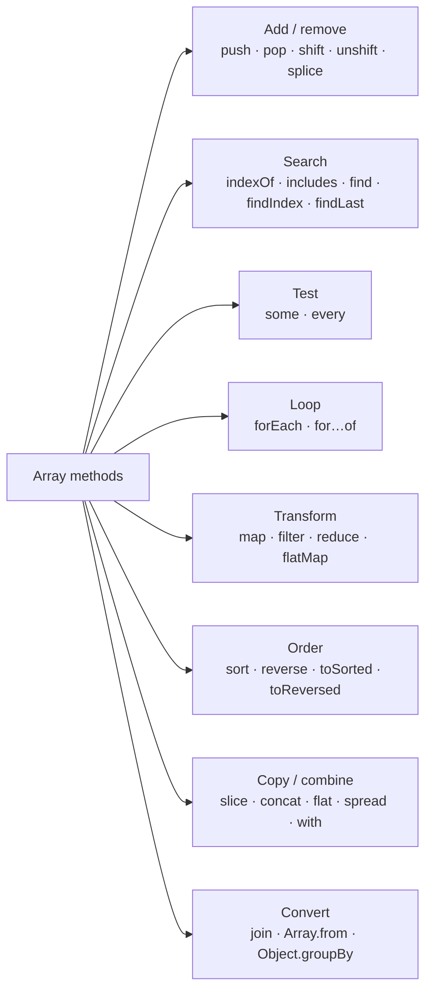
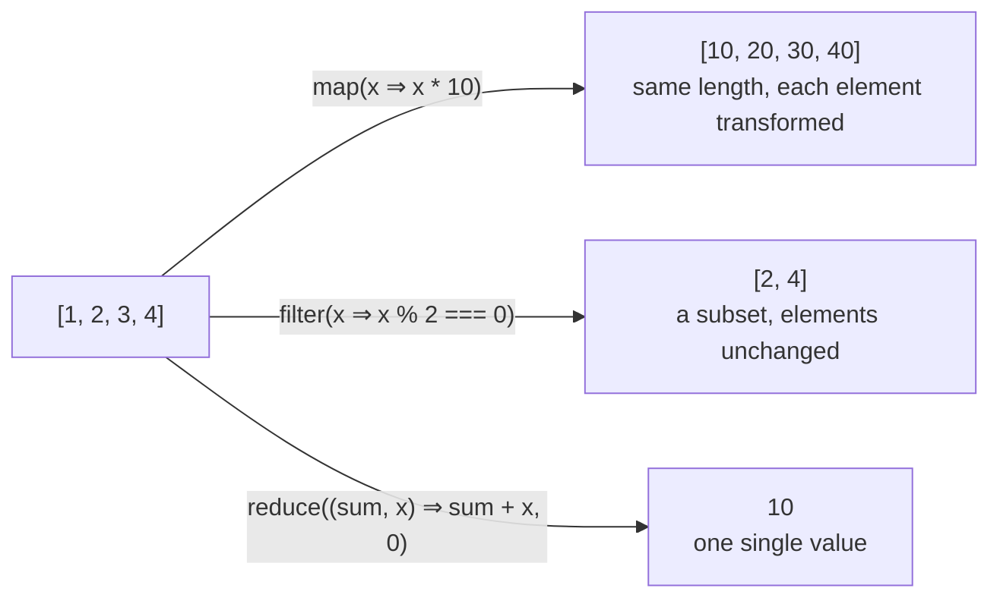
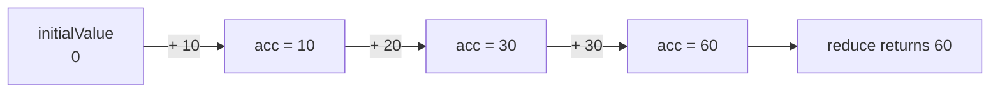

## What is an array?

An **array** is an ordered list of values. Each value sits in a numbered slot called an **index**, and indexes start at **0**.

```text
  index:    0        1        2        3
         ┌────────┬────────┬────────┬────────┐
fruits = │ "apple"│"banana"│ "cherry"│ "date" │     fruits.length === 4
         └────────┴────────┴────────┴────────┘
  fruits[0] → "apple"          fruits[fruits.length - 1] → "date"
```

You use an array whenever **order matters** or you have **many values of the same kind**: a list of users, the items in a cart, the rows of a table, the steps of a wizard.

Three facts make JavaScript arrays different from arrays in C or Java:

| Fact | What it means | Example |
| --- | --- | --- |
| They grow and shrink | No fixed size; `push` adds, `pop` removes | `[1, 2].push(3)` |
| They can hold any types | Numbers, strings, objects, functions, other arrays, all mixed | `[1, "a", { x: 1 }, [2]]` |
| They are objects | `typeof []` is `"object"`; the indexes are really property keys `"0"`, `"1"`… | `Array.isArray([])` → `true` |

## Creating arrays

```js run
// 1. Array literal: what you'll use 99% of the time
const empty = [];
const nums = [10, 20, 30];

// 2. Array.of: an array from its arguments
console.log(Array.of(7));          // [7]

// 3. Array.from: from anything iterable or array-like, with an optional mapper
console.log(Array.from("hey"));                    // ['h', 'e', 'y']
console.log(Array.from({ length: 4 }, (_, i) => i * i)); // [0, 1, 4, 9]
console.log(Array.from(new Set([1, 1, 2])));        // [1, 2]

// 4. Spread: copy or combine
const copy = [...nums];
console.log(copy, copy === nums);                   // same contents, different array

// 5. The Array constructor: careful!
console.log(new Array(3));         // [<empty>, <empty>, <empty>] — 3 empty slots, not [3]
console.log(new Array(3, 4));      // [3, 4]
console.log(new Array(3).fill(0)); // [0, 0, 0]
```

<Callout type="mistake">
`new Array(3)` does **not** create `[3]`. With a single number argument the constructor creates an array of that **length** full of empty slots ("holes"). Methods like `map` skip holes, so `new Array(3).map((_, i) => i)` is still `[<empty> × 3]`. Use `Array.from({ length: 3 }, (_, i) => i)` instead.
</Callout>

## Reading, writing and `length`

```js run
const letters = ["a", "b", "c"];

console.log(letters[0]);              // "a"
console.log(letters[5]);              // undefined — reading past the end is not an error
console.log(letters.at(-1));          // "c" — at() accepts negative indexes
console.log(letters[letters.length - 1]); // "c" — the classic way

letters[1] = "B";                     // overwrite
letters[letters.length] = "d";        // append (same as push)
console.log(letters, letters.length);

letters.length = 2;                   // ✂ length is writable: this truncates the array
console.log(letters);
letters.length = 0;                   // a common way to empty an array in place
console.log(letters);
```

`length` is **not** "the number of elements". It is **the highest index + 1**:

```js run
const sparse = [];
sparse[9] = "x";
console.log(sparse.length);      // 10, though only one element exists
console.log(0 in sparse);        // false — index 0 is a hole
```

## Arrays are objects (and why that matters)

```js run
const arr = ["x", "y"];
console.log(typeof arr);                     // "object"
console.log(Array.isArray(arr));             // true — the reliable check
console.log(Object.keys(arr));               // ['0', '1'] — indexes are string keys
console.log(Object.getPrototypeOf(arr) === Array.prototype); // methods live here

arr.label = "not an index";                  // allowed, but ignored by length and most methods
console.log(arr.length, arr);
```

Because every method (`map`, `push`…) lives on `Array.prototype`, every array shares one copy of them. See [Objects & prototypes](/javascript/objects-prototypes).

<Callout type="note" title="Under the hood: elements kinds">
V8 stores arrays differently depending on their contents: `PACKED_SMI` (small integers only, fastest), `PACKED_DOUBLE`, `PACKED_ELEMENTS` (anything), plus `HOLEY_*` variants. Transitions only go one way: once an array holds a string or gets a hole, it never returns to a faster kind. Practical takeaway: avoid holes and keep arrays homogeneous in hot code.
</Callout>

## The method map

There are more than 35 array methods. They are much easier to remember by **what job they do**:



### Mutating vs non-mutating

The single most important question to ask about a method: **does it change the array I call it on?**

| ✗ Mutates the original | ✓ Returns something new | Non-mutating twin (ES2023) |
| --- | --- | --- |
| `push`, `pop`, `shift`, `unshift` | `map`, `filter`, `reduce`, `slice` | — |
| `splice` | `concat`, `flat`, `flatMap` | `toSpliced()` |
| `sort` | `find`, `findIndex`, `some`, `every` | `toSorted()` |
| `reverse` | `includes`, `indexOf`, `join`, `at` | `toReversed()` |
| `fill`, `copyWithin` | `[...arr]`, `Array.from` | — |
| `arr[i] = x` | | `with(i, x)` |

```js run
const original = [3, 1, 2];

const sorted = original.toSorted();     // ✓ new array
console.log(original, sorted);          // [3, 1, 2] [1, 2, 3]

const same = original.sort();           // ✗ sorts in place AND returns the same array
console.log(original, same === original);

const updated = original.with(0, 99);   // immutable "arr[0] = 99"
console.log(original, updated);
```

<Callout type="interview">
In React, never mutate state arrays: `items.push(x); setItems(items)` doesn't re-render, because the array reference is unchanged and React compares with `Object.is`. Create a new array: `setItems([...items, x])`, `items.filter(…)`, `items.toSorted(…)`.
</Callout>

## Adding and removing at the ends

```text
          unshift(x) / shift()                     push(x) / pop()
              ⟶ start                                   end ⟵
              ┌────┬────┬────┬────┐
              │ a  │ b  │ c  │ d  │
              └────┴────┴────┴────┘
     slow: every index shifts by one        fast: nothing else moves
```

<Api name="push / pop / unshift / shift" sig="arr.push(...items) · arr.pop() · arr.unshift(...items) · arr.shift()" returns="`push`/`unshift` return the **new length**; `pop`/`shift` return the **removed element** (or `undefined` if the array was empty)." mutates="yes">

- `...items`: one or more values to add (`push` at the end, `unshift` at the start).
- `pop` and `shift` take no arguments.

</Api>

```js run
const queue = ["b", "c"];
console.log(queue.push("d", "e"));   // 4 — the new length, not the array!
console.log(queue.unshift("a"));     // 5
console.log(queue.pop());            // "e" — the removed item
console.log(queue.shift());          // "a"
console.log(queue);                  // ['b', 'c', 'd']
console.log([].pop());               // undefined — no error on empty arrays
```

| Method | Time complexity | Why |
| --- | --- | --- |
| `push` / `pop` | O(1) | Only the end changes |
| `unshift` / `shift` | O(n) | Every element must move to a new index |

So an array works well as a **stack** (`push` + `pop`) but is a slow **queue** for large data (`push` + `shift`). For big queues, use an index pointer or a linked list (see [Algorithms](/algorithms/level-2)).

## splice: the Swiss-army knife (mutating)

<Api name="Array.prototype.splice()" sig="arr.splice(start, deleteCount?, ...itemsToInsert)" returns="An array of the **removed** elements (empty if nothing was removed)." mutates="yes">

- `start`: the index to start at. Negative counts from the end (`-1` = last element).
- `deleteCount` (optional): how many elements to remove. Omitted → remove everything from `start` to the end. `0` → remove nothing.
- `...itemsToInsert` (optional): values to insert at `start`.

</Api>

```js run
const months = ["Jan", "Mar", "Apr", "Jun"];

months.splice(1, 0, "Feb");          // insert: at index 1, delete 0, add "Feb"
console.log(months);                 // ['Jan', 'Feb', 'Mar', 'Apr', 'Jun']

const removed = months.splice(3, 1); // delete 1 element at index 3
console.log(removed, months);        // ['Apr'] ['Jan', 'Feb', 'Mar', 'Jun']

months.splice(-1, 1, "May", "Jun");  // replace the last element with two
console.log(months);

const all = [1, 2, 3, 4, 5];
console.log(all.splice(2), all);     // [3, 4, 5] [1, 2] — no deleteCount: remove to the end

// Non-mutating twin:
const base = [1, 2, 3];
console.log(base.toSpliced(1, 1, "x"), base);   // [1, 'x', 3] [1, 2, 3]
```

## slice: copy a part (non-mutating)

<Api name="Array.prototype.slice()" sig="arr.slice(start?, end?)" returns="A **new** array with the elements from `start` up to, **but not including**, `end`. A shallow copy." mutates="no">

- `start` (optional, default `0`): first index to include. Negative counts from the end.
- `end` (optional, default `length`): index to stop **before**. Negative counts from the end.

</Api>

```js run
const nums = [10, 20, 30, 40, 50];
console.log(nums.slice(1, 3));   // [20, 30]  — indexes 1 and 2
console.log(nums.slice(2));      // [30, 40, 50]
console.log(nums.slice(-2));     // [40, 50]  — the last two
console.log(nums.slice());       // a full shallow copy
console.log(nums);               // unchanged
```

| | `slice(start, end)` | `splice(start, count, ...items)` |
| --- | --- | --- |
| Changes the original | No | **Yes** |
| Second argument | **End index** (exclusive) | **How many** to remove |
| Returns | The copied part | The removed part |
| Typical use | Copy, paginate, take the last N | Insert, delete, replace in place |

**Memory trick:** splice has a **p** for "**p**ermanent change".

## Combining and flattening

```js run
const a = [1, 2];
const b = [3, [4, 5]];

console.log(a.concat(b));          // [1, 2, 3, [4, 5]] — new array; nested arrays stay nested
console.log([...a, ...b]);         // same with spread
console.log(b.flat());             // [3, 4, 5] — one level
console.log([1, [2, [3, [4]]]].flat(Infinity)); // [1, 2, 3, 4] — all levels

const sentences = ["hello world", "good morning"];
console.log(sentences.map((s) => s.split(" ")));      // [['hello','world'], ['good','morning']]
console.log(sentences.flatMap((s) => s.split(" "))); // ['hello','world','good','morning']
```

`flatMap(fn)` is `map(fn).flat()` (one level) in one pass. Returning `[]` from its callback removes an element, and returning `[x, y]` expands it into two. That makes it a combined map + filter.

## Searching

| Question you're asking | Method | Returns when nothing is found |
| --- | --- | --- |
| Is this exact value in the array? | `includes(value)` | `false` |
| At which index is this exact value? | `indexOf(value)` / `lastIndexOf(value)` | `-1` |
| Which **first element** matches a condition? | `find(fn)` / `findLast(fn)` | `undefined` |
| At which **index** is the first match? | `findIndex(fn)` / `findLastIndex(fn)` | `-1` |
| Does **at least one** element match? | `some(fn)` | `false` |
| Do **all** elements match? | `every(fn)` | `true` (for an empty array!) |

```js run
const nums = [5, 12, 8, 130, 44, NaN];

console.log(nums.includes(8), nums.indexOf(8));   // true 2
console.log(nums.includes(NaN), nums.indexOf(NaN)); // true -1  ← indexOf uses ===, NaN !== NaN
console.log(nums.find((n) => n > 10));            // 12 — the element
console.log(nums.findIndex((n) => n > 10));       // 1  — its index
console.log(nums.findLast((n) => n > 10));        // 44 — searching from the end
console.log(nums.some((n) => n > 100));           // true
console.log(nums.every((n) => n > 1));            // false (NaN > 1 is false)
console.log([].every((n) => n > 1000));           // true — "vacuous truth"
```

`includes`, `indexOf` compare with **SameValueZero** / `===`, so for objects they check **identity**, not contents:

```js run
const users = [{ id: 1 }, { id: 2 }];
console.log(users.includes({ id: 1 }));             // false — a different object
console.log(users.some((u) => u.id === 1));         // true  — compare by a field
```

`find`, `some`, `every` and `findIndex` **stop early** as soon as the answer is known, which makes them cheaper than `filter(...).length` for large arrays.

## The callback trio: map, filter, reduce

These three methods are the core of everyday data transformation. They share a pattern: you pass a **callback**, and the array calls it once for each element.

All of them call your callback with the same three arguments:

| Argument | Meaning |
| --- | --- |
| `element` | The current element |
| `index` | Its index |
| `array` | The whole array the method was called on |



### map: transform every element

<Api name="Array.prototype.map()" sig="arr.map(callback(element, index, array), thisArg?)" returns="A **new** array of the **same length**, where each slot holds whatever the callback returned for that element." mutates="no">

- `callback`: called once per element; its **return value** becomes the new element. If you forget to `return`, you get `undefined`.
- `thisArg` (optional): value for `this` inside a regular-function callback (rarely needed with arrow functions).

</Api>

```js run
const users = [
  { id: 1, name: "Ali", age: 28 },
  { id: 2, name: "Sara", age: 34 },
];

console.log(users.map((u) => u.name));                        // ['Ali', 'Sara']
console.log(users.map(({ id, name }) => ({ id, label: name.toUpperCase() })));
console.log(users.map((u, index, array) => `${index + 1}/${array.length}`));

// Forgetting to return with curly braces:
console.log(users.map((u) => { u.name; }));                   // [undefined, undefined]
```

Use `map` when you want **one output per input**. If you don't use the returned array, you wanted `forEach`.

### filter: keep some elements

<Api name="Array.prototype.filter()" sig="arr.filter(callback(element, index, array), thisArg?)" returns="A **new** array containing only the elements for which the callback returned a **truthy** value. The elements themselves are not copied or changed." mutates="no">

- `callback`: return `true` (truthy) to keep the element, `false` (falsy) to drop it.

</Api>

```js run
const products = [
  { name: "Laptop", price: 1200, inStock: true },
  { name: "Mouse", price: 25, inStock: false },
  { name: "Monitor", price: 300, inStock: true },
];

console.log(products.filter((p) => p.inStock).map((p) => p.name));
console.log(products.filter((p) => p.price < 500).length);
console.log([0, 1, "", "a", null, NaN, 2].filter(Boolean));     // remove all falsy values

// Remove duplicates: keep an element only at its first occurrence
const tags = ["js", "css", "js", "html", "css"];
console.log(tags.filter((tag, i, all) => all.indexOf(tag) === i)); // (or [...new Set(tags)])
```

### reduce: combine everything into one value

`reduce` is the most powerful and the most misunderstood of the three, so let's take it slowly.

**The idea:** walk through the array while carrying a running result, called the **accumulator**. At each element, the callback receives the accumulator so far plus the current element, and **returns the new accumulator**. When the walk ends, the final accumulator is the result.

Think of a cashier adding up a receipt: they start at 0 (the **initial value**), look at each line, add it to the running total, and at the end they announce the total.

<Api name="Array.prototype.reduce()" sig="arr.reduce(callback(accumulator, currentValue, currentIndex, array), initialValue?)" returns="The **final accumulator**: whatever the callback returned on its last call. It can be any type: number, string, object, array, Map, even a Promise." mutates="no">

- `callback`: called once per element with **four** arguments:
  - `accumulator`: the running result so far (the previous call's return value, or `initialValue` on the first call).
  - `currentValue`: the element being processed.
  - `currentIndex`: its index.
  - `array`: the array `reduce` was called on.
- `initialValue` (optional but **strongly recommended**): the accumulator's starting value. Without it, the **first element** becomes the starting accumulator and iteration starts at index 1.

</Api>

#### Watching reduce step by step

```js run
const prices = [10, 20, 30];

const total = prices.reduce((acc, price, index) => {
  console.log(`index ${index}: acc = ${acc}, price = ${price} → returns ${acc + price}`);
  return acc + price;
}, 0);

console.log("total:", total);
```

| Call | `accumulator` (in) | `currentValue` | Callback returns (new accumulator) |
| --- | --- | --- | --- |
| 1 | `0` ← initialValue | `10` | `10` |
| 2 | `10` | `20` | `30` |
| 3 | `30` | `30` | `60` ← final result |



#### With and without `initialValue`

```js run
const nums = [1, 2, 3];

// With initialValue: 3 calls, acc starts at 0
console.log(nums.reduce((acc, n) => acc + n, 0));      // 6

// Without: 2 calls, acc starts as nums[0], iteration starts at index 1
console.log(nums.reduce((acc, n) => acc + n));         // 6 — same here, but…

// …it breaks in two common cases:
try {
  [].reduce((acc, n) => acc + n);                      // empty array, no initial value
} catch (e) {
  console.log(e.name + ": " + e.message);
}

const cart = [{ price: 5 }, { price: 7 }];
console.log(cart.reduce((acc, item) => acc + item.price));     // "[object Object]7" — acc started as an object!
console.log(cart.reduce((acc, item) => acc + item.price, 0));  // 12 ✓
```

| | With `initialValue` | Without `initialValue` |
| --- | --- | --- |
| First `accumulator` | `initialValue` | `arr[0]` |
| First `currentValue` | `arr[0]` | `arr[1]` |
| Number of calls | `length` | `length - 1` |
| Empty array | Returns `initialValue` | **TypeError** |
| One-element array | Calls the callback once | Returns that element **without calling the callback** |

<Callout type="tip">
**Always pass an initial value**, and make it the same type as the result you want: `0` for a sum, `""` for a string, `{}` for an object, `[]` for an array, `new Map()` for a map.
</Callout>

#### Does reduce change the original array?

**No.** `reduce` itself never modifies the array. It only reads it. But **your callback** could mutate things it touches, for example an object stored in the array, or an accumulator object that is shared:

```js run
const items = [{ qty: 1 }, { qty: 2 }];
const before = JSON.stringify(items);

const total = items.reduce((sum, item) => sum + item.qty, 0);
console.log(total, JSON.stringify(items) === before);   // 3 true — untouched

// ✗ A callback that mutates the elements: reduce allowed it, but it's your bug
items.reduce((_, item) => { item.qty *= 10; return _; }, null);
console.log(items);                                      // [{ qty: 10 }, { qty: 20 }]
```

#### Classic reduce recipes

```js run
const orders = [
  { id: 1, customer: "ali", amount: 120, status: "paid" },
  { id: 2, customer: "sara", amount: 80, status: "pending" },
  { id: 3, customer: "ali", amount: 40, status: "paid" },
  { id: 4, customer: "reza", amount: 200, status: "paid" },
];

// 1. Sum of a field
const revenue = orders.reduce((sum, o) => sum + o.amount, 0);

// 2. Maximum (start with -Infinity so any number beats it)
const biggest = orders.reduce((max, o) => Math.max(max, o.amount), -Infinity);

// 3. Count occurrences → object
const byStatus = orders.reduce((counts, o) => {
  counts[o.status] = (counts[o.status] ?? 0) + 1;
  return counts;                                   // always return the accumulator!
}, {});

// 4. Group into arrays
const byCustomer = orders.reduce((groups, o) => {
  (groups[o.customer] ??= []).push(o.id);
  return groups;
}, {});

// 5. Index by id → fast lookups later
const byId = orders.reduce((map, o) => map.set(o.id, o), new Map());

console.log(revenue, biggest);
console.log(byStatus);
console.log(byCustomer);
console.log(byId.get(4).customer);
```

```js run
// 6. Function composition: apply a list of functions in order
const pipeline = [(x) => x + 1, (x) => x * 2, (x) => `Result: ${x}`];
console.log(pipeline.reduce((value, fn) => fn(value), 5));   // "Result: 12"

// 7. Run async tasks one after another (sequentially)
const delay = (ms, label) => new Promise((r) => setTimeout(() => r(label), ms));
const tasks = [() => delay(30, "A"), () => delay(10, "B"), () => delay(20, "C")];

tasks
  .reduce((chain, task) => chain.then((results) => task().then((r) => [...results, r])), Promise.resolve([]))
  .then((results) => console.log("sequential:", results));   // ['A', 'B', 'C']
```

#### reduce on strings

Strings don't have a `reduce` method, but you can turn a string into an array of characters first:

```js run
const word = "mississippi";

// Count each character
const freq = [...word].reduce((counts, ch) => {
  counts[ch] = (counts[ch] ?? 0) + 1;
  return counts;
}, {});
console.log(freq);                                    // { m: 1, i: 4, s: 4, p: 2 }

// Reverse a string (the accumulator is a string!)
console.log([..."hello"].reduce((rev, ch) => ch + rev, ""));   // "olleh"

// Borrow the array method directly: strings are array-like
console.log(Array.prototype.reduce.call("abc", (acc, ch) => acc + ch.toUpperCase(), "")); // "ABC"

// Build a string from an array
const words = ["learn", "javascript", "deeply"];
console.log(words.reduce((s, w, i) => s + (i ? " " : "") + w[0].toUpperCase() + w.slice(1), ""));
```

Use `[...str]` (not `str.split("")`) so emoji and other characters outside the Basic Multilingual Plane stay intact. See [Strings](/javascript/strings).

#### reduceRight

`reduceRight` works exactly like `reduce`, but walks from the **last** element to the first:

```js run
console.log(["a", "b", "c"].reduce((acc, x) => acc + x, ""));      // "abc"
console.log(["a", "b", "c"].reduceRight((acc, x) => acc + x, "")); // "cba"

// Classic use: compose(f, g, h)(x) === f(g(h(x)))
const compose = (...fns) => (x) => fns.reduceRight((value, fn) => fn(value), x);
console.log(compose((x) => x + 1, (x) => x * 10)(2));               // 21
```

#### When not to use reduce

`reduce` can express anything, which also makes it easy to write unreadable code. Prefer the specific method when one exists:

| Instead of… | Write |
| --- | --- |
| `arr.reduce((acc, x) => [...acc, f(x)], [])` | `arr.map(f)` (and avoid the O(n²) copying!) |
| `reduce` that pushes matching elements | `arr.filter(fn)` |
| `reduce` that searches for one element | `arr.find(fn)` |
| `reduce` to sum, max | `reduce` is fine here, or `Math.max(...arr)` for small arrays |
| `reduce` to group | `Object.groupBy(arr, fn)` (ES2024) |

```js run
const people = [{ name: "Ali", team: "web" }, { name: "Sara", team: "data" }, { name: "Reza", team: "web" }];
console.log(Object.groupBy(people, (p) => p.team));
```

### forEach: just loop

<Api name="Array.prototype.forEach()" sig="arr.forEach(callback(element, index, array), thisArg?)" returns="`undefined`, always. Use it only for side effects (logging, DOM updates, pushing elsewhere)." mutates="no">

- `callback`: called for each element; its return value is ignored.

</Api>

```js run
const names = ["Ali", "Sara", "Reza"];
names.forEach((name, i) => console.log(i, name));

console.log(names.forEach((n) => n.toUpperCase()));  // undefined — forEach returns nothing

// You can't break out of forEach. Use for...of, some or find instead:
for (const name of names) {
  if (name === "Sara") break;
  console.log("visited", name);
}
```

| | `forEach` | `map` |
| --- | --- | --- |
| Returns | `undefined` | A new array |
| Purpose | Side effects | Transforming data |
| Chainable | No | Yes (`.map().filter()…`) |
| `break` / `return` early | Impossible (`return` only skips one element) | Impossible |

<Callout type="warning" title="forEach and async">
`forEach` does not wait for promises. `arr.forEach(async (x) => await save(x))` starts all saves at once and continues immediately. Use `for...of` with `await` for one-at-a-time, or `await Promise.all(arr.map(save))` for parallel.
</Callout>

#### A classic trap: map with parseInt

```js predict
console.log(["1", "2", "3"].map(parseInt));
```

```output
[1, NaN, NaN]
```

`map` passes **three** arguments `(element, index, array)`, and `parseInt` accepts two: `(string, radix)`. So the calls are `parseInt("1", 0)` → 1 (radix 0 means "auto"), `parseInt("2", 1)` → NaN (radix 1 is invalid), `parseInt("3", 2)` → NaN (3 is not a binary digit). Fix: `.map(Number)` or `.map((s) => parseInt(s, 10))`.

## Sorting

<Api name="Array.prototype.sort()" sig="arr.sort(compareFn?(a, b))" returns="The **same** array, now sorted (in place). Use `toSorted()` for a sorted copy." mutates="yes">

- `compareFn` (optional): receives two elements and returns a number:
  - **negative** → `a` comes first,
  - **positive** → `b` comes first,
  - **0** → keep their relative order (the sort is **stable** since ES2019).
- Without `compareFn`, elements are converted to **strings** and compared by UTF-16 code units.

</Api>

```js predict
console.log([10, 9, 1, 100, 25].sort());
console.log([10, 9, 1, 100, 25].sort((a, b) => a - b));
```

```output
[1, 10, 100, 25, 9]
[1, 9, 10, 25, 100]
```

The default sort compares `"10"`, `"9"`, `"1"`… as **text**, so `"100"` comes before `"25"`. For numbers, always pass `(a, b) => a - b` (ascending) or `(a, b) => b - a` (descending).

```js run
const team = [
  { name: "Sara", role: "dev", age: 34 },
  { name: "ali", role: "design", age: 28 },
  { name: "Reza", role: "dev", age: 28 },
];

// By number
console.log(team.toSorted((a, b) => a.age - b.age).map((p) => p.name));

// By text, correctly for human languages and case (localeCompare)
console.log(team.toSorted((a, b) => a.name.localeCompare(b.name)).map((p) => p.name));

// By several keys: role first, then age descending
console.log(
  team.toSorted((a, b) => a.role.localeCompare(b.role) || b.age - a.age).map((p) => `${p.role}:${p.name}`),
);

console.log(team[0].name);   // "Sara" — toSorted left the original alone
```

`reverse()` reverses in place (and returns the same array); `toReversed()` returns a reversed copy.

## Filling and replacing

```js run
console.log(new Array(3).fill(0));        // [0, 0, 0]
console.log([1, 2, 3, 4].fill("x", 1, 3)); // [1, 'x', 'x', 4] — from index 1 up to (not incl.) 3

// ✗ fill with an object puts the SAME object in every slot
const grid = new Array(3).fill([]);
grid[0].push("oops");
console.log(grid);                        // [['oops'], ['oops'], ['oops']]

// ✓ create a new object per slot
const grid2 = Array.from({ length: 3 }, () => []);
grid2[0].push("ok");
console.log(grid2);
```

## Converting arrays

```js run
const parts = ["2026", "10", "06"];
console.log(parts.join("-"));      // "2026-10-06"
console.log(parts.join());         // "2026,10,06" — the default separator is a comma
console.log(String([1, [2, 3]]));  // "1,2,3"

// Array-likes (have length + indexes, but no array methods) → real arrays
const arrayLike = { 0: "a", 1: "b", length: 2 };
console.log(Array.from(arrayLike));        // ['a', 'b']
// In the browser: Array.from(document.querySelectorAll("li")), [...nodeList]

// Entries: index + value pairs
for (const [i, v] of ["x", "y"].entries()) console.log(i, v);
```

## Copying: shallow vs deep

Every copying technique on this page (`slice`, spread, `concat`, `Array.from`, `map`) is **shallow**: the new array is new, but objects inside it are **shared**.

```js run
const original = [{ name: "Ali" }, [1, 2]];
const shallow = [...original];
shallow[0].name = "Changed";              // the inner object is shared
console.log(original[0].name);           // "Changed"

const deep = structuredClone(original);   // a real deep copy
deep[1].push(3);
console.log(original[1], deep[1]);        // [1, 2] [1, 2, 3]
```

```text
original ──► [ ref●, ref● ]           shallow ──► [ ref●, ref● ]
                 │      │                             │      │
                 ▼      ▼                             │      │
           {name}   [1,2]  ◄───────── same objects ───┘──────┘
```

## Looping: for vs for...of vs for...in

| Loop | Gives you | `break` / `continue` | `await` inside | Use for arrays? |
| --- | --- | --- | --- | --- |
| `for (let i = 0; …)` | Index | ✓ | ✓ | ✓ When you need the index or a custom step |
| `for (const x of arr)` | Value | ✓ | ✓ | ✓ **The default choice** |
| `arr.forEach(fn)` | Value, index | ✗ | ✗ (doesn't wait) | For simple side effects |
| `for (const k in arr)` | **String** keys, including inherited ones | ✓ | ✓ | ✗ Meant for objects |

```js run
const arr = ["a", "b"];
arr.extra = "!";
for (const k in arr) console.log("for...in:", k, typeof k);   // '0', '1', 'extra' — strings, and extra!
for (const v of arr) console.log("for...of:", v);             // 'a', 'b'
```

## Performance cheat sheet

| Operation | Complexity |
| --- | --- |
| `arr[i]`, `arr.at(i)`, `push`, `pop`, `length` | O(1) |
| `shift`, `unshift`, `splice` in the middle | O(n) |
| `includes`, `indexOf`, `find`, `some`, `every` | O(n) (stop early when found) |
| `map`, `filter`, `reduce`, `forEach`, `slice`, `concat` | O(n) |
| `sort`, `toSorted` | O(n log n) |
| `[...acc, x]` inside a loop / reduce | O(n²) in total: avoid for large arrays |

For many membership checks, convert the array to a `Set` once: `set.has(x)` is O(1). See [Map & Set](/javascript/collections).

## Common mistakes

- `new Array(3)` expecting `[3]`; `fill({})` / `fill([])` sharing one object.
- Using `sort()` without a comparator on numbers.
- Forgetting `return` in a `map`/`reduce` callback with curly braces.
- Calling `reduce` without an initial value on data that may be empty.
- Expecting `push` to return the array (it returns the new length).
- Mutating state arrays in React (`push`, `sort`, `reverse`, `splice`, `arr[i] = x`).
- `indexOf(NaN)` (always `-1`; use `includes` or `findIndex(Number.isNaN)`).
- `for...in` over arrays; `await` inside `forEach`.
- Thinking spread/`slice` make deep copies.

## Interview questions

<QA q="Explain `reduce`: what arguments does the callback receive, what does `initialValue` do, and what happens without it?" level="mid" n={1}>
<Answer>

`reduce(callback, initialValue)` walks the array carrying an accumulator. The callback receives `(accumulator, currentValue, currentIndex, array)` and must return the new accumulator; the final accumulator is the result. `initialValue` is the starting accumulator. Without it, the first element becomes the accumulator and iteration starts at index 1, so an empty array throws `TypeError` and arrays of objects can produce nonsense like `"[object Object]7"`.

</Answer>
<Deep>

`reduce` doesn't mutate the array, but the callback can mutate elements or a shared accumulator. Building arrays with `[...acc, x]` inside reduce is O(n²); push into the accumulator (it's local) or use `map`/`filter`. `reduceRight` iterates from the end and is the natural way to write `compose`.

</Deep>
<Mistake>

Forgetting to `return acc` from a block-bodied callback, which makes the next accumulator `undefined`.

</Mistake>
<FollowUp>

Implement `map` and `filter` using only `reduce`. Why is the naive spread version slow?

</FollowUp>
</QA>

<QA q="What's the difference between `map` and `forEach`?" level="junior" n={2}>
<Answer>

`map` returns a new array of the same length built from the callback's return values; `forEach` returns `undefined` and is only for side effects. Neither can be stopped with `break`. Use `map` to transform data and `forEach` (or `for...of`) to do something for each element.

</Answer>
<Deep>

Neither handles `async` callbacks the way people expect: `forEach` fires all promises without waiting; `map` returns an array of promises that you can `await Promise.all(...)`. Both skip holes in sparse arrays.

</Deep>
<Mistake>

Using `map` for side effects and ignoring the result (wasteful and misleading to readers).

</Mistake>
<FollowUp>

How would you process items sequentially with `await`? (`for...of` with `await`.)

</FollowUp>
</QA>

<QA q="Which array methods mutate the original array, and why does that matter in React?" level="mid" n={3}>
<Answer>

`push`, `pop`, `shift`, `unshift`, `splice`, `sort`, `reverse`, `fill`, `copyWithin` and index assignment mutate. React decides whether to re-render by comparing the old and new state with `Object.is`; a mutated array is the same reference, so React may skip the update and memoized children won't see the change.

</Answer>
<Deep>

ES2023 added non-mutating twins: `toSorted`, `toReversed`, `toSpliced` and `with(index, value)`. For nested updates, copy along the path (`items.map(i => i.id === id ? { ...i, done: true } : i)`) or use Immer, which records mutations on a draft and produces a new immutable structure.

</Deep>
<Mistake>

Thinking `const items = [...]` prevents mutation. `const` only stops reassignment of the variable.

</Mistake>
<FollowUp>

Why is `items.sort()` inside a render function a bug even if you never call `setState`?

</FollowUp>
</QA>

<QA q="Why does `[10, 9, 1, 100].sort()` give `[1, 10, 100, 9]`?" level="junior" n={4}>
<Answer>

Without a comparator, `sort` converts elements to strings and compares them as text, character by character: `"1" < "10" < "100" < "9"`. Pass a comparator: `(a, b) => a - b`.

</Answer>
<Deep>

The comparator must be consistent (return negative/zero/positive and be transitive); returning a boolean like `a > b` is a bug that happens to work in some engines. Since ES2019 `sort` is guaranteed stable, so multi-key sorting with `||` chaining works. For human-language strings use `localeCompare` or `Intl.Collator`.

</Deep>
<Mistake>

Writing `.sort((a, b) => a > b)`: it returns `true`/`false` (1/0), never negative, so ordering is wrong.

</Mistake>
<FollowUp>

How would you sort by last name, then first name, ignoring case and accents?

</FollowUp>
</QA>

<QA q="What's the difference between `slice` and `splice`?" level="junior" n={5}>
<Answer>

`slice(start, end)` returns a shallow copy of a portion and doesn't change the array; its second argument is an **end index** (exclusive). `splice(start, deleteCount, ...items)` changes the array in place (removing, inserting or replacing) and returns the removed elements; its second argument is a **count**.

</Answer>
<Deep>

`toSpliced` is the non-mutating version of `splice`. Both accept negative indexes. `slice()` with no arguments is a common way to copy an array (equivalent to `[...arr]`).

</Deep>
<Mistake>

Passing an end index to `splice` as if it were `slice`, which removes far more than intended.

</Mistake>
<FollowUp>

Remove the element with `id === 3` from an array without mutating it. (`arr.filter(x => x.id !== 3)` or `toSpliced(index, 1)`.)

</FollowUp>
</QA>

<QA q="What does `['1', '2', '3'].map(parseInt)` return and why?" level="mid" n={6}>
<Answer>

`[1, NaN, NaN]`. `map` calls the callback with `(element, index, array)`, and `parseInt` interprets the second argument as a radix: `parseInt("1", 0)` = 1, `parseInt("2", 1)` = NaN, `parseInt("3", 2)` = NaN.

</Answer>
<Deep>

The general lesson: passing a function reference directly to `map`, `filter` or `forEach` forwards **all** arguments. It's safe with unary functions like `Number` or `Boolean`, risky with functions that have optional parameters.

</Deep>
<Mistake>

Blaming `parseInt` for being buggy instead of understanding argument passing.

</Mistake>
<FollowUp>

What does `['a', 'b'].map(String.prototype.toUpperCase.call, String.prototype.toUpperCase)` do?

</FollowUp>
</QA>

<QA q="How do you remove duplicates from an array? Compare the approaches." level="mid" n={7}>
<Answer>

For primitives: `[...new Set(arr)]`, which is O(n) and keeps the first occurrence order. Alternatives: `arr.filter((x, i) => arr.indexOf(x) === i)` (O(n²)), or `reduce` with a seen-set. For objects, deduplicate by a key: `[...new Map(arr.map(o => [o.id, o])).values()]` (keeps the **last** object per id).

</Answer>
<Deep>

`Set` uses SameValueZero, so `NaN` is deduplicated correctly (unlike `indexOf`) and `0`/`-0` are treated as equal. Objects are compared by reference, so two structurally equal objects are not duplicates for a `Set`.

</Deep>
<Mistake>

Using `filter` + `indexOf` on large arrays; it's quadratic.

</Mistake>
<FollowUp>

How would you deduplicate while keeping the first object for each id instead of the last?

</FollowUp>
</QA>

<QA q="Implement your own `myReduce` on `Array.prototype`." level="senior" n={8}>
<Answer>

```js
Array.prototype.myReduce = function (callback, ...rest) {
  if (typeof callback !== "function") throw new TypeError(callback + " is not a function");
  const arr = Object(this);
  const len = arr.length >>> 0;
  let i = 0;
  let acc;
  if (rest.length) {
    acc = rest[0];
  } else {
    while (i < len && !(i in arr)) i++;          // skip holes
    if (i >= len) throw new TypeError("Reduce of empty array with no initial value");
    acc = arr[i++];
  }
  for (; i < len; i++) {
    if (i in arr) acc = callback(acc, arr[i], i, arr);
  }
  return acc;
};
```

</Answer>
<Deep>

Using `...rest` (not `initialValue === undefined`) distinguishes "no initial value" from "the initial value is `undefined`". Checking `i in arr` matches the spec's treatment of holes. `len` is read once, so elements appended during iteration are not visited.

</Deep>
<Mistake>

Checking `if (!initialValue)`, which breaks for `0`, `""` and `false` as initial values.

</Mistake>
<FollowUp>

Why is extending `Array.prototype` fine in an interview but a bad idea in production code?

</FollowUp>
</QA>

## Recap

<Recap>

- An array is an ordered, zero-indexed list; it has no fixed size, accepts any values, and is really an object.
- Use `Array.from({ length: n }, fn)` instead of `new Array(n)`, which creates empty slots (holes).
- `at(-1)` gives the last element; reading past the end is `undefined`, not an error.
- Mutating methods: `push`, `pop`, `shift`, `unshift`, `splice`, `sort`, `reverse`, `fill`. Non-mutating copies: `toSorted`, `toReversed`, `toSpliced`, `with`.
- `slice(start, end)` copies without mutating and excludes `end`; `splice(start, count, ...items)` mutates.
- `map` returns a same-length array, `filter` a subset, `reduce` a single value; always give `reduce` an initial value.
- `find` returns the first element or `undefined`, `findIndex` an index or `-1`, `includes` a boolean (and finds `NaN`), `some`/`every` booleans.
- `sort()` without a comparator sorts as strings (`[10, 9, 1]` → `[1, 10, 9]`); use `(a, b) => a - b` for numbers.
- Spread and `slice` are shallow copies; loop values with `for...of`, never `for...in` on arrays.

</Recap>
