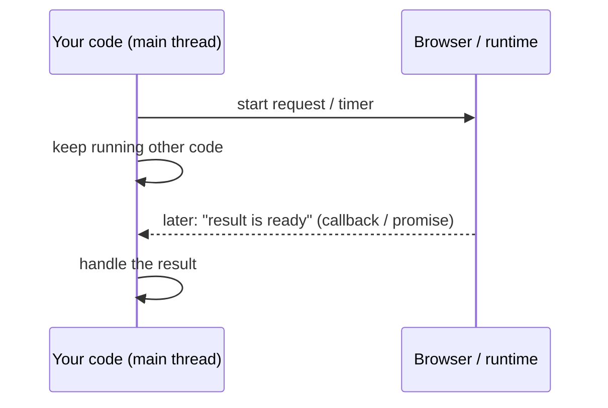
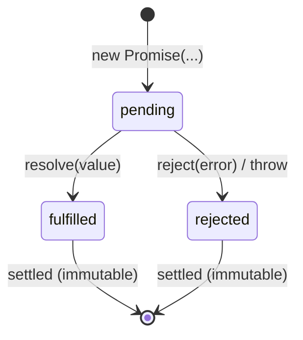

## Why asynchronous code?

JavaScript runs your code on **one thread**. If a slow operation (a network request, a timer, reading a file) blocked that thread, the page would freeze: no clicks, no scrolling, no animation until it finished.

So slow operations are **asynchronous**: you *start* them, JavaScript continues with the next line, and you get notified **later**, when the result is ready. The mechanism that delivers those notifications is the [event loop](/javascript/event-loop).

```js run
console.log("1. order a coffee");
setTimeout(() => console.log("3. coffee is ready ☕"), 100);   // start, don't wait
console.log("2. sit down and read the news");                 // runs immediately
```



JavaScript's async story has three generations, each built on the previous one:

| Generation | Style | Problem it solved | Problem it left |
| --- | --- | --- | --- |
| Callbacks | `doThing(arg, (err, result) => …)` | Not blocking | Nesting ("callback hell"), scattered error handling, no guarantees |
| Promises (ES2015) | `doThing(arg).then(…).catch(…)` | A value representing a future result; chaining; one error path | Still not "normal-looking" code |
| `async`/`await` (ES2017) | `const result = await doThing(arg)` | Async code that reads top-to-bottom, with `try/catch` | Easy to accidentally run things sequentially |

## Callbacks

A **callback** is a function you pass to another function, to be called when the work is done. Node.js popularized the **error-first** convention: the first argument is an error (or `null`), the rest is the result.

```js run
function loadUser(id, callback) {
  setTimeout(() => {
    if (id <= 0) callback(new Error("invalid id"));
    else callback(null, { id, name: `User ${id}` });
  }, 20);
}

loadUser(7, (err, user) => {
  if (err) return console.log("failed:", err.message);
  console.log("loaded:", user.name);
});
loadUser(-1, (err) => console.log("failed:", err.message));
```

### Callback hell and inversion of control

Dependent steps nest deeper and deeper, and every level needs its own error check:

```js
getUser(id, (err, user) => {
  if (err) return handle(err);
  getOrders(user.id, (err, orders) => {
    if (err) return handle(err);
    getDetails(orders[0].id, (err, details) => {
      if (err) return handle(err);
      render(details);          // the "pyramid of doom"
    });
  });
});
```

The deeper problem is **inversion of control**: you hand your continuation to someone else's code and trust it to call it **exactly once**, **asynchronously**, with the right arguments. A buggy library might call it twice, never, or synchronously. Promises fix that by giving *you* an object to hold.

## Promises

A **Promise** is an object that represents **the eventual result of an asynchronous operation**. Think of a restaurant buzzer: you get it immediately, and later it tells you "your order is ready" or "sorry, we're out of that".

A promise is always in one of three states, and once it **settles** it never changes again:



| State | Meaning | Handler that runs |
| --- | --- | --- |
| `pending` | Not finished yet | — |
| `fulfilled` | Succeeded with a **value** | `.then(onFulfilled)` |
| `rejected` | Failed with a **reason** (usually an `Error`) | `.catch(onRejected)` / `.then(_, onRejected)` |

### Creating a promise

<Api name="new Promise()" sig="new Promise((resolve, reject) => { … })" returns="A new promise in the `pending` state. It settles when the executor calls `resolve` or `reject` (or throws)." mutates="n/a">

- The **executor** function runs **immediately and synchronously**, receiving two functions:
  - `resolve(value)`: fulfill the promise with `value` (if `value` is itself a promise/thenable, follow it).
  - `reject(reason)`: reject the promise with `reason`.
- Only the **first** call counts; later `resolve`/`reject` calls are ignored.
- If the executor throws, the promise is rejected with that error.

</Api>

```js run
// Wrap a callback API in a promise ("promisify")
const wait = (ms, value) =>
  new Promise((resolve) => setTimeout(() => resolve(value), ms));

function loadUser(id) {
  return new Promise((resolve, reject) => {
    console.log("executor runs synchronously");
    setTimeout(() => {
      if (id <= 0) reject(new Error("invalid id"));
      else resolve({ id, name: `User ${id}` });
      resolve("ignored: a promise settles only once");
    }, 20);
  });
}

const p = loadUser(3);
console.log("after creating:", p instanceof Promise);
p.then((user) => console.log("fulfilled:", user.name));
wait(10, "hello").then(console.log);
```

You rarely need `new Promise` in application code. Most APIs already return promises (`fetch`, `response.json()`, file APIs, database clients). Use it to wrap callback-based or event-based APIs.

### Consuming a promise: `then`, `catch`, `finally`

<Api name="Promise.prototype.then()" sig="promise.then(onFulfilled?, onRejected?)" returns="A **new** promise, settled with whatever the handler returns (a value fulfills it, a returned promise is followed, a thrown error rejects it)." mutates="no">

- `onFulfilled(value)`: runs if the promise fulfills.
- `onRejected(reason)` (optional): runs if it rejects. Usually written as a separate `.catch`.
- Handlers always run **asynchronously** (as microtasks), even if the promise is already settled.

</Api>

| Method | Runs when | Receives | The returned promise… |
| --- | --- | --- | --- |
| `.then(fn)` | Fulfilled | The value | Settles with `fn`'s result |
| `.catch(fn)` | Rejected (anywhere above it in the chain) | The error | Settles with `fn`'s result: returning normally **recovers** |
| `.finally(fn)` | Either | Nothing | Passes the original value/error through (unless `fn` throws) |

### Chaining: the most important rule

**Every `.then` returns a new promise.** What you `return` from a handler becomes the input of the next step. That's what turns the callback pyramid into a flat chain:

```js run
const getUser = (id) => Promise.resolve({ id, name: "Sara" });
const getOrders = (user) => Promise.resolve([{ id: 101, total: 40 }, { id: 102, total: 15 }]);

getUser(1)
  .then((user) => {
    console.log("1. user:", user.name);
    return getOrders(user);              // return a promise → the next then waits for it
  })
  .then((orders) => {
    console.log("2. orders:", orders.length);
    return orders.reduce((s, o) => s + o.total, 0);   // return a plain value
  })
  .then((total) => {
    console.log("3. total:", total);
    throw new Error("payment service down");          // throw → jump to the next catch
  })
  .then(() => console.log("never runs"))
  .catch((err) => {
    console.log("4. caught:", err.message);
    return "fallback";                   // recovering: the chain is fulfilled again
  })
  .then((v) => console.log("5. continues with:", v))
  .finally(() => console.log("6. cleanup (always)"));
```

| Inside a handler you… | The next step receives |
| --- | --- |
| `return value` | `value` (fulfilled) |
| `return somePromise` | Whatever `somePromise` settles with (it waits) |
| `throw error` | A rejection → skips to the next `catch` |
| Return nothing | `undefined` |

<Callout type="mistake" title="The forgotten return">
`.then((user) => { getOrders(user); })` starts `getOrders` but doesn't return it, so the next `.then` runs immediately with `undefined` and errors from `getOrders` are lost ("floating promise"). With braces, always `return`.
</Callout>

### Error propagation

A rejection travels down the chain, skipping every `then` until it finds a `catch` (or a `then` with a second argument). A `catch` handles errors from **everything above it**.

```js run
Promise.resolve(1)
  .then((x) => x * 2)
  .then(() => { throw new TypeError("step 2 failed"); })
  .then(() => console.log("skipped"))
  .then(() => console.log("skipped too"))
  .catch((e) => console.log(`${e.name}: ${e.message}`));

// Without any catch: an "unhandled rejection" (browser console error / Node may exit)
// Promise.reject(new Error("nobody handles me"));
```

## Combining promises

| Method | Waits for | Fulfills with | Rejects when | Use it for |
| --- | --- | --- | --- | --- |
| `Promise.all(list)` | **All** to fulfill | Array of values, **in input order** | **The first** rejection (fail fast) | Independent requests that are all required |
| `Promise.allSettled(list)` | All to settle | Array of `{status, value}` / `{status, reason}` | Never | Batch operations where some may fail |
| `Promise.race(list)` | The **first to settle** | Its value | If the first to settle rejects | Timeouts |
| `Promise.any(list)` | The **first to fulfill** | Its value | Only if **all** reject (`AggregateError`) | Fastest of several mirrors |

```js run
const ok = (ms, v) => new Promise((r) => setTimeout(() => r(v), ms));
const fail = (ms, msg) => new Promise((_, j) => setTimeout(() => j(new Error(msg)), ms));

(async () => {
  console.log("all:", await Promise.all([ok(30, "a"), ok(10, "b"), ok(20, "c")]));   // order kept

  try { await Promise.all([ok(30, "a"), fail(10, "b failed")]); }
  catch (e) { console.log("all rejects fast:", e.message); }

  const settled = await Promise.allSettled([ok(10, "a"), fail(5, "nope")]);
  console.log("allSettled:", settled.map((r) => r.status === "fulfilled" ? r.value : r.reason.message));

  console.log("race:", await Promise.race([ok(30, "slow"), ok(10, "fast")]));
  console.log("any:", await Promise.any([fail(5, "x"), ok(20, "first success")]));

  try { await Promise.any([fail(5, "x"), fail(10, "y")]); }
  catch (e) { console.log("any:", e.constructor.name, e.errors.map((x) => x.message)); }
})();
```

```text
time →        0ms      10ms      20ms      30ms
ok(30,"a")    ─────────────────────────────● a
ok(10,"b")    ─────────● b
ok(20,"c")    ───────────────────● c
Promise.all   ─────────────────────────────● ["a","b","c"]   (waits for the slowest)
Promise.race  ─────────● "b"                                  (first to settle)
```

Other helpers: `Promise.resolve(v)` / `Promise.reject(e)` create settled promises; `Promise.withResolvers()` (ES2024) returns `{ promise, resolve, reject }` so you can settle a promise from outside its executor.

## async / await

`async`/`await` is syntax on top of promises that lets asynchronous code **read like synchronous code**.

<Api name="async function / await" sig="async function f(…) { const value = await somePromise; … }" returns="An `async` function **always returns a promise**: its `return` value fulfills it, a thrown error rejects it. `await p` evaluates to `p`'s fulfilled value or **throws** its rejection reason." mutates="n/a">

- `await` can only be used inside `async` functions (and at the top level of ES modules).
- `await` pauses **only this function**; the rest of the program keeps running.
- `await` on a non-promise value just wraps it (`await 5` → `5`, after a microtask).

</Api>

```js run
const fetchUser = (id) => new Promise((r) => setTimeout(() => r({ id, name: "Ali" }), 20));
const fetchPosts = (userId) => new Promise((r) => setTimeout(() => r(["post A", "post B"]), 20));

async function showProfile(id) {
  console.log("start");
  const user = await fetchUser(id);       // pauses here, without blocking the thread
  const posts = await fetchPosts(user.id);
  return `${user.name} has ${posts.length} posts`;
}

const result = showProfile(1);
console.log("showProfile returned a", result.constructor.name);   // Promise — immediately
result.then(console.log);
```

The same function with promises, to see what `await` replaces:

```js
function showProfile(id) {
  console.log("start");
  return fetchUser(id)
    .then((user) => fetchPosts(user.id).then((posts) => ({ user, posts })))
    .then(({ user, posts }) => `${user.name} has ${posts.length} posts`);
}
```

### Error handling with try/catch

A rejected `await` **throws**, so ordinary `try/catch/finally` works:

```js run
const request = (ok) => new Promise((resolve, reject) =>
  setTimeout(() => (ok ? resolve({ data: 42 }) : reject(new Error("HTTP 500"))), 10));

async function load(ok) {
  try {
    const res = await request(ok);
    return res.data;
  } catch (err) {
    console.log("handled:", err.message);
    return null;                          // fallback value
  } finally {
    console.log("loading spinner off");   // always runs
  }
}

(async () => {
  console.log(await load(true));
  console.log(await load(false));
})();
```

### Sequential vs parallel: the most common performance bug

```js run
const task = (name, ms) => new Promise((r) => setTimeout(() => r(name), ms));

(async () => {
  let t = Date.now();
  const a = await task("a", 100);          // waits 100ms…
  const b = await task("b", 100);          // …then starts b: another 100ms
  console.log("sequential:", a, b, Math.round((Date.now() - t) / 100) * 100, "ms");

  t = Date.now();
  const [c, d] = await Promise.all([task("c", 100), task("d", 100)]);  // both start now
  console.log("parallel:  ", c, d, Math.round((Date.now() - t) / 100) * 100, "ms");
})();
```

**Rule:** if two operations don't depend on each other, **start both, then await them together** with `Promise.all`. Use sequential `await` only when step 2 needs step 1's result.

### Loops

```js run
const save = (id) => new Promise((r) => setTimeout(() => r(`saved ${id}`), 20));
const ids = [1, 2, 3];

(async () => {
  // ✗ forEach doesn't wait: "done" prints before anything is saved
  ids.forEach(async (id) => console.log("forEach:", await save(id)));
  console.log("forEach 'done' (too early!)");

  await new Promise((r) => setTimeout(r, 50));

  // ✓ one after another
  for (const id of ids) console.log("for...of:", await save(id));

  // ✓ all at once, results in order
  console.log("all:", await Promise.all(ids.map(save)));
})();
```

### Top-level await

In ES modules, `await` works outside functions. The module (and anything importing it) waits for it:

```js
// config.js (an ES module)
const response = await fetch("/config.json");
export const config = await response.json();
```

## Real-world patterns

### Timeout

```js run
function withTimeout(promise, ms) {
  let timer;
  const timeout = new Promise((_, reject) => {
    timer = setTimeout(() => reject(new Error(`timed out after ${ms}ms`)), ms);
  });
  return Promise.race([promise, timeout]).finally(() => clearTimeout(timer));
}

const slow = new Promise((r) => setTimeout(() => r("data"), 200));
withTimeout(slow, 50).then(console.log, (e) => console.log(e.message));
```

### Cancellation with AbortController

Promises themselves can't be cancelled, but the work behind them often can. `AbortController` is the standard way: you pass its `signal` to the operation, and call `abort()` to stop it.

```js run
function cancellableDelay(ms, { signal } = {}) {
  return new Promise((resolve, reject) => {
    if (signal?.aborted) return reject(signal.reason);
    const timer = setTimeout(() => resolve(`waited ${ms}ms`), ms);
    signal?.addEventListener("abort", () => {
      clearTimeout(timer);
      reject(signal.reason);
    }, { once: true });
  });
}

const controller = new AbortController();
cancellableDelay(500, { signal: controller.signal })
  .then(console.log)
  .catch((e) => console.log("cancelled:", e.name));
setTimeout(() => controller.abort(), 50);

// fetch supports it natively:
//   fetch(url, { signal: controller.signal })
//   fetch(url, { signal: AbortSignal.timeout(5000) })   // built-in timeout
```

### Retry with exponential backoff

```js run
async function retry(fn, { retries = 3, baseDelay = 50 } = {}) {
  for (let attempt = 0; ; attempt++) {
    try {
      return await fn(attempt);
    } catch (err) {
      if (attempt >= retries) throw err;
      const delay = baseDelay * 2 ** attempt + Math.random() * 20;   // 50, 100, 200… + jitter
      console.log(`attempt ${attempt + 1} failed (${err.message}), retrying in ~${Math.round(delay)}ms`);
      await new Promise((r) => setTimeout(r, delay));
    }
  }
}

let calls = 0;
const flaky = async () => {
  if (++calls < 3) throw new Error("network error");
  return "success on call " + calls;
};
retry(flaky).then(console.log);
```

### Limiting concurrency

`Promise.all(urls.map(fetch))` starts **everything at once**. With 1,000 URLs that floods the network and the server. A small pool runs at most N at a time:

```js run
async function mapWithLimit(items, limit, fn) {
  const results = new Array(items.length);
  let next = 0;
  let active = 0, maxActive = 0;

  async function worker() {
    while (next < items.length) {
      const i = next++;                     // claim the next index (safe: JS is single-threaded)
      active++; maxActive = Math.max(maxActive, active);
      results[i] = await fn(items[i], i);
      active--;
    }
  }
  await Promise.all(Array.from({ length: Math.min(limit, items.length) }, worker));
  console.log("max running at once:", maxActive);
  return results;
}

const fakeFetch = (n) => new Promise((r) => setTimeout(() => r(n * 10), 10 + (n % 3) * 10));
mapWithLimit([1, 2, 3, 4, 5, 6, 7, 8], 3, fakeFetch).then((r) => console.log(r));
```

### Race conditions in the UI (stale responses)

When a user types "re", then "rea", then "react", three requests fly and **may return out of order**. If the "re" response arrives last, the UI shows results for the wrong query.

```js run
const search = (q) => new Promise((r) => setTimeout(() => r(`results for "${q}"`), { re: 90, rea: 30, react: 50 }[q]));

// ✗ naive: shows whatever arrives last
let shown = "";
for (const q of ["re", "rea", "react"]) search(q).then((res) => (shown = res));

// ✓ ignore responses that aren't for the latest request
let latest = 0;
let shownSafe = "";
for (const q of ["re", "rea", "react"]) {
  const id = ++latest;
  search(q).then((res) => { if (id === latest) shownSafe = res; });
}

setTimeout(() => console.log("naive:", shown, "| safe:", shownSafe), 150);
```

In React you'd do the same with a cleanup flag or `AbortController` in `useEffect`, or let a data library (TanStack Query, SWR) handle it.

## Common mistakes

- Forgetting `return` inside `.then` (floating promises), or forgetting `await`.
- Missing `.catch`/`try` → unhandled rejections.
- `await` in sequence for independent operations (use `Promise.all`).
- `async` callbacks inside `forEach`.
- Wrapping a promise in `new Promise` unnecessarily (the "explicit construction anti-pattern").
- Using `Promise.all` when partial failure is acceptable (use `allSettled`).
- Expecting `Promise.race` to cancel the losers (they keep running).
- Ignoring out-of-order responses in search/autocomplete.

## Interview questions

<QA q="What are the states of a promise, and what does `.then` return?" level="junior" n={1}>
<Answer>

`pending`, then settled as either `fulfilled` (with a value) or `rejected` (with a reason); a settled promise never changes. `.then` returns a **new** promise, resolved with whatever the handler returns: a value fulfills it, a returned promise is followed, a thrown error rejects it. That's what makes chaining work.

</Answer>
<Deep>

Handlers always run asynchronously as microtasks, even on already-settled promises, which guarantees consistent ordering (no "sometimes sync" bugs). Returning a thenable costs extra microtask ticks (see the event loop chapter).

</Deep>
<Mistake>

Thinking `.then` modifies the original promise or that the chain shares one promise.

</Mistake>
<FollowUp>

What's the difference between `.then(a, b)` and `.then(a).catch(b)`? (`b` in the second form also catches errors thrown by `a`.)

</FollowUp>
</QA>

<QA q="Compare `Promise.all`, `allSettled`, `race` and `any`." level="mid" n={2}>
<Answer>

`all` fulfills with all values in input order once every promise fulfills, and rejects on the first rejection. `allSettled` waits for all and reports each outcome; it never rejects. `race` settles like the first promise to settle (either way). `any` fulfills with the first fulfillment and rejects with an `AggregateError` only if all reject.

</Answer>
<Deep>

None of them cancel the remaining operations; pair them with `AbortController` if needed. `all` with an empty array fulfills immediately with `[]`; `race` with an empty array stays pending forever; `any` with an empty array rejects.

</Deep>
<Mistake>

Using `race` for "first success" (it settles on the first *rejection* too); that's `any`.

</Mistake>
<FollowUp>

Implement `Promise.all` yourself.

</FollowUp>
</QA>

<QA q="Implement `Promise.all`." level="senior" n={3}>
<Answer>

```js
function promiseAll(iterable) {
  return new Promise((resolve, reject) => {
    const items = Array.from(iterable);
    const results = new Array(items.length);
    let remaining = items.length;
    if (remaining === 0) return resolve(results);
    items.forEach((item, i) => {
      Promise.resolve(item).then((value) => {
        results[i] = value;              // keep input order
        if (--remaining === 0) resolve(results);
      }, reject);                        // first rejection wins
    });
  });
}
```

</Answer>
<Deep>

`Promise.resolve(item)` handles non-promise values and foreign thenables. Storing by index preserves order regardless of completion order. Calling `reject` many times is harmless because a promise settles only once.

</Deep>
<Mistake>

Pushing results with `results.push(value)`, which orders them by completion time.

</Mistake>
<FollowUp>

Now implement `allSettled` and `any`.

</FollowUp>
</QA>

<QA q="What does an `async` function return, and what happens when `await` gets a rejected promise?" level="junior" n={4}>
<Answer>

An async function always returns a promise: fulfilled with its return value, rejected with any thrown error. `await` on a rejected promise throws the reason at that line, so you handle it with `try/catch` (or a `.catch` on the returned promise).

</Answer>
<Deep>

`await` pauses only the async function; it schedules the rest of the function as a microtask when the awaited promise settles. `return await p` inside a `try` is meaningful (errors are caught there); `return p` without await would let the rejection escape the `try`.

</Deep>
<Mistake>

Expecting `const x = asyncFn()` to give the value instead of a promise.

</Mistake>
<FollowUp>

When is `return await` necessary, and when is it redundant?

</FollowUp>
</QA>

<QA q="You have 1,000 URLs to fetch. How do you do it efficiently and safely?" level="senior" n={5}>
<Answer>

Not with one `Promise.all` over all of them, which starts 1,000 requests at once. Use a concurrency limit (a worker pool of e.g. 6 workers pulling from a shared index), collect results by index, handle failures per item (try/catch or `allSettled` semantics), add retries with backoff for transient errors, and support cancellation with an `AbortController`.

</Answer>
<Deep>

Browsers already cap connections per origin (~6 for HTTP/1.1), but uncapped promises still allocate memory and can overwhelm the server or rate limits. Libraries like `p-limit` implement the pool pattern; for UIs, stream results as they arrive instead of waiting for all.

</Deep>
<Mistake>

Awaiting each request in a `for` loop (fully sequential: slow) or firing all at once (unbounded).

</Mistake>
<FollowUp>

How would you report progress (e.g. "340/1000 done") with your pool?

</FollowUp>
</QA>

## Recap

<Recap>

- Slow work (network, timers, files) must not block the thread; JavaScript handles it with callbacks, promises and async/await.
- Nested callbacks lead to callback hell and a trust problem (inversion of control).
- A promise has three states: pending, fulfilled, rejected; once settled it never changes.
- `then` always returns a new promise; the value or promise you return feeds the next step. Don't forget to `return`.
- One `catch` at the end catches errors from any step; `finally` runs either way and doesn't change the value.
- `Promise.all` gives all results or the first error, `allSettled` every outcome, `race` the first to settle, `any` the first to succeed.
- `async` always returns a promise and `await` waits for it to settle; errors are caught with `try/catch`.
- Run independent work in parallel with `Promise.all`, not sequential `await`s; `await` inside `forEach` doesn't wait.
- Use `AbortController` to cancel requests, and never leave a promise rejection unhandled.

</Recap>
