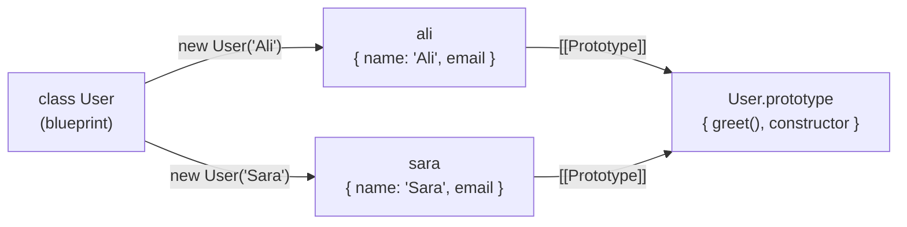
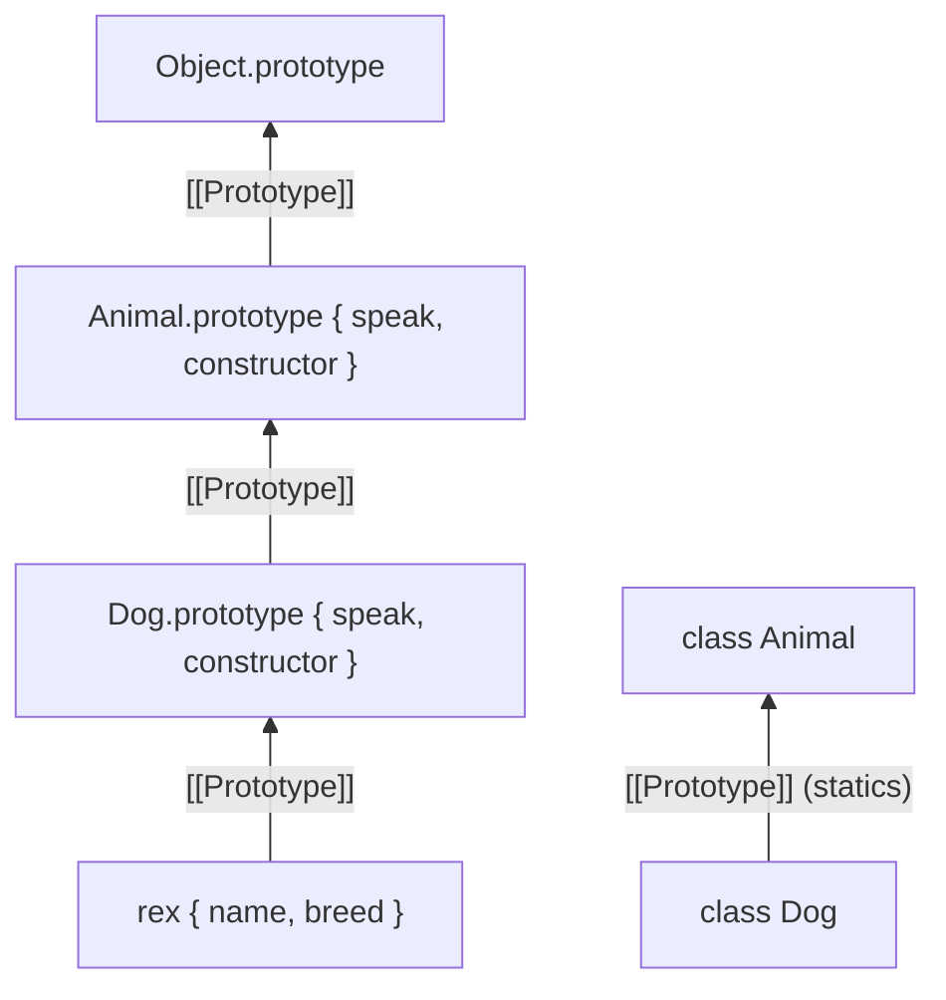

## What is a class?

A **class** is a blueprint for creating objects that share the same **shape** (properties) and **behaviour** (methods). Instead of writing the same object literal again and again, you describe it once and create as many **instances** as you need with `new`.

```js run
class User {
  constructor(name, email) {   // runs once for every new User
    this.name = name;          // instance properties: each object gets its own
    this.email = email;
  }

  greet() {                    // a method: shared by all instances
    return `Hi, I'm ${this.name}`;
  }
}

const ali = new User("Ali", "ali@example.com");
const sara = new User("Sara", "sara@example.com");

console.log(ali.greet(), sara.greet());
console.log(ali instanceof User);           // true
console.log(ali.greet === sara.greet);      // true — one shared function
```



**Key idea:** JavaScript classes are **syntax on top of prototypes**. A class creates a constructor function plus a `prototype` object holding its methods; instances delegate to that prototype. If prototypes are new to you, read [Objects & prototypes](/javascript/objects-prototypes) first. This chapter focuses on what the `class` syntax gives you and how to use it well.

```js run
class Point { constructor(x) { this.x = x; } show() { return this.x; } }
console.log(typeof Point);                                   // "function"
console.log(Object.getOwnPropertyNames(Point.prototype));    // ['constructor', 'show']
console.log(Object.getPrototypeOf(new Point(1)) === Point.prototype); // true
```

## Anatomy of a class

```js run
class BankAccount {
  // 1. Public field: created on every instance, before the constructor body runs
  currency = "USD";

  // 2. Private field: only code inside this class body can read/write it
  #balance = 0;

  // 3. Static field: lives on the class itself, not on instances
  static bankName = "JS Bank";
  static #count = 0;

  // 4. Constructor: runs on `new`, receives the arguments
  constructor(owner, initial = 0) {
    this.owner = owner;
    this.deposit(initial);
    BankAccount.#count++;
  }

  // 5. Method: on BankAccount.prototype, shared
  deposit(amount) {
    if (amount < 0) throw new RangeError("negative amount");
    this.#balance += amount;
    return this;                 // returning this enables chaining
  }

  // 6. Getter: read like a property
  get balance() {
    return this.#balance;
  }

  // 7. Private method
  #log(message) {
    return `[${this.owner}] ${message}`;
  }
  report() {
    return this.#log(`balance ${this.#balance} ${this.currency}`);
  }

  // 8. Static method: called on the class
  static count() {
    return BankAccount.#count;
  }
}

const acc = new BankAccount("Ali", 100).deposit(50);
console.log(acc.balance, acc.report());
console.log(BankAccount.bankName, BankAccount.count());
console.log(Object.keys(acc));           // ['currency', 'owner'] — private fields are invisible
```

| Member | Syntax | Lives on | Accessible as |
| --- | --- | --- | --- |
| Constructor | `constructor(…) {}` | The class function itself | `new BankAccount(…)` |
| Public field | `currency = "USD"` | **Each instance** | `acc.currency` |
| Private field | `#balance = 0` | Each instance (hidden slot) | Only `this.#balance` inside the class |
| Method | `deposit() {}` | `BankAccount.prototype` | `acc.deposit()` |
| Getter / setter | `get balance() {}` | `BankAccount.prototype` | `acc.balance` |
| Private method | `#log() {}` | Hidden, per class | Only inside the class |
| Static field / method | `static count() {}` | The class (`BankAccount`) | `BankAccount.count()` |
| Static block | `static { … }` | Runs once when the class is defined | — |

## The constructor

<Api name="constructor" sig="constructor(...params) { … }" returns="Nothing needed. `new` returns the new instance automatically (unless the constructor explicitly returns a different **object**)." mutates="n/a">

- `...params`: the arguments passed to `new ClassName(...)`.
- Inside, `this` is the brand-new instance. Fields are already initialized when the body starts (in a base class).
- A class may have **at most one** constructor. If you omit it, an empty one is created for you (in a subclass: `constructor(...args) { super(...args) }`).

</Api>

What `new User("Ali")` does, step by step:

```mermaid
flowchart TD
    N["new User('Ali')"] --> O["1. create an empty object<br/>whose [[Prototype]] is User.prototype"]
    O --> F["2. initialize fields<br/>(public and #private, in order)"]
    F --> C["3. run the constructor body<br/>with this = the new object"]
    C --> R{"4. constructor returned an object?"}
    R -->|no (usual)| I["return the new instance"]
    R -->|yes| X["return that object instead"]
```

```js run
class Order {
  status = "new";                         // fields run first…
  constructor(id) {
    console.log("in constructor, status =", this.status);   // …so status already exists
    this.id = id;
  }
}
const o = new Order(7);
console.log(o);

try {
  Order(8);                               // classes can't be called without new
} catch (e) {
  console.log(e.name + ": " + e.message);
}
```

## Fields: public and private

### Public fields

A field declaration (`name = value`) creates an **own property on every instance**. The value expression is evaluated **per instance**, so each object gets its own array or object:

```js run
class TodoList {
  items = [];                 // a NEW array for every instance ✓
  createdAt = Date.now();
}
const a = new TodoList();
const b = new TodoList();
a.items.push("buy milk");
console.log(a.items, b.items);            // ['buy milk'] [] — not shared
```

Compare with putting data on the prototype, which **is** shared:

```js run
function Old() {}
Old.prototype.items = [];                 // ✗ one array for every instance
const x = new Old(), y = new Old();
x.items.push("shared!");
console.log(y.items);                     // ['shared!']
```

### Private fields and methods (`#`)

`#name` members are **truly private**: the engine forbids access from outside the class body. That's different from the old `_name` convention, which is only a hint to other developers.

```js run
class Counter {
  #count = 0;
  #step;
  constructor(step = 1) { this.#step = step; }
  increment() { this.#count += this.#step; return this.#count; }

  // `#x in obj` checks whether obj has this class's private field ("brand check")
  static isCounter(obj) { return #count in obj; }
}

const c = new Counter(5);
console.log(c.increment(), c.increment());   // 5 10
console.log(c.count, Object.keys(c));        // undefined [] — nothing visible
console.log(JSON.stringify(c));              // {}
console.log(Counter.isCounter(c), Counter.isCounter({}));   // true false
// c.#count  → SyntaxError outside the class (can't even be written)
```

| | `_name` (convention) | `#name` (private) | Closure variable |
| --- | --- | --- | --- |
| Really hidden | ✗ | ✓ | ✓ |
| Shows in `Object.keys` / JSON / devtools props | ✓ | ✗ | ✗ |
| Accessible by subclasses | ✓ | ✗ (only the declaring class) | ✗ |
| Memory | Shared methods | Shared methods | A new function per object |

Private names are **per class**, not per object: code inside `Counter` can read `#count` of *another* `Counter` instance (useful for `equals(other)`).

## Methods and `this`

Methods are defined once on the prototype. When you call `obj.method()`, `this` is `obj`. The trouble starts when you **detach** a method from its object, for example when passing it as a callback:

```js run
class Timer {
  seconds = 0;
  tick() {
    this.seconds++;
    return this.seconds;
  }
}

const t = new Timer();
console.log(t.tick());            // 1 — called as t.tick(), this = t

const detached = t.tick;
try {
  detached();                     // this = undefined (class bodies are strict)
} catch (e) {
  console.log(e.name + ": " + e.message);
}
```

Three ways to keep `this` bound:

```js run
class Button {
  label = "Save";
  constructor() {
    this.handleBind = this.handleBind.bind(this);   // 1. bind in the constructor
  }
  handleBind() { return "bind: " + this.label; }

  handleArrow = () => "arrow field: " + this.label;  // 2. arrow function as a field

  handleNormal() { return "normal: " + this.label; }
}

const b = new Button();
const callbacks = [b.handleBind, b.handleArrow, () => b.handleNormal()]; // 3. wrap at the call site
callbacks.forEach((fn) => console.log(fn()));
```

| Approach | Where the function lives | Cost |
| --- | --- | --- |
| Prototype method + `bind` in constructor | A bound copy per instance | One function per instance |
| Arrow-function field | Own property per instance | One function per instance; not on the prototype, so not overridable via `super` |
| Wrap at call site `() => obj.m()` | Prototype | A new wrapper per call site/render |

See [this & functions](/javascript/this-functions) for every `this` rule.

## Getters and setters in classes

Accessors make computed or validated values look like plain properties. They live on the prototype:

```js run
class Rectangle {
  #width; #height;
  constructor(w, h) { this.width = w; this.height = h; }   // goes through the setters

  get width() { return this.#width; }
  set width(v) {
    if (!(v > 0)) throw new RangeError("width must be > 0");
    this.#width = v;
  }
  get height() { return this.#height; }
  set height(v) {
    if (!(v > 0)) throw new RangeError("height must be > 0");
    this.#height = v;
  }
  get area() { return this.#width * this.#height; }        // read-only computed value
}

const r = new Rectangle(3, 4);
console.log(r.area);
r.width = 10;
console.log(r.area);
try { r.width = -1; } catch (e) { console.log(e.message); }
try { r.area = 5; } catch (e) { console.log(e.name); }      // no setter → TypeError (strict)
```

The full story (descriptors, inheritance pitfalls, lazy getters) is in [Getters and setters](/javascript/objects-prototypes#getters-and-setters-accessor-properties).

## Static members

`static` members belong to the **class itself**. Use them for things that are about the concept, not about one particular instance: factory functions, constants, caches, counters, validation helpers.

```js run
class Color {
  static #cache = new Map();
  static WHITE = new Color(255, 255, 255);    // a static constant (can use the class itself)

  constructor(r, g, b) { Object.assign(this, { r, g, b }); }

  // Alternative constructor ("named constructor" / factory)
  static fromHex(hex) {
    if (Color.#cache.has(hex)) return Color.#cache.get(hex);
    const [r, g, b] = hex.match(/\w\w/g).map((h) => parseInt(h, 16));
    const color = new Color(r, g, b);
    Color.#cache.set(hex, color);
    return color;
  }

  static {                                    // static initialization block: runs once
    console.log("Color class initialized");
  }

  toString() { return `rgb(${this.r}, ${this.g}, ${this.b})`; }
}

console.log(String(Color.fromHex("#ff8800")));
console.log(Color.fromHex("#ff8800") === Color.fromHex("#ff8800"));   // true — cached
console.log(String(Color.WHITE));
console.log(new Color(1, 2, 3).fromHex);      // undefined — statics are not on instances
```

Inside a static method, `this` is the class it was called on, which matters for subclasses (`static create() { return new this(); }` creates the subclass).

## Inheritance with `extends` and `super`

`class Child extends Parent` makes `Child` inherit everything from `Parent`: instance methods (through the prototype chain) **and** static members (the child class's own prototype is the parent class).

```js run
class Animal {
  constructor(name) { this.name = name; }
  speak() { return `${this.name} makes a sound`; }
  static create(name) { return new this(name); }   // `this` = the class it's called on
}

class Dog extends Animal {
  constructor(name, breed) {
    super(name);                 // MUST be called before using `this`
    this.breed = breed;
  }
  speak() {                      // override
    return `${super.speak()}… a loud woof!`;   // super.method() calls the parent's version
  }
}

const rex = new Dog("Rex", "Labrador");
console.log(rex.speak());
console.log(rex instanceof Dog, rex instanceof Animal);
console.log(Dog.create("Max") instanceof Dog);     // static inherited, `this` = Dog
```



### The rules of `super`

| Where | What `super` means | Rule |
| --- | --- | --- |
| In a subclass constructor | `super(...args)` calls the parent constructor | Must run **before** any `this` access; `this` doesn't exist until then |
| In a method | `super.method()` calls the parent's method with the current `this` | Works in methods and accessors, not in plain functions |
| In a static method | `super.staticMethod()` calls the parent's static | |

```js predict
class A {
  constructor() { this.who = "A"; }
}
class B extends A {
  constructor() {
    try {
      this.early = true;
    } catch (e) {
      console.log(e.name);
    }
    super();
    console.log(this.who);
  }
}
new B();
```

```output
ReferenceError
A
```

In a derived class, `this` is in a **temporal dead zone** until `super()` returns, because it's the **parent** constructor that actually creates the object. That's also why subclasses of built-ins like `Array`, `Error` or `Map` work properly with classes.

### Extending built-ins

```js run
class ValidationError extends Error {
  constructor(field, message) {
    super(message);              // sets message (and stack) on the instance
    this.name = "ValidationError";
    this.field = field;
  }
}

try {
  throw new ValidationError("email", "Email is required");
} catch (e) {
  console.log(e instanceof ValidationError, e instanceof Error);
  console.log(`${e.name} on ${e.field}: ${e.message}`);
}

class Stack extends Array {
  peek() { return this.at(-1); }
}
const s = Stack.from([1, 2, 3]);
console.log(s.peek(), s.length, s instanceof Array, s.map((x) => x * 2) instanceof Stack);
```

Note the last line: `map` on a `Stack` returns a `Stack` too, because array methods create results via `this.constructor` (`Symbol.species`).

## Composition over inheritance

Inheritance creates a rigid "is-a" tree. When behaviours need to be combined freely, **composition** ("has-a") or **mixins** are usually better.

```js run
// Mixins: functions that take a class and return an extended class
const Serializable = (Base) => class extends Base {
  toJSON() { return { type: this.constructor.name, ...this }; }
};
const Timestamped = (Base) => class extends Base {
  createdAt = new Date(0).toISOString();
};

class Entity { constructor(id) { this.id = id; } }
class Product extends Serializable(Timestamped(Entity)) {
  constructor(id, title) { super(id); this.title = title; }
}

console.log(JSON.stringify(new Product(1, "Keyboard")));
```

```js run
// Composition: an object HAS helpers instead of BEING a subclass
class Logger { log(msg) { console.log(`[log] ${msg}`); } }
class Cache {
  #store = new Map();
  get(k) { return this.#store.get(k); }
  set(k, v) { this.#store.set(k, v); }
}

class UserService {
  constructor({ logger = new Logger(), cache = new Cache() } = {}) {
    this.logger = logger;          // injected: easy to replace in tests
    this.cache = cache;
  }
  getUser(id) {
    const hit = this.cache.get(id);
    if (hit) return hit;
    this.logger.log(`loading user ${id}`);
    const user = { id, name: `User ${id}` };
    this.cache.set(id, user);
    return user;
  }
}

const service = new UserService();
service.getUser(1);
service.getUser(1);                // second call is cached, no log
```

| | Inheritance (`extends`) | Composition |
| --- | --- | --- |
| Relationship | "is a" (Dog is an Animal) | "has a" (Service has a Logger) |
| Reuse | Implicit, through the chain | Explicit, through fields/params |
| Flexibility | Fixed at definition time, single parent | Mix and swap freely, at runtime |
| Testing | Hard to replace parent behaviour | Inject fakes easily |
| Risk | Fragile base class, deep hierarchies | More wiring code |

React made the same choice: components are combined by composition (children, props, hooks), and class inheritance between components is discouraged.

## Class vs factory function vs object literal

```js run
// Factory function: a function that returns an object
function createCounter(start = 0) {
  let count = start;                   // private through closure
  return {
    increment: () => ++count,
    get value() { return count; },
  };
}
const fc = createCounter(10);
fc.increment();
console.log(fc.value, fc instanceof Object);
```

| | `class` | Factory function | Object literal |
| --- | --- | --- | --- |
| Many instances | ✓ | ✓ | ✗ (one object) |
| Methods shared via prototype | ✓ | ✗ (copied per object) unless you use `Object.create` | — |
| Privacy | `#fields` | Closures | ✗ |
| `instanceof` checks | ✓ | ✗ | ✗ |
| `this` pitfalls | Yes, when detaching methods | None if you avoid `this` | Yes |
| Inheritance | `extends` | Composition | `Object.create` / spread |

## Hoisting and other differences from functions

| | `class` | `function` constructor |
| --- | --- | --- |
| Hoisting | Hoisted but in the **TDZ** (like `let`) | Fully hoisted |
| Call without `new` | `TypeError` | Runs, `this` = undefined/global (bug) |
| Body mode | Always **strict** | Sloppy unless `"use strict"` |
| Methods enumerable | No | Yes, if assigned to `prototype` |
| Private members | `#field` | Only closures |

```js run
try {
  new Early();          // TDZ: the class exists but isn't initialized yet
} catch (e) {
  console.log(e.name + ": " + e.message);
}
class Early {}
```

## Common mistakes

- Using `this` before `super()` in a subclass constructor.
- Passing `obj.method` as a callback and losing `this`.
- Putting mutable data (arrays, objects) on the prototype instead of in fields.
- Expecting `_private` to be private, or `#private` to be accessible in subclasses.
- Overriding only the getter of a getter/setter pair (the setter disappears for that name).
- Building deep inheritance hierarchies where composition would be simpler.
- Forgetting that class getters and methods are not serialized by `JSON.stringify`.

## Interview questions

<QA q="Are JavaScript classes real classes like in Java? What does `class` actually create?" level="mid" n={1}>
<Answer>

No. `class` is syntax over JavaScript's prototype system. It creates a constructor function (`typeof` is `"function"`) whose `prototype` object holds the methods; instances get that object as their `[[Prototype]]` and delegate to it. Nothing is copied at instantiation, except fields, which are created per instance.

</Answer>
<Deep>

Classes do add real semantics on top of constructor functions: they can't be called without `new`, bodies are strict, methods are non-enumerable, there are true `#private` members, `super` works via a method's home object, and derived constructors let the base constructor create `this` (which is what makes subclassing `Array` and `Error` work).

</Deep>
<Mistake>

Saying classes "copy" methods into each instance.

</Mistake>
<FollowUp>

How would you write `class Dog extends Animal` using only constructor functions and `Object.create`?

</FollowUp>
</QA>

<QA q="Why must `super()` be called before `this` in a subclass constructor?" level="mid" n={2}>
<Answer>

In a derived class, the object is created by the **parent** constructor. Until `super()` runs, there is no `this`, so touching it throws a `ReferenceError` (`this` is in a temporal dead zone).

</Answer>
<Deep>

This design lets built-ins allocate exotic objects: an `Array` subclass instance must be a real array with magic `length`, created by `Array` itself. Fields of the subclass are initialized right after `super()` returns, before the rest of the constructor body runs.

</Deep>
<Mistake>

Thinking `super()` is only needed when the parent constructor takes arguments.

</Mistake>
<FollowUp>

In what order do parent fields, the parent constructor body, child fields and the child constructor body run?

</FollowUp>
</QA>

<QA q="What's the difference between `#private`, `_private` and closure-based privacy?" level="mid" n={3}>
<Answer>

`_name` is only a naming convention; the property is public. `#name` is enforced by the language: it can only be accessed inside the class body and is invisible to `Object.keys`, JSON and proxies. Closure variables (in a factory or constructor) are also truly private but require per-object functions to access them.

</Answer>
<Deep>

Private names are lexically scoped to the class, not to the instance: one instance can read another instance's `#field`. `#x in obj` is a brand check that tells you whether `obj` was constructed by this class. Subclasses can't see the parent's private members; expose protected behaviour through methods instead.

</Deep>
<Mistake>

Trying to read `this.#field` from a subclass, which is a `SyntaxError` if the subclass didn't declare it.

</Mistake>
<FollowUp>

Why can't a `Proxy` wrapping a class instance call methods that use `#private` fields?

</FollowUp>
</QA>

<QA q="A method passed as an event handler throws `Cannot read properties of undefined`. Why, and how do you fix it?" level="junior" n={4}>
<Answer>

Passing `obj.method` passes just the function; when it's later called as a plain function, `this` is `undefined` (class code is strict). Fix it by binding in the constructor (`this.method = this.method.bind(this)`), defining the method as an arrow-function field, or wrapping at the call site (`() => obj.method()`).

</Answer>
<Deep>

Arrow fields create one function per instance and live on the instance, not the prototype, so they can't be overridden through `super.method()` and are slightly heavier in memory; for most UI code that's fine.

</Deep>
<Mistake>

Assuming `this` is fixed at the time the method is defined. It's decided at call time.

</Mistake>
<FollowUp>

Why didn't this problem exist with methods defined via arrow functions inside a factory function?

</FollowUp>
</QA>

<QA q="When would you choose composition over inheritance? Give an example." level="senior" n={5}>
<Answer>

When behaviours need to be combined in different ways, when the relationship is "has a" rather than "is a", or when you want to swap implementations (e.g. in tests). Example: a `UserService` that receives a `logger` and a `cache` instead of extending a `CachedLoggingService` base class.

</Answer>
<Deep>

Deep hierarchies suffer from the fragile base class problem: changing the parent can silently break children. Composition keeps dependencies explicit and enables dependency injection. Mixins (class factories) are a middle ground in JS but can cause name collisions and complex `super` chains.

</Deep>
<Mistake>

Creating a base class just to share a utility function.

</Mistake>
<FollowUp>

How does React's component model reflect "composition over inheritance"?

</FollowUp>
</QA>

## Recap

<Recap>

- A `class` is a template for objects of the same shape, and under the hood it's a constructor function plus a prototype.
- `constructor` runs on `new` and initialises the new object; calling a class without `new` throws.
- Public fields are created on each instance; methods live on the prototype and are shared by all instances.
- `#private` fields and methods are truly private and can't even be read outside the class.
- Methods get `this` from how they are called; detaching a method (`const f = obj.method`) loses `this`; an arrow-function field or `bind` fixes it.
- `static` members belong to the class, not instances; use them for factories and utilities.
- In a subclass you must call `super()` before using `this`; `super.method()` calls the parent's version.
- Classes are hoisted but stay in the TDZ, and their bodies are always strict.
- To combine behaviours, composition is often simpler and more flexible than deep inheritance.

</Recap>
