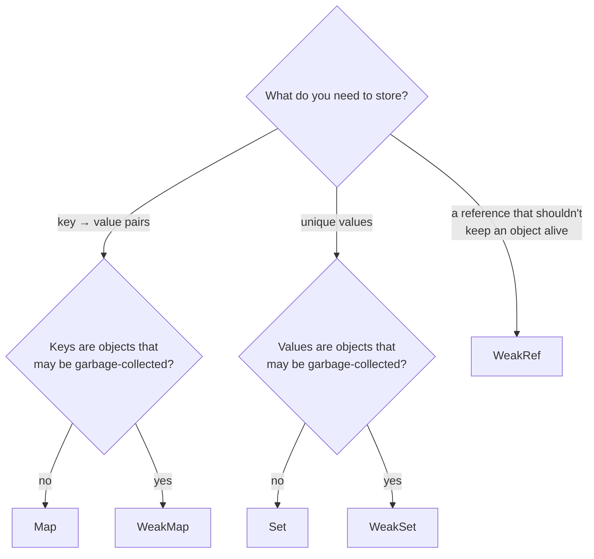
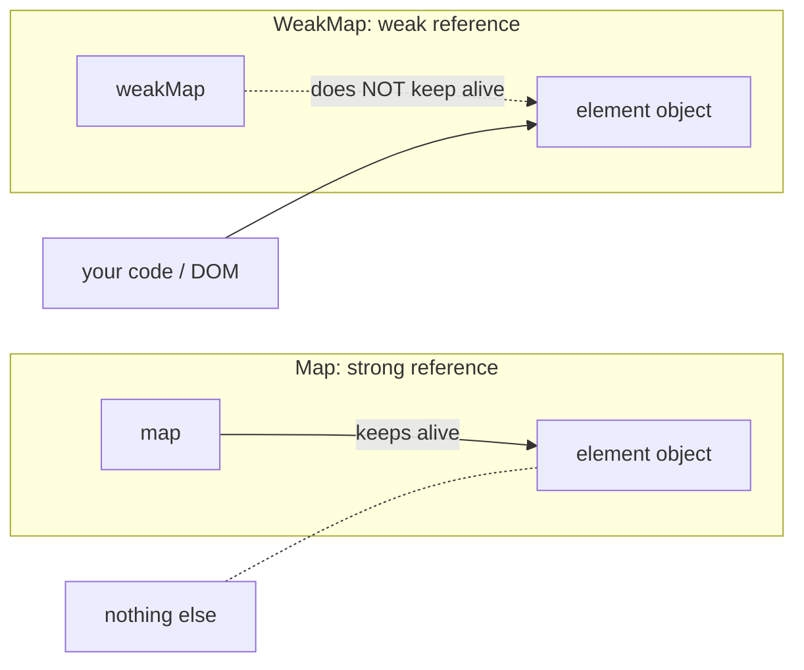

## Why do we need more than objects and arrays?

For years JavaScript developers used plain objects as dictionaries and arrays as sets. Both work, but both have sharp edges:

| Need | With a plain object / array | Problem |
| --- | --- | --- |
| Key–value lookup | `obj[key]` | Keys are always **strings or symbols** (`obj[1]` and `obj["1"]` collide, an object key becomes `"[object Object]"`); inherited keys like `"constructor"` or `"__proto__"` can clash; no fast `size` |
| A collection of unique values | `arr.includes(x)` before `push` | `includes` is O(n), so building a unique list is O(n²) |
| Attach data to an object you don't own (e.g. a DOM node) | `node._data = …` | Pollutes the object, and the data lives as long as the object, or longer if you keep a separate list |

ES2015 added four collection types that solve exactly these problems: **`Map`**, **`Set`**, **`WeakMap`** and **`WeakSet`**. ES2021 added **`WeakRef`** and **`FinalizationRegistry`** for advanced memory-sensitive code.



## Map: a real dictionary

A **`Map`** stores key–value pairs, remembers insertion order, and accepts **any value as a key**: objects, functions, `NaN`, numbers (without turning them into strings).

<Api name="Map" sig="new Map(iterable?) · map.set(key, value) · map.get(key) · map.has(key) · map.delete(key) · map.clear() · map.size" returns="`set` returns the **map itself** (so calls can be chained); `get` returns the value or `undefined`; `has`/`delete` return booleans; `size` is the number of entries." mutates="yes">

- `iterable` (optional): initial entries as `[key, value]` pairs, e.g. `new Map([["a", 1], ["b", 2]])` or `new Map(Object.entries(obj))`.
- `key`: any value. Keys are compared with **SameValueZero** (like `===`, except `NaN` equals `NaN`).

</Api>

```js run
const user = { id: 1 };
const config = new Map();

config.set("theme", "dark")          // string key
      .set(42, "the answer")        // number key: stays a number
      .set(user, { visits: 3 })     // object key!
      .set(NaN, "not a number");    // even NaN works

console.log(config.get("theme"));   // "dark"
console.log(config.get(42), config.get("42"));   // "the answer" undefined — no string coercion
console.log(config.get(user));      // { visits: 3 }
console.log(config.get({ id: 1 })); // undefined — a different object
console.log(config.get(NaN));       // "not a number"
console.log(config.has(user), config.size);       // true 4

config.delete(42);
console.log([...config.keys()]);    // insertion order is preserved
```

### Iterating a Map

```js run
const stock = new Map([
  ["apples", 12],
  ["bananas", 0],
  ["cherries", 40],
]);

for (const [fruit, count] of stock) {           // a Map iterates as [key, value] pairs
  console.log(`${fruit}: ${count}`);
}

stock.forEach((count, fruit) => {               // careful: (value, key), value first!
  if (count === 0) console.log("out of stock:", fruit);
});

console.log([...stock.keys()], [...stock.values()]);
console.log([...stock.entries()]);

// Transforming: convert to an array, use array methods, convert back
const doubled = new Map([...stock].map(([k, v]) => [k, v * 2]));
console.log(doubled);
```

### Converting between objects and Maps

```js run
const obj = { a: 1, b: 2 };
const map = new Map(Object.entries(obj));       // object → Map
console.log(map);

map.set("c", 3);
console.log(Object.fromEntries(map));           // Map → object (keys become strings)

console.log(JSON.stringify(map));               // "{}" — JSON doesn't understand Map!
console.log(JSON.stringify([...map]));          // serialize as an array of pairs instead
```

### Map vs plain object

| | `Map` | Plain object `{}` |
| --- | --- | --- |
| Key types | **Anything** | Strings and symbols only |
| Accidental keys | None | Inherited ones (`toString`, `constructor`, `__proto__`) unless `Object.create(null)` |
| Order | Insertion order, always | Integer-like keys first, then insertion order |
| Size | `map.size` (O(1)) | `Object.keys(obj).length` (O(n)) |
| Iteration | Directly iterable (`for...of`) | Needs `Object.keys/entries` |
| Frequent add/delete | Optimized for it | Can push the object into slow "dictionary mode" |
| JSON | Not supported directly | Native |
| Best for | Dynamic dictionaries, caches, counting, object keys | Fixed-shape records, configs, JSON data |

**Rule of thumb:** if the set of keys is **known in advance** (a user record with `name`, `email`), use an object. If keys are **data** (IDs, words, user input) and come and go, use a `Map`.

### Practical Map examples

```js run
// 1. Counting occurrences (works for any key type)
const words = "the cat and the hat and the bat".split(" ");
const counts = new Map();
for (const w of words) counts.set(w, (counts.get(w) ?? 0) + 1);
console.log(counts);

// 2. Grouping (ES2024 has a built-in)
const people = [{ name: "Ali", team: "web" }, { name: "Sara", team: "data" }, { name: "Reza", team: "web" }];
console.log(Map.groupBy(people, (p) => p.team));

// 3. A simple memo cache keyed by argument
function memoize(fn) {
  const cache = new Map();
  return (arg) => {
    if (cache.has(arg)) return cache.get(arg);
    const result = fn(arg);
    cache.set(arg, result);
    return result;
  };
}
const slowSquare = (n) => { console.log("computing", n); return n * n; };
const fastSquare = memoize(slowSquare);
console.log(fastSquare(9), fastSquare(9));   // "computing 9" printed once
```

A `Map` remembers insertion order, and re-inserting a key after deleting it moves it to the end. That makes a Map the standard building block for an **LRU cache** (see [Level 3 algorithms](/algorithms/level-3)).

## Set: unique values

A **`Set`** is a collection where each value can appear **only once**. Adding a value that's already there does nothing.

<Api name="Set" sig="new Set(iterable?) · set.add(value) · set.has(value) · set.delete(value) · set.clear() · set.size" returns="`add` returns the **set itself** (chainable); `has`/`delete` return booleans; `size` is the number of values." mutates="yes">

- `iterable` (optional): initial values, e.g. an array or a string.
- `value`: any value; uniqueness uses **SameValueZero** (`NaN` equals `NaN`, `0` equals `-0`, objects by reference).

</Api>

```js run
const tags = new Set(["js", "css"]);
tags.add("html").add("js");              // "js" is already there: ignored
console.log(tags, tags.size);            // Set(3) { 'js', 'css', 'html' } 3
console.log(tags.has("css"));            // true — O(1) on average, unlike array.includes

// The classic one-liner: remove duplicates
const nums = [3, 1, 3, 2, 1, NaN, NaN];
console.log([...new Set(nums)]);         // [3, 1, 2, NaN]

// Unique characters of a string
console.log([...new Set("mississippi")].join(""));   // "misp"

// Objects are unique by reference, not by content
const s = new Set([{ id: 1 }, { id: 1 }]);
console.log(s.size);                     // 2
```

### Set operations (union, intersection, difference)

Modern engines (ES2025) have built-in set-algebra methods. They all return a **new** Set:

```js run
const frontend = new Set(["js", "css", "html", "react"]);
const backend = new Set(["js", "sql", "node"]);

const has = (name) => typeof Set.prototype[name] === "function";
if (has("union")) {
  console.log(frontend.union(backend));                 // everything
  console.log(frontend.intersection(backend));          // in both: js
  console.log(frontend.difference(backend));            // only frontend
  console.log(frontend.symmetricDifference(backend));   // in exactly one
  console.log(new Set(["js"]).isSubsetOf(frontend));    // true
} else {
  // The same with spread + filter, for older engines
  console.log(new Set([...frontend, ...backend]));
  console.log(new Set([...frontend].filter((x) => backend.has(x))));
  console.log(new Set([...frontend].filter((x) => !backend.has(x))));
}
```

```text
 frontend            backend
┌───────────────┬────────┬──────────┐
│ css html react│   js   │ sql node │
└───────────────┴────────┴──────────┘
  difference    intersection
  └──────────── union ─────────────┘
```

### Why Set is faster for lookups

```js run
const size = 20000;
const arr = Array.from({ length: size }, (_, i) => i);
const set = new Set(arr);

let t = performance.now();
for (let i = 0; i < size; i++) arr.includes(i);       // O(n) per lookup → O(n²) total
console.log("array.includes:", Math.round(performance.now() - t), "ms");

t = performance.now();
for (let i = 0; i < size; i++) set.has(i);            // O(1) per lookup → O(n) total
console.log("set.has:       ", Math.round(performance.now() - t), "ms");
```

A Set (and a Map) is implemented as a **hash table**: the engine computes where a value lives instead of scanning every element.

## WeakMap: data attached to objects, without leaks

A **`WeakMap`** looks like a Map, with two important differences:

1. **Keys must be objects** (or non-registered symbols).
2. **Keys are held weakly**: if nothing else references the key object, the garbage collector can delete it, and its entry disappears from the WeakMap automatically.

Because entries can vanish at any moment, a WeakMap is **not iterable** and has **no `size`**. You can only `get`, `set`, `has` and `delete` with a key you already hold.

<Api name="WeakMap" sig="new WeakMap() · wm.set(objectKey, value) · wm.get(objectKey) · wm.has(objectKey) · wm.delete(objectKey)" returns="`set` returns the WeakMap; `get` the value or `undefined`; `has`/`delete` booleans." mutates="yes">

- `objectKey`: must be an object (a primitive key throws `TypeError`).
- `value`: anything; it stays alive only as long as the key does.

</Api>



```js run
const metadata = new WeakMap();

function track(element) {
  metadata.set(element, { clicks: 0, firstSeen: Date.now() });
}

let button = { id: "save" };         // stands in for a DOM node
track(button);
metadata.get(button).clicks++;
console.log(metadata.get(button), metadata.has(button));

button = null;                       // the only reference is gone…
// …so the GC may now remove the object AND its metadata. We can't observe it:
// a WeakMap has no size and can't be iterated.

try {
  metadata.set("string key", 1);     // primitives can't be keys
} catch (e) {
  console.log(e.name + ": " + e.message);
}
```

### Real uses of WeakMap

| Use | Why weak keys matter |
| --- | --- |
| Data for DOM nodes (tooltips, measurements, listeners) | When the node is removed and dropped, its data goes too: no leak |
| Caching results per object (`memoize(fn)` keyed by an object argument) | The cache never keeps arguments alive |
| Private data for class instances (the pre-`#private` pattern) | Data dies with the instance |
| Tracking which objects were already processed (e.g. deep clone with cycles) | No need to clean up after the operation |

```js run
// A per-object cache that cannot leak
const areaCache = new WeakMap();
function area(shape) {
  if (!areaCache.has(shape)) {
    console.log("computing area for", shape.name);
    areaCache.set(shape, shape.w * shape.h);
  }
  return areaCache.get(shape);
}
const box = { name: "box", w: 3, h: 4 };
console.log(area(box), area(box));   // computes once
```

React DevTools, Vue's reactivity system (`targetMap`) and many libraries use WeakMaps exactly like this.

## WeakSet

A **`WeakSet`** is to `Set` what `WeakMap` is to `Map`: it holds **objects only**, weakly, and can't be iterated. It answers one question: "have I seen this object?"

```js run
const visited = new WeakSet();

function deepCount(node) {
  if (node === null || typeof node !== "object") return 0;
  if (visited.has(node)) return 0;     // protects against circular references
  visited.add(node);
  return 1 + Object.values(node).reduce((sum, child) => sum + deepCount(child), 0);
}

const a = { name: "a" };
const b = { name: "b", parent: a };
a.child = b;                           // a ↔ b: a cycle
console.log(deepCount(a));             // 2 — no infinite recursion
```

## Comparison table

| | `Map` | `Set` | `WeakMap` | `WeakSet` |
| --- | --- | --- | --- | --- |
| Stores | key → value | values | object key → value | objects |
| Key/value types | Any | Any | Keys: objects only | Objects only |
| Keeps entries alive | ✓ (strong) | ✓ (strong) | ✗ (weak keys) | ✗ (weak) |
| `size` | ✓ | ✓ | ✗ | ✗ |
| Iterable (`for...of`, spread) | ✓ | ✓ | ✗ | ✗ |
| `clear()` | ✓ | ✓ | ✗ | ✗ |
| Typical use | Dictionaries, caches, counts | Uniqueness, fast membership | Metadata/caches per object | "Already seen?" checks |

## WeakRef and FinalizationRegistry (advanced)

A **`WeakRef`** holds a weak reference to a **single** object. `ref.deref()` returns the object if it's still alive, or `undefined` once it has been collected.

```js run
let bigData = { rows: new Array(1000).fill("row") };
const ref = new WeakRef(bigData);

console.log(ref.deref()?.rows.length);   // 1000 — still alive

bigData = null;   // after a future GC cycle, ref.deref() will return undefined
// We can't force GC here, so we can't show that moment deterministically.

const registry = new FinalizationRegistry((label) => {
  console.log(`${label} was garbage-collected`);   // may run later, or never
});
registry.register({ temp: true }, "temporary object");
console.log("registered");
```

<Callout type="warning" title="Use them rarely">
Garbage collection timing is unpredictable and differs between engines and runs. Never rely on a `FinalizationRegistry` callback for correctness (closing files, saving data); it may never run. `WeakRef` is useful for caches of expensive but re-creatable objects. For almost everything else, `WeakMap` is the right tool.
</Callout>

## Common mistakes

- Using `{}` as a dictionary for arbitrary keys (number/object keys collide, `"__proto__"` is special).
- `map[key] = value` on a `Map`: that sets a normal property, not an entry (`map.size` stays 0).
- Forgetting that `map.forEach` passes `(value, key)` in that order.
- `JSON.stringify(map)` → `"{}"`; serialize `[...map]` or `Object.fromEntries(map)`.
- Expecting `new Set([{a:1}, {a:1}])` to deduplicate objects by content.
- Keeping DOM nodes in a `Map`/array after removing them from the page: a memory leak. Use `WeakMap`/`WeakSet`.
- Trying to iterate or count a `WeakMap`.

## Interview questions

<QA q="When would you use a `Map` instead of a plain object?" level="junior" n={1}>
<Answer>

When keys are dynamic data rather than a fixed set of fields; when keys aren't strings (objects, numbers you don't want coerced); when entries are added and removed frequently; when you need `size` or guaranteed insertion-order iteration. Objects remain better for fixed-shape records and anything that goes to/from JSON.

</Answer>
<Deep>

Objects with keys added and deleted dynamically can fall into V8's slow dictionary mode, and user-provided keys like `"__proto__"` can cause prototype pollution bugs. A `Map` has no inherited keys and is designed for churn.

</Deep>
<Mistake>

Writing `map[key] = value` on a Map; it creates an ordinary property and bypasses the Map entirely.

</Mistake>
<FollowUp>

How would you serialize a `Map` to JSON and restore it?

</FollowUp>
</QA>

<QA q="What's the difference between `Map` and `WeakMap`? Give a real use case for `WeakMap`." level="mid" n={2}>
<Answer>

A `WeakMap` only accepts objects as keys and holds them weakly: if the key object is no longer referenced elsewhere, the entry can be garbage-collected. As a result it has no `size`, can't be iterated and can't be cleared. Typical use: attaching metadata or cached computations to DOM nodes or other objects you don't own, without causing memory leaks.

</Answer>
<Deep>

The value is held strongly only as long as the key is alive (an "ephemeron"). A value that references its own key does not keep the key alive. WeakMap was also the standard way to implement private instance data before `#private` fields.

</Deep>
<Mistake>

Saying the values are weak. It's the **keys** that are weak.

</Mistake>
<FollowUp>

Why can't a WeakMap be iterable? (Its contents would depend on garbage-collection timing.)

</FollowUp>
</QA>

<QA q="How do you remove duplicates from an array, and how does `Set` decide two values are equal?" level="junior" n={3}>
<Answer>

`[...new Set(array)]`. A Set uses SameValueZero: like `===`, except `NaN` is equal to `NaN`; `0` and `-0` are equal; objects are equal only if they are the same reference.

</Answer>
<Deep>

To deduplicate objects by a field, use a Map keyed by that field: `[...new Map(items.map(i => [i.id, i])).values()]` keeps the last item per id. This is O(n), while `filter` + `findIndex` is O(n²).

</Deep>
<Mistake>

Expecting `new Set([{ id: 1 }, { id: 1 }])` to have size 1.

</Mistake>
<FollowUp>

How would you compute the intersection of two arrays efficiently?

</FollowUp>
</QA>

<QA q="Why is `set.has(x)` faster than `array.includes(x)`?" level="mid" n={4}>
<Answer>

`includes` scans the array element by element: O(n). A Set is a hash table, so `has` computes the bucket for `x` and checks only there: O(1) on average. For many lookups the difference is O(n²) vs O(n).

</Answer>
<Deep>

Converting to a Set costs O(n) once, so it pays off when you do more than a handful of lookups. For tiny arrays (a few elements) `includes` can be just as fast because of lower overhead.

</Deep>
<Mistake>

Converting an array to a Set inside a loop, which repeats the O(n) cost each iteration.

</Mistake>
<FollowUp>

What data structure would you use to keep a Set's insertion order and also evict the oldest entry? (A Map: an LRU cache.)

</FollowUp>
</QA>

## Recap

<Recap>

- `Map` accepts keys of any type (even objects), preserves insertion order and has `size`; better than an object for frequently changing dictionaries.
- `Set` stores unique values; `[...new Set(arr)]` removes duplicates. Comparison uses SameValueZero (`NaN` equals itself).
- The new `Set` methods (`union`, `intersection`, `difference`, …) do set operations without loops.
- `WeakMap` and `WeakSet` only accept objects (and non-registered symbols) as keys and don't keep them alive.
- Weak collections aren't iterable and have no `size`, because their contents depend on when GC runs.
- Use a WeakMap for private data or a cache attached to an object (e.g. a DOM node) without leaking memory.
- `WeakRef` and `FinalizationRegistry` are advanced and non-deterministic; never make program logic depend on them.

</Recap>
