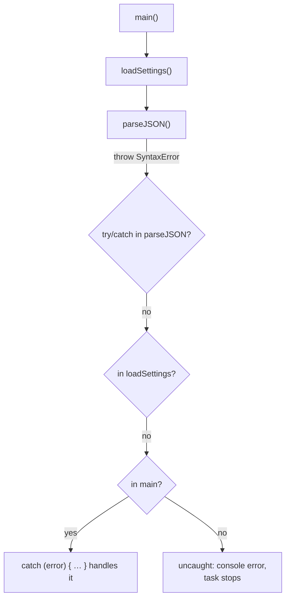
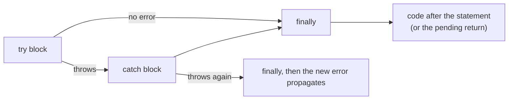

## What is an error?

An **error** is how a program says "I can't continue doing what you asked". In JavaScript, errors are **objects** that get **thrown**. Throwing stops the current code immediately and unwinds the call stack until some code **catches** the error. If nothing catches it, the error becomes **uncaught**: it's reported in the console and that task (or the whole Node process) stops.



Errors fall into three groups, and they deserve different handling:

| Kind | Examples | What to do |
| --- | --- | --- |
| **Programmer errors** (bugs) | `undefined is not a function`, wrong argument types | Fix the code. Don't hide them with try/catch |
| **Operational errors** (expected failures) | Network down, 404, invalid user input, timeout, permission denied | Handle them: retry, show a message, fall back |
| **Fatal / environment** | Out of memory, stack overflow | Usually can't recover; log and fail safely |

## The `Error` object

<Api name="Error" sig="new Error(message?, { cause }?)" returns="An error object with `name`, `message`, `stack` and (optionally) `cause`." mutates="n/a">

- `message` (optional): a human-readable description.
- `options.cause` (optional, ES2022): the underlying error that caused this one.

</Api>

```js run
const err = new Error("Could not load profile", { cause: new Error("HTTP 503") });

console.log(err.name);                    // "Error"
console.log(err.message);                 // "Could not load profile"
console.log(err.cause.message);           // "HTTP 503"
console.log(err instanceof Error);        // true
console.log(typeof err.stack, err.stack.split("\n")[0]);   // the call stack where it was created
```

| Property | Meaning |
| --- | --- |
| `name` | The error type (`"TypeError"`, `"ValidationError"`…) |
| `message` | What went wrong, for developers (and sometimes users) |
| `stack` | Non-standard but universal: where the error was **created** (not thrown) |
| `cause` | The original error, for chaining context without losing the root cause |

### Built-in error types

| Type | Thrown when | Example |
| --- | --- | --- |
| `TypeError` | A value isn't the expected type / operation not allowed on it | `null.x`, `undefined()`, assigning to a constant property in strict mode |
| `ReferenceError` | A variable doesn't exist, or is used in its TDZ | `missingVar`, `let x` used before its line |
| `SyntaxError` | Code or data can't be parsed | `JSON.parse("{bad}")`, `eval("if(")` |
| `RangeError` | A number is outside the allowed range | `new Array(-1)`, too much recursion, `(1).toFixed(200)` |
| `URIError` | Malformed URI functions input | `decodeURIComponent("%")` |
| `EvalError` | Legacy, essentially unused | — |
| `AggregateError` | Several errors at once | `Promise.any` when all reject |
| `DOMException` | Browser APIs | `AbortError`, `NotAllowedError`, `QuotaExceededError` |

```js run
const attempts = [
  () => null.name,
  () => missingVariable,
  () => JSON.parse("{not json}"),
  () => new Array(-1),
  () => decodeURIComponent("%"),
];
for (const fn of attempts) {
  try { fn(); } catch (e) { console.log(`${e.name}: ${e.message}`); }
}
```

## `throw`

`throw` accepts **any value**, but you should always throw `Error` objects (or subclasses). Strings and plain objects have no `stack` and break `instanceof` checks.

```js run
function divide(a, b) {
  if (typeof a !== "number" || typeof b !== "number") {
    throw new TypeError(`divide expects numbers, got ${typeof a} and ${typeof b}`);
  }
  if (b === 0) throw new RangeError("cannot divide by zero");
  return a / b;
}

console.log(divide(10, 4));
try { divide(1, 0); } catch (e) { console.log(e.name, "-", e.message); }

try { throw "just a string"; } catch (e) {
  console.log(typeof e, e.stack);           // "string" undefined — no stack trace!
}
```

## try / catch / finally

<Api name="try…catch…finally" sig="try { … } catch (error) { … } finally { … }" returns="A statement, not a value. `catch` runs only if `try` threw; `finally` runs **always**: after `try`, after `catch`, even after `return` or `break`." mutates="n/a">

- `catch (error)`: receives the thrown value. The binding is optional (`catch { … }`) if you don't need it.
- `finally`: for cleanup (closing, hiding spinners, releasing locks). At least one of `catch`/`finally` is required.

</Api>

```js run
function readConfig(text) {
  console.log("1. start");
  try {
    const config = JSON.parse(text);
    console.log("2. parsed");
    return config;                          // finally still runs before returning
  } catch (error) {
    console.log("3. caught:", error.name);
    return { fallback: true };
  } finally {
    console.log("4. finally (always)");
  }
}

console.log(readConfig('{"debug":true}'));
console.log(readConfig("oops"));
```



### What `finally` can override

```js predict
function f() {
  try {
    return "from try";
  } finally {
    console.log("finally runs");
  }
}
function g() {
  try {
    throw new Error("lost");
  } finally {
    return "from finally";
  }
}
console.log(f());
console.log(g());
```

```output
finally runs
from try
from finally
```

A `return` inside `finally` **replaces** the pending return value and even **swallows** a thrown error. Never return from `finally`; use it only for cleanup.

### try/catch only catches synchronous errors

```js run
try {
  setTimeout(() => {
    try {
      throw new Error("inside the timer");
    } catch (e) {
      console.log("caught INSIDE the callback:", e.message);   // ✓ the only place it can be caught
    }
  }, 0);
} catch (e) {
  console.log("never printed: the callback runs later, outside this try");
}
console.log("the outer try finished long ago");
```

For promises, the error arrives later as a **rejection**; catch it with `await` inside `try`, or `.catch()`. See [Async JavaScript](/javascript/async).

```js run
async function load() {
  try {
    await Promise.reject(new Error("network failed"));
  } catch (e) {
    console.log("async error caught with await:", e.message);
  }
}
load();

Promise.reject(new Error("also fine")).catch((e) => console.log(".catch():", e.message));
```

## Custom error classes

Custom errors let calling code react to **kinds** of failures instead of parsing messages:

```js run
class AppError extends Error {
  constructor(message, options) {
    super(message, options);
    this.name = this.constructor.name;          // "ValidationError", "NotFoundError"…
  }
}
class ValidationError extends AppError {
  constructor(field, message) {
    super(message);
    this.field = field;
  }
}
class HttpError extends AppError {
  constructor(status, url, options) {
    super(`HTTP ${status} for ${url}`, options);
    this.status = status;
  }
  get isRetryable() { return this.status >= 500 || this.status === 429; }
}

function handle(error) {
  if (error instanceof ValidationError) return `Fix the "${error.field}" field: ${error.message}`;
  if (error instanceof HttpError && error.status === 404) return "Not found";
  if (error instanceof HttpError && error.isRetryable) return "Server busy, retrying…";
  throw error;                                   // unknown: don't swallow it, rethrow
}

console.log(handle(new ValidationError("email", "is required")));
console.log(handle(new HttpError(404, "/api/user/9")));
console.log(handle(new HttpError(503, "/api/feed")));
try { handle(new TypeError("a real bug")); } catch (e) { console.log("rethrown:", e.name); }
```

<Callout type="tip" title="Catch narrowly, rethrow the rest">
A `catch` block should handle the errors it understands and **rethrow everything else**. A blanket `catch (e) {}` turns real bugs into silent wrong behaviour that's much harder to find.
</Callout>

### Wrapping errors with `cause`

When a low-level error crosses a layer boundary, wrap it in an error that makes sense at that level, and keep the original as `cause`:

```js run
async function fetchJson(url) {
  try {
    throw new SyntaxError("Unexpected token < in JSON at position 0");   // e.g. the server sent HTML
  } catch (err) {
    throw new Error(`Failed to load ${url}`, { cause: err });
  }
}

fetchJson("/api/settings").catch((e) => {
  console.log(e.message);                          // high-level context
  console.log("  caused by:", e.cause.name, "-", e.cause.message);   // root cause preserved
});
```

## Errors vs return values

Not every failure should be an exception. For **expected** outcomes (a form field is invalid, a search finds nothing), returning a result is often clearer:

```js run
// "Result" style: the caller must look at ok/error
function parseAge(input) {
  const age = Number(input);
  if (!Number.isInteger(age)) return { ok: false, error: "Age must be a whole number" };
  if (age < 0 || age > 150) return { ok: false, error: "Age must be between 0 and 150" };
  return { ok: true, value: age };
}

for (const input of ["34", "abc", "-3"]) {
  const result = parseAge(input);
  console.log(input, "→", result.ok ? result.value : `error: ${result.error}`);
}
```

| | Throwing | Returning a result |
| --- | --- | --- |
| Best for | Unexpected or exceptional failures; deep call chains | Expected, frequent outcomes (validation, "not found") |
| Caller can ignore it | No (it propagates) | Yes (if careless) |
| Control flow | Jumps up the stack | Explicit, local |
| Performance | Creating stack traces costs time if done thousands of times | Cheap |
| Examples | `JSON.parse`, failed network request | Form validation, `Array.prototype.find` returning `undefined` |

## Global error handlers

Use them as a **safety net** for logging and reporting, not as normal error handling:

```js
// Browser: uncaught synchronous errors
window.addEventListener("error", (event) => {
  report({ message: event.message, stack: event.error?.stack, source: event.filename });
});

// Browser: promise rejections nobody handled
window.addEventListener("unhandledrejection", (event) => {
  report({ message: String(event.reason), stack: event.reason?.stack });
  // event.preventDefault() hides the default console message
});

// Node.js
process.on("uncaughtException", (err) => { log(err); process.exit(1); });  // state may be corrupt: restart
process.on("unhandledRejection", (reason) => { log(reason); });
```

Tools such as Sentry, Datadog or Bugsnag install these handlers for you, attach context (user, route, release version) and use **source maps** to turn minified stack traces back into your original code.

### Errors in React

A component that throws during rendering would blank the whole tree. **Error boundaries** (a class component with `static getDerivedStateFromError` / `componentDidCatch`, or libraries like `react-error-boundary`) catch render errors below them and show a fallback UI. They don't catch errors in event handlers, timers or async code; use try/catch there.

```jsx
<ErrorBoundary fallback={<p>Something went wrong.</p>} onError={report}>
  <Dashboard />
</ErrorBoundary>
```

## Practical guidelines

| Do | Don't |
| --- | --- |
| Throw `Error` objects (or subclasses) with clear messages | Throw strings or plain objects |
| Validate input at boundaries (API responses, user input, function arguments of public APIs) | Trust external data |
| Catch where you can actually **do something** (retry, fallback, message) | Wrap every line in try/catch |
| Rethrow errors you don't understand | Swallow errors with empty `catch {}` |
| Add context with `cause` | Lose the original error when wrapping |
| Show users friendly messages; log technical details | Show stack traces to users |
| Clean up in `finally` | Return from `finally` |
| Handle every promise (`await` in try, or `.catch`) | Leave floating promises |

## Common mistakes

- `catch (e) {}` with nothing inside (silent failures).
- Expecting `try/catch` to catch errors in callbacks or un-awaited promises.
- Throwing strings (`throw "failed"`): no stack trace, no `instanceof`.
- Using exceptions for ordinary control flow in hot loops.
- Forgetting `this.name` in custom errors (they all print as "Error").
- Returning from `finally`, which hides errors.
- Comparing error messages (`e.message === "..."`) instead of types or codes.

## Interview questions

<QA q="What's the difference between `throw new Error('x')` and `throw 'x'`?" level="junior" n={1}>
<Answer>

Both stop execution and can be caught, but an `Error` object has a `name`, a `message` and a `stack` trace showing where it was created, and it works with `instanceof` checks and error-reporting tools. A thrown string has none of that, which makes debugging much harder.

</Answer>
<Deep>

The stack is captured when the error is **constructed**, not when it's thrown. Subclassing `Error` (with `this.name` set) lets callers distinguish error types; `cause` preserves the chain when errors are wrapped across layers.

</Deep>
<Mistake>

Thinking you can only `throw` Error objects. Any value can be thrown; it's just a bad idea.

</Mistake>
<FollowUp>

How would you design an error hierarchy for an API client?

</FollowUp>
</QA>

<QA q="Does `finally` always run? What happens with `return` inside `try` and `finally`?" level="mid" n={2}>
<Answer>

Yes: `finally` runs after `try` completes normally, after a `catch`, and even when `try` or `catch` returns or breaks. If `finally` itself returns a value, that value replaces any pending return and also swallows a pending exception.

</Answer>
<Deep>

The only cases where `finally` doesn't run are when the process/thread itself dies (e.g. the tab is closed, `process.exit()`, an infinite loop in `try`). In generators, `finally` runs when the generator is closed early (`return()`), which is why it's used for cleanup there.

</Deep>
<Mistake>

Putting a `return` in `finally` "just in case", which hides errors.

</Mistake>
<FollowUp>

What does `(() => { try { throw 1 } finally { return 2 } })()` return? (`2`; the error is swallowed.)

</FollowUp>
</QA>

<QA q="Why doesn't try/catch catch an error thrown inside `setTimeout` or a promise?" level="mid" n={3}>
<Answer>

`try/catch` only covers code that runs synchronously inside the `try` block. A `setTimeout` callback runs later in a new task, when the `try` has already finished; a promise rejection is delivered asynchronously. Catch inside the callback, or use `await` inside the `try` (or `.catch()`) for promises.

</Answer>
<Deep>

Unhandled rejections trigger `unhandledrejection` in browsers and may terminate Node processes. Async stack traces in DevTools ("async" frames) help connect the failure to the code that scheduled it.

</Deep>
<Mistake>

Wrapping `fetch(url).then(...)` in `try/catch` without awaiting it.

</Mistake>
<FollowUp>

How do you make sure no promise in your app is left unhandled? (Lint rules like `@typescript-eslint/no-floating-promises`, a global handler for reporting.)

</FollowUp>
</QA>

<QA q="When should you throw an error, and when should you return a result object?" level="senior" n={4}>
<Answer>

Throw for exceptional or unexpected situations where the immediate caller usually can't continue (bugs, broken invariants, failed I/O deep in a call chain). Return a result (`{ ok, value, error }` or `null`) for expected, frequent outcomes the caller must handle anyway, such as validation failures or "not found".

</Answer>
<Deep>

Exceptions propagate automatically (good for deep stacks, bad if callers forget they can happen); results make failure explicit in the type (TypeScript discriminated unions). Building stack traces is relatively expensive, so throwing thousands of times in a hot loop is slow. Many codebases mix both: results inside the domain logic, exceptions at infrastructure boundaries.

</Deep>
<Mistake>

Using exceptions for normal control flow (e.g. throwing to break out of loops).

</Mistake>
<FollowUp>

How would you type a result object in TypeScript so the compiler forces callers to check `ok`?

</FollowUp>
</QA>

## Recap

<Recap>

- An error is an `Error` object (or a subclass such as `TypeError`, `ReferenceError`, `SyntaxError`, `RangeError`) with `name`, `message` and `stack`.
- `throw` stops execution and propagates the error to the nearest `catch`; always throw `Error` objects, not strings.
- `finally` runs no matter what, even after `return`; a `return` inside `finally` overrides the previous result.
- `cause` (in `new Error(msg, { cause })`) preserves the original error when you re-wrap it.
- Build custom error classes with `extends Error` and set `name`, so they can be detected with `instanceof`.
- Expected failures ("user not found") can be returned as values instead of thrown; throw the unexpected ones.
- `try/catch` doesn't catch errors from later async callbacks; for promises use `catch` or `await` inside `try`.
- Global handlers (`window.onerror`, `unhandledrejection`) and React error boundaries report errors to a monitoring service.
- Never swallow errors silently: handle them or rethrow them.

</Recap>
