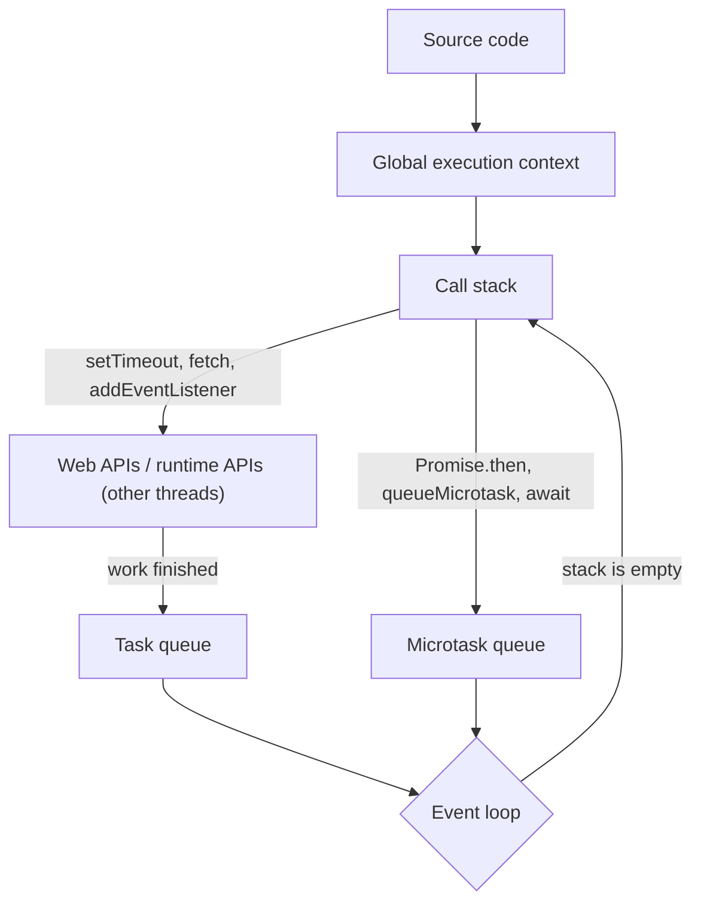
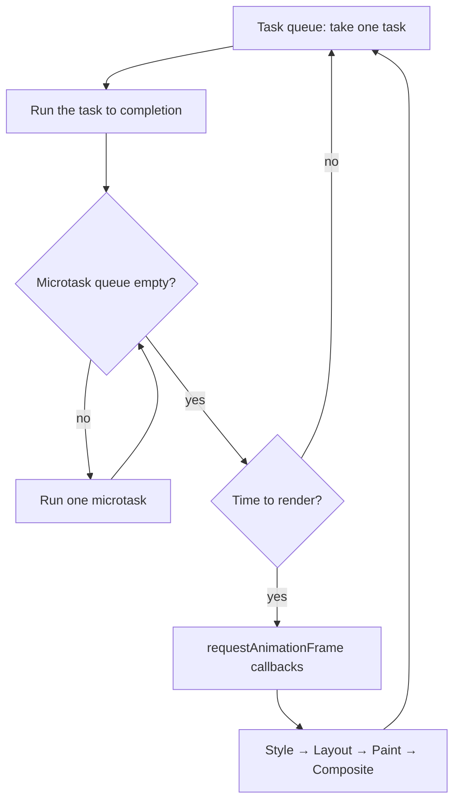
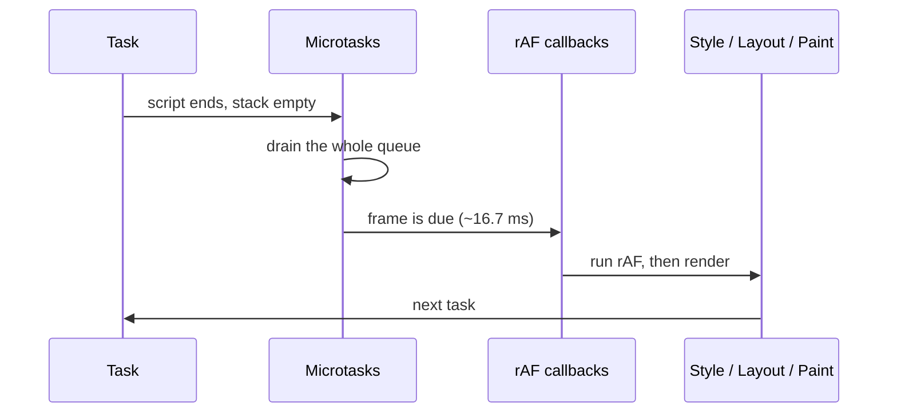

## Why does the event loop exist?

JavaScript has **one call stack**, so only one piece of code runs at any moment. If network requests and timers were synchronous, the whole page (clicks, scrolling, animation) would freeze until the response arrived.

The solution: **long-running work is handed to the runtime (Web APIs)**, which does it on other threads. When the work finishes, a **callback is queued**. The `event loop` is the mechanism that decides **when and in what order** those callbacks run on the call stack.

## The complete runtime map

```text
JavaScript engine (V8)
       │
       ├── Heap ............. objects, closures, environment records
       │
       └── Call stack ....... execution contexts (frames)

Browser runtime
       │
       ├── Web APIs ......... timers, fetch, DOM events, IndexedDB, ... (outside the engine)
       ├── Task queue(s) .... timer, event, message and I/O callbacks
       ├── Microtask queue .. promise reactions, queueMicrotask, MutationObserver
       └── Event loop ....... the coordinator: stack empty? → microtasks → render → next task
```



### What does each part do?

| Part | Responsibility | Belongs to |
| --- | --- | --- |
| **Call stack** | Runs synchronous code; each function call pushes a frame (execution context) and `return` pops it | Engine |
| **Heap** | Memory for objects; managed by the garbage collector | Engine |
| **Web APIs** | Do async work off the main thread (counting time, networking, listening for events) | Browser |
| **Task queue** (macrotask / callback queue) | FIFO queue(s) of ready callbacks; a browser can have several queues with different priorities (user input usually beats timers) | Browser (HTML spec) |
| **Microtask queue** | A single higher-priority FIFO queue; drained **completely** before the next task and before rendering | ECMAScript (job queue) + HTML |
| **Event loop** | The endless loop coordinating these queues and rendering | Browser |

## The event loop algorithm (processing model)

A simplified version of the HTML specification's algorithm:

```js
// pseudo-code, not real browser code
while (true) {
  // 1. One task (the oldest one from a queue the browser picks)
  const task = pickOldestTask(taskQueues);
  if (task) runToCompletion(task);          // runs until the call stack is empty

  // 2. Microtask checkpoint: ALL microtasks, including ones queued while draining
  while (microtaskQueue.length > 0) {
    runToCompletion(microtaskQueue.shift());
  }

  // 3. Rendering (if a frame is due, usually every ~16.7 ms)
  if (isRenderingOpportunity()) {
    runResizeAndScrollSteps();
    runAnimationFrameCallbacks();            // requestAnimationFrame
    recalcStyleLayoutPaint();                // style → layout → paint → composite
  }

  // 4. If there is spare time: requestIdleCallback
}
```



### Three golden rules

1. **Run to completion:** no callback can interrupt code that is already running. A task or microtask runs until the call stack is empty.
2. **Microtasks before the next task:** after **every** task (and after the main script), the **whole** microtask queue is drained, including microtasks added while draining.
3. **Rendering happens between tasks:** the browser can only paint when both the call stack and the microtask queue are empty.

## Microtasks vs tasks

| | Microtask | Task (macrotask) |
| --- | --- | --- |
| Sources | `Promise.then/catch/finally`, the continuation after `await`, `queueMicrotask`, `MutationObserver` | `setTimeout`, `setInterval`, DOM events (click, input), `MessageChannel`/`postMessage`, network I/O, running a `<script>` |
| Per event loop turn | **All** of them run | **One** runs |
| Before rendering | Yes | Rendering may happen between two tasks |
| Danger | **Starvation**: endless microtasks block rendering and tasks forever | Long tasks (> 50 ms) make the page sluggish |
| In the spec | ECMAScript jobs + HTML microtask queue | HTML task sources |

The term "macrotask" does not exist in the spec; the official name is **task**. "Callback queue" is another informal name for the task queue.

### Why does a microtask queue exist at all?

Promises needed reactions to be **asynchronous**, so behaviour is predictable (`then` never runs synchronously), but also to run **as soon as possible**, before the browser renders or handles another event, so an inconsistent intermediate state is never painted. `MutationObserver` is a microtask for the same reason: it reports all DOM changes of a task in one batch, before rendering.

## Visualizer: the basic example, step by step

Use the buttons to watch the call stack and queues change at each step:

<EventLoopViz example="basic" />

```js predict
console.log("A");

setTimeout(() => {
  console.log("B");
}, 0);

Promise.resolve().then(() => {
  console.log("C");
});

console.log("D");
```

```output
A
D
C
B
```

**Step by step:**

1. The script itself is a **task**. The global execution context is pushed onto the call stack.
2. `console.log("A")` prints **A**.
3. `setTimeout(cb, 0)` hands the callback to the **timer Web API**. After roughly 0 ms, `cb` is moved to the **task queue**. `setTimeout` returns immediately.
4. `Promise.resolve()` is already fulfilled, so `.then(cb)` queues a **microtask** right away.
5. `console.log("D")` prints **D**.
6. The script ends and the call stack is empty. **Microtask checkpoint:** **C** is printed.
7. The microtask queue is empty. (Rendering opportunity.) The event loop takes the next task: **B**.

## Advanced event loop examples

### Example 1: a promise chain and queueMicrotask

```js predict
setTimeout(() => console.log(1));
Promise.resolve()
  .then(() => console.log(2))
  .then(() => console.log(3));
queueMicrotask(() => console.log(4));
console.log(5);
```

```output
5
2
4
3
1
```

- Sync: `5`. Microtask queue: `[then→2, micro→4]`. Task queue: `[timeout→1]`.
- `then→2` runs and prints 2; the next promise in the chain resolves and `then→3` goes to the **end** of the queue: `[micro→4, then→3]`.
- 4 prints, then 3. The queue is empty → task: 1.

Key point: the second `then` is **not in the queue** until the first one has run. Every link in a chain costs a separate tick.

### Example 2: the promise executor is synchronous

```js predict
console.log(1);
new Promise((resolve) => {
  console.log(2);
  resolve();
  console.log(3);
}).then(() => console.log(4));
console.log(5);
```

```output
1
2
3
5
4
```

The executor function in `new Promise(executor)` runs **immediately and synchronously**. `resolve()` doesn't stop execution (it isn't a `return`); it only marks the promise as fulfilled. Only the `then` callback is asynchronous.

### Example 3: async/await

<EventLoopViz example="async-await" />

```js predict
async function a() {
  console.log("a1");
  await b();
  console.log("a2");
}
async function b() {
  console.log("b");
}

console.log("start");
a();
setTimeout(() => console.log("timeout"), 0);
Promise.resolve().then(() => console.log("promise"));
console.log("end");
```

```output
start
a1
b
end
a2
promise
timeout
```

- An `async function` runs **synchronously up to its first `await`**: it prints `a1`, then calls `b()`, which prints `b` synchronously.
- `await` on the (already fulfilled) promise returned by `b`: the rest of `a` (`console.log("a2")`) is scheduled as a microtask and `a()` returns to its caller.
- `then→promise` is queued **after** it, so `a2` prints before `promise`.

```text
await x  ≈  Promise.resolve(x).then(continuation)
```

<Callout type="note">
Since V8 7.2 (2019), `await` on a **native promise** costs only **one tick**. It used to cost three, so the output of some of these puzzles differed in old Chrome and Node 10. Mentioning this in an interview signals real depth.
</Callout>

### Example 4: a task inside a microtask, a microtask inside a task

<EventLoopViz example="nested" />

```js predict
setTimeout(() => {
  console.log("T1");
  Promise.resolve().then(() => console.log("M-in-T1"));
}, 0);
setTimeout(() => console.log("T2"), 0);
Promise.resolve().then(() => {
  console.log("M1");
  setTimeout(() => console.log("T3"), 0);
});
```

```output
M1
T1
M-in-T1
T2
T3
```

The key rule: **after every task the whole microtask queue is drained.** So `M-in-T1`, created during the first task, runs before `T2`. `T3` is last because it was appended to the task queue while `M1` was running.

### Example 5: returning a promise from then (two extra ticks)

```js predict
Promise.resolve()
  .then(() => {
    console.log("A");
    return Promise.resolve("x");
  })
  .then((v) => console.log("B", v));

Promise.resolve()
  .then(() => console.log(1))
  .then(() => console.log(2))
  .then(() => console.log(3))
  .then(() => console.log(4));
```

```output
A
1
2
3
B x
4
```

This is one of the hardest ones. When a `then` callback returns a **thenable** (anything with a `then` method, promises included), the outer promise can't resolve immediately. The spec performs two extra jobs:

| Tick | Microtask queue before running | What happens | Printed |
| --- | --- | --- | --- |
| 1 | `[A, 1]` | A returns a promise → `NewPromiseResolveThenableJob` queued; 1 → queues 2 | A, 1 |
| 2 | `[ThenableJob, 2]` | ThenableJob calls `x.then(resolveOuter)`; x is fulfilled, so a reaction is queued; 2 → queues 3 | 2 |
| 3 | `[resolveOuter, 3]` | The outer promise resolves → queues B; 3 → queues 4 | 3 |
| 4 | `[B, 4]` | | B x, 4 |

In practice: `return await somePromise` in an async function, or returning a promise from `then`, **shifts the ordering** (although real code should never depend on that).

### Example 6: an async function that returns a promise

```js predict
async function returnsValue() {
  return 1;
}
async function returnsPromise() {
  return Promise.resolve(2);
}

returnsPromise().then((v) => console.log(v));
returnsValue().then((v) => console.log(v));
```

```output
1
2
```

Although `returnsPromise` is called first, `2` prints after `1`. Returning a promise from an async function goes through the same thenable mechanism as example 5 and costs two extra ticks.

### Example 7: timers with different delays

```js predict
setTimeout(() => console.log("t100"), 100);
setTimeout(() => console.log("t0"), 0);
setTimeout(() => console.log("t10"), 10);
Promise.resolve().then(() => {
  setTimeout(() => console.log("t0 from micro"), 0);
});
console.log("sync");
```

```output
sync
t0
t0 from micro
t10
t100
```

- Timers enter the task queue by **expiry time**, not by registration order.
- `t0 from micro` is registered in a microtask (right after the script); it expires after `t0` but before `t10`.
- A `setTimeout` delay is a **minimum**, not a guarantee: if the stack is busy, the callback runs later. Nested timers deeper than 5 levels are clamped to at least **4 ms**, and background tabs throttle timers to 1 second or more.

### Example 8: recursive microtasks and starvation

```js predict
let count = 0;
function loop() {
  if (count++ < 3) {
    console.log("micro", count);
    queueMicrotask(loop);
  }
}
setTimeout(() => console.log("timeout"));
queueMicrotask(loop);
```

```output
micro 1
micro 2
micro 3
timeout
```

A microtask that queues another microtask runs **in the same checkpoint**. Without the stop condition (an unconditional `queueMicrotask(loop)`), `timeout` would **never** run and the page would freeze completely. That is worse than a normal infinite loop, because not even rendering happens. This is **microtask starvation**. The same code with `setTimeout(loop)` instead would not lock the page.

### Example 9: error handling in a promise chain

```js predict
Promise.reject(new Error("boom"))
  .then(() => console.log("then 1"))
  .catch((e) => {
    console.log("catch", e.message);
    return "recovered";
  })
  .then((v) => console.log("then 2", v))
  .finally(() => console.log("finally"));

Promise.resolve()
  .then(() => console.log("other 1"))
  .then(() => console.log("other 2"))
  .then(() => console.log("other 3"));
```

```output
other 1
catch boom
other 2
then 2 recovered
other 3
finally
```

- `then 1` never runs: the rejection **passes through** a `then` without an error handler, but that pass-through still costs a tick. That's why `catch` comes after `other 1`.
- `catch` handles the error and returns a value, so the chain is **fulfilled** again.
- Two independent chains **interleave** tick by tick.

### Example 10: await in a loop, sequential vs parallel

```js predict
const wait = (ms, value) => new Promise((r) => setTimeout(() => r(value), ms));
const round = (ms) => Math.round(ms / 100) * 100;

(async () => {
  let start = Date.now();
  for (const ms of [100, 100, 100]) await wait(ms);
  console.log("sequential ~", round(Date.now() - start), "ms");

  start = Date.now();
  await Promise.all([100, 100, 100].map((ms) => wait(ms)));
  console.log("parallel ~", round(Date.now() - start), "ms");
})();
```

```output
sequential ~ 300 ms
parallel ~ 100 ms
```

In the loop, each `await` waits for the previous promise, and the next timer only **starts** afterwards. With `map`, all timers start together and `Promise.all` waits for the slowest. For independent network requests this difference multiplies the load time.

### Example 11: everything combined

```js predict
console.log("1");

setTimeout(() => {
  console.log("2");
  Promise.resolve().then(() => console.log("3"));
}, 0);

new Promise((resolve) => {
  console.log("4");
  setTimeout(() => {
    console.log("5");
    resolve();
  }, 0);
}).then(() => console.log("6"));

(async () => {
  console.log("7");
  await null;
  console.log("8");
  await new Promise((r) => setTimeout(r, 0));
  console.log("9");
})();

queueMicrotask(() => console.log("10"));
console.log("11");
```

```output
1
4
7
11
8
10
2
3
5
6
9
```

| Phase | What happens | Task queue | Microtask queue | Printed |
| --- | --- | --- | --- | --- |
| Script | Sync: 1, 4 (executor), 7 (async up to await), 11 | `[T-2, T-5]` | `[cont-8, m-10]` | 1 4 7 11 |
| Microtasks | async continues: 8; then `await new Promise(setTimeout)` registers T-r; m-10 | `[T-2, T-5, T-r]` | — | 8 10 |
| Task T-2 | prints 2; queues microtask m-3 | `[T-5, T-r]` | `[m-3]` | 2, 3 |
| Task T-5 | prints 5; resolve → then-6 | `[T-r]` | `[then-6]` | 5, 6 |
| Task T-r | resolves the promise inside the async function → it continues | — | `[cont-9]` | 9 |

## Rendering and requestAnimationFrame

The browser gets a **rendering opportunity** about 60 times a second (or in sync with the display's refresh rate). Rendering only happens **between tasks**, after the microtask queue has been drained.

```js
button.addEventListener("click", () => {
  box.style.display = "block";
  // ... 2 seconds of heavy computation ...
  box.style.display = "none";
  // the user never sees box: rendering only happens after this task ends
});
```

### requestAnimationFrame

`requestAnimationFrame(cb)` runs the callback **right before the next frame is painted**. It is neither a task nor a microtask; it is part of the rendering step.

| | `setTimeout(fn, 16)` | `requestAnimationFrame(fn)` |
| --- | --- | --- |
| Timing | Approximate; may run mid-frame or twice in one frame | Exactly once before each paint |
| Matches a 120 Hz display | No | Yes |
| Background tab | Throttled | **Paused** (saves battery) |
| Good for | General delays | Animation, frame-aligned layout reads/writes |

```js
// Order within one browser event loop turn:
setTimeout(() => console.log("timeout"), 0);
requestAnimationFrame(() => console.log("rAF"));
Promise.resolve().then(() => console.log("microtask"));
// microtask always first; timeout vs rAF depends on where we are in the frame
```



### Breaking up long tasks

A task longer than 50 ms is a **long task**: user interactions get no response until it finishes and INP suffers. The fix is to split the work and **yield** to the event loop:

```js run
async function processInChunks(items, handle) {
  const yieldToMain = () =>
    globalThis.scheduler?.yield?.() ?? new Promise((r) => setTimeout(r, 0));

  let lastYield = performance.now();
  for (const item of items) {
    handle(item);
    if (performance.now() - lastYield > 40) {   // take a breath every ~40 ms
      await yieldToMain();                        // let the event loop handle clicks and render
      lastYield = performance.now();
    }
  }
}

let sum = 0;
processInChunks(Array.from({ length: 200000 }, (_, i) => i), (n) => { sum += Math.sqrt(n); })
  .then(() => console.log("done", Math.round(sum)));
```

<Callout type="interview">
Why isn't `await Promise.resolve()` enough to yield? Because it's a microtask: it runs before rendering and before any user event, so the event loop never gets a chance. A real yield needs a new **task** (`setTimeout`, `MessageChannel`, or `scheduler.yield()`, which also puts the continuation at high priority).
</Callout>

## MutationObserver

```js
const observer = new MutationObserver((mutations) => {
  console.log("mutations:", mutations.length);   // once, for all changes in this task
});
observer.observe(list, { childList: true });

list.append(itemA);
list.append(itemB);
list.append(itemC);
console.log("sync done");
// output: "sync done", then "mutations: 3", delivered as one batched microtask
```

## The event loop in Node.js

Node uses **libuv**, and its event loop has **phases**:

```text
   ┌───────────────────────────┐
┌─>│          timers           │  setTimeout, setInterval
│  ├───────────────────────────┤
│  │     pending callbacks     │  some system callbacks
│  ├───────────────────────────┤
│  │       idle, prepare       │  internal
│  ├───────────────────────────┤
│  │           poll            │  new I/O; waits for events
│  ├───────────────────────────┤
│  │           check           │  setImmediate
│  ├───────────────────────────┤
└──┤      close callbacks      │  socket.on("close")
   └───────────────────────────┘
   between callbacks: the process.nextTick queue, then the promise microtask queue
```

| | Browser | Node.js |
| --- | --- | --- |
| Higher priority than promises | — | `process.nextTick` |
| `setImmediate` | ✗ | check phase |
| `setTimeout(0)` vs `setImmediate` | — | Order is **non-deterministic** in the main module; inside an I/O callback `setImmediate` always wins |
| Rendering | Part of the loop | None |

## Common mistakes

- Saying "`setTimeout(fn, 0)` runs immediately".
- Thinking the `new Promise` executor is asynchronous.
- Thinking the code after `await` continues synchronously.
- Using `await Promise.resolve()` to yield to the browser.
- Endless recursive microtasks.
- Assuming Node's event loop is the same as the browser's.
- Relying on exact tick ordering in production code (fragile; coordinate explicitly instead).

## Interview questions

<QA q="Explain the event loop." level="mid" n={1}>
<Answer>

JavaScript has one call stack. Async work is handed to Web APIs; when it finishes, callbacks are queued in the microtask queue (promises, `queueMicrotask`, `MutationObserver`) or a task queue (timers, events, messages). When the stack is empty, the event loop runs one task, then drains the entire microtask queue, then renders if a frame is due (including rAF callbacks), and repeats.

</Answer>
<Deep>

The event loop is defined in the HTML spec, not ECMAScript, which only defines job queues. Browsers have several task queues with different priorities (user input usually wins). A microtask checkpoint also runs after each callback, even between the listeners of one event when the event was dispatched by the user (but not with `element.click()` from a script, because the stack is not empty there).

</Deep>
<Mistake>

Saying the event loop "runs code in parallel", or that `setTimeout` is part of the engine.

</Mistake>
<FollowUp>

Why does the microtask order between two click listeners differ when the user clicks vs when `button.click()` is called?

</FollowUp>
</QA>

<QA q="What is the difference between microtasks and macrotasks? Give examples." level="mid" n={2}>
<Answer>

Microtasks (promise callbacks, `queueMicrotask`, `await` continuations, `MutationObserver`) **all** run after each task and before rendering. Tasks (`setTimeout`, `setInterval`, events, `MessageChannel`) run **one** per turn. So `Promise.resolve().then(a)` always runs before `setTimeout(b, 0)`.

</Answer>
<Deep>

A microtask that queues another microtask runs in the same checkpoint and can starve tasks and rendering forever. Libraries use this property to batch updates (Vue's `nextTick`, batching in some state libraries).

</Deep>
<Mistake>

Thinking microtasks and tasks alternate one by one.

</Mistake>
<FollowUp>

What happens to the page if a `then` keeps queuing microtasks forever? How is that different from `while (true)`?

</FollowUp>
</QA>

<QA q="Why doesn't `setTimeout(fn, 0)` run immediately?" level="junior" n={3}>
<Answer>

After the delay the callback only moves to the task queue. It still has to wait for the call stack to empty, for all microtasks to run, and for earlier tasks (and possibly a render) to finish. 0 means "at least 0 ms", not "now".

</Answer>
<Deep>

Browsers clamp nested timers deeper than 5 levels to at least 4 ms, throttle background-tab timers to 1 s or more, and may align timers in power-saving modes. For a faster yield use `MessageChannel` or `scheduler.postTask` (React's scheduler uses `MessageChannel`).

</Deep>
<Mistake>

Using `setTimeout(fn, 0)` "to make sure the DOM is updated" without understanding why it works.

</Mistake>
<FollowUp>

Why does React's scheduler use `MessageChannel` instead of `setTimeout`?

</FollowUp>
</QA>

<QA q="Predict the output and explain it." level="senior" n={4}>
<Answer>

```js
async function f() {
  console.log(1);
  await Promise.resolve();
  console.log(2);
}
setTimeout(() => console.log(3));
f();
Promise.resolve().then(() => console.log(4)).then(() => console.log(5));
console.log(6);
```

Output: `1 6 2 4 5 3`. The async function is synchronous up to `await` (1); its continuation is a microtask queued before `then→4`; 6 is sync; then the microtasks in order: 2, 4, and 5 (queued only after 4 ran); finally the task: 3.

</Answer>
<Deep>

If the `await` were on a non-native thenable (`{ then(r) { r(); } }`), two extra ticks would be needed and the order would become `1 6 4 2 5 3`. In old engines (before V8 7.2) even native promises took three ticks.

</Deep>
<Mistake>

Putting 2 after 4 "because `then` was written earlier". What matters is the order things are queued, not the order they're written.

</Mistake>
<FollowUp>

If `f` used `await new Promise(r => setTimeout(r))` instead, what would print? (`1 6 4 5 3 2`.)

</FollowUp>
</QA>

<QA q="Where does rendering happen in the event loop, and why does a long synchronous task freeze the UI?" level="mid" n={5}>
<Answer>

Rendering (rAF callbacks, style, layout, paint) only runs between tasks, once the call stack and microtask queue are empty. A long task keeps the stack busy, so no frame is painted and no input event is processed until it ends.

</Answer>
<Deep>

The fix is to split the work into chunks and yield with a real task (`scheduler.yield()`, `setTimeout`, `MessageChannel`), move it to a Web Worker, or make it incremental. React's concurrent rendering does exactly this: it works in ~5 ms slices and yields so input stays responsive.

</Deep>
<Mistake>

Wrapping heavy work in a promise and expecting it to run "in the background". Promise callbacks still run on the main thread.

</Mistake>
<FollowUp>

How would you measure that a page has long tasks in production? (Long Animation Frames API / `PerformanceObserver` with `longtask`, and INP from real-user monitoring.)

</FollowUp>
</QA>

## Recap

<Recap>

- JavaScript has one call stack; the event loop takes the next job from the queues when the stack is empty.
- Each loop iteration: one task, then **all** microtasks, then rendering if needed.
- Tasks: `setTimeout`, `setInterval`, DOM events, messages. Microtasks: promise callbacks (`then`/`catch`/`finally`), `await`, `queueMicrotask`, MutationObserver.
- Microtasks always run before the next task; microtasks that keep scheduling microtasks can starve rendering.
- `setTimeout(fn, 0)` means "at least zero", not "immediately"; it runs after synchronous code and all microtasks.
- Code after `await` is a microtask, so an async function runs synchronously up to its first `await`.
- `requestAnimationFrame` runs right before the next frame is painted and is the right place for visual updates.
- Node has separate phases (timers, poll, check), and the `process.nextTick` queue runs even before promise microtasks.
- Long synchronous code blocks the event loop; split heavy work into chunks or move it to a Web Worker.

</Recap>
