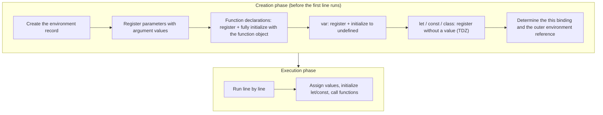
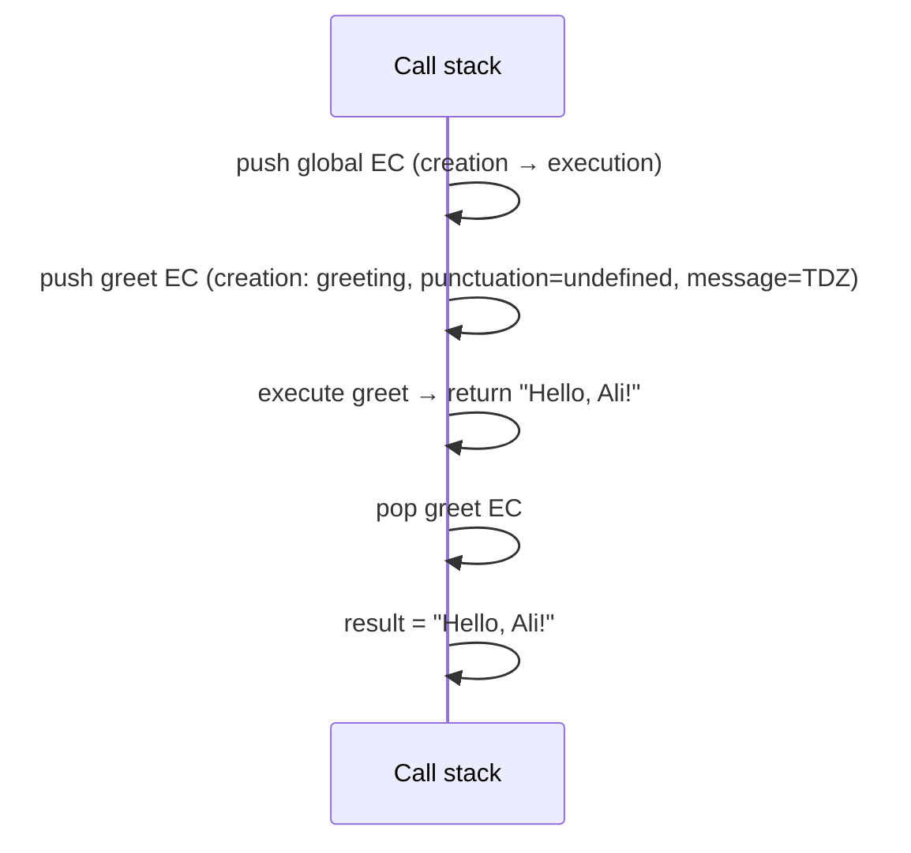
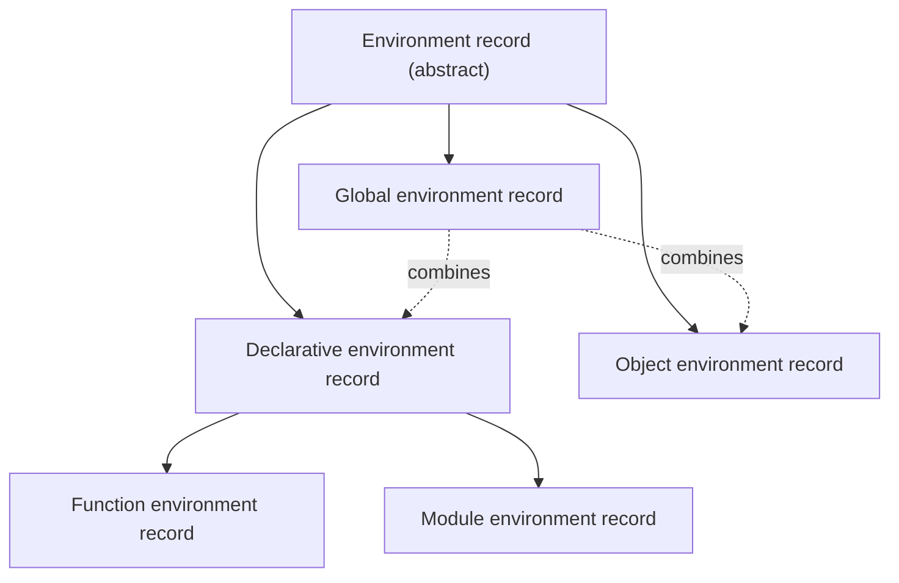
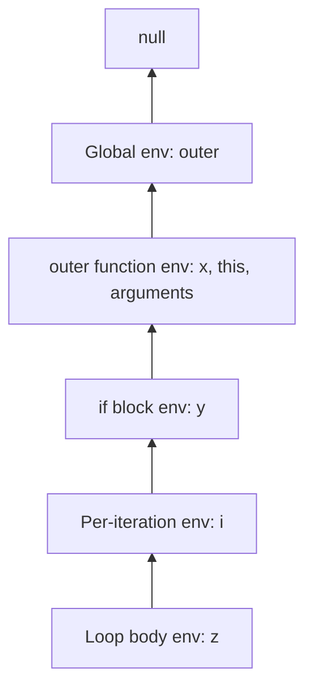

## What is an execution context?

An `execution context` is an internal engine structure holding **everything needed to run a piece of code**: which variables are accessible, what `this` is, and how far execution has progressed. Whenever code runs, it runs inside an execution context.

Execution contexts live on the **call stack**. The context on top of the stack is the **running execution context**.

### Kinds of execution context

| Kind | Created when | How many |
| --- | --- | --- |
| **Global execution context** | A script starts running | One per script/realm |
| **Function execution context** | **Every** function call | One per call (recursion = many) |
| **Eval execution context** | Code runs through `eval()` | — (don't use it) |
| **Module execution context** | Each ES module is evaluated | One per module |

### Components of an execution context

Per the ECMAScript spec, every execution context has:

```text
Execution context
├── LexicalEnvironment    → environment record for let, const, class, functions and parameters
├── VariableEnvironment   → environment record for var (initially the same as LexicalEnvironment in functions)
├── PrivateEnvironment    → class #private names
├── this binding          → (stored in the function environment record)
├── Function / ScriptOrModule
├── Realm                 → the global object and intrinsics (Array.prototype, …)
└── Code evaluation state → where execution is (suspendable/resumable for generators and async)
```

`VariableEnvironment` and `LexicalEnvironment` start out the same in a function. When execution enters a block, **LexicalEnvironment** points to a new environment (for the block's `let`/`const`), but VariableEnvironment doesn't change — which is exactly why `var` ignores blocks.

## Two phases: creation and execution

Every execution context is built and run in two phases:



### Step-by-step example

```js
var name = "Ali";
let age = 30;

function greet(greeting) {
  var punctuation = "!";
  const message = greeting + ", " + name + punctuation;
  return message;
}

const result = greet("Hello");
```

**1. Global creation phase:**

| Binding | Value | Where |
| --- | --- | --- |
| `name` | `undefined` | Object environment record (the global object, in a script) |
| `greet` | `<function>` | Object environment record |
| `age` | uninitialized (TDZ) | Global declarative environment record |
| `result` | uninitialized (TDZ) | Global declarative environment record |
| `this` | `globalThis` (in a script) | — |

**2. Global execution phase:** `name = "Ali"`, `age = 30`, then `greet("Hello")` is called → a new function execution context is pushed.

**3. Function creation phase (`greet`):**

| Binding | Value |
| --- | --- |
| `greeting` | `"Hello"` (parameter) |
| `punctuation` | `undefined` |
| `message` | uninitialized (TDZ) |
| `arguments` | `{ 0: "Hello", length: 1 }` |
| `this` | `undefined` (strict) or `globalThis` (sloppy) |
| Outer reference | The global environment (because `greet` was **defined** there) |

**4. Function execution phase:** `punctuation = "!"`, `message = "Hello, Ali!"` (resolving `name` through the outer reference to the global environment), `return`; the context is popped and `result` is initialized.



## Lexical environments

A `lexical environment` maps **identifiers to values** and links to an outer environment. The modern spec calls it an **environment record**, made of two parts:

1. **The environment record:** the table of bindings (name → value + state).
2. **The outer environment reference (`[[OuterEnv]]`):** a pointer to the enclosing environment, or `null` for the global one.

```text
Current lexical environment
        │  [[OuterEnv]]
        ↓
Outer lexical environment
        │  [[OuterEnv]]
        ↓
Outer lexical environment
        │  [[OuterEnv]]
        ↓
Global environment
        │
        ↓
      null
```

"Lexical" means **where the code is written in the source** (not where it's called from) determines what the outer reference points to.

### Kinds of environment record



| Kind | Holds | Created for |
| --- | --- | --- |
| **Declarative** | `let`, `const`, `class`, parameters, block-level function declarations, `catch (e)` | Every block, function, `catch` |
| **Function** (a declarative subtype) | Plus `this`, `super`, `new.target` and this-binding state | Every function call (except arrows, which have no this) |
| **Module** (a declarative subtype) | Module bindings and **live import bindings** | Every module |
| **Object** | Bindings **as properties of a real object** | The global object, `with` statements |
| **Global** | An object record (on `globalThis`: var and functions) plus a declarative record (global let/const/class) | One per realm |

### The global environment

```js
var a = 1;          // → object record → globalThis.a
function f() {}     // → object record → globalThis.f
let b = 2;          // → declarative record (not on globalThis)
const c = 3;        // → declarative record
```

That's why in a script `window.a` is 1 but `window.b` is undefined. In a module the global environment is still the outermost one, but no top-level module declaration goes into it — the module environment record sits in between.

### Block environments

Every block with block-level declarations gets its own environment:

```js
function outer() {
  const x = 1;            // outer's function environment
  if (true) {
    const y = 2;          // block environment (outer → function env)
    for (let i = 0; i < 1; i++) {
      const z = 3;        // loop body environment (outer → per-iteration env → if block env)
      console.log(x + y + z + i);
    }
  }
}
```



## The scope chain and identifier resolution

When code hits a name (identifier), the engine runs this algorithm (`ResolveBinding`):

1. Look in the current environment record.
2. If it's not there, follow `[[OuterEnv]]` and repeat.
3. If you reach `null`: on read → `ReferenceError: x is not defined`; on assignment in sloppy mode → an implicit global is created (in strict mode → `ReferenceError`).

```js run
const level = "global";

function outer() {
  const level = "outer";
  function inner() {
    console.log(level);     // inner first, then outer → "outer"
  }
  return inner;
}

const fn = outer();
fn();                        // "outer" — not "global"; what matters is where inner was defined
```

Wherever `inner` is called from, its `[[OuterEnv]]` points to `outer`'s environment — because when a function is **created**, the current environment is stored in the function's internal `[[Environment]]` slot. That's the foundation of **closures** ([next chapter](/javascript/scope-closures)).

## Hoisting — the full picture

### What hoisting really is

"Moving up" is a metaphor. The reality: **during the creation phase the engine scans the whole scope and registers every declaration in the environment record before the first line runs.** How each kind is registered differs:

| Declaration | Hoisted? | Initial value | Before its line |
| --- | --- | --- | --- |
| `var x` | ✓ | `undefined` | `undefined` |
| `let x` | ✓ | uninitialized | `ReferenceError` (TDZ) |
| `const x` | ✓ | uninitialized | `ReferenceError` (TDZ) |
| `function f() {}` | ✓ | **The full function object** | Callable |
| `var f = function () {}` | ✓ (only `f`) | `undefined` | `TypeError: f is not a function` |
| `const f = () => {}` | ✓ | uninitialized | `ReferenceError` |
| `class C {}` | ✓ | uninitialized | `ReferenceError` |
| `import` | ✓ | Live binding (after dependencies evaluate) | Usable |

### Function declarations vs function expressions

```js run
console.log(declared());          // ✓ "declared"
function declared() { return "declared"; }

console.log(typeof expressed);    // "undefined" — only the var was hoisted
try {
  expressed();
} catch (error) {
  console.log(error.name + ": " + error.message);
}
var expressed = function () { return "expressed"; };
```

### Precedence: function or var?

If a name has both a function declaration and a `var`, **the function declaration wins the creation phase** (a var without a value doesn't overwrite it), but the var's assignment changes it during execution:

```js predict sloppy
console.log(typeof foo);
var foo = "string";
function foo() {}
console.log(typeof foo);
```

```output
function
string
```

This runs as a classic script; in an ES module, a top-level function is lexical and declaring a same-named var is a `SyntaxError`.

1. Creation: `foo` first gets the function from its declaration; `var foo` with no value has no effect because the binding already exists.
2. Execution: the first line prints `"function"`, then `foo = "string"` runs, and finally `"string"`.

### var, let and const from the engine's point of view

```js
var x;
let y;
const z;   // ✗ SyntaxError: Missing initializer in const declaration
```

- `var x;` was initialized to `undefined` during creation; the `var x;` line itself **does nothing** at execution time (a no-op).
- `let y;` is uninitialized during creation; the `let y;` line **initializes it to undefined** at execution time and ends the TDZ. So this line is a real operation.
- `const z;` doesn't even parse, because a const without an initializer is meaningless.

### Functions declared inside blocks (a trap)

In sloppy mode, function declarations inside blocks behave strangely for backwards compatibility (spec Annex B). In strict mode it's simple: they're **block-scoped**.

```js run
"use strict";
{
  function inBlock() { return "hi"; }
}
console.log(typeof inBlock); // "undefined" in strict mode (and in modules)
```

<Callout type="warning">
In sloppy mode the same code prints `"function"` (the function is also copied to function scope). Never rely on this; inside blocks use `const fn = () => {}`.
</Callout>

## The this binding

`this` is part of the execution context and is determined **at call time** (not definition time) — unlike scope, which is lexical. The one exception is arrow functions: they have no this binding and read `this` from the enclosing lexical environment like any other variable. Full details in [this & functions](/javascript/this-functions).

| Context | `this` |
| --- | --- |
| Global (script) | `globalThis` |
| Global (module) | `undefined` |
| Plain function, strict | `undefined` |
| Plain function, sloppy | `globalThis` |
| Method (`obj.fn()`) | `obj` |
| `new Fn()` | The new object |
| Arrow function | The enclosing `this` (lexical) |

## The eval execution context

`eval(code)` creates a new execution context. **Direct eval** can see the current scope and, in sloppy mode, add new `var`s to it; **indirect eval** (`(0, eval)(code)`) runs in the global scope.

Reasons to avoid `eval`: security (running unknown code → XSS), performance (the engine can't optimise the scope when any name could appear at runtime), and CSP blocks it (`unsafe-eval`).

## Common mistakes

- Imagining hoisting physically moves code.
- Confusing scope (lexical, definition time) with `this` (dynamic, call time).
- Expecting a function expression to be callable before its definition like a declaration.
- Thinking a function can see variables at its **call site** (that's dynamic scope, which JavaScript doesn't have).
- Declaring functions inside blocks and relying on sloppy-mode behaviour.

## Interview questions

<QA q="What is an execution context and when is one created?" level="mid" n={1}>
<Answer>

An internal structure holding what's needed to run code: the lexical and variable environments, the this binding, the realm and the evaluation state. One global context is created when a script starts, a function context for **every** call, and separate contexts for each module and eval. They are pushed onto and popped off the call stack.

</Answer>
<Deep>

Each context has two phases: creation (building environment records, hoisting, determining this and the outer reference) and execution. For generators and async functions a context can be removed from the stack and later resumed in the same state — which is how `await` pauses a function without blocking the thread.

</Deep>
<Mistake>

Treating execution context and scope as the same thing. The scope (lexical environment) is just one component of a context.

</Mistake>
<FollowUp>

What happens to an async function's execution context when it hits `await`?

</FollowUp>
</QA>

<QA q="What is a lexical environment and what is it made of?" level="senior" n={2}>
<Answer>

A structure mapping names to values, made of an environment record (the table of bindings) and an outer environment reference (pointer to the enclosing environment). The chain of those references forms the scope chain. It's "lexical" because the outer reference is determined by where the code is written.

</Answer>
<Deep>

Record kinds: declarative (let/const/class/parameters), function (plus this, super, new.target), module (with live import bindings), object (bindings as properties of an object — the global object and `with`) and global (an object record plus a declarative record). When a function is created, the current environment is stored in its `[[Environment]]`; when it's called, a new environment is created whose outer reference is that `[[Environment]]` — that's the closure mechanism.

</Deep>
<Mistake>

Saying the scope chain is built from the call stack (call order).

</Mistake>
<FollowUp>

Why are `with` and direct `eval` bad for performance? (They make scope dynamic, so the engine can't resolve names at compile time.)

</FollowUp>
</QA>

<QA q="What does this print, and why?" level="mid" n={3}>
<Answer>

```js
var x = 1;
function test() {
  console.log(x);
  var x = 2;
}
test();
```

It prints `undefined`. The inner `var x` is hoisted to undefined during the function's creation phase and shadows the global x.

</Answer>
<Deep>

The function environment has an `x` binding with the value undefined after creation; ResolveBinding finds it in the current environment and never reaches the global one. With let instead of var you'd get a `ReferenceError` (TDZ).

</Deep>
<Mistake>

Answering `1` because the inner x "hasn't been defined yet".

</Mistake>
<FollowUp>

What if we replace `var x = 2` with `x = 2`? (It prints `1`, then the global x becomes 2.)

</FollowUp>
</QA>

<QA q="How does hoisting differ between function declarations and function expressions?" level="junior" n={4}>
<Answer>

A function declaration is **fully** hoisted (name + body) during the creation phase and can be called before its definition. With a function expression only the variable is hoisted: with `var` it's undefined (calling it → `TypeError`), with `let/const` it's in the TDZ (`ReferenceError`).

</Answer>
<Deep>

A named function expression (`const f = function inner() {}`) exposes its name (`inner`) only inside its own body, through a dedicated environment with an immutable binding — useful for recursion and clearer stack traces.

</Deep>
<Mistake>

Saying arrow functions "aren't hoisted". The variable holding one is hoisted like any const/let and sits in the TDZ.

</Mistake>
<FollowUp>

If a var and a function declaration share a name, which one wins?

</FollowUp>
</QA>

## Recap

<Recap>

- All code runs inside an execution context: global, one per **function call**, module and eval.
- Contexts live on the call stack; the top context is the code running right now.
- Each context has two phases: creation (registering bindings) and execution (running line by line).
- During creation: function declarations are fully initialised, `var` gets `undefined`, and `let`/`const`/`class` stay uninitialised (TDZ).
- A lexical environment is a name-to-value table plus a pointer to the outer environment; that chain is the scope chain.
- The outer environment is decided by **where the function is written**, not where it is called (lexical scoping).
- Hoisting is just the creation phase; no code is moved.
- Function declarations are hoisted completely; function expressions only as far as their variable.
- `this` is part of the context and is decided at call time (except for arrow functions).

</Recap>
