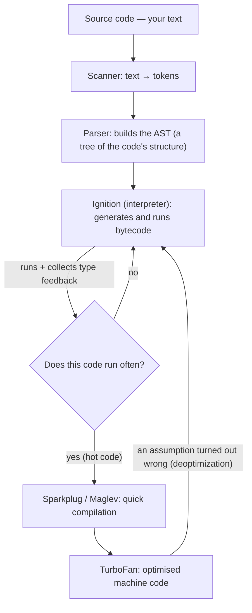

## Where JavaScript came from and what it does

In 1995 web pages were completely static: text and images, nothing that reacted. If a user filled in a form wrong, the form went to the server and a few seconds later an error page came back. Netscape wanted a small language that ran **inside the browser itself**, so a page could react without a round trip to the server. Brendan Eich built the first version in about ten days, and it was named **JavaScript** (for marketing reasons — it has nothing to do with Java).

Today JavaScript is the only language every browser runs natively, and outside the browser (Node.js, Deno, Bun) it powers servers, build tools and even desktop apps.

```js run
// The simplest program: print a value to the console
console.log("Hello from JavaScript!");

// JavaScript works with data and makes decisions
const price = 120;
const discount = price > 100 ? 0.1 : 0; // 10% off if the price is over 100
console.log("Final price:", price * (1 - discount)); // 108
```

<Callout type="note">
Every code block marked "Run" can be edited and executed right on this page. Change the numbers and run it again — it is the fastest way to learn.
</Callout>

## The precise definition of JavaScript, word by word

In interviews you will often hear — or be asked for — this definition:

> JavaScript is a **high-level**, **dynamically** and **weakly typed**, **multi-paradigm**, **single-threaded** language that works in a **non-blocking** way thanks to the **event loop**, and modern engines **JIT-compile** it.

Memorising the sentence is useless; you need to explain every word with an example. So let's unpack them one at a time.

### High-level

A **high-level** language keeps you away from hardware details. In C you allocate memory yourself (`malloc`) and free it yourself (`free`); forget to free it and the program leaks memory, free it twice and the program crashes.

In JavaScript you just create values. The engine allocates the memory, and once nothing can reach a value any more, a part of the engine called the **garbage collector** frees it. There are no pointers to touch memory addresses directly.

```js run
function makeList() {
  const big = new Array(1_000_000).fill(0); // one million slots; the engine allocates them
  return big.length;
}

console.log(makeList()); // 1000000
// After the function returns nothing can reach `big`,
// so the garbage collector will free it later. You do nothing.
```

The details are in [Call stack, heap & garbage collection](/javascript/memory-gc).

### Dynamically typed

In **statically typed** languages such as Java or TypeScript, the type of every variable is known while you write the code and the compiler checks it before the program runs. In JavaScript the type belongs to the **value**, not to the variable. A variable can hold a number now and a string on the next line. Types are only checked **while the program runs** (at runtime).

```js run
let value = 42;
console.log(typeof value); // "number"

value = "forty-two";       // same variable, now a string
console.log(typeof value); // "string"

value = [4, 2];
console.log(typeof value); // "object" — arrays are a kind of object in JavaScript
```

**Upside:** fast to write and very flexible. **Cost:** type mistakes are only found when that line actually runs. If a function expects a number and gets a string, nothing complains until execution reaches it. TypeScript was created precisely to fix this (see [TypeScript](/typescript/fundamentals)).

### Weakly typed

"Dynamic" is about **when** types are checked; "weak" is about **what the language does** when two incompatible types meet. JavaScript does not throw — it silently converts one of the values to the other type. This automatic conversion is called **coercion**.

```js run
console.log("5" * 2);   // 10   — * only works on numbers, so "5" became 5
console.log("5" + 2);   // "52" — + with a string means concatenation, so 2 became "2"
console.log(true + 1);  // 2    — true became 1
console.log([] + {});   // "[object Object]" — both became strings
```

Python is also dynamic but **strong**: `"5" + 2` throws a `TypeError` in Python. So the two properties are independent:

| | Static (checked before running) | Dynamic (checked while running) |
| --- | --- | --- |
| **Strong** (no automatic conversion) | Java, Rust | Python, Ruby |
| **Weak** (converts automatically) | C | **JavaScript**, PHP |

The exact coercion rules and `==` vs `===` are covered in [Types, equality & coercion](/javascript/types-coercion).

### Multi-paradigm

A **paradigm** is a style of thinking about and writing programs. JavaScript does not force one style on you; it supports all three main ones:

```js run
const prices = [100, 250, 40];

// 1. Imperative: tell the computer what to do, step by step
let total = 0;
for (let i = 0; i < prices.length; i++) {
  total += prices[i];
}
console.log("imperative:", total); // 390

// 2. Functional: functions are passed around as values and data is not mutated
const sum = prices.reduce((acc, p) => acc + p, 0);
console.log("functional:", sum); // 390

// 3. Object-oriented, prototype-based: data and behaviour live together
const cart = {
  items: prices,
  total() {
    return this.items.reduce((a, b) => a + b, 0);
  },
};
console.log("OOP:", cart.total()); // 390
```

One important detail: object orientation in JavaScript is based on **prototypes**, not classes. The `class` keyword added in ES2015 is a more familiar face on top of the same prototype system (see [Objects & prototypes](/javascript/objects-prototypes) and [Classes](/javascript/classes)).

### Single-threaded

A **thread** is an independent path of execution. JavaScript has just **one** thread to run your code, and therefore one **call stack** (the list of functions currently running). In practice this means: **at any moment only one piece of your code is running**, and nothing else can jump into the middle of it.

That is both good and bad. Good, because you never worry about two threads changing the same variable at once (race conditions, a real headache in Java and C++). Bad, because if a heavy job keeps the thread busy, **everything** waits. In a browser that means a frozen page: clicks do nothing and animations stop.

### Non-blocking, thanks to the event loop

If there is only one thread, why doesn't downloading a file for 5 seconds freeze the page for 5 seconds? Because JavaScript does not wait. Slow work (network requests, timers, reading files) is handed to the **runtime environment** (the browser or Node) and JavaScript keeps running the rest of the code. When the slow work finishes, the environment puts the function you gave it (a **callback**) into a queue, and the **event loop** runs it once the call stack is empty.

```js run
console.log("1. Order a coffee");

setTimeout(() => {
  // We hand this function (a callback) to the browser to call 1000 ms later
  console.log("3. The coffee is ready");
}, 1000);

console.log("2. Meanwhile, check email");
// Output: 1, 2, and one second later 3 — the code did not wait for the timer
```

It is like a waiter who hands the order to the kitchen and serves other tables until the food is ready, instead of standing at the kitchen door. The event loop has a whole chapter: [The event loop — deep dive](/javascript/event-loop).

### JIT-compiled

There are two classic ways to run code:

- An **interpreter** reads the code and executes it right away. Starts fast, runs slowly.
- A **compiler** first translates the whole program into machine code (the processor's own language), then runs it. Runs fast, but compiling takes time.

Modern JavaScript engines combine both: they start with a fast interpreter, and the parts that **run very often** (called hot code) are compiled to optimised machine code while the program runs. This is called **JIT** (just-in-time — compiling exactly when it pays off). So "JavaScript is an interpreted language" is not accurate for modern engines. The details are in the engine section below.

## What ECMAScript is and how it differs from JavaScript

If several companies build browsers and each implements JavaScript its own way, code that works in one browser breaks in another. That is exactly what happened in the 90s (Netscape vs Internet Explorer). The fix was a **written standard**.

- **ECMAScript** is the name of that standard: a document called **ECMA-262** that says precisely what the syntax is, what `[1, 2].map(fn)` must do, what `typeof null` returns, and so on for every feature.
- It is written by a committee called **TC39** at Ecma International, whose members represent Google, Mozilla, Apple, Microsoft and other companies.
- **JavaScript** is an implementation of that standard (plus whatever the runtime environment adds).

An analogy: ECMAScript is the **rulebook of football**, and each JavaScript engine (V8, SpiderMonkey…) is a team that plays by those rules. One set of rules, but every team has its own style and speed.

### What is in the language — and what is not

This is the most important point of the section for interviews: **`setTimeout`, `fetch`, `document`, `localStorage` and even `console` are not part of ECMAScript.** The runtime environment (browser or Node) provides them to your code.

| Part of ECMAScript (the core language) | Part of the runtime (the host) |
| --- | --- |
| Syntax: `if`, `for`, `function`, `class`, `import` | `document`, `window`, the DOM — in browsers |
| Types: `number`, `string`, `object`, … | `setTimeout`, `setInterval` — in browsers and Node |
| Built-in objects: `Array`, `Object`, `Promise`, `Map`, `JSON`, `Math`, `Date` | `fetch`, `localStorage`, `WebSocket` — in browsers |
| Rules for scope, closures and `this` | `fs`, `http`, `process`, `require` — in Node |
| The job queue for promises | `console` — both have it, but it is not part of the language |

```js run
// These exist in every JavaScript environment because they are part of the language:
console.log(typeof Array, typeof Promise, typeof Map, typeof JSON);

// These depend on the runtime. Here the code runs in a Web Worker, which has no DOM:
console.log(typeof setTimeout); // "function" — workers have timers
console.log(typeof document);   // "undefined" — workers cannot access the DOM
```

### The TC39 process: how a new feature gets into the language

Every proposal goes through stages. The higher the stage, the less likely it is to change:

| Stage | Name | What it means |
| --- | --- | --- |
| 0 | Strawperson | Just an idea; any TC39 member can bring it up |
| 1 | Proposal | The committee agrees the problem is worth exploring; it has an owner (champion) |
| 2 | Draft | Syntax and behaviour roughly specified; likely to land eventually |
| 2.7 | Approved in principle | Design approved; waiting for official tests (Test262) and prototype implementations |
| 3 | Candidate | Design is final; browsers start implementing |
| 4 | Finished | At least two engines ship it; included in the next yearly edition |

**In practice:** tools such as Babel and TypeScript sometimes give you Stage 3 features early. Using a Stage 2 (or lower) feature in production code is risky because it may still change.

### Editions: from ES5 to today

Until 2009 editions were numbered (ES3, ES5). The next big one, ES6, shipped in 2015, and since then there is a **yearly** edition named after the year (ES2016, ES2017, …). So ES6 and ES2015 are the same thing.

| Edition | Features interviewers ask about |
| --- | --- |
| ES5 (2009) | Strict mode, `JSON`, `map`/`filter`/`forEach` on arrays, `Object.defineProperty` |
| ES2015 (ES6) | The biggest change in the language's history: `let`/`const`, arrow functions, `class`, `Promise`, ES modules, template literals, destructuring, `Map`/`Set`, `Symbol`, iterators and generators |
| ES2017 | `async`/`await`, `Object.entries`/`Object.values` |
| ES2018 | Object rest/spread (`{...obj}`), `Promise.prototype.finally`, `for await...of` |
| ES2020 | Optional chaining `?.`, nullish coalescing `??`, `BigInt`, `Promise.allSettled`, `globalThis` |
| ES2021 | `Promise.any`, the `??=`, `||=` and `&&=` operators, `replaceAll`, `WeakRef` |
| ES2022 | Top-level `await` in modules, class fields and `#private`, `.at()`, `Object.hasOwn`, `Error.cause` |
| ES2023 | Non-mutating array methods: `toSorted`, `toReversed`, `toSpliced`, `with`; and `findLast` |
| ES2024 | `Object.groupBy`, `Promise.withResolvers`, resizable ArrayBuffer |
| ES2025 | Iterator helpers, `Set` methods (`union`, `intersection`, …), `Promise.try`, `RegExp.escape` |

## The JavaScript engine: the program that runs your code

A computer only understands machine code — very simple instructions like "add these two numbers" or "put this value in that memory slot". A **JavaScript engine** is a program that takes the text of your code and turns it into something the processor can execute.

| Engine | Made by | Used in |
| --- | --- | --- |
| **V8** | Google | Chrome, Edge, Opera, Node.js, Deno |
| **SpiderMonkey** | Mozilla | Firefox |
| **JavaScriptCore** (JSC, Nitro) | Apple | Safari, every iOS browser, Bun |

Every engine has two main memory areas you will hear about constantly:

- **Call stack:** the list of functions currently running, in the order they were called. Each call pushes a **frame** on top; when the function returns, its frame is popped.
- **Heap:** a large, unordered area where objects, arrays and functions are stored.

### How code travels through V8, step by step

Let's follow this single line from text to execution:

```js
let total = price * 2;
```



<Steps>
<Step title="Scanner: split the text into tokens">

The engine first reads the text character by character and splits it into meaningful units called **tokens** — like breaking a sentence into words. Whitespace and comments are dropped here.

```text
let   total   =   price   *   2   ;
 │      │     │     │     │   │   │
keyword name  op   name   op num  punctuator
```

</Step>
<Step title="Parser: build the AST">

Tokens alone do not say what depends on what. The **parser** applies the grammar rules and builds a tree called the **AST** (abstract syntax tree). If the code has a syntax error (say, an unclosed parenthesis) it is found here, and **not a single line runs**.

```text
VariableDeclaration (let)
└── VariableDeclarator
    ├── id:   Identifier "total"
    └── init: BinaryExpression "*"
              ├── left:  Identifier "price"
              └── right: NumericLiteral 2
```

Tools such as Babel, ESLint and Prettier work on exactly this kind of AST. You can paste any code into astexplorer.net to see its tree.

**Lazy parsing:** fully parsing every function is expensive. V8 only skims (pre-parses) the bodies of functions that have not been called yet and fully parses them on first call. That is why pages start faster.

</Step>
<Step title="Ignition: compile to bytecode and run">

**Ignition**, V8's interpreter, turns the AST into **bytecode**: compact, simple instructions that are closer to machine code than your source but still independent of the processor type. Then it runs that bytecode. Simplified:

```text
LdaGlobal  [price]     ; load price into the main register (the accumulator)
MulSmi     [2]         ; multiply it by the small integer 2
StaCurrentContextSlot  ; store the result in the slot for `total`
```

</Step>
<Step title="Collect type feedback">

While running, Ignition takes notes: "so far `price` has always been a small integer", "this function is always called with objects of the same shape". These notes are called **type feedback**, and they fuel the next step.

</Step>
<Step title="JIT: compile the hot code">

If a function or loop runs many times (it becomes hot), V8 hands it to its JIT compilers. There are tiers: **Sparkplug** compiles very quickly without optimising, **Maglev** optimises moderately, and **TurboFan** uses the type feedback to produce the fastest machine code. For example, if `price` has always been an integer, TurboFan emits a plain integer multiply instruction and removes all the type checks.

</Step>
<Step title="Deoptimization: when an assumption turns out wrong">

Optimised code is built on **assumptions**. If one day `price` is a string, the assumption breaks. V8 throws the optimised code away and goes back to bytecode. This is called **deoptimization** (deopt). If it keeps happening, the code gets slow.

</Step>
</Steps>

```js run
// A simple function always called with the same type: a good candidate for optimisation
function double(n) {
  return n * 2;
}

let sum = 0;
for (let i = 0; i < 100_000; i++) {
  sum += double(i); // 100,000 calls with a number: hot and monomorphic
}
console.log(sum);

// Suddenly passing a string breaks the "always a number" assumption and may deopt.
// The result is still correct (coercion) — only the fast path is lost.
console.log(double("21")); // 42
```

### Hidden classes and inline caches: why object shape matters

In JavaScript any object can gain a new property at any moment. If the engine searched a table to find `user.name` every time, it would be slow. V8's solution is to give every object a **hidden class** (also called a map or shape in V8) that says "this object has properties `x` and `y`, `x` is in slot 0 and `y` is in slot 1".

```text
const a = {};        Shape S0: {}
a.x = 1;             Shape S1: { x → slot 0 }              (S0 → S1)
a.y = 2;             Shape S2: { x → slot 0, y → slot 1 }  (S1 → S2)

const b = {};  b.x = 5;  b.y = 6;   ← same transition path: b also has shape S2 ✓
const c = {};  c.y = 6;  c.x = 5;   ← different order: a different shape ✗
```

Now the **inline cache** comes in: when a line such as `point.x` runs, V8 remembers "last time this object's shape was S2 and `x` was in slot 0". If the shape is the same next time, it reads slot 0 directly — no lookup.

| State of a line of code | Shapes seen | Speed |
| --- | --- | --- |
| Monomorphic | just 1 | fastest |
| Polymorphic | 2 to 4 | a bit slower; checks a few cases |
| Megamorphic | more than 4 | inline cache is dropped; slow lookup |

```js
// Good: every Point is built in the same order → one shared shape
function Point(x, y) {
  this.x = x;
  this.y = y;
}
const p1 = new Point(1, 2);
const p2 = new Point(3, 4);

// Bad: different order → two different shapes
const q1 = { x: 1, y: 2 };
const q2 = { y: 2, x: 1 };

// Bad: delete pushes the object into dictionary mode (a slow lookup table)
delete p1.x;
// Better, if you just want to clear the value
p2.x = undefined;
```

<Callout type="interview">
This level of detail (AST, bytecode, JIT, hidden classes, deopt) usually comes up in senior interviews. You don't need to memorise every V8 compiler name; what matters is explaining the chain **parse → bytecode → feedback → optimised compile → deopt** and its practical consequences: build objects with a stable shape, avoid `delete` in hot code, and keep the argument types of hot functions consistent.
</Callout>

## The runtime: an engine alone is not enough

An engine only understands the language. It knows nothing about the network, timers, the screen or files. Run bare V8 and you do not even have `setTimeout`! The **runtime** is everything around the engine that lets code talk to the outside world:

> **Runtime = engine + host APIs + event loop + callback queues**

```text
┌──────────────────────────── Browser Runtime ─────────────────────────────┐
│  ┌──────── JS Engine (V8) ────────┐     ┌──────── Web APIs ────────────┐ │
│  │  Heap         Call Stack       │     │ DOM, fetch, setTimeout,      │ │
│  │  (Objects)    (Frames)         │ ──► │ XMLHttpRequest, IndexedDB,   │ │
│  └────────────────────────────────┘     │ WebSocket, Geolocation ...   │ │
│                 ▲                       └──────────────┬───────────────┘ │
│                 │  Event Loop                          │ callbacks        │
│                 └──── Microtask Queue ◄────────────────┤                  │
│                 └──── Task Queues     ◄────────────────┘                  │
│                       Rendering (rAF, Style, Layout, Paint)               │
└──────────────────────────────────────────────────────────────────────────┘
```

### The journey of a `setTimeout`, start to finish

To make each part's role concrete, let's follow exactly what happens when this code runs:

```js
console.log("A");
setTimeout(() => console.log("B"), 0);
console.log("C");
```

<Steps>
<Step title='`console.log("A")` runs on the call stack'>
A is printed and its frame is popped off the stack.
</Step>
<Step title="`setTimeout` is called">
This function belongs to the browser, not the engine. The engine just calls it and hands over the callback. The **browser** starts the timer somewhere else. `setTimeout` itself returns immediately.
</Step>
<Step title='`console.log("C")` runs'>
C is printed. Even with a zero-millisecond timer, the callback cannot run yet because the call stack is busy.
</Step>
<Step title="The timer fires and the callback is queued">
The browser puts the callback into the **task queue**.
</Step>
<Step title="The event loop runs the callback">
The event loop keeps checking: "is the call stack empty?" Once it is, it takes the first task from the queue and pushes it onto the stack. B is printed. Final order: **A, C, B**.
</Step>
</Steps>

### The browser runtime vs the Node.js runtime

Both use V8, so the **language** is the same — but the APIs around it are completely different because the needs differ. A browser must display pages and protect users from malicious sites; Node must work with files, the network and the operating system.

| | Browser | Node.js |
| --- | --- | --- |
| Engine | V8, SpiderMonkey or JSC (depends on the browser) | V8 |
| Global object | `window` (in workers: `self`) | `global` |
| `globalThis` (the same name everywhere) | ✓ | ✓ |
| Specific APIs | DOM, `fetch`, `localStorage`, Web Workers | `fs`, `http`, `process`, `Buffer` |
| Event loop implementation | Defined by the HTML spec; includes a rendering step | The **libuv** library with phases: timers, poll, check, close |
| Module system | ES modules | ES modules and CommonJS (`require`) |
| System access | Restricted (sandboxed); cannot see files | Full; it can delete files |
| `setImmediate` and `process.nextTick` | ✗ | ✓ |

**`process.nextTick` in Node** has its own queue that runs even before promise microtasks. If an interviewer asks for the output order of some Node code, remember this.

## Single-threaded but concurrent: what does that mean?

These two words sound contradictory, so let's define them precisely:

- **Parallelism:** two jobs run **at the exact same moment** on two processor cores.
- **Concurrency:** several jobs make progress **over the same period of time**, even if only one is actually running at any instant.

Your JavaScript runs on one thread, so it is **not parallel**. But the browser itself has many threads: network downloads, timer counting, image decoding and compositing the page's layers happen on other threads. JavaScript starts a job, hands it off and carries on. The result: **concurrency without parallelism in your code**.

This example shows that no callback can interrupt synchronous code that is already running:

```js run
const start = Date.now();

// A zero-millisecond timer: "run this as soon as possible"
setTimeout(() => console.log("timer ran after", Date.now() - start, "ms"), 0);

// Keep the thread busy for 300 ms (busy-wait)
while (Date.now() - start < 300) {
  // The call stack is occupied; the event loop cannot run the callback
}
console.log("loop done");
// Output: "loop done" first, then "timer ran after ~300 ms"
```

The delay was zero, yet the callback ran about 300 ms later. **A `setTimeout` delay is a minimum wait, not an exact time.** In a real browser those 300 ms are a page that ignores clicks.

### When you really need parallelism: Web Workers

For heavy CPU work (compressing images, processing large files, number crunching) you can create a **Web Worker**. A worker is a separate thread with its own engine instance, heap and event loop. Workers cannot touch the DOM and talk to the main page only by **messages**.

```js
// main.js — the main page
const worker = new Worker("heavy.js");
worker.postMessage({ numbers: [1, 2, 3, 4] }); // the data is copied (structured clone)
worker.onmessage = (event) => {
  console.log("result from worker:", event.data); // 10
};

// heavy.js — runs on a separate thread
self.onmessage = (event) => {
  const sum = event.data.numbers.reduce((a, b) => a + b, 0);
  self.postMessage(sum); // the main page stayed free the whole time
};
```

This handbook runs its runnable examples in a Web Worker so an infinite loop in an example cannot lock the page. Node's equivalent is **Worker Threads**.

## Strict mode: a stricter version of the language

Early JavaScript was designed to be "forgiving": it accepted many mistakes without errors and behaved strangely instead. Removing those behaviours would have broken old sites, so ES5 took a different route: an opt-in mode called **strict mode** that turns those mistakes into **real errors**. The old default is called **sloppy mode**.

### How to turn it on

```js
// 1. For a whole file: the very first line
"use strict";

// 2. For one function only: the first line of its body
function strictOnly() {
  "use strict";
  // strict only in here
}

// 3. Automatically: every ES module (import/export or <script type="module">)
//    and every class body is always strict — nothing to write.
```

`"use strict"` only works as the **first statement** of a file or function. Anywhere else it is just a harmless string.

### What exactly does strict mode change?

**1. Assigning to an undeclared variable throws.** In sloppy mode a typo silently creates a new global variable:

```js run sloppy
// Sloppy mode: a typo in a variable name
let counter = 0;
countr = 5; // typo! No error — it creates a brand-new global variable
console.log(counter);           // 0 — the real variable is untouched
console.log(globalThis.countr); // 5 — an accidental global
```

```js run
// The same code in strict mode (examples here run strict by default)
let counter = 0;
try {
  countr = 5;
} catch (e) {
  console.log(e.name, "-", e.message); // ReferenceError - countr is not defined
}
```

**2. `this` in a plain function call is `undefined`.** In sloppy mode it is the global object, so code may accidentally write onto `window`:

```js run sloppy
function sloppyThis() {
  return this === globalThis;
}
console.log(sloppyThis()); // true — this points at the global object
```

```js run
function strictThis() {
  return this;
}
console.log(strictThis()); // undefined — the mistake surfaces early
```

**3. Writing to a read-only property throws.** In sloppy mode the write is silently ignored and you think the value changed:

```js run
const config = Object.freeze({ mode: "dark" }); // a fully locked object
try {
  config.mode = "light";
} catch (e) {
  console.log(e.name); // TypeError — in sloppy mode nothing would happen
}
console.log(config.mode); // "dark"
```

**4. Some dangerous syntax is banned.** These do not even parse; they are `SyntaxError`s:

| Code | Why it is banned |
| --- | --- |
| `function f(a, a) {}` | Duplicate parameter; which `a` is which? |
| `with (obj) { x = 1 }` | Is `x` a variable or `obj.x`? Makes optimisation impossible |
| `delete myVariable` | Deleting a variable is meaningless; sloppy mode silently fails |
| `let yield = 1` or `let package = 1` | Words reserved for the language's future |
| `010` (legacy octal) | Confusing: `010` used to equal 8! Write `0o10` instead |

<Callout type="tip">
In modern projects you are almost always in strict mode, because any file with `import` or `export` is an ES module, and modules are strict automatically. But a legacy plain `<script>`, or code typed into the browser console, runs in sloppy mode.
</Callout>

## JavaScript types at a glance

JavaScript has **8 data types**: seven **primitives** (simple, immutable values) and one **object** type (a collection of properties that can change). Full details are in [Types & coercion](/javascript/types-coercion).

| Type | Example | In short |
| --- | --- | --- |
| `string` | `"hello"` | Text |
| `number` | `42`, `3.14`, `NaN`, `Infinity` | All numbers, integer and decimal, in one type |
| `bigint` | `10n` | Integers larger than `2^53 - 1` |
| `boolean` | `true`, `false` | True or false |
| `undefined` | `undefined` | "No value has been given yet" |
| `null` | `null` | "Intentionally empty" |
| `symbol` | `Symbol("id")` | A unique identifier; no two symbols are equal |
| `object` | `{}`, `[]`, `function(){}`, `new Date()` | Everything else |

The `typeof` operator returns a value's type as a string. Look for its two famous exceptions in the output:

```js run
console.log(typeof "hi", typeof 42, typeof 10n, typeof true);
// string number bigint boolean

console.log(typeof undefined, typeof Symbol(), typeof {});
// undefined symbol object

console.log(typeof null);           // "object"   ← exception 1: a historical bug
console.log(typeof function () {}); // "function" ← exception 2: functions are objects but get their own result
console.log(typeof []);             // "object"   — use Array.isArray for arrays
```

**Why is `typeof null` `"object"`?** In the first JavaScript implementation every value was stored with a small type tag, and the tag for objects was `000`. `null` was represented as the NULL pointer, whose bits are all zero. So `typeof` saw the tag `000` and answered `"object"`. A fix was proposed and rejected because too much code on the web already relied on the behaviour.

## Common mistakes

<Callout type="mistake">
**"`setTimeout` and `fetch` are part of JavaScript."** They are runtime APIs, not defined in ECMAScript. The evidence is simple: Node had no `fetch` for years, and workers have no `document`.
</Callout>

<Callout type="mistake">
**"JavaScript is interpreted, line by line."** Modern engines parse the code, compile it to bytecode and JIT-compile hot code. If code really ran line by line, a syntax error on line 100 would not stop line 1 from running — but it does, because the whole file is parsed before anything runs.
</Callout>

<Callout type="mistake">
**"Single-threaded means JavaScript cannot do two things at once."** Your code runs on one thread, but I/O (network, timers, files) is done in parallel by the runtime. JavaScript only coordinates when those jobs start and finish.
</Callout>

<Callout type="mistake">
**"The event loop is identical in browsers and Node."** The basic idea is the same, but Node has separate phases (timers, poll, check) and the `process.nextTick` queue, while browsers have a rendering step. The output order of some code differs between them.
</Callout>

## Interview questions

<QA q="What is the difference between JavaScript, ECMAScript, an engine and a runtime?" level="junior" n={1}>
<Answer>

- **ECMAScript** is the written language standard (ECMA-262, maintained by TC39).
- **JavaScript** is an implementation of that standard.
- An **engine** (e.g. V8) is the program that parses and executes code; it has a heap and a call stack.
- A **runtime** is the engine plus host APIs (DOM and `fetch` in browsers, `fs` in Node), the event loop and the callback queues.

</Answer>
<Deep>

ECMAScript only defines the job queue used by promises. The full event loop with tasks and rendering is defined in the HTML spec, and Node implements its own with libuv. That is why the order of some callbacks — e.g. `setImmediate` vs `setTimeout(fn, 0)` — differs between environments.

</Deep>
<Mistake>

Saying `setTimeout` or `console` are part of the JavaScript language.

</Mistake>
<FollowUp>

If JavaScript is single-threaded, how does the browser download a file and run an animation at the same time? (The download happens on the browser's network thread and CSS animations on the compositor thread; only your JS runs on the main thread.)

</FollowUp>
</QA>

<QA q="How does V8 execute JavaScript? What does JIT mean?" level="senior" n={2}>
<Answer>

The code is turned into tokens and then an **AST**. The **Ignition** interpreter generates **bytecode** from the AST and runs it while collecting **type feedback**. Code that runs often is handed to the **JIT** compilers (Sparkplug, Maglev and finally TurboFan), which use the feedback's assumptions to produce optimised machine code. If an assumption breaks (a function that always got numbers receives a string), **deoptimization** happens and execution falls back to bytecode.

</Answer>
<Deep>

JIT balances "start fast" (interpreter) against "run fast" (optimising compiler). Hidden classes and inline caches make property access fast as long as object shapes stay stable. A monomorphic site (one shape) is fastest, polymorphic (2–4 shapes) slower, and megamorphic (more) has no inline cache at all.

</Deep>
<Mistake>

Saying JavaScript is "interpreted line by line".

</Mistake>
<FollowUp>

Why is `delete obj.prop` harmful in hot code, and what should you do instead? (It moves the object into dictionary mode and breaks inline caches. Set the value to `undefined`, or build a new object without that property using destructuring.)

</FollowUp>
</QA>

<QA q="What is strict mode and how do you enable it?" level="junior" n={3}>
<Answer>

An opt-in mode from ES5 that turns the language's silent mistakes into errors: assigning to an undeclared variable throws `ReferenceError`, `this` in a plain function call is `undefined`, writing to a read-only property throws `TypeError`, and syntax such as `with` and duplicate parameters is banned. It is enabled with `"use strict"` as the first line of a file or function; ES modules and class bodies are strict automatically.

</Answer>
<Mistake>

Putting `"use strict"` in the middle of a file and expecting it to work. It only has an effect as the first statement.

</Mistake>
</QA>

<QA q="Why is `typeof null` equal to `'object'`?" level="junior" n={4}>
<Answer>

A historical bug from the first JavaScript implementation: values were stored with a type tag, the tag for objects was zero, and `null` was the zero pointer. So `typeof` classified it as an object. Fixing it would have broken existing code on the web, so it stayed.

</Answer>
<Deep>

Check for null with `value === null`. To check that something is "really an object": `value !== null && typeof value === "object"`. For precise type detection, `Object.prototype.toString.call(value)` returns `"[object Null]"` for `null`.

</Deep>
<Mistake>

Concluding that `null` is an object. `null` is a primitive.

</Mistake>
<FollowUp>

What does `typeof` return for a function, and why is that interesting? (`"function"` — even though a function is an object. It is the only object subtype `typeof` reports separately.)

</FollowUp>
</QA>

## Recap

<Recap>

- JavaScript is high-level, dynamically and weakly typed, multi-paradigm and single-threaded, and non-blocking thanks to the event loop.
- Dynamic means types are checked at runtime; weak means the language converts types automatically (coercion). The two properties are independent.
- ECMAScript is the language standard; TC39 evolves it yearly through stages 0 to 4.
- `setTimeout`, `fetch`, `document` and `console` are not part of the language; the runtime provides them.
- An engine goes token → AST → bytecode → JIT, and deoptimizes when its assumptions break.
- Stable object shapes (hidden classes) keep inline caches working and code fast.
- A runtime is engine + host APIs + event loop + queues. Browsers and Node share the language but not the APIs.
- Your code is single-threaded, but I/O proceeds concurrently; for real parallelism, use Web Workers.
- Strict mode turns silent mistakes into errors and is automatic in ES modules and classes.

</Recap>
