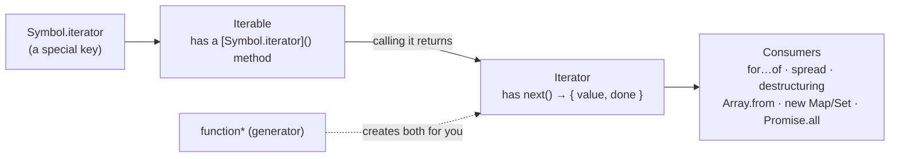
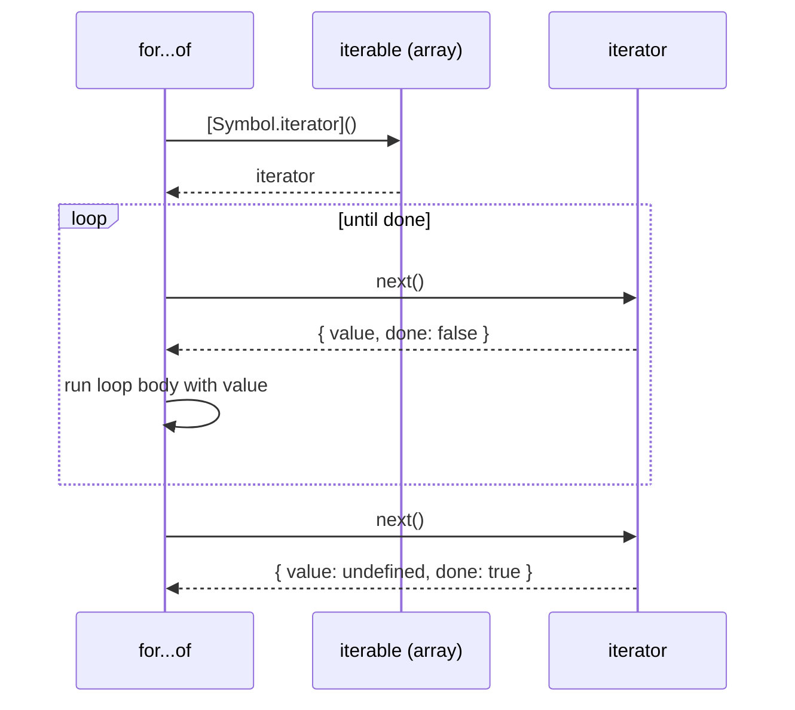
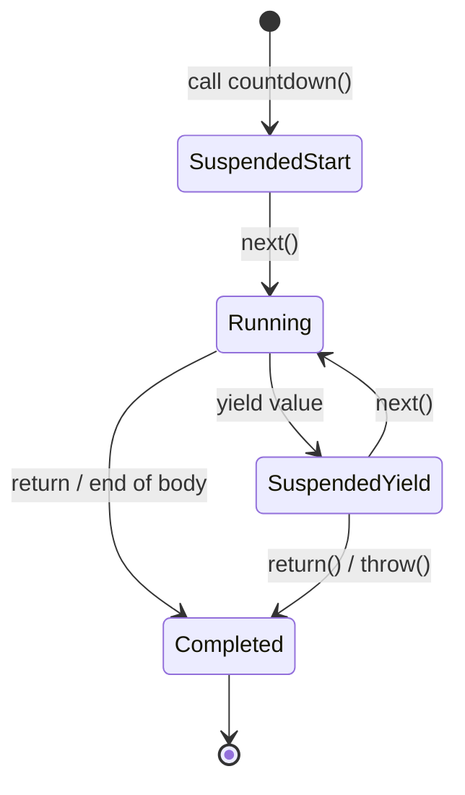

## The big picture

Why can you write `for (const x of array)`, `for (const ch of "text")`, `[...set]` and `const [a, b] = map`, but `for (const x of { a: 1 })` throws `TypeError: object is not iterable`?

Because JavaScript has an **iteration protocol**: a small contract that any object can implement. Arrays, strings, Maps and Sets implement it; plain objects don't. To understand that contract you need one building block first, **symbols**, and once you have it, **generators** make implementing it almost effortless.



## Symbols

A **symbol** is a primitive value that is **guaranteed to be unique**. Its main job is to be a property key that can never collide with any other key, including keys added by other libraries or by future versions of the language.

<Api name="Symbol()" sig="Symbol(description?)" returns="A brand-new, unique symbol. Two calls never return equal symbols, even with the same description." mutates="n/a">

- `description` (optional): a label for debugging only; it does not affect identity.

</Api>

```js run
const id1 = Symbol("id");
const id2 = Symbol("id");

console.log(typeof id1);                 // "symbol"
console.log(id1 === id2);                // false — always unique
console.log(id1.description);            // "id"
console.log(id1.toString());             // "Symbol(id)"

const user = { name: "Ali", [id1]: 123 };  // symbol as a property key
console.log(user[id1]);                    // 123
console.log(Object.keys(user));            // ['name'] — symbols are skipped
console.log(JSON.stringify(user));         // {"name":"Ali"} — and not serialized
console.log(Object.getOwnPropertySymbols(user)); // [Symbol(id)] — but they're not secret
console.log(Reflect.ownKeys(user));        // ['name', Symbol(id)]

try { `${id1}`; } catch (e) { console.log(e.name + ": " + e.message); } // no implicit string conversion
```

| Property key type | Visible in `for...in` / `Object.keys` / JSON | Can collide with other code | Truly private |
| --- | --- | --- | --- |
| String | ✓ | ✓ | ✗ |
| Symbol | ✗ | ✗ (unique) | ✗ (`getOwnPropertySymbols` finds it) |
| `#private` (classes) | ✗ | ✗ | ✓ |

### The global registry: `Symbol.for`

`Symbol.for(key)` returns a symbol from a **global, cross-realm registry**: the same key always returns the same symbol, even across iframes and modules.

```js run
const a = Symbol.for("app.theme");
const b = Symbol.for("app.theme");
console.log(a === b);                    // true — shared
console.log(Symbol.keyFor(a));           // "app.theme"
console.log(Symbol.keyFor(Symbol("x"))); // undefined — not registered
```

React uses `Symbol.for("react.element")` to mark JSX elements. Because JSON can't contain symbols, a server can't inject a fake React element through JSON data, which is an XSS defence.

### Well-known symbols: hooks into the language

The language itself looks up certain symbol-keyed methods on your objects. Implementing them customizes built-in behaviour:

| Symbol | The language calls it when… | Example |
| --- | --- | --- |
| `Symbol.iterator` | You iterate (`for...of`, spread, destructuring) | Make a class iterable |
| `Symbol.asyncIterator` | You use `for await...of` | Stream pages from an API |
| `Symbol.toPrimitive` | The object is converted to a primitive (`+obj`, `` `${obj}` ``) | Money objects that behave like numbers |
| `Symbol.toStringTag` | `Object.prototype.toString` is called | `[object MyType]` |
| `Symbol.hasInstance` | `x instanceof C` | Custom `instanceof` logic |
| `Symbol.species` | Array methods create derived results | Subclasses of Array |

```js run
class Money {
  constructor(amount, currency) { this.amount = amount; this.currency = currency; }
  [Symbol.toPrimitive](hint) {             // hint: "number", "string" or "default"
    return hint === "string" ? `${this.amount.toFixed(2)} ${this.currency}` : this.amount;
  }
  get [Symbol.toStringTag]() { return "Money"; }
}
const price = new Money(19.9, "USD");
console.log(`${price}`, price * 2, price + 1);
console.log(Object.prototype.toString.call(price));   // [object Money]
```

## The iteration protocol

The protocol is two small interfaces:

| Role | What it must have | Meaning |
| --- | --- | --- |
| **Iterable** | A method under the key `Symbol.iterator` that returns an iterator | "I can be looped over" |
| **Iterator** | A `next()` method returning `{ value, done }` | "Here is the next item, and whether we're finished" |

Let's see what `for...of` does behind the scenes:

```js run
const colors = ["red", "green", "blue"];

const iterator = colors[Symbol.iterator]();   // 1. ask the iterable for an iterator
console.log(iterator.next());                 // { value: 'red', done: false }
console.log(iterator.next());                 // { value: 'green', done: false }
console.log(iterator.next());                 // { value: 'blue', done: false }
console.log(iterator.next());                 // { value: undefined, done: true }
console.log(iterator.next());                 // stays done

// for...of is exactly this loop:
const it = colors[Symbol.iterator]();
let step = it.next();
while (!step.done) {
  console.log("for...of would give:", step.value);
  step = it.next();
}
```



### Built-in iterables and what they yield

| Iterable | Each step yields |
| --- | --- |
| `Array` | Elements (`arr.keys()`, `arr.values()`, `arr.entries()` give other views) |
| `String` | **Code points** (so emoji stay intact) |
| `Map` | `[key, value]` pairs |
| `Set` | Values |
| `arguments`, `NodeList` | Elements |
| Generators | Whatever they `yield` |
| Plain object `{}` | ✗ Not iterable; use `Object.keys/values/entries(obj)` |

### Everything that consumes iterables

```js run
const set = new Set(["a", "b", "c"]);

for (const x of set) console.log("for...of", x);
console.log([...set]);                          // spread into an array
const [first, ...rest] = set;                   // destructuring
console.log(first, rest);
console.log(Array.from(set, (x) => x.toUpperCase()));
console.log(new Map([["k", 1]].values()));       // constructors accept iterables
console.log(Math.max(...new Set([3, 9, 2])));    // spread into arguments
console.log(Object.fromEntries(new Map([["a", 1]])));
```

## Making your own object iterable

To make `for...of` work on your object, add a `[Symbol.iterator]()` method that returns an iterator.

```js run
const range = {
  from: 1,
  to: 5,
  [Symbol.iterator]() {
    let current = this.from;
    const last = this.to;
    return {
      next() {
        return current <= last
          ? { value: current++, done: false }
          : { value: undefined, done: true };
      },
    };
  },
};

console.log([...range]);                  // [1, 2, 3, 4, 5]
for (const n of range) if (n % 2) console.log("odd", n);
```

That works, but writing `next()` by hand is fiddly: you have to keep the state in variables and build `{ value, done }` objects yourself. **Generators** do all of that for you.

## Generators

A **generator function** (written `function*`) is a function that can **pause** in the middle and **resume** later. Calling it doesn't run its body. It returns a **generator object**, which is an iterator. Each `next()` call runs the body until the next `yield`, hands out that value, and freezes there.

<Api name="function*" sig="function* name(params) { … yield value; … return finalValue; }" returns="Calling it returns a **generator object** (both an iterator and an iterable). The body runs only when `next()` is called." mutates="n/a">

- `yield value`: pauses and produces `{ value, done: false }`.
- `return finalValue`: ends the generator with `{ value: finalValue, done: true }` (ignored by `for...of`).
- The generator object has `next(arg)`, `return(value)` and `throw(error)`.

</Api>

```js run
function* countdown() {
  console.log("  (body starts)");
  yield 3;
  console.log("  (resumed after 3)");
  yield 2;
  yield 1;
  return "liftoff";
}

const gen = countdown();          // nothing printed yet: the body hasn't run
console.log("created");
console.log(gen.next());          // runs until the first yield → { value: 3, done: false }
console.log(gen.next());          // { value: 2, done: false }
console.log(gen.next());          // { value: 1, done: false }
console.log(gen.next());          // { value: 'liftoff', done: true }
console.log(gen.next());          // { value: undefined, done: true }

console.log([...countdown()]);    // [3, 2, 1] — spread ignores the return value
```



### The range example, rewritten with a generator

```js run
const range = {
  from: 1,
  to: 5,
  *[Symbol.iterator]() {                 // a generator method
    for (let n = this.from; n <= this.to; n++) yield n;
  },
};
console.log([...range]);

class Tree {
  constructor(value, children = []) { this.value = value; this.children = children; }
  *[Symbol.iterator]() {                 // depth-first traversal in 3 lines
    yield this.value;
    for (const child of this.children) yield* child;   // yield* delegates to another iterable
  }
}
const tree = new Tree("root", [new Tree("a", [new Tree("a1")]), new Tree("b")]);
console.log([...tree]);                  // ['root', 'a', 'a1', 'b']
```

`yield* iterable` yields every value of another iterable (or generator), one by one. It's how recursive generators stay short.

### Lazy and infinite sequences

A generator computes values **only when asked**. That makes infinite sequences possible: they never run ahead of the consumer.

```js run
function* naturals() {
  let n = 1;
  while (true) yield n++;             // infinite, but only runs on demand
}

function* take(iterable, count) {
  if (count <= 0) return;
  for (const x of iterable) {
    yield x;
    if (--count === 0) return;        // returning closes the source too
  }
}

function* map(iterable, fn) { for (const x of iterable) yield fn(x); }
function* filter(iterable, fn) { for (const x of iterable) if (fn(x)) yield x; }

// The first 5 squares of even numbers, computed lazily:
const result = take(map(filter(naturals(), (n) => n % 2 === 0), (n) => n * n), 5);
console.log([...result]);             // [4, 16, 36, 64, 100]

// A unique-ID generator
function* idGenerator(prefix) { let i = 0; while (true) yield `${prefix}-${++i}`; }
const ids = idGenerator("order");
console.log(ids.next().value, ids.next().value);
```

| Approach | `naturals().filter().map().slice(0,5)` with arrays | Generator pipeline |
| --- | --- | --- |
| Works with infinite data | ✗ (can't build an infinite array) | ✓ |
| Memory | An intermediate array per step | One value at a time |
| When work happens | Eagerly, all at once | Lazily, as the consumer pulls |

Modern engines also ship **iterator helpers** (ES2025) so you don't have to write `map`/`filter`/`take` yourself:

```js run
function* naturals() { let n = 1; while (true) yield n++; }
if (typeof Iterator !== "undefined" && Iterator.prototype.take) {
  console.log(naturals().filter((n) => n % 2 === 0).map((n) => n * n).take(5).toArray());
} else {
  console.log("Iterator helpers are not available in this engine yet");
}
```

### Two-way communication: `next(value)`

`yield` is also an **expression**: the value passed to the *next* `next(value)` call becomes the result of the paused `yield`. This lets the caller send data into the generator.

```js run
function* conversation() {
  const name = yield "What's your name?";
  const lang = yield `Hi ${name}! Favourite language?`;
  return `${name} likes ${lang}`;
}

const chat = conversation();
console.log(chat.next().value);          // starts it; the argument of the first next() is ignored
console.log(chat.next("Sara").value);    // "Sara" becomes the value of the first yield
console.log(chat.next("JavaScript"));    // { value: 'Sara likes JavaScript', done: true }
```

```text
caller:     next()            next("Sara")                next("JavaScript")
              │                    │                             │
generator:  ──┴─► yield "What…" ◄──┘ name = "Sara"               │
                  ─────────────────► yield "Hi Sara…" ◄──────────┘ lang = "JavaScript"
                                     ───────────────────────────► return "Sara likes JavaScript"
```

This mechanism is how libraries like `co` and Redux-Saga built "async/await before async/await": the generator yields a promise, the runner waits for it and sends the result back with `next(result)`.

### `return()` and `throw()`

```js run
function* resource() {
  try {
    yield 1;
    yield 2;
    yield 3;
  } finally {
    console.log("cleanup ran");          // runs when the generator is closed early
  }
}

for (const x of resource()) {
  console.log(x);
  if (x === 2) break;                    // break calls gen.return() → finally runs
}

const g = resource();
g.next();
try {
  g.throw(new Error("injected"));        // raises the error at the paused yield
} catch (e) {
  console.log("caught outside:", e.message);
}
```

`break`, `return` and exceptions inside `for...of` automatically call the iterator's `return()`, so `finally` blocks in generators are a reliable place for cleanup.

## Async iteration: `for await...of`

An **async iterable** produces promises over time: data arriving from the network, a stream, paginated API results. Its `next()` returns a **promise** of `{ value, done }`, and `for await...of` waits for each one.

```js run
// A fake paginated API
const fetchPage = (page) =>
  new Promise((resolve) =>
    setTimeout(() => resolve({ items: [`item ${page}a`, `item ${page}b`], next: page < 3 ? page + 1 : null }), 30),
  );

// async generator: `async function*` can both await and yield
async function* allItems() {
  let page = 1;
  while (page) {
    const { items, next } = await fetchPage(page);
    yield* items;                         // yield each item of this page
    page = next;
  }
}

(async () => {
  for await (const item of allItems()) {
    console.log(item);
    if (item === "item 2b") break;        // stops fetching more pages
  }
  console.log("done");
})();
```

| | Sync iterator | Async iterator |
| --- | --- | --- |
| Key | `Symbol.iterator` | `Symbol.asyncIterator` |
| `next()` returns | `{ value, done }` | `Promise<{ value, done }>` |
| Generator syntax | `function*` | `async function*` |
| Loop | `for...of` | `for await...of` |
| Real examples | Arrays, Maps, trees | `ReadableStream` (fetch bodies), Node streams, paginated APIs |

## Common mistakes

- Expecting a generator to run when called (it only runs on `next()`).
- Spreading an infinite generator (`[...naturals()]` never finishes).
- Reusing a generator object: it is single-use; once `done`, it stays done. Call the function again for a fresh one.
- Forgetting that the first `next(value)` argument is ignored.
- Returning a value from a generator and expecting `for...of` to see it.
- Using `for...in` or `for...of` on plain objects (use `Object.entries`).
- Assuming symbol keys are private (they're only hidden from string-based enumeration).

## Interview questions

<QA q="What's the difference between an iterable and an iterator?" level="mid" n={1}>
<Answer>

An **iterable** is an object with a `[Symbol.iterator]()` method; calling it returns an **iterator**. An iterator is an object with a `next()` method that returns `{ value, done }`. Arrays, strings, Maps and Sets are iterables; `for...of`, spread and destructuring consume iterables by asking them for a fresh iterator.

</Answer>
<Deep>

Built-in iterators (and generator objects) are also iterable: their `[Symbol.iterator]()` returns `this`. That's why you can `for...of` over `map.entries()`. Iterators may implement `return()` for cleanup, which `for...of` calls on `break` or exceptions.

</Deep>
<Mistake>

Saying an object is iterable because it has a `length` property (that's an array-like, which `Array.from` accepts but `for...of` doesn't).

</Mistake>
<FollowUp>

Make `{ from: 1, to: 3 }` iterable with and without a generator.

</FollowUp>
</QA>

<QA q="What is a generator and when would you use one?" level="mid" n={2}>
<Answer>

A generator function (`function*`) returns an iterator whose body runs lazily: each `next()` runs until the next `yield`, then pauses with its local state intact. Use it to implement iterables concisely, to produce lazy or infinite sequences, to traverse trees/graphs, and to build pipelines that process one item at a time.

</Answer>
<Deep>

`yield` is two-way: `next(x)` resumes the generator with `x` as the result of the paused `yield`, which allowed coroutine runners (co, Redux-Saga) to implement async flows. Async generators combine `await` and `yield` for streams and pagination, consumed with `for await...of`.

</Deep>
<Mistake>

Thinking the code runs when the generator function is called.

</Mistake>
<FollowUp>

How does Redux-Saga use generators, and what advantage do they give for testing? (Effects are yielded as plain objects you can assert on.)

</FollowUp>
</QA>

<QA q="What are symbols used for? Are symbol keys private?" level="mid" n={3}>
<Answer>

Symbols are unique primitive values, used as property keys that can't collide with other keys, for meta-level hooks (`Symbol.iterator`, `Symbol.toPrimitive`) and as unique identifiers/brands (`Symbol.for("react.element")`). Symbol keys are **not private**: they're skipped by `for...in`, `Object.keys` and JSON, but `Object.getOwnPropertySymbols` and `Reflect.ownKeys` reveal them.

</Answer>
<Deep>

`Symbol()` creates a new symbol every time; `Symbol.for(key)` uses a global registry shared across realms. Symbols can't be implicitly converted to strings, which prevents accidental use as display text. For real privacy, use `#private` fields or closures.

</Deep>
<Mistake>

Using symbols to "hide" sensitive data.

</Mistake>
<FollowUp>

Why does React mark elements with a registered symbol rather than a string type?

</FollowUp>
</QA>

<QA q="How would you consume a paginated API with `for await...of`?" level="senior" n={4}>
<Answer>

Write an `async function*` that fetches a page, `yield*`s its items, and loops while there's a next page. The consumer uses `for await (const item of allItems())`; it can `break` early, which closes the generator and stops further requests.

</Answer>
<Deep>

The generator keeps pagination state internally, so consumers stay simple, and work is pulled on demand (backpressure). Add `try/finally` for cleanup (e.g. aborting an in-flight request with an `AbortController`). Fetch response bodies are `ReadableStream`s, which are async iterable in modern runtimes.

</Deep>
<Mistake>

Loading all pages into one array before processing, which wastes memory and delays the first result.

</Mistake>
<FollowUp>

How would you add concurrency (fetch 2 pages ahead) without losing order?

</FollowUp>
</QA>

## Recap

<Recap>

- A `Symbol` is a unique value, used for keys that can't clash and for well-known symbols like `Symbol.iterator`.
- An iterator is an object with a `next()` method returning `{ value, done }`.
- An iterable has a `[Symbol.iterator]()` method that returns an iterator; arrays, strings, Maps, Sets and NodeLists are iterable.
- `for...of`, spread, destructuring and `Array.from` all use this protocol.
- A generator (`function*`) pauses with `yield` and resumes later, and is itself an iterator.
- Generators are lazy: the next value is only produced when requested, so infinite sequences are possible.
- `next(value)` sends a value into the generator; `return()` and `throw()` end it from outside.
- `for await...of` iterates async iterables such as streams or paginated APIs.

</Recap>
