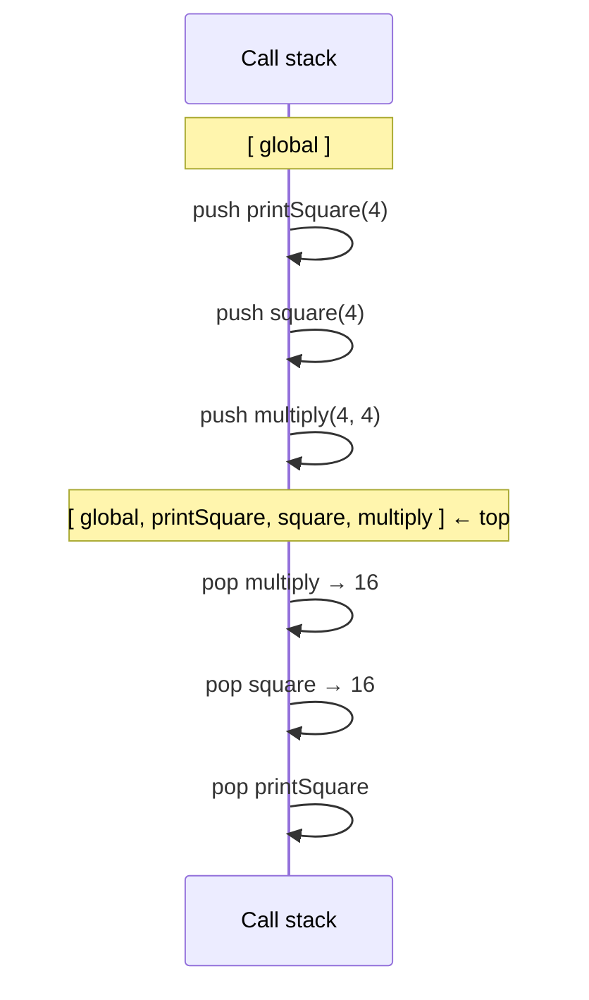
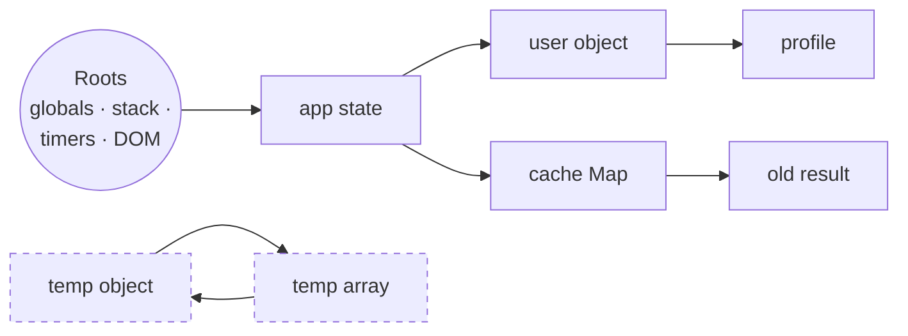
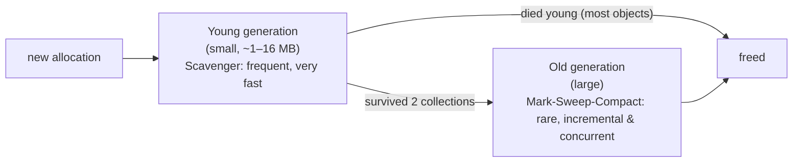
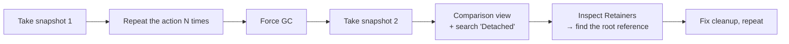

## The memory lifecycle

Every program does three things with memory, whatever the language:

1. **Allocate** memory when something is created (a variable, an object, a function, a string).
2. **Use** it (read and write).
3. **Release** it when it's no longer needed.

In C you do step 3 yourself with `free()`, and forgetting it (a leak) or doing it twice (a crash) are classic bugs. JavaScript does steps 1 and 3 **automatically**: the engine allocates when you create values, and a **garbage collector (GC)** releases memory that can no longer be used. "Automatic" doesn't mean "free of problems", though: you can still keep things alive by accident. That's what a JavaScript memory leak is.

```js run
let user = { name: "Ali", tags: ["admin"] };  // allocate: an object, an array, two strings
console.log(user.name);                       // use
user = null;                                  // the object is now unreachable → the GC may release it
```

## Where values live: the stack and the heap

| | Call stack | Heap |
| --- | --- | --- |
| What lives there | **Frames**: one per active function call, with its local variables and where to return | **Objects**: object literals, arrays, functions, closures' environments, large strings |
| Size | Small, fixed limit (roughly ~1 MB; ~10k frames) | Large, grows as needed (hundreds of MB+) |
| Allocation | Push on call, pop on return: extremely fast | Dynamic: needs a GC to clean up |
| Ordering | Last in, first out | No order |

```text
CALL STACK                         HEAP
┌──────────────────────────┐
│ greet()                  │       ┌──────────────────────────┐
│   message ───────────────┼──────►│ "Hello, Ali"             │
│   user ──────────────────┼───┐   └──────────────────────────┘
├──────────────────────────┤   │   ┌──────────────────────────┐
│ main()                   │   └──►│ { name: "Ali", age: 30 } │
│   count = 3              │       └──────────────────────────┘
└──────────────────────────┘
```

A simplified mental model that is good enough for interviews:

- **Primitives** in local variables (`count = 3`) can sit directly in the frame.
- **Objects** always live in the heap; variables hold a **reference** (an address) to them.

<Callout type="note" title="It's a model, not the full truth">
Engines are more clever: V8 stores small integers ("Smis") directly in the reference itself, keeps most strings in the heap, and moves variables captured by closures out of the stack into a heap-allocated **context** so they survive after the function returns. The stack/heap split above is still the right way to reason about copying and lifetime.
</Callout>

### Copying: value vs reference

```js run
let a = 10;
let b = a;          // copies the value
b++;
console.log(a, b);  // 10 11 — independent

const original = { score: 10 };
const alias = original;   // copies the REFERENCE: both point to one object
alias.score++;
console.log(original.score);           // 11 — same object
console.log(alias === original);       // true

const copy = { ...original };          // a NEW object (shallow copy)
copy.score = 0;
console.log(original.score, copy === original);   // 11 false
```

## The call stack in detail

Every function call pushes a **frame** (an execution context) onto the call stack; `return` pops it. The frame on top is the code running right now.

```js run
function multiply(a, b) {
  console.log(new Error("where am I?").stack.split("\n").slice(1, 4).map((l) => l.trim().split(" (")[0]).join(" ← "));
  return a * b;
}
function square(n) { return multiply(n, n); }
function printSquare(n) { console.log("result:", square(n)); }

printSquare(4);
```



### Stack overflow

The stack has a limit. Recursion without a base case (or with a very deep one) fills it up:

```js run
let depth = 0;
function dive() {
  depth++;
  dive();                 // no base case
}
try {
  dive();
} catch (e) {
  console.log(`${e.name}: ${e.message} (after ~${depth} frames)`);
}

// Fix deep recursion with a loop or an explicit stack (an array on the heap)
function sumTo(n) {
  let total = 0;
  for (let i = 1; i <= n; i++) total += i;
  return total;
}
console.log(sumTo(1e6));
```

## How garbage collection decides: reachability

The GC doesn't ask "is this still **needed**?" (it can't know your intentions). It asks: **"can the program still reach this value?"**

- **Roots** are always reachable: global variables, the variables of the currently executing functions (the stack), active timers and callbacks, the DOM tree and listeners attached to it, and so on.
- Anything referenced **from a reachable value** is reachable too.
- Everything else is garbage and may be freed.



`temp object` and `temp array` reference each other, but **nothing reachable references them**, so both are collected. Cycles are not a problem for a reachability-based GC.

```js run
function createLinkedPair() {
  const a = { name: "a" };
  const b = { name: "b" };
  a.partner = b;              // a → b
  b.partner = a;              // b → a  (a cycle)
  return "done";              // a and b become unreachable together → both collectable
}
console.log(createLinkedPair());
```

### Reference counting (why cycles used to leak)

An older strategy counts how many references point to each object and frees it when the count reaches 0. It can't free cycles (each object in a cycle has count ≥ 1). Old Internet Explorer used reference counting for DOM objects, so cycles between JS objects and DOM nodes leaked. Modern engines use **tracing** (mark-and-sweep), which handles cycles.

## Mark-and-sweep and generational GC

**Mark-and-sweep** in two phases:

1. **Mark:** start from the roots and follow every reference, marking each object reached.
2. **Sweep:** walk the heap and free every object that wasn't marked. (Often followed by **compaction**: moving live objects together to avoid fragmentation.)

Doing this over the whole heap would cause long pauses, so V8 (and other engines) use a **generational** design, based on the observation that **most objects die young** (temporary arrays, intermediate strings, event objects):



| | Young generation (Scavenger / minor GC) | Old generation (major GC) |
| --- | --- | --- |
| Contains | New objects | Objects that survived a couple of minor GCs |
| How often | Very often | Rarely |
| Cost | Proportional to **live** objects (cheap if most died) | Larger; done incrementally and on helper threads |
| Algorithm | Copying ("semi-space"): copy survivors, drop the rest | Mark–sweep–compact |

V8's GC (named **Orinoco**) does most of its work **in parallel** (several threads), **incrementally** (small slices interleaved with your code) and **concurrently** (while JavaScript keeps running), and it schedules work in idle time between frames. That's why GC pauses are usually invisible, unless you allocate enormous amounts of garbage in a hot loop.

## Memory leaks in frontend code

A **leak** is memory that stays reachable even though your program will never use it again. In a single-page app that runs for hours, small leaks add up until the tab slows down or crashes.

### 1. Forgotten timers and intervals

```js run
function startPolling(component) {
  const id = setInterval(() => {
    // this closure keeps `component` (and everything it references) alive…
    component.ticks++;
  }, 10);
  return () => clearInterval(id);      // …until someone calls this
}

const widget = { ticks: 0, bigData: new Array(100_000).fill("•") };
const stop = startPolling(widget);

setTimeout(() => {
  stop();                              // ✓ without this, widget can never be collected
  console.log("stopped after", widget.ticks, "ticks");
}, 60);
```

### 2. Event listeners that outlive their element or component

```js
function mountTooltip(button) {
  const onScroll = () => positionTooltip(button);
  window.addEventListener("scroll", onScroll);         // window is a root…
  return () => window.removeEventListener("scroll", onScroll);   // …so remove it on unmount!
}

// Modern alternative: one AbortController removes many listeners at once
const controller = new AbortController();
window.addEventListener("resize", onResize, { signal: controller.signal });
window.addEventListener("scroll", onScroll, { signal: controller.signal });
controller.abort();                                     // both removed
```

### 3. Detached DOM nodes

A node removed from the page is still alive if JavaScript holds a reference to it, and so is its entire subtree:

```js
const cache = [];
function showRow(data) {
  const row = document.createElement("tr");
  row.textContent = data;
  table.append(row);
  cache.push(row);              // ✗ kept forever, even after table.innerHTML = ""
}
// Fix: don't keep node references longer than needed, or use a WeakMap/WeakSet keyed by node.
```

### 4. Closures capturing more than they need

```js run
function createHandler() {
  const hugeReport = new Array(1_000_000).fill(0);   // ~8 MB
  const summary = hugeReport.length;                  // the only thing we need
  return () => summary;                               // ✓ captures only `summary`
  // return () => hugeReport.length;                  // ✗ would keep the whole array alive
}
const handler = createHandler();
console.log(handler());
```

Engines keep the variables a closure **references**. If several closures are created in the same scope, they share one context, so a variable used by *any* of them stays alive for *all* of them.

### 5. Unbounded caches and global collections

```js run
const memo = new Map();                 // ✗ grows forever with every new argument
function slowLabel(id) {
  if (!memo.has(id)) memo.set(id, `label-${id}`);
  return memo.get(id);
}
for (let i = 0; i < 5000; i++) slowLabel(i);
console.log("cache size:", memo.size);

// ✓ Bound it (LRU), clear it on navigation, or key it by objects with a WeakMap
class LRU {
  #max; #map = new Map();
  constructor(max) { this.#max = max; }
  get(k) { if (!this.#map.has(k)) return; const v = this.#map.get(k); this.#map.delete(k); this.#map.set(k, v); return v; }
  set(k, v) { this.#map.delete(k); this.#map.set(k, v); if (this.#map.size > this.#max) this.#map.delete(this.#map.keys().next().value); }
  get size() { return this.#map.size; }
}
const lru = new LRU(100);
for (let i = 0; i < 5000; i++) lru.set(i, i);
console.log("lru size:", lru.size);
```

### 6. Subscriptions and observers

`IntersectionObserver`, `ResizeObserver`, `MutationObserver`, WebSocket handlers, store subscriptions (`store.subscribe`), EventEmitters: anything you subscribe to must be unsubscribed. In React, that's exactly what the **cleanup function** of `useEffect` is for:

```js
useEffect(() => {
  const unsubscribe = store.subscribe(render);
  const observer = new ResizeObserver(onResize);
  observer.observe(ref.current);
  return () => {             // runs on unmount (and before the effect re-runs)
    unsubscribe();
    observer.disconnect();
  };
}, []);
```

### 7. Accidental globals

```js run sloppy
function count() {
  total = 0;               // sloppy mode: no declaration → creates a global property!
  for (let i = 0; i < 3; i++) total += i;
  return total;
}
count();
console.log("leaked global:", typeof globalThis.total, globalThis.total);
// Strict mode (modules, classes) throws a ReferenceError instead.
```

| Leak source | Root that keeps it alive | Fix |
| --- | --- | --- |
| `setInterval` / recursive `setTimeout` | Timer list | `clearInterval` on cleanup |
| Listeners on `window`/`document` | DOM / window | `removeEventListener` or `AbortController` |
| Detached DOM nodes | Your arrays/maps/closures | Drop references; `WeakMap`/`WeakSet` |
| Big data in closures | Long-lived callback | Capture only what you need |
| Unbounded caches | Module-level `Map` | LRU limit, TTL, `WeakMap` |
| Subscriptions/observers | The source object | Unsubscribe / `disconnect()` |
| Accidental globals | `globalThis` | Strict mode, linting |

## Finding leaks with DevTools

1. **Performance monitor** (Chrome: More tools → Performance monitor): watch "JS heap size" and "DOM Nodes" while you repeat an action (open/close a modal 20 times). A staircase that never comes down suggests a leak.
2. **Memory panel → Heap snapshot**: take one, repeat the action, force GC (the trash icon), take another, then use **Comparison** view. Sort by "# Delta" or "Size Delta". Search for **"Detached"** to find detached DOM trees.
3. **Retainers** pane: select a leaked object to see the chain of references keeping it alive back to a root. That chain tells you exactly what to clean up.
4. **Allocation instrumentation on timeline**: shows *where* allocations happen and which survive.



## Allocation and performance

GC is fast, but **creating garbage still costs time**. In hot paths (animation frames, scroll handlers, large loops), avoid allocating new objects unnecessarily:

```js run
const points = Array.from({ length: 200_000 }, (_, i) => ({ x: i, y: i * 2 }));

let t = performance.now();
let sum1 = 0;
for (const p of points) sum1 += Object.values(p).reduce((a, b) => a + b, 0);  // 2 temporary arrays per point
console.log("allocating:", Math.round(performance.now() - t), "ms");

t = performance.now();
let sum2 = 0;
for (const p of points) sum2 += p.x + p.y;                                      // no allocations
console.log("non-allocating:", Math.round(performance.now() - t), "ms", sum1 === sum2);
```

Other tips: reuse objects in animation loops, prefer typed arrays for large numeric data, avoid creating closures inside very hot loops, and don't hold large structures longer than needed.

## Common mistakes

- Thinking "JavaScript has a GC, so leaks can't happen".
- Believing cycles leak in modern engines (they don't; unreachable cycles are collected).
- Forgetting cleanup: intervals, listeners, observers, subscriptions, `useEffect` returns.
- Keeping references to removed DOM nodes.
- Unbounded caches and global arrays that only grow.
- Setting a variable to `null` everywhere "to help the GC" (only useful for long-lived references to big data).
- Deep recursion without considering stack limits.

## Interview questions

<QA q="What's the difference between the stack and the heap in JavaScript?" level="junior" n={1}>
<Answer>

The call stack holds frames for active function calls (local variables, return addresses); it's small, fast and LIFO. The heap holds objects (arrays, functions, closures' environments, most strings); it's large and managed by the garbage collector. Variables that hold objects store references to heap memory, which is why assigning an object copies the reference, not the object.

</Answer>
<Deep>

V8 stores small integers inline in references and moves variables captured by closures into heap-allocated contexts so they outlive the frame. Too many frames cause `RangeError: Maximum call stack size exceeded`.

</Deep>
<Mistake>

Saying "primitives go on the stack and objects on the heap" as an absolute rule. It's a model; strings and captured variables usually live in the heap.

</Mistake>
<FollowUp>

Why does `const` not make an object immutable?

</FollowUp>
</QA>

<QA q="How does garbage collection work in modern JavaScript engines?" level="mid" n={2}>
<Answer>

By reachability: starting from roots (globals, the current stack, active callbacks, the DOM), the collector marks everything reachable and frees the rest (mark-and-sweep, usually followed by compaction). Engines are generational: a frequent, cheap scavenger collects the young generation where most objects die, and survivors are promoted to an old generation collected less often.

</Answer>
<Deep>

V8's Orinoco runs marking concurrently and incrementally on helper threads and uses idle time between frames to keep pauses short. Because tracing works from roots, unreachable cycles are collected, unlike pure reference counting (which leaked DOM↔JS cycles in old IE).

</Deep>
<Mistake>

Claiming that setting a variable to `null` immediately frees memory. It only removes one reference; collection happens later, if the object is unreachable.

</Mistake>
<FollowUp>

Why is allocating many short-lived objects relatively cheap, while promoting many objects to the old generation is expensive?

</FollowUp>
</QA>

<QA q="Name common causes of memory leaks in a single-page app and how to prevent them." level="mid" n={3}>
<Answer>

Uncleared intervals/timeouts; event listeners on `window`/`document` not removed on unmount; detached DOM nodes still referenced from JS; closures capturing large data; unbounded caches or global arrays; subscriptions and observers never unsubscribed; accidental globals. Prevent them with cleanup functions (`useEffect` returns, `AbortController` for listeners), bounded caches, `WeakMap`/`WeakSet` for per-object data, and strict mode.

</Answer>
<Deep>

Diagnose with heap snapshot comparisons: repeat an action, force GC, compare, search for "Detached", then read the retainer chain to find the root keeping the object alive.

</Deep>
<Mistake>

Blaming the framework for leaks that come from missing cleanup in your own effects.

</Mistake>
<FollowUp>

How would you prove that closing a modal 50 times doesn't leak?

</FollowUp>
</QA>

<QA q="Do circular references cause memory leaks?" level="junior" n={4}>
<Answer>

Not in modern engines. Their GCs trace reachability from roots, so a cycle of objects that nothing reachable points to is collected entirely. Cycles only leaked with reference-counting collectors, such as the DOM in old Internet Explorer.

</Answer>
<Deep>

Cycles still matter for other algorithms: `JSON.stringify` throws on them and naive deep-clone/deep-equal functions recurse forever (use a `WeakMap`/`WeakSet` to track visited objects, or `structuredClone`, which supports cycles).

</Deep>
<Mistake>

Breaking every cycle manually "to help the GC".

</Mistake>
<FollowUp>

How does `structuredClone` handle circular references?

</FollowUp>
</QA>

## Recap

<Recap>

- The memory lifecycle is allocate, use, release; in JavaScript the first and last steps are automatic.
- The call stack holds function frames; objects, arrays and closures live in the heap.
- Unbounded recursion fills the stack and throws `RangeError: Maximum call stack size exceeded`.
- The GC frees what is no longer **reachable** from the roots (globals, the current stack, live closures), not what is "no longer used".
- Mark-and-sweep also collects circular references; generational GC assumes most objects die young.
- Common frontend leaks: uncleared listeners and timers, detached DOM nodes still referenced, unbounded caches, large closures and globals.
- In React, clean up in each `useEffect` cleanup function.
- Find leaks with heap snapshots and by comparing two snapshots in DevTools; look for "Detached".

</Recap>
