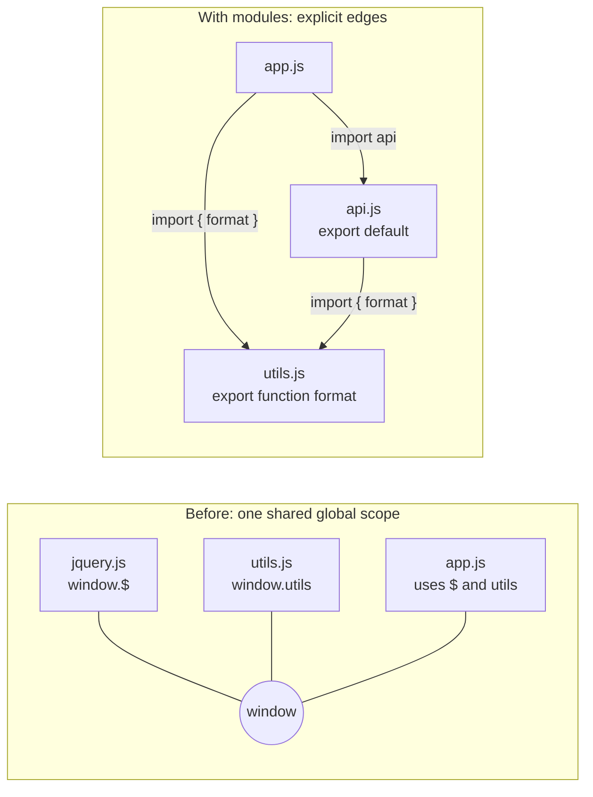
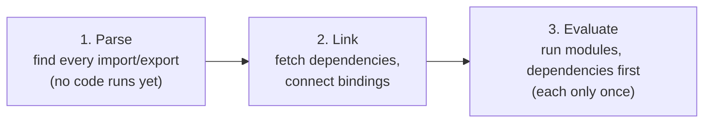
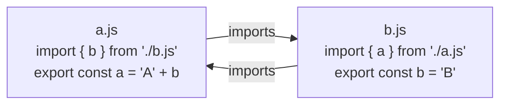

## Why modules?

A **module** is a file that keeps its own variables private and explicitly **exports** what other files may use, and explicitly **imports** what it needs from others.

Before modules, every `<script>` shared **one global scope**. That caused real problems:

| Problem | Example |
| --- | --- |
| Name collisions | Two libraries both define a global `$` or `utils`; the last one loaded wins |
| Hidden dependencies | `app.js` silently needs `jquery.js` to be loaded first; reorder the tags and it breaks |
| No privacy | Every helper is reachable (and changeable) by every other script |
| Hard to optimize | Tools can't tell which code is actually used |

Modules solve all four: each file has its **own scope**, dependencies are **declared** with `import`, only `export`ed things are visible, and the static structure lets bundlers remove unused code.



### The pre-module workaround: IIFE and the module pattern

```js run
// An IIFE (Immediately Invoked Function Expression) creates a private scope
const counterModule = (function () {
  let count = 0;                         // private
  function increment() { return ++count; }
  return { increment, get count() { return count; } };   // the "public API"
})();

counterModule.increment();
console.log(counterModule.count, typeof count);   // 1 "undefined" — count is not global
```

This "revealing module pattern" is still worth knowing (you'll see it in old code and in bundler output), but you should use real modules today.

## ES modules (ESM): the standard

### Exporting

```js
// math.js
export const PI = 3.14159;                       // named export (declaration)
export function add(a, b) { return a + b; }      // named export
function multiply(a, b) { return a * b; }
function secret() {}                             // not exported → private to this file

export { multiply, multiply as times };          // export list, with renaming
export default function subtract(a, b) {         // ONE default export per module
  return a - b;
}
```

### Importing

```js
// app.js
import subtract, { add, PI, times as mul } from "./math.js";   // default + named (+ rename)
import * as math from "./math.js";                           // namespace object: math.add, math.default
import "./polyfills.js";                                     // run for side effects only

console.log(add(2, 3), subtract(5, 1), mul(2, 4), math.PI);
```

| Form | Syntax | Notes |
| --- | --- | --- |
| Named export | `export function add() {}` / `export { a, b }` | Imported with the **same name** in braces: `import { add }` |
| Default export | `export default value` | Imported with **any name**, no braces: `import anything from` |
| Rename | `export { a as b }` / `import { a as b }` | Avoids collisions |
| Namespace import | `import * as ns from` | All named exports as properties (+ `ns.default`) |
| Re-export | `export { add } from "./math.js"` / `export * from` | Build "barrel" files (`index.js`) |
| Side-effect import | `import "./styles.css"` | Runs the module, imports nothing |

### Named vs default exports

| | Named | Default |
| --- | --- | --- |
| How many per module | Any number | At most one |
| Name at import | Must match (or be renamed explicitly) | Chosen by the importer |
| Refactoring / IDE support | Rename-safe, auto-import works well | Each file may call it differently |
| Tree shaking | Granular | Fine, but an exported object of helpers isn't shakeable |
| Typical use | Utility libraries, multiple components | A file's single main thing (a React page component, a config) |

Many teams prefer **named exports everywhere** for consistency and better tooling; frameworks sometimes require defaults (e.g. Next.js pages, `React.lazy`).

### Live bindings: imports are not copies

An imported name is a **live, read-only view** of the exporting module's variable. When the exporter changes the variable, every importer sees the new value. And importers **cannot** assign to it.

```js run
// We create a real module from a string so it can run here.
const source = `
  export let count = 0;
  export function increment() { count++; }
`;
const url = "data:text/javascript," + encodeURIComponent(source);

const counter = await import(url);
console.log(counter.count);          // 0
counter.increment();
console.log(counter.count);          // 1 — the import sees the module's live variable

const again = await import(url);     // the same URL → the same module instance (cached)
console.log(again === counter, again.count);   // true 1

try {
  counter.count = 100;               // importers can't assign to a binding
} catch (e) {
  console.log(e.name + ": " + e.message);
}
```

CommonJS behaves differently: `require` gives you a **copy of the exported value at that moment** (for primitives), as shown later.

### Modules are evaluated once and cached

Importing the same module from ten files doesn't run it ten times. It runs **once**, the first time it's imported, and every importer shares the same instance. That's why a module-level variable works as a singleton (a store, a cache, a configured client).

### Static structure

`import` and `export` declarations must be at the **top level** with **string-literal** paths. The engine reads them before running any code:



Consequences:

- Imports are **hoisted**: they're resolved before the module body runs, wherever you write them.
- Syntax errors and missing named exports are detected **before** any code executes.
- Tools can analyze the dependency graph statically, which enables **tree shaking** (dropping unused exports).

### Other ESM rules

| Rule | Detail |
| --- | --- |
| Always strict mode | No `"use strict"` needed; `this` at the top level is `undefined` |
| Own scope | Top-level `var`/`function` don't become `window` properties |
| `import.meta` | Info about the current module: `import.meta.url`; bundlers add `import.meta.env` |
| Top-level `await` | Allowed; importers wait for the module to finish |
| In browsers | `<script type="module">` is **deferred** by default, runs once even if included twice, needs CORS for cross-origin |
| File paths | Browsers need full specifiers (`./utils.js`, with extension) or an **import map** for bare names like `"react"` |

```html
<script type="importmap">
  { "imports": { "lodash-es/": "https://cdn.jsdelivr.net/npm/lodash-es/" } }
</script>
<script type="module">
  import debounce from "lodash-es/debounce.js";   // resolved via the import map
</script>
```

## Dynamic `import()`

`import(specifier)` is a **function-like expression** that loads a module **at runtime** and returns a **promise** of its namespace object. Unlike static imports, it can be used anywhere, with computed paths.

<Api name="import()" sig="import(specifier, options?)" returns="A `Promise` that fulfills with the module namespace object (`{ default, ...namedExports }`). The module is fetched and evaluated on first call, then cached." mutates="n/a">

- `specifier`: a string (can be computed at runtime).
- `options` (optional): e.g. `{ with: { type: "json" } }` for JSON modules.

</Api>

```js run
async function loadFormatter(locale) {
  // In a real app: await import(`./formatters/${locale}.js`) — here an inline module
  const code = `export default (n) => new Intl.NumberFormat(${JSON.stringify(locale)}).format(n);`;
  const mod = await import("data:text/javascript," + encodeURIComponent(code));
  return mod.default;
}

const fa = await loadFormatter("fa-IR");
const en = await loadFormatter("en-US");
console.log(fa(1234567.89), "|", en(1234567.89));
```

Typical uses:

| Use | Example |
| --- | --- |
| **Code splitting** (load a route or heavy widget only when needed) | `const Chart = lazy(() => import("./Chart"))` in React |
| Conditional loading | Polyfills only in old browsers; admin tools only for admins |
| Locale / theme files | ``import(`./locales/${lang}.js`)`` |
| Loading from CommonJS | `await import("esm-only-package")` |

Bundlers (Vite, webpack, Rollup) turn each dynamic import into a **separate chunk** file, downloaded on demand. This very site loads each chapter, the diagram library and the code editor this way.

## CommonJS (CJS): Node's original module system

Before ESM existed, Node.js used **CommonJS**, and a huge part of npm still ships it.

```js
// math.cjs
const PI = 3.14159;
function add(a, b) { return a + b; }
module.exports = { PI, add };        // or: exports.add = add;

// app.cjs
const { add, PI } = require("./math.cjs");   // synchronous, returns module.exports
const fs = require("node:fs");
if (process.env.DEBUG) require("./debug-tools.cjs");   // require works anywhere, even conditionally
```

CommonJS's `require` returns the `module.exports` **object**; destructuring copies the values out at that moment:

```js run
// Simulating CommonJS semantics with a tiny require() implementation
function createModule(factory) {
  const module = { exports: {} };
  factory(module, module.exports);
  return module;
}

const counterModule = createModule((module) => {
  let count = 0;
  module.exports = { count, increment: () => { count++; module.exports.count = count; } };
});
const require = () => counterModule.exports;

const { count, increment } = require();   // destructured: a COPY of the number
increment();
console.log(count);                       // 0 — stale copy
console.log(require().count);             // 1 — reading through the object sees the update
```

### ESM vs CommonJS

| | ES modules | CommonJS |
| --- | --- | --- |
| Syntax | `import` / `export` | `require()` / `module.exports` |
| Loading | Asynchronous, in phases (parse → link → evaluate) | Synchronous, at the `require` call |
| Structure | **Static** (top level, literal paths) | **Dynamic** (anywhere, computed paths) |
| Bindings | **Live**, read-only | Copies of values at `require` time |
| Tree shaking | ✓ Reliable | ✗ Hard |
| Top-level `await` | ✓ | ✗ |
| `this` at top level | `undefined` | `module.exports` |
| `__dirname`, `__filename` | ✗ (use `import.meta.dirname` / `import.meta.url`) | ✓ |
| Runs in browsers | ✓ Natively | ✗ (needs a bundler) |
| Node file detection | `.mjs`, or `.js` with `"type": "module"` in package.json | `.cjs`, or `.js` without `"type": "module"` |

### Interoperability

- ESM can `import` CommonJS: `module.exports` becomes the **default export** (Node also detects many named exports).
- CommonJS can't statically `require` ESM in older Node; use `await import()`. Recent Node versions (22+) support `require()` of synchronous ESM.
- Libraries often publish **both** using the `"exports"` field in `package.json` ("dual packages").

```json
{
  "name": "my-lib",
  "type": "module",
  "exports": {
    ".": {
      "import": "./dist/index.js",
      "require": "./dist/index.cjs",
      "types": "./dist/index.d.ts"
    }
  },
  "sideEffects": false
}
```

## Circular dependencies

When `a.js` imports `b.js` and `b.js` imports `a.js`, one of them must run first, and it will see the other **not yet initialized**:



```js
// main.js imports a.js → a.js starts linking → needs b.js → b.js runs FIRST
// b.js: if it reads `a` at top level → ReferenceError (a is in its TDZ)
// b.js: if it only uses `a` inside a function called later → fine
```

Rules of thumb: avoid cycles (move shared code into a third module); if you can't, only use imported bindings **inside functions** that run after all modules have loaded, never at the top level. Bundlers (and tools like `madge` or ESLint's `import/no-cycle`) can detect cycles.

## Tree shaking and side effects

**Tree shaking** is the bundler removing exports that nobody imports. It works because ESM is static. Two things defeat it:

1. **Side effects at module top level** (code that runs on import, like registering a global or patching a prototype). The bundler must keep such modules. Declare `"sideEffects": false` (or a list of files that do have side effects, such as CSS) in `package.json` to allow aggressive removal.
2. **Exporting one big object** (`export default { a, b, c }`): the bundler can't know which properties you'll use.

```js
// ✓ shakeable: import only what you use
import { debounce } from "lodash-es";

// ✗ pulls in the whole library (CommonJS, one object)
import _ from "lodash";
_.debounce(fn, 100);
```

## Common mistakes

- Mixing `import` and `require` in the same file without understanding the module type.
- Forgetting the `.js` extension in browser/Node ESM paths.
- Expecting `export default` objects to be tree-shaken.
- Reading an imported binding at the top level inside a circular dependency.
- Assigning to an imported binding (it's read-only; export a setter function instead).
- Using `__dirname` in ESM (use `import.meta.dirname` / `new URL(".", import.meta.url)`).
- Putting slow work (fetching, heavy computation) at module top level, which delays every importer.

## Interview questions

<QA q="What are the main differences between ES modules and CommonJS?" level="mid" n={1}>
<Answer>

ESM uses `import`/`export`, is static (top-level declarations with literal paths), loads asynchronously in parse → link → evaluate phases, exports **live read-only bindings**, supports top-level await and tree shaking, and runs natively in browsers. CommonJS uses `require`/`module.exports`, is dynamic and synchronous, and gives you the exported values at `require` time.

</Answer>
<Deep>

Because ESM is linked before evaluation, missing named exports are errors before any code runs, and cycles see uninitialized bindings (TDZ) rather than partially filled objects. In Node, the module type is determined by the file extension (`.mjs`/`.cjs`) or the `"type"` field in `package.json`; dual packages use the `"exports"` field.

</Deep>
<Mistake>

Saying ESM is "just new syntax for require".

</Mistake>
<FollowUp>

How can a CommonJS file load an ES module?

</FollowUp>
</QA>

<QA q="What is a live binding? Show an example." level="senior" n={2}>
<Answer>

An ES module import isn't a copy: it's a live reference to the exporting module's variable. If `counter.js` exports `let count` and an `increment()` function that changes it, an importer reading `count` after calling `increment()` sees the new value. Importers can't assign to the binding (it's read-only from their side).

</Answer>
<Deep>

Live bindings are what make circular imports workable (a binding can be filled in after linking) and why the module namespace object is a special exotic object with getters. In CommonJS, destructuring `const { count } = require(...)` copies the value at that moment, so later changes aren't visible.

</Deep>
<Mistake>

Trying `import { count } from "./c.js"; count++` to update shared state.

</Mistake>
<FollowUp>

How would you expose mutable shared state from a module safely?

</FollowUp>
</QA>

<QA q="What does dynamic `import()` give you, and how does it relate to code splitting?" level="mid" n={3}>
<Answer>

`import(path)` loads a module at runtime and returns a promise of its namespace. It can be called conditionally, inside functions, with computed paths. Bundlers turn each dynamic import into a separate chunk, so code for a route, a heavy component or a rarely used feature is only downloaded when needed. That's code splitting; React's `lazy(() => import("./Page"))` is built on it.

</Answer>
<Deep>

Prefetching (`<link rel="modulepreload">`, router prefetch on hover) hides the extra latency. Because modules are cached, calling `import()` repeatedly is cheap after the first load. Over-splitting into many tiny chunks can hurt performance through request overhead and waterfalls.

</Deep>
<Mistake>

Dynamically importing something that's needed for the first render anyway, which only adds a network round-trip.

</Mistake>
<FollowUp>

How would you avoid a loading waterfall when a lazy route itself lazily imports a chart library?

</FollowUp>
</QA>

<QA q="What is tree shaking and what can prevent it?" level="mid" n={4}>
<Answer>

Tree shaking is dead-code elimination of unused exports, made possible by ESM's static imports. It's prevented by modules with top-level side effects (unless `package.json` declares `"sideEffects": false`), by CommonJS modules, by importing whole namespaces into objects that are used dynamically, and by exporting a single default object of helpers.

</Answer>
<Deep>

Bundlers also need to know that removing code is safe; minifiers use `/*#__PURE__*/` annotations to mark calls without side effects. Libraries like `lodash-es` and `date-fns` are designed as one function per module for this reason.

</Deep>
<Mistake>

Assuming any ESM library is automatically tree-shakeable.

</Mistake>
<FollowUp>

How would you check which modules end up in your production bundle? (Bundle analyzer / `vite-bundle-visualizer`.)

</FollowUp>
</QA>

## Recap

<Recap>

- Modules split code into independent files with their own scope and make dependencies explicit.
- ES modules (`import`/`export`) are the language standard, statically analysed and always strict.
- Named exports are imported by exact name, default exports by any name; named exports are better for refactoring and tree shaking.
- Imports are live bindings: if the exporting module changes a value, importers see the new one — but they can't reassign it themselves.
- Each module runs only once and its result is cached.
- Dynamic `import()` returns a promise and is the basis of code splitting and lazy loading.
- CommonJS (`require`/`module.exports`) is synchronous and dynamic and copies values, not bindings.
- Circular dependencies can give half-initialised values or TDZ errors; fix them by moving shared code to a third module.
- Tree shaking removes unused code, as long as it's ESM and free of side effects (`"sideEffects": false`).

</Recap>
