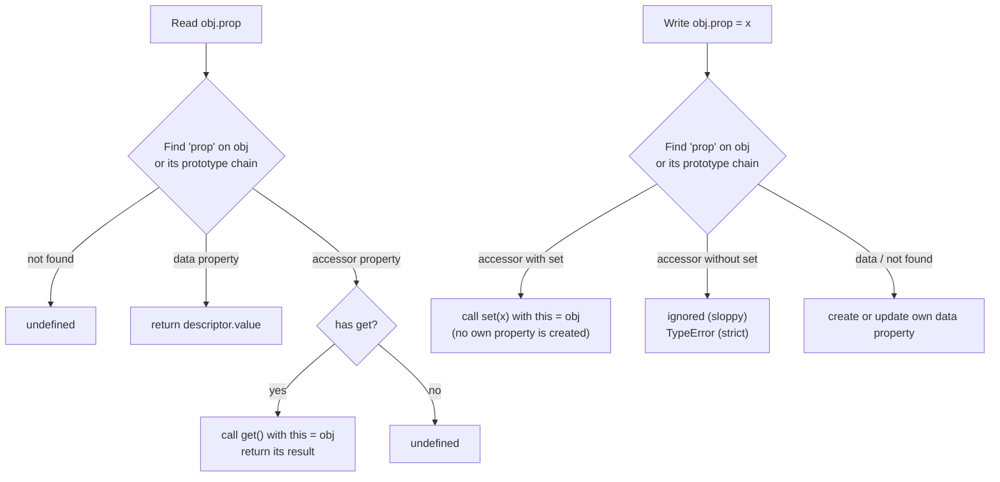
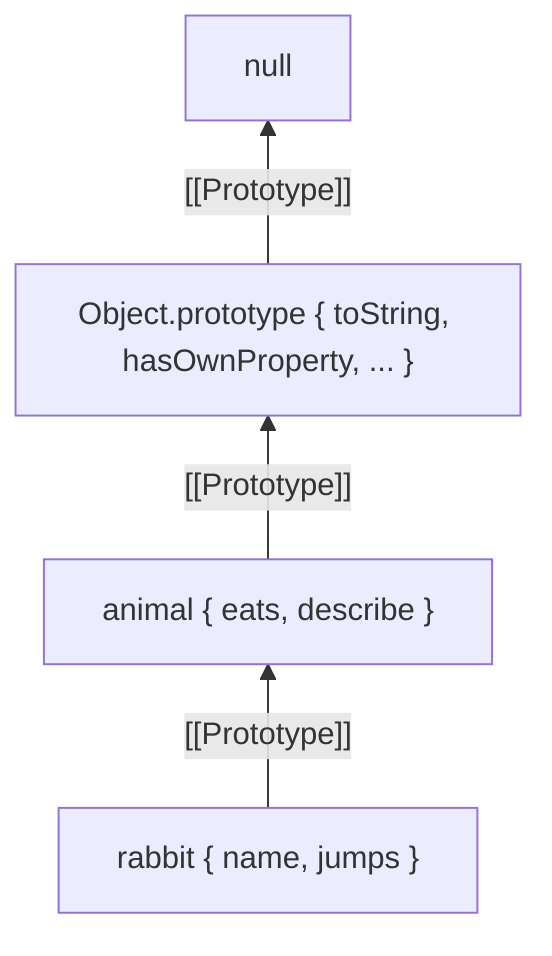
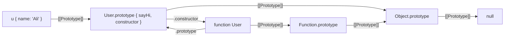

## Objects in JavaScript

An `object` is a collection of **properties**; each property has a **key** (a string or symbol) and a **descriptor**. Everything that isn't a primitive — arrays, functions, dates, maps, class instances — is an object.

## Ways to create objects

```js run
// 1. Object literal — the most common
const user = { name: "Ali", age: 30 };

// 2. Constructor function with new
function Person(name) { this.name = name; }
const p = new Person("Sara");

// 3. Class (syntax sugar over constructors and prototypes)
class Animal { constructor(name) { this.name = name; } }
const a = new Animal("Rex");

// 4. Object.create — with any prototype you like
const proto = { greet() { return "Hi " + this.name; } };
const o = Object.create(proto);
o.name = "Neda";

// 5. Object.create(null) — no prototype at all (a pure dictionary)
const dict = Object.create(null);

console.log(user, p, a, o.greet(), "toString" in dict);
```

## Accessing properties

```js run
const key = "first name";
const product = {
  title: "Laptop",
  "first name": "Ali",           // a key with a space
  [`price_${2026}`]: 1200,      // computed property name
  [Symbol.for("id")]: 7,
  greet() { return this.title; }, // method shorthand
};

console.log(product.title);               // dot notation
console.log(product[key]);                // bracket notation (dynamic key)
console.log(product.price_2026);
console.log(product.missing?.deep);       // optional chaining → undefined
console.log(Object.keys(product));        // symbols aren't in keys
```

Non-symbol keys are always **converted to strings**: `obj[1]` and `obj["1"]` are the same; `obj[{}]` creates the key `"[object Object]"`. For object keys use a `Map`.

### Key order

`Object.keys` and `for...in` have a defined order: **integer-like** keys first in ascending order, then string keys in **insertion order**, then symbols (only in `Reflect.ownKeys`).

```js run
console.log(Object.keys({ b: 1, 2: 1, a: 1, 1: 1 })); // ['1', '2', 'b', 'a']
```

## Property descriptors

Behind the scenes every property has a **descriptor** controlling its behaviour. There are two kinds of property:

| Data property | Accessor property |
| --- | --- |
| `value` | `get` |
| `writable` | `set` |
| `enumerable` | `enumerable` |
| `configurable` | `configurable` |

| Attribute | Meaning | Default via literal/assignment | Default via `defineProperty` |
| --- | --- | --- | --- |
| `writable` | The value can change | `true` | `false` |
| `enumerable` | Shows up in `for...in`, `Object.keys`, spread, `JSON.stringify` | `true` | `false` |
| `configurable` | Can be deleted and its descriptor changed | `true` | `false` |

```js run
const account = {};
Object.defineProperty(account, "id", {
  value: 42,
  writable: false,
  enumerable: false,
  configurable: false,
});

console.log(Object.getOwnPropertyDescriptor(account, "id"));
try {
  account.id = 100;                      // sloppy: silently ignored; strict (here): TypeError
} catch (error) {
  console.log(error.name + ": " + error.message);
}
console.log(account.id);                 // 42
```

```js run
const config = {};
Object.defineProperty(config, "secret", { value: "x", enumerable: false });
config.visible = true;

console.log(Object.keys(config));          // ['visible']
console.log(JSON.stringify(config));       // {"visible":true}
console.log({ ...config });                // spread copies only enumerable own properties
console.log(config.secret);                // "x" — still directly accessible
console.log(Object.getOwnPropertyNames(config)); // ['secret', 'visible']
```

That's why built-in methods like `Array.prototype.map` don't show up in `for...in`: they're `enumerable: false`.

## Getters and setters (accessor properties)

So far every property held a **value**. JavaScript has a second kind of property, the **accessor property**, which holds no value at all. Instead it holds up to two functions:

- a **getter** (`get`) that runs whenever the property is **read**,
- a **setter** (`set`) that runs whenever the property is **assigned**.

From the outside an accessor looks exactly like a normal property: `obj.fullName`, `obj.fullName = "…"`. No parentheses, no call syntax. That is the whole point: you can put logic behind something that reads like plain data.



### Three ways to define an accessor

#### 1. Object literal syntax

```js run
const user = {
  firstName: "Sara",
  lastName: "Ahmadi",

  get fullName() {
    return `${this.firstName} ${this.lastName}`;
  },

  set fullName(value) {
    const [first, ...rest] = value.trim().split(/\s+/);
    this.firstName = first;
    this.lastName = rest.join(" ");
  },
};

console.log(user.fullName);         // "Sara Ahmadi" — get() ran
user.fullName = "Reza  Karimi Nia";  // set() ran
console.log(user.firstName);        // "Reza"
console.log(user.lastName);         // "Karimi Nia"
console.log(user);                  // fullName shows as [Getter/Setter]
```

A getter takes **no parameters**; a setter takes **exactly one**. Anything else is a `SyntaxError`.

#### 2. `Object.defineProperty`

Useful when you add an accessor to an existing object, generate accessors in a loop, or need to control `enumerable`/`configurable`.

```js run
const rect = { width: 4, height: 3 };

Object.defineProperty(rect, "area", {
  get() {
    return this.width * this.height;
  },
  enumerable: false,   // the default anyway with defineProperty
  configurable: true,
});

console.log(rect.area);                 // 12
rect.width = 10;
console.log(rect.area);                 // 30 — always up to date, nothing to sync
console.log(Object.keys(rect));         // ['width', 'height'] — area is hidden
console.log(Object.getOwnPropertyDescriptor(rect, "area"));
```

#### 3. `class` syntax

In a class, `get`/`set` are defined **once on the prototype** and shared by every instance. They are non-enumerable, like class methods.

```js run
class Temperature {
  #celsius = 0;                     // private backing field

  get celsius() { return this.#celsius; }
  set celsius(value) {
    if (typeof value !== "number" || Number.isNaN(value)) {
      throw new TypeError("celsius must be a number");
    }
    if (value < -273.15) throw new RangeError("below absolute zero");
    this.#celsius = value;
  }

  get fahrenheit() { return this.#celsius * 1.8 + 32; }
  set fahrenheit(value) { this.celsius = (value - 32) / 1.8; } // reuses the validation

  static get absoluteZero() { return -273.15; }               // static accessor
}

const t = new Temperature();
t.celsius = 25;
console.log(t.fahrenheit);                   // 77
t.fahrenheit = 212;
console.log(t.celsius);                      // 100
console.log(Temperature.absoluteZero);       // -273.15

try { t.celsius = -500; } catch (e) { console.log(e.name + ": " + e.message); }

console.log(Object.hasOwn(t, "celsius"));    // false — it lives on the prototype
console.log(Object.getOwnPropertyNames(Temperature.prototype));
```

### The accessor descriptor

An accessor descriptor has `get`, `set`, `enumerable` and `configurable`, but **no** `value` and **no** `writable`. Mixing the two kinds is an error:

```js run
const o = {};
try {
  Object.defineProperty(o, "x", { value: 1, get() { return 2; } });
} catch (e) {
  console.log(e.name + ": " + e.message);
}

const literal = { get answer() { return 42; } };
console.log(Object.getOwnPropertyDescriptor(literal, "answer"));
// { get: [Function], set: undefined, enumerable: true, configurable: true }
```

| | Literal `{ get x() {} }` | `defineProperty(o, "x", { get })` | `class { get x() {} }` |
| --- | --- | --- | --- |
| Where it lives | Own property of the object | Own property of the object | `Class.prototype` (shared) |
| `enumerable` | `true` | `false` (default) | `false` |
| `configurable` | `true` | `false` (default) | `true` |
| Shows in `JSON.stringify` | Yes (value is computed) | No | No |

### Getter-only and setter-only properties

```js run sloppy
const config = {
  get version() { return "2.1.0"; },   // no setter → read-only
  set log(message) { this.lines = [...(this.lines ?? []), message]; }, // no getter → write-only
};

config.version = "9.9.9";               // sloppy mode: silently ignored
console.log(config.version);            // "2.1.0"

config.log = "started";
config.log = "loaded";
console.log(config.log);                // undefined — there is no getter
console.log(config.lines);              // ['started', 'loaded']
```

```js run
"use strict";
const config = { get version() { return "2.1.0"; } };
try {
  config.version = "9.9.9";             // strict mode: TypeError
} catch (e) {
  console.log(e.name + ": " + e.message);
}
```

Code in ES modules and classes is always strict, so in modern code assigning to a getter-only property **throws**.

### Where does the real value live? (backing storage)

A getter/setter pair usually reads and writes some hidden storage. There are four common choices:

| Storage | Example | Truly private? | Notes |
| --- | --- | --- | --- |
| Underscore convention | `this._age` | ✗ | Only a naming convention; visible in `Object.keys` and devtools |
| Closure variable | `let age` inside a factory | ✓ | Per-object functions (more memory) |
| `WeakMap` keyed by instance | `privates.get(this).age` | ✓ | The pre-2022 class pattern |
| `#private` field | `this.#age` | ✓ | Modern standard; enforced by the engine |

```js run
// Closure-based: no one can bypass the setter
function createAccount(owner) {
  let balance = 0;                       // not reachable from outside
  const history = [];
  return {
    owner,
    get balance() { return balance; },
    set balance(_) { throw new Error("use deposit() / withdraw()"); },
    deposit(amount) {
      if (amount <= 0) throw new RangeError("amount must be positive");
      balance += amount;
      history.push(+amount);
    },
    get history() { return [...history]; },   // return a copy, not the internal array
  };
}

const acc = createAccount("Ali");
acc.deposit(100);
acc.deposit(50);
console.log(acc.balance, acc.history);
try { acc.balance = 1e9; } catch (e) { console.log(e.message); }
acc.history.push(999999);               // only mutates the copy
console.log(acc.history);
```

### Real-world use cases

#### Derived (computed) values

Instead of storing `fullName`, `area` or `total` and keeping them in sync, compute them on read. There is a single source of truth and nothing can drift.

```js run
class Cart {
  items = [];
  add(name, price, qty = 1) { this.items.push({ name, price, qty }); return this; }

  get count() { return this.items.reduce((n, i) => n + i.qty, 0); }
  get subtotal() { return this.items.reduce((s, i) => s + i.price * i.qty, 0); }
  get tax() { return Math.round(this.subtotal * 0.09); }
  get total() { return this.subtotal + this.tax; }
  get isEmpty() { return this.items.length === 0; }
}

const cart = new Cart().add("Keyboard", 1200, 1).add("Mouse", 300, 2);
console.log(cart.count, cart.subtotal, cart.tax, cart.total, cart.isEmpty);
```

#### Validation and normalization

```js run
class Form {
  #email = "";
  set email(value) {
    const normalized = String(value).trim().toLowerCase();
    if (!/^[^\s@]+@[^\s@]+\.[^\s@]+$/.test(normalized)) {
      throw new TypeError(`invalid email: "${value}"`);
    }
    this.#email = normalized;
  }
  get email() { return this.#email; }
}

const f = new Form();
f.email = "  Sara@Example.COM ";
console.log(f.email);                     // "sara@example.com"
try { f.email = "not-an-email"; } catch (e) { console.log(e.message); }
```

#### Lazy, memoized getter

An expensive value is computed on first access, then the getter **replaces itself** with a plain data property, so later reads cost nothing.

```js run
const report = {
  rows: Array.from({ length: 5 }, (_, i) => ({ id: i, score: (i * 37) % 11 })),

  get stats() {
    console.log("…computing stats (runs once)");
    const scores = this.rows.map((r) => r.score);
    const value = {
      max: Math.max(...scores),
      avg: scores.reduce((a, b) => a + b, 0) / scores.length,
    };
    // overwrite the accessor with a data property holding the result
    Object.defineProperty(this, "stats", { value, writable: false, enumerable: true });
    return value;
  },
};

console.log(report.stats);
console.log(report.stats);   // no "computing" line — it is now a data property
```

#### Observing changes (how Vue 2 reactivity worked)

Because every write goes through `set`, a setter is the perfect place to notify listeners. This is a miniature version of what Vue 2 did with `Object.defineProperty` on every data field.

```js run
function reactive(target, onChange) {
  const store = { ...target };
  for (const key of Object.keys(target)) {
    Object.defineProperty(target, key, {
      enumerable: true,
      get() {
        return store[key];
      },
      set(next) {
        const prev = store[key];
        if (Object.is(prev, next)) return;      // nothing changed → no update
        store[key] = next;
        onChange(key, prev, next);
      },
    });
  }
  return target;
}

const state = reactive({ count: 0, title: "Todo" }, (key, prev, next) =>
  console.log(`render! ${key}: ${prev} → ${next}`),
);

state.count++;          // get, then set
state.count = 1;        // same value → no render
state.title = "Done";
state.newKey = "x";     // ⚠ not reactive: no accessor exists for keys added later
```

The last line is exactly why Vue 2 needed `Vue.set()`, and why Vue 3 switched to `Proxy`, which intercepts **any** key, including ones added later and deletions.

#### Deprecating an old API without breaking callers

```js run
class Settings {
  theme = "light";
  /** @deprecated use theme */
  get darkMode() {
    console.warn("darkMode is deprecated, use theme");
    return this.theme === "dark";
  }
  set darkMode(on) {
    console.warn("darkMode is deprecated, use theme");
    this.theme = on ? "dark" : "light";
  }
}
const s = new Settings();
s.darkMode = true;
console.log(s.theme);
```

### You already use accessors every day: the DOM

Most DOM properties are accessors defined on prototypes such as `HTMLElement.prototype` and `Node.prototype`. That is why assigning a string can trigger parsing, layout or a network request:

```js
el.innerHTML = "<b>hi</b>";   // setter: parse HTML, replace children
el.textContent;               // getter: concatenates all descendant text
input.value = "x";            // setter: updates the control's state
el.hidden = true;             // setter: reflects to the hidden attribute
el.offsetHeight;              // getter: may force a synchronous layout (reflow)!

Object.getOwnPropertyDescriptor(Element.prototype, "innerHTML");
// { get: ƒ, set: ƒ, enumerable: true, configurable: true }
```

The `offsetHeight` case is important for performance interviews: reading a layout getter right after a style write forces the browser to compute layout immediately ("layout thrashing").

### Accessors and the prototype chain

Accessors are found through the prototype chain like any property, and **`this` is always the object you started from** (the receiver), not the prototype where the accessor was found.

The big difference from data properties: **assigning to a property whose setter is inherited calls that setter. It does not create an own property** (no shadowing).

```js predict
const base = {
  set name(v) { this._name = v.toUpperCase(); },
  get name() { return this._name; },
};
const child = Object.create(base);
child.name = "ali";

console.log(child.name);
console.log(Object.hasOwn(child, "name"));
console.log(Object.hasOwn(child, "_name"));
console.log(Object.hasOwn(base, "_name"));
```

```output
ALI
false
true
false
```

The inherited setter ran with `this === child`, so `_name` was written onto `child`. `name` itself still lives only on `base`. To really shadow an inherited accessor you must use `Object.defineProperty(child, "name", { value: … })`.

#### Overriding an accessor in a subclass

```js run
class Shape {
  get description() { return `a ${this.kind}`; }
  get kind() { return "shape"; }
}
class Circle extends Shape {
  constructor(r) { super(); this.r = r; }
  get kind() { return "circle"; }                         // override
  get description() { return super.description + ` (r=${this.r})`; } // call the parent getter
}
console.log(new Circle(2).description);   // "a circle (r=2)"
```

<Callout type="warning" title="Override one half, lose the other">
If a subclass defines only `get x()`, the parent's `set x()` is **not** inherited for that name: the subclass's accessor property has `set: undefined`, so assignments now fail. When you override one half of a pair, define both.
</Callout>

```js run
class A {
  #v = 1;
  get v() { return this.#v; }
  set v(x) { this.#v = x; }
}
class B extends A {
  get v() { return super.v * 10; }   // getter only!
}
const b = new B();
try { b.v = 5; } catch (e) { console.log(e.name + ": " + e.message); }
```

### Pitfalls

#### 1. Infinite recursion

A setter that assigns to **its own name** calls itself forever:

```js predict
const person = {
  set name(value) {
    this.name = value;      // calls this setter again…
  },
};
try {
  person.name = "Ali";
} catch (e) {
  console.log(e.name);
}
```

```output
RangeError
```

Fix: store the value elsewhere: `this._name`, a closure variable or `this.#name`.

#### 2. `JSON.stringify`, spread and `Object.assign` read the getter

They don't copy the accessor; they **call the getter once** and copy the resulting value. And because class accessors live on the prototype, they disappear from JSON entirely.

```js predict
class User {
  constructor(first, last) { this.first = first; this.last = last; }
  get full() { return this.first + " " + this.last; }
}
const literal = { first: "Ali", get full() { return "Ali R"; } };

console.log(JSON.stringify(new User("Ali", "R")));
console.log(JSON.stringify(literal));

const copy = { ...literal };
console.log(Object.getOwnPropertyDescriptor(copy, "full").value);
```

```output
{"first":"Ali","last":"R"}
{"first":"Ali","full":"Ali R"}
Ali R
```

To serialize class getters, add a `toJSON()` method. To copy accessors **as accessors**, copy their descriptors:

```js run
const source = {
  _n: 1,
  get double() { return this._n * 2; },
};

const snapshot = Object.assign({}, source);          // double becomes a frozen value
const clone = Object.defineProperties({}, Object.getOwnPropertyDescriptors(source));

source._n = 10; snapshot._n = 10; clone._n = 10;
console.log(snapshot.double, clone.double);          // 2 20
```

#### 3. `Object.assign` *calls* setters on the target

```js run
const target = {
  set price(v) { console.log("setter called with", v); this._price = v; },
};
Object.assign(target, { price: 100 });   // setter runs
const spread = { ...target, price: 200 }; // spread defines a plain property instead
console.log(Object.getOwnPropertyDescriptor(spread, "price"));
```

#### 4. Expensive or side-effecting getters

A getter *looks* free, so callers will happily read it in loops and render functions. Keep getters cheap and free of side effects. If one must do real work, memoize it (see the lazy getter above) or make it a method (`computeStats()`), whose call syntax signals the cost.

#### 5. Arrow functions don't work as accessors

The literal/class syntax doesn't allow arrows, but `defineProperty` does, and the arrow then ignores the receiver:

```js run
const counter = { n: 5 };
Object.defineProperty(counter, "bad", { get: () => this?.n });   // lexical this → undefined
Object.defineProperty(counter, "good", { get() { return this.n; } });
console.log(counter.bad, counter.good);   // undefined 5
```

#### 6. The setter's return value is ignored

An assignment expression always evaluates to the **right-hand side**, whatever the setter returns or stores:

```js run
const o = { set x(v) { this._x = v * 2; return "ignored"; }, get x() { return this._x; } };
const result = (o.x = 5);
console.log(result, o.x);   // 5 10
```

### Getter vs method vs Proxy

| | Getter / setter | Method (`getX()` / `setX(v)`) | `Proxy` |
| --- | --- | --- | --- |
| Call-site syntax | `obj.x`, `obj.x = v` | `obj.getX()`, `obj.setX(v)` | `obj.x`, `obj.x = v` |
| Defined per | One known key | One known key | **Every** key, even unknown or future ones |
| Can take arguments | No (setter takes one) | Yes, any number | — |
| Signals cost to caller | No (looks like a field) | Yes | No |
| Intercepts `delete`, `in`, `Object.keys` | No | No | Yes |
| Typical use | Derived values, validation, compatibility | Work with parameters or real cost | Reactivity (Vue 3, MobX), validation layers, mocks |

**Rule of thumb:** use a getter for a cheap, side-effect-free value that conceptually *is* a property of the object. Use a method when it takes arguments, is expensive or has effects. Use a `Proxy` when you need to intercept keys you don't know in advance.

## Copying and merging objects

### Object.assign vs spread

```js run
const defaults = { theme: "light", size: "md" };
const options = { size: "lg" };

const a = Object.assign({}, defaults, options);   // target first, sources in order
const b = { ...defaults, ...options };            // the last one wins
console.log(a, b);
```

| | `Object.assign(target, ...src)` | `{ ...src }` |
| --- | --- | --- |
| New object | Only if target is `{}`; **mutates target** | Always new |
| Setters on target | **Invoked** | Not invoked (properties are defined) |
| Source getters | Read (value copied) | Read |
| Depth | Shallow | Shallow |
| Prototype | Target's | `Object.prototype` |

## freeze, seal and preventExtensions

| | Add property | Delete property | Change value | Change descriptor |
| --- | --- | --- | --- | --- |
| `Object.preventExtensions` | ✗ | ✓ | ✓ | ✓ |
| `Object.seal` | ✗ | ✗ | ✓ | ✗ |
| `Object.freeze` | ✗ | ✗ | ✗ | ✗ |

```js run sloppy
const settings = Object.freeze({ api: { url: "/v1" }, retries: 3 });
settings.retries = 10;           // sloppy: silently ignored
settings.api.url = "/v2";        // ✓ freeze is shallow!
console.log(settings.retries, settings.api.url, Object.isFrozen(settings));

function deepFreeze(obj) {
  for (const value of Object.values(obj)) {
    if (value && typeof value === "object") deepFreeze(value);
  }
  return Object.freeze(obj);
}
const locked = deepFreeze({ api: { url: "/v1" } });
locked.api.url = "/v2";
console.log(locked.api.url);     // "/v1"
```

## Prototypes

### What is a prototype?

Every object has an internal **`[[Prototype]]`** slot pointing to another object (or `null`). When a property isn't found on an object, the engine looks in its `[[Prototype]]`, then that one's prototype, and so on. This is the **prototype chain** — the basis of inheritance in JavaScript.

```js run
const animal = {
  eats: true,
  describe() { return `${this.name} eats: ${this.eats}`; },
};
const rabbit = Object.create(animal);   // rabbit.[[Prototype]] = animal
rabbit.name = "Bugs";
rabbit.jumps = true;

console.log(rabbit.jumps);              // own property
console.log(rabbit.eats);               // from the prototype
console.log(rabbit.describe());         // method from the prototype, but this = rabbit
console.log(Object.hasOwn(rabbit, "eats"), "eats" in rabbit);
```

### The prototype chain at runtime



Reading `rabbit.toString`:

1. Own property on `rabbit`? ✗
2. On `animal`? ✗
3. On `Object.prototype`? ✓ → return it.
4. If `null` is reached → `undefined`.

**Writing is different:** `rabbit.eats = false` doesn't write to the prototype; it creates a new **own property** on rabbit that shadows it (unless the prototype's property is a setter or `writable: false`).

### `__proto__` vs `prototype`

The most important and most confusing distinction:

| | `obj.__proto__` | `Constructor.prototype` |
| --- | --- | --- |
| Exists on | **Every object** | Only **functions** (not arrows or methods) |
| Is | A getter/setter for **this object's own** `[[Prototype]]` | The object that becomes the `[[Prototype]]` of **future instances** |
| Used during | Property lookup | `new Constructor()` |
| Standard API | `Object.getPrototypeOf(obj)` / `Object.setPrototypeOf` | — |

```js run
function User(name) {
  this.name = name;
}
User.prototype.sayHi = function () {
  return "Hi, " + this.name;
};

const u = new User("Ali");

console.log(Object.getPrototypeOf(u) === User.prototype);   // true
console.log(u.__proto__ === User.prototype);                 // true (legacy way)
console.log(User.prototype.constructor === User);            // true
console.log(Object.getPrototypeOf(User) === Function.prototype); // true — User itself is a function
console.log(Object.hasOwn(u, "sayHi"), u.sayHi());           // false — comes from the prototype
```



The key line: **`u.__proto__ === User.prototype`**. `prototype` is an ordinary property on a function; `__proto__` is a window onto an object's own prototype.

### What exactly does `new` do?

```js run
function myNew(Constructor, ...args) {
  // 1. create a new object whose prototype is Constructor.prototype
  const instance = Object.create(Constructor.prototype);
  // 2. run the constructor with this = instance
  const result = Constructor.apply(instance, args);
  // 3. if the constructor returned an object, use it; otherwise the instance
  return result !== null && (typeof result === "object" || typeof result === "function")
    ? result
    : instance;
}

function Car(model) { this.model = model; }
Car.prototype.drive = function () { return this.model + " is driving"; };

const car = myNew(Car, "Tesla");
console.log(car.drive(), car instanceof Car);
```

### instanceof

`a instanceof B` checks whether `B.prototype` appears **anywhere in `a`'s prototype chain**:

```js run
function isInstance(obj, Constructor) {
  let proto = Object.getPrototypeOf(obj);
  while (proto !== null) {
    if (proto === Constructor.prototype) return true;
    proto = Object.getPrototypeOf(proto);
  }
  return false;
}
console.log(isInstance([], Array), isInstance([], Object), isInstance({}, Array));
```

Trap: an array from another iframe isn't `instanceof Array` (a different realm, a different `Array.prototype`). That's why `Array.isArray` exists.

## Inheritance

### With constructor functions (pre-ES6)

```js run
function Animal(name) {
  this.name = name;
}
Animal.prototype.speak = function () {
  return `${this.name} makes a sound`;
};

function Dog(name, breed) {
  Animal.call(this, name);                 // call the parent constructor
  this.breed = breed;
}
Dog.prototype = Object.create(Animal.prototype);  // link the chain
Dog.prototype.constructor = Dog;                  // restore constructor
Dog.prototype.speak = function () {               // override
  return `${this.name} barks`;
};

const d = new Dog("Rex", "Labrador");
console.log(d.speak(), d instanceof Animal, Animal.prototype.speak.call(d));
```

### class — syntax sugar over the same mechanism

```js run
class Animal {
  #id = Math.random().toString(36).slice(2, 6);   // a truly private field
  static count = 0;                                // on the class itself

  constructor(name) {
    this.name = name;
    Animal.count++;
  }
  speak() {                                        // lives on Animal.prototype
    return `${this.name} makes a sound`;
  }
  get id() { return this.#id; }
}

class Dog extends Animal {
  constructor(name, breed) {
    super(name);                                   // must run before using this
    this.breed = breed;
  }
  speak() {
    return super.speak() + " — woof";              // call the parent method
  }
}

const d = new Dog("Rex", "Lab");
console.log(d.speak(), Animal.count, typeof d.id);
console.log(typeof Animal, Object.getPrototypeOf(Dog) === Animal);
console.log(Object.getPrototypeOf(Dog.prototype) === Animal.prototype);
```

| How class differs from a constructor function | |
| --- | --- |
| Calling without `new` | `TypeError` |
| Hoisting | TDZ (like let) |
| Body | Always strict mode |
| Methods | `enumerable: false` |
| `extends` | Chains both `prototype` and the constructor itself (for statics) |
| `#private` fields | Truly private; not even reachable by reflection |
| `super` | Access to parent methods via the home object |

### Delegation vs classical inheritance

In class-based languages (Java, C#) a class is a **template** and an instance a **copy** of its structure. In JavaScript nothing is copied: an instance just has a **live link** to its prototype and **delegates** lookups to it. Consequence: adding a method to a prototype after instances exist affects all of them immediately.

```js run
const a = [1, 2, 3];
Array.prototype.last = function () { return this[this.length - 1]; };
console.log(a.last());       // 3 — a was created before last existed
delete Array.prototype.last; // ⚠ never modify global prototypes in real code
```

<Callout type="warning">
Modifying built-in prototypes (monkey patching) is bad: it collides with other code and future language versions (the `Array.prototype.flatten` vs MooTools saga is why the standard method is called `flat`).
</Callout>

## Composition vs inheritance

Deep inheritance chains are brittle. Modern frontend code prefers **composition**:

```js run
const canFly = (state) => ({ fly: () => `${state.name} flies` });
const canSwim = (state) => ({ swim: () => `${state.name} swims` });

function createDuck(name) {
  const state = { name };
  return { ...state, ...canFly(state), ...canSwim(state) };
}
const duck = createDuck("Donald");
console.log(duck.fly(), duck.swim());
```

React follows the same philosophy: components combine through composition (children, props, hooks), not `extends`.

## Prototype pollution (security)

If code merges user-controlled keys without checks, an attacker can modify `Object.prototype`:

```js run
function unsafeMerge(target, source) {
  for (const key in source) {
    if (typeof source[key] === "object" && source[key] !== null) {
      target[key] ??= {};
      unsafeMerge(target[key], source[key]);
    } else {
      target[key] = source[key];
    }
  }
  return target;
}

const payload = JSON.parse('{"__proto__": {"isAdmin": true}}');
unsafeMerge({}, payload);
console.log({}.isAdmin);   // true! every object is polluted
delete Object.prototype.isAdmin;
```

Defences: reject `__proto__`, `constructor` and `prototype` keys; use `Object.create(null)` or `Map` for user data; `Object.freeze(Object.prototype)` in sensitive environments.

## Common mistakes

- Confusing `__proto__` with `prototype`.
- Defining methods inside the constructor (`this.fn = function…`) instead of on the prototype — every instance gets its own copy.
- Forgetting `super()` before `this` in a subclass.
- Assuming `Object.freeze` and spread are deep.
- `for...in` without `hasOwn` (prototype properties are iterated too).
- Using plain objects as maps with user-provided keys.

## Interview questions

<QA q="What's the difference between `__proto__` and `prototype`?" level="mid" n={1}>
<Answer>

`prototype` is a property on functions (constructors): the object that becomes new instances' prototype during `new`. `__proto__` (or `Object.getPrototypeOf`) on any object exposes **that object's own** prototype. So `new User().__proto__ === User.prototype`.

</Answer>
<Deep>

`__proto__` is actually a getter/setter on `Object.prototype`, not a real property on every object — which is why `Object.create(null).__proto__` is undefined. Arrow functions and methods have no `prototype` because they aren't constructors. Changing a prototype with `setPrototypeOf` after creation is very bad for performance (it breaks hidden classes).

</Deep>
<Mistake>

Saying every object has a property called `prototype`.

</Mistake>
<FollowUp>

What is `Object.getPrototypeOf(Function)`? (`Function.prototype` — Function is itself a function.)

</FollowUp>
</QA>

<QA q="Explain the prototype chain. How is `obj.toString()` found?" level="junior" n={2}>
<Answer>

Every object has a `[[Prototype]]`. When reading a property that isn't on the object itself, the engine searches up the prototype chain until it reaches `null`. `toString` isn't on an object literal, but it's found on `Object.prototype`.

</Answer>
<Deep>

Writes don't walk the chain: assignment creates a new own property (shadowing), unless the inherited property is a setter or non-writable. Engines speed lookups up with inline caches and prototype validity cells; changing prototypes at runtime invalidates them.

</Deep>
<Mistake>

Thinking prototype methods are copied onto instances.

</Mistake>
<FollowUp>

How do you create an object with no prototype, and what's it good for?

</FollowUp>
</QA>

<QA q="What steps does the `new` operator perform? Implement it." level="senior" n={3}>
<Answer>

1) Create a new object whose `[[Prototype]]` is `Constructor.prototype`; 2) run the constructor with this set to it; 3) if the constructor returns an object, return that, otherwise the new object. The implementation with `Object.create` and `apply` is shown above.

</Answer>
<Deep>

For classes, `new` is more involved: in a derived class, this isn't initialized until `super()` is called (a TDZ for this), and the object is actually created by the base constructor — which is why subclasses of `Array` or `Error` work properly. `new.target` lets you detect whether a function was called with new.

</Deep>
<Mistake>

Forgetting step 3 (returning an explicit object from the constructor).

</Mistake>
<FollowUp>

Why couldn't `class Foo extends Array` be fully emulated with ES5 constructor functions?

</FollowUp>
</QA>

<QA q="What is a property descriptor? How do you create a read-only property hidden from `Object.keys`?" level="mid" n={4}>
<Answer>

The metadata of each property: `value`, `writable`, `enumerable`, `configurable` (or `get`/`set` for accessors). Use `Object.defineProperty(obj, "key", { value, writable: false, enumerable: false })`.

</Answer>
<Deep>

Defaults in `defineProperty` are all false, unlike plain assignment. `configurable: false` is nearly irreversible (you can only change writable from true to false). Freeze and seal actually set configurable (and writable) to false on every property and prevent extensions.

</Deep>
<Mistake>

Thinking a non-enumerable property is "private"; it's still reachable directly or via `getOwnPropertyNames`. For real privacy use `#private` or closures.

</Mistake>
<FollowUp>

What's the difference between `Object.keys`, `Object.getOwnPropertyNames` and `Reflect.ownKeys`?

</FollowUp>
</QA>

<QA q="What is the difference between a data property and an accessor property? When would you reach for a getter?" level="mid" n={5}>
<Answer>

A data property stores a `value` (plus `writable`). An accessor property stores `get`/`set` functions and no value: reading calls the getter, assigning calls the setter, both with `this` set to the receiver. Use a getter for a cheap, side-effect-free derived value (`fullName`, `total`, `isEmpty`), and a setter for validation, normalization or change notification.

</Answer>
<Deep>

Accessors can be defined in literals (own, enumerable), with `defineProperty` (non-enumerable by default) or in classes (on the prototype, non-enumerable). An inherited setter is **called** on assignment instead of creating an own property. Most DOM properties (`innerHTML`, `value`, `offsetHeight`) are accessors on prototypes, which is why some reads force layout.

</Deep>
<Mistake>

Writing `set name(v) { this.name = v }`: the setter calls itself until `RangeError: Maximum call stack size exceeded`.

</Mistake>
<FollowUp>

How would you implement a lazy getter that computes once and then becomes a plain property?

</FollowUp>
</QA>

<QA q="Why does `JSON.stringify(new User())` omit a class getter, while a getter in an object literal is included?" level="senior" n={6}>
<Answer>

`JSON.stringify` serializes **own enumerable** properties. A literal getter is an own, enumerable accessor, so it is called and its value is written. A class getter lives on `User.prototype` and is non-enumerable, so it is never visited. Fix it with a `toJSON()` method that returns the shape you want.

</Answer>
<Deep>

Spread and `Object.assign` behave the same way: they read getters once and copy the **value**, turning the accessor into a static snapshot. `Object.assign` also **invokes setters** on the target, while spread defines plain properties. To copy accessors as accessors, use `Object.defineProperties(target, Object.getOwnPropertyDescriptors(source))`.

</Deep>
<Mistake>

Assuming spread clones behaviour: after `{ ...obj }` a former getter is a frozen value that no longer tracks the source.

</Mistake>
<FollowUp>

What does `structuredClone` do with getters and class instances?

</FollowUp>
</QA>

## Recap

<Recap>

- An object is a collection of properties; keys are strings or symbols, and integer-like keys always come first in ascending order.
- Every property has a descriptor: `value`, `writable`, `enumerable`, `configurable` (or `get`/`set` for accessors).
- Getters and setters are properties that run a function when read or written; the real value is stored elsewhere (e.g. a private field).
- Spread and `Object.assign` are shallow; they run getters and copy the result, not the getter itself.
- `preventExtensions` blocks new properties, `seal` also blocks deletion, `freeze` blocks every change; all three are shallow.
- Every object has a `[[Prototype]]`; if a property isn't on the object, the engine walks up the prototype chain.
- `prototype` is a property on functions; `__proto__` (or `Object.getPrototypeOf`) shows an object's prototype.
- `new` creates an empty object with the function's prototype, runs the function with it as `this`, and returns it (unless the function returns another object).
- `class` is prototype inheritance with cleaner syntax; prefer composition over deep inheritance and watch out for prototype pollution.

</Recap>
