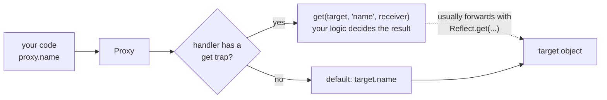

## What is metaprogramming?

Normal code works **with** objects: it reads properties, calls methods, assigns values. **Metaprogramming** is code that changes **how those basic operations themselves behave**. JavaScript offers it at three levels:

| Level | Tool | Controls |
| --- | --- | --- |
| One known property | Getters/setters, `Object.defineProperty` | Reads/writes of that single key |
| Built-in conversions & protocols | Well-known symbols (`Symbol.iterator`, `Symbol.toPrimitive`) | Iteration, conversion to primitives, `instanceof` |
| **Every** operation on an object | **`Proxy`** (+ `Reflect`) | Reads, writes, `in`, `delete`, `Object.keys`, function calls, `new`… for **any** key |

This chapter is about the last row. You don't need Proxies every day, but they power Vue 3's and MobX's reactivity, Immer's immutable updates, validation layers, API mocks and test spies, and interviewers love them because they reveal how objects really work.

## Proxy: a wrapper that intercepts operations

A **Proxy** wraps a **target** object. Every operation on the proxy is first sent to a **handler**; if the handler defines a **trap** for that operation, the trap runs instead of the default behaviour.

<Api name="Proxy" sig="new Proxy(target, handler)" returns="A proxy object that looks like `target` from the outside, but routes every operation through `handler`." mutates="n/a">

- `target`: the object (or function) being wrapped. Without traps, operations go straight to it.
- `handler`: an object whose methods are **traps**: `get`, `set`, `has`, `deleteProperty`, `ownKeys`, `apply`, `construct`, …

</Api>



```js run
const user = { name: "Ali", age: 30 };

const logged = new Proxy(user, {
  get(target, key, receiver) {
    console.log(`GET ${String(key)}`);
    return Reflect.get(target, key, receiver);     // do the normal thing
  },
  set(target, key, value, receiver) {
    console.log(`SET ${String(key)} = ${value}`);
    return Reflect.set(target, key, value, receiver);
  },
});

logged.name;              // GET name
logged.age = 31;          // SET age = 31
console.log(user.age);    // 31 — the change reached the target
console.log(logged === user);   // false — a proxy is a different object
```

### The traps

Each trap corresponds to one internal operation of the language:

| Trap | Intercepts | Must return |
| --- | --- | --- |
| `get(target, key, receiver)` | `proxy.key`, `proxy[key]` | The value |
| `set(target, key, value, receiver)` | `proxy.key = value` | `true` if successful (`false` → `TypeError` in strict mode) |
| `has(target, key)` | `key in proxy` | Boolean |
| `deleteProperty(target, key)` | `delete proxy.key` | Boolean |
| `ownKeys(target)` | `Object.keys`, `for...in`, `Reflect.ownKeys`, spread | Array of keys |
| `getOwnPropertyDescriptor(target, key)` | `Object.getOwnPropertyDescriptor`, and indirectly `Object.keys` | Descriptor or `undefined` |
| `defineProperty(target, key, desc)` | `Object.defineProperty` | Boolean |
| `getPrototypeOf` / `setPrototypeOf` | `Object.getPrototypeOf`, `instanceof` | Object / Boolean |
| `apply(target, thisArg, args)` | Calling a proxied **function** | Call result |
| `construct(target, args, newTarget)` | `new proxy(...)` | An object |

## Reflect: the default behaviour, as functions

**`Reflect`** is a plain object with one static method per trap, with the **same name and the same arguments**. Each method performs the default operation. That makes it the natural way to say "now do what would normally happen" inside a trap.

<Api name="Reflect" sig="Reflect.get(target, key, receiver?) · Reflect.set(target, key, value, receiver?) · Reflect.has(target, key) · Reflect.ownKeys(target) · Reflect.deleteProperty(target, key) · Reflect.apply(fn, thisArg, args) · Reflect.construct(C, args)" returns="The result of the default operation. Methods that change things return a **boolean** (success) instead of throwing." mutates="n/a">

- Arguments mirror the matching trap, so a trap can forward with `Reflect.trap(...arguments)`.

</Api>

```js run
const obj = { a: 1 };
console.log(Reflect.get(obj, "a"));                  // 1 — same as obj.a
console.log(Reflect.has(obj, "a"));                  // true — same as "a" in obj
console.log(Reflect.ownKeys({ x: 1, [Symbol("s")]: 2 })); // includes symbols

// Booleans instead of exceptions:
const frozen = Object.freeze({ x: 1 });
console.log(Reflect.set(frozen, "x", 2));            // false (no throw)
console.log(Reflect.defineProperty(frozen, "y", { value: 1 }));  // false

console.log(Reflect.apply(Math.max, null, [3, 7, 2]));   // 7
```

### Why pass `receiver`?

`receiver` is the object the operation started on (usually the proxy itself). It matters when the target has **getters** that use `this`: forwarding with `target[key]` would run the getter with `this === target`, bypassing the proxy for any further reads.

```js run
const target = {
  first: "Ada",
  last: "Lovelace",
  get full() { return `${this.first} ${this.last}`; },
};
const reads = [];

const wrong = new Proxy(target, { get: (t, k) => (reads.push(k), t[k]) });
wrong.full;
console.log("wrong:", reads.splice(0));     // ['full'] — inner reads of first/last were missed

const right = new Proxy(target, { get: (t, k, r) => (reads.push(k), Reflect.get(t, k, r)) });
right.full;
console.log("right:", reads);               // ['full', 'first', 'last'] — getter ran with this = proxy
```

**Rule:** inside traps, forward with `Reflect.method(...)` and pass `receiver` along.

## Practical uses

### 1. Validation

```js run
function withSchema(target, schema) {
  return new Proxy(target, {
    set(t, key, value, receiver) {
      const check = schema[key];
      if (!check) throw new TypeError(`unknown field "${String(key)}"`);
      if (!check(value)) throw new TypeError(`invalid value for "${String(key)}": ${JSON.stringify(value)}`);
      return Reflect.set(t, key, value, receiver);
    },
  });
}

const person = withSchema({}, {
  name: (v) => typeof v === "string" && v.length > 0,
  age: (v) => Number.isInteger(v) && v >= 0 && v < 150,
});

person.name = "Sara";
person.age = 34;
console.log(person);
for (const [k, v] of [["age", -5], ["email", "x@y.z"]]) {
  try { person[k] = v; } catch (e) { console.log(e.message); }
}
```

### 2. Default values and safe deep access

```js run
const withDefault = (obj, fallback) =>
  new Proxy(obj, { get: (t, k, r) => (k in t ? Reflect.get(t, k, r) : fallback) });

const translations = withDefault({ hello: "سلام", bye: "خداحافظ" }, "[missing translation]");
console.log(translations.hello, translations.thanks);

// Negative array indexes, Python-style
const pyArray = (arr) =>
  new Proxy(arr, {
    get(t, k, r) {
      const i = typeof k === "string" && /^-\d+$/.test(k) ? t.length + Number(k) : k;
      return Reflect.get(t, i, r);
    },
  });
const letters = pyArray(["a", "b", "c"]);
console.log(letters[-1], letters[-2], letters.length);
```

### 3. Reactivity (how Vue 3 works)

The idea: the `get` trap records **which effect read which key** ("track"), and the `set` trap re-runs **the effects that depend on that key** ("trigger").

```js run
const targetMap = new WeakMap();      // target → Map(key → Set(effects))
let activeEffect = null;

function track(target, key) {
  if (!activeEffect) return;
  let deps = targetMap.get(target);
  if (!deps) targetMap.set(target, (deps = new Map()));
  let effects = deps.get(key);
  if (!effects) deps.set(key, (effects = new Set()));
  effects.add(activeEffect);
}

function trigger(target, key) {
  targetMap.get(target)?.get(key)?.forEach((effect) => effect());
}

function reactive(obj) {
  return new Proxy(obj, {
    get(t, k, r) { track(t, k); return Reflect.get(t, k, r); },
    set(t, k, v, r) {
      const changed = !Object.is(t[k], v);
      const ok = Reflect.set(t, k, v, r);
      if (changed) trigger(t, k);
      return ok;
    },
  });
}

function effect(fn) {
  activeEffect = fn;
  fn();                    // first run collects dependencies
  activeEffect = null;
}

const state = reactive({ count: 0, name: "cart" });
effect(() => console.log(`render: ${state.name} has ${state.count} items`));

state.count++;             // re-renders: the effect read `count`
state.count = 1;           // same value → nothing
state.name = "basket";     // re-renders: the effect read `name`
state.extra = true;        // nobody read `extra` → nothing (but new keys DO work with a Proxy)
```

Compare with the getter/setter version in [Getters and setters](/javascript/objects-prototypes#getters-and-setters-accessor-properties): with `defineProperty`, keys added later aren't reactive. A Proxy sees **every** key, including new ones and deletions, which is exactly why Vue 3 switched to Proxies.

### 4. Function proxies: spies and timing

```js run
function spy(fn) {
  const calls = [];
  const proxy = new Proxy(fn, {
    apply(target, thisArg, args) {
      const result = Reflect.apply(target, thisArg, args);
      calls.push({ args, result });
      return result;
    },
  });
  return { proxy, calls };
}

const { proxy: add, calls } = spy((a, b) => a + b);
add(1, 2);
add(10, 20);
console.log(calls);           // this is roughly what jest.fn() / vi.fn() record
```

### 5. Read-only views

```js run
function readonly(obj) {
  return new Proxy(obj, {
    get(t, k, r) {
      const value = Reflect.get(t, k, r);
      return value && typeof value === "object" ? readonly(value) : value;   // deep, lazily
    },
    set(_, k) { console.log(`blocked write to ${String(k)}`); return true; },
    deleteProperty(_, k) { console.log(`blocked delete of ${String(k)}`); return true; },
  });
}

const config = readonly({ api: { url: "/v1" }, retries: 3 });
config.retries = 10;
config.api.url = "/v2";        // nested objects are protected too, unlike Object.freeze
delete config.retries;
console.log(config.retries, config.api.url);
```

## Limits and pitfalls

### Private fields and internal slots

Some built-in objects (`Map`, `Set`, `Date`, `Promise`) and class `#private` fields store data in **internal slots** that live on the original object. A proxy is a different object, so methods that need those slots fail when `this` is the proxy:

```js run
const map = new Map([["a", 1]]);
const proxied = new Proxy(map, {});
try {
  proxied.get("a");                 // Map.prototype.get called with this = proxy
} catch (e) {
  console.log(e.name + ": " + e.message);
}

// Fix: bind methods to the real target
const fixed = new Proxy(map, {
  get(t, k, r) {
    const value = Reflect.get(t, k, t);       // use the target as receiver for slot-based getters (size)
    return typeof value === "function" ? value.bind(t) : value;
  },
});
console.log(fixed.get("a"), fixed.size);
```

### Identity, performance and invariants

| Pitfall | Details |
| --- | --- |
| Identity | `proxy !== target`; a `Set` containing the target doesn't contain the proxy |
| Performance | Every operation goes through a JS function; avoid proxies in tight numeric loops |
| Invariants | Traps can't lie about non-configurable or non-extensible facts (e.g. reporting a frozen property with a different value throws `TypeError`) |
| Debugging | Devtools show the proxy, and traps can make logging confusing (logging calls `get`!) |
| `typeof` | Can't be intercepted: a proxy of a function is still `"function"`, of an object `"object"` |

### Revocable proxies

```js run
const { proxy, revoke } = Proxy.revocable({ secret: 42 }, {});
console.log(proxy.secret);
revoke();                           // cut access, e.g. when handing an object to untrusted code
try { proxy.secret; } catch (e) { console.log(e.name + ": " + e.message); }
```

## Proxy vs getters/setters vs `Object.defineProperty`

| | Getter/setter | `defineProperty` per key | `Proxy` |
| --- | --- | --- | --- |
| Works for keys known in advance | ✓ | ✓ | ✓ |
| Works for **new** keys added later | ✗ | ✗ | ✓ |
| Intercepts `delete`, `in`, `Object.keys` | ✗ | ✗ | ✓ |
| Intercepts function calls / `new` | ✗ | ✗ | ✓ |
| Modifies the original object | Yes (defines accessors on it) | Yes | No (wraps it) |
| Overhead | Low | Low | Higher (a trap per operation) |
| Used by | Classes, computed values | Vue 2 reactivity | Vue 3, MobX 6, Immer, test spies |

## Common mistakes

- Forwarding with `target[key]` instead of `Reflect.get(target, key, receiver)` (breaks getters and inheritance).
- Forgetting to return `true` from `set`/`deleteProperty` (strict mode throws `TypeError`).
- Wrapping `Map`/`Set`/`Date` or classes with `#private` fields without binding methods to the target.
- Logging a proxy inside its own `get` trap (infinite recursion).
- Comparing a proxy with its target (`===` is `false`).
- Using proxies in performance-critical inner loops.

## Interview questions

<QA q="What is a Proxy, and how is it different from getters/setters?" level="mid" n={1}>
<Answer>

A Proxy wraps a target object and lets a handler intercept fundamental operations through traps: `get`, `set`, `has`, `deleteProperty`, `ownKeys`, `apply`, `construct` and more. Getters/setters only work for specific, known keys defined on the object itself; a proxy intercepts operations on **any** key (including ones added later), plus `delete`, `in`, key enumeration and function calls, without modifying the original object.

</Answer>
<Deep>

That's why Vue 2 needed `Vue.set` for new keys (it used `defineProperty`) while Vue 3 doesn't (it uses Proxy). Proxies are bound by invariants (they can't misreport non-configurable properties) and add per-operation overhead.

</Deep>
<Mistake>

Thinking a Proxy copies the object. Without traps it forwards everything to the same target.

</Mistake>
<FollowUp>

Why can't a Proxy intercept `typeof`, or strict equality checks?

</FollowUp>
</QA>

<QA q="Why do traps usually call `Reflect` methods, and what is the `receiver` argument for?" level="senior" n={2}>
<Answer>

`Reflect` has one method per trap with identical arguments, each performing the default operation, so traps can add behaviour and then forward cleanly. `receiver` is the object the operation started on (usually the proxy); passing it to `Reflect.get/set` makes getters and setters run with `this === proxy`, so their internal property accesses are also intercepted, and inheritance via `Object.create(proxy)` works.

</Answer>
<Deep>

`Reflect` methods also return booleans instead of throwing (`Reflect.set` on a frozen object returns `false`), which maps directly onto what `set`/`defineProperty` traps must return. Before `Reflect` existed, the equivalent logic was spread across `Object.*` methods with inconsistent behaviour.

</Deep>
<Mistake>

Writing `get: (t, k) => t[k]`, which silently loses the receiver.

</Mistake>
<FollowUp>

Show a case where `t[k]` and `Reflect.get(t, k, receiver)` give different results.

</FollowUp>
</QA>

<QA q="Sketch how a Proxy-based reactivity system (like Vue 3) works." level="senior" n={3}>
<Answer>

Wrap state in a Proxy. In the `get` trap, if an effect is currently running, record it as a dependency of `(target, key)` in a `WeakMap<target, Map<key, Set<effect>>>` (track). In the `set` trap, if the value actually changed, re-run the effects registered for that key (trigger). Effects are functions like render functions or computed values, run once initially to collect their dependencies.

</Answer>
<Deep>

Real systems create nested proxies lazily on `get`, cache proxies per target in a WeakMap (so identity is stable), batch triggered effects into a microtask, clean up stale dependencies before each re-run, and handle arrays (`length`, index sets) and collections (Map/Set need special handlers because of internal slots).

</Deep>
<Mistake>

Re-running every effect on any change, instead of only those that read the changed key.

</Mistake>
<FollowUp>

Why does Vue use a WeakMap rather than a Map for `targetMap`?

</FollowUp>
</QA>

<QA q="Why does `new Proxy(new Map(), {}).get('a')` throw?" level="senior" n={4}>
<Answer>

`Map.prototype.get` reads the map's entries from an **internal slot** (`[[MapData]]`) on `this`. Through the proxy, `this` is the proxy object, which doesn't have that slot, so it throws `TypeError: Method Map.prototype.get called on incompatible receiver`. Fix it by binding methods to the target in the `get` trap.

</Answer>
<Deep>

The same applies to `Date`, `Set`, `Promise`, typed arrays and class `#private` fields. Libraries like Vue provide dedicated "collection handlers" that intercept `get`, `set`, `has`, `size` etc. and call the original methods on the raw target.

</Deep>
<Mistake>

Assuming every object can be transparently proxied.

</Mistake>
<FollowUp>

How would you make `size` work too? (It's a getter that needs the target as receiver.)

</FollowUp>
</QA>

## Recap

<Recap>

- A Proxy wraps an object and intercepts operations such as get, set, delete and `in` through traps.
- Each trap — `get`, `set`, `has`, `deleteProperty`, `apply`, `construct`, … — covers one internal language operation.
- `Reflect` exposes the default behaviour of each operation as a function; inside a trap, preserve normal behaviour with `Reflect.get(target, key, receiver)`.
- A `set` trap must return `true`; otherwise strict mode throws a `TypeError`.
- Uses: validation, defaults, logging, reactivity (Vue 3) and dynamic APIs.
- Proxies don't work directly with `#private` fields or internal slots (Map, Date), and a proxy is not `===` to its target.
- Proxies cost performance; for one known property, a getter/setter is simpler.

</Recap>
