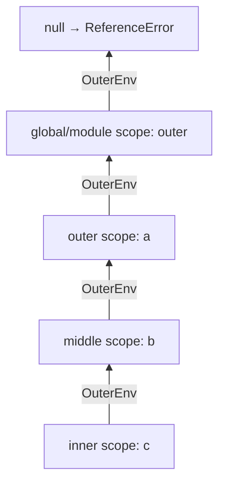

## What is scope?

`Scope` is the set of rules deciding **where in the code an identifier is accessible**. At the engine level, a scope is a lexical environment (see [Execution context](/javascript/execution-context)).

### Kinds of scope

| Scope | Created by | Contains |
| --- | --- | --- |
| **Global scope** | The top level of a script | Top-level var and functions (on globalThis) and global let/const |
| **Module scope** | Each ES module | All top-level module declarations — private unless exported |
| **Function scope** | Each function | Parameters, var, and every declaration in the body |
| **Block scope** | `{ }`, `if`, `for`, `try/catch` | `let`, `const`, `class` (and functions in strict mode) |

```js run
const moduleLevel = "module";        // module scope (this runs as a worker module)

function fn(param) {                 // function scope: param
  var functionLevel = "function";
  if (true) {
    let blockLevel = "block";        // block scope
    console.log(moduleLevel, functionLevel, blockLevel, param);
  }
  // blockLevel isn't accessible here
}
fn("param");
```

## Lexical scope vs dynamic scope

JavaScript has **lexical (static) scope**: what a function can access is decided by **where it's defined** in the source — before running, just by reading the code.

With **dynamic scope** (Bash, old Emacs Lisp), access is decided by the **call chain** at runtime.

```js run
const value = "global";

function printValue() {
  console.log(value);
}

function caller() {
  const value = "caller";
  printValue();
}

caller();
// Lexical scope (JavaScript): "global" — printValue is defined at the top level
// Dynamic scope (hypothetical): "caller" — printValue was called from caller
```

<Callout type="interview">
The only thing in JavaScript that behaves like dynamic scope is **`this`**: its value depends on how a function is called, not where it's defined. Hence the saying "scope is lexical, this is dynamic".
</Callout>

## The scope chain

When an identifier is read, the engine starts in the current scope and walks outward through `[[OuterEnv]]` until it finds it:



```js run
const a = 1;
function outer() {
  const b = 2;
  function middle() {
    const c = 3;
    function inner() {
      console.log(a + b + c);   // c: inner✗ → middle✓ | b: … → outer✓ | a: … → global✓
    }
    inner();
  }
  middle();
}
outer();
```

- Lookup only goes **outward**; an outer scope never sees an inner scope's variables.
- The first binding found wins (**shadowing**).
- Because scope is static, engines precompute resolution at compile time as much as possible, so lookups are cheap in practice — unless `eval` or `with` is involved.

### Shadowing

```js
const theme = "light";
function render() {
  const theme = "dark";     // shadows the outer theme
  console.log(theme);       // "dark"
}
```

Shadowing is legal but can be confusing (ESLint: `no-shadow`). **Illegal shadowing:** you can't shadow an outer `let` with a `var` in an inner block, because the var hoists to function scope and collides with the let:

```js
let x = 1;
{
  var x = 2;   // ✗ SyntaxError: Identifier 'x' has already been declared
}
```

## What is a closure?

A `closure` is the combination of a **function** and **the lexical environment where it was created**. Put simply: a function that can access variables of its outer scope **even after that scope has finished executing**.

```js run
function makeCounter() {
  let count = 0;                 // local to makeCounter
  return function increment() {
    count += 1;                  // accessed after makeCounter has returned
    return count;
  };
}

const counter = makeCounter();   // makeCounter finished; its context was popped
console.log(counter());          // 1
console.log(counter());          // 2

const another = makeCounter();   // a brand-new environment
console.log(another());          // 1
console.log(counter());          // 3
```

### How a closure is built at runtime

```mermaid
sequenceDiagram
    participant Stack as Call stack
    participant Heap as Heap
    Stack->>Heap: makeCounter() → create environment record { count: 0 }
    Stack->>Heap: create function object "increment" with [[Environment]] = that record
    Stack->>Stack: return increment; makeCounter's context is popped
    Note over Heap: record { count } survives because increment.[[Environment]] points to it
    Stack->>Heap: counter() → new environment with OuterEnv = { count }
    Heap-->>Stack: count++ → 1
```

1. Every **function object** gets an internal **`[[Environment]]`** slot when created, pointing to the **current lexical environment**.
2. When `makeCounter` returns, its **execution context** leaves the call stack, but its **environment record** (in the heap) isn't freed, because `increment.[[Environment]]` still references it.
3. Each `counter()` call creates a new environment whose `[[OuterEnv]]` is that old `makeCounter` environment.
4. The garbage collector keeps the environment alive as long as `counter` is reachable.

**Key point:** a closure keeps the **binding** (a live link to the variable), **not a copy of the value**. If the variable changes later, the closure sees the new value.

```js run
let message = "first";
const show = () => console.log(message);
message = "second";
show();   // "second" — not "first"
```

### Why do closures exist?

Closures are the natural result of two features: **functions are first-class** (they can be returned and passed around) and **scope is lexical**. If a function running outside its defining scope couldn't see that scope's variables, lexical scope would be meaningless. In fact **every JavaScript function is a closure**; the term is usually used when a function is used outside the scope where it was defined.

## Practical uses of closures

### 1. Private state (encapsulation)

```js run
function createBankAccount(initial) {
  let balance = initial;                     // not accessible from outside
  const history = [];

  return {
    deposit(amount) {
      if (amount <= 0) throw new RangeError("amount must be positive");
      balance += amount;
      history.push({ type: "deposit", amount });
      return balance;
    },
    withdraw(amount) {
      if (amount > balance) throw new Error("insufficient funds");
      balance -= amount;
      history.push({ type: "withdraw", amount });
      return balance;
    },
    get balance() { return balance; },
    get history() { return [...history]; },  // a copy, so state can't be mutated from outside
  };
}

const account = createBankAccount(100);
account.deposit(50);
account.withdraw(30);
console.log(account.balance, account.history.length);
console.log(account.balanceValue, "← there's no way to reach balance directly");
```

Before class `#private` fields, this was the only way to get real privacy (the module pattern).

### 2. Factory functions and configuration

```js run
function createFormatter(locale, currency) {
  const formatter = new Intl.NumberFormat(locale, { style: "currency", currency });
  return (amount) => formatter.format(amount);   // the formatter is built once
}

const euros = createFormatter("de-DE", "EUR");
const dollars = createFormatter("en-US", "USD");
console.log(euros(1250.5));
console.log(dollars(42.5));
```

### 3. Memoization

```js run
function memoize(fn) {
  const cache = new Map();                       // lives on in the closure
  return function (...args) {
    const key = JSON.stringify(args);
    if (cache.has(key)) return cache.get(key);
    const result = fn.apply(this, args);
    cache.set(key, result);
    return result;
  };
}

let calls = 0;
const slowSquare = (n) => { calls++; return n * n; };
const fastSquare = memoize(slowSquare);
fastSquare(9); fastSquare(9); fastSquare(9);
console.log("result:", fastSquare(9), "real calls:", calls);
```

### 4. Debounce / throttle

```js run
function debounce(fn, delay) {
  let timerId;                                   // state shared by all calls
  return function (...args) {
    clearTimeout(timerId);
    timerId = setTimeout(() => fn.apply(this, args), delay);
  };
}

const search = debounce((q) => console.log("searching:", q), 100);
search("r"); search("re"); search("rea"); search("react");  // only the last one runs
```

### 5. Event handlers

```js
function setupTabs(buttons) {
  buttons.forEach((button, index) => {
    button.addEventListener("click", () => {
      activate(index);          // each handler has its own index
    });
  });
}
```

### 6. Partial application and currying

```js run
const multiply = (a) => (b) => a * b;   // each arrow closes over the previous parameter
const double = multiply(2);
const triple = multiply(3);
console.log(double(5), triple(5));
```

### 7. once

```js run
function once(fn) {
  let called = false;
  let result;
  return (...args) => {
    if (!called) {
      called = true;
      result = fn(...args);
    }
    return result;
  };
}
const init = once(() => { console.log("initializing…"); return 42; });
console.log(init(), init(), init());
```

## Closures and memory

### Does a closure keep the whole scope?

Per the spec, a closure keeps the entire environment. In practice **V8 optimises**: only variables used by **at least one** inner function go into a heap-allocated context object; the rest stay on the stack and are freed on return.

**The trap:** all closures created in the same scope **share one context**:

```js
function attach() {
  const hugeData = new Array(1_000_000).fill("x");   // ~8MB
  const small = 1;

  const logSize = () => console.log(hugeData.length); // uses hugeData
  return () => small;                                  // only needs small
  // but because logSize used hugeData, it's in the shared context,
  // and the returned function keeps it alive → memory leak
}
```

### Common closure leaks

```js
// A listener that's never removed keeps the whole component alive through its closure
function mountWidget(element, bigState) {
  const onResize = () => element.style.width = bigState.width + "px";
  window.addEventListener("resize", onResize);
  return () => window.removeEventListener("resize", onResize); // ✓ cleanup
}
```

| Leak source | Fix |
| --- | --- |
| Listeners on window/document | `removeEventListener` or an `AbortController.signal` |
| A forgotten `setInterval` | `clearInterval` in cleanup |
| An unbounded cache in a closure | Bound it (LRU) or use a `WeakMap` |
| References to removed DOM nodes | Null them out, `WeakRef` |

Details in [Garbage collection](/javascript/memory-gc).

## Closures and React

React hooks are built entirely on closures. **Every render is a new call of the component function**, and each handler and effect closes over the props and state **of that render**.

### Stale closures

```jsx
function Timer() {
  const [count, setCount] = useState(0);

  useEffect(() => {
    const id = setInterval(() => {
      setCount(count + 1);   // ✗ count is always 0 — closure over the first render
    }, 1000);
    return () => clearInterval(id);
  }, []);                    // the effect ran only once

  return <p>{count}</p>;     // shows 1 and stays there
}
```

Fixes:

```jsx
// 1. Functional update: no need to close over count
setCount((c) => c + 1);

// 2. Add count to the dependencies (the interval is recreated on every change)
useEffect(() => { /* ... */ }, [count]);

// 3. useRef for the latest value (e.g. in long-lived callbacks)
const countRef = useRef(count);
countRef.current = count;
```

The same problem simulated without React:

```js run
function createComponent() {
  let renders = [];
  function render(count) {
    // each render creates a new closure over that render's count
    const handleClick = () => console.log("clicked with count =", count);
    renders.push(handleClick);
  }
  return { render, renders };
}

const component = createComponent();
component.render(0);
component.render(1);
component.render(2);

const staleHandler = component.renders[0];   // like an effect with [] holding the first handler
staleHandler();                               // count = 0 ← stale
component.renders.at(-1)();                   // count = 2 ← latest render
```

Details in [React effects](/react/effects).

## Closures in loops — again

```js predict
const fns = [];
for (var i = 0; i < 3; i++) {
  fns.push(() => i);
}
console.log(fns.map((f) => f()));
```

```output
[3, 3, 3]
```

All three closures point to **one** `i` binding (function/module scope). With `let`, each iteration has a fresh binding and the result is `[0, 1, 2]`.

## Common mistakes

- Thinking a closure keeps a **copy of the value**.
- Stale closures in React effects and async callbacks.
- Creating closures in hot loops (each closure is a new heap object).
- Holding references to large data in long-lived closures.
- Assuming a function can see variables at its **call site**.

## Interview questions

<QA q="What is a closure? Explain with a real example." level="junior" n={1}>
<Answer>

A closure is a function combined with the lexical environment it was created in; the function can access outer-scope variables even after that scope has finished. Real examples: `debounce`, which keeps `timerId` between calls, or `createCounter` with a private `count`.

</Answer>
<Deep>

Every function object has an `[[Environment]]` pointing to the environment current at creation. When the outer function returns, its execution context leaves the stack but the environment record stays in the heap because it's still referenced. Each call of the inner function creates a new environment whose outer is that record.

</Deep>
<Mistake>

Saying "a closure is a function inside another function". Nesting isn't the point — access to the outer environment is, and technically every JavaScript function is a closure.

</Mistake>
<FollowUp>

Does a closure keep a copy of the value or a reference to the binding? How would you prove it?

</FollowUp>
</QA>

<QA q="What is lexical scope and how does it differ from dynamic scope?" level="mid" n={2}>
<Answer>

With lexical scope, a function's scope is determined by where it's written and is known before running. With dynamic scope it's determined by the call chain at runtime. JavaScript is lexical; only `this` behaves quasi-dynamically.

</Answer>
<Deep>

Lexical scope lets the engine resolve names at compile time (e.g. into indexed context slots) and lets tools like bundlers and minifiers rename variables safely (mangling). `eval` and `with` break that guarantee.

</Deep>
<Mistake>

Attributing `this` behaviour to scope.

</Mistake>
<FollowUp>

Why can't a minifier shorten variable names in a function that contains a direct eval?

</FollowUp>
</QA>

<QA q="What is a stale closure in React and how do you fix it?" level="senior" n={3}>
<Answer>

Each render is a fresh call of the component, and handlers and effects close over that render's state. If a long-lived callback (an interval, a subscription, an effect with incomplete dependencies) from an old render is kept, it sees old values. Fixes: functional updates (`setX(x => x + 1)`), a complete dependency array, `useRef` for the latest value, or `useEffectEvent` (React 19.2+).

</Answer>
<Deep>

This isn't inherent to "UI = f(state)"; it comes from combining closures with callbacks that outlive a render. The `react-hooks/exhaustive-deps` rule detects it. `useEffectEvent` creates a stable function that always reads the latest props/state without re-running the effect.

</Deep>
<Mistake>

Disabling the ESLint rule, or leaving the dependency array empty to "avoid re-running" the effect.

</Mistake>
<FollowUp>

Why can `useCallback` with incorrect dependencies create a stale closure?

</FollowUp>
</QA>

<QA q="Can closures cause memory leaks? Give an example." level="senior" n={4}>
<Answer>

Yes. A closure keeps its outer environment alive; if the closure is long-lived (a listener on window, an interval, a global cache) and the environment references big data or removed DOM nodes, the GC can't free them. In V8 all closures from one scope share a context, so a tiny closure can keep alive data that only another closure used.

</Answer>
<Deep>

To debug: take heap snapshots in DevTools, compare two snapshots and inspect an object's "Retainers"; closure contexts show up as `(closure)` and `system / Context`. Prevention: cleanup in `useEffect`, `AbortController` for listeners, `WeakMap` for caches keyed by objects.

</Deep>
<Mistake>

Claiming closures are inherently "slow" or "leaky"; the problem is only long-lived closures holding unnecessary references.

</Mistake>
<FollowUp>

What is a detached DOM node and how do you find one in a heap snapshot?

</FollowUp>
</QA>

## Recap

<Recap>

- Scope decides where a variable is visible: global, module, function and block.
- JavaScript uses lexical scope: where code is written, not where it runs, decides scope.
- To resolve a name the engine walks outward along the scope chain; an inner variable with the same name shadows the outer one.
- A closure is a function plus the environment it was created in; it remembers outer variables even after the outer function has returned.
- A closure accesses **the variable itself**, not a copy of its value; later changes are visible.
- Uses: private state, factories, memoisation, debounce/throttle, currying and `once`.
- Closures can keep memory alive; listeners or timers that are never cleared are the most common leak.
- In React a stale closure is a callback that captured an old state value; fix it with correct dependencies, an updater function or `useRef`.

</Recap>
