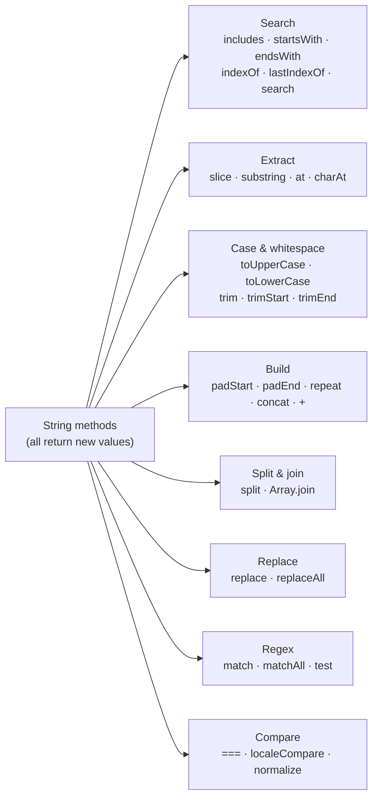

## What is a string?

A **string** is a piece of text: a sequence of characters such as `"hello"`, `"سلام"` or `"👍"`. Strings are one of JavaScript's **primitive** types, and two facts about them explain almost every surprise you'll meet:

1. **Strings are immutable.** No method ever changes a string; every method returns a **new** string.
2. **A string is a sequence of UTF-16 *code units*, not of "characters".** Most letters use one code unit, but emoji and many symbols use two, so `length` doesn't always match what a human sees.

```text
  "Hi!"   →   index:  0     1     2
                    ┌─────┬─────┬─────┐
                    │ "H" │ "i" │ "!" │      "Hi!".length === 3
                    └─────┴─────┴─────┘
```

## Creating strings

```js run
const single = 'single quotes';
const double = "double quotes";            // identical to single quotes
const name = "Sara";
const template = `Hello, ${name}! 2 + 3 = ${2 + 3}`;   // template literal: interpolation
const multiLine = `line 1
line 2`;                                    // real line breaks, no \n needed

console.log(template);
console.log(multiLine);
console.log("It's \"quoted\"\tand\\escaped");   // escapes: \" \' \\ \n \t \u{1F600}
console.log(String(42), String(null), String([1, 2]), `${{}}`);  // converting to string
```

| Syntax | Interpolation `${}` | Multi-line | Typical use |
| --- | --- | --- | --- |
| `'…'` / `"…"` | ✗ | ✗ (need `\n`) | Fixed text |
| `` `…` `` | ✓ | ✓ | Text built from values, HTML/SQL/CSS snippets |

## Accessing characters

```js run
const word = "JavaScript";

console.log(word[0]);            // "J"
console.log(word.at(-1));        // "t" — at() accepts negative indexes
console.log(word.charAt(4));     // "S"
console.log(word[99], word.charAt(99));  // undefined "" — out of range differs!
console.log(word.length);        // 10
console.log(word.charCodeAt(0)); // 74 — the UTF-16 code unit as a number
```

### Strings are immutable

```js run
"use strict";
let greeting = "hello";
try {
  greeting[0] = "H";             // strict mode: TypeError (sloppy mode: silently ignored)
} catch (e) {
  console.log(e.name + ": " + e.message);
}
console.log(greeting);           // "hello" — unchanged

greeting = "H" + greeting.slice(1);   // build a NEW string and reassign the variable
console.log(greeting);           // "Hello"
```

The **variable** `greeting` can point to a new string; the **string value** itself never changes. That's why `str.toUpperCase()` alone does nothing useful: you must use its return value.

## The method map



## Searching inside a string

| Question | Method | Returns |
| --- | --- | --- |
| Does it contain…? | `includes(sub, from?)` | `true` / `false` |
| Does it start / end with…? | `startsWith(sub, pos?)` / `endsWith(sub, len?)` | `true` / `false` |
| Where does … first / last appear? | `indexOf(sub, from?)` / `lastIndexOf(sub)` | Index or `-1` |
| Where does a **pattern** first match? | `search(regex)` | Index or `-1` |

```js run
const url = "https://example.com/blog/post-42?ref=home";

console.log(url.includes("blog"));                 // true
console.log(url.startsWith("https://"));           // true
console.log(url.endsWith("home"));                 // true
console.log(url.indexOf("/"), url.lastIndexOf("/")); // 6 24
console.log(url.indexOf("missing"));               // -1
console.log(url.search(/\d+/));                    // 30 — index of the first digit

// All these methods are case-sensitive:
console.log("Hello".includes("hello"), "Hello".toLowerCase().includes("hello")); // false true
```

<Callout type="mistake">
`if (str.indexOf("x"))` is a classic bug: `indexOf` returns `0` when the match is at the very start, and `0` is falsy. Use `includes` for yes/no questions.
</Callout>

## Extracting part of a string

<Api name="String.prototype.slice()" sig="str.slice(start, end?)" returns="A **new** string from `start` up to, but not including, `end`." mutates="no">

- `start`: index to start at. Negative counts from the end.
- `end` (optional, default `length`): index to stop before. Negative counts from the end.

</Api>

```js run
const s = "frontend";
console.log(s.slice(0, 5));     // "front"
console.log(s.slice(5));        // "end"
console.log(s.slice(-3));       // "end"  — last 3 characters
console.log(s.slice(-3, -1));   // "en"
console.log(s.slice(4, 2));     // ""     — start after end → empty

console.log(s.substring(4, 2)); // "on"   — substring SWAPS the arguments
console.log(s.substring(-3));   // "frontend" — negative becomes 0
```

| | `slice(a, b)` | `substring(a, b)` | `substr(start, length)` |
| --- | --- | --- | --- |
| Negative index | Counts from the end | Treated as `0` | `start` may be negative |
| `a > b` | Empty string | **Swaps** `a` and `b` | — |
| Second argument | End index | End index | **Length** |
| Status | ✓ Use this | OK | ✗ Legacy, avoid |

## Case and whitespace

```js run
const input = "   Ali.Rezaei@Example.COM \n";

const email = input.trim().toLowerCase();       // the classic normalization pair
console.log(JSON.stringify(email));             // "ali.rezaei@example.com"

console.log(JSON.stringify("  x  ".trimStart()), JSON.stringify("  x  ".trimEnd()));
console.log("istanbul".toLocaleUpperCase("tr-TR"));   // "İSTANBUL" — locale-aware casing
```

`trim` removes spaces, tabs, line breaks and other Unicode whitespace (including the non-breaking space) from both ends, never from the middle.

## Building strings: padding, repeating, joining

```js run
console.log("7".padStart(3, "0"));        // "007"  — zero-pad numbers
console.log("5".padEnd(4, "."));          // "5..."
console.log("ab".repeat(3));              // "ababab"
console.log("-".repeat(20));              // a divider line

const card = "4111111111111234";
console.log(card.slice(-4).padStart(card.length, "•"));   // mask all but the last 4

const time = (h, m) => `${String(h).padStart(2, "0")}:${String(m).padStart(2, "0")}`;
console.log(time(9, 5));                  // "09:05"
```

Joining many pieces: `+` and template literals are fine and fast in modern engines. For building a string in a loop, pushing parts into an array and calling `join("")` at the end is equally fine and often clearer.

## split: string → array

<Api name="String.prototype.split()" sig="str.split(separator?, limit?)" returns="A **new array** of substrings. The original string is unchanged." mutates="no">

- `separator` (optional): a string or a regular expression marking where to cut. Omitted → an array with the whole string. `""` → split into UTF-16 code units.
- `limit` (optional): maximum number of pieces to return.

</Api>

```js run
console.log("2026-10-06".split("-"));              // ['2026', '10', '06']
console.log("2026-10-06".split("-").map(Number));  // [2026, 10, 6]
console.log("a, b,c ,  d".split(/\s*,\s*/));       // ['a', 'b', 'c', 'd'] — regex separator
console.log("one two three".split(" ", 2));        // ['one', 'two'] — limit
console.log("abc".split(""));                      // ['a', 'b', 'c']
console.log("abc".split());                        // ['abc']
console.log("".split(","));                        // [''] — not an empty array!

// Round trip: split + array methods + join
const title = "learn javascript the deep way";
console.log(title.split(" ").map((w) => w[0].toUpperCase() + w.slice(1)).join(" "));
```

## replace and replaceAll

<Api name="String.prototype.replace() / replaceAll()" sig="str.replace(pattern, replacement) · str.replaceAll(pattern, replacement)" returns="A **new** string with the match(es) replaced." mutates="no">

- `pattern`: a string or a regular expression.
  - `replace` with a **string** pattern replaces only the **first** match.
  - `replace` with a regex replaces the first match, or **all** with the `g` flag.
  - `replaceAll` replaces **every** match (a regex passed to it must have the `g` flag).
- `replacement`: a string (may use `$1`, `$2`… for regex groups and `$&` for the whole match) **or a function** `(match, ...groups, offset, string) => newText`.

</Api>

```js run
const text = "cat, cat, cat";
console.log(text.replace("cat", "dog"));     // "dog, cat, cat" — first only
console.log(text.replaceAll("cat", "dog"));  // "dog, dog, dog"
console.log(text.replace(/cat/g, "dog"));    // "dog, dog, dog"

// Regex groups in the replacement: reorder a date
console.log("2026-10-06".replace(/(\d+)-(\d+)-(\d+)/, "$3/$2/$1"));   // "06/10/2026"

// A replacement function: fill a template
const template = "Hi {name}, you have {count} new messages";
const data = { name: "Sara", count: 3 };
console.log(template.replace(/\{(\w+)\}/g, (match, key) => data[key] ?? match));

// slugify a title
const slug = "  Hello, World! JS & CSS  ".trim().toLowerCase().replace(/[^a-z0-9]+/g, "-").replace(/^-|-$/g, "");
console.log(slug);   // "hello-world-js-css"
```

## Regular expressions with strings (brief)

```js run
const log = "error 404 at 10:32, error 500 at 11:05";

console.log(/error/.test(log));                       // true — does it match?
console.log(log.match(/\d{3}/));                      // first match with details
console.log(log.match(/\d{3}/g));                     // ['404', '500'] — all matches with g
for (const m of log.matchAll(/error (\d+) at (\d+:\d+)/g)) {
  console.log(`code ${m[1]} at ${m[2]} (index ${m.index})`);
}
```

## Comparing strings

```js run
console.log("apple" === "apple");          // true — compares the contents
console.log("a" < "b", "Z" < "a");         // true true — by UTF-16 code unit: uppercase before lowercase!
console.log("10" < "9");                   // true — text comparison, not numeric

// Human-friendly comparison: localeCompare / Intl.Collator
console.log("a".localeCompare("B"));                                // -1 (a before B)
console.log(["ä", "a", "z"].sort((x, y) => x.localeCompare(y, "de"))); // ['a', 'ä', 'z']
console.log("2" < "10", "2".localeCompare("10", undefined, { numeric: true })); // false -1
```

## Unicode: why `length` lies

JavaScript strings are stored as **UTF-16**. Each element is a 16-bit **code unit**. Characters outside the first 65,536 code points (emoji, many historic scripts, some CJK) need **two** code units, called a **surrogate pair**. On top of that, what a user sees as one character (a **grapheme**) can be several code points combined.

| Level | Unit | `"👍🏽"` counts as |
| --- | --- | --- |
| Code units (what `length` and `[i]` use) | 16-bit values | 4 |
| Code points (what `for...of` and `[...str]` use) | Unicode characters | 2 (👍 + skin-tone modifier) |
| Graphemes (what humans see) | User-perceived characters | 1 |

```js run
const thumbs = "👍🏽";
console.log(thumbs.length);                       // 4
console.log([...thumbs].length);                  // 2
const segmenter = new Intl.Segmenter("en", { granularity: "grapheme" });
console.log([...segmenter.segment(thumbs)].length); // 1

console.log("👍".split(""));                      // two broken halves (lone surrogates)
console.log([..."👍"]);                           // ['👍'] — intact

// Reversing safely
const text = "ab👍";
console.log(text.split("").reverse().join(""));  // broken emoji
console.log([...text].reverse().join(""));       // "👍ba"
```

### Normalization

The same visible text can be encoded in different ways. `é` can be one code point (`U+00E9`) or `e` followed by a combining accent (`U+0301`):

```js run
const composed = "caf\u00e9";
const decomposed = "cafe\u0301";
console.log(composed, decomposed, composed === decomposed);              // café café false
console.log(composed.normalize("NFC") === decomposed.normalize("NFC"));  // true
```

Normalize before comparing or searching user input. For Persian and Arabic text, also unify letter variants (`ي` → `ی`, `ك` → `ک`) and remove the zero-width non-joiner where needed. This site's search does exactly that.

## Strings are primitives, but they have methods

`"abc".toUpperCase()` works because, when you access a property on a primitive, JavaScript temporarily wraps it in a `String` object (**auto-boxing**), calls the method from `String.prototype`, and throws the wrapper away.

```js run sloppy
const s = "hello";
console.log(typeof s, typeof new String("hello"));       // "string" "object"
console.log(s === "hello", new String("hello") === "hello"); // true false

s.custom = 1;                    // sloppy mode: set on a temporary wrapper… (strict mode: TypeError)
console.log(s.custom);           // undefined — …which is already gone
```

Never create strings with `new String(…)`: it produces an object that is always truthy and never `===` to a string.

## Tagged templates

A **tag** is a function placed before a template literal. It receives the literal text parts and the interpolated values separately, so it can process them (escape, translate, build queries…):

```js run
function safeHtml(strings, ...values) {
  const escape = (v) => String(v).replace(/[&<>"']/g, (c) => `&#${c.charCodeAt(0)};`);
  return strings.reduce((out, str, i) => out + str + (i < values.length ? escape(values[i]) : ""), "");
}

const userInput = '';
console.log(safeHtml`<p>Comment: ${userInput}</p>`);

// String.raw: a built-in tag that keeps backslashes as-is
console.log(String.raw`C:\new\table`);
```

Tagged templates power `styled-components` (CSS-in-JS), `graphql-tag`, `lit-html` and safe SQL builders.

## Classic string algorithms

```js run
// 1. Palindrome (ignoring case, spaces and punctuation)
const isPalindrome = (s) => {
  const clean = s.toLowerCase().replace(/[^a-z0-9]/g, "");
  return clean === [...clean].reverse().join("");
};
console.log(isPalindrome("A man, a plan, a canal: Panama"));   // true

// 2. Anagrams: same letters, different order
const sortLetters = (s) => [...s.toLowerCase()].sort().join("");
console.log(sortLetters("listen") === sortLetters("silent"));   // true

// 3. Character frequency, then the most common character
const freq = [..."programming"].reduce((m, ch) => m.set(ch, (m.get(ch) ?? 0) + 1), new Map());
const [top] = [...freq].sort((a, b) => b[1] - a[1]);
console.log(top);                                                 // ['r', 2] (or g/m, also 2)

// 4. Capitalize every word
console.log("hello big world".replace(/\b\w/g, (c) => c.toUpperCase()));

// 5. Truncate with an ellipsis, without cutting a word in half
const truncate = (s, max) => (s.length <= max ? s : s.slice(0, s.lastIndexOf(" ", max)) + "…");
console.log(truncate("JavaScript strings are immutable sequences", 25));
```

## Common mistakes

- Expecting a method to change the string (`name.trim();` without using the result).
- `if (str.indexOf(x))`: fails when the match is at index 0; use `includes`.
- `replace("a", "b")` expecting all matches to change; use `replaceAll` or a `g` regex.
- Using `length`, `split("")` or `[i]` for user-visible character counts or reversing (breaks emoji and combined characters).
- Comparing numbers stored as strings (`"10" < "9"` is `true`).
- Comparing user input without `trim()`, case folding and `normalize()`.
- `new String("x")` instead of a primitive.
- Building HTML with string concatenation from user input (XSS).

## Interview questions

<QA q="Why are strings immutable, and what does that mean in practice?" level="junior" n={1}>
<Answer>

A string value can never be changed after it's created. Methods like `toUpperCase`, `replace` or `slice` return **new** strings, and assigning `str[0] = "X"` is ignored (or throws in strict mode). In practice you must use the return value: `name = name.trim()`.

</Answer>
<Deep>

Immutability lets engines share and intern strings, use them safely as object keys, and represent concatenations lazily (V8 uses "cons strings"/ropes, flattening them when needed). The variable holding a string can still be reassigned; only the value is immutable.

</Deep>
<Mistake>

Calling `str.replace(...)` and expecting `str` to change.

</Mistake>
<FollowUp>

Why is `s += x` in a loop not as slow in modern JavaScript as it is in some other languages?

</FollowUp>
</QA>

<QA q="What's the difference between `slice`, `substring` and `substr`?" level="junior" n={2}>
<Answer>

All extract part of a string. `slice(start, end)` supports negative indexes (counted from the end) and returns `""` if `start > end`. `substring(start, end)` treats negatives as 0 and swaps the arguments if `start > end`. `substr(start, length)` takes a length instead of an end index and is a legacy feature. Prefer `slice`.

</Answer>
<Deep>

`slice` behaves the same for strings and arrays, which makes it the easiest to remember. All three work on UTF-16 code units, so they can cut a surrogate pair (an emoji) in half.

</Deep>
<Mistake>

Passing a length as the second argument of `slice`/`substring`.

</Mistake>
<FollowUp>

How would you take the first 10 *visible* characters of a string that may contain emoji? (`Intl.Segmenter`.)

</FollowUp>
</QA>

<QA q="Why is `'👍'.length` equal to 2, and how do you count characters correctly?" level="senior" n={3}>
<Answer>

JavaScript strings are UTF-16: `length` counts 16-bit code units. 👍 is outside the Basic Multilingual Plane, so it's stored as a surrogate pair of two code units. `[...str].length` counts code points; `Intl.Segmenter` with `granularity: "grapheme"` counts what users perceive as characters (e.g. 👍🏽 or a flag emoji is 1).

</Answer>
<Deep>

`for...of`, spread and `Array.from` iterate by code point; `split("")`, indexing and `charCodeAt` work with code units. `codePointAt` and `String.fromCodePoint` handle full code points. Database or API limits are often in bytes (UTF-8), which is yet another measure; `new TextEncoder().encode(str).length` gives that.

</Deep>
<Mistake>

Validating "max 20 characters" with `length`, which rejects short emoji-rich names and can cut characters in half when truncating.

</Mistake>
<FollowUp>

What does `"é" === "é"` return when one is composed and the other decomposed, and how do you fix the comparison? (`normalize`.)

</FollowUp>
</QA>

<QA q="How does `replace` work with a function as the second argument?" level="mid" n={4}>
<Answer>

For every match, the function is called with `(match, group1, group2, …, offset, fullString)`, and whatever it returns is inserted in place of the match. With a `g` regex (or `replaceAll`) it runs once per match. It's ideal for templates, escaping, or transformations that depend on the matched text.

</Answer>
<Deep>

With named groups (`(?<key>\w+)`), the last argument is a `groups` object. In string replacements (not functions), special patterns like `$&`, `$1` and `$<name>` are interpreted, which can surprise you when inserting user-provided text that contains `$`; a function replacement avoids that.

</Deep>
<Mistake>

Using `replace` with a string pattern to replace every occurrence: only the first one changes.

</Mistake>
<FollowUp>

Write a function that converts `"some_variable_name"` to `"someVariableName"`.

</FollowUp>
</QA>

<QA q="What is a tagged template, and give a real use case." level="senior" n={5}>
<Answer>

A tag is a function called with the template's static string parts (as an array) and the interpolated values as separate arguments: ``tag`a${x}b` `` calls `tag(["a", "b"], x)`. The tag decides what to return (not necessarily a string). Real uses: escaping HTML (`lit-html`), CSS-in-JS (`styled-components`), parameterized SQL that prevents injection, and i18n.

</Answer>
<Deep>

The `strings` array is frozen and identical across calls for the same call site, so libraries use it as a cache key (lit-html parses each template once). `strings.raw` gives the unprocessed text with escapes intact, which is what `String.raw` uses.

</Deep>
<Mistake>

Thinking template literals escape values automatically; plain `` `${x}` `` inserts the raw value.

</Mistake>
<FollowUp>

How would a `sql` tag prevent SQL injection?

</FollowUp>
</QA>

## Recap

<Recap>

- Strings are immutable primitives; every method returns a new string.
- Template literals (`` `…${x}` ``) make multi-line strings and interpolation easy; tagged templates let a function process them.
- `includes`, `startsWith`, `endsWith` for simple searches; `indexOf` returns an index or `-1`.
- `slice` accepts negative indexes; `substring` treats negatives as zero; `substr` is deprecated.
- `split` turns a string into an array and `join` reverses it; `replace` with a string only replaces the first match, `replaceAll` replaces all.
- For language-aware comparison use `localeCompare` or `Intl.Collator`, not `<`.
- `length` counts UTF-16 code units, not visible characters; emoji and some letters take two. `[...str]` splits by code point and `Intl.Segmenter` by visible character.
- A string primitive is temporarily wrapped in a `String` object when you call a method (autoboxing).

</Recap>
