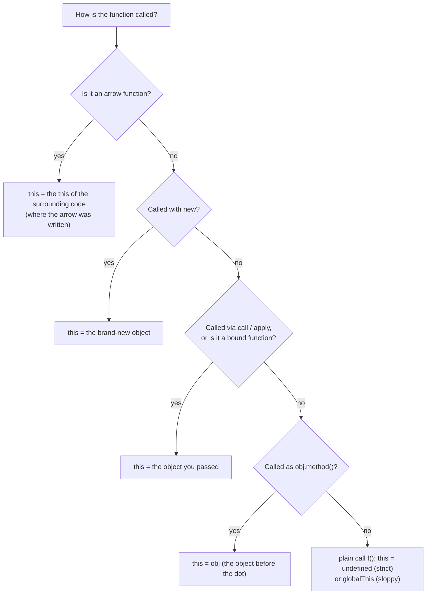

## What is a function?

A **function** is a reusable block of code with a name (or not), that takes **inputs** (parameters), does some work, and gives back an **output** (its return value). You define it once and **call** it as many times as you need.

```js run
//        name      parameters
function  greet(   name, greeting = "Hello"  ) {
  const message = `${greeting}, ${name}!`;   // body
  return message;                            // output
}

console.log(greet("Sara"));                  // call with arguments → "Hello, Sara!"
console.log(greet("Ali", "Salam"));
```

| Term | In the example | Meaning |
| --- | --- | --- |
| **Parameter** | `name`, `greeting` | The variable names in the definition |
| **Argument** | `"Sara"`, `"Ali"`, `"Salam"` | The actual values passed in a call |
| **Default value** | `greeting = "Hello"` | Used when the argument is `undefined` (missing) |
| **Body** | The code in `{ }` | Runs on every call, with fresh local variables |
| **Return value** | `message` | What the call expression evaluates to |

In JavaScript, functions are also **values** (objects): you can store them in variables, pass them to other functions and return them from functions. That single fact powers callbacks, event handlers, `map`/`filter`, closures, React components and hooks.

## Three ways to define a function

```js run
// 1. Function declaration: hoisted (usable before the line it's defined on)
console.log(square(4));
function square(n) { return n * n; }

// 2. Function expression: a function value assigned to a variable (not hoisted)
const cube = function (n) { return n ** 3; };

// 3. Arrow function: short syntax, no own `this` / `arguments`
const double = (n) => n * 2;            // implicit return for a single expression
const sum = (a, b) => {                 // braces → you must write return
  const total = a + b;
  return total;
};
const makeUser = (name) => ({ name });  // returning an object literal: wrap it in ( )

console.log(cube(2), double(5), sum(2, 3), makeUser("Reza"));
```

| | Declaration | Expression | Arrow |
| --- | --- | --- | --- |
| Syntax | `function f() {}` | `const f = function () {}` | `const f = () => {}` |
| Hoisted (callable before definition) | ✓ Fully | ✗ (TDZ with `let/const`) | ✗ |
| Own `this` | ✓ Decided by the call | ✓ Decided by the call | ✗ Uses the surrounding `this` |
| `arguments` object | ✓ | ✓ | ✗ |
| Can be used with `new` | ✓ | ✓ | ✗ |
| Typical use | Top-level named functions | Conditional definitions, callbacks | Callbacks, short helpers, methods that must keep outer `this` |

## Parameters in depth

### Missing and extra arguments

JavaScript doesn't check the number of arguments. Missing parameters are `undefined`; extra arguments are ignored (but still accessible).

```js run
function info(a, b) {
  return `a=${a}, b=${b}`;
}
console.log(info(1));           // a=1, b=undefined — missing
console.log(info(1, 2, 3));     // a=1, b=2 — the 3 is ignored
console.log(info.length);       // 2 — the number of declared parameters
```

### Default parameters

```js run
function createButton(label, { size = "md", variant = "primary", disabled = false } = {}) {
  return `<button class="${variant} ${size}"${disabled ? " disabled" : ""}>${label}</button>`;
}

console.log(createButton("Save"));
console.log(createButton("Delete", { variant: "danger" }));
console.log(createButton("Wait", { disabled: true, size: "sm" }));

// Defaults apply only for undefined, NOT for null or other falsy values
const withDefault = (x = "default") => x;
console.log(withDefault(undefined), withDefault(null), withDefault(0), withDefault(""));
```

The `{ … } = {}` pattern (destructured "options object" with a default) is how most modern APIs accept many optional settings: callers pass only what they need, in any order.

### Rest parameters and spread

```js run
// Rest (...): collects the REMAINING arguments into a real array
function logAll(level, ...messages) {
  console.log(`[${level}]`, messages.length, "messages:", messages.join(" | "));
}
logAll("info", "server started", "port 3000", "ready");

// Spread (...): the opposite — expands an array into separate arguments
const scores = [12, 45, 7];
console.log(Math.max(...scores));          // same as Math.max(12, 45, 7)

// The old `arguments` object: array-like, not available in arrows
function legacy() {
  return Array.from(arguments).reduce((a, b) => a + b, 0);
}
console.log(legacy(1, 2, 3));
```

| | Rest `...args` | `arguments` |
| --- | --- | --- |
| Type | Real `Array` (has `map`, `filter`…) | Array-like object |
| Contains | Only the remaining, unnamed arguments | **All** arguments |
| In arrow functions | ✓ | ✗ |
| Recommendation | ✓ Use this | Legacy code only |

### Arguments are passed by "sharing"

JavaScript always passes **the value of the argument**. For objects, that value is a **reference**, so the function can mutate the object but can't replace the caller's variable:

```js run
function mutate(obj) { obj.changed = true; }       // changes the shared object
function reassign(obj) { obj = { replaced: true }; } // only rebinds the local parameter

const settings = { theme: "dark" };
mutate(settings);
reassign(settings);
console.log(settings);                             // { theme: 'dark', changed: true }
```

## Return values

```js run
function noReturn() { const x = 1; }
function earlyReturn(n) {
  if (n < 0) return "negative";    // return exits immediately
  return "non-negative";
}
function multiple() {
  return [200, "OK"];              // return several values as an array (or object)
}

console.log(noReturn());           // undefined — every function returns something
console.log(earlyReturn(-5));
const [status, text] = multiple();
console.log(status, text);
```

<Callout type="mistake" title="Automatic semicolon insertion after return">
A line break right after `return` ends the statement. `return` followed by `{ ok: true }` on the next line returns `undefined`. Keep the value on the same line as `return`, or open the parenthesis/brace on that line.
</Callout>

## Functions are values (first-class functions)

```js run
const operations = {
  add: (a, b) => a + b,
  sub: (a, b) => a - b,
};
operations.mul = (a, b) => a * b;               // store in an object

function calculate(op, a, b) {                  // receive as an argument
  return operations[op](a, b);
}
console.log(calculate("mul", 6, 7));

function multiplier(factor) {                   // return a function
  return (n) => n * factor;
}
const triple = multiplier(3);
console.log(triple(10), typeof triple, triple.name || "(anonymous)", triple.length);
```

### Callbacks

A **callback** is a function passed to another function, to be called by it later: when an event happens, when data arrives, or for each element of a collection.

```js run
// You decide WHAT to do; filter decides WHEN to call it
const isAdult = (person) => person.age >= 18;
const people = [{ name: "Ali", age: 17 }, { name: "Sara", age: 25 }];
console.log(people.filter(isAdult).map((p) => p.name));

// Your own function that accepts a callback
function repeat(times, callback) {
  for (let i = 0; i < times; i++) callback(i);
}
repeat(3, (i) => console.log("tick", i));
```

### Higher-order functions

A **higher-order function** either **takes** a function as an argument or **returns** one (or both). `map`, `filter`, `reduce`, `setTimeout`, `addEventListener`, `debounce` and React's `memo` are all higher-order functions.

```js run
// A higher-order function that adds logging to ANY function
function withLogging(fn) {
  return function (...args) {
    const result = fn(...args);
    console.log(`${fn.name}(${args.join(", ")}) → ${result}`);
    return result;
  };
}
const add = (a, b) => a + b;
const loggedAdd = withLogging(add);
loggedAdd(2, 3);

// once(): a function that can only run one time
function once(fn) {
  let called = false, result;
  return (...args) => {
    if (!called) { called = true; result = fn(...args); }
    return result;
  };
}
const init = once(() => { console.log("initializing…"); return "ready"; });
console.log(init(), init(), init());   // "initializing…" printed only once
```

### Pure functions and side effects

A **pure function** (1) returns the same output for the same input and (2) doesn't change anything outside itself (no **side effects**: no mutation of arguments or globals, no I/O).

```js run
// ✓ pure
const total = (items) => items.reduce((sum, i) => sum + i.price * i.qty, 0);

// ✗ impure: mutates its argument and depends on outside state
let taxRate = 0.1;
function addTax(cart) {
  cart.total = cart.total * (1 + taxRate);   // mutation + reads a global
  return cart;
}

const items = [{ price: 10, qty: 2 }, { price: 5, qty: 1 }];
console.log(total(items), total(items));     // always 25 25
const cart = { total: 100 };
addTax(cart); addTax(cart);
console.log(cart.total);                     // 121 — each call changes the result
```

Pure functions are easy to test, cache (memoize) and reason about. React expects components and reducers to be pure for the same reason. Side effects are necessary (saving data, rendering), but keep them at the edges.

### Immediately invoked function expressions (IIFE)

```js run
const config = (() => {
  const env = "production";            // private
  return { apiUrl: env === "production" ? "https://api.example.com" : "http://localhost" };
})();
console.log(config.apiUrl);

// Also useful for an async block where top-level await isn't available:
(async () => {
  const value = await Promise.resolve(42);
  console.log("async IIFE:", value);
})();
```

### Recursion

A **recursive** function calls itself. Every recursive function needs a **base case** that stops the recursion, and each call should move closer to it.

```js run
function factorial(n) {
  if (n <= 1) return 1;            // base case
  return n * factorial(n - 1);     // recursive case: a smaller problem
}
console.log(factorial(5));         // 5 * 4 * 3 * 2 * 1 = 120

// Recursion shines for tree-shaped data
const menu = { label: "root", children: [
  { label: "Products", children: [{ label: "Phones", children: [] }, { label: "Laptops", children: [] }] },
  { label: "About", children: [] },
] };
function printTree(node, depth = 0) {
  console.log("  ".repeat(depth) + "- " + node.label);
  node.children.forEach((child) => printTree(child, depth + 1));
}
printTree(menu);
```

```text
factorial(4)
  = 4 * factorial(3)
      = 3 * factorial(2)
          = 2 * factorial(1)
              = 1            ← base case, then the stack unwinds
          = 2
      = 6
  = 24
```

Each call adds a frame to the call stack; very deep recursion throws `RangeError: Maximum call stack size exceeded` (see [Memory](/javascript/memory-gc)).

### Currying and partial application

**Currying** transforms `f(a, b, c)` into `f(a)(b)(c)`: a chain of functions that each take one argument. **Partial application** fixes some arguments now and supplies the rest later.

```js run
const curriedAdd = (a) => (b) => (c) => a + b + c;
console.log(curriedAdd(1)(2)(3));

// A generic curry for functions with a fixed number of parameters
function curry(fn) {
  return function curried(...args) {
    return args.length >= fn.length ? fn(...args) : (...more) => curried(...args, ...more);
  };
}
const volume = curry((l, w, h) => l * w * h);
console.log(volume(2)(3)(4), volume(2, 3)(4), volume(2)(3, 4));

// Partial application with bind (first argument is `this`)
const log = (level, message) => `[${level}] ${message}`;
const warn = log.bind(null, "WARN");
console.log(warn("disk almost full"));
```

### Composition

**Composition** builds a new function by chaining existing ones: the output of one becomes the input of the next.

```js run
const pipe = (...fns) => (x) => fns.reduce((value, fn) => fn(value), x);

const trim = (s) => s.trim();
const lower = (s) => s.toLowerCase();
const slugify = (s) => s.replace(/[^a-z0-9]+/g, "-");

const toSlug = pipe(trim, lower, slugify);
console.log(toSlug("  Hello World From JS  "));   // "hello-world-from-js"
```

## `this`: who called me?

`this` is a special value available inside regular functions. It refers to **the object the function was called on**, and it's decided **at call time**, not where the function was written. The same function can see a different `this` on every call.

```js run
function whoAmI() {
  return this?.name ?? String(this);
}

const alice = { name: "Alice", whoAmI };
const bob = { name: "Bob", whoAmI };

console.log(alice.whoAmI());          // "Alice" — called on alice
console.log(bob.whoAmI());            // "Bob"   — same function, called on bob
console.log(whoAmI());                // "undefined" — called on nothing (strict mode)
console.log(whoAmI.call({ name: "Carol" }));   // "Carol" — this set explicitly
```

**Why does `this` exist?** So one function (stored once, for example on a prototype) can work with **many different objects**. `Array.prototype.push` is a single function; `this` tells it *which* array to push into.

To find `this`, look at the **call site** and walk through these rules in order:



### Rule 1: plain call → default binding

```js run sloppy
function sloppyMode() { return this === globalThis; }
console.log(sloppyMode());       // true — sloppy mode falls back to the global object
```

```js run
function strictMode() { return this; }
console.log(strictMode());       // undefined — strict mode (modules and classes are always strict)
```

### Rule 2: method call → implicit binding

When a function is called **as `object.method()`**, `this` is the object **before the dot at the moment of the call**:

```js run
const counter = {
  count: 0,
  increment() {
    this.count++;
    return this.count;
  },
};
console.log(counter.increment(), counter.increment());   // 1 2

const nested = { name: "outer", inner: { name: "inner", who() { return this.name; } } };
console.log(nested.inner.who());   // "inner" — only the LAST object before the dot counts
```

#### Losing `this`

The binding happens at **call time**. If you take the method off the object and call it later, there's no object before the dot anymore:

```js run
const user = {
  name: "Ali",
  greet() { return `Hi, I'm ${this?.name}`; },
};

const greet = user.greet;           // just the function, no object attached
console.log(greet());               // "Hi, I'm undefined"

function runLater(callback) { return callback(); }
console.log(runLater(user.greet));  // same problem: passed as a plain function

console.log(runLater(() => user.greet()));   // ✓ wrap it: now called as user.greet()
console.log(runLater(user.greet.bind(user))); // ✓ or bind it
```

This is the #1 source of `this` bugs: passing methods as callbacks (`setTimeout(obj.method)`, `button.addEventListener("click", obj.method)`, `array.map(obj.method)`).

### Rule 3: `call`, `apply` and `bind` → explicit binding

<Api name="Function.prototype.call / apply / bind" sig="fn.call(thisArg, arg1, arg2, …) · fn.apply(thisArg, [args]) · fn.bind(thisArg, …presetArgs)" returns="`call` and `apply` **run the function immediately** and return its result. `bind` **doesn't run it**: it returns a **new function** with `this` (and optionally some arguments) permanently fixed." mutates="n/a">

- `thisArg`: the value to use as `this`.
- `call` takes the arguments one by one; `apply` takes them as **one array** (memory trick: **a**pply = **a**rray).
- `bind`'s extra arguments are pre-filled (partial application).

</Api>

```js run
function introduce(greeting, punctuation) {
  return `${greeting}, I'm ${this.name}${punctuation}`;
}
const sara = { name: "Sara" };

console.log(introduce.call(sara, "Hello", "!"));       // runs now, args listed
console.log(introduce.apply(sara, ["Hi", "?"]));       // runs now, args as an array

const saraIntro = introduce.bind(sara, "Salam");       // doesn't run: returns a new function
console.log(saraIntro("."));                           // "Salam, I'm Sara."
console.log(saraIntro.call({ name: "Other" }, "!"));   // still Sara: bound functions can't be re-bound
```

| | `call` | `apply` | `bind` |
| --- | --- | --- | --- |
| Runs the function | Immediately | Immediately | No: returns a new function |
| Arguments | Listed: `(this, a, b)` | Array: `(this, [a, b])` | Pre-filled: `(this, a)` then more later |
| Typical use | Borrowing a method: `Array.prototype.slice.call(arguments)` | Spreading arrays (mostly replaced by `...`) | Fixing `this` for callbacks; partial application |

```js run
// Borrowing methods with call
const arrayLike = { 0: "a", 1: "b", length: 2 };
console.log(Array.prototype.map.call(arrayLike, (x) => x.toUpperCase()));

// Implementing bind yourself (a classic interview question)
Function.prototype.myBind = function (thisArg, ...preset) {
  const fn = this;                                  // the function bind was called on
  return function (...later) {
    return fn.apply(thisArg, [...preset, ...later]);
  };
};
function hello(greeting, punctuation) { return `${greeting}, I'm ${this.name}${punctuation}`; }
console.log(hello.myBind({ name: "Reza" }, "Hey")("!"));
```

### Rule 4: `new` → constructor binding

Calling a function with `new` creates a new object and sets `this` to it. See [Objects & prototypes](/javascript/objects-prototypes) and [Classes](/javascript/classes).

```js run
function Person(name) {
  this.name = name;               // this = the new object
}
const p = new Person("Neda");
console.log(p.name, p instanceof Person);

const bound = Person.bind({ name: "ignored" });
console.log(new bound("Wins").name);   // "Wins" — new beats bind
```

### Rule 5: arrow functions → lexical `this`

Arrow functions **don't have their own `this`**. They use the `this` of the code **around them**, at the place they were written, and nothing (not `call`, `apply`, `bind` or a method call) can change it.

```js run
const timer = {
  seconds: 0,
  startWithRegularFunction() {
    return function () { return this?.seconds; };   // its own this → lost when called alone
  },
  startWithArrow() {
    return () => this.seconds;                      // this of startWithArrow → timer
  },
};

const regular = timer.startWithRegularFunction();
const arrow = timer.startWithArrow();
timer.seconds = 5;
console.log(regular());                 // undefined
console.log(arrow());                   // 5
console.log(arrow.call({ seconds: 99 }));   // 5 — call can't change an arrow's this
```

That makes arrows perfect for callbacks **inside** methods, and wrong **as** methods:

```js run
const team = {
  name: "Frontend",
  members: ["Ali", "Sara"],
  list() {
    return this.members.map((m) => `${m} @ ${this.name}`);   // ✓ arrow keeps this = team
  },
  badMethod: () => typeof this,          // ✗ arrow as a method: this is NOT team
};
console.log(team.list());
console.log(team.badMethod());           // "undefined" (module top-level this)
```

### Precedence

When several rules seem to apply, this order decides:

| Priority | Rule | Example | `this` is |
| --- | --- | --- | --- |
| 1 (highest) | Arrow function | `() => this` | Outer `this`, always |
| 2 | `new` | `new Fn()` | The new object (even if `Fn` is bound) |
| 3 | Explicit / bound | `fn.call(o)`, `fn.bind(o)()` | `o` |
| 4 | Method call | `o.fn()` | `o` |
| 5 (lowest) | Plain call | `fn()` | `undefined` (strict) / `globalThis` (sloppy) |

```js predict
const obj = {
  name: "obj",
  regular() { return this.name; },
  arrow: () => typeof this,
  nested() {
    const inner = () => this.name;
    return inner();
  },
};
const { regular } = obj;
console.log(obj.regular());
console.log(obj.arrow());
console.log(obj.nested());
console.log(regular.call({ name: "other" }));
try {
  console.log(regular());
} catch (e) {
  console.log(e.constructor.name);
}
```

```output
obj
undefined
obj
other
TypeError
```

The last call is a plain call: `this` is `undefined` (modules are strict), so reading `this.name` throws a `TypeError`.

## `this` in the real world

### Classes and React class components

```js run
class Toggle {
  on = false;
  constructor() { this.flipBound = this.flip.bind(this); }
  flip() { this.on = !this.on; return this.on; }
  flipArrow = () => { this.on = !this.on; return this.on; };   // arrow field: bound per instance
}

const t = new Toggle();
const handlers = [t.flipBound, t.flipArrow];
handlers.forEach((h) => console.log(h()));     // works: both keep this = t
try { const { flip } = t; flip(); } catch (e) { console.log("unbound:", e.name); }
```

This is exactly why React class components needed `this.handleClick = this.handleClick.bind(this)` or arrow-function fields. Function components with hooks don't use `this` at all.

### DOM event listeners

```js
button.addEventListener("click", function (event) {
  console.log(this === event.currentTarget);   // true: a regular listener gets the element as this
});
button.addEventListener("click", (event) => {
  console.log(this);                            // arrow: the outer this (often undefined in modules)
  console.log(event.currentTarget);             // ✓ prefer the event object either way
});
```

## Common mistakes

- Passing a method as a callback (`setTimeout(obj.method)`) and losing `this`.
- Using an arrow function as an object method or as a prototype method that needs `this`.
- Expecting `call`/`bind` to change an arrow function's `this`, or re-binding a bound function.
- Forgetting `return` in a function body with braces, or putting the returned value on the next line.
- Using `arguments` in an arrow function (it refers to the outer function's `arguments`).
- Mutating arguments and causing surprising side effects for the caller.
- Recursion without a base case.

## Interview questions

<QA q="Explain the rules that determine `this`." level="mid" n={1}>
<Answer>

`this` is decided by how a function is called: with `new`, it's the new object; with `call`/`apply`/`bind`, it's the given object; as `obj.method()`, it's `obj`; as a plain call, it's `undefined` in strict mode (or `globalThis` in sloppy mode). Arrow functions ignore all of these and use the `this` of the surrounding scope.

</Answer>
<Deep>

Precedence: arrow (lexical) > `new` > explicit/bound > implicit (method) > default. Bound functions can't be re-bound, but `new` overrides a bound `this`. `this` is part of the execution context created for each call, which is why it isn't captured like a normal variable, except by arrows, which resolve it lexically like a variable.

</Deep>
<Mistake>

Saying `this` refers to the function itself, or to the object where the function was defined.

</Mistake>
<FollowUp>

What is `this` inside a `setTimeout` callback written as a regular function, in a browser module?

</FollowUp>
</QA>

<QA q="What's the difference between `call`, `apply` and `bind`?" level="junior" n={2}>
<Answer>

All three set `this` explicitly. `call` and `apply` run the function immediately; `call` takes arguments one by one, `apply` takes them as an array. `bind` doesn't run anything: it returns a new function with `this` (and optionally the first arguments) fixed.

</Answer>
<Deep>

A bound function ignores later `call`/`apply`/`bind` attempts to change `this`, but `new` still creates a fresh object. Spread syntax replaced most uses of `apply` (`Math.max(...arr)`). `bind` is also handy for partial application: `log.bind(null, "WARN")`.

</Deep>
<Mistake>

Thinking `bind` calls the function.

</Mistake>
<FollowUp>

Implement `Function.prototype.myBind`, including support for `new`.

</FollowUp>
</QA>

<QA q="When should you NOT use an arrow function?" level="mid" n={3}>
<Answer>

As object or prototype methods that need `this` to be the object; as constructors (they can't be used with `new`); as DOM event handlers when you rely on `this` being the element; and when you need the `arguments` object. Arrows are ideal for callbacks inside methods, where they keep the method's `this`.

</Answer>
<Deep>

Arrow functions also have no `prototype` property and no `super`/`new.target` of their own. Class fields defined as arrows are created per instance, which costs memory but avoids binding issues for callbacks.

</Deep>
<Mistake>

Defining `const obj = { name: "x", getName: () => this.name }` and expecting `"x"`.

</Mistake>
<FollowUp>

What does an arrow function at the top level of an ES module see as `this`? (`undefined`.)

</FollowUp>
</QA>

<QA q="What is a higher-order function? Write one." level="junior" n={4}>
<Answer>

A function that takes a function as an argument and/or returns a function. Examples: `map`, `filter`, `setTimeout`, `debounce`. A simple one: `const once = (fn) => { let done = false, r; return (...a) => done ? r : (done = true, r = fn(...a)); }`.

</Answer>
<Deep>

Higher-order functions rely on closures: the returned function remembers variables like `done` and `fn`. They enable reusable behaviour (logging, caching, retrying, throttling) without changing the original function, and they are the basis of React patterns such as higher-order components and custom hooks.

</Deep>
<Mistake>

Confusing "higher-order function" with "function that calls another function".

</Mistake>
<FollowUp>

Write `memoize(fn)` and explain when its cache can cause a memory leak.

</FollowUp>
</QA>

<QA q="What's the difference between parameters and arguments, and what happens when you pass the wrong number?" level="junior" n={5}>
<Answer>

Parameters are the names in the function definition; arguments are the values passed at the call. JavaScript doesn't enforce the count: missing parameters are `undefined` (or their default value), and extra arguments are ignored but available via rest parameters or `arguments`.

</Answer>
<Deep>

Defaults are applied only when the argument is `undefined`, not `null`. `fn.length` counts parameters before the first one with a default or rest. Arguments are passed by sharing: objects can be mutated by the callee, but reassigning the parameter doesn't affect the caller's variable.

</Deep>
<Mistake>

Expecting `f(null)` to use the default value.

</Mistake>
<FollowUp>

What is `((a, b = 1, ...c) => {}).length`? (`1`.)

</FollowUp>
</QA>

## Recap

<Recap>

- Three ways to define a function: declarations (fully hoisted), expressions and arrow functions.
- Missing arguments are `undefined`; extra ones are ignored. Default parameters only apply for `undefined`, not `null`.
- A rest parameter gathers extra arguments into a real array; spread does the opposite.
- Functions are values (first-class): they can be passed, returned and stored — the basis of callbacks and higher-order functions.
- A pure function returns the same output for the same input and has no side effects; it's easy to test and reason about.
- `this` is decided by **how the function is called**: a plain call (`undefined` in strict mode), a method call (the object before the dot), `call`/`apply`/`bind`, and `new`.
- Precedence: `new` > `bind`/`call`/`apply` > method call > default.
- Arrow functions have no `this` of their own and take it from the outer scope; great for callbacks inside methods, but they shouldn't be object methods themselves.
- Passing a method as a callback (e.g. to `addEventListener` or `setTimeout`) loses its `this`.

</Recap>
