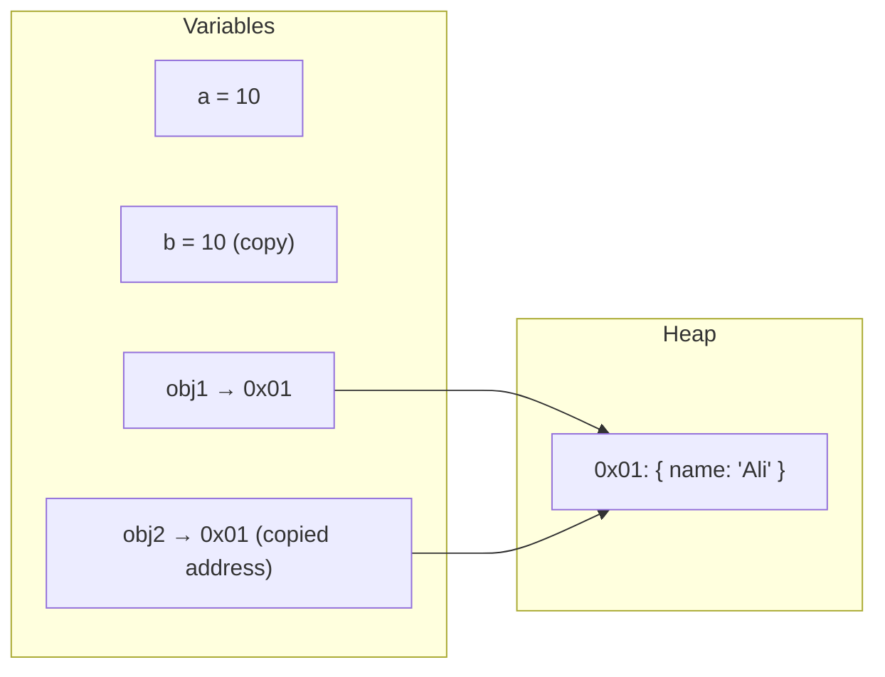
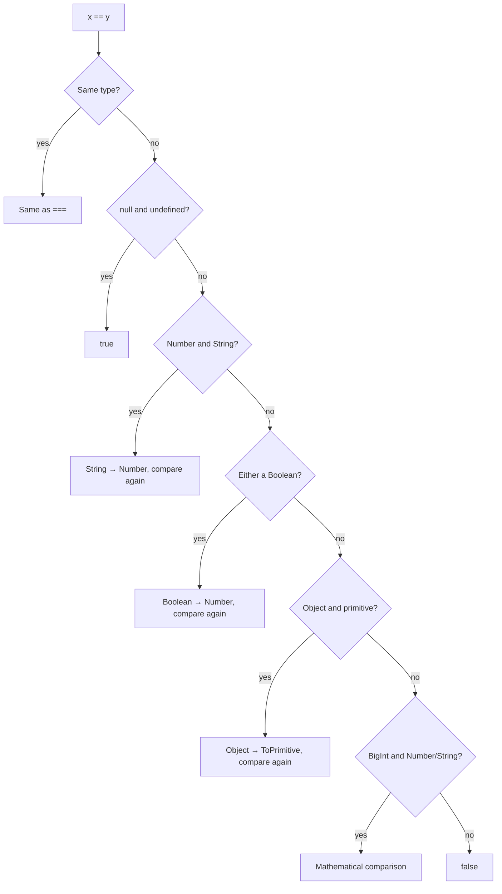
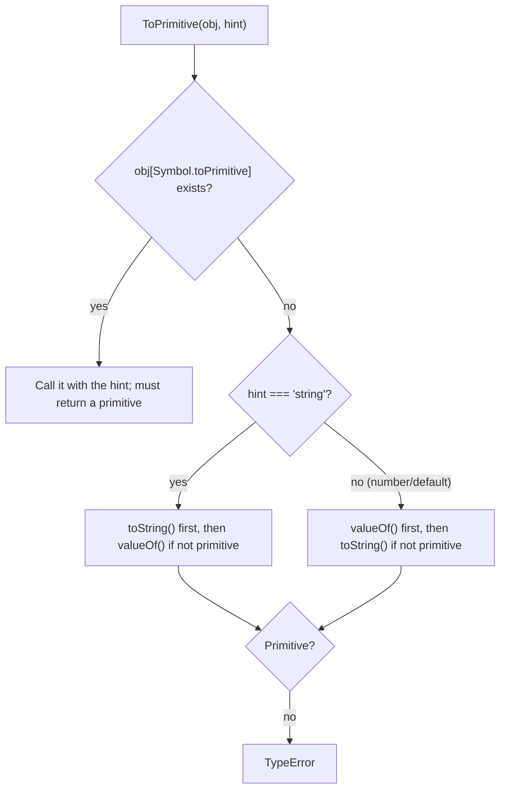

## Data types in JavaScript

JavaScript has eight data types: **seven primitives** and **object**.

| Type | Example | `typeof` | Note |
| --- | --- | --- | --- |
| `string` | `"hello"`, `` `x=${x}` `` | `"string"` | Immutable; UTF-16 |
| `number` | `42`, `3.14`, `NaN`, `Infinity`, `-0` | `"number"` | IEEE 754 double precision (64-bit) |
| `bigint` | `9007199254740993n` | `"bigint"` | Arbitrary-precision integers |
| `boolean` | `true`, `false` | `"boolean"` | |
| `undefined` | `undefined` | `"undefined"` | "No value assigned" |
| `null` | `null` | **`"object"`** | "Intentionally empty" — a historical typeof bug |
| `symbol` | `Symbol("id")` | `"symbol"` | A unique identifier; hidden property keys |
| `object` | `{}`, `[]`, `new Date()`, functions | `"object"` / `"function"` | Mutable; handled by reference |

### number and its limits

`number` is a **double-precision floating point** value. Consequences:

```js run
console.log(0.1 + 0.2);                          // 0.30000000000000004
console.log(0.1 + 0.2 === 0.3);                  // false
console.log(Math.abs(0.1 + 0.2 - 0.3) < Number.EPSILON); // true — the right comparison

console.log(Number.MAX_SAFE_INTEGER);            // 9007199254740991 = 2^53 - 1
console.log(9007199254740992 === 9007199254740993); // true! precision lost
console.log(9007199254740992n === 9007199254740993n); // false — BigInt is exact

console.log(1 / 0, -1 / 0, 0 / 0);               // Infinity -Infinity NaN
console.log(typeof NaN);                          // "number"
```

`0.1` has no exact base-2 representation (like ⅓ in base 10). For money, use **integers in the smallest unit** (cents) or a decimal library.

## Primitive vs reference

This distinction underpins mutation, equality, React props and immutability.



| Concept | Primitive | Object (reference) |
| --- | --- | --- |
| **Value** | The value itself lives in the variable | The variable holds a **reference** (address) to an object in the heap |
| **Copy on assignment** | The value is copied; independent | The **reference** is copied; both point to one object |
| **Mutation** | Impossible (immutable) | Possible; visible through every reference |
| **Identity** | Equality by value | Equality by **identity** (same object) |
| **Passing to a function** | The value is copied | The reference is copied (**call by sharing**) |

```js run
// primitive: independent copies
let a = 10;
let b = a;
b++;
console.log(a, b);                       // 10 11

// reference: one object, two references
const user1 = { name: "Ali" };
const user2 = user1;
user2.name = "Sara";
console.log(user1.name);                 // "Sara" — mutated through user2

// identity: two objects with equal content aren't equal
console.log({ x: 1 } === { x: 1 });     // false
console.log(user1 === user2);            // true — the same object
```

### Primitives are immutable

```js run sloppy
let text = "hello";
text[0] = "H";                 // ignored in sloppy mode; TypeError in strict mode (read-only property)
console.log(text);             // "hello"
const upper = text.toUpperCase();
console.log(text, upper);      // methods return new values
```

So why does `"hello".toUpperCase()` work if primitives have no methods? JavaScript temporarily wraps the primitive in a **wrapper object** (`String`, `Number`, `Boolean`, `Symbol`, `BigInt`) — **autoboxing** — calls the method from `String.prototype`, and throws the wrapper away.

### Call by sharing

JavaScript is always **pass by value**; for objects, the "value" is the reference itself:

```js run
function mutate(obj) {
  obj.count = 99;        // ✓ the original object changes (same reference)
}
function reassign(obj) {
  obj = { count: -1 };   // ✗ only rebinds the local variable
}

const data = { count: 0 };
mutate(data);
console.log(data.count);  // 99
reassign(data);
console.log(data.count);  // 99 — reassign had no effect on data
```

### Shallow vs deep copy

```js run
const original = { name: "Ali", address: { city: "Tehran" }, tags: ["a"] };

const shallow = { ...original };              // or Object.assign({}, original)
shallow.name = "Sara";                        // ✓ independent
shallow.address.city = "Shiraz";              // ✗ address is shared!
console.log(original.address.city);           // "Shiraz"

const deep = structuredClone(original);       // native deep copy
deep.address.city = "Tabriz";
console.log(original.address.city);           // "Shiraz" — untouched
```

| Method | Depth | Limitations |
| --- | --- | --- |
| `{ ...obj }`, `Object.assign`, `[...arr]` | Shallow | Nested objects stay shared |
| `JSON.parse(JSON.stringify(x))` | Deep | Breaks functions, `undefined`, symbols, Date (becomes a string), Map, Set, BigInt (throws) and circular references (throws) |
| `structuredClone(x)` | Deep | No functions or DOM nodes; class prototypes are lost; handles Date, Map, Set and circular references correctly |

## null vs undefined

| | `undefined` | `null` |
| --- | --- | --- |
| Meaning | "Not assigned / doesn't exist" | "Intentionally empty / no value" |
| Usually set by | The **engine** | The **programmer** |
| `typeof` | `"undefined"` | `"object"` (bug) |
| As a number (`Number()`) | `NaN` | `0` |
| In JSON | Property is dropped | Kept as `null` |
| Triggers default parameters | **Yes** | **No** |
| `== null` | `true` | `true` |
| `=== null` | `false` | `true` |

Sources of `undefined`: an unassigned variable, a missing property, an omitted argument, a function without `return`, `void 0`, an array hole.

```js run
function greet(name = "guest") { return "Hi " + name; }
console.log(greet(undefined));    // "Hi guest" — undefined triggers the default
console.log(greet(null));         // "Hi null"  — null is a value

console.log(JSON.stringify({ a: undefined, b: null }));  // {"b":null}
console.log(null + 1, undefined + 1);                     // 1 NaN

// nullish coalescing and optional chaining
const config = { retries: 0, timeout: null };
console.log(config.retries || 3);   // 3 ✗ — zero is falsy
console.log(config.retries ?? 3);   // 0 ✓ — only null/undefined
console.log(config.timeout ?? 5000);
console.log(config.server?.host ?? "localhost");
```

## Equality: `==`, `===` and `Object.is()`

| | `==` (loose) | `===` (strict) | `Object.is()` (SameValue) |
| --- | --- | --- | --- |
| Type conversion | **Yes** | No | No |
| `NaN` vs `NaN` | `false` | `false` | **`true`** |
| `+0` vs `-0` | `true` | `true` | **`false`** |
| `null` vs `undefined` | **`true`** | `false` | `false` |
| `"1"` vs `1` | `true` | `false` | `false` |
| Objects | Identity | Identity | Identity |
| Use | Only `x == null` | Default | `NaN` and `-0`; React's `useState` and `useEffect` |

```js run
console.log(NaN === NaN, Object.is(NaN, NaN));   // false true
console.log(0 === -0, Object.is(0, -0));         // true false
console.log(null == undefined, null === undefined); // true false
console.log(null == 0, null >= 0);               // false true  ← trap!
console.log([1, 2].includes(NaN), [NaN].includes(NaN), [NaN].indexOf(NaN)); // false true -1
```

`includes` uses the **SameValueZero** algorithm (like Object.is, but treats `+0` and `-0` as equal), while `indexOf` uses `===` — so `indexOf(NaN)` is always `-1`.

<Callout type="interview">
React compares previous and next state, and hook dependencies, with `Object.is`. That's why mutating an object and calling `setState` with the same reference doesn't re-render.
</Callout>

### The `==` algorithm (abstract equality)



Key points:

- `null` and `undefined` are `==` **only** to each other and themselves; not to `0`, `""` or `false`.
- A boolean is **always converted to a number first**: `true → 1`, `false → 0`.

### Solving `[] == false` step by step

```text
[] == false
→ Boolean to Number:          [] == 0
→ Object to primitive:        ToPrimitive([]) → [].valueOf() is an object → [].toString() → ""
                              "" == 0
→ String to Number:           0 == 0
→ true
```

And yet `[]` is **truthy**: `if ([])` runs! `if` uses `ToBoolean` (every object is truthy) while `==` uses the algorithm above.

```js run
console.log([] == false);      // true
console.log(!![]);             // true — [] is truthy
console.log([] == ![]);        // true! ![] = false → [] == false → true
console.log([0] == false);     // true:  "0" → 0
console.log([1, 2] == "1,2");  // true
console.log({} == "[object Object]"); // true
```

## Type coercion

`Type coercion` converts a value from one type to another:

- **Explicit:** `Number("42")`, `String(10)`, `Boolean(x)`, `parseInt`.
- **Implicit:** by operators: `"5" * 2`, `if (x)`, `` `${x}` ``, `x == y`.

All coercion goes through **four abstract operations** in the spec.

### ToBoolean

The simplest: there are only **8 falsy values**. **Everything else is truthy**:

| Falsy |
| --- |
| `false`, `0`, `-0`, `0n`, `""` (empty string), `null`, `undefined`, `NaN` |

```js run
const values = [[], {}, "0", "false", " ", new Boolean(false), -1, Infinity, () => {}];
console.log(values.map(Boolean)); // all true — even new Boolean(false), because it's an object
```

(`document.all` is the only falsy object — a historical exception.)

### ToNumber

| Input | Result |
| --- | --- |
| `undefined` | `NaN` |
| `null` | `0` |
| `true` / `false` | `1` / `0` |
| `""`, `"  "`, `"\n"` | `0` |
| `"42"`, `" 42 "` | `42` |
| `"42px"`, `"1,000"` | `NaN` |
| `"0x1F"`, `"0b11"`, `"1e3"` | `31`, `3`, `1000` |
| Symbol | `TypeError` |
| BigInt | `TypeError` with `+`; `Number(10n)` is allowed |
| Object | `ToPrimitive(hint: "number")`, then ToNumber |

```js run
console.log(Number(""), Number(" 12 "), Number("12px"), parseInt("12px"), parseFloat("3.5kg"));
console.log(+[], +[5], +[1, 2], +{}, +null, +undefined, +true, +"");
```

`parseInt` reads until the first invalid character; `Number` requires the whole string to be valid. Always give `parseInt` a **radix**: `parseInt("08", 10)`.

### ToString

| Input | Result |
| --- | --- |
| `null`, `undefined` | `"null"`, `"undefined"` |
| `-0` | `"0"` |
| `[1, [2, 3]]` | `"1,2,3"` |
| `[]` | `""` |
| `[null, undefined]` | `","` |
| `{}` | `"[object Object]"` |
| Symbol | `TypeError` implicitly; `String(sym)` is allowed |

### ToPrimitive

Used when an **object** must become a primitive. It takes a **hint**: `"number"`, `"string"` or `"default"`.



- Hint `"string"`: template literals, `String(obj)`, property keys.
- Hint `"number"`: arithmetic operators (`-`, `*`, `/`), `<`, `Number(obj)`.
- Hint `"default"`: binary `+` and `==`. (Date is the exception and treats default like string.)

```js run
const price = {
  amount: 42,
  valueOf() { return this.amount; },
  toString() { return `${this.amount} USD`; },
};
console.log(price * 2);        // 84  — hint number → valueOf
console.log(`${price}`);       // "42 USD" — hint string → toString
console.log(price + 1);        // 43 — hint default → valueOf

const temperature = {
  [Symbol.toPrimitive](hint) {
    return hint === "string" ? "25°C" : 25;
  },
};
console.log(`${temperature}`, temperature * 2, temperature + 1);
```

### The `+` operator

`+` is the only arithmetic operator with **two meanings**:

1. Apply `ToPrimitive` (hint default) to both sides.
2. **If either is a string → convert both to strings and concatenate.**
3. Otherwise convert both to numbers and add.

```js run
console.log(1 + "2");          // "12"
console.log(1 + 2 + "3");      // "33"  — left to right: 3 + "3"
console.log("1" + 2 + 3);      // "123"
console.log("5" - 2);          // 3    — minus is numeric only
console.log("5" * "2");        // 10
console.log(true + 1);         // 2
console.log([] + []);          // ""   — "" + ""
console.log([] + {});          // "[object Object]"
console.log({} + []);          // "[object Object]" (as a console statement it may show 0)
console.log(1 + null, 1 + undefined); // 1 NaN
```

### Relational comparisons `<` and `>`

- If **both are strings**: **lexicographic** comparison by code unit.
- Otherwise: both become numbers.

```js run
console.log("10" < "9");      // true  — string comparison: "1" < "9"
console.log("10" < 9);        // false — numeric
console.log(null >= 0, null > 0, null == 0); // true false false ← null becomes a number for >= but not for ==
console.log(undefined >= 0);  // false — NaN
console.log([2] > 1);         // true  — "2" → 2
```

## Classic trick questions

```js predict
console.log(typeof null);
console.log([] == false);
console.log([] === false);
console.log(typeof NaN);
console.log(NaN === NaN);
console.log(0.1 + 0.2 === 0.3);
console.log("b" + "a" + +"a" + "a");
console.log([1, 2, 3] + [4, 5, 6]);
console.log(true + true + "3");
console.log("3" - - "3");
```

```output
object
true
false
number
false
false
baNaNa
1,2,34,5,6
23
6
```

- `"b" + "a" + +"a" + "a"`: `+"a"` (unary plus) → `NaN` → `"ba" + NaN + "a"` → `"baNaNa"`.
- `[1,2,3] + [4,5,6]`: both become `"1,2,3"` and `"4,5,6"` → concatenated.
- `true + true + "3"`: `2 + "3"` → `"23"`.
- `"3" - - "3"`: `-"3"` → `-3`; `"3" - (-3)` → `6`.

```js predict
console.log(Math.max() < Math.min());
console.log([10, 1, 3].sort());
console.log(parseInt(0.0000005));
console.log(["1", "2", "3"].map(parseInt));
```

```output
true
[1, 10, 3]
5
[1, NaN, NaN]
```

- `Math.max()` with no arguments is `-Infinity`; `Math.min()` is `Infinity`.
- `sort` without a comparator compares elements **as strings**.
- `0.0000005` stringifies to `"5e-7"`, and parseInt reads up to the `e` → `5`.
- `map` passes three arguments: `parseInt("1", 0)` → 1, `parseInt("2", 1)` → NaN (invalid radix), `parseInt("3", 2)` → NaN (3 isn't a base-2 digit).

## Precise type detection

```js run
const typeOf = (v) => Object.prototype.toString.call(v).slice(8, -1);
console.log([null, [], new Date(), /x/, new Map(), 1n, () => {}].map(typeOf));

console.log(Array.isArray([]), Number.isNaN("abc"), isNaN("abc"));   // true false true
console.log(Number.isInteger(5.0), Number.isSafeInteger(2 ** 53));    // true false
```

The global `isNaN` coerces first (`isNaN("abc") === true`); `Number.isNaN` doesn't. Always use `Number.isNaN`.

## Common mistakes

- Using `==` anywhere except `x == null`.
- `||` for defaults when `0` or `""` are valid (use `??`).
- Comparing floats with `===`.
- `sort()` without a comparator for numbers.
- `typeof x === "object"` without checking for null.
- Shallow copies and surprise mutations of nested objects.
- Money in floating-point numbers.

## Interview questions

<QA q="What's the difference between `==`, `===` and `Object.is`?" level="junior" n={1}>
<Answer>

`==` converts types before comparing. `===` compares type and value without conversion. `Object.is` is like `===` with two differences: `Object.is(NaN, NaN)` is true and `Object.is(0, -0)` is false. For objects all three compare identity.

</Answer>
<Deep>

In the spec these are IsLooselyEqual, IsStrictlyEqual and SameValue; there's a fourth, SameValueZero (used by `includes`, `Map` and `Set`), which treats NaN as equal and ±0 as equal. React uses Object.is to bail out of setState and to compare dependencies.

</Deep>
<Mistake>

Saying `==` compares "only values" and `===` "values and types" without knowing the coercion rules — and claiming `===` works for NaN.

</Mistake>
<FollowUp>

When is `==` acceptable? (`x == null`, to check for null and undefined at once.)

</FollowUp>
</QA>

<QA q="Why is `[] == ![]` true?" level="mid" n={2}>
<Answer>

`![]` is evaluated first: `[]` is truthy, so `![]` is false. Now `[] == false`: the boolean becomes a number (0), the array becomes `""` via ToPrimitive and then 0; `0 == 0` → true.

</Answer>
<Deep>

The key is the difference between ToBoolean (true for any object) and the `==` algorithm, which converts objects to primitives. ToPrimitive on an array first calls valueOf (which returns the array itself — not a primitive), then toString (`""`).

</Deep>
<Mistake>

Thinking that since `[]` is truthy, `[] == true` must be true. Actually `[] == true` is false (`0 == 1`).

</Mistake>
<FollowUp>

What are `[0] == false` and `[1] == true`? (Both true.)

</FollowUp>
</QA>

<QA q="How do primitives and references differ? Is JavaScript pass-by-reference?" level="junior" n={3}>
<Answer>

Primitives are immutable and copied and compared by value. Objects are mutable; a variable holds a reference to them in the heap; assignment copies the reference and comparison is by identity. JavaScript is always pass-by-value — for objects the value passed is the reference (call by sharing): mutations are visible, reassigning the parameter isn't.

</Answer>
<Deep>

In the engine, small primitives (Smis in V8) live directly in registers or the stack, and others (strings, HeapNumbers) live in the heap but are immutable. String immutability enables interning and shared memory. In React the same distinction is why updates must be immutable: `setState` with the same reference makes Object.is return true and nothing renders.

</Deep>
<Mistake>

Saying "objects are passed by reference"; if that were true, `obj = {}` inside a function would change the outer variable.

</Mistake>
<FollowUp>

What can't `structuredClone` copy?

</FollowUp>
</QA>

<QA q="Explain ToPrimitive. What are `{} + []` and `[] + {}`?" level="senior" n={4}>
<Answer>

ToPrimitive converts an object to a primitive with a hint (number, string or default): first `Symbol.toPrimitive` if present; otherwise toString first for "string" and valueOf first for the others. `[] + {}` → `"" + "[object Object]"` → `"[object Object]"`. `{} + []` is the same as an expression, but at the start of a statement (e.g. in the console) `{}` parses as an empty block and `+[]` → `0` is shown.

</Answer>
<Deep>

Date is the only built-in that treats the default hint like string (`new Date() + 1` produces a string). `Symbol.toPrimitive` gives full control — e.g. a Money object that formats itself in template literals but is a number in arithmetic.

</Deep>
<Mistake>

Assuming console behaviour equals expression behaviour; the `{}` ambiguity between a block and an object literal.

</Mistake>
<FollowUp>

How would you make `obj == 1 && obj == 2 && obj == 3` true? (A valueOf that increments a counter each time.)

</FollowUp>
</QA>

## Recap

<Recap>

- JavaScript has seven primitive types (`string`, `number`, `bigint`, `boolean`, `undefined`, `null`, `symbol`) and one `object` type.
- `number` is a 64-bit float: `0.1 + 0.2 !== 0.3`, and integers are only exact up to `Number.MAX_SAFE_INTEGER`.
- Primitives are compared and copied by value, objects by reference; argument passing is "call by sharing".
- Shallow copies (spread, `Object.assign`) copy only the first level; use `structuredClone` for a deep copy.
- `undefined` means "no value given yet", `null` means "intentionally empty".
- `===` compares without type conversion; `==` coerces first; `Object.is` even handles `NaN` and `-0` correctly.
- Coercion uses ToBoolean, ToNumber and ToString, and objects are first turned into primitives with ToPrimitive (`valueOf`/`toString`).
- There are eight falsy values: `false`, `0`, `-0`, `0n`, `""`, `null`, `undefined`, `NaN`; everything else — even `[]` and `{}` — is truthy.
- `+` concatenates if either side is a string; other arithmetic operators convert to numbers.

</Recap>
