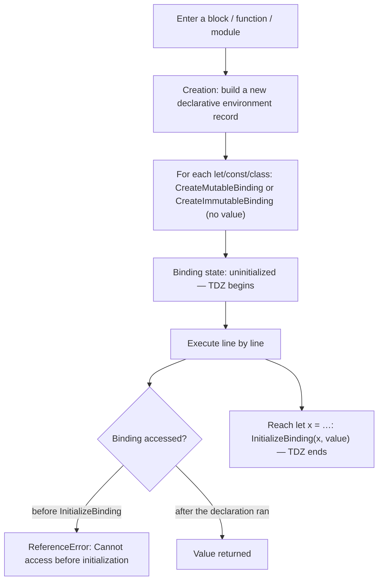

## Three ways to declare a variable

JavaScript has three declaration keywords: `var` (since the beginning), and `let` and `const` (since ES2015). The difference isn't just "can it change"; it's about **scope, when initialization happens, and how the binding is recorded in the environment record**.

| Feature | `var` | `let` | `const` |
| --- | --- | --- | --- |
| Scope | **Function** (or global) | **Block** | **Block** |
| Hoisted | Yes | Yes | Yes |
| Value when hoisted | `undefined` | **Uninitialized (TDZ)** | **Uninitialized (TDZ)** |
| Access before the declaration line | `undefined` | `ReferenceError` | `ReferenceError` |
| Redeclaration in the same scope | Allowed | `SyntaxError` | `SyntaxError` |
| Reassignment | Allowed | Allowed | `TypeError` |
| Initializer required | No | No | **Yes** |
| Property on the global object (in scripts) | **Yes** (`window.x`) | No | No |
| In a `for` loop | One binding for the whole loop | **A new binding per iteration** | A new binding per iteration (if unchanged) |

## Scope: function vs block

A `block` is anything between `{` and `}`: the body of `if`, `for`, `while`, `try`, or a standalone block.

```js run
function demo() {
  if (true) {
    var a = "var";
    let b = "let";
    const c = "const";
  }
  console.log(a);              // "var" — var ignores blocks
  console.log(typeof b);       // "undefined" — b doesn't exist outside the block
  try {
    console.log(b);
  } catch (error) {
    console.log(error.name + ": " + error.message);
  }
}
demo();
```

`var` is only scoped to **functions**. That let variables leak out of blocks and caused classic bugs.

## const: a constant binding, not a constant value

`const` means the **binding** (the name-to-value link) can't change — not that the value is immutable:

```js run
const user = { name: "Ali" };
user.name = "Sara";            // ✓ mutating the object
console.log(user);

const list = [1, 2];
list.push(3);                  // ✓
console.log(list);

try {
  user = {};                   // ✗ changing the binding
} catch (error) {
  console.log(error.name + ": " + error.message);
}

const frozen = Object.freeze({ level: 1 });
frozen.level = 2;              // strict mode → TypeError; sloppy mode → silently ignored
```

For real immutability: `Object.freeze` (shallow), a recursive deep freeze, or immutable data structures.

## Redeclaration and reassignment

```js
var x = 1;
var x = 2;      // ✓ var allows redeclaration — a source of bugs in big files

let y = 1;
let y = 2;      // ✗ SyntaxError: Identifier 'y' has already been declared
                //   (a parse-time error; no line of the script runs)

let z = 1;
z = 2;          // ✓ reassignment

const w = 1;
w = 2;          // ✗ TypeError: Assignment to constant variable (at runtime)
```

## Hoisting — a quick look

`Hoisting` means **declarations are registered in the environment record during the creation phase, before any line runs**. Code doesn't physically move. The difference between `var` and `let/const` is **the value they're registered with**:

- `var` → registered and **immediately initialized to `undefined`**.
- `let`, `const`, `class` → registered but left **uninitialized** until execution reaches the declaration.

Full details in [Execution context & hoisting](/javascript/execution-context).

## TDZ — the temporal dead zone

### Definition

The `TDZ (temporal dead zone)` is the period **from the start of a scope until the declaration line of a `let`, `const` or `class` executes**. During it the binding **exists but is uninitialized**, and any access throws a `ReferenceError`.

```text
{                                   ◄── block starts: binding "a" is created (uninitialized)
   ┆  console.log(a);  // ✗           ┐
   ┆  typeof a;        // ✗           │  TDZ
   ┆  a = 5;           // ✗           ┘
   let a = 10;                      ◄── declaration runs: a is initialized → TDZ ends
   console.log(a);     // ✓ 10
}
```

### Why "temporal"?

Because the TDZ depends on **execution time**, not **position in the source**. A function written above the declaration but called **after** it works fine:

```js run
function read() {
  return value;      // textually before the let
}

// read();          // ✗ calling here: ReferenceError (still in the TDZ)
let value = 42;
console.log(read()); // ✓ 42 — the TDZ is over when the call happens
```

### Why does the TDZ exist?

1. **Catching bugs:** reading a variable before it's initialized is almost always a bug. `var` silently returns `undefined`; the TDZ throws a clear error.
2. **Making `const` meaningful:** if `const` were hoisted with undefined like var, a constant could have two different values (first undefined, then the real one) — contradicting the very idea of a constant.
3. **Predictable semantics** for module import bindings and classes.

### The TDZ at runtime: lexical environments and bindings



In the ECMAScript spec:

- Entering a block creates a new **declarative environment record**.
- A binding is created for each `let`/`const` **without calling InitializeBinding**.
- `GetBindingValue` on an uninitialized binding throws a `ReferenceError`.
- When execution reaches `let x = expr`, `expr` is evaluated first and then `InitializeBinding` is called.
- For `let x;` with no initializer, it's initialized to `undefined` when that line runs.

### TDZ vs undefined

| | Variable in the TDZ | Variable holding `undefined` |
| --- | --- | --- |
| Binding exists? | Yes | Yes |
| Initialized? | **No** | Yes (with `undefined`) |
| Reading it | `ReferenceError` | `undefined` |
| `typeof x` | **`ReferenceError`** | `"undefined"` |
| Example | `let` before its line | `var` before its line, or `let x;` after the declaration |

Important: `typeof` is usually "safe" and returns `"undefined"` for undeclared variables — **but it throws for a variable in the TDZ**:

```js run
console.log(typeof neverDeclared);   // "undefined" — no binding at all
try {
  console.log(typeof inTdz);         // ReferenceError — binding exists but is uninitialized
} catch (error) {
  console.log(error.name + ": " + error.message);
}
let inTdz = 1;
```

### Example 1: the basics

```js predict
console.log(a);
let a = 10;
```

```output
Uncaught ReferenceError: Cannot access 'a' before initialization
```

`a` was registered during the script/module's creation phase (so the message isn't "not defined"), but it's in the TDZ.

### Example 2: the TDZ inside a block

```js predict
let a = 1;
{
  console.log(a);
  let a = 20;
}
```

```output
Uncaught ReferenceError: Cannot access 'a' before initialization
```

Many expect `1` (from the outer scope). But entering the block creates a new `a` binding in **the block's environment record**, which **shadows** the outer `a`. Identifier lookup starts in the current environment, finds the binding there (uninitialized or not) and never looks outward.

### Example 3: the TDZ in default parameters

Parameters are initialized left to right, and each one is in the TDZ until initialized:

```js run
function ok(a, b = a * 2) {
  return [a, b];
}
console.log(ok(3));             // [3, 6]

function broken(a = b, b = 2) {
  return [a, b];
}
try {
  broken();
} catch (error) {
  console.log(error.name + ": " + error.message); // b is still in the TDZ
}
```

### Example 4: self-reference

```js run
try {
  let x = x + 1;   // the right side is evaluated before InitializeBinding
} catch (error) {
  console.log(error.name + ": " + error.message);
}

var y = y + 1;     // var: y is undefined at evaluation time → NaN
console.log(y);
```

### Example 5: the TDZ in nested scopes

```js predict
const value = "outer";

function test() {
  console.log(value);
  if (true) {
    const value = "inner";
  }
}
test();
```

```output
outer
```

**No** error here: `const value = "inner"` lives in the `if` block's environment, not the function's. When `console.log(value)` runs, the function environment has no `value` binding, so lookup continues outward and finds `"outer"`. The TDZ only applies **within its own scope**.

```js predict
const value = "outer";

function test() {
  console.log(value);
  const value = "inner";
}
test();
```

```output
Uncaught ReferenceError: Cannot access 'value' before initialization
```

This time `const value` is in the function's own environment and shadows the outer `value`.

### Example 6: the TDZ and closures

```js run
function makeCounter() {
  const increment = () => count++;   // closes over the "count" binding in this scope
  // increment();                    // ✗ still in the TDZ here
  let count = 0;
  increment();                        // ✓ count is initialized now
  increment();
  return count;
}
console.log(makeCounter());           // 2
```

A closure refers to the **binding**, not a value. Creating the closure during the TDZ is fine; **calling** it before initialization isn't.

### The TDZ and `class`

`class` behaves like `let`. Unlike function declarations, you can't use it before its definition:

```js run
try {
  new Animal();
} catch (error) {
  console.log(error.name + ": " + error.message);
}
class Animal {}

console.log(typeof greet); // "function" — function declarations are fully hoisted
function greet() {}
```

Even in its own `extends` clause, the class name is in the TDZ: `class A extends A {}` → `ReferenceError`.

### Comparing `let`, `const` and `class`

| | `let` | `const` | `class` |
| --- | --- | --- | --- |
| TDZ | ✓ | ✓ | ✓ |
| Block scope | ✓ | ✓ | ✓ |
| Reassignment | ✓ | ✗ | ✓ (of the outer name; inside the class body the name is immutable) |
| Initializer required | ✗ | ✓ | — |
| Body in strict mode | — | — | ✓ |

### The TDZ in module imports and circular dependencies

Import bindings are **live**, and with circular dependencies a binding can still be in its TDZ:

```js
// a.js
import { b } from "./b.js";
export const a = "A";
console.log(b);

// b.js
import { a } from "./a.js";
console.log(a);            // ✗ ReferenceError — a.js hasn't reached `export const` yet
export const b = "B";
```

If `a.js` is the entry point, `b.js` runs first (dependencies are evaluated first), and at that moment `a` is still in its TDZ. This is a common cause of mysterious "Cannot access before initialization" errors in large React projects.

## The global scope: var vs let

In a **classic script** (not a module), top-level `var` and function declarations become properties of the global object; `let` and `const` live in a separate declarative record:

```js run sloppy
var a = 1;
let b = 2;
console.log(globalThis.a);  // 1
console.log(globalThis.b);  // undefined
```

This snippet runs as a sloppy-mode classic script. In an **ES module**, neither ends up on the global object, because each module has its own scope.

## `let` in loops — the classic question

```js predict
for (var i = 0; i < 3; i++) {
  setTimeout(() => console.log("var", i), 0);
}
for (let j = 0; j < 3; j++) {
  setTimeout(() => console.log("let", j), 0);
}
```

```output
var 3
var 3
var 3
let 0
let 1
let 2
```

- With `var` there is **one** `i` binding for the whole function/script. All three closures point to it, and when the callbacks run (after the loop), its value is `3`.
- With `let`, the spec creates a **fresh environment per iteration** and copies the value into it (`CreatePerIterationEnvironment`). Each closure gets its own iteration's binding.

The pre-ES6 fix with an IIFE:

```js
for (var i = 0; i < 3; i++) {
  (function (captured) {
    setTimeout(() => console.log(captured), 0);
  })(i);
}
```

## Best practices

1. Default to **`const`**. It signals the binding won't change and makes code predictable.
2. Use **`let`** only when you genuinely reassign (counters, accumulators).
3. Don't use **`var`** in new code (ESLint: `no-var`, `prefer-const`).
4. Declare variables in the **smallest possible scope**, close to where they're used — the TDZ will rarely bite.

## Common mistakes

- Thinking `let` and `const` aren't hoisted. **They are**; they just aren't initialized.
- Thinking `const` makes values immutable.
- Assuming `typeof` is always safe.
- Expecting access to a same-named outer variable before an inner `let` (shadowing).
- `var` in loops with async callbacks.
- Circular imports producing obscure TDZ errors.

## Interview questions

<QA q="What is the TDZ and why does it exist?" level="mid" n={1}>
<Answer>

The period from the start of a scope until a `let`, `const` or `class` declaration executes, during which the binding exists but is uninitialized; any access throws a `ReferenceError`. It exists to surface use-before-initialization bugs and to guarantee a `const` never has two different values.

</Answer>
<Deep>

During the creation phase, `let/const` bindings are created in a declarative environment record, but `InitializeBinding` isn't called until execution reaches the declaration. It's "temporal" because it depends on execution order, not source order: a function defined before the declaration but called after it accesses the variable without error.

</Deep>
<Mistake>

Saying "let and const aren't hoisted". If they weren't, `let a = 1; { console.log(a); let a = 2; }` would print 1 — but it throws a ReferenceError.

</Mistake>
<FollowUp>

Why does `typeof x` throw for a variable in the TDZ but not for an undeclared variable?

</FollowUp>
</QA>

<QA q="What does this print? `let x = 1; function f() { console.log(x); let x = 2; } f();`" level="mid" n={2}>
<Answer>

`ReferenceError: Cannot access 'x' before initialization`. The inner `let x` shadows the outer `x` and is still in its TDZ when `console.log` runs.

</Answer>
<Deep>

Identifier resolution starts at the current environment record. The function environment has an `x` binding (hoisted), so lookup stops there and never reaches the outer scope; because that binding is uninitialized, it throws.

</Deep>
<Mistake>

Answering "1" on the grounds that the inner x hasn't been declared yet, so the outer one should be read.

</Mistake>
<FollowUp>

What if `let x = 2` were inside an `if` in the function? (Then `1` is printed, because the binding lives in the if block's environment.)

</FollowUp>
</QA>

<QA q="Explain the full difference between var, let and const." level="junior" n={3}>
<Answer>

`var` is function-scoped, hoisted and initialized to undefined, allows redeclaration and creates a property on window in global scripts. `let` and `const` are block-scoped, hoisted but in the TDZ until their declaration, and redeclaring them in the same scope is a `SyntaxError`. `const` forbids reassignment but doesn't make object contents immutable.

</Answer>
<Deep>

In a `for` loop, `let` creates a fresh binding per iteration, so closures capture that iteration's value; `var` has one shared binding. For the engine, `const` enables some optimizations (like constant folding), but the main reason to use it is readability and bug prevention.

</Deep>
<Mistake>

Saying "const means the value is constant" or "let isn't hoisted".

</Mistake>
<FollowUp>

Why is `const` allowed in `for...of` but `for (const i = 0; i < 3; i++)` throws? (In for...of each iteration initializes a new binding; in a classic for, `i++` mutates the same binding → TypeError.)

</FollowUp>
</QA>

<QA q="Why does a `for` loop with `var` and `setTimeout` print 3 three times? Give two fixes." level="junior" n={4}>
<Answer>

`var` has one binding for the whole function; all three callbacks close over the same `i`, and by the time they run (after the loop), `i` is 3. Fixes: `let` (a new binding per iteration) or an IIFE that receives the current value as a parameter. A third option: `setTimeout(fn, 0, i)`, which passes the argument to the callback.

</Answer>
<Deep>

It combines two concepts: closures (callbacks access the binding, not a snapshot of the value) and the event loop (setTimeout callbacks run after the synchronous code finishes). In the spec, `CreatePerIterationEnvironment` creates a new environment per iteration for let, copying the previous value.

</Deep>
<Mistake>

Blaming setTimeout alone; the same happens with any stored closure (e.g. an array of functions).

</Mistake>
<FollowUp>

If instead of setTimeout we push functions into an array and call them later, what's the result with var? (Still 3, 3, 3.)

</FollowUp>
</QA>

## Recap

<Recap>

- `var` is function-scoped; `let` and `const` are block-scoped, so `var` leaks out of blocks.
- `const` freezes the binding, not the value; the contents of a `const` object or array can still change.
- `var` can be redeclared; `let` and `const` can only be declared once per scope.
- All three are hoisted, but `var` is initialised to `undefined` while `let`/`const`/`class` stay uninitialised.
- The TDZ is the time between entering the scope and reaching the declaration; accessing the variable then throws `ReferenceError`.
- The TDZ is temporal, not spatial: a function defined before the declaration but called after it is fine.
- A global `var` creates a property on `window`; `let` and `const` don't.
- `let` in a `for` loop creates a fresh binding per iteration, which is why the classic `setTimeout`-in-a-loop bug happens with `var` but not `let`.
- Rule of thumb: default to `const`, use `let` when needed, never `var`.

</Recap>
