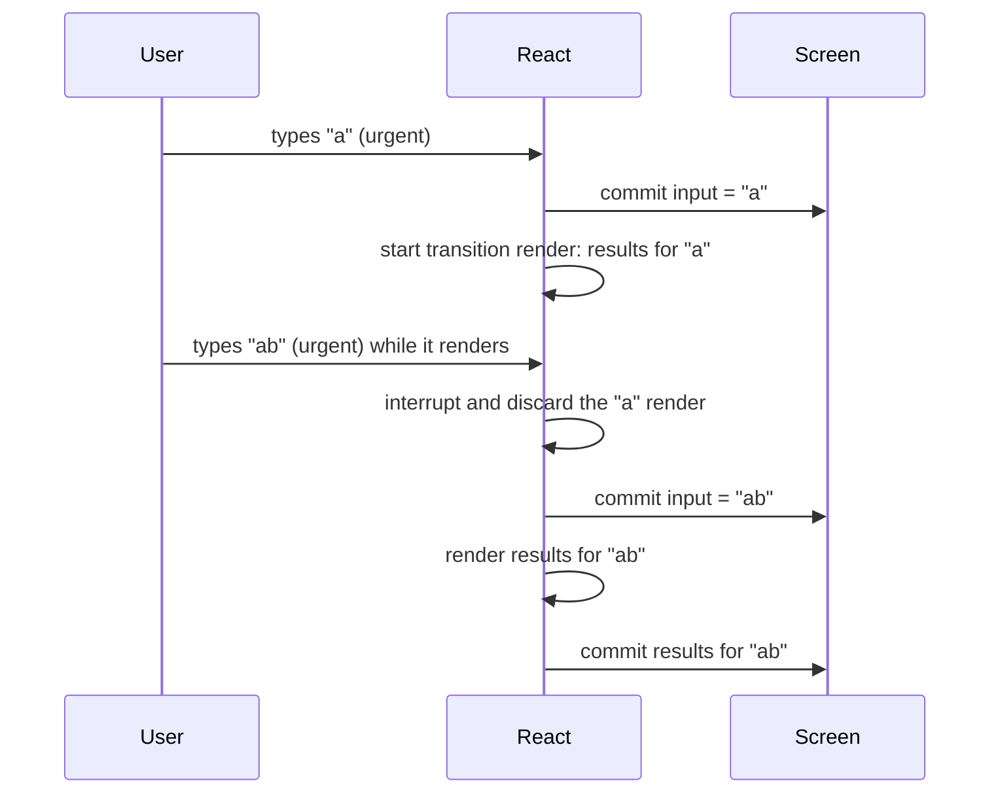
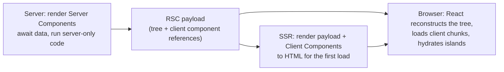

## What this chapter covers

The previous chapters were about writing components. This one is about **when and where** they run:

- **Concurrent rendering**: React can prepare a new UI in the background, interrupt that work for something urgent, and throw it away if it becomes outdated. You control it with `useTransition` and `useDeferredValue`.
- **Suspense**: a component can say "I'm not ready yet", and React shows a fallback for that part of the tree.
- **Rendering on the server**: SSR, streaming and hydration turn components into HTML before JavaScript loads.
- **React Server Components**: components that run *only* on the server and never ship their code to the browser.

These four ideas build on each other, and on [Fiber and lanes](/react/rendering). Senior interviews almost always reach at least one of them.

## Concurrent rendering

### The problem: rendering blocks the main thread

Before React 18, rendering was **synchronous**: once React started rendering an update, it finished the whole tree before the browser could do anything else. Type into a search box that filters 20,000 items, and each keystroke blocks the main thread for, say, 200ms. The input freezes, characters appear in bursts.

Debouncing hides the problem by rendering less often, but the render still blocks when it finally happens. What we want is different: **render the expensive list without blocking typing**.

### The idea: urgent and non-urgent updates

Concurrent React splits updates into two kinds:

- **Urgent** updates reflect direct interaction: typing, clicking, pressing. Users expect them immediately.
- **Transition** updates move the UI from one view to another: the filtered results, a new tab's content. A short delay is fine; a frozen input is not.

Transition renders happen in **small chunks**: React renders a few fibers, then checks (about every 5ms) whether something more important is waiting ([the work loop](/react/rendering)). If the user types again, React **pauses or abandons** the half-finished transition render, handles the keystroke, then starts the transition again with the latest state. Nothing is committed until the transition render completes, so the user never sees a half-rendered screen.



### useTransition

<Api name="useTransition()" sig="const [isPending, startTransition] = useTransition()" returns="a flag that is true while a transition is pending, and a function that starts one." mutates="no">

- Takes no arguments.
- `isPending`: `true` from the moment you call `startTransition` until the transition's render is committed. Use it to show that something is happening without hiding the current UI.
- `startTransition(action)`: calls `action` immediately; every state update **scheduled synchronously inside it** is marked as a transition. The action can be async in React 19 ([Actions](/react/react-19)); updates after an `await` need another `startTransition`.
- State setters for **controlled inputs must not be transitions**: the input has to show the typed character immediately.
- If the same state gets an urgent update during a pending transition, the urgent one is applied first and the transition re-renders on top of it.

</Api>

There's also a standalone `startTransition` exported from `react` for code outside components (a router, a store). It works the same but doesn't give you `isPending`.

```jsx live
import { memo, useState, useTransition } from 'react'

// Deliberately slow: every item burns ~0.3ms
const SlowItem = memo(function SlowItem({ text }) {
  const start = performance.now()
  while (performance.now() - start < 0.3) {}
  return <li>{text}</li>
})

const SlowList = memo(function SlowList({ query }) {
  const items = []
  for (let i = 0; i < 300; i++) items.push(<SlowItem key={i} text={`${query} result #${i}`} />)
  return <ul style={{ height: 120, overflow: 'auto' }}>{items}</ul>
})

export default function App() {
  const [text, setText] = useState('') // urgent: what the input shows
  const [query, setQuery] = useState('') // transition: what the list shows
  const [useT, setUseT] = useState(true)
  const [isPending, startTransition] = useTransition()

  function handleChange(e) {
    setText(e.target.value) // always urgent
    if (useT) startTransition(() => setQuery(e.target.value))
    else setQuery(e.target.value) // blocks typing for ~100ms per keystroke
  }

  return (
    <>
      <label>
        <input type="checkbox" checked={useT} onChange={(e) => setUseT(e.target.checked)} /> use a transition
      </label>
      <p>
        <input value={text} onChange={handleChange} placeholder="type fast…" />{' '}
        {isPending && <span>updating…</span>}
      </p>
      <div style={{ opacity: isPending ? 0.5 : 1 }}>
        <SlowList query={query} />
      </div>
    </>
  )
}
```

Type quickly with the box unchecked: the input stutters. Check it: the input stays smooth, the list catches up and fades while it's stale.

### useDeferredValue

Sometimes you don't own the state update: the value comes in as a prop or from a hook. **`useDeferredValue`** lets a part of the UI **lag behind** a value.

<Api name="useDeferredValue()" sig="const deferred = useDeferredValue(value, initialValue?)" returns="during urgent renders, the previous value; then the latest value, rendered in a background transition." mutates="no">

- `value`: the value you want to defer, usually a primitive or a memoized object (a new object every render would restart the background render every time).
- `initialValue` (optional, React 19): the value to use on the component's first render, before any deferred render. Without it, the first render already uses `value`.
- On an update, React first re-renders with the **old** deferred value (fast, because memoized children skip), commits that, then starts a background render with the new value. If `value` changes again before that finishes, the background render is restarted.
- It only helps when the slow child is wrapped in `memo` (or compiled by the React Compiler); otherwise the urgent render re-renders the slow child anyway.

</Api>

```jsx live
import { memo, useDeferredValue, useState } from 'react'

const SlowList = memo(function SlowList({ query }) {
  const start = performance.now()
  while (performance.now() - start < 80) {} // pretend the list is expensive
  return <p>Results for “{query}”</p>
})

export default function App() {
  const [query, setQuery] = useState('')
  const deferredQuery = useDeferredValue(query)
  const isStale = query !== deferredQuery // the list is showing an older query

  return (
    <>
      <input value={query} onChange={(e) => setQuery(e.target.value)} placeholder="type fast…" />
      <div style={{ opacity: isStale ? 0.5 : 1, transition: 'opacity 0.2s' }}>
        <SlowList query={deferredQuery} />
      </div>
    </>
  )
}
```

| | `useTransition` | `useDeferredValue` |
| --- | --- | --- |
| You wrap | the **state update** | the **value** you read |
| Use when | you call the setter (event handler, Action) | the value comes from props, a hook or a library |
| Pending signal | `isPending` | `value !== deferredValue` |
| Supports async work | yes (Actions) | no |

<Callout type="note">
**Transitions vs debounce/throttle.** Debouncing waits a fixed time and always does the full work; on a fast device that's wasted delay, on a slow one it still blocks. A transition starts immediately, adapts to the device, and is interruptible. Debounce is still right for limiting **network requests**; transitions are for **rendering** cost.
</Callout>

## Suspense

### Declaring loading states

**`<Suspense>`** lets a part of the tree wait for something (code, data, an image) while showing a fallback, instead of every component managing its own `isLoading`.

<Api name="<Suspense>" sig="<Suspense fallback={node}>…</Suspense>" returns="its children, or the fallback while any child is suspended." mutates="no">

- `children`: the UI that may suspend.
- `fallback`: what to show instead, usually a skeleton or spinner. Can be any React node, including `null`.
- A component **suspends** when it reads something not ready yet: a [`lazy`](/react/performance) component whose code is loading, a pending Promise read with [`use`](/react/react-19), or data from a Suspense-enabled library or framework. Fetching inside an Effect does **not** suspend.
- React shows the **closest** Suspense boundary above the suspended component. When everything inside is ready, the fallback is replaced in one go.
- While suspended, the children's state is **not kept** on the first mount (there's nothing to keep), but on later updates an already-shown boundary keeps its state hidden behind the fallback.

</Api>

### Nested boundaries: reveal in stages

One boundary means "show nothing until everything is ready". Nested boundaries let you reveal the page in a designed order:

```jsx live
import { Suspense, use, useState } from 'react'

const cache = new Map()
function load(key, ms) {
  // Cached by key, so the same Promise is returned on every render
  if (!cache.has(key)) cache.set(key, new Promise((r) => setTimeout(() => r(`${key} ✓`), ms)))
  return cache.get(key)
}

function Part({ name, ms }) {
  const value = use(load(name, ms))
  return <p>{value}</p>
}

export default function App() {
  const [run, setRun] = useState(0)
  return (
    <>
      <button onClick={() => { cache.clear(); setRun(run + 1) }}>reload</button>
      <div key={run}>
        <Suspense fallback={<p>⏳ loading the page shell…</p>}>
          <Part name="header" ms={400} />
          <Suspense fallback={<p>⏳ loading posts…</p>}>
            <Part name="posts" ms={1500} />
          </Suspense>
          <Suspense fallback={<p>⏳ loading sidebar…</p>}>
            <Part name="sidebar" ms={900} />
          </Suspense>
        </Suspense>
      </div>
    </>
  )
}
```

The header appears after 0.4s with both inner fallbacks, the sidebar at 0.9s, the posts at 1.5s. Each boundary is an independent loading unit. Design boundaries around **what the user perceives as a unit**: one spinner per meaningful section, not one per component.

### Transitions keep the old UI instead of a fallback

If an **already visible** boundary suspends because of a normal (urgent) update, React replaces its content with the fallback, which can feel like a flash. If the update is a **transition**, React keeps showing the current content until the new content is ready (and `isPending` lets you show a subtle indicator). This is why routers wrap navigation in `startTransition`: you stay on the old page until the new one can render, instead of seeing a blank spinner.

### The order of reveal and throttling

To avoid "popcorn" UI, React **throttles** reveals: boundaries that resolve close together are shown together, and once a fallback is shown it stays for a minimum time (about 300ms) so it doesn't flicker. In React 19, when one sibling suspends, React commits the fallback immediately and then **pre-warms** the other siblings in the background, so their own data requests start early instead of waiting.

## Rendering on the server

### Why render on the server

A client-rendered app (CSR) sends an almost empty HTML page and a big JavaScript bundle. The user sees nothing until the JavaScript downloads, parses, runs, and fetches data. That hurts **First Contentful Paint** and [LCP](/tooling/web-performance), and search engines and link previews see an empty page.

**Server-side rendering (SSR)** runs your components on the server to produce HTML, so the browser can show content immediately. Then JavaScript loads and **hydrates** that HTML to make it interactive.

| Strategy | HTML produced | Good for | Cost |
| --- | --- | --- | --- |
| **CSR** (client-side) | in the browser | apps behind a login, highly interactive tools | slow first paint, poor SEO |
| **SSR** (per request) | on the server, every request | personalized or frequently changing pages | server work per request |
| **SSG** (static generation) | at build time | docs, blogs, marketing pages | rebuild to update |
| **ISR** (incremental static) | at build time, regenerated in the background after N seconds | large catalogs that change occasionally | framework/host support |
| **Streaming SSR** | on the server, sent in chunks as Suspense boundaries resolve | pages with slow parts | needs streaming support end to end |
| **Partial pre-rendering** | static shell at build time + dynamic holes streamed per request | mostly static pages with a few dynamic parts | framework support (`prerender` + `resume`) |

### Hydration

**Hydration** is React attaching to server-rendered HTML instead of creating new DOM: it renders the components in the browser, walks the existing DOM in parallel, checks that they match, and attaches event listeners and refs.

```jsx
// Client entry for a server-rendered page
import { hydrateRoot } from 'react-dom/client'

hydrateRoot(document.getElementById('root'), <App />, {
  onRecoverableError: (error) => report(error), // e.g. mismatches React fixed itself
})
```

<Steps>
<Step title="Server renders HTML">
`renderToPipeableStream(<App />)` (Node) or `renderToReadableStream(<App />)` (Web streams: Deno, Bun, edge runtimes, Node 18+) produces HTML. Effects don't run on the server, and neither do event handlers.
</Step>
<Step title="Browser shows the HTML">
The page is visible, but buttons don't work yet: there are no listeners.
</Step>
<Step title="JavaScript loads and hydrateRoot runs">
React renders the same tree in the browser and adopts the existing DOM nodes instead of creating them.
</Step>
<Step title="Effects run, the page is interactive">
From now on it's a normal client React app.
</Step>
</Steps>

### Hydration mismatches

Hydration assumes the first client render produces **exactly the same output** as the server. If it doesn't, React logs a mismatch error with a diff and, for the affected Suspense boundary (or the whole root), throws away the server HTML and renders on the client, which is slower and may flash.

Common causes and fixes:

| Cause | Fix |
| --- | --- |
| `Date.now()`, `new Date().toLocaleString()`, `Math.random()` in render | pass the value from the server, or render it after mount (`useEffect` + state) |
| `typeof window !== 'undefined' ? A : B` in render | render the same thing first, switch in an Effect; or `use(browser())` for client-only parts ([19.3](/react/react-19)) |
| reading `localStorage` (theme, auth) during render | read it in an Effect, or use a cookie the server can read too |
| invalid HTML nesting (`<div>` inside `<p>`, `<a>` inside `<a>`) | fix the markup: the browser's parser rearranges it before React sees it |
| browser extensions changing the DOM | React 19 ignores most of these in `<head>`/`<body>`; nothing to fix |

For a single unavoidable difference (a timestamp), add `suppressHydrationWarning` to that element. It works one level deep and only for text and attributes.

The usual "client only" pattern:

```jsx
function LocalTime({ iso }) {
  const [text, setText] = useState(null) // server and first client render agree: null
  useEffect(() => setText(new Date(iso).toLocaleTimeString()), [iso])
  return <time dateTime={iso}>{text ?? '—'}</time>
}
```

### Streaming SSR and selective hydration

With `renderToString` (the old API), the server must wait for **all** data before sending any HTML, and the client must hydrate the **whole** page before any part is interactive. Two waterfalls.

Streaming fixes both with Suspense boundaries:

1. The server sends the shell HTML immediately, with fallbacks where boundaries are still waiting.
2. When a boundary's data is ready, the server streams its HTML in the same response, plus a tiny inline script that swaps it into place. No extra request.
3. **Selective hydration**: the client hydrates each boundary independently, as soon as its code and HTML are there. If the user clicks a part that isn't hydrated yet, React **prioritizes hydrating that boundary** first, then replays the click.

```js
// Node server (Express) with streaming
import { renderToPipeableStream } from 'react-dom/server'

app.get('/', (req, res) => {
  const { pipe } = renderToPipeableStream(<App />, {
    bootstrapScripts: ['/client.js'], // the hydrateRoot entry
    onShellReady() {
      // everything outside Suspense boundaries is ready: start sending
      res.setHeader('Content-Type', 'text/html')
      pipe(res)
    },
    onShellError(error) {
      res.status(500).send('<h1>Something went wrong</h1>')
    },
    onError(error) {
      console.error(error) // errors inside boundaries: those fall back to client rendering
    },
  })
})
```

`onAllReady` fires when everything (including all boundaries) is rendered: use it instead of `onShellReady` for crawlers or static generation, where you want complete HTML.

## React Server Components

### The problem with SSR alone

SSR renders HTML on the server, but **all component code still ships to the browser** for hydration. A blog post component that uses a 300 KB markdown library and a syntax highlighter sends both to every visitor, just to re-render HTML they already have. And data fetching still happens either in a framework-specific loader or in the browser.

**React Server Components (RSC)** add a new kind of component that runs **only on the server** (at request time, or at build time) and is **never hydrated**. Its code stays on the server; only its rendered output is sent.

### Server and Client Components

| | Server Component (default in RSC frameworks) | Client Component (`'use client'`) |
| --- | --- | --- |
| Runs | on the server only | on the server for SSR, and in the browser |
| Can be `async` and `await` data directly | ✅ | ❌ |
| Access DB, file system, secrets | ✅ | ❌ |
| State, Effects, event handlers, browser APIs | ❌ | ✅ |
| Its JavaScript is sent to the browser | ❌ never | ✅ |
| Can import | Server and Client Components | only Client Components (and shared code) |

```jsx
// app/post/[id]/page.jsx — a Server Component (no directive needed)
import { db } from '@/lib/db' // server-only: never reaches the browser
import { marked } from 'marked' // 300 KB that stays on the server
import LikeButton from './LikeButton' // a Client Component

export default async function PostPage({ params }) {
  const post = await db.post.findUnique({ where: { id: params.id } }) // await in a component!
  return (
    <article>
      <h1>{post.title}</h1>
      <div dangerouslySetInnerHTML={{ __html: marked(post.body) }} />
      <LikeButton postId={post.id} initialLikes={post.likes} /> {/* interactive island */}
    </article>
  )
}
```

```jsx
// LikeButton.jsx
'use client' // this file and everything it imports become client code

import { useState } from 'react'

export default function LikeButton({ postId, initialLikes }) {
  const [likes, setLikes] = useState(initialLikes)
  return <button onClick={() => setLikes(likes + 1)}>♥ {likes}</button>
}
```

### 'use client' marks a boundary

`'use client'` doesn't mean "this component runs only on the client" (it's still SSR'd). It marks a **module boundary**: this file, and every module it imports, is part of the client bundle. You put it at the **entry points** of interactive islands, not on every file.

What can cross the boundary as props from a Server Component to a Client Component: **serializable values** only. Strings, numbers, booleans, `null`/`undefined`, plain objects and arrays of those, `Date`, `Map`, `Set`, typed arrays, Promises (read them with `use`), JSX elements (including Server Components passed as `children`), and **Server Functions**. Not allowed: ordinary functions, class instances, symbols that aren't global.

### Composition across the boundary

A Client Component can't `import` a Server Component (importing makes it client code). But it can **receive one as `children`** or another prop, because the server renders it first and passes the result:

```jsx
// Server Component
<ClientTabs>
  <ServerRenderedReport /> {/* rendered on the server, passed as an element */}
</ClientTabs>
```

This is the same [children pattern](/react/patterns) from composition, now crossing the network.

### The RSC payload

How does output get to the browser? The server renders Server Components into a compact streamed format, the **RSC payload** (often called "flight"): a description of the tree with the Server Components already resolved to their output, and **references** to Client Components (which module and export to load) with their props.



On navigation, the framework fetches only the new RSC payload and React **merges it into the existing tree**, so client state (an open dropdown, typed text) in Client Components survives.

### Server Functions ('use server')

A **Server Function** is an async function marked with `'use server'` that runs on the server but can be called from the client. The bundler replaces it on the client with a reference; calling it sends a POST request with the serialized arguments.

```jsx
// actions.js
'use server'

export async function addComment(postId, formData) {
  const text = formData.get('text')
  if (!(await currentUser())) throw new Error('Not signed in') // always re-check auth: anyone can call it
  await db.comment.create({ data: { postId, text } })
}
```

```jsx
// A Client Component
'use client'
import { addComment } from './actions'

export function CommentForm({ postId }) {
  return (
    <form action={addComment.bind(null, postId)}>
      <textarea name="text" />
      <button>Post</button>
    </form>
  )
}
```

Used as a form `action`, it works **before JavaScript loads** (progressive enhancement): the form posts to the server like plain HTML. Inside `useActionState` it gives you pending state and results, as in [React 19 Actions](/react/react-19).

<Callout type="warning">
A Server Function is a **public HTTP endpoint**. Validate arguments and check authentication and authorization inside it, every time, exactly as you would in an API route. The `'use server'` directive doesn't make it private.
</Callout>

### cache and cacheSignal

In Server Components, `cache(fn)` from `react` memoizes a function **for the duration of one server request**, so several components can call `getUser(id)` and hit the database once. `cacheSignal()` (19.2) returns an `AbortSignal` that aborts when that request's render is done or abandoned, so you can cancel fetches nobody will use.

```jsx
import { cache, cacheSignal } from 'react'

export const getUser = cache(async (id) => {
  const res = await fetch(`https://api.example.com/users/${id}`, { signal: cacheSignal() })
  return res.json()
})
```

### RSC vs SSR

They're often confused, and they work together:

- **SSR** answers "how do I turn components into HTML for the first load?" Every component still hydrates.
- **RSC** answers "which components should never run in the browser?" Server Components render to the RSC payload, not to HTML. On the first load, SSR then turns that payload plus the Client Components into HTML.

You can have SSR without RSC (classic Next.js pages, Remix), and RSC without SSR (rare, but possible). Frameworks that support RSC today: Next.js App Router, React Router (framework mode, RSC support), Waku, and others built on bundler integrations; React's RSC APIs are meant for frameworks, not for direct use in apps.

## Common mistakes

<Callout type="mistake">
**Wrapping the input's own state in a transition.** `startTransition(() => setText(e.target.value))` on a controlled input makes typing lag or drop characters: the input must update urgently. Keep two states (urgent text, deferred query) or use `useDeferredValue`.
</Callout>

<Callout type="mistake">
**`useDeferredValue` without memoizing the slow child.** If `<SlowList query={deferred} />` isn't wrapped in `memo`, the urgent render re-renders it anyway and nothing improves.
</Callout>

<Callout type="mistake">
**Putting `'use client'` on everything** (or at the root layout). Then nothing is a Server Component and you ship all the code again. Push client boundaries down to the interactive leaves.
</Callout>

<Callout type="mistake">
**Rendering browser-only values during SSR.** `window.innerWidth`, `localStorage` or `new Date()` in render produce mismatches. Render a stable placeholder, then update in an Effect.
</Callout>

## Interview questions

<QA q="What is concurrent rendering?" level="senior" n={1}>
<Answer>

The ability to prepare multiple versions of the UI at once and to interrupt rendering. Transition renders run in small time slices; between slices React checks for higher-priority work (input), and can pause or discard the in-progress render to handle it, then restart with fresh state. Nothing is committed until a render completes, so the UI stays consistent. It's opt-in through `startTransition`, `useTransition`, `useDeferredValue` and Suspense.

</Answer>
<Deep>

Under the hood updates get lanes (`SyncLane`, `InputContinuousLane`, `DefaultLane`, `TransitionLanes`…). `workLoopConcurrent` calls `shouldYield()` between fibers; a higher-priority update causes React to abandon the work-in-progress tree and start from the current tree.

</Deep>
</QA>

<QA q="useTransition vs useDeferredValue?" level="mid" n={2}>
<Answer>

Both mark work as non-urgent. `useTransition` wraps the **state update** you trigger and gives `isPending`; it also supports async Actions. `useDeferredValue` wraps a **value** you receive (prop or hook result) and returns a version that lags behind during urgent renders; compare it with the current value to detect staleness. The slow child must be memoized for either to help.

</Answer>
</QA>

<QA q="How does Suspense work?" level="mid" n={3}>
<Answer>

When a component reads something that isn't ready (lazy code, a pending Promise via `use`, or a Suspense-enabled data source), it suspends; React renders the closest `<Suspense>` boundary's fallback for that subtree and retries when the resource resolves. Nested boundaries reveal UI in stages. If the update is a transition, React keeps showing the old content instead of the fallback. On the server, boundaries define streaming and selective hydration units.

</Answer>
</QA>

<QA q="What is hydration, and what causes hydration mismatches?" level="mid" n={4}>
<Answer>

Hydration is React attaching to server-rendered HTML: it renders the same components in the browser, reuses the existing DOM, and attaches event listeners. A mismatch happens when the first client render differs from the server HTML: time, random values, `window`/`localStorage` checks in render, invalid HTML nesting. React 19 logs a diff and falls back to client rendering for that boundary. Fix by rendering the same output first and updating in an Effect, or `suppressHydrationWarning` for a single unavoidable text.

</Answer>
</QA>

<QA q="What do streaming SSR and selective hydration solve?" level="senior" n={5}>
<Answer>

With `renderToString` you wait for all data before sending HTML, and hydrate everything before anything is interactive. Streaming (`renderToPipeableStream` / `renderToReadableStream`) sends the shell immediately and streams each Suspense boundary's HTML when ready. Selective hydration hydrates boundaries independently and prioritizes the one the user interacts with, replaying the event afterwards.

</Answer>
</QA>

<QA q="What are React Server Components, and how are they different from SSR?" level="senior" n={6}>
<Answer>

Server Components run only on the server (they can be async and access data directly) and are never hydrated, so their code and dependencies are not shipped to the browser. They render to the RSC payload, which describes the tree and references Client Components (marked with `'use client'`) that the browser loads and hydrates. SSR is about producing HTML for the first load; every SSR'd component still hydrates. They complement each other: RSC decides what runs where, SSR turns the result into HTML.

</Answer>
<FollowUp>

What can you pass from a Server to a Client Component? Serializable props: primitives, plain objects/arrays, Date, Map, Set, Promises, JSX, and Server Functions — not regular functions or class instances.

</FollowUp>
</QA>

<QA q="What is a Server Function, and what must you be careful about?" level="senior" n={7}>
<Answer>

An async function marked `'use server'` that runs on the server but can be called from client code or passed as a form action; the framework turns calls into POST requests. It enables progressive enhancement for forms. It's effectively a public endpoint, so it must validate input and check authentication/authorization on every call.

</Answer>
</QA>

## Recap

<Recap>

- Concurrent rendering renders transitions in interruptible slices; urgent updates (typing) go first and nothing half-done is committed.
- `useTransition` wraps updates you trigger (`isPending`, async Actions); `useDeferredValue` lets a received value lag behind.
- Both need the slow child to be memoized; never make a controlled input's own state a transition.
- `<Suspense>` shows the closest fallback while children wait for code or data; nest boundaries to reveal in stages.
- Transitions keep visible content instead of falling back to a spinner.
- SSR sends HTML first; hydration makes it interactive and requires identical first renders.
- Mismatches come from time, randomness, browser-only checks and invalid HTML; render stable output, then update in an Effect.
- Streaming SSR and selective hydration work per Suspense boundary and prioritize what the user touches.
- Server Components run only on the server, can be async, and ship no JavaScript; `'use client'` marks the client boundary.
- Server Functions (`'use server'`) are public endpoints: validate and authorize inside them.

</Recap>
