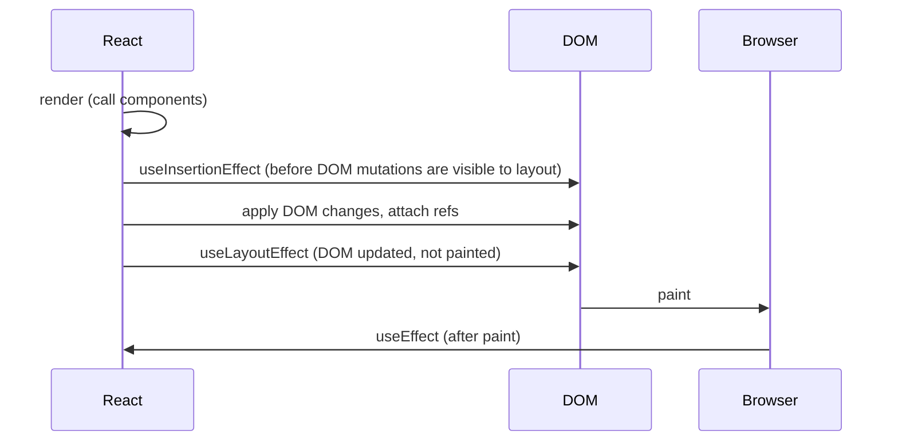

## Why effects exist

A React component is supposed to be a **pure** function: given props and state, it returns JSX and does nothing else ([purity](/react/fundamentals)). Event handlers take care of things that happen *because the user did something*: a click sends a message, a submit saves a form.

But some code must run *because the component is on the screen*, no matter which click caused it. A chat room should be connected while the `ChatRoom` component is visible. A `<video>` should play when the `isPlaying` prop is `true`. The document title should match the current page. Nothing was "clicked" here: rendering itself requires the outside world to be kept in sync.

That is what an **Effect** is: code that **synchronizes a component with an external system** (the network, a browser API, a timer, a third-party widget, a non-React library) after React has updated the screen.

```text
 render (pure)          commit (React updates DOM)        after paint
┌──────────────┐       ┌─────────────────────────┐       ┌───────────────────────────────┐
│ compute JSX  │ ───►  │ insert / update nodes   │ ───►  │ useEffect: connect, subscribe, │
│ no side      │       │ attach refs             │       │ start timers, sync a widget    │
│ effects      │       │ useLayoutEffect         │       │                               │
└──────────────┘       └─────────────────────────┘       └───────────────────────────────┘
```

<Callout type="note">
"Effect" with a capital E means React's specific feature (`useEffect` and friends). A "side effect" in general is any change to the outside world. Effects are one place where side effects are allowed; event handlers are the other, and they're usually the better one.
</Callout>

## useEffect

<Api name="useEffect()" sig="useEffect(setup, dependencies?)" returns="`undefined`." mutates="no (it schedules your setup to run after commit)">

- `setup`: a function with your Effect's logic. It may return a **cleanup** function. React runs `setup` after the component is added to the screen (after the browser has painted, in most cases). Before running it again with new values, React runs the previous cleanup with the *old* values. When the component is removed, React runs the cleanup one last time.
- `setup` must not be `async`: an `async` function returns a Promise, and React expects either nothing or a cleanup function. Define an async function *inside* the setup and call it.
- `dependencies` (optional): the list of every reactive value (props, state, and variables or functions declared in the component body) that `setup` reads. React compares each item with its previous value using [`Object.is`](/javascript/types-coercion). The list must have a constant length and be written inline.
  - **omitted**: the Effect runs after **every** commit.
  - **`[]`**: it runs once after mount (and cleans up on unmount).
  - **`[a, b]`**: it runs after mount and again after any commit where `a` or `b` changed.

</Api>

The smallest useful Effect keeps the document title in sync with state:

```jsx live
import { useEffect, useState } from 'react'

export default function App() {
  const [count, setCount] = useState(0)

  useEffect(() => {
    // Runs after React has updated the DOM, every time count changes
    document.title = `Clicked ${count} times`
    console.log('effect: title set to', count)
  }, [count])

  return <button onClick={() => setCount(count + 1)}>Clicked {count} times</button>
}
```

The console shows `effect: title set to 0` twice at first. That isn't a bug: these demos render in [StrictMode](#strictmode-runs-every-effect-twice-in-development), which mounts, unmounts and remounts once in development.

### The three forms of the dependency array

The same Effect behaves very differently depending on its second argument. Click the buttons and watch the console:

```jsx live
import { useEffect, useState } from 'react'

export default function App() {
  const [a, setA] = useState(0)
  const [b, setB] = useState(0)

  useEffect(() => {
    console.log('no array   → after every render')
  })
  useEffect(() => {
    console.log('[]         → only after mount')
  }, [])
  useEffect(() => {
    console.log('[a]        → after mount and when a changes, a =', a)
  }, [a])

  return (
    <>
      <button onClick={() => { console.clear(); setA(a + 1) }}>a = {a}</button>{' '}
      <button onClick={() => { console.clear(); setB(b + 1) }}>b = {b}</button>
    </>
  )
}
```

Clicking `b` logs only the first line. Clicking `a` logs the first and the third. The `[]` Effect never runs again.

<Callout type="warning">
Dependencies are not something you *choose* to describe when an Effect should run. They're a **description of what the code reads**. If the setup uses `roomId`, then `roomId` must be in the array, and the linter rule `react-hooks/exhaustive-deps` will tell you so. To run an Effect less often, change the *code* so it doesn't need that value, never lie about the array.
</Callout>

## Cleanup

Most Effects start something that must be stopped: a connection, a subscription, a timer, a listener. The function you **return** from setup is the **cleanup**.

```jsx live
import { useEffect, useState } from 'react'

function Clock() {
  const [now, setNow] = useState(() => new Date())

  useEffect(() => {
    console.log('start interval')
    const id = setInterval(() => setNow(new Date()), 1000)
    // Without this, every mount leaves another interval running forever
    return () => {
      console.log('clear interval')
      clearInterval(id)
    }
  }, [])

  return <p>{now.toLocaleTimeString()}</p>
}

export default function App() {
  const [show, setShow] = useState(true)
  return (
    <>
      <button onClick={() => setShow(!show)}>{show ? 'Hide' : 'Show'} clock</button>
      {show && <Clock />}
    </>
  )
}
```

### When cleanup runs

Cleanup runs in exactly two situations:

1. **Before the Effect runs again** because a dependency changed. The cleanup sees the *previous* render's values, because it's a closure created during that render.
2. **When the component unmounts.**

<Steps>
<Step title="Mount with roomId = 'general'">
setup runs: `connect('general')`.
</Step>
<Step title="Re-render with roomId = 'travel'">
React sees the dependency changed. First the old cleanup: `disconnect('general')`. Then the new setup: `connect('travel')`.
</Step>
<Step title="Re-render with the same roomId">
Dependencies are equal by `Object.is`, so nothing runs.
</Step>
<Step title="Unmount">
The last cleanup runs: `disconnect('travel')`.
</Step>
</Steps>

```jsx live
import { useEffect, useState } from 'react'

function createConnection(room) {
  return {
    connect: () => console.log(`✅ connect to "${room}"`),
    disconnect: () => console.log(`❌ disconnect from "${room}"`),
  }
}

function ChatRoom({ roomId }) {
  useEffect(() => {
    const conn = createConnection(roomId)
    conn.connect()
    return () => conn.disconnect() // closes over THIS render's roomId
  }, [roomId])
  return <h3>Welcome to {roomId}</h3>
}

export default function App() {
  const [roomId, setRoomId] = useState('general')
  const [open, setOpen] = useState(true)
  return (
    <>
      <select value={roomId} onChange={(e) => setRoomId(e.target.value)}>
        <option>general</option>
        <option>travel</option>
        <option>music</option>
      </select>{' '}
      <button onClick={() => setOpen(!open)}>{open ? 'Close' : 'Open'} chat</button>
      {open && <ChatRoom roomId={roomId} />}
    </>
  )
}
```

### Think in synchronization, not in lifecycle

Class components taught people to think "on mount do X, on update do Y, on unmount do Z". Effects work better with a different question: **how do I start synchronizing, and how do I stop?** The `ChatRoom` Effect doesn't care whether it's a mount or a room change. It only knows how to connect to *one* room and how to disconnect from it. React calls those two halves as often as needed.

| Class lifecycle thinking | Effect thinking |
| --- | --- |
| `componentDidMount`: connect | setup: connect to `roomId` |
| `componentDidUpdate`: if room changed, disconnect old, connect new | (nothing extra: React runs cleanup + setup when `roomId` changes) |
| `componentWillUnmount`: disconnect | cleanup: disconnect from `roomId` |

One Effect = one independent synchronization process. If an Effect does two unrelated things (connect to a chat *and* log an analytics event), split it into two Effects, each with its own dependencies.

## StrictMode runs every Effect twice in development

In development with `<StrictMode>`, React mounts each component, **immediately unmounts it, and mounts it again**. So you see setup → cleanup → setup. Production runs setup once.

The point is to catch missing cleanups. If your Effect connects but doesn't disconnect, the double run leaves two connections open and you notice right away, instead of in production after the user navigates back and forth.

<Callout type="mistake">
**Wrong fix:** using a ref to make the Effect run "only once".

```jsx
const didRun = useRef(false)
useEffect(() => {
  if (didRun.current) return // hides the symptom
  didRun.current = true
  connect()
}, [])
```

This hides the double mount in development, but the real bug remains: the component never disconnects, and it will leak the moment it really unmounts and remounts. **Fix:** return a cleanup that undoes the setup. The test is simple: setup → cleanup → setup must look to the user exactly like setup alone.
</Callout>

What a correct cleanup looks like depends on the kind of Effect:

| Effect does | Cleanup does |
| --- | --- |
| subscribes to an event (`addEventListener`, `store.subscribe`) | unsubscribes |
| starts a timer (`setTimeout`, `setInterval`) | `clearTimeout` / `clearInterval` |
| opens a connection | closes it |
| starts an animation | resets it to the initial value |
| fetches data | ignores or aborts the stale response ([below](#fetching-data-in-an-effect)) |
| controls a widget (`map.setZoom(z)`) | often nothing: calling it twice with the same value is harmless |
| sends an analytics event | nothing: a duplicate in dev is fine, production sends one |

A few things truly must happen only once per app load (for example initializing an SDK). Those don't belong in a component at all: put them in a top-level module statement or guard them with a module-level flag.

## Effect timing: useEffect, useLayoutEffect, useInsertionEffect

React has three Effect hooks with the same signature. They differ only in **when** they run during a commit ([commit sub-steps](/react/rendering)).



### useLayoutEffect

<Api name="useLayoutEffect()" sig="useLayoutEffect(setup, dependencies?)" returns="`undefined`." mutates="no">

- Same arguments and cleanup rules as `useEffect`.
- It runs **synchronously after the DOM is updated and before the browser paints**. Any state update inside it is also processed synchronously, before the paint.
- It blocks painting, so slow code here makes the app feel slow. On the server it does nothing (there's no layout), which is why it shouldn't be the default.

</Api>

Use it when you must **measure the DOM and change the UI before the user sees it**: tooltip positioning, scroll restoration, measuring text to choose a layout. With `useEffect` the user may see one frame of the wrong position (a flicker).

```jsx live
import { useLayoutEffect, useRef, useState } from 'react'

function Tooltip({ text }) {
  const ref = useRef(null)
  const [width, setWidth] = useState(0)

  // Measure before paint, so the first frame the user sees is already centered
  useLayoutEffect(() => {
    setWidth(ref.current.getBoundingClientRect().width)
  }, [text])

  return (
    <div style={{ position: 'relative', height: 40 }}>
      <span
        ref={ref}
        style={{ position: 'absolute', left: `calc(50% - ${width / 2}px)`, padding: '4px 8px', background: '#334', color: 'white', borderRadius: 6 }}
      >
        {text}
      </span>
    </div>
  )
}

export default function App() {
  const [text, setText] = useState('Hi')
  return (
    <>
      <input value={text} onChange={(e) => setText(e.target.value)} />
      <Tooltip text={text} />
    </>
  )
}
```

### useInsertionEffect

<Api name="useInsertionEffect()" sig="useInsertionEffect(setup, dependencies?)" returns="`undefined`." mutates="no">

- Same signature. It runs **before** layout effects, at a point where refs aren't attached yet and you can't update state.
- It exists for **CSS-in-JS libraries** that need to inject `<style>` tags before any layout effect reads layout. Application code almost never needs it.

</Api>

| Hook | Runs | Blocks paint? | Typical use |
| --- | --- | --- | --- |
| `useInsertionEffect` | during commit, before layout effects | yes | inject `<style>` (libraries only) |
| `useLayoutEffect` | after DOM changes, before paint | yes | measure DOM, prevent flicker |
| `useEffect` | after paint (usually) | no | everything else: subscriptions, network, timers |

<Callout type="note">
`useEffect` usually runs after paint, but if the commit was caused by a discrete user input (a click or a key press), React flushes it before the browser paints so the result of the interaction is consistent. Don't rely on either timing: if you need "before paint", use `useLayoutEffect`.
</Callout>

## Dependencies in depth

### Stale closures: why missing dependencies are bugs

Every render has its own props, state and functions. An Effect is a closure that captured the values of the render it was created in ([closures](/javascript/scope-closures)). If you leave a value out of the array, the Effect keeps the *old* value forever.

```jsx live
import { useEffect, useState } from 'react'

export default function App() {
  const [count, setCount] = useState(0)
  const [step, setStep] = useState(1)

  useEffect(() => {
    const id = setInterval(() => {
      // ❌ step is missing from the deps: this closure sees step = 1 forever
      setCount((c) => c + step)
    }, 1000)
    return () => clearInterval(id)
  }, []) // eslint would warn: React Hook useEffect has a missing dependency: 'step'

  return (
    <>
      <p>count: {count}</p>
      <label>
        step: <input type="number" value={step} onChange={(e) => setStep(Number(e.target.value))} />
      </label>
      <p>Change the step to 10: the counter still adds 1.</p>
    </>
  )
}
```

Fix it by adding `step` to the array. The interval is then recreated whenever `step` changes, which is correct: the "synchronization" now depends on `step`.

### Removing dependencies the honest way

When an Effect re-runs too often, change the code so it reads fewer reactive values:

1. **Use an updater function.** `setCount(count + 1)` reads `count`; `setCount(c => c + 1)` doesn't. The interval above then no longer needs `count`.
2. **Move non-reactive values outside the component.** A constant or a pure helper declared at module level is not a dependency.
3. **Move objects and functions inside the Effect.** An object literal created during render is a *new* object every render, so `Object.is` says it changed every time:

```jsx
// ❌ options is a new object on every render → the Effect reconnects on every render
const options = { serverUrl, roomId }
useEffect(() => {
  const conn = createConnection(options)
  conn.connect()
  return () => conn.disconnect()
}, [options])

// ✅ create it inside; depend on the primitive values it's built from
useEffect(() => {
  const conn = createConnection({ serverUrl, roomId })
  conn.connect()
  return () => conn.disconnect()
}, [serverUrl, roomId])
```

4. **Read primitives out of object props** before the Effect: `const { roomId } = options` and depend on `roomId`.
5. **Separate the non-reactive part with `useEffectEvent`** (next section).

Wrapping a function in [`useCallback`](/react/performance) or an object in `useMemo` also stabilizes it, but moving it inside the Effect is simpler when only the Effect uses it.

### Is the dependency array a performance optimization?

Partly. Skipping the Effect when nothing relevant changed is an optimization, but correctness comes first: React may run your Effect more often than the array suggests (StrictMode, Fast Refresh, future features that keep state while hiding a component). Every Effect must work correctly if it's set up and cleaned up any number of times.

## useEffectEvent: reading the latest value without re-running

Sometimes an Effect needs a value that should **not** cause re-synchronization. Example: when the chat connects, show a notification in the current `theme`. Connecting depends on `roomId`. The theme is only *read* when the "connected" event happens; changing the theme shouldn't reconnect.

```jsx
// ❌ theme is in the deps, so switching dark mode reconnects to the chat
useEffect(() => {
  const conn = createConnection(roomId)
  conn.on('connected', () => showNotification('Connected!', theme))
  conn.connect()
  return () => conn.disconnect()
}, [roomId, theme])
```

**`useEffectEvent`** (stable since React 19.2) extracts the non-reactive part into an **Effect Event**: a function that always sees the latest props and state, but whose identity isn't a dependency.

<Api name="useEffectEvent()" sig="const onEvent = useEffectEvent(callback)" returns="a function that calls the latest `callback` with the arguments you pass." mutates="no">

- `callback`: a function containing the logic that should "react" to nothing but should *see* the latest values. It can take arguments.
- The returned function must be called **only from inside Effects** (or from other Effect Events), never during render or from an event handler you pass down.
- Don't put it in a dependency array. The linter knows it's not reactive.
- Don't pass it to other components or hooks. Declare it right next to the Effect that uses it.

</Api>

```jsx live
import { useEffect, useEffectEvent, useState } from 'react'

function ChatRoom({ roomId, theme }) {
  // Not reactive: always reads the latest theme, never triggers a reconnect
  const onConnected = useEffectEvent(() => {
    console.log(`🔔 connected to ${roomId} (theme: ${theme})`)
  })

  useEffect(() => {
    console.log(`✅ connecting to ${roomId}`)
    const id = setTimeout(onConnected, 500) // pretend the server answered
    return () => {
      clearTimeout(id)
      console.log(`❌ disconnect from ${roomId}`)
    }
  }, [roomId]) // theme is NOT here, and that's correct

  return <h3 style={{ color: theme === 'dark' ? '#88f' : '#226' }}>Room: {roomId}</h3>
}

export default function App() {
  const [roomId, setRoomId] = useState('general')
  const [dark, setDark] = useState(false)
  return (
    <>
      <select value={roomId} onChange={(e) => setRoomId(e.target.value)}>
        <option>general</option>
        <option>travel</option>
      </select>{' '}
      <label>
        <input type="checkbox" checked={dark} onChange={(e) => setDark(e.target.checked)} /> dark theme
      </label>
      <ChatRoom roomId={roomId} theme={dark ? 'dark' : 'light'} />
    </>
  )
}
```

Toggling the theme logs nothing; changing the room reconnects and the notification shows the theme that's current *when it fires*.

<Callout type="interview">
"How do I read the latest state in an Effect without adding it to the dependencies?" A strong answer: first ask whether the value really is non-reactive. If yes, use `useEffectEvent` (React 19.2+). Before that, the workaround was a ref updated on every render (`latestRef.current = value`) and read inside the Effect, which is what `useEffectEvent` does for you, safely. Suppressing the linter with `// eslint-disable-next-line` is the wrong answer.
</Callout>

## Fetching data in an Effect

Fetching in an Effect is the "classic" pattern, and it has one bug almost everyone writes the first time: a **race condition**.

Type a query: requests for `"r"`, `"re"` and `"rea"` are in flight. Responses can arrive in any order. If `"r"` (slow) arrives after `"rea"`, the screen shows results for the wrong query.

```jsx live
import { useEffect, useState } from 'react'

// Fake API: shorter queries are slower, so old responses arrive LAST
function search(q) {
  return new Promise((resolve) =>
    setTimeout(() => resolve([`${q}-1`, `${q}-2`]), 1500 - q.length * 400),
  )
}

export default function App() {
  const [query, setQuery] = useState('rea')
  const [results, setResults] = useState([])
  const [safe, setSafe] = useState(true)

  useEffect(() => {
    let ignore = false
    search(query).then((data) => {
      console.log(`response for "${query}"${ignore ? ' (ignored)' : ''}`)
      if (!safe || !ignore) setResults(data)
    })
    // Cleanup runs when query changes: the old request's answer is now stale
    return () => {
      ignore = true
    }
  }, [query, safe])

  return (
    <>
      <label>
        <input type="checkbox" checked={safe} onChange={(e) => setSafe(e.target.checked)} /> ignore stale responses
      </label>
      <p>
        <button onClick={() => { console.clear(); setQuery('r'); setTimeout(() => setQuery('rea'), 50) }}>
          Type "r" then "rea" quickly
        </button>
      </p>
      <p>query: <b>{query}</b> → results: {results.join(', ')}</p>
    </>
  )
}
```

With the checkbox off, the final results are `r-1, r-2` even though the query is `rea`. With it on, the stale response is ignored.

### Aborting instead of ignoring

`ignore` drops the result but the request still downloads. With [`fetch`](/browser/http-fetch) you can cancel it with an `AbortController`:

```jsx
useEffect(() => {
  const controller = new AbortController()
  async function load() {
    try {
      const res = await fetch(`/api/search?q=${encodeURIComponent(query)}`, { signal: controller.signal })
      setResults(await res.json())
    } catch (err) {
      if (err.name !== 'AbortError') setError(err) // aborting is expected, not an error
    }
  }
  load() // the setup itself can't be async, so call an async function
  return () => controller.abort()
}, [query])
```

### Why you should usually not fetch in Effects

Even with the race fixed, hand-written fetching in Effects has problems:

- **No caching**: navigate away and back, and the data is fetched again; two components needing the same data fetch it twice.
- **Network waterfalls**: the parent fetches, renders a child, the child fetches. Each request waits for the previous render.
- **Slow start**: the fetch begins only after the component rendered and painted, never earlier.
- **No server rendering**: Effects don't run on the server.

Prefer your framework's data loading, [TanStack Query](/react/state), or [`use` with Suspense](/react/react-19). Fetching in an Effect is fine for small apps and learning, and it's important to know how to do it correctly because interviews ask.

## You might not need an Effect

Effects are an escape hatch for synchronizing with things *outside* React. The most common Effect mistake is using one when no external system is involved. Each of these patterns adds an extra render, a moment of wrong UI, and code that's harder to follow.

### Derived data: calculate during render

```jsx
// ❌ an extra state and an extra render, and one frame with a stale fullName
const [fullName, setFullName] = useState('')
useEffect(() => {
  setFullName(first + ' ' + last)
}, [first, last])

// ✅ just compute it
const fullName = first + ' ' + last
```

If the calculation is expensive, wrap it in [`useMemo`](/react/performance), still not an Effect.

### Resetting all state when a prop changes: use key

```jsx
// ❌ the profile renders once with the previous user's comment, then resets
function Profile({ userId }) {
  const [comment, setComment] = useState('')
  useEffect(() => setComment(''), [userId])
}

// ✅ a different key = a different component instance with fresh state
<Profile key={userId} userId={userId} />
```

This works because [state belongs to a position in the tree and a key](/react/hooks).

### Adjusting some state when a prop changes: do it during render

If only *part* of the state should change, store the previous prop and compare during render. React re-runs the component immediately, before touching the DOM, so there's no flash of wrong UI:

```jsx
function List({ items }) {
  const [selection, setSelection] = useState(null)
  const [prevItems, setPrevItems] = useState(items)
  if (items !== prevItems) {
    setPrevItems(items)
    setSelection(null) // allowed: updating THIS component's state during render
  }
  // ...
}
```

Better still, avoid the state: store `selectedId` and compute `items.find(i => i.id === selectedId)` during render.

### Logic caused by a user action: put it in the event handler

```jsx
// ❌ "buy" logic fires whenever the product is in the cart, including after a page reload
useEffect(() => {
  if (product.isInCart) showNotification(`Added ${product.name}!`)
}, [product])

// ✅ it happens because the user clicked, so it lives in the click handler
function handleBuyClick() {
  addToCart(product)
  showNotification(`Added ${product.name}!`)
}
```

The test: **"Why does this code run?"** If the answer is "because the user did X", it belongs in X's handler. If it's "because the component is displayed", it's an Effect.

### Chains of Effects

```jsx
// ❌ each Effect sets state that triggers the next: 4 renders for one move
useEffect(() => { if (card.gold) setGoldCount((c) => c + 1) }, [card])
useEffect(() => { if (goldCount > 3) { setRound((r) => r + 1); setGoldCount(0) } }, [goldCount])
useEffect(() => { if (round > 5) setIsGameOver(true) }, [round])
```

Compute what you can during render (`isGameOver = round > 5`) and calculate the rest of the next state inside the event handler that played the card, in one go.

### Notifying a parent about a change

```jsx
// ❌ the child updates, renders, then tells the parent, which renders again
useEffect(() => { onChange(isOn) }, [isOn, onChange])

// ✅ update both in the same event: one batched render
function handleClick() {
  const next = !isOn
  setIsOn(next)
  onChange(next)
}
```

Even better, make the component [controlled](/react/patterns) and let the parent own the state.

### Subscribing to an external store

A manual `useEffect` + `useState` subscription can tear during concurrent rendering. Use [`useSyncExternalStore`](/react/hooks):

```jsx
const isOnline = useSyncExternalStore(
  (cb) => { addEventListener('online', cb); addEventListener('offline', cb); return () => { removeEventListener('online', cb); removeEventListener('offline', cb) } },
  () => navigator.onLine,
  () => true, // server snapshot
)
```

### Summary table

| You want to | Don't | Do |
| --- | --- | --- |
| show a value computed from props/state | Effect + state | compute during render (`useMemo` if expensive) |
| reset all state when an id changes | Effect that resets | `key={id}` |
| reset part of the state | Effect that sets state | set state during render, or store ids instead |
| react to a click/submit | Effect watching a flag | the event handler |
| tell the parent about a change | Effect calling `onChange` | call it in the same handler, or lift state |
| read an external store | Effect + state | `useSyncExternalStore` |
| fetch data | Effect (for real apps) | framework loader, TanStack Query, `use` |
| connect to a system while visible | | **Effect** ✅ |

## Effects and refs

Effects run after refs are attached, so they're the right place to call imperative DOM APIs. Read `ref.current` inside the Effect, not during render:

```jsx live
import { useEffect, useRef, useState } from 'react'

function VideoLike({ isPlaying }) {
  const ref = useRef(null)
  useEffect(() => {
    // Sync an imperative API with a prop. Calling it twice is harmless, so no cleanup.
    ref.current.style.animationPlayState = isPlaying ? 'running' : 'paused'
    console.log(isPlaying ? '▶ play' : '⏸ pause')
  }, [isPlaying])
  return (
    <div
      ref={ref}
      style={{ width: 40, height: 40, background: 'tomato', borderRadius: 8, animation: 'spin 1.5s linear infinite' }}
    />
  )
}

export default function App() {
  const [playing, setPlaying] = useState(false)
  return (
    <>
      <style>{'@keyframes spin { to { transform: rotate(360deg) } }'}</style>
      <button onClick={() => setPlaying(!playing)}>{playing ? 'Pause' : 'Play'}</button>
      <VideoLike isPlaying={playing} />
    </>
  )
}
```

Refs aren't dependencies in a useful sense: `ref` itself is stable, and changing `ref.current` doesn't re-render, so putting `ref.current` in the array doesn't do what people expect. If you need to react to a DOM node appearing, use a [ref callback](/react/hooks), which in React 19 can return a cleanup function.

## Common mistakes

<Callout type="mistake">
**Infinite loop: setting state that is also a dependency.**

```jsx
useEffect(() => {
  setCount(count + 1) // changes count → Effect runs again → changes count…
}, [count])
```

Ask what external system this synchronizes with. Usually none, and the logic belongs in render or an event handler. An Effect that unconditionally sets state it depends on always loops. The same happens with an object or function dependency that's recreated every render and an Effect that sets state.
</Callout>

<Callout type="mistake">
**`async` setup.** `useEffect(async () => { … })` returns a Promise, so React gets no cleanup and warns. Write `useEffect(() => { async function load() {…} load() }, [deps])`.
</Callout>

<Callout type="mistake">
**Missing cleanup for listeners.** `window.addEventListener('resize', onResize)` without `removeEventListener` in the cleanup adds a new listener on every mount; with StrictMode you'll see two from the start. The function passed to `removeEventListener` must be the **same function** you added, so define it inside the Effect.
</Callout>

<Callout type="mistake">
**Silencing the linter.** `// eslint-disable-next-line react-hooks/exhaustive-deps` almost always hides a stale closure. Fix the code instead: updater functions, moving things inside the Effect, or `useEffectEvent`.
</Callout>

## Interview questions

<QA q="What is useEffect for, and when does it run?" level="junior" n={1}>
<Answer>

It synchronizes a component with an external system: network connections, subscriptions, timers, browser APIs, non-React widgets. It runs after React commits the update to the DOM, usually after the browser paints, and again after any commit where one of its dependencies changed (by `Object.is`). Its returned cleanup runs before the next run and on unmount.

</Answer>
</QA>

<QA q="What's the difference between no dependency array, [] and [a, b]?" level="junior" n={2}>
<Answer>

No array: after every commit. `[]`: once after mount, cleanup on unmount. `[a, b]`: after mount and whenever `a` or `b` changed. The array must list every reactive value the Effect reads; it describes the code, it isn't a scheduling switch.

</Answer>
</QA>

<QA q="Why does my Effect run twice in development?" level="mid" n={3}>
<Answer>

`<StrictMode>` mounts, unmounts and remounts every component once in development to verify that Effects clean up properly. Production runs it once. The fix is never to suppress the second run but to write a cleanup so that setup → cleanup → setup is indistinguishable from a single setup.

</Answer>
<Deep>

The same mechanism prepares code for features that hide and restore components while keeping their state, like [`<Activity>`](/react/performance): when a subtree is hidden its Effects are cleaned up, and when it's shown again they're set up again.

</Deep>
</QA>

<QA q="useEffect vs useLayoutEffect?" level="mid" n={4}>
<Answer>

Both have the same API. `useLayoutEffect` runs synchronously after DOM mutations and **before the browser paints**, blocking the paint; use it to measure layout and adjust the UI without a visible flicker (tooltips, scroll position). `useEffect` runs after paint and doesn't block, so it's the default for everything else. `useLayoutEffect` does nothing on the server.

</Answer>
</QA>

<QA q="What is a stale closure in an Effect, and how do you fix it?" level="mid" n={5}>
<Answer>

The Effect function captures the props and state of the render that created it. If a value it reads isn't in the dependency array, the Effect never re-runs with the new value and keeps using the old one, for example an interval callback that always sees the initial state. Fix: list the dependency, or remove the need for it with an updater function (`setX(x => x + 1)`), by moving it inside the Effect, or with `useEffectEvent` for values that shouldn't trigger re-synchronization.

</Answer>
</QA>

<QA q="How do you avoid race conditions when fetching data in useEffect?" level="mid" n={6}>
<Answer>

In the cleanup, mark the request as stale: set a local `ignore = true` flag that the `.then` checks before setting state, or call `controller.abort()` on an `AbortController` whose `signal` was passed to `fetch` (and ignore the `AbortError`). The cleanup runs whenever the dependency (the query) changes, so only the latest request can update state.

</Answer>
<FollowUp>

Why do many teams avoid fetching in Effects altogether? No caching or deduplication, network waterfalls, fetching starts late, and no SSR. Data libraries and framework loaders solve these.

</FollowUp>
</QA>

<QA q="What is useEffectEvent?" level="senior" n={7}>
<Answer>

A hook (stable in React 19.2) that wraps logic an Effect calls but that shouldn't make the Effect re-run. The returned function always sees the latest props and state, and it's excluded from dependencies. Typical use: an Effect that depends on `roomId` calls `onConnected()` which reads `theme`; changing the theme no longer reconnects. It may be called only from Effects and shouldn't be passed to other components.

</Answer>
</QA>

<QA q="Give examples where an Effect is the wrong tool." level="mid" n={8}>
<Answer>

Computing derived values (compute during render), resetting state on prop change (`key`), reacting to user actions (event handlers), notifying parents (call the callback in the same handler), chains of state updates (compute the next state in one place), subscribing to external stores (`useSyncExternalStore`), and fetching in real apps (data libraries). Rule of thumb: an Effect is for synchronizing with something outside React because the component is displayed.

</Answer>
</QA>

## Recap

<Recap>

- An Effect synchronizes a component with an external system after commit; event handlers handle user actions.
- `useEffect(setup, deps)`: no array = every commit, `[]` = mount only, `[a, b]` = when they change (`Object.is`).
- The returned cleanup runs before the next setup (with the old values) and on unmount.
- Think "start/stop synchronizing", not mount/update/unmount; one Effect per independent process.
- StrictMode runs setup → cleanup → setup in development to expose missing cleanups; fix the cleanup, don't block the rerun.
- `useLayoutEffect` runs before paint for measuring and preventing flicker; `useInsertionEffect` is for CSS-in-JS libraries.
- Dependencies describe what the code reads; remove them by changing code (updaters, moving objects inside), never by lying.
- `useEffectEvent` lets an Effect read the latest values without re-running because of them.
- Fetching in Effects needs an ignore flag or `AbortController` against race conditions; real apps prefer data libraries.
- Don't use Effects for derived data, resets (`key`), user-action logic, parent notifications or external stores.

</Recap>
