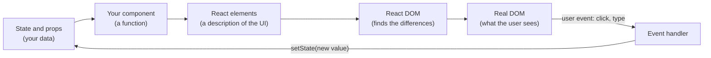
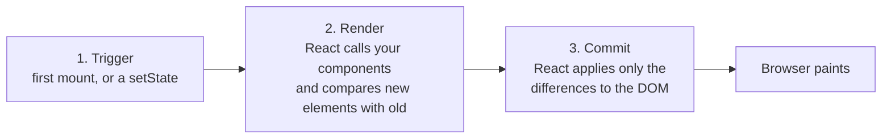

## Why React?

Imagine a counter with a title, a badge and a button that must be disabled after 10 clicks. In plain JavaScript you update every one of those places by hand, on every click:

```js
// Vanilla DOM: you are responsible for keeping every piece of UI in sync
let count = 0
button.addEventListener('click', () => {
  count++
  title.textContent = `Clicked ${count} times`
  badge.textContent = count
  button.disabled = count >= 10   // forget one of these lines → the UI lies
})
```

This style is **imperative**: you describe *the steps* to change the screen. It works for a counter, but in a real app with hundreds of values and thousands of elements, the number of "when X changes, also update Y" rules explodes, and one forgotten rule is a bug.

**React** is a JavaScript library for building user interfaces that flips the model to **declarative**: you describe *what the screen should look like for the current data*, and React figures out which DOM changes are needed to get there.

```jsx live
import { useState } from 'react'

export default function App() {
  // count is "state": data React remembers between renders
  const [count, setCount] = useState(0)

  // Describe the UI for the current count. No manual DOM updates anywhere.
  return (
    <div>
      <h3>Clicked {count} times</h3>
      <span>badge: {count}</span>{' '}
      <button disabled={count >= 10} onClick={() => setCount(count + 1)}>
        +1
      </button>
    </div>
  )
}
```

The demo above is editable. Change `count >= 10` to `count >= 3` and watch the preview update.

<Callout type="note">
Every **React live** demo in this part runs real React 19 (development build) in a sandboxed frame. It is wrapped in `<StrictMode>` like a real app, so React's development warnings and double calls appear in the console under the demo exactly as they would in your project.
</Callout>

## The mental model: UI = f(state)

The single most important idea in React fits in one line: **the UI is a function of the state**. You write components that take data and return a description of the UI. When the data changes, React calls your function again and updates the screen to match the new description.



Notice the loop has a single direction. Data flows **down** (from state into the UI), and the only way back up is an event handler that asks React to change the state. This is called **one-way data flow**, and it is why React apps are predictable: to know why the screen shows something, you only look at the state.

<Callout type="tip">
React is a **library**, not a full framework. It only handles the UI. Routing, data fetching and building are done by other tools or by a framework built on React (Next.js, React Router, Remix). That's why interviewers sometimes ask "library or framework?"; the honest answer is "a UI library with a large ecosystem".
</Callout>

## Starting an app: createRoot

A React app is attached to one existing DOM element, usually `<div id="root">` in `index.html`. You create a **root** for it and render your top component into it.

```jsx
import { StrictMode } from 'react'
import { createRoot } from 'react-dom/client'
import App from './App'

// 1. Take control of an existing, empty DOM node
const root = createRoot(document.getElementById('root'))

// 2. Render the top component; React builds the DOM inside #root
root.render(
  <StrictMode>
    <App />
  </StrictMode>,
)
```

<Api name="createRoot()" sig="createRoot(domNode, options?)" returns="a root object with `render(reactNode)` and `unmount()`." mutates="yes (React takes over the contents of domNode)">

- `domNode` (DOM element): the container. React replaces everything inside it; don't let other code touch its children.
- `options` (optional object):
  - `onUncaughtError(error, errorInfo)`: called when an error is thrown during rendering and no [Error Boundary](/react/patterns) catches it. The app is unmounted.
  - `onCaughtError(error, errorInfo)`: called when an Error Boundary catches an error.
  - `onRecoverableError(error, errorInfo)`: called when React recovers on its own (for example a hydration mismatch it fixes by re-rendering on the client).
  - `identifierPrefix` (string): a prefix for IDs generated by `useId`, useful when two React roots live on one page.

`root.render(node)` can be called again to replace what is shown; React updates the existing DOM instead of rebuilding it. `root.unmount()` removes the tree and runs all cleanup code.

</Api>

<Callout type="note">
Projects created with Vite or a framework already contain this file (`main.jsx` / `main.tsx`), and frameworks such as Next.js call it for you. You will rarely write it, but interviewers like asking what it does.
</Callout>

## JSX

### What JSX is

**JSX** is a syntax extension that lets you write HTML-like markup inside JavaScript. Browsers can't run it: a compiler (Babel, SWC, esbuild, TypeScript) turns every tag into a plain function call before your code runs.

```jsx
const el = <h1 className="title">Hello, {name}!</h1>
```

Since React 17 the compiler uses the **automatic JSX runtime** and produces this:

```js
import { jsxs as _jsxs } from 'react/jsx-runtime'

// tag name → 1st argument, attributes and children → props object
const el = _jsxs('h1', { className: 'title', children: ['Hello, ', name, '!'] })
```

(`jsxs` is used when there are several static children, `jsx` when there is one. Before React 17 the output was `React.createElement(...)`, which is why old files start with `import React from 'react'`. It is no longer needed.)

### What a JSX expression evaluates to: a React element

That function call returns a **React element**: a small, plain, immutable JavaScript object that *describes* a piece of UI. It is not a DOM node and nothing is drawn yet.

```js
// What <h1 className="title" key="k1">Hi</h1> evaluates to (React 19.3, development build)
{
  $$typeof: Symbol(react.transitional.element), // marks it as a real element (blocks JSON injection)
  type: 'h1',                                   // a tag name string, or a component function
  key: 'k1',                                    // kept outside props
  props: { className: 'title', children: 'Hi' },
  _owner: null, _store: {}                      // development-only bookkeeping
}
```

Three details worth remembering:

- Elements and their `props` are **frozen** in development (`Object.isFrozen(el.props)` is `true`), so you can't modify them by mistake.
- `key` is stored on the element, **not** in `props`. A component that reads `props.key` gets `undefined` and React prints a warning.
- In React 19 `ref` is an ordinary prop (`props.ref`); the separate `element.ref` field is gone. More in [React 19](/react/react-19).

`$$typeof` is a Symbol on purpose: JSON can't contain Symbols, so if an attacker manages to inject a JSON object where your code expects an element, React refuses to render it.

### The rules of JSX

JSX looks like HTML but follows JavaScript rules. Each rule below exists because of what JSX compiles to.

1. **Return one root.** A component returns one value, so two siblings must be wrapped. Use a **Fragment** (`<>…</>`) to group them without adding a DOM element. Write `<Fragment key={id}>` when the group needs a key.
2. **Close every tag.** ``, `<br />`, `<input />`. JSX is stricter than HTML.
3. **Attributes are camelCase JavaScript property names**: `className` (because `class` is a reserved word), `htmlFor` (instead of `for`), `onClick`, `tabIndex`, `readOnly`. The exceptions are `aria-*` and `data-*`, which keep their dashes.
4. **`style` takes an object**, not a string: `style={{ fontSize: 14, marginTop: '1em' }}`. The outer braces mean "JavaScript here", the inner ones are the object. A bare number becomes pixels (`14` → `14px`) for size-like properties.
5. **Curly braces `{}` hold any JavaScript *expression*** (something that produces a value): variables, calls, ternaries, `.map()`. Statements such as `if`, `for` or `const` are not allowed inside them; put those before the `return`.
6. **Comments** inside JSX are written as `{/* comment */}`.
7. **Boolean attributes**: `<input disabled />` means `disabled={true}`. `disabled={false}` removes the attribute.

```jsx live
export default function App() {
  const user = { name: 'Ada', unread: 3, isAdmin: true }
  const colors = ['tomato', 'gold', 'seagreen']

  return (
    // Fragment: two siblings, no extra <div> in the DOM
    <>
      {/* className / htmlFor instead of class / for */}
      <label htmlFor="q" className="label">Search: </label>
      <input id="q" readOnly value={user.name} />

      {/* style is an object; 14 means 14px */}
      <p style={{ fontSize: 14, color: '#555' }}>
        {user.name} has {user.unread * 10} points {user.isAdmin ? '(admin)' : ''}
      </p>

      {/* any expression works inside {} — here, an array of elements */}
      <div>
        {colors.map((c) => (
          <span key={c} data-color={c} style={{ background: c, padding: '2px 8px', marginRight: 4 }}>
            {c}
          </span>
        ))}
      </div>
    </>
  )
}
```

### JSX escapes text for you

Everything you put inside `{}` as text is **escaped**: `<`, `>` and `&` are turned into harmless entities before reaching the DOM. A string that looks like HTML is shown as text and never executed, which protects you from most XSS (cross-site scripting) attacks by default.

```jsx
const comment = ''
<div>{comment}</div>
// HTML produced: <div>&lt;img src=x onerror=alert(1)&gt;</div>  → shown as text, no alert
```

When you really have trusted HTML (for example sanitized Markdown output), React makes you write a deliberately scary prop name:

```jsx
<div dangerouslySetInnerHTML={{ __html: trustedHtml }} />
```

<Callout type="warning">
`dangerouslySetInnerHTML` bypasses escaping. Only pass HTML you produced or sanitized yourself (for example with DOMPurify). Also remember that escaping covers **text**, not URLs: `<a href={userUrl}>` with `javascript:alert(1)` is still dangerous, so validate URLs that come from users. React 19 blocks `javascript:` URLs in `href`. See [browser security](/browser/security).
</Callout>

### What can appear inside {}

React renders these values as children. Note the surprises: `0` and `NaN` are rendered as text, while `true` renders nothing.

| Value | Rendered as |
| --- | --- |
| string, number (`'hi'`, `42`, `0`, `NaN`) | text: `hi`, `42`, `0`, `NaN` |
| `''` (empty string) | nothing |
| `null`, `undefined`, `true`, `false` | nothing |
| an element (`<b>x</b>`) | that element |
| an array (`[1, <i key="a">2</i>]`) | each item, in order (items that are elements need a `key`) |
| a plain object (`{ a: 1 }`) | **error**: "Objects are not valid as a React child" |
| a function | nothing, plus a warning (you probably meant to call it or render it as `<Fn />`) |

## Components

### What a component is

A **component** is a JavaScript function that returns JSX. It is a reusable, named piece of UI: a button, a card, a whole page. You use it like an HTML tag.

```jsx
function Greeting() {
  return <p>Hello!</p>
}

// Using it creates an element whose type is the function itself
<Greeting />   // → { type: Greeting, props: {}, ... }
```

React calls `Greeting` when it needs to know what to show. The function returns elements, those elements may be other components, and React keeps calling functions until only DOM tags (`'div'`, `'p'`…) are left. The result is a tree.

### Element vs component vs instance

These three words are often mixed up, and interviewers know it.

| Term | What it is | Example |
| --- | --- | --- |
| **Component** | the function (or class) you write | `function Greeting() {…}` |
| **Element** | the plain object JSX produces: "render `Greeting` with these props" | `<Greeting />` |
| **Instance** | the live thing React keeps for a component on screen: its state, effects and position in the tree. For function components it's internal (a "Fiber"; see [Rendering](/react/rendering)) | — |

### Names must start with a capital letter

The compiler decides between a DOM tag and a component by the first letter. `<button>` compiles to `jsx('button')`, a string, so React creates an HTML element. `<Button>` compiles to `jsx(Button)`, a reference to your function.

<Callout type="mistake">
```jsx
function profileCard() { return <div>…</div> }
<profileCard />   // ❌ compiles to jsx('profilecard'): an unknown HTML tag, your function never runs
```
Name components in PascalCase: `ProfileCard`.
</Callout>

### Never define a component inside another component

Component definitions belong at the top level of a module. If you declare one inside another component's body, a **brand-new function** is created on every render. To React, a different function means a different component type, so it throws away the old subtree, including its state and DOM, and mounts a fresh one.

Type something into the box below, then click **+1**:

```jsx live
import { useState } from 'react'

export default function App() {
  const [count, setCount] = useState(0)

  // ❌ A new Input function (= a new component type) is created on every render of App
  function Input() {
    const [text, setText] = useState('')
    return <input value={text} onChange={(e) => setText(e.target.value)} placeholder="type here, then click +1" />
  }

  return (
    <div>
      <Input />
      <button onClick={() => setCount((c) => c + 1)}>+1 ({count})</button>
    </div>
  )
}
```

Typing works because only `Input` re-renders. Clicking **+1** re-renders `App`, which creates a new `Input` type. React unmounts the old input along with your text, and also its focus. The fix is to move `function Input() {…}` above `App`.

## Props

### Passing data into a component

**Props** (short for properties) are the inputs of a component. The parent writes them as JSX attributes; React collects them into one object and passes it as the function's first argument.

```jsx live
// Destructure the props object; size has a default used when it's missing or undefined
function Avatar({ name, size = 48 }) {
  const initials = name.split(' ').map((w) => w[0]).join('')
  return (
    <div style={{ width: size, height: size, borderRadius: '50%', background: '#6366f1',
                  color: 'white', display: 'grid', placeItems: 'center', fontSize: size / 3 }}>
      {initials}
    </div>
  )
}

// children = whatever is written between <Card> and </Card>
function Card({ title, children }) {
  return (
    <section style={{ border: '1px solid #ddd', borderRadius: 12, padding: 12, marginBottom: 8 }}>
      <h4 style={{ margin: '0 0 8px' }}>{title}</h4>
      {children}
    </section>
  )
}

export default function App() {
  return (
    <>
      <Card title="Default size">
        <Avatar name="Ada Lovelace" />
      </Card>
      <Card title="Small, and a string child">
        <Avatar name="Alan Turing" size={32} />
        <p>Any JSX can go inside a Card.</p>
      </Card>
    </>
  )
}
```

What you need to know about props:

- **Any value can be a prop**: strings (`title="Hi"`), anything else in braces (`size={32}`, `user={user}`, `onSave={handleSave}`), even JSX (`icon={<Star />}`).
- **`children`** is a special prop holding the content between the opening and closing tags. It can be text, an element, an array or `undefined`. It's how you build "wrapper" components such as cards, modals and layouts.
- **Default values** come from JavaScript destructuring defaults (`size = 48`). They apply when the prop is missing or `undefined`, but **not** when it is `null`. (`defaultProps` on function components was removed in React 19.)
- **Spreading**: `<Avatar {...user} />` passes every field of `user` as a prop. It's handy for forwarding props, but it hides what is passed, so use it with care.
- A prop **without a value** is `true`: `<Modal open />` equals `<Modal open={true} />`.

### Props are read-only

A component must never change its own props. They belong to the parent, and in development React freezes the props object, so `props.size = 10` throws a `TypeError`. When a value needs to change over time, it should be **state**, either inside this component or in the parent, which then passes the new value down.

### Passing functions down: how children talk to parents

Data flows down through props. To send something **up**, the parent passes a function as a prop and the child calls it. By convention these props are named `onSomething`, and the functions that handle them `handleSomething`.

```jsx live
import { useState } from 'react'

// The child knows nothing about the parent's state; it just reports what happened
function ColorButton({ color, onPick }) {
  return (
    <button onClick={() => onPick(color)} style={{ borderColor: color, marginRight: 6 }}>
      {color}
    </button>
  )
}

export default function App() {
  const [picked, setPicked] = useState('none')

  function handlePick(color) {
    console.log('child reported:', color)
    setPicked(color)                       // the parent owns and updates the state
  }

  return (
    <>
      {['red', 'green', 'blue'].map((c) => (
        <ColorButton key={c} color={c} onPick={handlePick} />
      ))}
      <p>Picked: <b style={{ color: picked }}>{picked}</b></p>
    </>
  )
}
```

When two siblings need the same data, move that state up to their closest common parent and pass it down to both. This is called **lifting state up**, and it is covered with all its alternatives in [State management](/react/state).

## Conditional rendering

A component is a JavaScript function, so you choose what to render with ordinary JavaScript. There are four common forms:

```jsx
// 1. if / early return: best for whole different outputs
if (isLoading) return <Spinner />

// 2. Ternary: choose between two pieces inline
{isLoggedIn ? <Profile /> : <SignInButton />}

// 3. && : render something or nothing
{hasError && <ErrorMessage />}

// 4. return null: render nothing at all
if (!user) return null
```

### The `&&` trap with numbers

`a && b` returns `a` when `a` is falsy. If `a` is `false` that's fine, because React renders nothing for `false`. If `a` is `0`, React renders the number **0**.

```jsx live
import { useState } from 'react'

export default function App() {
  const [messages, setMessages] = useState([])
  const [loggedIn, setLoggedIn] = useState(false)

  return (
    <div>
      {/* ❌ messages.length is 0 → the expression returns 0 → React renders "0" */}
      <p>Bug: {messages.length && <b>{messages.length} new</b>}</p>

      {/* ✅ compare first, so the left side is a real boolean */}
      <p>Fixed: {messages.length > 0 && <b>{messages.length} new</b>}</p>

      <p>{loggedIn ? 'Welcome back!' : 'Please sign in.'}</p>

      <button onClick={() => setMessages((m) => [...m, 'hi'])}>Add message</button>{' '}
      <button onClick={() => setLoggedIn((v) => !v)}>{loggedIn ? 'Log out' : 'Log in'}</button>
    </div>
  )
}
```

<Callout type="tip">
For three or more branches, nested ternaries become hard to read. Use `if`/`switch` before the `return`, or a lookup object: `const views = { list: <List />, grid: <Grid /> }` and then `{views[mode]}`.
</Callout>

## Lists and keys

### Rendering a list

To show a list, turn an array of data into an array of elements with `.map()`. Each element in the array needs a **`key`**: a string or number that identifies that item among its siblings.

```jsx
const todos = [
  { id: 'a1', text: 'Learn JSX' },
  { id: 'b2', text: 'Learn props' },
]

<ul>
  {todos.map((todo) => (
    <li key={todo.id}>{todo.text}</li>   // key goes on the outermost element returned by map
  ))}
</ul>
```

### Why keys exist

On every render React compares the new list of children with the previous one to decide what to keep, move, create or delete. Without keys it can only match children **by position**: "the first `<li>` now is the first `<li>` from before". With keys it matches **by identity**: "the item with key `b2` is the same item as before, even if it moved".

This matters because a component's **state and DOM node belong to its position or key**. If identity is wrong, state ends up attached to the wrong item.

Type a note next to "Apples" in **both** columns, then click **Add to top**:

```jsx live
import { useState } from 'react'

let nextId = 3

function Row({ name }) {
  // Uncontrolled input: the typed text lives in the DOM node React keeps for this row
  return (
    <li>
      {name} <input placeholder="note" size={8} />
    </li>
  )
}

export default function App() {
  const [items, setItems] = useState([
    { id: 1, name: 'Apples' },
    { id: 2, name: 'Bread' },
  ])

  function addToTop() {
    const id = nextId++
    setItems([{ id, name: 'New #' + id }, ...items])
  }

  return (
    <>
      <button onClick={addToTop}>Add to top</button>
      <div style={{ display: 'flex', gap: 24 }}>
        <div>
          <b>key = index ❌</b>
          <ul>{items.map((item, index) => <Row key={index} name={item.name} />)}</ul>
        </div>
        <div>
          <b>key = item.id ✅</b>
          <ul>{items.map((item) => <Row key={item.id} name={item.name} />)}</ul>
        </div>
      </div>
    </>
  )
}
```

On the left, the new item gets key `0`, the key "Apples" had before, so React reuses that row's DOM node. Your note now sits next to the new item. On the right, "Apples" keeps key `1` and its note moves with it.

### Rules for keys

- **Stable**: the same item gets the same key on every render. Use an ID from your data (database ID, UUID created when the item was created).
- **Unique among siblings**: two lists in different places can reuse the same keys.
- **Never `Math.random()` or `crypto.randomUUID()` during render**: every render produces new keys, so React destroys and recreates every row, losing state, focus and performance.
- **The index is acceptable only** when the list never reorders, never filters, and items are only appended at the end. The `push` demo later in this chapter is such a case.
- Keys are **not passed as props**. If the child needs the ID, pass it again under another name: `<Row key={item.id} id={item.id} />`.

<Callout type="tip">
A key is also a tool: changing the `key` of a component on purpose makes React throw away its state and mount a fresh one. `<ProfileForm key={userId} />` resets the whole form when you switch users. More in [Hooks](/react/hooks) and [State management](/react/state).
</Callout>

## Responding to events

### Event handlers

To react to a click, pass a function to the `onClick` prop. React's event props are camelCase (`onClick`, `onChange`, `onSubmit`, `onKeyDown`, `onMouseEnter`) and take a **function**, not a string.

<Callout type="mistake">
```jsx
<button onClick={handleClick}>      // ✅ pass the function; React calls it on click
<button onClick={handleClick()}>    // ❌ calls it NOW, during render, and passes its return value
<button onClick={() => remove(id)}> // ✅ need an argument? wrap it in an arrow function
```
If the function you call too early sets state, the render sets state, which triggers another render, and so on. React stops with the error **"Too many re-renders"**.
</Callout>

### The event object, propagation and default behavior

Your handler receives a **SyntheticEvent**: React's wrapper around the native browser event with the same interface (`target`, `currentTarget`, `key`, `preventDefault()`, `stopPropagation()`…) and consistent behavior across browsers. The original is available as `e.nativeEvent`.

React events **bubble** through the *React tree*, just like DOM events (see [Events](/browser/events)). Add `Capture` to the name (`onClickCapture`) to listen during the capture phase.

```jsx live
export default function App() {
  function handleParent() {
    console.log('div: onClick (bubbled up from a child)')
  }

  function handleButton(e) {
    console.log('button:', e.type, 'on', e.target.tagName)
  }

  function handleLink(e) {
    e.preventDefault()    // don't let the browser navigate
    e.stopPropagation()   // the div's onClick will not run
    console.log('link: default prevented, propagation stopped')
  }

  return (
    <div
      onClickCapture={() => console.log('div: onClickCapture (runs first, on the way down)')}
      onClick={handleParent}
      style={{ padding: 12, background: '#f3f4f6', borderRadius: 8 }}
    >
      <button onClick={handleButton}>Button</button>{' '}
      <a href="https://react.dev" onClick={handleLink}>Link</a>
    </div>
  )
}
```

Behind the scenes React doesn't attach a listener to every element. It attaches **one listener per event type to the root container** (`#root`) and dispatches to your handlers itself. This is event delegation (since React 17 on the root, before that on `document`). It's why thousands of rows with `onClick` cost almost nothing.

Three React-specific differences from the DOM are worth knowing:

- **`onChange` fires on every keystroke** for inputs, like the native `input` event, not only on blur like the native `change` event.
- **`onScroll` does not bubble** in React (since 17), matching the browser.
- **Returning `false` does not prevent the default**. Call `e.preventDefault()` explicitly.

## State: giving a component memory

### Why a normal variable is not enough

Props come from the parent. For data a component owns and changes over time (a typed value, an open/closed flag, a counter), you need **state**. A local variable can't do the job, for two reasons the demo shows:

```jsx live
import { useState } from 'react'

export default function App() {
  let plain = 0                                  // re-created as 0 on every render
  const [count, setCount] = useState(0)          // remembered by React between renders

  function handleClick() {
    plain = plain + 1                            // changes a local variable, but React isn't told
    setCount(count + 1)                          // asks React to render again with a new value
    console.log('plain =', plain, '| count in this render =', count)
  }

  return (
    <>
      <p>plain: {plain} · count: {count}</p>
      <button onClick={handleClick}>Click</button>
    </>
  )
}
```

1. **Local variables don't survive renders.** Each render is a new call of the function, so `plain` starts from `0` again.
2. **Changing a local variable doesn't trigger a render.** React has no idea it changed.

`useState` solves both: React stores the value outside your function and gives it back on the next render, and the setter tells React a render is needed.

<Api name="useState()" sig="const [state, setState] = useState(initialState)" returns="an array of exactly two items: the current state and a setter function." mutates="no (schedules a re-render when the setter is called)">

- `initialState`: the value for the **first** render. It's ignored on every later render.
  - If you pass a **function**, React treats it as an **initializer**: it calls it once, on the first render, and uses the return value. `useState(() => loadFromStorage())` avoids running expensive code on every render. `useState(loadFromStorage())` (with the parentheses) calls it on *every* render and throws the result away. In StrictMode React calls the initializer twice to help you find impure ones.
- Returns `[state, setState]`. The names are yours; the convention is `[thing, setThing]`.
- `setState(nextState)`:
  - pass a **value** to replace the state: `setCount(5)`;
  - or an **updater function** that receives the pending state and returns the next one: `setCount(c => c + 1)`;
  - returns `undefined`; the new value is visible on the **next** render, not on the next line;
  - if the new value is the same as the current one according to `Object.is`, React may skip re-rendering;
  - the setter function has a stable identity: it's the same function on every render.

</Api>

Hooks such as `useState` must be called at the **top level** of a component, never inside conditions, loops or nested functions. The reason, and all the other hooks, are in the [Hooks](/react/hooks) chapter.

### State is a snapshot

Calling the setter does not change the `count` variable you already have. It asks for a new render, and the **next** call of your component receives the new value. Inside one render, `count` is a constant: a snapshot.

That explains the classic interview puzzle:

```jsx live
import { useState } from 'react'

export default function App() {
  const [count, setCount] = useState(0)

  return (
    <>
      <h3>{count}</h3>
      <button
        onClick={() => {
          setCount(count + 1) // count is 0 in this render → "set it to 1"
          setCount(count + 1) // still 0 → "set it to 1"
          setCount(count + 1) // still 0 → "set it to 1"
        }}
      >
        +3 (broken)
      </button>{' '}
      <button
        onClick={() => {
          setCount((c) => c + 1) // queued: 0 → 1
          setCount((c) => c + 1) // queued: 1 → 2
          setCount((c) => c + 1) // queued: 2 → 3
        }}
      >
        +3 (updater)
      </button>
    </>
  )
}
```

<Steps>
<Step title="Click runs the handler">
React calls your handler. `count` is `0` because the handler belongs to the render where `count` was `0`.
</Step>
<Step title="Setters only queue updates">
Each `setCount` call adds an update to a queue; nothing re-renders yet. The broken button queues "replace with 1" three times. The updater button queues three functions.
</Step>
<Step title="React batches and re-renders once">
After the handler finishes, React processes the queue in order. "Replace with 1" ×3 gives `1`. The functions give `0 → 1 → 2 → 3`. Then it renders once with the final value.
</Step>
</Steps>

Grouping several updates into one render is called **batching**. Since React 18 it happens everywhere: in event handlers, timeouts, promises and native listeners. Use the updater form whenever the next state depends on the previous one.

### Update objects and arrays without mutating them

React decides whether state changed by comparing the old and new values with `Object.is`. For objects and arrays that is a **reference** comparison. If you mutate the existing array and pass the same array back, React sees "same object", skips the render, and the screen stays stale.

```jsx live
import { useState } from 'react'

export default function App() {
  const [todos, setTodos] = useState(['Learn JSX'])

  function addWrong() {
    todos.push('Mutated!')     // changes the existing array…
    setTodos(todos)            // …same reference → Object.is says "unchanged" → no render
    console.log('array length is', todos.length, 'but the list did not update')
  }

  function addRight() {
    setTodos([...todos, 'Added #' + (todos.length + 1)])   // a new array → React re-renders
  }

  return (
    <>
      {/* append-only list, so index keys are safe here */}
      <ul>{todos.map((t, i) => <li key={i}>{t}</li>)}</ul>
      <button onClick={addWrong}>push (wrong)</button>{' '}
      <button onClick={addRight}>spread (right)</button>
    </>
  )
}
```

Click **push** a few times (nothing appears), then **spread**: the mutated items suddenly show up, because the new render reads the array that was secretly changed. That kind of delayed, confusing bug is why React state must be treated as **immutable**.

| Goal | ❌ Mutates | ✅ Creates a new value |
| --- | --- | --- |
| add to an array | `arr.push(x)` | `[...arr, x]` / `[x, ...arr]` |
| remove | `arr.splice(i, 1)` | `arr.filter(item => item.id !== id)` |
| replace one item | `arr[i] = x` | `arr.map(item => item.id === id ? { ...item, done: true } : item)` |
| sort / reverse | `arr.sort()` / `arr.reverse()` | `arr.toSorted()` / `arr.toReversed()` (or `[...arr].sort()`) |
| change an object field | `obj.name = 'x'` | `{ ...obj, name: 'x' }` |
| change a nested field | `obj.address.city = 'x'` | `{ ...obj, address: { ...obj.address, city: 'x' } }` |

Spreading copies only **one level**. Every level you change on the way to a nested field needs its own copy, which is why deeply nested state is a hint to flatten it or use a reducer ([State management](/react/state)).

### A first form input: controlled components

When an input's `value` comes from state and every change goes through `onChange` back into state, the input is **controlled**: React state is the single source of truth.

```jsx live
import { useState } from 'react'

export default function App() {
  const [name, setName] = useState('')

  return (
    <>
      {/* value is driven by state; typing calls onChange, which updates state, which re-renders */}
      <input value={name} onChange={(e) => setName(e.target.value)} placeholder="Your name" />
      <p>Hello, {name || 'stranger'}! ({name.length} characters)</p>
      <button onClick={() => setName('')}>Clear</button>
    </>
  )
}
```

Because the value lives in state you can validate, transform (`e.target.value.toUpperCase()`) or reset it from anywhere. An input with `value` but **no** `onChange` is read-only, and React warns about it. Uncontrolled inputs, `defaultValue` and React 19 form Actions are covered in [Component patterns](/react/patterns) and [React 19](/react/react-19).

## Rendering and purity

### What "render" means

**Rendering** is React calling your component function to find out what should be on screen. It is not the same as updating the DOM. Every update goes through three steps:



- **Trigger**: the initial `root.render()`, or a state update in some component.
- **Render**: React calls the component whose state changed **and, by default, all components below it**, even if their props didn't change. A parent re-render re-renders its children.
- **Commit**: React changes only the DOM nodes that differ. If a render produces the same output, the DOM isn't touched at all.

How React compares trees, how Fiber schedules the work and when it skips components are covered in [Rendering, reconciliation & Fiber](/react/rendering) and [Performance](/react/performance).

### Components must be pure

Because React may call your component any number of times, in any order, and even throw a render away (with concurrent features), the component must be a **pure function** of its inputs:

- **Same inputs, same output**: the same props, state and context always produce the same JSX.
- **No side effects during render**: don't modify variables or objects that existed before the render, don't change the DOM, don't start requests, don't set timers. Side effects belong in **event handlers** (first choice) or in [Effects](/react/effects).

Creating and changing **local** variables and objects inside the render is fine; that is called **local mutation**. The rule is about things outside the current call.

```jsx live
let guest = 0   // lives outside the component

function Cup() {
  guest = guest + 1   // ❌ side effect during render: modifies a variable that existed before
  return <p>Tea cup for guest #{guest}</p>
}

export default function App() {
  return (
    <>
      <Cup />
      <Cup />
      <Cup />
    </>
  )
}
```

You probably expected 1, 2, 3, but the demo shows 2, 4, 6. In development, StrictMode calls each component **twice** to expose exactly this kind of impurity, and the impure `Cup` gives a different answer each time. Make it pure by passing the number in: `<Cup guest={1} />` and `function Cup({ guest }) {…}`.

## StrictMode

`<StrictMode>` is a development-only helper you wrap around your app (or part of it). It renders nothing visible and does **nothing in production builds**. In development it deliberately stresses your components to surface bugs early:

- **Calls component bodies twice** (as well as `useState`/`useMemo`/`useReducer` initializers and updater functions) to find impure rendering. React 19 shows the second call's console logs dimmed in the browser devtools.
- **Runs every Effect setup and cleanup one extra time on mount** (setup → cleanup → setup) to find Effects with missing cleanup. See [Effects](/react/effects).
- **Calls ref callbacks twice on mount** (attach → detach → attach), for the same reason.
- **Warns about deprecated APIs**, such as legacy context and old string refs in class components.

```jsx live
import { useEffect, useState } from 'react'

export default function App() {
  const [count, setCount] = useState(0)

  console.log('render, count =', count)              // printed twice per render in StrictMode

  useEffect(() => {
    console.log('effect setup, count =', count)
    return () => console.log('effect cleanup, count =', count)
  }, [count])

  return <button onClick={() => setCount((c) => c + 1)}>count: {count}</button>
}
```

Look at the console: on mount you see the render logs, then `setup → cleanup → setup`. Click and you see one normal `cleanup` (old count) and `setup` (new count). Click **Reload** to watch the mount sequence again.

<Callout type="interview">
"Why does my effect run twice?" is one of the most common React questions. A strong answer: it only happens in development under StrictMode, it's intentional, and it simulates the component being unmounted and remounted (as happens with fast refresh, or when `<Activity>` hides and shows content). If running setup twice breaks something, the Effect is missing a cleanup. Don't remove StrictMode to "fix" it.
</Callout>

## Class components (legacy, still asked)

Before hooks (React 16.8, 2019) state and lifecycle were only available in **class components**. New code uses functions, but you'll meet classes in older codebases and in interviews, and **Error Boundaries can still only be written as classes** (see [Component patterns](/react/patterns)).

```jsx
import { Component } from 'react'

class Counter extends Component {
  state = { count: 0, label: 'clicks' }   // always one object

  handleClick = () => {
    // setState MERGES the object into the existing state (useState replaces it)
    this.setState((prev) => ({ count: prev.count + 1 }))
  }

  componentDidMount() { /* after the first commit */ }
  componentDidUpdate(prevProps, prevState) { /* after every later commit */ }
  componentWillUnmount() { /* cleanup before removal */ }

  render() {
    return <button onClick={this.handleClick}>{this.state.count} {this.state.label}</button>
  }
}
```

| Class | Function component equivalent |
| --- | --- |
| `this.state` / `this.setState(partial)` (merges) | `useState` / `useReducer` (replaces) |
| `componentDidMount` | `useEffect(() => {…}, [])` |
| `componentDidUpdate` | `useEffect(() => {…}, [deps])` |
| `componentWillUnmount` | the cleanup function returned from `useEffect` |
| `shouldComponentUpdate` / `PureComponent` | `memo` (or the React Compiler) |
| `this.props` (always the *latest* props) | props of *this* render (a snapshot) |
| `componentDidCatch` / `getDerivedStateFromError` | no hook equivalent: Error Boundaries are still classes |

The last-but-one row hides a real bug class. `this.props` in a class always points to the latest props, so a `setTimeout` that reads `this.props.user` after the user changed sees the *new* user. A function component's closure keeps the props of the render that created it.

## Common mistakes

<Callout type="mistake">
**Rendering an object.** `<p>{user}</p>` throws "Objects are not valid as a React child". Render a field (`{user.name}`) or `JSON.stringify(user)` for debugging.
</Callout>

<Callout type="mistake">
**Reading state right after setting it.** `setCount(count + 1); console.log(count)` logs the old value: the variable belongs to the current render. Compute the next value in a variable first if you need it: `const next = count + 1; setCount(next)`.
</Callout>

<Callout type="mistake">
**Copying props into state.** `const [color, setColor] = useState(props.color)` only reads the prop on the first render; later changes from the parent are ignored. Use the prop directly, or name it `initialColor` to make the intent clear.
</Callout>

<Callout type="mistake">
**Forgetting the key, or putting it on the wrong element.** The key belongs on the outermost element returned from `map` (often a component or a `<Fragment key>`), not on an element inside it.
</Callout>

## Interview questions

<QA q="What is React, and what does 'declarative' mean?" level="junior" n={1}>
<Answer>

React is a JavaScript library for building user interfaces out of components. Declarative means you describe *what* the UI should look like for the current state (`UI = f(state)`), and React works out *how* to update the DOM to match. In imperative code you write the DOM operations yourself and must remember every place to update.

</Answer>
<Deep>

React re-runs your component when its state changes, compares the new element tree with the previous one (reconciliation), and commits only the differences. The DOM is the output; your code never edits it directly in normal use.

</Deep>
</QA>

<QA q="What is JSX and what does it compile to?" level="junior" n={2}>
<Answer>

A syntax extension that lets you write markup in JavaScript. A compiler turns each tag into a function call. Since React 17 that's `jsx(type, props, key)` from `react/jsx-runtime` (before, `React.createElement`). The call returns a React element: a plain, immutable object `{ type, props, key }` describing the UI.

</Answer>
<Mistake>

Saying JSX is HTML, or that it creates DOM nodes. It creates plain objects; React DOM creates nodes later, in the commit phase.

</Mistake>
<FollowUp>

Why is `class` written `className`? Because JSX attributes become keys of a JavaScript object and map to DOM *properties* (`el.className`), and `class` is a reserved word.

</FollowUp>
</QA>

<QA q="What is the difference between a component, an element and an instance?" level="junior" n={3}>
<Answer>

A **component** is the function or class you write. An **element** is the immutable object that JSX produces, describing "render this component or tag with these props". An **instance** is what React keeps for a mounted component: its state, effects and position in the tree. For function components it's internal (a Fiber node). For class components it's the `this` object.

</Answer>
</QA>

<QA q="Why does React need keys in lists, and why is the index a bad key?" level="mid" n={4}>
<Answer>

Keys tell React which child is which between renders, so it can match items by identity instead of by position. State and DOM nodes are attached to that identity. With index keys, inserting, removing or reordering items shifts the indexes, so state such as input text, focus or animation sticks to the wrong item, and React does more DOM work than needed.

</Answer>
<Deep>

The index is fine only for static lists or append-only lists. Random keys are worse than indexes: every render produces new keys, so every row is unmounted and remounted.

</Deep>
<FollowUp>

How can you use keys on purpose? Change a component's key to reset all its state, for example `<Form key={userId} />`.

</FollowUp>
</QA>

<QA q="What is the difference between props and state?" level="junior" n={5}>
<Answer>

Props are inputs passed by the parent; they are read-only for the component receiving them. State is data a component owns and changes with its setter; changing it triggers a re-render. The same value is often state in a parent and a prop in the child it's passed to.

</Answer>
</QA>

<QA q="Why does calling setCount(count + 1) three times only add 1?" level="mid" n={6}>
<Answer>

State is a snapshot. Inside one render `count` is a constant, so all three calls compute `0 + 1` and queue "set to 1". React batches them and renders once with `1`. Use the updater form `setCount(c => c + 1)`, which receives the pending value, so the three updates chain to `3`.

</Answer>
<Mistake>

Saying "setState is async". The scheduling is the point, but the real reason is that the `count` variable belongs to the render where the handler was created. Even if the update ran synchronously, that variable would not change.

</Mistake>
</QA>

<QA q="Why must components be pure, and what does StrictMode do about it?" level="mid" n={7}>
<Answer>

React may call a component many times, pause, discard or redo renders (concurrent rendering), so a render must only compute JSX from props, state and context, without side effects. In development, StrictMode double-invokes component bodies, initializers and updaters, runs effects setup → cleanup → setup, and calls ref callbacks twice, so impurity and missing cleanups show up as visible bugs. It does nothing in production.

</Answer>
</QA>

<QA q="What happens if you declare a component inside another component?" level="senior" n={8}>
<Answer>

Each render of the outer component creates a new function, which is a new component *type*. React sees a different type at that position, so it unmounts the old subtree and mounts a new one on every parent render. All inner state is lost, inputs lose focus, effects re-run, and it's slower. Declare components at module top level and pass data as props.

</Answer>
</QA>

<QA q="Why do state updates have to be immutable?" level="mid" n={9}>
<Answer>

React (and `memo`, `useMemo`, effect dependencies) detect changes with `Object.is`, a reference comparison. Mutating an object and setting the same reference looks like "no change", so React skips the render. Mutation also breaks past snapshots that closures still hold. Create new objects and arrays with spread, `map`, `filter` or `toSorted`.

</Answer>
<FollowUp>

How do you update deeply nested state comfortably? Flatten (normalize) the state, use `useReducer`, or use a helper such as Immer, which lets you write mutating code against a draft and produces new objects for you.

</FollowUp>
</QA>

<QA q="How does React handle events? Does it add a listener to every element?" level="mid" n={10}>
<Answer>

No. React attaches one native listener per event type to the root container (since React 17; before, to `document`) and dispatches a SyntheticEvent to your handlers, simulating capture and bubble through the React tree. The SyntheticEvent has the standard interface, and the native event is available as `e.nativeEvent`.

</Answer>
<FollowUp>

Why did React 17 move from `document` to the root? So that several React versions, or React mixed with other code, can live on one page and `e.stopPropagation()` behaves as expected relative to non-React listeners.

</FollowUp>
</QA>

## Recap

<Recap>

- React is declarative: `UI = f(state)`. You describe the screen for the current data, React updates the DOM.
- `createRoot(container).render(<App />)` starts an app; `<StrictMode>` adds development-only checks.
- JSX compiles to `jsx(type, props, key)` calls that return immutable element objects, not DOM nodes.
- JSX rules: one root (or Fragment), closed tags, camelCase props (`className`, `htmlFor`), `style` objects, expressions only inside `{}`.
- Text in `{}` is escaped; `0` and `NaN` render, `false/null/undefined/true` don't; `dangerouslySetInnerHTML` skips escaping.
- Components are capitalized functions declared at the top level; props are read-only, `children` is a prop, functions passed as props let children talk to parents.
- Keys identify list items by identity; use stable IDs, not indexes for changing lists, never random values.
- Event props take a function (`onClick={fn}`, not `fn()`); React delegates events to the root.
- State is a snapshot per render; setters queue updates that are batched; use `setX(prev => …)` when the next value depends on the previous one.
- Never mutate state; components must be pure; StrictMode double-calls to catch violations.

</Recap>
