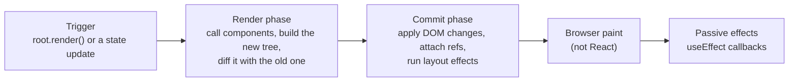
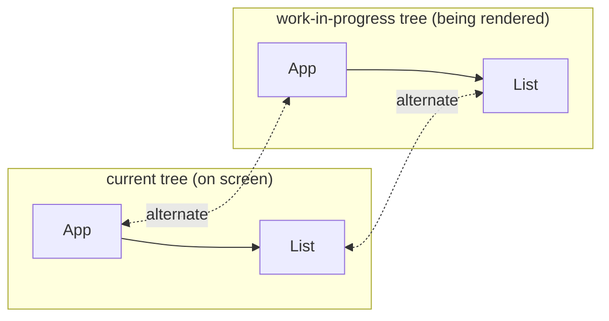

## Why this chapter matters

You already know the slogan from [React fundamentals](/react/fundamentals#the-mental-model-ui--fstate): **UI = f(state)**. You change state, React "re-renders", the screen updates. This chapter opens that box. What exactly happens between `setCount(1)` and the new pixel on screen? Which components run again, which DOM nodes change, and in what order do refs and effects fire?

Interviewers love these questions because the answers separate people who *use* React from people who *understand* it: "What causes a re-render?", "What is reconciliation?", "What is Fiber?", "Render phase vs commit phase?". Real bugs come from the same place: lost input state, effects firing in an unexpected order, a whole page re-rendering on every keystroke.

## The three steps: trigger, render, commit

Think of React as a restaurant kitchen:

1. **Trigger**: a customer places an order (something asks for a new UI).
2. **Render**: the cook prepares the dish (React calls your components to find out what the UI should look like).
3. **Commit**: the waiter puts the dish on the table (React applies the changes to the real DOM).

After the commit the **browser** takes over and paints the pixels; that part isn't React (see the [browser rendering pipeline](/browser/rendering-pipeline)).



The word **render** in React does *not* mean "draw on the screen". It means "call the component function to get its JSX". A component can render without anything on the screen changing.

### Step 1: what triggers a render

There are only two reasons React starts rendering:

- **The initial render.** You call `createRoot(container).render(<App />)` once when the app starts.
- **A state update** somewhere in the tree. That covers every way to change state: a `useState` setter, a `useReducer` `dispatch`, a store read with `useSyncExternalStore` that announces a change, and a context provider whose `value` changes (that's state of the component above it).

Notice what is *not* on the list: **props changing**. Props are not a trigger; they are an *input*. Props only change because a parent rendered again and passed new ones, and that parent rendered because of a state update.

### Step 2: the render phase

React starts from the component whose state changed and **calls it**. It returns JSX, which is a tree of React elements. If those elements contain other components, React calls them too, and so on down the tree until it reaches plain DOM elements like `<div>` and `<p>`.

While it does this, React compares the new elements with what it rendered last time. This comparison is **reconciliation**, and its result is a list of changes ("set this text", "add this attribute", "remove that node"). Nothing in the DOM has been touched yet.

Two properties of the render phase matter a lot:

- **It must be pure.** React may call your component and throw the result away (StrictMode does it on purpose, concurrent rendering does it when something more urgent arrives). So rendering must not change anything outside itself; see [Components must be pure](/react/fundamentals#components-must-be-pure).
- **It can be interrupted.** Since React 18, a low-priority render can be paused to let the browser handle a click, then resumed or restarted. That's why no side effect may happen during render.

### Step 3: the commit phase

Once the whole new tree is known, React **commits** it. This phase is synchronous and can't be interrupted, so the user never sees a half-updated UI. It has three sub-steps:

<Steps>
<Step title="Before mutation">
React reads anything it needs from the DOM *before* changing it. For class components this is when `getSnapshotBeforeUpdate` runs (for example to remember the scroll position).
</Step>
<Step title="Mutation">
React inserts, updates and removes DOM nodes, runs `useInsertionEffect` callbacks, detaches old refs and runs the cleanups of layout effects that are changing.
</Step>
<Step title="Layout">
React attaches refs (DOM ref callbacks and `ref.current`), then runs `useLayoutEffect` callbacks (and `componentDidMount`/`componentDidUpdate`). The DOM is updated but the browser hasn't painted yet, so a layout effect can measure an element and fix the layout without a flicker.
</Step>
</Steps>

Then the browser paints. After that, React runs the **passive effects**: `useEffect` cleanups and then the new `useEffect` callbacks. They don't block painting, which is why `useEffect` is the default choice (details in [Effects](/react/effects)).

<Callout type="note">
"After paint" is the usual case, not a promise. If the update came from a discrete user event like a click or a key press, React flushes the passive effects synchronously at the end of the commit, before the browser paints, so the result of the click is consistent before the next event. Never rely on `useEffect` running before or after paint; use `useLayoutEffect` when the timing matters.
</Callout>

### Seeing the order for yourself

Every step logs to the console below. Read the mount order first, then press the button and read the update order. The demo is outside StrictMode so that each line appears once.

```jsx live nostrict
import { useState, useEffect, useLayoutEffect } from 'react'

function Child({ count }) {
  console.log(`render Child (count=${count})`)          // render phase
  useLayoutEffect(() => {
    console.log('  layout effect Child')                 // commit, before paint
    return () => console.log('  layout cleanup Child')
  }, [count])
  useEffect(() => {
    console.log('    effect Child')                      // after commit
    return () => console.log('    effect cleanup Child')
  }, [count])
  return (
    <p ref={(node) => { if (node) console.log('  ref attached <p>') }}>
      Child sees {count}
    </p>
  )
}

export default function App() {
  const [count, setCount] = useState(0)
  console.log(`render App (count=${count})`)
  useLayoutEffect(() => {
    console.log('  layout effect App')
    return () => console.log('  layout cleanup App')
  }, [count])
  useEffect(() => {
    console.log('    effect App')
    return () => console.log('    effect cleanup App')
  }, [count])
  return (
    <>
      <button onClick={() => { console.clear(); setCount(count + 1) }}>
        Re-render ({count})
      </button>
      <Child count={count} />
    </>
  )
}
```

What the log shows:

- **Render goes top-down**: `App` first, then `Child`, because a parent has to run before React knows which children it renders.
- **Commit work goes bottom-up**: the `<p>` ref, then `Child`'s layout effect, then `App`'s. A parent's effects run after its children's, so when a parent's effect runs, its children are fully set up.
- **All layout effects finish before any passive effect starts.**
- On an update, React first runs **all the cleanups** of that kind (with the values from the previous render), and only then **all the new effects**: `layout cleanup Child`, `layout cleanup App`, then `layout effect Child`, `layout effect App`.
- The inline ref callback is a new function on every render, so React detaches the old one (calls it with `null`) and attaches the new one each time.

## When does a component re-render?

This is the single most common React rendering question, and the honest answer has three parts. A component renders again when:

1. **Its own state changes** (a setter or dispatch from `useState`/`useReducer`, or an external store it subscribes to).
2. **Its parent renders.** By default, when a component renders, React renders **every component it returns, recursively**, whether or not their props changed.
3. **A context it reads changes** (`useContext(SomeContext)` or `use(SomeContext)` and the nearest provider gets a new `value`).

The second rule surprises people. React does not check "did the props change?" before rendering a child. Rendering is usually cheap, and checking props on every component would cost time too, so React only skips work when you ask it to (with [`memo`](/react/performance) or the React Compiler) or when the element is the very same object as last time (see below).

```jsx live nostrict
import { useState } from 'react'

function Title() {
  console.log('render Title (it has no props at all!)')
  return <h4 style={{ margin: 0 }}>Counter</h4>
}

function Display({ value }) {
  console.log('render Display', value)
  return <p>Value: {value}</p>
}

export default function App() {
  const [count, setCount] = useState(0)
  const [, setNothing] = useState(0)
  console.log('render App')
  return (
    <>
      <Title />
      <Display value={count} />
      <button onClick={() => setCount(count + 1)}>Change count</button>{' '}
      {/* new state value, but nothing reads it: App and all children still render */}
      <button onClick={() => setNothing((n) => n + 1)}>Change unused state</button>
    </>
  )
}
```

Press either button: `Title` renders every time even though it has no props, and the second button re-renders everything although nothing visible changes.

<Callout type="mistake">
**"A component re-renders when its props change."** Not quite. A child re-renders because its *parent* rendered, and that happens with or without new props. With `memo`, the reverse becomes true: the child renders only if its props changed (by `Object.is` on each prop). Saying it precisely in an interview is a quick win.
</Callout>

### Re-rendering is not the same as changing the DOM

A render only *calculates* the UI. React then compares the result with the previous one and touches the DOM only where something differs. In the demo below, a [`MutationObserver`](/browser/dom) watches the real DOM. Each click re-renders the whole component, yet only one text node is ever changed:

```jsx live
import { useState, useEffect, useRef } from 'react'

export default function App() {
  const [count, setCount] = useState(0)
  const [log, setLog] = useState([])
  const box = useRef(null)

  useEffect(() => {
    // Record every real DOM change inside the box
    const observer = new MutationObserver((records) => {
      const changes = records.map((r) =>
        r.type === 'characterData' ? `text changed to "${r.target.data}"` : r.type)
      setLog((old) => [...old, ...changes].slice(-4))
    })
    observer.observe(box.current, { subtree: true, childList: true, characterData: true, attributes: true })
    return () => observer.disconnect()
  }, [])

  return (
    <>
      <div ref={box}>
        <h4 style={{ margin: 0 }}>This heading is rendered every time</h4>
        <p className="static">So is this paragraph.</p>
        <p>Clicks: {count}</p>
      </div>
      <button onClick={() => setCount(count + 1)}>Re-render</button>
      <pre>{log.join('\n') || 'No DOM changes yet'}</pre>
    </>
  )
}
```

So "it re-rendered" is not automatically a problem. A render that produces the same output costs some JavaScript time and no DOM work. It only becomes a problem when the component is slow to render or there are thousands of them, which the [Performance](/react/performance) chapter deals with.

### When React skips rendering (bailouts)

React has a few built-in ways to avoid work, called **bailouts**:

| Situation | What React does |
| --- | --- |
| You set state to the **same value** (`Object.is(old, new)`) | Skips re-rendering that component's children. It may still call the component itself once before deciding (see [Bailing out](/react/hooks#bailing-out-setting-the-same-value)). |
| A child element is **the same object** as in the previous render | Skips that child entirely (unless its own state or context changed). |
| The child is wrapped in **`memo`** and every prop is `Object.is`-equal | Skips that child ([Performance](/react/performance)). |
| The **React Compiler** is enabled | It inserts memoization for you, so unchanged JSX keeps the same identity ([Performance](/react/performance)). |

The second row explains a useful trick that needs no `memo` at all.

### The "children as props" trick

When `App` renders `<SlowTree />`, the JSX creates a **new element object** on every render of `App`, so React renders `SlowTree` again. But if `SlowTree` is created *by the parent* of the component whose state changes and passed in as `children`, the element object was created in the parent's last render and stays the same object. React sees the identical element and skips it.

```jsx live nostrict
import { useState } from 'react'

function SlowTree() {
  console.log('render SlowTree')                        // pretend this is expensive
  return <p>I am an expensive subtree.</p>
}

// ❌ The state lives in the same component that creates <SlowTree />
function ColorPickerBad() {
  const [color, setColor] = useState('#2563eb')
  return (
    <div style={{ borderLeft: `6px solid ${color}`, paddingLeft: 8 }}>
      <input type="color" value={color} onChange={(e) => setColor(e.target.value)} />
      <SlowTree />                                       {/* new element every render */}
    </div>
  )
}

// ✅ The state is in a wrapper; the expensive tree comes in from outside
function ColorPicker({ children }) {
  const [color, setColor] = useState('#16a34a')
  return (
    <div style={{ borderLeft: `6px solid ${color}`, paddingLeft: 8 }}>
      <input type="color" value={color} onChange={(e) => setColor(e.target.value)} />
      {children}                                         {/* same element object as before */}
    </div>
  )
}

export default function App() {
  return (
    <>
      <p>Drag the first picker: SlowTree renders on every change.</p>
      <ColorPickerBad />
      <p>Drag the second one: SlowTree doesn't render at all.</p>
      <ColorPicker>
        <SlowTree />
      </ColorPicker>
    </>
  )
}
```

The related advice is **move state down**: keep state in the smallest component that needs it, so that a state change re-renders as little as possible. Both tricks are free, which is why you should try them before reaching for `memo`.

## Batching: many updates, one render

If every `setState` started its own render, a handler that sets three values would render three times, and the user might even see the in-between states. Instead React **batches**: it collects every update made while your code runs and renders once at the end.

Since React 18 this is **automatic batching** everywhere: in React event handlers, `setTimeout` callbacks, promise `.then` handlers, `await` continuations and native event listeners. Before React 18, only updates inside React event handlers were batched.

```jsx live nostrict
import { useState } from 'react'
import { flushSync } from 'react-dom'

export default function App() {
  const [a, setA] = useState(0)
  const [b, setB] = useState(0)
  console.log(`render a=${a} b=${b}`)

  function inHandler() {
    console.clear()
    setA((x) => x + 1)
    setB((x) => x + 1)          // one render with both changes
  }

  function inTimeout() {
    console.clear()
    setTimeout(() => {
      setA((x) => x + 1)
      setB((x) => x + 1)        // still one render (React 18+)
    }, 0)
  }

  function withFlushSync() {
    console.clear()
    flushSync(() => setA((x) => x + 1))   // forces a render right here
    console.log('after flushSync, the DOM already shows the new a')
    setB((x) => x + 1)                    // a second render
  }

  return (
    <>
      <p>a = {a}, b = {b}</p>
      <button onClick={inHandler}>Two updates in a handler</button>{' '}
      <button onClick={inTimeout}>Two updates in a timeout</button>{' '}
      <button onClick={withFlushSync}>With flushSync</button>
    </>
  )
}
```

### Opting out with flushSync

<Api name="flushSync()" sig="flushSync(callback)" returns="whatever `callback` returns." mutates="yes (renders and commits synchronously, updating the DOM before it returns)">

- `callback`: a function that makes state updates. React runs it, then immediately renders and commits those updates (plus any that were already pending) before `flushSync` returns.
- Import it from `react-dom`, not `react`, because it's about the DOM being up to date.
- Calling it during render or inside an effect logs a warning: React is already busy and can't flush.

</Api>

You rarely need it. The classic case is reading the DOM right after an update, for example scrolling to a list item that the update just added:

```jsx
import { flushSync } from 'react-dom'

function addTodo(text) {
  flushSync(() => {
    setTodos((todos) => [...todos, { id: crypto.randomUUID(), text }])
  })
  // The new <li> is in the DOM now, so we can scroll to it
  listRef.current.lastElementChild.scrollIntoView({ behavior: 'smooth' })
}
```

<Callout type="warning">
`flushSync` gives up batching and the concurrent features (a transition inside it renders synchronously), and can hurt performance. Reach for a ref callback or `useLayoutEffect` first, and use `flushSync` only when you truly need the DOM updated in the middle of a function.
</Callout>

## The virtual DOM

You'll hear that React uses a **virtual DOM**. The phrase just means: React keeps a lightweight description of the UI in plain JavaScript objects (the React elements your components return, plus React's internal tree of Fibers), computes the next description on each render, compares the two, and touches the real DOM only where they differ.

```js run
// A JSX expression like <p className="note">Hi {name}</p> becomes a plain object:
const name = 'Ada'
const element = {
  $$typeof: Symbol.for('react.transitional.element'), // marks it as a React element
  type: 'p',
  key: null,
  props: { className: 'note', children: ['Hi ', name] },
}
console.log(element.type, element.props) // p { className: 'note', children: [ 'Hi ', 'Ada' ] }
```

Creating and comparing such objects is much cheaper than creating real DOM nodes, which carry hundreds of properties and can trigger style and layout work in the browser.

<Callout type="mistake">
**"The virtual DOM makes React faster than the DOM."** It doesn't: the fastest possible update is a hand-written `textNode.data = '5'`, and React always does more than that (render, diff, then the same DOM call). The virtual DOM's value is that it lets you write UI **declaratively** (describe the result, not the steps) while keeping the DOM work *small enough*. Libraries like Svelte and Solid skip the virtual DOM and compile updates directly, which is why the React team prefers the terms "React elements" and "Fiber tree" today.
</Callout>

## Reconciliation: how React compares two trees

**Reconciliation** is the algorithm that takes the previous tree and the new one and works out the smallest reasonable set of DOM changes.

The fully general problem ("find the minimum edits that turn one tree into another") takes about **O(n³)** time: for 1000 elements, around a billion comparisons. Far too slow to run on every keystroke. React instead uses an **O(n)** algorithm based on two assumptions that are true for almost all real UIs:

1. **Elements of different types produce different trees.** A `<div>` that becomes a `<section>`, or a `<Counter>` that becomes a `<Timer>`, is not "edited"; the old subtree is thrown away and a new one is built.
2. **Keys tell React which children are the same item** across renders, so a list can be reordered without being rebuilt.

React walks both trees at the same time, comparing each position with the same position in the previous render. At each position there are four cases:

| Old element | New element | What React does |
| --- | --- | --- |
| `<div className="a">` | `<div className="b">` (same DOM type) | Keeps the DOM node, updates only the changed attributes (`className`), then recurses into the children. |
| `<Counter step={1}>` | `<Counter step={2}>` (same component type) | Keeps the component instance **and its state**, renders it with the new props, then recurses into its output. |
| `<div>` | `<section>` (different type) | **Unmounts** the old subtree (cleanups run, DOM nodes removed, **all state inside is destroyed**) and mounts a new one. |
| something | nothing (`null`, `false`) | Unmounts the old subtree. |

### Changing the type destroys state

Type something into the input, then toggle the wrapper. Only the outer tag changes, but because the type at that position differs, React throws away everything inside it, including the input's text and the counter's state.

```jsx live
import { useState } from 'react'

function Counter() {
  const [n, setN] = useState(0)
  return <button onClick={() => setN(n + 1)}>Clicked {n} times</button>
}

export default function App() {
  const [boxed, setBoxed] = useState(false)
  const content = (
    <>
      <input placeholder="Type here first" /> <Counter />
    </>
  )
  return (
    <>
      <label>
        <input type="checkbox" checked={boxed} onChange={(e) => setBoxed(e.target.checked)} />
        Wrap in &lt;section&gt; instead of &lt;div&gt;
      </label>
      {/* Same children, different parent type: the whole subtree is rebuilt */}
      {boxed
        ? <section style={{ border: '2px dashed', padding: 8 }}>{content}</section>
        : <div style={{ padding: 10 }}>{content}</div>}
    </>
  )
}
```

The same rule explains a mistake from the fundamentals chapter: [never define a component inside another component](/react/fundamentals#never-define-a-component-inside-another-component). Each render creates a brand-new function, so the type is "different" every time and the child's state resets on every keystroke.

### Same position, same type: state is kept

The reverse also holds, and it surprises people. React doesn't care how *your code* produced the element; it only looks at the type at that position in the output.

```jsx live
import { useState } from 'react'

function Counter({ fancy }) {
  const [n, setN] = useState(0)
  return (
    <button style={{ fontWeight: fancy ? 'bold' : 'normal' }} onClick={() => setN(n + 1)}>
      {fancy ? '✨ ' : ''}Clicked {n} times
    </button>
  )
}

export default function App() {
  const [fancy, setFancy] = useState(false)
  return (
    <>
      <label>
        <input type="checkbox" checked={fancy} onChange={(e) => setFancy(e.target.checked)} /> Fancy
      </label>
      <p>Two different JSX branches, same position and type: the count survives</p>
      {fancy ? <Counter fancy /> : <Counter />}

      <p>Two different positions: the count resets when you toggle</p>
      {fancy && <Counter fancy />}
      {!fancy && <Counter />}
    </>
  )
}
```

In the second pair, `{fancy && …}` and `{!fancy && …}` are two separate slots in the children array. When one is `false`, its slot is empty, so toggling moves the counter from slot 1 to slot 2: a different position, so new state. To force a reset even at the same position, give the element a different `key`, as shown in [State belongs to a position in the tree](/react/hooks#state-belongs-to-a-position-in-the-tree).

### Lists and keys inside reconciliation

For children that come from an array, comparing "by position" breaks down as soon as items are inserted, removed or reordered. A **key** gives each child an identity: React matches old and new children **by key** first, so an item keeps its DOM node and state when it moves. The fundamentals chapter shows the visible bug that wrong keys cause in [Why keys exist](/react/fundamentals#why-keys-exist). Here is what reconciliation does with keys:

```text
Before:  [ A(key=a) , B(key=b) , C(key=c) ]
After:   [ C(key=c) , A(key=a) , B(key=b) ]      ← C moved to the front

With keys:  match by key → a=a, b=b, c=c
            → no node is recreated; React only moves C's DOM node (1 insertBefore)

With index keys (0,1,2):  match by position → 0:A→C, 1:B→A, 2:C→B
            → every item gets the wrong props; inputs/state stay at the old position
```

Keys only have to be unique **among siblings**, and they must be **stable**: `Math.random()` or `crypto.randomUUID()` called during render creates a new key every time, so every item is unmounted and remounted on every render.

## Fiber: React's engine

So far we've talked about "the tree" loosely. Internally, since React 16 (2017), that tree is made of **Fibers**, and the engine that walks it is called the **Fiber reconciler**. Interviews for senior positions often ask about it.

### The problem Fiber solved

Before React 16, the **stack reconciler** rendered the tree by plain recursion: `render(App)` called `render(Child)` called `render(Grandchild)`... Recursion uses the JavaScript call stack, and a call stack can't be paused: once React started an update, it had to finish the whole tree in one go. For a large tree that might take 100 ms, during which the main thread was blocked: typing lagged and animations stuttered.

The fix was to stop using the call stack and give React its *own* data structure it could walk step by step, stop at any point, and continue later. Each step of that walk is one Fiber.

### What a Fiber is

A **Fiber** is a plain JavaScript object that React creates for every component instance and every DOM element in the tree. It's the "instance" from [Element vs component vs instance](/react/fundamentals#element-vs-component-vs-instance): the place where React keeps everything about that part of the UI between renders. The real fields in React 19 include:

| Field | What it holds |
| --- | --- |
| `tag` | Kind of fiber: function component, class component, host (DOM) element, text, fragment, context provider and so on. |
| `type`, `key` | Copied from the element: the component function or tag name like `'div'`, and the key. |
| `stateNode` | The real thing behind the fiber: the DOM node for host fibers, the instance for class components. |
| `child`, `sibling`, `return` | Links to the first child, the next sibling and the parent. These turn the tree into a linked list React can walk without recursion. |
| `pendingProps`, `memoizedProps` | The props for this render and the props used last time it finished. |
| `memoizedState` | For function components: the **linked list of hooks** (the "slots" from the [rules of hooks](/react/hooks#why-the-order-matters-how-react-stores-hook-state)). |
| `updateQueue` | Pending updates and, for function components, the effect list. |
| `flags`, `subtreeFlags` | Bit flags marking what the commit must do here: `Placement`, `Update`, `ChildDeletion`, `Ref`, `Passive` (has effects)... |
| `lanes`, `childLanes` | Which priorities of work are pending on this fiber and anywhere below it. |
| `alternate` | The matching fiber in the other tree (see double buffering). |

```text
            App                        child   ↓  first child
             │                         sibling →  next sibling
             ↓ child                   return  ↑  parent
          Header ──sibling──→ Main ──sibling──→ Footer
                               │
                               ↓ child
                              List
                               │
                               ↓ child
                             Item1 ──sibling──→ Item2
   (every child also has a `return` pointer back up to its parent)
```

### The work loop: walking the tree one fiber at a time

React processes the tree with a loop rather than recursion. For each fiber it calls **`beginWork`** (render the component, reconcile its children, return the first child). When a fiber has no children left to process, React calls **`completeWork`** (for host fibers: create or prepare the DOM node, collect flags) and moves to the sibling, or back up to the parent. This runnable model follows exactly the order React uses:

```js run
// Build a small fiber tree with child / sibling / return links
function fiber(name, children = []) {
  const f = { name, child: null, sibling: null, return: null }
  children.forEach((c, i) => {
    c.return = f
    if (i === 0) f.child = c
    else children[i - 1].sibling = c
  })
  return f
}
const root = fiber('App', [
  fiber('Header'),
  fiber('Main', [fiber('List', [fiber('Item1'), fiber('Item2')])]),
  fiber('Footer'),
])

// React's loop: one unit of work at a time, no recursion
function performUnitOfWork(f) {
  console.log('begin   ', f.name)        // beginWork: call the component, reconcile children
  if (f.child) return f.child            // go down first
  let node = f
  while (node) {
    console.log('complete', node.name)   // completeWork: prepare DOM, bubble flags up
    if (node.sibling) return node.sibling // then go right
    node = node.return                    // then go back up
  }
  return null                             // back at the top: the tree is done
}

let next = root
while (next) next = performUnitOfWork(next) // React can stop between any two iterations
```

Read the output: `begin` goes top-down (parents render before children, as in the log demo earlier) and `complete` goes bottom-up (children finish before their parents, which is why child effects run first in the commit).

The important line is the last one. Because the state of the walk is just the variable `next`, React can stop between two units of work, let the browser handle an event, and later continue from `next`. In concurrent rendering the loop really looks like this:

```js
// Simplified from react-reconciler
function workLoopConcurrent() {
  while (workInProgress !== null && !shouldYield()) {
    performUnitOfWork(workInProgress)
  }
}
```

`shouldYield()` comes from React's **Scheduler** package. It returns `true` once React has been working for about **5 ms** (the `frameInterval` in `scheduler`), so React gives the main thread back to the browser many times per frame. This is called **time slicing**. Urgent updates (like typing) use `workLoopSync`, which has no `shouldYield` check.

### Double buffering: current and work-in-progress

React keeps **two** fiber trees:

- **current**: the tree that matches what is on the screen now.
- **work-in-progress**: the tree being built during a render.

Each fiber's `alternate` points to its twin in the other tree, so React reuses objects instead of allocating new ones each time. Rendering happens entirely in the work-in-progress tree. If the render is interrupted or thrown away, the current tree (and the screen) is untouched. When the commit finishes, React simply swaps a pointer: `root.current = finishedWork`. The work-in-progress tree becomes the current tree, and the old current tree becomes the scratch space for the next render.



The name comes from graphics: a game draws the next frame into a hidden buffer and then swaps it with the visible one, so you never see a half-drawn frame.

### Lanes: priorities for updates

Not all updates are equally urgent. A key press must show up immediately; a list filtered by that key press can wait a few milliseconds. React tracks the priority of every update with **lanes**: each lane is one bit in a 31-bit number, so a set of pending priorities is just a bitmask, and checking or merging them is a fast bitwise operation.

| Lane | Typical source |
| --- | --- |
| `SyncLane` | Discrete user events: `click`, `keydown`, `input`, `submit`. Also `flushSync`. |
| `InputContinuousLane` | Continuous events: `mousemove`, `scroll`, `pointermove`, `wheel`. |
| `DefaultLane` | Updates from outside any event: `setTimeout`, a resolved `fetch`, the initial `root.render`. |
| `TransitionLanes` | Updates inside `startTransition` / `useTransition`, and the deferred render of `useDeferredValue`. |
| `RetryLanes` | Retrying content after a [Suspense](/react/advanced) boundary's data arrives. |
| `IdleLane` | Work with the lowest priority. |
| `OffscreenLane` | Pre-rendering hidden content, for example inside [`<Activity mode="hidden">`](/react/performance). |

When a high-priority update arrives during a low-priority render, React can abandon the low-priority work-in-progress tree, render and commit the urgent update, then restart the low-priority render on top of the new state. You'll use this power through `useTransition` and `useDeferredValue` in [Concurrent React](/react/advanced).

<Callout type="note">
Lanes, `beginWork` and `workLoopConcurrent` are internal implementation details: you never import them and they can change between versions. Know the concepts (units of work, interruptible rendering, two trees, priorities) for interviews; don't build anything on the names.
</Callout>

### Putting it all together

<Steps>
<Step title="A click calls setCount(1)">
React creates an update object, puts it on the hook's queue, gives it `SyncLane` (a click is a discrete event), marks the fiber and every ancestor's `childLanes`, and schedules a render of the root. Other updates in the same handler join the same batch.
</Step>
<Step title="Render: build the work-in-progress tree">
React walks from the root. Fibers with no pending work and the same props are **bailed out** (cloned from current, or skipped entirely when `childLanes` is empty too). For the fiber that changed, React calls the component, processes the hook's update queue to get `count = 1`, and reconciles the returned elements against the old child fibers, setting flags such as `Update` or `Placement`.
</Step>
<Step title="Complete: prepare the DOM work">
On the way back up, `completeWork` prepares DOM changes (which props changed on which nodes) and bubbles `subtreeFlags` up so the commit can skip subtrees with nothing to do.
</Step>
<Step title="Commit: apply it all at once">
Before mutation, mutation (DOM changes), swap `root.current`, layout (refs, layout effects). All synchronous.
</Step>
<Step title="Paint and passive effects">
The browser paints the new frame; React runs `useEffect` cleanups and callbacks (or flushes them right away for a discrete event like this click).
</Step>
</Steps>

## Rendering in StrictMode

In development, [`<StrictMode>`](/react/fundamentals#strictmode) renders every component **twice** (and runs the second render's result), and mounts every component, unmounts it and mounts it again to run each effect's cleanup once. This is how React checks that rendering is pure and that cleanups are correct, using the same "throw a render away" ability that concurrent rendering relies on. It doesn't happen in production. That's why the logging demos in this chapter use `nostrict`: in StrictMode every render line would appear twice.

## Common mistakes

<Callout type="mistake">
**Reading state right after setting it.** `setCount(count + 1); console.log(count)` prints the old value. The setter only queues an update; the new value appears in the *next* render. Compute the next value in a variable if you need it now.
</Callout>

<Callout type="mistake">
**Side effects in render.** Fetching data, setting a timer or writing to `localStorage` in the component body runs on every render, twice in StrictMode, and possibly for renders that are thrown away. Put them in event handlers or [effects](/react/effects).
</Callout>

<Callout type="mistake">
**Unstable keys or types.** `key={Math.random()}`, `key={index}` on a list that changes order, or a component defined inside another component all make React see "a different item" and remount it, losing state, focus and DOM nodes.
</Callout>

<Callout type="mistake">
**Fighting re-renders with `memo` everywhere.** Most re-renders are cheap and touch no DOM. First move state down or pass expensive trees as `children`; measure with the React DevTools Profiler before memoizing; or let the React Compiler do it ([Performance](/react/performance)).
</Callout>

## Interview questions

<QA q="What happens after you call setState?" level="mid" n={1}>
<Answer>

The setter doesn't change anything immediately. React puts an update on that hook's queue, marks the component as having pending work with a priority (lane), and schedules a render. Updates made in the same event are batched. During the next render React calls the component again, processes the queue to compute the new state, reconciles the returned elements with the previous ones, then commits the minimal DOM changes, attaches refs, runs layout effects, lets the browser paint, and runs `useEffect`s. If the new state is `Object.is` equal to the old one, React bails out.

</Answer>
</QA>

<QA q="What is the difference between the render phase and the commit phase?" level="mid" n={2}>
<Answer>

The **render phase** calls components and computes what changed. It must be pure, touches no DOM, and in concurrent mode can be paused, restarted or discarded. The **commit phase** applies the changes to the DOM, attaches refs and runs layout effects; it is synchronous and can't be interrupted, so the user never sees a partially applied update. Passive effects (`useEffect`) run after the commit, normally after paint.

</Answer>
<Deep>

The commit has sub-phases: before mutation (`getSnapshotBeforeUpdate`), mutation (DOM writes, `useInsertionEffect`, ref detach, layout cleanups), then `root.current` is swapped, then layout (ref attach, `useLayoutEffect`, `componentDidMount/Update`). Effects run child-first because they're collected on the way back up the tree.

</Deep>
</QA>

<QA q="What causes a component to re-render? Does a props change re-render it?" level="mid" n={3}>
<Answer>

A component re-renders when its own state changes, when its parent re-renders, or when a context it consumes changes. Props changing isn't a separate cause: props only change because the parent rendered, and by default the child renders whenever its parent does, even with identical props. `memo` changes that so the child renders only when a prop changed (shallow `Object.is` comparison).

</Answer>
<FollowUp>

*How can you avoid re-rendering an expensive child without `memo`?* Move state down into a smaller component, or lift the expensive part up and pass it as `children`: the element is created by the parent, keeps its identity, and React skips it.

</FollowUp>
</QA>

<QA q="What is the virtual DOM? Is it why React is fast?" level="junior" n={4}>
<Answer>

It's an in-memory description of the UI as plain JavaScript objects (React elements and the Fiber tree). On each update React builds the new description, diffs it with the previous one and applies only the differences to the real DOM. It isn't faster than precise manual DOM updates; its benefit is that you write declarative code and still get reasonably minimal DOM work.

</Answer>
</QA>

<QA q="Explain reconciliation. Why does React's diff run in O(n)?" level="mid" n={5}>
<Answer>

Reconciliation compares the new element tree with the previous one to find DOM changes. A general tree diff is O(n³), so React uses heuristics: elements of different types produce completely different subtrees (unmount and remount rather than diff), and lists are matched by `key`. Same DOM type means "update attributes"; same component type means "keep the instance and its state and render with new props".

</Answer>
<Mistake>

Saying React "diffs the real DOM". It never reads the DOM to compare; it compares the new elements with the fibers from the previous render.

</Mistake>
</QA>

<QA q="Why does an input lose its text when its parent changes from <div> to <section>?" level="mid" n={6}>
<Answer>

Because the element type at that position changed, and React's rule is "different type, different tree". It unmounts the whole old subtree (destroying state and DOM nodes, including the input and its text) and mounts a new one. The same happens if a component is defined inside another component, since its function, and therefore its type, is new on every render.

</Answer>
</QA>

<QA q="What is automatic batching?" level="mid" n={7}>
<Answer>

React groups all state updates made in the same tick into one render. Before React 18 this only happened inside React event handlers; since React 18 (with `createRoot`) it also applies to timeouts, promises and native event handlers. Batching avoids wasted renders and prevents the UI from showing half-updated state. `flushSync` opts out when you need the DOM updated immediately.

</Answer>
</QA>

<QA q="What is React Fiber and why was it introduced?" level="senior" n={8}>
<Answer>

Fiber is the reconciler architecture introduced in React 16. Each component instance and DOM element has a fiber object (type, props, state/hooks, flags, priority lanes, and `child`/`sibling`/`return` links). The old stack reconciler rendered recursively and couldn't stop; Fiber turns rendering into a loop over units of work that can yield to the browser, be paused, resumed, restarted or abandoned. That made concurrent features possible: time slicing, transitions, Suspense, and priority-based updates.

</Answer>
<Deep>

React keeps two trees, `current` and `work-in-progress`, linked through `alternate` (double buffering), so an interrupted render never touches what's on screen; the commit swaps them with one pointer assignment. The work loop calls `beginWork` going down and `completeWork` going up, checking the Scheduler's `shouldYield()` (about 5 ms slices) between fibers in concurrent mode.

</Deep>
</QA>

<QA q="What are lanes?" level="senior" n={9}>
<Answer>

Lanes are React's priority model: each update gets a lane, a bit in a 31-bit mask (`SyncLane` for clicks and key presses, `InputContinuousLane` for mouse moves, `DefaultLane` for timers and network results, transition lanes for `startTransition`, plus retry, idle and offscreen lanes). Bitmasks make it cheap to batch updates of the same priority, find the most urgent pending work, and let an urgent update interrupt a transition render.

</Answer>
</QA>

## Recap

<Recap>

- An update has three steps: **trigger** (initial render or a state update), **render** (call components, diff) and **commit** (apply DOM changes); then the browser paints.
- "Render" means calling your component, not touching the DOM; a re-render with the same output changes no DOM.
- Render is pure and interruptible; commit is synchronous. Commit order: DOM mutation → refs → `useLayoutEffect` (child before parent) → paint → `useEffect`.
- A component re-renders when its state changes, its parent renders, or a context it reads changes. Props alone are not a trigger.
- Avoid unneeded renders by moving state down or passing expensive trees as `children` before reaching for `memo`.
- Since React 18, updates are batched everywhere; `flushSync` forces a synchronous render.
- Reconciliation is O(n): a different type destroys the subtree and its state; the same type at the same position keeps state; keys match list items.
- A Fiber is React's per-instance object with `child`/`sibling`/`return` links, hooks in `memoizedState`, flags and lanes.
- The work loop (`beginWork` down, `completeWork` up) can yield every ~5 ms; `current` and work-in-progress trees are swapped on commit.
- Lanes are bitmask priorities that let urgent updates interrupt transitions.

</Recap>
