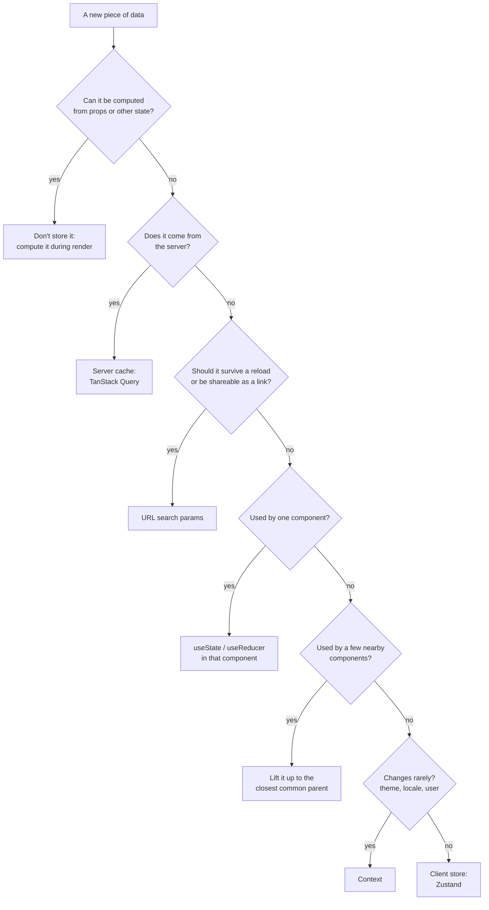
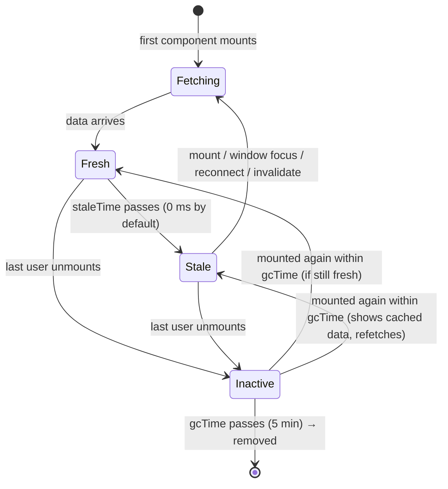

## Why state management is a topic at all

You already know the tools for one component: [`useState`](/react/hooks#usestate-in-depth), [`useReducer`](/react/hooks#usereducer) and [`useContext`](/react/hooks#usecontext). "State management" is the question that comes next, once an app grows: **where should each piece of data live, who is allowed to change it, and how do the components that need it get it?**

Getting this wrong is the root of most messy React code: the same data copied into three places and drifting apart, a `useEffect` that "syncs" two states, a context that re-renders the whole app on every keystroke, or a hand-written cache of API responses full of race conditions. Interviewers ask about it constantly ("Context or Redux?", "What is server state?", "Why TanStack Query?") because the answer shows how you think about architecture.

This chapter goes from the smallest decision (what to put in `useState`) to the largest (a global store and a server cache), and ends with a map of which tool fits which job.

## The kinds of state

Not all state is the same. Before choosing a tool, name the **kind** of data you have:

| Kind | Examples | Who owns the truth | Best home |
| --- | --- | --- | --- |
| **Local UI state** | Is this dropdown open? The text in this input. Current tab. | This component | `useState` / `useReducer` in that component |
| **Shared client state** | The logged-in user, theme, cart, a wizard's steps, a selected item used by two panels | The browser app | Lifted state, context, or a client store (Zustand) |
| **Server state** | Products, comments, the user's orders: anything that lives in a database | **The server**; you only hold a cached copy | A server-state library (TanStack Query) |
| **URL state** | Search term, filters, page number, the open item's id | The address bar | The router's search params / path |
| **Form state** | Field values, validation errors, "touched" flags | The form, until it's submitted | Local state, a form library, or [form Actions](/react/react-19) |
| **Derived state** | A filtered list, a total price, "is the form valid?" | Nobody: it's calculated | **Not state.** Compute it during render |

Two lines in this table do most of the work in real apps. **Derived state isn't state**: if you can calculate it from other values, calculate it. And **server state isn't client state**: data fetched from an API is a *cache* of someone else's data, with problems (staleness, refetching, deduplication) that `useState` was never designed for.

### Choosing a home



Start at the top every time. Most data is caught by the first three questions, and much less of it ends up "global" than people expect.

## Structuring local state

Even inside one component, the *shape* of state decides how many bugs you can write. React's docs give five principles; each one removes a whole class of bugs.

### Group related state

If two values always change together, keep them in one state variable. Then they can never get out of sync.

```jsx
// ❌ Two variables that must always be updated together
const [x, setX] = useState(0)
const [y, setY] = useState(0)

// ✅ One object, updated in one call
const [position, setPosition] = useState({ x: 0, y: 0 })
setPosition({ x: e.clientX, y: e.clientY })
```

### Avoid contradictions: use a status instead of many booleans

Several booleans that describe one process can combine into impossible states: `isSending` and `isSent` both `true`? Replace them with one **status** value that can only be one thing at a time.

```jsx live
import { useState } from 'react'

const wait = (ms) => new Promise((r) => setTimeout(r, ms))

export default function Feedback() {
  const [text, setText] = useState('')
  // ✅ One value with 4 possible states instead of isTyping/isSending/isSent/isError
  const [status, setStatus] = useState('typing')   // 'typing' | 'sending' | 'sent' | 'error'

  async function handleSubmit(e) {
    e.preventDefault()
    setStatus('sending')
    await wait(800)                                  // pretend to call an API
    setStatus(text.includes('error') ? 'error' : 'sent')
  }

  if (status === 'sent') return <p>Thanks for the feedback! ✅</p>

  return (
    <form onSubmit={handleSubmit}>
      <textarea value={text} onChange={(e) => setText(e.target.value)}
        disabled={status === 'sending'} placeholder="Type 'error' to see the error state" />
      <br />
      <button disabled={text === '' || status === 'sending'}>
        {status === 'sending' ? 'Sending…' : 'Send'}
      </button>
      {status === 'error' && <p style={{ color: 'crimson' }}>Something went wrong.</p>}
    </form>
  )
}
```

This is a tiny **state machine**: a fixed set of states and clear moves between them. In TypeScript, a union type `'typing' | 'sending' | 'sent' | 'error'` makes impossible states impossible to write.

### Avoid redundant state: derive it

If a value can be calculated from props or other state during render, don't store it. Storing it means you must remember to update it every time the source changes, and one day you'll forget.

```jsx
// ❌ fullName must be kept in sync by hand
const [firstName, setFirstName] = useState('')
const [lastName, setLastName] = useState('')
const [fullName, setFullName] = useState('')

// ✅ Calculated on every render, always correct
const fullName = firstName + ' ' + lastName
```

The same goes for filtered lists, counts, totals and "is valid" flags. If the calculation is genuinely expensive, cache it with [`useMemo`](/react/performance) rather than putting it in state.

<Callout type="mistake">
**Copying a prop into state.** `const [color, setColor] = useState(props.color)` reads the prop only on the **first** render; when the parent passes a new color, this component keeps showing the old one. Use the prop directly. If you really want only an initial value, name it so: `initialColor`.
</Callout>

### Avoid duplication: store the id, not a copy

When one piece of state points at an item inside another, store its **id** and look the item up. A copy of the object goes stale the moment the original is edited.

```jsx live
import { useState } from 'react'

const initial = [
  { id: 1, title: 'Pretzels' },
  { id: 2, title: 'Crispy seaweed' },
  { id: 3, title: 'Granola bar' },
]

export default function Menu() {
  const [items, setItems] = useState(initial)
  const [selectedId, setSelectedId] = useState(1)       // ✅ only the id
  const selected = items.find((i) => i.id === selectedId) // derived, always fresh

  function rename(id, title) {
    setItems(items.map((i) => (i.id === id ? { ...i, title } : i)))
  }

  return (
    <>
      {items.map((item) => (
        <div key={item.id}>
          <input value={item.title} onChange={(e) => rename(item.id, e.target.value)} />
          <button onClick={() => setSelectedId(item.id)}>Choose</button>
        </div>
      ))}
      <p>You picked: <b>{selected.title}</b> (edit it above: this updates too)</p>
    </>
  )
}
```

If you had stored `const [selected, setSelected] = useState(items[0])`, editing the chosen item's title would leave the "You picked" line showing the old title.

### Avoid deep nesting: normalize

Deeply nested state (a tree of folders inside folders) is painful to update immutably: changing one leaf means copying every level above it. Flatten it the way a database would: store items in an object **by id**, and let each item list its children's ids.

```js run
// Nested: updating 'c' means copying root → a → c
const nested = { id: 'root', children: [{ id: 'a', children: [{ id: 'c', title: 'Old', children: [] }] }] }

// Normalized: every item is one key away
const byId = {
  root: { id: 'root', childIds: ['a'] },
  a:    { id: 'a', childIds: ['c'] },
  c:    { id: 'c', title: 'Old', childIds: [] },
}

// Updating 'c' copies only the outer object and 'c' itself
const next = { ...byId, c: { ...byId.c, title: 'New' } }
console.log(next.c.title, next.a === byId.a) // New true  ← untouched items keep their identity
```

Keeping untouched items as the *same objects* also helps performance: `memo`-ized rows for those items can skip rendering.

## Sharing state between components

### Lifting state up

When two components need the same data, move the state to their **closest common parent** and pass it down as props, together with functions to change it. This is **lifting state up**, and the result is a **single source of truth**: one owner, many readers.

In this accordion only one panel may be open. Neither panel can know about the other, so the parent owns `activeIndex`:

```jsx live
import { useState } from 'react'

// A "controlled" panel: it has no state, the parent decides everything
function Panel({ title, children, isActive, onShow }) {
  return (
    <section style={{ border: '1px solid #8884', padding: 8, marginBottom: 6 }}>
      <h4 style={{ margin: 0 }}>{title}</h4>
      {isActive ? <p>{children}</p> : <button onClick={onShow}>Show</button>}
    </section>
  )
}

export default function Accordion() {
  const [activeIndex, setActiveIndex] = useState(0)   // the single source of truth
  return (
    <>
      <Panel title="About" isActive={activeIndex === 0} onShow={() => setActiveIndex(0)}>
        A handbook for frontend interviews.
      </Panel>
      <Panel title="Topics" isActive={activeIndex === 1} onShow={() => setActiveIndex(1)}>
        HTML, CSS, JavaScript, TypeScript, the browser and React.
      </Panel>
    </>
  )
}
```

A component whose important data comes from props is **controlled** by its parent; one that keeps it in its own state is **uncontrolled**. Lifting state up turns an uncontrolled component into a controlled one. (More on this trade-off in [Component patterns](/react/patterns).)

Lifting has a cost: when the parent's state changes, the parent and everything below it re-renders (see [When does a component re-render?](/react/rendering#when-does-a-component-re-render)). So lift only as high as you must, and no higher.

### Prop drilling and Context

When the common parent is far above the components that need the data, every component in between must accept and pass the prop along without using it. This is **prop drilling**. It's fine for two or three levels; past that, [Context](/react/hooks#usecontext) lets a provider make a value available to its whole subtree.

### Scaling up: reducer + context

A common built-in pattern for app-level state combines the two hooks: a [reducer](/react/hooks#usereducer) holds the logic, and **two** contexts deliver it, one for the state and one for `dispatch`.

```jsx live
import { createContext, useContext, useReducer, useState } from 'react'

const TasksContext = createContext(null)
const DispatchContext = createContext(null)

function tasksReducer(tasks, action) {
  switch (action.type) {
    case 'added':   return [...tasks, { id: Date.now(), text: action.text, done: false }]
    case 'toggled': return tasks.map((t) => (t.id === action.id ? { ...t, done: !t.done } : t))
    case 'deleted': return tasks.filter((t) => t.id !== action.id)
    default: throw new Error('Unknown action: ' + action.type)
  }
}

// The provider hides how the state is stored
function TasksProvider({ children }) {
  const [tasks, dispatch] = useReducer(tasksReducer, [{ id: 1, text: 'Read the state chapter', done: false }])
  return (
    <TasksContext value={tasks}>
      <DispatchContext value={dispatch}>{children}</DispatchContext>
    </TasksContext>
  )
}

// Custom hooks: components never touch the contexts directly
const useTasks = () => useContext(TasksContext)
const useTasksDispatch = () => useContext(DispatchContext)

function AddTask() {
  const dispatch = useTasksDispatch()          // needs only dispatch
  const [text, setText] = useState('')
  return (
    <form onSubmit={(e) => { e.preventDefault(); dispatch({ type: 'added', text }); setText('') }}>
      <input value={text} onChange={(e) => setText(e.target.value)} placeholder="New task" />
      <button disabled={!text}>Add</button>
    </form>
  )
}

function TaskList() {
  const tasks = useTasks()
  const dispatch = useTasksDispatch()
  return (
    <ul>
      {tasks.map((t) => (
        <li key={t.id}>
          <label>
            <input type="checkbox" checked={t.done} onChange={() => dispatch({ type: 'toggled', id: t.id })} />
            {t.done ? <s>{t.text}</s> : t.text}
          </label>{' '}
          <button onClick={() => dispatch({ type: 'deleted', id: t.id })}>✕</button>
        </li>
      ))}
    </ul>
  )
}

export default function App() {
  return (
    <TasksProvider>
      <AddTask />
      <TaskList />
    </TasksProvider>
  )
}
```

Why two contexts? `dispatch` never changes identity, so components that only *send* actions (like `AddTask`) read a context whose value never changes and aren't re-rendered by context when the tasks change. (`<TasksContext value={…}>` renders the context as its own provider, which works since React 19; older code writes `<TasksContext.Provider value={…}>`.)

### Where Context stops scaling

Context is a **dependency-injection** tool, not a state manager with smart updates. Its limits are worth knowing precisely:

- **Every consumer re-renders when the value changes**, even if it only uses one field of a big object. There are no selectors: you can't say "re-render me only when `user.name` changes".
- A new object literal as the value (`value={{ user, setUser }}`) is a new value **on every render of the provider**, so all consumers re-render even when nothing changed. Memoize it (or let the React Compiler do it).
- Splitting into many small contexts helps, but each needs its own provider, and the nesting grows quickly.

For data that changes rarely (theme, locale, the signed-in user, feature flags) Context is perfect. For data that changes often and is read in many places in different slices, a store with **selectors** fits better.

## Client stores: Zustand

A **client store** keeps state **outside** the React tree, in a plain JavaScript object, and lets components **subscribe to the slice** they need. React reads it through [`useSyncExternalStore`](/react/hooks#usesyncexternalstore), the hook made exactly for this. Popular stores include Redux Toolkit, Zustand, Jotai, MobX and Valtio. This handbook uses **Zustand**: it's small (about 1 KB), needs no provider, and its ideas transfer to every other store.

### Creating a store

<Api name="create()" sig="const useStore = create((set, get, api) => initialState)" returns="a hook `useStore(selector?)` with the store API attached: `getState`, `setState`, `subscribe`, `getInitialState`." mutates="no (it creates a new store)">

- `set(partial, replace?)`: updates the state. `partial` is an object, or a function `(state) => object` when the next state depends on the current one. The result is **shallowly merged** into the state (one level deep, like a class component's `setState`). Pass `replace = true` to replace the whole state instead of merging.
- `get()`: returns the current state. Use it inside actions to read values without subscribing.
- `api`: the store API itself (rarely needed, used by middleware).
- The function returns the **initial state**: data *and* the functions (**actions**) that change it. Keeping actions inside the store keeps every update rule in one place, like a reducer.

</Api>

```jsx live
import { create } from 'zustand'

// The store lives outside React: one object, shared by every component
const useCounter = create((set) => ({
  count: 0,
  step: 1,
  increment: () => set((state) => ({ count: state.count + state.step })), // merged into state
  setStep: (step) => set({ step }),
  reset: () => set({ count: 0 }),
}))

function Count() {
  const count = useCounter((state) => state.count)   // subscribes to count only
  console.log('render Count')
  return <h3 style={{ margin: 0 }}>Count: {count}</h3>
}

function StepPicker() {
  const step = useCounter((state) => state.step)     // subscribes to step only
  const setStep = useCounter((state) => state.setStep)
  console.log('render StepPicker')
  return (
    <label>
      Step:{' '}
      <select value={step} onChange={(e) => setStep(Number(e.target.value))}>
        {[1, 5, 10].map((n) => <option key={n}>{n}</option>)}
      </select>
    </label>
  )
}

function Buttons() {
  const increment = useCounter((state) => state.increment) // functions never change
  const reset = useCounter((state) => state.reset)
  console.log('render Buttons')
  return (
    <p>
      <button onClick={increment}>+ step</button> <button onClick={reset}>Reset</button>
    </p>
  )
}

// No provider needed: any component can use the hook
export default function App() {
  return (
    <>
      <Count />
      <StepPicker />
      <Buttons />
    </>
  )
}
```

Clear the console (or watch the new lines) and press **+ step**: only `Count` renders. Change the step: only `StepPicker` renders. `Buttons` never re-renders after mounting, because the actions it selects never change. That's the main difference from Context: **a component re-renders only when the value its selector returns changes** (compared with `Object.is`).

### Selectors and useShallow

The function you pass to the hook is a **selector**: it picks what the component needs from the whole state. Zustand runs it after every store change and re-renders the component only if the result is different from last time (by `Object.is`).

That rule has one trap. A selector that builds a **new object or array** returns a different value every time, even when the contents are equal:

```jsx
// ❌ A new object on every call. In Zustand 5 this throws
//    "Maximum update depth exceeded": React sees a "changed" value forever.
const { count, step } = useCounter((s) => ({ count: s.count, step: s.step }))

// ✅ Option 1: one selector per value (primitives compare by value)
const count = useCounter((s) => s.count)
const step = useCounter((s) => s.step)

// ✅ Option 2: useShallow compares the object's fields one level deep
import { useShallow } from 'zustand/shallow'
const { count, step } = useCounter(useShallow((s) => ({ count: s.count, step: s.step })))
```

`useShallow(selector)` wraps your selector so that, if the new result has the **same keys with `Object.is`-equal values** as the previous one, it returns the *previous* object. Same object, so no re-render.

<Callout type="mistake">
**Calling the hook with no selector.** `const state = useCounter()` subscribes to the **entire** store, so the component re-renders on every change to any field. It's convenient in a tiny demo and a performance bug in a real app. Always select what you use.
</Callout>

### Using the store outside React

Because the store is a plain object, code that isn't a component can use it too: event listeners, WebSocket handlers, API helpers, tests.

```js
useCounter.getState().count          // read the current state (no subscription)
useCounter.getState().increment()    // call an action
useCounter.setState({ count: 42 })   // write directly (merged)

const unsubscribe = useCounter.subscribe((state, prevState) => {
  if (state.count !== prevState.count) console.log('count changed to', state.count)
})
unsubscribe()                        // stop listening

useCounter.setState(useCounter.getInitialState(), true) // reset everything (e.g. between tests)
```

### Middleware: persist, devtools and immer

Middleware wraps the store's initializer to add behavior. The three you'll meet most come from `zustand/middleware`:

```jsx
import { create } from 'zustand'
import { persist, createJSONStorage, devtools } from 'zustand/middleware'
import { immer } from 'zustand/middleware/immer'   // needs the `immer` package

const useSettings = create(
  devtools(                               // shows actions and state in Redux DevTools
    persist(                              // saves the state and restores it on reload
      (set) => ({
        theme: 'light',
        fontSize: 16,
        setTheme: (theme) => set({ theme }),
      }),
      {
        name: 'settings',                 // the storage key (required)
        storage: createJSONStorage(() => localStorage), // the default; sessionStorage also works
        partialize: (s) => ({ theme: s.theme }), // save only some fields
        version: 1,                       // bump it and add `migrate` when the shape changes
      },
    ),
  ),
)

// immer lets you write "mutating" code that produces an immutable update
const useTodos = create(
  immer((set) => ({
    todos: [],
    toggle: (id) => set((state) => {
      const todo = state.todos.find((t) => t.id === id)
      todo.done = !todo.done            // looks like a mutation; immer makes a copy
    }),
  })),
)
```

The order matters: `devtools` should be the outermost wrapper so it sees the final `set`. With `persist`, the first render may show the default state before the saved one is loaded from asynchronous storage; `useSettings.persist.hasHydrated()` tells you when it's done.

### Zustand with TypeScript

With TypeScript, write the state type and call `create` **twice**: `create<State>()(…)`. The extra `()` is a workaround that lets TypeScript infer the middleware types while you specify the state type.

```tsx
import { create } from 'zustand'

type CartState = {
  items: { id: string; qty: number }[]
  add: (id: string) => void
  total: () => number
}

const useCart = create<CartState>()((set, get) => ({
  items: [],
  add: (id) => set((s) => ({ items: [...s.items, { id, qty: 1 }] })),
  total: () => get().items.reduce((sum, i) => sum + i.qty, 0), // get() reads without subscribing
}))
```

### Splitting a big store into slices

A large store can be built from **slice** functions, each owning a part of the state and its actions, then combined into one store:

```js
const createUserSlice = (set) => ({ user: null, login: (user) => set({ user }) })
const createCartSlice = (set) => ({ items: [], add: (item) => set((s) => ({ items: [...s.items, item] })) })

const useAppStore = create((...args) => ({
  ...createUserSlice(...args),
  ...createCartSlice(...args),
}))
```

Alternatively, simply create **several small stores** (`useCartStore`, `useUiStore`). Unlike Redux, Zustand has no rule of "one store per app".

### Zustand, Redux Toolkit and the others

| Library | Model | When it shines |
| --- | --- | --- |
| **Redux Toolkit** | One store, reducers ("slices"), actions as plain objects, middleware, time-travel DevTools | Large teams wanting strict conventions, an existing Redux codebase, complex event logs |
| **Zustand** | Hook-based store, actions as functions, selectors, no provider | Most apps that need shared client state with little boilerplate |
| **Jotai** | Many tiny **atoms**; derived atoms compute from others | State made of many independent pieces with fine-grained dependencies |
| **MobX / Valtio** | Mutable observable objects; reads are tracked automatically | Teams that prefer mutation-style code |

All of them solve the same two problems Context doesn't: **selective subscriptions** and **state that lives outside the tree**. In interviews, explaining *that* is worth more than knowing any one API.

## Server state: TanStack Query

### Why server data is different

Data from an API isn't really *your* state. The server owns it; you hold a **snapshot** that might already be out of date. Handling that well means solving a list of problems:

- **Caching**: going back to a page shouldn't show a spinner for data you fetched a second ago.
- **Deduplication**: three components asking for the same user should cause one request, not three.
- **Staleness**: when should cached data be refetched? On window focus, on reconnect, after a mutation?
- **Race conditions**: a slow response for an old search must not overwrite a fast response for the new one.
- **Loading, error and retry** states for every request.
- **Garbage collection**: dropping cached data nobody uses anymore.

The naive approach puts a `fetch` inside a `useEffect` and stores the result with `useState`. It works for a demo and solves **none** of the problems above (the race condition alone needs an "ignore" flag; see [Effects](/react/effects)). That's why server state usually gets its own library: **TanStack Query** (formerly React Query), SWR, RTK Query or Apollo for GraphQL. With such a library, your client store becomes much smaller, because most "global state" in typical apps was really server data.

### Setup

A `QueryClient` holds the cache. Provide it once at the top of the app:

```jsx
import { QueryClient, QueryClientProvider } from '@tanstack/react-query'

const queryClient = new QueryClient()      // create it once, outside components

export default function App() {
  return (
    <QueryClientProvider client={queryClient}>
      <Routes />
    </QueryClientProvider>
  )
}
```

### useQuery: reading data

<Api name="useQuery()" sig="const result = useQuery({ queryKey, queryFn, ...options })" returns="an object with `data`, `error`, `status`, `fetchStatus`, the `is*` flags, `refetch` and more." mutates="no (it reads from and writes to the query cache)">

- `queryKey` (required): an **array** that identifies the data, like `['todos']` or `['todo', 5]` or `['todos', { status: 'done', page: 2 }]`. It's hashed deterministically (object key order doesn't matter). Everything the query function uses should be in the key: when the key changes, it's a different cache entry and the query fetches it.
- `queryFn` (required unless set as a default): an async function that returns the data or **throws** on error. It receives `{ queryKey, signal, meta, client }`; pass `signal` to `fetch` so that cancelled queries abort the request. Note that `fetch` doesn't throw on HTTP 404/500; check `response.ok` yourself.
- `staleTime` (default `0`): how long fresh data stays **fresh**. Fresh data is served from the cache with no refetch. `Infinity` means "only refetch when invalidated"; `'static'` means "never refetch, even when invalidated".
- `gcTime` (default 5 minutes): how long **unused** data stays in the cache after the last component using it unmounts. Then it's garbage-collected.
- `enabled` (default `true`): `false` stops the query from running automatically (for dependent queries, see below).
- `select`: transforms or picks part of the data (`(todos) => todos.length`); the component re-renders only when the selected result changes.
- `placeholderData`: data to show while the real data loads. `keepPreviousData` (imported from the library) keeps showing the previous key's data while the new key loads, which avoids a spinner on every page change.
- `retry` (default `3` in the browser, with exponential backoff), `refetchOnWindowFocus`, `refetchOnReconnect`, `refetchOnMount` (all default `true`, and they refetch only **stale** data), `refetchInterval` (polling).

</Api>

The result object has two independent statuses, which confuses everyone at first:

| Field | Values | Answers the question |
| --- | --- | --- |
| `status` | `'pending'` (no data yet), `'error'`, `'success'` | **Do we have data?** |
| `fetchStatus` | `'fetching'`, `'paused'` (offline), `'idle'` | **Is the query function running right now?** |

The flags are shortcuts: `isPending` (no data yet), `isError`, `isSuccess`, `isFetching` (a request is in flight, including background refetches), and `isLoading`, which is exactly `isPending && isFetching` (the first load is in progress). A query can be `success` *and* `fetching` at the same time: that's a **background refetch**, where you keep showing the old data and maybe a small "updating" hint.

Here's a complete example with a fake API. Switch between users: the first visit to a user shows a loading state; going back shows the cached data instantly, then refreshes it in the background because `staleTime` is 0.

```jsx live
import { useState } from 'react'
import { QueryClient, QueryClientProvider, useQuery } from '@tanstack/react-query'

// A fake API: 700 ms delay, a fresh "lastSeen" on every call
const wait = (ms) => new Promise((r) => setTimeout(r, ms))
async function fetchUser(id) {
  console.log('fetching user', id)
  await wait(700)
  if (id === 3) throw new Error('User 3 does not exist')
  return { id, name: ['Ada', 'Linus'][id - 1], lastSeen: new Date().toLocaleTimeString() }
}

function User({ id }) {
  const { data, error, isPending, isError, isFetching } = useQuery({
    queryKey: ['user', id],           // a different id is a different cache entry
    queryFn: () => fetchUser(id),
    retry: false,                     // fail fast in this demo (default: 3 retries)
  })

  if (isPending) return <p>Loading user {id}…</p>   // no data yet
  if (isError) return <p style={{ color: 'crimson' }}>Error: {error.message}</p>
  return (
    <p>
      <b>{data.name}</b>, last seen {data.lastSeen}
      {isFetching && ' (refreshing in the background…)'}
    </p>
  )
}

const queryClient = new QueryClient()

export default function App() {
  const [id, setId] = useState(1)
  return (
    <QueryClientProvider client={queryClient}>
      {[1, 2, 3].map((n) => (
        <button key={n} onClick={() => setId(n)} disabled={n === id}>User {n}</button>
      ))}
      <User id={id} />
    </QueryClientProvider>
  )
}
```

### The life of a cached query



The two timers are the most-asked TanStack Query question:

- **`staleTime`** decides **when to refetch**. While data is fresh, mounting a new component that uses it, focusing the window, or reconnecting causes no request.
- **`gcTime`** decides **when to forget**. It starts only when *no* component uses the query anymore.

With the default `staleTime: 0`, every new mount and every window focus refetches in the background. That's safe but chatty; most apps set a default like `staleTime: 60_000` on the `QueryClient`: `new QueryClient({ defaultOptions: { queries: { staleTime: 60_000 } } })`.

### Query keys

Treat query keys like dependency arrays: everything the `queryFn` reads goes in the key. Keys are hierarchical, which makes invalidation powerful: invalidating `['todos']` also invalidates `['todos', 5]` and `['todos', { status: 'done' }]` because they **start with** it. Many teams use a **key factory** to keep keys consistent:

```js
export const todoKeys = {
  all:    ['todos'],
  lists:  () => [...todoKeys.all, 'list'],
  list:   (filters) => [...todoKeys.lists(), filters],
  detail: (id) => [...todoKeys.all, 'detail', id],
}
// useQuery({ queryKey: todoKeys.detail(5), queryFn: () => getTodo(5) })
// queryClient.invalidateQueries({ queryKey: todoKeys.lists() }) → refetches every list
```

### Dependent and parallel queries

A query that needs the result of another waits with `enabled`:

```js
const { data: user } = useQuery({ queryKey: ['user', email], queryFn: () => getUser(email) })
const { data: projects } = useQuery({
  queryKey: ['projects', user?.id],
  queryFn: () => getProjects(user.id),
  enabled: !!user?.id,          // doesn't run until the user is known
})
```

Two `useQuery` calls in the same component run **in parallel** automatically. For a dynamic number of queries use `useQueries({ queries: ids.map((id) => ({ queryKey: ['user', id], queryFn: … })) })`.

### useMutation: changing data

Reads are **queries**; creates, updates and deletes are **mutations**. A mutation doesn't run on mount and isn't cached; you call it from an event.

<Api name="useMutation()" sig="const mutation = useMutation({ mutationFn, onMutate?, onSuccess?, onError?, onSettled? })" returns="an object with `mutate(variables)`, `mutateAsync(variables)`, `status`, `isPending`, `isError`, `isSuccess`, `data`, `error`, `variables` and `reset()`." mutates="yes (it runs your server change, and its callbacks usually update the cache)">

- `mutationFn(variables, context)`: the async function that talks to the server. `variables` is whatever you pass to `mutate`.
- `onMutate(variables, context)`: runs **before** `mutationFn`. Use it for optimistic updates; what it returns is passed to the other callbacks as `onMutateResult` (handy for a rollback snapshot).
- `onSuccess(data, variables, onMutateResult, context)`, `onError(error, variables, onMutateResult, context)`, `onSettled(data, error, variables, onMutateResult, context)`: run after success, after failure, and after either. If they return a promise, it is awaited.
- `context` contains `client` (the `QueryClient`), `meta` and `mutationKey`.
- `mutate(variables, { onSuccess, onError, onSettled })` fires the mutation and never throws; `mutateAsync` returns a promise you can `await` (and must `catch`).

</Api>

After a successful mutation, the cached data is out of date. The simplest fix is to **invalidate** the affected queries: they're marked stale and the active ones refetch right away.

```js
const queryClient = useQueryClient()
const addTodo = useMutation({
  mutationFn: (text) => api.post('/todos', { text }),
  onSuccess: () => queryClient.invalidateQueries({ queryKey: ['todos'] }), // refetch the list
})
// <button onClick={() => addTodo.mutate('Buy milk')} disabled={addTodo.isPending}>
```

If the server returns the updated object, you can skip the refetch and write it into the cache yourself with `queryClient.setQueryData(['todo', id], updated)`.

### Optimistic updates

An **optimistic update** shows the result *before* the server confirms it, and rolls back if the server says no. It makes the UI feel instant. The recipe has four steps; tick "Make the server fail" to see the rollback:

```jsx live
import { useState } from 'react'
import { QueryClient, QueryClientProvider, useQuery, useMutation, useQueryClient } from '@tanstack/react-query'

// A fake server with a real "database"
const wait = (ms) => new Promise((r) => setTimeout(r, ms))
const db = { todos: [{ id: 1, text: 'Learn TanStack Query', done: false }] }
let failNext = false
const api = {
  async getTodos() { await wait(400); return structuredClone(db.todos) },
  async toggle(id) {
    await wait(900)
    if (failNext) throw new Error('Server rejected the change')
    const t = db.todos.find((t) => t.id === id)
    t.done = !t.done
    return structuredClone(t)
  },
}

function Todos() {
  const queryClient = useQueryClient()
  const [fail, setFail] = useState(false)
  const { data: todos, isPending, isFetching } = useQuery({ queryKey: ['todos'], queryFn: api.getTodos })

  const toggle = useMutation({
    mutationFn: (id) => api.toggle(id),
    onMutate: async (id) => {
      await queryClient.cancelQueries({ queryKey: ['todos'] })     // 1. stop refetches that could overwrite us
      const previous = queryClient.getQueryData(['todos'])          // 2. snapshot for rollback
      queryClient.setQueryData(['todos'], (old) =>                  // 3. update the cache optimistically
        old.map((t) => (t.id === id ? { ...t, done: !t.done } : t)))
      return { previous }                                           //    → becomes onMutateResult
    },
    onError: (err, id, onMutateResult) => {
      queryClient.setQueryData(['todos'], onMutateResult.previous)  // 4a. roll back on failure
      console.log('rolled back:', err.message)
    },
    onSettled: () => queryClient.invalidateQueries({ queryKey: ['todos'] }), // 4b. resync with the server
  })

  if (isPending) return <p>Loading…</p>
  return (
    <>
      <label>
        <input type="checkbox" checked={fail} onChange={(e) => { failNext = e.target.checked; setFail(e.target.checked) }} />
        Make the server fail
      </label>
      <ul>
        {todos.map((t) => (
          <li key={t.id}>
            <label>
              <input type="checkbox" checked={t.done} onChange={() => toggle.mutate(t.id)} /> {t.text}
            </label>
          </li>
        ))}
      </ul>
      <small>{toggle.isPending ? 'Saving…' : isFetching ? 'Syncing…' : 'Up to date'}</small>
    </>
  )
}

const queryClient = new QueryClient()
export default function App() {
  return (
    <QueryClientProvider client={queryClient}>
      <Todos />
    </QueryClientProvider>
  )
}
```

There's a lighter variant that doesn't touch the cache: render `toggle.variables` while `toggle.isPending` is true, and the UI shows the pending value until the mutation settles. React 19 also has its own [`useOptimistic`](/react/react-19) hook for the same idea with Actions.

### Suspense, prefetching and SSR

- `useSuspenseQuery` has the same options but **suspends** while loading and **throws** errors to the nearest error boundary, so `data` is always defined. Loading UI moves to a `<Suspense>` boundary ([Concurrent React & Suspense](/react/advanced)).
- `queryClient.prefetchQuery({ queryKey, queryFn })` fills the cache ahead of time, for example when a user hovers over a link.
- For server rendering, you prefetch on the server, `dehydrate(queryClient)` the cache into the HTML, and wrap the client app in `<HydrationBoundary state={…}>` so the first render already has data.

## URL state

Some state belongs in the **address bar**: search terms, filters, sort order, the current page, the open tab or item. Put there, it survives a reload, works with the back button, and can be shared as a link. Router libraries expose it as a hook, and the browser's own `URLSearchParams` does the parsing:

```jsx
import { useSearchParams } from 'react-router'

function ProductList() {
  const [params, setParams] = useSearchParams()
  const q = params.get('q') ?? ''                     // read: ?q=shoes&page=2
  const page = Number(params.get('page') ?? 1)
  return (
    <input value={q} onChange={(e) => setParams({ q: e.target.value, page: '1' })} />
  )
}
```

The URL is then the **single source of truth**: don't copy `q` into `useState`. Combine it with TanStack Query by putting the params into the query key: `['products', { q, page }]`.

## The whole map

| Tool | Scope | Re-renders | Best for |
| --- | --- | --- | --- |
| `useState` | One component | That component (+ children) | Local UI state |
| `useReducer` | One component | Same | Complex local updates with many actions |
| Lifted state | A subtree | The owner and its subtree | State shared by a few nearby components |
| Context | A subtree | **Every** consumer on any change | Rarely changing values: theme, locale, user, DI |
| Reducer + Context | A subtree | Every state consumer | Medium app state without a library |
| Zustand / Redux Toolkit | App-wide, outside React | Only components whose selected value changed | Frequently changing shared client state |
| TanStack Query | App-wide cache | Only components using that query (and the fields they read) | **Everything that comes from the server** |
| URL params | App-wide, in the address bar | Components reading the params | Filters, search, pagination, shareable state |

<Callout type="tip">
A typical modern React app needs surprisingly little global client state: server data goes to TanStack Query, shareable UI state goes to the URL, forms use local state or form Actions, and what's left (theme, auth, a cart, a few UI flags) fits comfortably in Context or a small Zustand store.
</Callout>

## Common mistakes

<Callout type="mistake">
**Syncing state with an effect.** `useEffect(() => setFiltered(items.filter(…)), [items])` renders twice and can show stale data for a frame. Derive it during render instead: `const filtered = items.filter(…)`.
</Callout>

<Callout type="mistake">
**Putting server data in a global store.** Copying API results into Redux or Zustand means rebuilding caching, refetching, deduplication and loading states by hand, and the copy goes stale. Keep server data in a server-state library; keep only client state in the store.
</Callout>

<Callout type="mistake">
**One giant context for everything.** A single `AppContext` with the user, the theme, the cart and the modal state re-renders every consumer whenever any of them changes. Split contexts by how often they change, or use a store with selectors.
</Callout>

<Callout type="mistake">
**Query keys that miss a dependency.** `useQuery({ queryKey: ['todos'], queryFn: () => getTodos(filter) })` caches every filter under the same key, so changing the filter shows the old list. Put `filter` in the key: `['todos', filter]`.
</Callout>

## Interview questions

<QA q="How do you decide where a piece of state should live?" level="mid" n={1}>
<Answer>

First, check if it's state at all: anything computable from props or other state is derived during render. Then classify it: server data goes into a server cache (TanStack Query); state that should survive reloads or be shareable goes into the URL; state used by one component stays local; state used by a few components is lifted to their closest common parent; widely used, rarely changing values go into context; frequently changing shared client state goes into a store with selectors like Zustand.

</Answer>
</QA>

<QA q="What's the difference between client state and server state?" level="mid" n={2}>
<Answer>

Client state is owned by the browser app and is synchronous: a modal being open, a selected tab, a theme. Server state is owned by a remote server; the app only holds a possibly stale, asynchronously fetched cached copy that other users can change. Server state needs caching, deduplication, background refetching, invalidation after mutations, retries and garbage collection, which is why it's handled by dedicated libraries such as TanStack Query or SWR rather than `useState` or Redux.

</Answer>
</QA>

<QA q="Context or Redux/Zustand?" level="mid" n={3}>
<Answer>

Context is a way to pass a value down a subtree without prop drilling; it has no selectors, so every consumer re-renders when the value changes. That's ideal for values that change rarely (theme, locale, current user, injected services). A store like Zustand or Redux Toolkit keeps state outside React and lets each component subscribe to just the slice it uses, so frequent updates re-render only the affected components, and it can be read and updated outside components. Use Context for rarely changing data and dependency injection, a store for frequently changing shared state.

</Answer>
<FollowUp>

*Can you make Context faster?* Memoize the value, split it into several contexts (for example state and dispatch separately), move fast-changing parts down, or use `use-context-selector`-style libraries. At some point that's reinventing a store.

</FollowUp>
</QA>

<QA q="What is lifting state up?" level="junior" n={4}>
<Answer>

Moving state from components that need to share it into their closest common parent, then passing the value down as props along with callbacks to change it. It creates a single source of truth so the components can't disagree. The trade-off is that the parent and its subtree re-render on changes, so you lift only as high as necessary.

</Answer>
</QA>

<QA q="Why does a Zustand selector that returns an object cause problems, and how do you fix it?" level="mid" n={5}>
<Answer>

Zustand compares the selector result with `Object.is`. A selector like `(s) => ({ a: s.a, b: s.b })` returns a new object every time, so the result always looks changed: the component re-renders on every store update, and in Zustand 5 (built on `useSyncExternalStore`) it can loop until React throws "Maximum update depth exceeded". Fix it by selecting each primitive separately or by wrapping the selector in `useShallow`, which returns the previous object when the fields are shallowly equal.

</Answer>
</QA>

<QA q="Explain staleTime vs gcTime in TanStack Query." level="mid" n={6}>
<Answer>

`staleTime` (default 0) is how long fetched data is considered fresh; while fresh, mounts, window focus and reconnects don't refetch it. `gcTime` (default 5 minutes) is how long data stays in the cache after no component uses it anymore; after that it's removed. Stale data is still shown instantly from the cache; it's just refetched in the background on the next trigger.

</Answer>
<Mistake>

Thinking `gcTime` (formerly `cacheTime` in v4) controls refetching. It only controls when unused data is deleted.

</Mistake>
</QA>

<QA q="What's the difference between isPending, isLoading and isFetching?" level="mid" n={7}>
<Answer>

`isPending` means there's no data yet (`status === 'pending'`). `isFetching` means the query function is running right now, including background refetches when data already exists. `isLoading` is `isPending && isFetching`: the very first load is in progress. A disabled query with no data is pending but not loading.

</Answer>
</QA>

<QA q="How do you implement an optimistic update with TanStack Query?" level="senior" n={8}>
<Answer>

In `onMutate`: cancel outgoing refetches for the affected key (`cancelQueries`) so they don't overwrite the optimistic value, snapshot the current data with `getQueryData`, write the expected result with `setQueryData`, and return the snapshot. In `onError`, restore the snapshot (it arrives as `onMutateResult`). In `onSettled`, invalidate the key to resync with the server. A simpler alternative for one place in the UI is rendering `mutation.variables` while `isPending`.

</Answer>
</QA>

<QA q="Why not fetch data with useEffect and useState?" level="mid" n={9}>
<Answer>

It works for simple cases but leaves you to solve every server-state problem by hand: race conditions between overlapping requests, caching across components and navigations, deduplicating identical requests, refetching stale data, retries, loading and error states, and cleanup. It also creates request waterfalls, because data loading starts only after rendering. Libraries like TanStack Query (or a framework's data loaders and Server Components) solve these problems once.

</Answer>
</QA>

## Recap

<Recap>

- Classify data first: local UI, shared client, server, URL, form, or derived. Derived values are computed during render, never stored.
- Structure state well: group related values, use one status instead of many booleans, store ids instead of copies, normalize deep trees.
- Lift state to the closest common parent to share it; it becomes a single source of truth with controlled children.
- Context removes prop drilling but re-renders every consumer on change; use it for rarely changing values and split state from dispatch.
- Client stores (Zustand, Redux Toolkit) live outside React and re-render only components whose **selected** value changed.
- In Zustand: actions live in the store, `set` merges shallowly, select narrowly, use `useShallow` for object selectors, and `getState`/`subscribe` work outside React.
- Server state is a cache of someone else's data; TanStack Query handles caching, deduplication, refetching, retries and garbage collection.
- `queryKey` identifies data and must include every input; `staleTime` controls refetching, `gcTime` controls forgetting.
- Mutations change data; invalidate or `setQueryData` afterward, and use `onMutate` + rollback for optimistic updates.
- Put shareable UI state (search, filters, page) in the URL and treat it as the source of truth.

</Recap>
