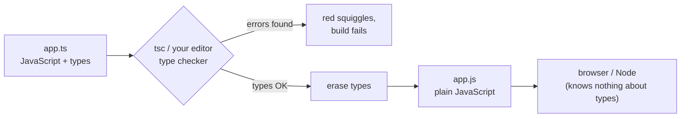
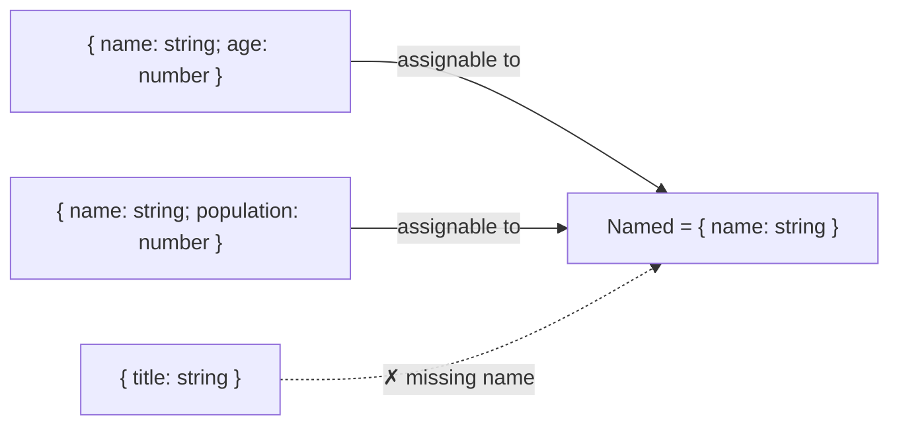

## What is TypeScript?

**TypeScript** is JavaScript **plus a type system**. You write normal JavaScript and add **type annotations** that describe what kind of values your variables, parameters and return values hold. The TypeScript compiler (`tsc`) checks those descriptions **before** your code runs, then **erases** them and outputs plain JavaScript.



Two facts to understand from day one:

1. **Types only exist at compile time.** At runtime there's no TypeScript: no type checks, no `typeof User`. If data comes from an API, TypeScript can't verify it by itself (you need runtime validation, e.g. Zod).
2. **TypeScript is a superset of JavaScript.** Every valid JavaScript program is (almost always) valid TypeScript; you can adopt it file by file.

### Why teams use it

| Benefit | Example |
| --- | --- |
| Catch bugs before running | `user.nmae` → "Property 'nmae' does not exist. Did you mean 'name'?" |
| Editor superpowers | Autocomplete, jump to definition, safe rename across the project |
| Self-documenting code | A function signature tells you what to pass and what you get back |
| Confident refactoring | Change a type and the compiler lists every place that needs updating |
| Contracts between teams | API response types shared by frontend and backend |

```ts
function formatPrice(amount: number, currency: string): string {
  return new Intl.NumberFormat("en-US", { style: "currency", currency }).format(amount);
}

formatPrice(19.9, "USD");      // ✓
formatPrice("19.9", "USD");    // ❌ Argument of type 'string' is not assignable to parameter of type 'number'.
formatPrice(19.9);             // ❌ Expected 2 arguments, but got 1.
```

## Basic type annotations

The syntax is `name: Type`, after the variable or parameter name.

```ts
let username: string = "Sara";
let age: number = 34;             // integers and floats are both `number`
let isAdmin: boolean = false;
let big: bigint = 10n;
let id: symbol = Symbol("id");
let nothing: null = null;
let notSet: undefined = undefined;

let scores: number[] = [90, 85];          // array of numbers
let tags: Array<string> = ["ts", "js"];   // same thing, generic syntax
let point: [number, number] = [10, 20];   // tuple: fixed length and types per position
```

### Type inference: you don't have to annotate everything

TypeScript **infers** types from values. Annotate **function parameters** and **public APIs**; let inference handle local variables.

```ts
let city = "Tehran";        // inferred: string
city = 42;                  // ❌ Type 'number' is not assignable to type 'string'.

const pi = 3.14;            // inferred: 3.14 (a literal type: const can never change)
const items = [1, 2, 3];    // inferred: number[]
const user = { name: "Ali", age: 30 };   // inferred: { name: string; age: number }

function add(a: number, b: number) {
  return a + b;             // return type inferred: number
}
```

| Annotate | Let TypeScript infer |
| --- | --- |
| Function parameters | Local variables with an initial value |
| Exported functions' return types (documents the contract) | Return types of small internal functions |
| Empty arrays/objects that will be filled later (`const ids: number[] = []`) | Callbacks passed to typed functions (`arr.map(x => …)`, x is inferred) |
| Values coming from outside (`JSON.parse`, `fetch`) | |

## Object types: `type` and `interface`

```ts
// A type alias
type User = {
  id: number;
  name: string;
  email?: string;            // optional: may be missing (string | undefined)
  readonly createdAt: Date;  // can't be reassigned after creation
};

// An interface: almost the same thing for object shapes
interface Product {
  id: number;
  title: string;
  price: number;
  tags: string[];
}

const u: User = { id: 1, name: "Ali", createdAt: new Date() };
u.name = "Reza";             // ✓
u.createdAt = new Date();    // ❌ Cannot assign to 'createdAt' because it is a read-only property.

const p: Product = { id: 1, title: "Mouse", price: 25 };
// ❌ Property 'tags' is missing in type '{ id: number; title: string; price: number; }'
```

### `type` vs `interface`

| | `interface` | `type` |
| --- | --- | --- |
| Object shapes | ✓ | ✓ |
| Unions, primitives, tuples, mapped/conditional types | ✗ | ✓ (`type Id = string \| number`) |
| Extending | `interface B extends A {}` | `type B = A & { … }` (intersection) |
| Declaration merging (same name declared twice merges) | ✓ (used to augment library types) | ✗ (error) |
| Error messages | Show the interface name | Sometimes show the expanded structure |

**Practical rule:** use `interface` for object shapes that others may extend (public APIs, component props in some teams) and `type` for everything else (unions, utility types). Consistency within a codebase matters more than the choice.

```ts
interface Animal { name: string }
interface Dog extends Animal { breed: string }     // extends

type WithTimestamps = { createdAt: Date; updatedAt: Date };
type Post = { title: string } & WithTimestamps;    // intersection: has ALL members

// Declaration merging: adding a property to a global type
interface Window { analytics?: { track(event: string): void } }
window.analytics?.track("page_view");
```

### Index signatures and `Record`

When keys aren't known in advance:

```ts
type Scores = { [studentName: string]: number };   // any string key → number
const scores: Scores = { ali: 18, sara: 20 };

type Locale = "fa" | "en";
const titles: Record<Locale, string> = { fa: "سلام", en: "Hello" };   // exactly these keys
```

## Functions

```ts
// Parameter and return types
function divide(a: number, b: number): number {
  return a / b;
}

// Optional and default parameters
function greet(name: string, greeting?: string): string {      // greeting: string | undefined
  return `${greeting ?? "Hello"}, ${name}`;
}
function repeat(text: string, times = 2): string {              // times inferred as number
  return text.repeat(times);
}

// Rest parameters
function sum(...values: number[]): number {
  return values.reduce((a, b) => a + b, 0);
}

// Function types: describing a function value
type Comparator<T> = (a: T, b: T) => number;
const byAge: Comparator<{ age: number }> = (a, b) => a.age - b.age;

// Callbacks
function onEvent(name: string, handler: (payload: { id: number }) => void): void {
  handler({ id: 1 });
}

// void vs never
function log(message: string): void { console.log(message); }       // returns nothing useful
function fail(message: string): never { throw new Error(message); } // never returns at all
```

## Union and literal types

A **union** `A | B` means "a value of type A **or** B". A **literal type** is a type with exactly one value, like `"dark"` or `42`. Together they describe a fixed set of allowed values, a much safer alternative to plain strings.

```ts
type Theme = "light" | "dark" | "system";        // only these three strings
type Id = string | number;

let theme: Theme = "dark";
theme = "blue";                                   // ❌ Type '"blue"' is not assignable to type 'Theme'.

function printId(id: Id) {
  // id.toUpperCase();                            // ❌ Property 'toUpperCase' does not exist on type 'number'.
  if (typeof id === "string") {
    console.log(id.toUpperCase());                // ✓ here TypeScript knows id is a string
  } else {
    console.log(id.toFixed(0));                   // ✓ and here a number
  }
}
```

That `if (typeof …)` trick is called **narrowing**, the subject of the [next chapter](/typescript/narrowing).

## The special types: `any`, `unknown`, `never`, `void`

| Type | Meaning | Can be assigned to anything? | Can you use it without checks? | Use it for |
| --- | --- | --- | --- | --- |
| `any` | "Turn type checking off" | ✓ | ✓ (nothing is checked) | Emergency escape hatch, migrating JS. Avoid |
| `unknown` | "Some value, I don't know what yet" | ✗ (only to `unknown`/`any`) | ✗ You must narrow first | Data from `JSON.parse`, `fetch`, `catch (e)` |
| `never` | "This can't happen" | ✓ (assignable to everything) | — | Functions that throw, exhaustive checks |
| `void` | "No meaningful return value" | — | — | Return type of functions that return nothing |

```ts
const fromApi: unknown = JSON.parse('{"name":"Ali"}');

fromApi.name;                       // ❌ 'fromApi' is of type 'unknown'.

if (typeof fromApi === "object" && fromApi !== null && "name" in fromApi) {
  console.log(fromApi.name);        // ✓ narrowed
}

const dangerous: any = JSON.parse("123");
dangerous.foo.bar.baz();            // compiles fine, crashes at runtime: that's what `any` costs you
```

<Callout type="interview">
"`any` vs `unknown`?" is a favourite question. `any` disables checking and spreads silently (anything you derive from it is also `any`). `unknown` is the type-safe counterpart: you can store anything in it, but you must prove what it is before using it.
</Callout>

## Type assertions and the non-null assertion

An **assertion** tells the compiler "trust me, I know the type better than you". It changes nothing at runtime; if you're wrong, you get a runtime crash.

```ts
const input = document.querySelector("#email") as HTMLInputElement;   // assertion
input.value = "a@b.c";

const el = document.getElementById("app")!;   // ! = "not null or undefined", trust me
el.textContent = "Hello";

const n = "hello" as unknown as number;        // double assertion: compiles, but is a lie
```

Prefer narrowing (`if (el)`, `instanceof HTMLInputElement`) or a validation library over assertions. Use `as const` (below) freely, though; it's a different, safe feature.

### `as const` and `satisfies`

```ts
// as const: make a value deeply readonly with literal types
const ROLES = ["admin", "editor", "viewer"] as const;
type Role = (typeof ROLES)[number];            // "admin" | "editor" | "viewer"

// satisfies: check a value against a type WITHOUT widening it
type ColorMap = Record<string, `#${string}`>;
const palette = {
  primary: "#2459e0",
  danger: "#c0352f",
} satisfies ColorMap;                          // ✓ validated…
palette.primary;                               // …and still typed as the literal "#2459e0", keys autocomplete
```

## Classes in TypeScript

```ts
class Account {
  readonly id: number;
  private balance = 0;            // TS-only privacy (checked at compile time)
  #pin: string;                   // JS #private (enforced at runtime)
  protected owner: string;        // visible in subclasses

  constructor(id: number, owner: string, pin: string) {
    this.id = id;
    this.owner = owner;
    this.#pin = pin;
  }

  deposit(amount: number): this { this.balance += amount; return this; }
  get total(): number { return this.balance; }
}

// Parameter properties: declare and assign in one go
class Point {
  constructor(public x: number, public y: number) {}
}

// Implementing an interface
interface Shape { area(): number }
class Circle implements Shape {
  constructor(private r: number) {}
  area() { return Math.PI * this.r ** 2; }
}

abstract class Repository<T> {          // can't be instantiated directly
  abstract findById(id: string): Promise<T | undefined>;
}
```

## Enums (and why many teams prefer unions)

```ts
enum Direction { Up, Down, Left, Right }        // numeric: Up = 0, Down = 1…
enum Status { Active = "ACTIVE", Banned = "BANNED" }   // string enum

const s: Status = Status.Active;

// The alternative most codebases prefer: a union of literals (+ an as-const object if you need values)
const STATUS = { Active: "ACTIVE", Banned: "BANNED" } as const;
type StatusValue = (typeof STATUS)[keyof typeof STATUS];   // "ACTIVE" | "BANNED"
```

Enums are one of the few TypeScript features that **generate runtime code**, numeric enums accept any number, and they don't work with "type stripping" tools (Node's built-in TS support, `erasableSyntaxOnly`). Unions of string literals are lighter and play better with JSON.

## How the type system thinks: structural typing

TypeScript compares types by **shape**, not by name. If a value has all the required properties with compatible types, it fits, whatever it's called. This is called **structural typing** (or "duck typing": if it walks like a duck…).

```ts
interface Named { name: string }

class Person { constructor(public name: string, public age: number) {} }
const city = { name: "Shiraz", population: 1_900_000 };

function hello(x: Named) { return `Hello ${x.name}`; }

hello(new Person("Ali", 30));   // ✓ has name: string
hello(city);                    // ✓ also has name: string — the names Person/city don't matter

hello({ name: "Sara", extra: true });
// ❌ Object literal may only specify known properties ('excess property check'
//    applies only to fresh object literals, to catch typos)
```



A type with **more** properties is assignable to a type with **fewer** (it's a subtype). That's why you can pass a full `User` to a function that only needs `{ id: number }`.

## Setting up TypeScript

```bash
npm install --save-dev typescript
npx tsc --init          # creates tsconfig.json
npx tsc --noEmit        # type-check only (bundlers like Vite handle the JS output)
```

The `tsconfig.json` options that matter most:

| Option | What it does | Recommendation |
| --- | --- | --- |
| `strict` | Enables all strict checks (`strictNullChecks`, `noImplicitAny`, …) | **Always `true`** |
| `noUncheckedIndexedAccess` | `arr[i]` and `obj[key]` include `undefined` | ✓ Catches many real bugs |
| `target` | Which JS version to output | `ES2022` or later for modern apps |
| `module` / `moduleResolution` | How imports are resolved | `"ESNext"` + `"Bundler"` with Vite/webpack |
| `jsx` | JSX handling | `"react-jsx"` |
| `noEmit` | Only type-check, don't write files | ✓ When a bundler compiles |
| `skipLibCheck` | Skip checking `.d.ts` files of dependencies | ✓ Faster builds |

With `strictNullChecks` (part of `strict`), `null` and `undefined` are **not** part of other types unless you say so. This is the single most valuable check in TypeScript:

```ts
function getLength(text: string | null) {
  return text.length;            // ❌ 'text' is possibly 'null'.
  return text?.length ?? 0;      // ✓
}
```

### Declaration files and `@types`

Libraries written in JavaScript describe their types in **`.d.ts` declaration files**. Many ship them; for others, the community publishes them as `@types/*` packages:

```bash
npm install --save-dev @types/lodash
```

```ts
// global.d.ts: describe a global or a module that has no types
declare const __APP_VERSION__: string;
declare module "*.svg" {
  const url: string;
  export default url;
}
```

## Common mistakes

- Thinking types exist at runtime (they're erased; validate external data).
- Using `any` to silence errors instead of `unknown` + narrowing.
- Overusing `as` assertions and the `!` operator.
- Annotating everything, even what inference already knows (noise).
- Turning `strict` off to "make it compile".
- Typing API responses by hand and trusting them without validation.
- Using numeric enums and passing arbitrary numbers into them.

## Interview questions

<QA q="What is TypeScript and what does it do at runtime?" level="junior" n={1}>
<Answer>

TypeScript is a typed superset of JavaScript. Its compiler checks types during development and build, then removes them and emits plain JavaScript. At runtime nothing of TypeScript remains: there are no type checks, so data from outside (APIs, user input, `localStorage`) must still be validated at runtime.

</Answer>
<Deep>

A few features do emit code (enums, namespaces, parameter properties, legacy decorators), which is why "type stripping" tools (Node's native TS support, esbuild's isolatedModules mode) restrict them. Libraries like Zod or Valibot let you define a schema once and derive both the runtime validator and the static type (`z.infer<typeof schema>`).

</Deep>
<Mistake>

Believing `function f(x: number)` will throw if someone passes a string at runtime.

</Mistake>
<FollowUp>

How would you type and validate a `fetch` response safely?

</FollowUp>
</QA>

<QA q="What's the difference between `any`, `unknown` and `never`?" level="mid" n={2}>
<Answer>

`any` disables type checking: anything can be assigned to it and you can do anything with it. `unknown` also accepts any value, but you can't use it until you narrow it (typeof, instanceof, a type guard). `never` is the empty type: no value has it; it's the return type of functions that never return and what remains after exhaustively narrowing a union.

</Answer>
<Deep>

`unknown` is the top type and `never` the bottom type of the type system: everything is assignable to `unknown`, and `never` is assignable to everything. `any` is both at once, which is why it breaks soundness and "infects" values derived from it. In `catch (e)`, TypeScript types `e` as `unknown` with `useUnknownInCatchVariables` (part of `strict`).

</Deep>
<Mistake>

Using `any` for "I don't know the type yet" where `unknown` fits.

</Mistake>
<FollowUp>

How does `never` enable exhaustiveness checks in a `switch` over a union?

</FollowUp>
</QA>

<QA q="`type` or `interface`? When do you use which?" level="mid" n={3}>
<Answer>

Both describe object shapes. Interfaces support declaration merging and `extends` and give clearer error messages; type aliases can describe anything, including unions, tuples, primitives, mapped and conditional types. A common convention: interfaces for public, extendable object shapes, and types for unions and computed types.

</Answer>
<Deep>

Declaration merging is how you augment third-party or global types (`interface Window { … }`, module augmentation). Intersections (`A & B`) and `extends` mostly behave the same, but `extends` reports conflicts as errors earlier, while conflicting intersections can silently produce `never` properties.

</Deep>
<Mistake>

Claiming interfaces are faster or "more correct" in general.

</Mistake>
<FollowUp>

How would you add a custom property to the global `Window` type?

</FollowUp>
</QA>

<QA q="What is structural typing? Give an example where it surprises people." level="senior" n={4}>
<Answer>

TypeScript checks compatibility by shape: a value is assignable to a type if it has all required properties with compatible types, regardless of its declared name or class. So a `Person` object can be passed where `{ name: string }` is expected. The surprise: two unrelated types with the same shape are interchangeable, for example `UserId` and `OrderId` both being `string`, so mixing them up compiles.

</Answer>
<Deep>

The fix is "branded" (nominal-like) types: `type UserId = string & { readonly __brand: "UserId" }`, created only through a validating function. Excess property checks are a special exception that applies only to fresh object literals, to catch typos.

</Deep>
<Mistake>

Expecting `class A {}` and `class B {}` with identical members to be incompatible.

</Mistake>
<FollowUp>

Implement a branded `Email` type with a constructor function that validates the format.

</FollowUp>
</QA>

## Recap

<Recap>

- TypeScript is a superset of JavaScript that checks types **before running** and is erased completely in the output.
- TypeScript infers types wherever it can; write annotations for parameters and public boundaries.
- `type` and `interface` both describe object shapes; `interface` can merge and `extends`, `type` is more flexible for unions and compositions.
- A union (`A | B`) means "one of these", and literal types (`"sm" | "md"`) restrict allowed values exactly.
- `any` switches checking off; `unknown` is safe and requires narrowing before use; `never` means "can't happen"; `void` means "the return value doesn't matter".
- Type assertions (`as`) and `!` only make promises to the compiler and do no runtime checks.
- Types are structural: any object with the required shape is accepted, whatever its name.
- A union of strings is often a lighter, more predictable alternative to `enum`.
- Turn on `strict: true` in `tsconfig.json` from day one.

</Recap>
