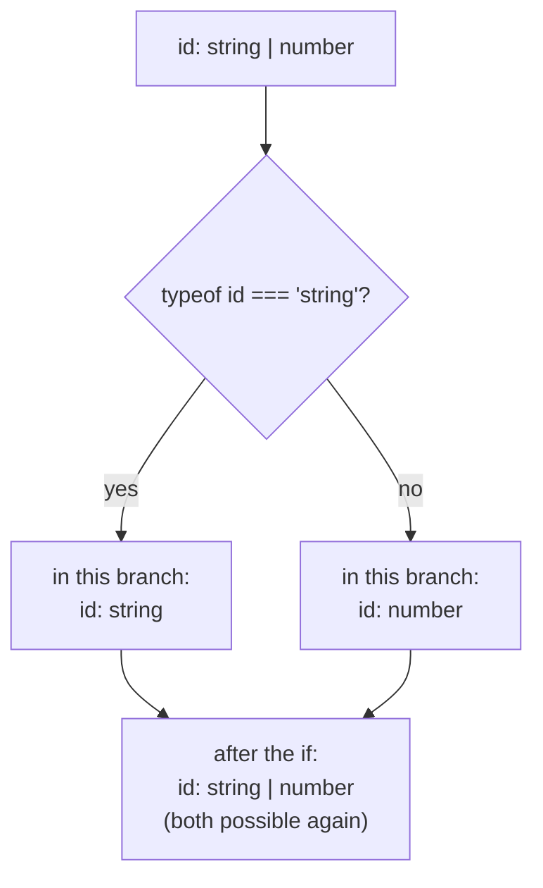

## The problem: a value that is "one of several things"

In real code many values don't have just one shape. A user ID might be a number or a string. A request result might be data or an error. A form field might hold text or be empty (`null`). In [the fundamentals chapter](/typescript/fundamentals#union-and-literal-types) we saw that TypeScript models this with a **union type** ("one of these"): `string | number`.

But as soon as you have a union, you hit a wall:

```ts
function printId(id: string | number) {
  console.log(id.toUpperCase());
  // ❌ Property 'toUpperCase' does not exist on type 'string | number'.
  //    Property 'toUpperCase' does not exist on type 'number'.
}
```

Why the error? TypeScript only allows what is valid for **every** member of the union. `toUpperCase` exists on `string` but not on `number`; if `id` is a number at runtime, the program crashes. So the compiler asks you for **proof**: "show me it's a string right now."

Using a check in your code to make a variable's type **narrower** (more precise) in part of the code is called **narrowing**:

```ts
function printId(id: string | number) {
  if (typeof id === "string") {
    console.log(id.toUpperCase()); // ✓ here id is a string
  } else {
    console.log(id.toFixed(2));    // ✓ only number is left here
  }
}
```

Notice that we wrote no TypeScript-specific syntax. `typeof id === "string"` is plain JavaScript. TypeScript **reads** your code and works out from the conditions which types are possible in each branch. Narrowing means TypeScript trusts your own logic.

## How narrowing works: control flow analysis

TypeScript tracks two types for every variable:

- The **declared type**: what you said when you declared it, e.g. `string | number`. This never changes.
- The **narrowed type**: what the variable can be **at this exact point in the code**. It changes with every condition, `return`, assignment and `throw`.

The mechanism that does this is called **control flow analysis**. TypeScript follows every path execution could take, just like you tracing the code with your finger:



When the two branches join again, TypeScript combines their types and you're back to `string | number`. Now let's see what can narrow a type. These checks are called **type guards**.

## Guard 1: `typeof`

JavaScript's `typeof` operator returns a string naming a value's runtime type. TypeScript knows all eight results and narrows with each one:

| `typeof x` | What remains |
| --- | --- |
| `"string"` | `string` |
| `"number"` | `number` (including `NaN` and `Infinity`) |
| `"bigint"` | `bigint` |
| `"boolean"` | `boolean` |
| `"symbol"` | `symbol` |
| `"undefined"` | `undefined` |
| `"function"` | anything callable |
| `"object"` | objects, arrays **and `null`** |

```ts
function describe(value: string | number | boolean | (() => void)) {
  if (typeof value === "function") {
    value();                       // value: () => void
  } else if (typeof value === "boolean") {
    console.log(value ? "yes" : "no"); // value: boolean
  } else {
    console.log(value);            // value: string | number
  }
}
```

### The famous trap: `typeof null === "object"`

This is a historical JavaScript bug that was never fixed (fixing it would break old code):

```js run
console.log(typeof null);       // "object" ← not "null"!
console.log(typeof []);         // "object" ← arrays are objects too
console.log(typeof {});         // "object"
```

TypeScript knows this and saves you from a bug:

```ts
function printAll(strs: string | string[] | null) {
  if (typeof strs === "object") {
    for (const s of strs) {}
    // ❌ 'strs' is possibly 'null'.
    // in this branch strs is string[] | null, not just string[]
  }
}
```

<Callout type="mistake" title="Thinking typeof x === &quot;object&quot; means “a real object”">
`typeof x === "object"` is true for arrays and for `null`. If you really want "a non-null object", write `x !== null && typeof x === "object"`, and use `Array.isArray(x)` for arrays.
</Callout>

## Guard 2: truthiness

In JavaScript any value in an `if` becomes `true` or `false`. The **falsy** values (the ones treated as `false`) are exactly: `false`, `0`, `-0`, `0n`, `""` (empty string), `null`, `undefined` and `NaN`. Everything else is **truthy**.

TypeScript uses this: when you write `if (x)`, `null` and `undefined` are definitely gone in the `true` branch.

```ts
function greet(name: string | undefined) {
  if (name) {
    console.log("Hi " + name.toUpperCase()); // ✓ name: string
  } else {
    // name: string | undefined ← why is string still here?
  }
}
```

Why is `string` still possible in the `else`? Because the empty string `""` is also falsy. TypeScript is precise: in the `else`, `name` may be `""` or `undefined`. That precision sometimes exposes a real bug:

```ts
function setVolume(level: number | undefined) {
  if (!level) {
    level = 50;        // 🐞 if the user deliberately set volume to 0, we turn it into 50!
  }
}

function setVolumeFixed(level: number | undefined) {
  if (level === undefined) {
    level = 50;        // ✓ only when no value was actually given
  }
  // or shorter: level ??= 50;
}
```

<Callout type="mistake" title="Truthiness on numbers and strings">
Don't check `number` and `string` with `if (x)` unless you really want `0` and `""` to count as "empty". Use `x !== undefined`, `x != null`, or the `??` operator (which reacts only to `null` and `undefined`). The same trap exists in React: `{count && <Badge />}` renders the number `0` on screen when `count` is zero.
</Callout>

The `!` (not) operator flips the narrowing, and `!!x` or `Boolean(x)` behave like `if (x)`.

## Guard 3: equality

Comparisons with `===`, `!==`, `==` and `!=` narrow too. TypeScript infers what is possible from the value compared against:

```ts
function compare(a: string | number, b: string | boolean) {
  if (a === b) {
    // the only type both sides share is string, so both are strings here
    a.toUpperCase(); // ✓
    b.toUpperCase(); // ✓
  }
}

function pick(size: "sm" | "md" | "lg" | 0) {
  if (size === 0) {
    // size: 0
  } else {
    size.toUpperCase(); // ✓ size: "sm" | "md" | "lg"
  }
}
```

### `== null`: the one place `==` is useful

In JavaScript, `x == null` is true for **both** `null` and `undefined` (and nothing else). TypeScript knows this, so `x != null` removes both with a single comparison:

```ts
function len(text: string | null | undefined) {
  if (text != null) {
    return text.length; // ✓ text: string
  }
  return 0;
}
```

| Check | What it removes |
| --- | --- |
| `x !== null` | only `null` |
| `x !== undefined` | only `undefined` |
| `x != null` | `null` and `undefined` (not `0` or `""`) |
| `if (x)` | `null`, `undefined` **and** `0`, `""`, `false`, `NaN` |

## Guard 4: the `in` operator

In JavaScript, `"key" in obj` asks: "does this object (or its prototype chain) have a property with this name?" TypeScript uses it to tell union members apart by **whether a property exists**:

```ts
type Fish = { swim(): void };
type Bird = { fly(): void };

function move(animal: Fish | Bird) {
  if ("swim" in animal) {
    animal.swim(); // animal: Fish
  } else {
    animal.fly();  // animal: Bird
  }
}
```

The exact rule: the `true` branch keeps members that have the property (required or optional), and the `false` branch keeps members that lack it or have it as optional. So a type with an **optional** property (`swim?`) stays in **both** branches, because it may or may not have it.

`in` is especially useful when you didn't write the types yourself (say, they come from a library) and can't add a shared property to tell them apart.

## Guard 5: `instanceof`

At runtime, `x instanceof C` checks whether `C.prototype` is in `x`'s prototype chain (we saw this in [the prototypes chapter](/javascript/objects-prototypes)). TypeScript narrows to the class's instance type:

```ts
function toTimestamp(input: Date | string) {
  if (input instanceof Date) {
    return input.getTime();         // input: Date
  }
  return new Date(input).getTime(); // input: string
}
```

The most common place for `instanceof` is a `catch` block. Under `strict`, the `catch` variable is `unknown`, because JavaScript lets you `throw` anything (even a string or a number):

```ts
try {
  JSON.parse("{bad json");
} catch (e) {
  console.log(e.message);   // ❌ 'e' is of type 'unknown'.
  if (e instanceof Error) {
    console.log(e.message); // ✓ e: Error
  } else {
    console.log(String(e)); // something that isn't an Error was thrown
  }
}
```

<Callout type="note">
`instanceof` only works with things that exist at runtime: classes and constructor functions. `x instanceof User` is impossible when `User` is an `interface` or `type`, because types are erased after compilation. For those, use `in`, a discriminant or a type predicate (below).
</Callout>

## Guard 6: `Array.isArray`

`typeof` returns `"object"` for arrays, so we detect them with `Array.isArray`. TypeScript treats this function as a type guard:

```ts
function joinAll(input: string | string[]) {
  if (Array.isArray(input)) {
    return input.join(", "); // input: string[]
  }
  return input;              // input: string
}
```

A common pattern is normalizing "one or many" input so the rest of the function deals with a single shape:

```ts
function addTags(tags: string | string[]) {
  const list = Array.isArray(tags) ? tags : [tags]; // list: string[]
  list.forEach((t) => console.log(t));
}
```

## Narrowing by assignment, `return` and `throw`

Narrowing doesn't only come from `if`. Anything that changes the execution path affects the type.

### Assignment

When you assign to a `let` variable, its narrowed type becomes the type of the new value, **but** only within the declared type:

```ts
let value: string | number = "hello";
value.toUpperCase(); // ✓ it's a string now

value = 42;
value.toFixed(1);    // ✓ it's a number now

value = true;        // ❌ Type 'boolean' is not assignable to type 'string | number'.
```

### Early return

The pattern you'll see most in real code: get the invalid cases out of the way first with `return` or `throw`, so the rest of the function works with a clean type. It also removes nested `if`s:

```ts
function getUserName(user: { name?: string } | null): string {
  if (user === null) return "Guest";       // from here on user: { name?: string }
  if (!user.name) throw new Error("No name"); // from here on user.name: string
  return user.name.toUpperCase();          // ✓
}
```

<Steps>
<Step title="Start of the function">
`user` is `{ name?: string } | null`. You can't do anything with it, because it might be `null`.
</Step>
<Step title="After the first if">
If it was `null`, the function returned. So any code after this line definitely has a non-`null` `user`. TypeScript removes `null` from the type.
</Step>
<Step title="After the second if">
If `name` was empty or `undefined`, the `throw` ran and the function didn't continue. So from here `user.name` is definitely a non-empty `string`.
</Step>
<Step title="The last line">
Both dangerous cases are gone, and `user.name.toUpperCase()` is valid without any `!` or `as`.
</Step>
</Steps>

TypeScript tracks narrowing on properties (like `user.name`), not just on variables.

## Discriminated unions: the most important pattern in this chapter

So far narrowing was based on the runtime type. But when every union member is an object (say "circle" and "square", or "loading", "success" and "error"), `typeof` sees them all as `"object"`. The fix is to give each member a **label**.

A **discriminated union** (also called a tagged union) is a union of objects that all share one property whose value is a different **literal type** in each member. That property is the **discriminant**. It's usually named `kind`, `type` or `status`.

```ts
type Circle = { kind: "circle"; radius: number };
type Square = { kind: "square"; size: number };
type Rect   = { kind: "rect"; width: number; height: number };

type Shape = Circle | Square | Rect;

function area(shape: Shape): number {
  switch (shape.kind) {
    case "circle":
      return Math.PI * shape.radius ** 2;    // shape: Circle
    case "square":
      return shape.size ** 2;                // shape: Square
    case "rect":
      return shape.width * shape.height;     // shape: Rect
  }
}
```

What happened? On checking `shape.kind === "circle"`, TypeScript walks the union and keeps only the members whose `kind` could be `"circle"`. Only `Circle` qualifies, so `shape` becomes exactly `Circle` and `radius` is available.

```text
 shape.kind === "circle" ?

 ┌───────────────────────┐   kind: "circle"  ✓  ──► kept
 │ Circle | Square | Rect│   kind: "square"  ✗  ──► removed
 └───────────────────────┘   kind: "rect"    ✗  ──► removed

 result:  shape: Circle
```

### Why this pattern matters so much: UI state

The classic interview example is the state of a network request. The weak approach uses several independent properties:

```ts
// ❌ weak model: allows impossible combinations
type BadState = {
  loading: boolean;
  data?: User[];
  error?: string;
};
// { loading: true, data: [...], error: "x" } ← loading, succeeded and failed at once?!
```

This model allows `2 × 2 × 2 = 8` combinations, only 3 of which make sense. A discriminated union makes impossible states **impossible to write**:

```ts
type User = { id: number; name: string };

// ✓ correct model: each state carries exactly its own data
type RequestState =
  | { status: "idle" }
  | { status: "loading" }
  | { status: "success"; data: User[] }
  | { status: "error"; error: string };

function render(state: RequestState): string {
  switch (state.status) {
    case "idle":    return "Press the button";
    case "loading": return "Loading…";
    case "success": return state.data.map((u) => u.name).join(", "); // data only exists here
    case "error":   return "Failed: " + state.error;                 // error only exists here
  }
}
```

This idea is known as **make impossible states impossible**. The same pattern drives React reducers (`action.type`), API responses and state machines.

### Discriminant rules

- The discriminant must be a **literal type**: a string (`"circle"`), number (`1`), `true`/`false`, or `null`/`undefined`. With `kind: string` narrowing doesn't work, because any member could hold any string.
- It works with `if`, `switch`, `===` and `!==`.
- Destructuring works too: `const { kind } = shape; if (kind === "circle") shape.radius` is valid (as long as neither `shape` nor `kind` is reassigned).

## Exhaustiveness checking: the compiler reminds you

Imagine someone adds a new shape six months later:

```ts
type Triangle = { kind: "triangle"; base: number; height: number };
type Shape = Circle | Square | Rect | Triangle;
```

`area` has no `case` for `"triangle"` and returns `undefined` at runtime. We want the compiler to point out **every** `switch` that needs updating. For that we use the `never` type.

Reminder: `never` is the empty type; no value has it. When you narrow away every member of a union, what's left is `never`. So in the `default` we say "this must be `never`":

```ts
function area(shape: Shape): number {
  switch (shape.kind) {
    case "circle": return Math.PI * shape.radius ** 2;
    case "square": return shape.size ** 2;
    case "rect":   return shape.width * shape.height;
    default: {
      const unreachable: never = shape;
      // ❌ Type 'Triangle' is not assignable to type 'never'.
      return unreachable;
    }
  }
}
```

The error names the forgotten member exactly (`Triangle`). Once you add `case "triangle"`, nothing is left in the `default`, `shape` becomes `never`, and the error disappears.

Projects usually write a helper that fails at compile time and also throws a clear error at runtime (in case invalid data arrives from outside):

```ts
function assertNever(value: never): never {
  throw new Error("Unexpected value: " + JSON.stringify(value));
}

// ...
default:
  return assertNever(shape); // won't compile if a case is missing
```

<Callout type="tip">
Another way is to write the return type explicitly (`: number`) and leave out the `default`. Under `strict`, a missing `case` gives "Function lacks ending return statement and return type does not include 'undefined'". But this only works for functions that return a value; `assertNever` works everywhere.
</Callout>

## Type predicates: build your own type guard

Sometimes a check is more complex than a `typeof`, and you want to put it in a function and reuse it. But there's a problem:

```ts
function isFish(animal: Fish | Bird): boolean {
  return "swim" in animal;
}

if (isFish(pet)) {
  pet.swim(); // ❌ TypeScript only knows isFish returned a boolean, not what it proved
}
```

The fix is a **type predicate**: instead of `boolean`, write `parameterName is Type`.

<Api name="Type predicate" sig="function guard(param: A): param is B" returns="A `boolean` at runtime. At compile time: if it returns `true`, the argument is treated as `B` in the `true` branch, and as “A minus B” in the `false` branch." mutates="no">

- `param`: must be exactly the name of one of this function's parameters (or `this` in methods).
- `B`: the type you claim; it must be compatible with the parameter's type (usually a subset of it).
- The body can contain **any** logic; TypeScript does **not** check that it's correct.

</Api>

```ts
function isFish(animal: Fish | Bird): animal is Fish {
  return "swim" in animal;
}

function move(pet: Fish | Bird) {
  if (isFish(pet)) {
    pet.swim(); // ✓ pet: Fish
  } else {
    pet.fly();  // ✓ pet: Bird (TypeScript removed Fish from the union for us)
  }
}
```

### Real use: validating data from outside

Data from `fetch`, `JSON.parse` or `localStorage` is `unknown` (or worse, `any`). A type predicate can check it and narrow it:

```ts
type User = { id: number; name: string };

function isUser(value: unknown): value is User {
  return (
    typeof value === "object" &&
    value !== null &&                                   // remember typeof null === "object"?
    "id" in value && typeof value.id === "number" &&
    "name" in value && typeof value.name === "string"
  );
}

const data: unknown = JSON.parse('{"id":1,"name":"Sara"}');
if (isUser(data)) {
  console.log(data.name); // ✓ data: User
}
```

### Filtering arrays with a type predicate

`Array.prototype.filter` has an overload that takes a type predicate and narrows the output array's type:

```ts
const pets: (Fish | Bird)[] = getPets();
const fishes: Fish[] = pets.filter(isFish); // ✓
```

Since TypeScript 5.5, if a simple arrow function's body is a type guard, TypeScript **infers** the predicate itself:

```ts
const mixed = [1, null, 2, undefined];      // (number | null | undefined)[]
const nums = mixed.filter((x) => x != null); // number[] ✓ (before 5.5: (number | null | undefined)[])
```

<Callout type="mistake" title="A lying type predicate">
TypeScript only believes the function's signature and never compares the body against it. This compiles without any error and crashes at runtime:

```ts
function isString(x: unknown): x is string {
  return typeof x === "number"; // 🐞 wrong, but the compiler says nothing
}
```

A type predicate is about as powerful as `as`: you're making a promise to the compiler. Keep predicates small, simple and tested. For complex data, use a library like Zod that builds both the validation and the type from a single schema.
</Callout>

## Assertion functions: "if not, throw"

A type predicate narrows a type **inside an `if`**. Sometimes you want to say: "this must be true, and if it isn't, don't continue at all." That's what **assertion functions** are for:

<Api name="Assertion function" sig="function assert(cond: unknown): asserts cond · function assertIsT(v: unknown): asserts v is T" returns="`void`. It must `throw` when the condition fails. At compile time: after the call, the condition (or type `T`) is assumed true for the **rest** of the scope." mutates="no">

- `asserts cond`: after the call, the expression `cond` is assumed true (as if you were after an `if (!cond) throw`).
- `asserts v is T`: after the call, `v` has type `T`.
- It must be declared with `function` or as a variable with an explicit type annotation, and called directly (`assert(x)`, not through an unannotated alias such as `const a = assert; a(x)`).

</Api>

```ts
function assert(condition: unknown, message = "Assertion failed"): asserts condition {
  if (!condition) throw new Error(message);
}

function assertIsDefined<T>(value: T, name = "value"): asserts value is NonNullable<T> {
  if (value === null || value === undefined) {
    throw new Error(`${name} must be defined`);
  }
}

function init() {
  const root = document.getElementById("root"); // HTMLElement | null
  assertIsDefined(root, "#root");
  root.append("ready");                         // ✓ from here root: HTMLElement

  const config = loadConfig();                  // { port?: number }
  assert(config.port !== undefined, "port is required");
  config.port.toFixed();                        // ✓ port: number
}
```

| | Type predicate (`x is T`) | Assertion function (`asserts x is T`) |
| --- | --- | --- |
| Runtime result | `true` / `false` | returns nothing; either continues or `throw`s |
| Where it narrows | inside `if` branches | from the next line to the end of the scope |
| Good for | choosing between several cases | conditions that "must" hold (invariants) |

## Narrowing `unknown`

`unknown` is the safest type for unknown data: it accepts any value, but you can do **nothing** with it until you narrow it. Every guard we've seen works on it:

```ts
function toText(value: unknown): string {
  if (typeof value === "string") return value;
  if (typeof value === "number") return value.toFixed(2);
  if (value instanceof Date)     return value.toISOString();
  if (Array.isArray(value))      return value.map(toText).join(", "); // value: any[]
  if (typeof value === "object" && value !== null && "toString" in value) {
    return String(value);
  }
  return "";
}
```

That's why `unknown` is recommended over `any` for external input: `any` lets you do anything without checking and hides the bug until runtime, while `unknown` forces you to check first.

## Where narrowing gets lost

Control flow analysis is smart but conservative: wherever it can't **prove** the type hasn't changed, it throws the narrowing away.

### 1. Callbacks and variables reassigned later

```ts
function example() {
  let value: string | number = Math.random() > 0.5 ? "a" : 1;

  if (typeof value === "string") {
    const shout = () => value.toUpperCase();
    // ❌ Property 'toUpperCase' does not exist on type 'string | number'.
    value = 3; // ← because of this line
  }
}
```

Why? The callback might run **later**, when `value` is no longer a string. Because `value` is reassigned after the callback is created, TypeScript can't trust the narrowing. Since TypeScript 5.4, narrowing is preserved inside closures when there are no assignments after the last one (or the variable is a `const` or an untouched parameter). The simple fix: put the value in a `const`.

```ts
if (typeof value === "string") {
  const text = value;                 // text: string and never changes
  const shout = () => text.toUpperCase(); // ✓
}
```

### 2. A check stored in a separate variable

Since TypeScript 4.4 this works, as long as both the condition and the variable are `const` (or a parameter that isn't reassigned):

```ts
function f(x: string | number) {
  const isString = typeof x === "string";
  if (isString) {
    x.toUpperCase(); // ✓ (aliased condition)
  }
}
```

### 3. A type assertion is just a promise

`value as string` and `value!` change the type but perform **no** check. They aren't narrowing; they actually switch narrowing off. Wherever you can, write a real guard instead.

## All guards at a glance

| Guard | Example | Good for |
| --- | --- | --- |
| `typeof` | `typeof x === "string"` | primitives and functions |
| Truthiness | `if (x)` | removing `null`/`undefined` (watch out for `0` and `""`) |
| Equality | `x === "a"`, `x != null` | literal types, `null`/`undefined` |
| `in` | `"swim" in animal` | objects that differ by a property |
| `instanceof` | `e instanceof Error` | classes (`Date`, `Error`, `HTMLElement`) |
| `Array.isArray` | `Array.isArray(x)` | arrays vs non-arrays |
| Discriminant | `switch (s.kind)` | unions of objects; the main way to model state |
| Type predicate | `isUser(x)` | reusable logic, validating `unknown` |
| Assertion function | `assertIsDefined(x)` | invariants; "if not, stop" |
| `never` | `const n: never = x` | guaranteeing every case is handled |

## Common mistakes

- Using `if (x)` on a `number` or `string` and losing `0` and `""`.
- Forgetting that `typeof null === "object"`.
- Modeling state with several booleans and optional properties instead of a discriminated union.
- A `default` without a `never` check in `switch` statements, so adding a new case raises no error.
- A type predicate whose body doesn't match its signature (the compiler won't catch it).
- Using `as` or `!` to silence an error instead of writing a guard.
- Trying `instanceof` with an `interface` or `type` (they don't exist at runtime).

## Interview questions

<QA q="What is narrowing in TypeScript? Name several ways to do it." level="junior" n={1}>
<Answer>

Narrowing is TypeScript using control flow analysis (`if`, `switch`, `return`, `throw`, assignments) to treat a variable as a more precise type than its declared type in each part of the code. Ways to narrow: `typeof`, truthiness, equality checks (`===`, `!= null`), the `in` operator, `instanceof`, `Array.isArray`, discriminated unions, type predicates (`x is T`) and assertion functions (`asserts x is T`).

</Answer>
<Deep>

The key point is that most of these are plain JavaScript and really check at runtime. By contrast, `as` and `!` only change the type at compile time with no runtime check, so they don't count as narrowing.

</Deep>
</QA>

<QA q="What is a discriminated union and why is it useful for UI state?" level="mid" n={2}>
<Answer>

It's a union of objects that all share one property (the discriminant, such as `status` or `kind`) with a different literal value in each. Checking that property tells TypeScript exactly which member you have, and that member's specific properties become available. It's useful for UI state because it makes impossible states (say, `loading` and `error` at once) unrepresentable, and each state carries only its own data.

</Answer>
<Deep>

Combined with a `never` check in the `default` (exhaustiveness checking), adding a new state makes the compiler list every `switch` that needs updating. This is the reducer pattern in React and Redux (`action.type`).

</Deep>
<Mistake>

Modeling state as `{ loading: boolean; data?: T; error?: string }`, which has 8 combinations of which only 3 are valid.

</Mistake>
<FollowUp>

How do you implement exhaustiveness checking?

</FollowUp>
</QA>

<QA q="How does exhaustiveness checking with `never` work?" level="mid" n={3}>
<Answer>

In the `default` of a `switch` on the discriminant, you assign the variable to a variable of type `never` (or pass it to `assertNever(x: never)`). If every case is handled, nothing but `never` is left after all members are removed, and the code compiles. If a case is missing, the remaining type is that member, and since nothing except `never` is assignable to `never`, you get a compile error that also names the missing member.

</Answer>
</QA>

<QA q="What's the difference between a type predicate (`x is T`) and a type assertion (`as T`)?" level="mid" n={4}>
<Answer>

A type assertion just tells the compiler "treat this as T" and has no runtime code. A type predicate is a real function that checks at runtime and returns `true`/`false`, and TypeScript narrows the type in each branch based on the result (also removing T from the union in the `false` branch).

</Answer>
<Deep>

They share one thing: TypeScript doesn't verify either. A type predicate's body can be wrong and the compiler says nothing, so predicates should be small and tested. Since TS 5.5, simple predicates (like `x => x != null` in `filter`) are inferred automatically.

</Deep>
<Mistake>

Assuming that writing `value is User` makes TypeScript perform the necessary checks itself.

</Mistake>
</QA>

<QA q="Why is narrowing sometimes lost inside a callback?" level="senior" n={5}>
<Answer>

Because the callback might run later. If the variable is a `let` that is reassigned after the callback is created, TypeScript can't prove it still has the narrowed type when the callback runs, so it falls back to the declared type. The fix: copy the narrowed value into a `const` before creating the callback.

</Answer>
<Deep>

Since TypeScript 5.4, narrowing is preserved in closures created after the variable's last assignment. It was always preserved for `const`s and parameters that are never reassigned. Narrowing on properties (`obj.a`) is not reset after function calls, which is technically unsound (the function could change `obj.a`); TypeScript accepts that trade-off for practicality.

</Deep>
</QA>

<QA q="Why can't you write `e.message` directly in `catch (e)`?" level="junior" n={6}>
<Answer>

Under `strict` (the `useUnknownInCatchVariables` option), `e` is `unknown`, because JavaScript lets you `throw` anything: a string, a number, `null` or an arbitrary object. You must narrow it first, usually with `if (e instanceof Error)`, and show `String(e)` for other cases.

</Answer>
</QA>

## Recap

<Recap>

- Narrowing means TypeScript uses control flow analysis to know a variable's type more precisely than its declared type at each point in the code.
- Built-in guards: `typeof`, truthiness, `===` and `!= null`, `in`, `instanceof` and `Array.isArray`; all plain JavaScript.
- `typeof null === "object"`, and `if (x)` also removes `0` and `""`; use `x != null` for "not empty".
- Early exits with `return` and `throw` let the rest of the function continue with a clean type.
- A discriminated union (a shared literal property such as `status`) is the best way to model state and eliminates impossible states.
- `const x: never = value` or `assertNever` in the `default` ensures no case is forgotten.
- A type predicate (`x is T`) creates a reusable guard, but TypeScript doesn't check its body.
- An assertion function (`asserts x is T`) narrows from the next line to the end of the scope and throws on failure.
- Prefer `unknown` over `any` for external data and narrow it with guards.
- Narrowing of a `let` is lost in a callback if it's reassigned later; put the value in a `const`.

</Recap>
