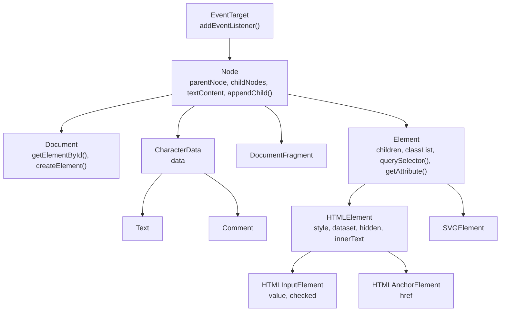

## چرا باید DOM API را بلد باشیم؟

React، Vue و Svelte در نهایت همه یک کار می‌کنند: متدهای DOM را صدا می‌زنند تا Element بسازند، تغییرش بدهند یا حذفش کنند. وقتی یک لیست کند Render می‌شود، وقتی انیمیشنی تکه‌تکه اجرا می‌شود، یا وقتی مصاحبه‌کننده می‌گوید «با JavaScript خالی بنویس»، باید بدانید این متدها چه می‌کنند و چه هزینه‌ای دارند.

در [مبانی HTML](/html/fundamentals#dom-چیست) دیدید که **DOM** (Document Object Model) درختی زنده از Objectهاست که مرورگر از روی HTML می‌سازد. این فصل درباره‌ی **کار کردن با همین درخت از JavaScript** است: پیدا کردن Nodeها، رفتن از یکی به دیگری، تغییر محتوا، ساختن و جابه‌جا کردن Elementها، اندازه‌گیری‌شان و زیر نظر گرفتن تغییراتشان.

<Callout type="note">
مثال‌های این فصل پیش‌نمایش زنده‌ی HTML هستند: هر کدام یک تابع کوچک `log()` دارد که خروجی را داخل یک `<pre>` زیر پیش‌نمایش می‌نویسد. کد را تغییر دهید تا دوباره اجرا شود.
</Callout>

## Node، Element و سلسله‌مراتب کلاس‌ها

هر چیزی که در درخت هست یک **Node** است: Elementها، متن‌ها، کامنت‌ها و خود Document. هر نوع Node یک Object است که از کلاس متفاوتی ساخته شده و این کلاس‌ها از هم ارث می‌برند. همین زنجیره‌ی ارث‌بری تعیین می‌کند هر Object چه متدهایی دارد.



پس یک `<input>` از نوع `HTMLInputElement` است و در عین حال `HTMLElement`، `Element`، `Node` و `EventTarget` هم هست. `value` را از کلاس خودش دارد، `style` را از `HTMLElement`، `querySelector` را از `Element`، `appendChild` را از `Node` و `addEventListener` را از `EventTarget`.

هر Node یک عدد به اسم **`nodeType`** دارد. این پنج‌تا را واقعاً در کار می‌بینید:

| `nodeType` | ثابت | چیست |
| --- | --- | --- |
| `1` | `Node.ELEMENT_NODE` | یک Element مثل `<div>`، `<p>` یا `<svg>` |
| `3` | `Node.TEXT_NODE` | متن داخل Element، حتی فاصله‌ی خالی بین تگ‌ها |
| `8` | `Node.COMMENT_NODE` | `<!-- a comment -->` |
| `9` | `Node.DOCUMENT_NODE` | خود `document` |
| `11` | `Node.DOCUMENT_FRAGMENT_NODE` | یک `DocumentFragment` (پایین‌تر می‌بینیم) |

```html live
<ul id="list">
  <li>One</li>
  <!-- a comment -->
  <li>Two</li>
</ul>
<pre id="log" style="font-size:13px"></pre>
<script>
  const log = (l) => (document.getElementById("log").textContent += l + "\n");
  const list = document.getElementById("list");

  // childNodes یعنی همه‌ی Nodeها؛ children فقط Elementها
  log("childNodes: " + list.childNodes.length);   // 7: متن، li، متن، کامنت، متن، li، متن
  log("children:   " + list.children.length);     // 2: فقط دو <li>
  log([...list.childNodes].map((n) => n.nodeType).join(" ")); // 3 1 3 8 3 1 3

  const input = document.createElement("input");
  log(input instanceof HTMLInputElement && input instanceof Node); // true
  log(document.documentElement.tagName);           // HTML: همان Element <html>
</script>
```

سه نقطه‌ی شروع همیشه در دسترس‌اند: `document.documentElement` (یعنی `<html>`)، `document.head` و `document.body`.

## پیدا کردن Elementها

### querySelector و querySelectorAll

این دو متد هر **CSS Selector**ی را می‌پذیرند (همان چیزی که در [Selectorهای CSS](/css/selectors) یاد گرفتید)، برای همین تقریباً همه‌ی جست‌وجوها را با همین دو متد انجام می‌دهید.

<Api name="querySelector / querySelectorAll" sig="root.querySelector(selectors) · root.querySelectorAll(selectors)" returns="`querySelector` **اولین** Element منطبق (به ترتیب سند) یا `null` را برمی‌گرداند. `querySelectorAll` یک `NodeList` **ایستا** برمی‌گرداند (ممکن است خالی باشد، اما هیچ‌وقت `null` نیست)." mutates="no">

- `root`: می‌تواند `document`، هر Element، یک `DocumentFragment` یا یک Shadow Root باشد. فقط نوادگان `root` برگردانده می‌شوند، خود `root` هرگز.
- `selectors` (رشته، اجباری): یک یا چند CSS Selector که با کاما جدا شده‌اند، مثل `"#cart .item:not(.sold-out)"` یا `"h2, h3"`. اگر Selector نامعتبر باشد `SyntaxError` پرتاب می‌شود.

</Api>

```html live
<section id="cart">
  <p class="item">Pen</p>
  <p class="item sold-out">Ink</p>
  <p class="item">Paper</p>
</section>
<pre id="log" style="font-size:13px"></pre>
<script>
  const log = (l) => (document.getElementById("log").textContent += l + "\n");
  const cart = document.querySelector("#cart");

  log(cart.querySelector(".item").textContent);            // Pen: اولین مورد
  const available = cart.querySelectorAll(".item:not(.sold-out)");
  log(available.length);                                    // 2
  available.forEach((p) => log("- " + p.textContent));     // NodeList متد forEach دارد
  log(cart.querySelector(".missing"));                      // null: چیزی پیدا نشد
  log(cart.querySelectorAll(".missing").length);            // 0: لیست خالی، نه null

  try {
    cart.querySelector("p[");                               // Selector خراب
  } catch (e) {
    log(e.name);                                            // SyntaxError
  }
</script>
```

<Callout type="mistake">
Selector روی **کل سند** بررسی می‌شود و بعد فقط نوادگان `root` نگه داشته می‌شوند. برای همین `cart.querySelector("section p")` باز هم پاراگراف‌ها را پیدا می‌کند، با اینکه `section` خود `cart` است و داخلش نیست. برای اینکه Selector از خود root شروع شود از `:scope` استفاده کنید: `cart.querySelectorAll(":scope > p")` فقط فرزندهای مستقیم را برمی‌گرداند.
</Callout>

### متدهای قدیمی‌تر getElement*

| متد | روی چه چیزی صدا زده می‌شود | خروجی |
| --- | --- | --- |
| `document.getElementById(id)` | `document` (و Fragment و Shadow Root)، **نه** روی Element | یک Element یا `null` |
| `root.getElementsByClassName(names)` | document یا Element | یک `HTMLCollection` **زنده** |
| `root.getElementsByTagName(tag)` | document یا Element | یک `HTMLCollection` **زنده** |
| `document.getElementsByName(name)` | `document` | یک `NodeList` **زنده** (فیلدهای فرم با آن `name`) |

به `getElementById` خود id را بدهید، **بدون** `#`. این سریع‌ترین روش جست‌وجوست چون مرورگر یک فهرست id → Element نگه می‌دارد، اما این تفاوت فقط در حلقه‌هایی که خیلی زیاد اجرا می‌شوند به چشم می‌آید.

### مجموعه‌ی زنده در برابر ایستا

مجموعه‌ی **زنده** (Live) هر بار که DOM تغییر کند خودش را به‌روز می‌کند. مجموعه‌ی **ایستا** (Static) یک عکس فوری از همان لحظه‌ای است که درخواستش کردید.

| از کجا می‌آید | نوع | زنده؟ |
| --- | --- | --- |
| `querySelectorAll` | `NodeList` | نه، عکس فوری |
| `getElementsByClassName`، `getElementsByTagName`، `el.children`، `form.elements` | `HTMLCollection` | بله |
| `node.childNodes` | `NodeList` | بله |

```html live
<ul>
  <li class="todo">A</li>
  <li class="todo">B</li>
  <li class="todo">C</li>
  <li class="todo">D</li>
</ul>
<pre id="log" style="font-size:13px"></pre>
<script>
  const log = (l) => (document.getElementById("log").textContent += l + "\n");
  const live = document.getElementsByClassName("todo");

  // باگ: هر حذف، مجموعه‌ی زنده را کوچک می‌کند و اندیس‌ها جابه‌جا می‌شوند
  for (let i = 0; i < live.length; i++) live[i].classList.remove("todo");
  log("still .todo: " + live.length);   // 2: B و D جا ماندند

  // راه درست: اول یک کپی ایستا بگیرید
  [...live].forEach((li) => li.classList.remove("todo"));
  log("still .todo: " + live.length);   // 0
</script>
```

<Callout type="tip">
`NodeList` متد `forEach` دارد اما `map` و `filter` ندارد. `HTMLCollection` هیچ‌کدام را ندارد. هر دو را با `[...list]` یا `Array.from(list)` به آرایه‌ی واقعی تبدیل کنید.
</Callout>

### closest و matches: نگاه به بالا و آزمایش

<Api name="Element.closest() / Element.matches()" sig="el.closest(selectors) · el.matches(selectors)" returns="`closest` نزدیک‌ترین Element منطبق را برمی‌گرداند؛ جست‌وجو **از خود `el` شروع می‌شود** و رو به بالا در اجدادش ادامه پیدا می‌کند. اگر پیدا نشود `null`. `matches` اگر خود `el` منطبق باشد `true` برمی‌گرداند." mutates="no">

- `selectors` (رشته، اجباری): یک لیست CSS Selector. Syntax نامعتبر `SyntaxError` پرتاب می‌کند.

</Api>

```html live
<article class="card" data-id="42">
  <h3>Title</h3>
  <button><span id="icon">★</span> Save</button>
</article>
<pre id="log" style="font-size:13px"></pre>
<script>
  const log = (l) => (document.getElementById("log").textContent += l + "\n");
  const icon = document.getElementById("icon");

  log(icon.closest(".card").dataset.id);  // 42: span → button → article
  log(icon.closest("span") === icon);     // true: اول خود Element بررسی می‌شود
  log(icon.closest("form"));              // null: هیچ جدّ <form>ی ندارد
  log(icon.matches("button span"));       // true
</script>
```

`closest` ستون اصلی **Event Delegation** است: یک Listener روی والد می‌گذارید و بعد با `event.target.closest(".card")` می‌فهمید روی کدام کارت کلیک شده. این را در فصل [Eventها](/browser/events) می‌بینیم.

## حرکت در درخت

وقتی یک Node دارید، می‌توانید بدون جست‌وجوی دوباره به همسایه‌هایش بروید. دو خانواده Property داریم: یکی **همه‌ی Nodeها** را حساب می‌کند (متن و کامنت هم)، دیگری **فقط Elementها** را. تقریباً همیشه دومی را می‌خواهید.

```text
                 parentElement
                       ▲
previousElementSibling ◄── el ──► nextElementSibling
                       │
           firstElementChild … lastElementChild
                 (children = all of them)
```

| همه‌ی Nodeها | فقط Elementها | نکته |
| --- | --- | --- |
| `parentNode` | `parentElement` | فقط در بالاترین نقطه فرق دارند: برای `<html>`، مقدار `parentNode` برابر `document` است و `parentElement` برابر `null` |
| `childNodes` | `children` | هر دو مجموعه‌ی زنده‌اند |
| `firstChild` / `lastChild` | `firstElementChild` / `lastElementChild` | `firstChild` اغلب یک Text Node خالی (فاصله) است |
| `previousSibling` / `nextSibling` | `previousElementSibling` / `nextElementSibling` | در دو سر لیست `null` |
| — | `childElementCount` | همان `children.length` |

```html live
<ol id="steps">
  <li>Wash</li>
  <li id="mid">Rinse</li>
  <li>Repeat</li>
</ol>
<pre id="log" style="font-size:13px"></pre>
<script>
  const log = (l) => (document.getElementById("log").textContent += l + "\n");
  const mid = document.getElementById("mid");

  log(mid.previousElementSibling.textContent);   // Wash
  log(mid.nextElementSibling.textContent);       // Repeat
  log(JSON.stringify(mid.nextSibling.textContent)); // "\n  ": یک Text Node از جنس فاصله
  log(mid.parentElement.id);                     // steps
  log(document.documentElement.parentNode === document); // true
  log(document.documentElement.parentElement);   // null
</script>
```

## خواندن و تغییر محتوا

برای خواندن یا نوشتن محتوای یک Element سه راه داریم که در سرعت، خروجی و امنیت با هم فرق دارند.

### textContent

**`textContent`** متن خام خود Node و همه‌ی نوادگانش است که پشت هم چسبیده‌اند. هیچ کاری به CSS ندارد؛ پس متنی که با `display: none` مخفی شده و حتی محتوای `<script>` و `<style>` را هم شامل می‌شود. مقداردهی به آن **همه‌ی فرزندها را پاک می‌کند** و یک Text Node جایشان می‌گذارد. HTML داخل رشته Parse نمی‌شود، برای همین **برای ورودی کاربر امن است**.

### innerText

**`innerText`** متن **همان‌طور که نمایش داده می‌شود** است: Elementهای مخفی حذف می‌شوند و شکستن خط‌ها از Layout پیروی می‌کند (Elementهای Block و `<br>` تبدیل به `\n` می‌شوند). مرورگر برای اینکه بداند چه چیزی نمایش داده شده، باید اول Style و Layout را حساب کند؛ پس خواندن `innerText` می‌تواند یک **Reflow** اجباری راه بیندازد (بیشتر در [Rendering Pipeline مرورگر](/browser/rendering-pipeline)). مقداردهی به آن هم فرزندها را جایگزین می‌کند و `\n` را به `<br>` تبدیل می‌کند.

### innerHTML، outerHTML و insertAdjacentHTML

**`innerHTML`** فرزندهای Element را به‌صورت یک رشته‌ی HTML برمی‌گرداند. مقداردهی به آن رشته را به‌عنوان HTML **Parse** می‌کند و جای همه‌ی فرزندها می‌گذارد. **`outerHTML`** همین است ولی خود Element را هم شامل می‌شود؛ مقداردهی به آن کل Element را در والدش جایگزین می‌کند.

```html live
<div id="box">Visible <span style="display:none">hidden</span><b>bold</b></div>
<pre id="log" style="font-size:13px"></pre>
<script>
  const log = (l) => (document.getElementById("log").textContent += l + "\n");
  const box = document.getElementById("box");

  log(box.textContent);   // "Visible hiddenbold": span مخفی هم هست
  log(box.innerText);     // "Visible bold": فقط چیزی که دیده می‌شود
  log(box.innerHTML);     // Markup فرزندها به‌صورت رشته
  log(box.outerHTML.slice(0, 14)); // <div id="box">: خود Element هم هست

  box.textContent = "<i>not parsed</i>";  // همین کاراکترها نمایش داده می‌شوند
  log(box.children.length);               // 0: هنوز فقط یک Text Node
  box.innerHTML = "<i>parsed</i>";        // یک Element واقعی <i> می‌سازد
  log(box.children[0].tagName);           // I
</script>
```

<Callout type="mistake">
**هیچ‌وقت ورودی کاربر را در `innerHTML` نگذارید.** تگ `<script>`ی که با `innerHTML` اضافه شود اجرا نمی‌شود و همین حس امنیت کاذب می‌دهد. اما Attributeهای Event Handler اجرا می‌شوند:

```js
// comment = ''
list.innerHTML += `<li>${comment}</li>`;   // ✗ XSS: onerror اجرا می‌شود
```

برای داده از `textContent` (یا `createElement` به‌همراه `textContent`) استفاده کنید. اگر واقعاً مجبورید HTML کاربر را نمایش دهید، اول با کتابخانه‌ای مثل DOMPurify پاک‌سازی‌اش کنید. جزئیات در [امنیت مرورگر](/browser/security).
</Callout>

<Callout type="mistake">
`el.innerHTML += "<li>…</li>"` **همه‌ی** فرزندهای فعلی را به رشته تبدیل می‌کند و بعد کل رشته را دوباره Parse می‌کند. یعنی همه‌ی فرزندها از بین می‌روند و از نو ساخته می‌شوند: Listenerهایشان پاک می‌شود، مقدار inputها ریست می‌شود و با هر آیتم کندتر می‌شود. برای اضافه کردن بدون دست زدن به محتوای قبلی، از `insertAdjacentHTML` یا `append` استفاده کنید.
</Callout>

<Api name="Element.insertAdjacentHTML()" sig="el.insertAdjacentHTML(position, html)" returns="`undefined`." mutates="yes (the DOM)">

- `position` (رشته، اجباری، حساس به حروف بزرگ و کوچک نیست): محل درج نسبت به `el`. هر مقدار دیگری `SyntaxError` پرتاب می‌کند.
  - `"beforebegin"`: قبل از `el`، به‌عنوان Sibling قبلی‌اش (`el` باید والد داشته باشد).
  - `"afterbegin"`: داخل `el`، قبل از اولین فرزند.
  - `"beforeend"`: داخل `el`، بعد از آخرین فرزند.
  - `"afterend"`: بعد از `el`، به‌عنوان Sibling بعدی‌اش (`el` باید والد داشته باشد).
- `html` (رشته): به‌عنوان HTML Parse می‌شود. همان قواعد XSS مربوط به `innerHTML` اینجا هم صدق می‌کند.

دو متد هم‌خانواده با همین مقدارهای `position` هم هست: `insertAdjacentElement(position, element)` و `insertAdjacentText(position, text)`.

</Api>

```text
<!-- beforebegin -->
<ul id="list">
  <!-- afterbegin -->
  <li>existing</li>
  <!-- beforeend -->
</ul>
<!-- afterend -->
```

```html live
<ul id="list"><li>existing</li></ul>
<script>
  const list = document.getElementById("list");
  list.insertAdjacentHTML("beforebegin", "<p>beforebegin</p>");
  list.insertAdjacentHTML("afterbegin", "<li>afterbegin</li>");
  list.insertAdjacentHTML("beforeend", "<li>beforeend</li>");
  list.insertAdjacentHTML("afterend", "<p>afterend</p>");
</script>
```

| | HTML را Parse می‌کند | برای متن کاربر امن | ممکن است Layout اجباری بسازد | فرزندهای قبلی می‌مانند |
| --- | --- | --- | --- | --- |
| `textContent =` | نه | بله | نه | نه (جایگزین می‌کند) |
| `innerText =` | نه | بله | هنگام خواندن، بله | نه (جایگزین می‌کند) |
| `innerHTML =` | بله | **نه** | نه | نه (جایگزین می‌کند) |
| `insertAdjacentHTML` | بله | **نه** | نه | **بله** |

## Attributeها، کلاس‌ها، Style و داده

فرق Attribute و Property را در [مبانی HTML](/html/fundamentals#attribute-در-مقابل-property) توضیح دادیم. خلاصه‌اش: State را از طریق Property بخوانید و بنویسید (`input.value`، `el.hidden`) و برای Attributeهایی که Property ندارند از `getAttribute` / `setAttribute` / `removeAttribute` / `hasAttribute` / `toggleAttribute` استفاده کنید. سه Property هم ارزش یک بخش جدا را دارند.

### classList

Attribute `class` یک رشته است که کلاس‌ها با فاصله در آن جدا شده‌اند. ویرایش دستی‌اش (`el.className += " active"`) راحت باعث کلاس تکراری یا خراب شدن بقیه‌ی کلاس‌ها می‌شود. **`classList`** یک `DOMTokenList` است که کلاس‌ها را یکی‌یکی ویرایش می‌کند.

<Api name="Element.classList" sig="add(...tokens) · remove(...tokens) · toggle(token, force?) · replace(oldToken, newToken) · contains(token)" returns="`add` و `remove` مقدار `undefined` برمی‌گردانند؛ `toggle` برمی‌گرداند که **بعد از اجرا کلاس هست یا نه**؛ `replace` اگر `oldToken` پیدا و جایگزین شود `true` برمی‌گرداند؛ `contains` یک boolean." mutates="yes (the class attribute)">

- `...tokens`: یک یا چند اسم کلاس. اضافه کردن کلاسی که هست یا حذف کلاسی که نیست هیچ کاری نمی‌کند (نه خطا، نه تکرار).
- `force` (boolean اختیاری): `true` مثل `add` رفتار می‌کند و `false` مثل `remove`. وقتی وضعیت از یک متغیر می‌آید به‌درد می‌خورد: `el.classList.toggle("open", isOpen)`.
- رشته‌ی خالی `SyntaxError` پرتاب می‌کند و Tokenی که فاصله داشته باشد `InvalidCharacterError`.

</Api>

```html live
<div id="panel" class="card">Panel</div>
<pre id="log" style="font-size:13px"></pre>
<script>
  const log = (l) => (document.getElementById("log").textContent += l + "\n");
  const cl = document.getElementById("panel").classList;

  cl.add("open", "shadow", "open");     // "open" دوم نادیده گرفته می‌شود
  log(cl.value);                        // card open shadow
  log(cl.toggle("open"));               // false: بود، حذف شد
  log(cl.toggle("open", true));         // true: اضافه‌ی اجباری
  log(cl.toggle("open", true));         // true: هنوز هست، چیزی عوض نشد
  log(cl.replace("card", "tile"));      // true
  log(cl.contains("card"));             // false
  try { cl.add("two words"); } catch (e) { log(e.name); } // InvalidCharacterError
</script>
```

### style و getComputedStyle

**`el.style`** فقط Attribute **inline** یعنی `style` خود Element را می‌خواند و می‌نویسد و Styleهایی را که از Stylesheet می‌آیند نمی‌بیند. اسم Propertyها camelCase است (`backgroundColor`) و مقدارها رشته‌ای با واحد.

**`getComputedStyle(el, pseudoElt?)`** مقدار **نهایی** هر Property را بعد از Cascade، Inheritance و محاسبه برمی‌گرداند؛ یعنی همان چیزی که مرورگر واقعاً استفاده می‌کند. فقط‌خواندنی است، مقدارها محاسبه‌شده‌اند (رنگ معمولاً به شکل `rgb(...)` و طول‌ها به `px`) و آرگومان دوم اختیاری برای خواندن Pseudo-element مثل `"::before"` است. مثل `innerText`، خواندنش ممکن است محاسبه‌ی Style و Layout را اجباری کند.

```html live
<style>.note { color: teal; padding: 1em; }</style>
<p id="p" class="note" style="font-size: 20px">Note</p>
<pre id="log" style="font-size:13px"></pre>
<script>
  const log = (l) => (document.getElementById("log").textContent += l + "\n");
  const p = document.getElementById("p");

  log(JSON.stringify(p.style.color));        // "": رنگ از Stylesheet آمده، نه inline
  log(p.style.fontSize);                     // 20px: inline
  const cs = getComputedStyle(p);
  log(cs.color);                             // rgb(0, 128, 128): همان teal، محاسبه‌شده
  log(cs.paddingTop);                        // 20px: یعنی 1em از فونت 20px

  p.style.setProperty("--accent", "orange");            // Custom Property فقط با setProperty
  p.style.setProperty("border", "2px solid", "important"); // آرگومان سوم: اولویت
  p.style.removeProperty("font-size");                  // برگشت به مقدار Stylesheet
  log(p.getAttribute("style"));
</script>
```

<Callout type="tip">
به‌جای ست کردن چند Style inline، یک **کلاس** را عوض کنید: CSS در Stylesheet می‌ماند، Override کردنش راحت است و یک تغییر کلاس یعنی یک بار محاسبه‌ی دوباره‌ی Style. `el.style` را برای مقدارهای واقعاً پویا (مختصات هنگام Drag، عرض یک Progress) یا برای CSS Custom Propertyها نگه دارید: `el.style.setProperty("--progress", "40%")`.
</Callout>

### dataset

Attributeهای `data-*` روی **`el.dataset`** ظاهر می‌شوند؛ پیشوند `data-` حذف می‌شود و بقیه camelCase می‌شود: `data-user-id` می‌شود `dataset.userId`. مقدارها همیشه **رشته** هستند، پس `dataset.count = 5` در واقع `"5"` ذخیره می‌کند و `delete el.dataset.userId` خود Attribute را حذف می‌کند. جزئیات بیشتر در [مبانی HTML](/html/fundamentals#attributeهای-data--و-dataset).

## ساختن، درج، جابه‌جایی و حذف

### ساختن Node

- `document.createElement(tagName)`: یک Element تازه و **جدا از صفحه**. تا وقتی درجش نکنید روی صفحه نیست.
- `document.createTextNode(text)`: یک Text Node؛ متنش هیچ‌وقت به‌عنوان HTML Parse نمی‌شود.
- `node.cloneNode(deep)`: یک کپی. مقدار پیش‌فرض `deep` برابر **`false`** است؛ یعنی فقط خود Element و Attributeهایش کپی می‌شوند، نه فرزندهایش. `cloneNode(true)` کل زیردرخت را کپی می‌کند.

<Callout type="warning">
`cloneNode` همه‌ی Attributeها (از جمله `id` و `onclick="…"` inline) را کپی می‌کند، اما Listenerهایی که با `addEventListener` اضافه شده‌اند و Propertyهای JavaScriptی که خودتان ست کرده‌اید را **کپی نمی‌کند**. یادتان باشد `id` را عوض کنید، وگرنه id تکراری خواهید داشت.
</Callout>

### متدهای جدید درج

<Api name="append / prepend / before / after / replaceWith / remove / replaceChildren" sig="parent.append(...nodes) · parent.prepend(...nodes) · el.before(...nodes) · el.after(...nodes) · el.replaceWith(...nodes) · el.remove() · parent.replaceChildren(...nodes)" returns="همه `undefined` برمی‌گردانند." mutates="yes (the DOM)">

- `...nodes`: هر تعداد Node **یا رشته**. رشته‌ها به Text Node تبدیل می‌شوند (هیچ‌وقت به‌عنوان HTML Parse نمی‌شوند).
- `append` / `prepend`: درج داخل Element، به‌عنوان آخرین / اولین فرزند.
- `before` / `after`: درج بیرون Element، به‌عنوان Sibling. اگر `el` والد نداشته باشد کاری نمی‌کند.
- `replaceWith`: Nodeها را جای `el` می‌گذارد و `el` را بیرون می‌آورد.
- `remove()`: `el` را از والدش جدا می‌کند. اگر والد نداشته باشد کاری نمی‌کند.
- `replaceChildren(...nodes)`: همه‌ی فرزندها را حذف می‌کند و بعد `nodes` را اضافه می‌کند. **بدون آرگومان** Element را خالی می‌کند.

</Api>

```html live
<ul id="list"><li id="b">B</li></ul>
<pre id="log" style="font-size:13px"></pre>
<script>
  const log = (l) => (document.getElementById("log").textContent += l + "\n");
  const list = document.getElementById("list");
  const b = document.getElementById("b");

  const li = (text) => {
    const el = document.createElement("li");
    el.textContent = text;            // امن: Parse نمی‌شود
    return el;
  };

  list.append(li("D"), li("E"));      // چندتا با هم
  list.prepend(li("A"));
  b.after(li("C"));
  list.lastElementChild.replaceWith(li("E!"));
  log([...list.children].map((x) => x.textContent).join(" ")); // A B C D E!

  list.append("plain text <b>not bold</b>"); // رشته تبدیل به Text Node می‌شود
  log(list.lastChild.nodeType);              // 3
  list.lastChild.remove();
</script>
```

### متدهای قدیمی

این‌ها را در کدهای قدیمی و سوال‌های مصاحبه می‌بینید. فقط با Node کار می‌کنند (رشته نمی‌پذیرند) و برخلاف متدهای جدید **یک Node برمی‌گردانند**.

| قدیمی | خروجی | معادل جدید |
| --- | --- | --- |
| `parent.appendChild(node)` | همان Node اضافه‌شده | `parent.append(node)` |
| `parent.insertBefore(node, ref)` | Node درج‌شده. اگر `ref` برابر `null` باشد، در انتها درج می‌کند | `ref.before(node)` |
| `parent.removeChild(child)` | فرزند حذف‌شده؛ اگر فرزند آن والد نباشد خطا می‌دهد | `child.remove()` |
| `parent.replaceChild(newNode, oldNode)` | Node **قدیمی** | `oldNode.replaceWith(newNode)` |

### درج Nodeی که الان در DOM است، آن را جابه‌جا می‌کند

هر Node فقط **یک والد** می‌تواند داشته باشد. اگر Nodeی را که الان جایی در درخت هست دوباره درج کنید، **جابه‌جا** می‌شود، نه کپی. لازم نیست اول حذفش کنید.

```html live
<ul id="a"><li id="item">I move</li></ul>
<ul id="b"></ul>
<pre id="log" style="font-size:13px"></pre>
<script>
  const log = (l) => (document.getElementById("log").textContent += l + "\n");
  const item = document.getElementById("item");
  document.getElementById("b").append(item);       // از #a به #b منتقل شد
  log(document.getElementById("a").children.length); // 0
  log(item.parentElement.id);                       // b
</script>
```

ساده‌ترین راه **مرتب کردن دوباره‌ی** یک لیست هم همین است: آیتم‌ها را به ترتیب جدید دوباره append کنید.

### DocumentFragment و template

**`DocumentFragment`** یک ظرف سبک است که جزو صفحه نیست. Nodeها را داخلش می‌سازید و بعد کل Fragment را یک‌جا درج می‌کنید. موقع درج، **فرزندهایش منتقل می‌شوند** و خود Fragment خالی می‌ماند.

```html live
<ul id="list"></ul>
<pre id="log" style="font-size:13px"></pre>
<script>
  const log = (l) => (document.getElementById("log").textContent += l + "\n");
  const frag = document.createDocumentFragment();
  for (const name of ["Ada", "Linus", "Grace"]) {
    const li = document.createElement("li");
    li.textContent = name;
    frag.append(li);                 // هنوز به صفحه دست نزده‌ایم
  }
  document.getElementById("list").append(frag); // یک بار درج
  log(frag.childNodes.length);       // 0: فرزندها منتقل شدند
</script>
```

<Callout type="note">
در مرورگرهای امروزی، `parent.append(a, b, c)` با چند Node هم یک درج واحد است و مرورگر به‌هرحال Layout را تا وقتی لازم نشده عقب می‌اندازد. فایده‌ی اصلی Fragment این است که یک زیردرخت کامل را **یک‌جا** می‌سازید و در یک قدم درج می‌کنید. قاتل اصلی Performance چیز دیگری است: خواندن Layout بین نوشتن‌ها، که پایین‌تر می‌بینیم.
</Callout>

Element **`<template>`** محتوای HTMLی را نگه می‌دارد که Parse می‌شود ولی نمایش داده نمی‌شود: اسکریپت‌هایش اجرا نمی‌شوند و تصویرهایش دانلود نمی‌شوند. Property `content` آن یک `DocumentFragment` است که برای هر آیتم از آن کپی می‌گیرید:

```html live
<template id="row">
  <li class="user"><strong class="name"></strong> <span class="role"></span></li>
</template>
<ul id="users"></ul>
<script>
  const tpl = document.getElementById("row");
  const users = [{ name: "Ada", role: "admin" }, { name: "Linus", role: "editor" }];
  for (const u of users) {
    const li = tpl.content.cloneNode(true);    // کپی عمیق؛ خود template قابل استفاده‌ی دوباره می‌ماند
    li.querySelector(".name").textContent = u.name;
    li.querySelector(".role").textContent = u.role;
    document.getElementById("users").append(li);
  }
</script>
```

## Performance در DOM: دسته‌بندی کارها و Layout Thrashing

خود تغییر دادن DOM ارزان است. چیزی که وقت می‌گیرد کاری است که مرورگر **بعدش** برای نمایش تغییر انجام می‌دهد: محاسبه‌ی دوباره‌ی Styleها، **Layout** (محاسبه‌ی اندازه و جای هر جعبه) و **Paint**. مرورگر معمولاً این کارها را عقب می‌اندازد و درست قبل از کشیدن Frame بعدی، یک بار انجامشان می‌دهد.

مشکل وقتی شروع می‌شود که درست بعد از یک **نوشتن**، یک مقدار Layout را **بخوانید** (`offsetHeight`، `getBoundingClientRect()`، `scrollTop`، `getComputedStyle()`، `innerText`). مرورگر برای اینکه عدد درست بدهد مجبور است Layout را **همان لحظه** اجرا کند؛ به این می‌گویند **Forced Synchronous Layout**. اگر این کار را داخل یک حلقه انجام دهید به **Layout Thrashing** می‌رسید: در هر دور حلقه یک Layout کامل، به‌جای یک بار در هر Frame.

```js
// ✗ Layout Thrashing: خواندن ← نوشتن ← خواندن ← نوشتن…
for (const box of boxes) {
  const w = container.offsetWidth;   // خواندن: Layout اجباری (نوشتن قبلی آن را کهنه کرده)
  box.style.width = w / 2 + "px";    // نوشتن: Layout دوباره کهنه می‌شود
}

// ✓ یک بار بخوانید، بعد بنویسید
const w = container.offsetWidth;     // فقط یک Layout
for (const box of boxes) box.style.width = w / 2 + "px";  // فقط نوشتن
```

چند قاعده‌ی سرانگشتی:

- اول همه‌ی خواندن‌ها، بعد همه‌ی نوشتن‌ها.
- به‌جای چند Style inline، یک کلاس را عوض کنید.
- برای تغییرات بصری که به اسکرول یا انیمیشن وابسته‌اند، داخل `requestAnimationFrame` بنویسید.
- `transform` و `opacity` را انیمیت کنید؛ این‌ها می‌توانند از Layout و Paint رد شوند (ببینید [Performance رندر در CSS](/css/rendering-performance)).

## اندازه‌گیری Elementها: اندازه، موقعیت و اسکرول

DOM چند Property مختلف برای «عرض» دارد که فرقشان در این است که کدام بخش‌های جعبه را حساب می‌کنند:

```text
┌─────────────────── offsetWidth ───────────────────┐
│ border                                            │
│ ┌────────────── clientWidth ─────────────┐ ┌────┐ │
│ │ padding                                │ │ s  │ │
│ │  ┌───────────── content ────────────┐  │ │ c  │ │
│ │  │                                  │  │ │ r  │ │
│ │  └──────────────────────────────────┘  │ │ o  │ │
│ │                                        │ │ l  │ │
│ └────────────────────────────────────────┘ └────┘ │
└───────────────────────────────────────────────────┘
scrollWidth = full width of the content, including the part hidden by overflow
```

| Property | شامل چه چیزی است | نکته |
| --- | --- | --- |
| `offsetWidth` / `offsetHeight` | محتوا + padding + border + اسکرول‌بار | به عدد صحیح گرد می‌شود؛ `transform` را نادیده می‌گیرد |
| `clientWidth` / `clientHeight` | محتوا + padding، **منهای** اسکرول‌بار | بدون border |
| `scrollWidth` / `scrollHeight` | کل محتوای قابل اسکرول | اگر چیزی سرریز نکند با `client*` برابر است |
| `scrollTop` / `scrollLeft` | چقدر اسکرول شده | **قابل نوشتن**: با مقداردهی اسکرول می‌کنید |
| `offsetTop` / `offsetLeft` | موقعیت نسبت به `offsetParent` | `offsetParent` یعنی نزدیک‌ترین جدّ Positioned |
| `getBoundingClientRect()` | Border Box **نسبت به Viewport** | اعشاری است و `transform` را هم حساب می‌کند |

همه‌ی این‌ها برای Elementی با `display: none` صفر هستند، چون اصلاً جعبه‌ای ندارد.

<Api name="Element.getBoundingClientRect()" sig="el.getBoundingClientRect()" returns="یک `DOMRect` با `x`، `y`، `width`، `height`، `top`، `right`، `bottom` و `left` بر حسب پیکسل CSS و **نسبت به Viewport** (با اسکرول عوض می‌شوند). برای مختصات نسبت به کل صفحه، `window.scrollX` / `scrollY` را اضافه کنید." mutates="no">

- آرگومانی نمی‌گیرد. اگر Layout کهنه باشد، خواندنش Layout را اجباری می‌کند.

</Api>

```html live
<div id="box" style="width:200px;padding:10px;border:5px solid teal;overflow:auto;height:60px">
  <div style="width:400px;height:150px">wide content</div>
</div>
<pre id="log" style="font-size:13px"></pre>
<script>
  const log = (l) => (document.getElementById("log").textContent += l + "\n");
  const box = document.getElementById("box");
  log("offsetWidth  " + box.offsetWidth);   // 230 = 200 + 2×10 + 2×5
  log("clientWidth  " + box.clientWidth);   // 220 منهای عرض اسکرول‌بار
  log("scrollWidth  " + box.scrollWidth);   // حدود 420: محتوا + padding چپ و راست
  box.scrollTop = 40;                       // اسکرول با کد
  log("scrollTop    " + box.scrollTop);     // 40
  const r = box.getBoundingClientRect();
  log("rect " + r.width + " × " + r.height);  // 230 × 90
</script>
```

برای اینکه یک Element را به محدوده‌ی دید بیاورید از `el.scrollIntoView({ behavior: "smooth", block: "center" })` استفاده کنید. `block` و `inline` مقدارهای `"start"`، `"center"`، `"end"` و `"nearest"` را می‌پذیرند.

## زیر نظر گرفتن DOM: Observerها

Polling (یعنی «هر ۱۰۰ میلی‌ثانیه چک کن عوض شده یا نه») CPU را هدر می‌دهد و همیشه دیر می‌فهمد. مرورگر سه **Observer** دارد که دقیقاً وقتی چیزی عوض شد شما را خبر می‌کنند. شکل استفاده‌ی هر سه یکی است: `new XObserver(callback)`، بعد `observe(target, options)` و در آخر وقتی کارتان تمام شد `disconnect()`.

### MutationObserver: تغییرات درخت

<Api name="MutationObserver" sig="new MutationObserver(callback) · observer.observe(target, options) · observer.disconnect() · observer.takeRecords()" returns="`observe` و `disconnect` مقدار `undefined` برمی‌گردانند؛ `takeRecords` رکوردهایی را که هنوز تحویل داده نشده‌اند برمی‌گرداند." mutates="no">

- `callback(mutations, observer)`: یک **آرایه از `MutationRecord`** را به‌صورت دسته‌ای می‌گیرد. به شکل یک **Microtask** اجرا می‌شود؛ یعنی بعد از تمام شدن اسکریپت فعلی، نه بعد از هر تغییر. هر رکورد `type` (`"childList"`، `"attributes"` یا `"characterData"`)، `target`، `addedNodes`، `removedNodes`، `attributeName` و `oldValue` دارد.
- `options` (دست‌کم یکی از `childList`، `attributes` یا `characterData` باید در نهایت `true` باشد، وگرنه `TypeError`):
  - `childList`: اضافه یا حذف شدن فرزندها را گزارش می‌دهد.
  - `attributes`: تغییر Attributeها را گزارش می‌دهد.
  - `characterData`: تغییر محتوای Text Nodeها را گزارش می‌دهد.
  - `subtree`: کل زیردرخت را زیر نظر می‌گیرد، نه فقط خود `target`.
  - `attributeFilter`: آرایه‌ای از اسم Attributeهایی که باید زیر نظر باشند (به‌طور ضمنی `attributes` را روشن می‌کند).
  - `attributeOldValue` / `characterDataOldValue`: مقدار قبلی را در `oldValue` می‌گذارد.

</Api>

```html live
<ul id="list"></ul>
<pre id="log" style="font-size:13px"></pre>
<script>
  const log = (l) => (document.getElementById("log").textContent += l + "\n");
  const list = document.getElementById("list");

  const mo = new MutationObserver((records) => {
    log("callback with " + records.length + " records");   // یک بار، به‌صورت دسته‌ای
    for (const r of records) log("  " + r.type + " " + (r.attributeName ?? r.addedNodes.length + " added"));
  });
  mo.observe(list, { childList: true, attributes: true, attributeOldValue: true });

  list.append(document.createElement("li"));
  list.append(document.createElement("li"));
  list.setAttribute("data-state", "ready");
  log("script finished");             // قبل از Callback چاپ می‌شود (Microtask)
</script>
```

کاربردهای رایج: واکنش به تغییراتی که کدی خارج از کنترل شما (مثلاً یک ویجت Third-party) در DOM می‌دهد، راه‌اندازی خودکار Componentهایی که بعداً به صفحه اضافه می‌شوند، و ویرایشگرهایی که باید تغییرات را دنبال کنند.

### IntersectionObserver: دیده می‌شود یا نه؟

**`IntersectionObserver`** خبر می‌دهد که یک Element وارد Viewport (یا یک `root` اسکرول‌شونده‌ی دیگر) شد یا از آن خارج شد. Lazy Loading، اسکرول بی‌پایان، «ظاهر شدن هنگام اسکرول» و شمارش دیده شدن تبلیغ همه با همین ساخته می‌شوند، بدون حتی یک Listener روی `scroll`.

- Optionها: `root` (ظرف اسکرول؛ پیش‌فرض `null` یعنی Viewport)، `rootMargin` (بزرگ یا کوچک کردن root مثل margin در CSS؛ مثلاً `"200px"` برای اینکه زودتر لود را شروع کنید) و `threshold` (یک عدد یا آرایه‌ای بین `0` و `1`: چه کسری از Element باید دیده شود تا Callback اجرا شود).
- هر Entry مقدارهای `isIntersecting`، `intersectionRatio`، `target` و مستطیل‌هایی مثل `boundingClientRect` را دارد.
- Callback **یک بار بلافاصله بعد از `observe()`** هم اجرا می‌شود و وضعیت اولیه را گزارش می‌دهد.

```js
const io = new IntersectionObserver((entries) => {
  for (const entry of entries) {
    if (!entry.isIntersecting) continue;
    const img = entry.target;
    img.src = img.dataset.src;   // تصویر اصلی را لود کن
    io.unobserve(img);           // دیگر لازم نیست این یکی را زیر نظر بگیریم
  }
}, { rootMargin: "200px" });     // 200px قبل از رسیدن به دید شروع کن

document.querySelectorAll("img[data-src]").forEach((img) => io.observe(img));
```

### ResizeObserver: اندازه‌اش عوض شد؟

Event `resize` روی `window` فقط از اندازه‌ی پنجره خبر دارد. **`ResizeObserver`** اندازه‌ی **یک Element** را گزارش می‌دهد، دلیلش هر چه باشد: تغییر اندازه‌ی پنجره، باز شدن Sidebar یا لود شدن محتوا. هر Entry مقدار `contentRect` و آرایه‌های `contentBoxSize` و `borderBoxSize` را دارد. با `observe(target, { box })` انتخاب می‌کنید کدام جعبه زیر نظر باشد: `"content-box"` (پیش‌فرض)، `"border-box"` یا `"device-pixel-content-box"`.

```js
const ro = new ResizeObserver((entries) => {
  for (const entry of entries) {
    const width = entry.contentBoxSize[0].inlineSize;
    entry.target.classList.toggle("compact", width < 400);   // یک «Container Query» با JS
  }
});
ro.observe(document.querySelector(".card"));
```

## نگاهی کوتاه به Shadow DOM و Custom Element

**Shadow DOM** به یک Element اجازه می‌دهد درخت DOM جدا و پنهان خودش را داشته باشد؛ Styleهای داخلش بیرون نشت نمی‌کنند و Styleهای صفحه هم به داخلش نمی‌رسند. کنترل‌های `<video>` با همین ساخته شده‌اند و Web Componentها هم برای کپسوله کردن از آن استفاده می‌کنند.

```html live
<user-badge name="Ada"></user-badge>
<p class="label">Outside: page styles still apply here</p>
<style>.label { color: crimson; }</style>
<script>
  class UserBadge extends HTMLElement {
    connectedCallback() {                           // وقتی به صفحه اضافه شد صدا زده می‌شود
      const root = this.attachShadow({ mode: "open" });
      root.innerHTML = `
        <style>.label { color: teal; font-weight: bold; }</style>
        <span class="label">👤 ${this.getAttribute("name")}</span>`;
    }
  }
  customElements.define("user-badge", UserBadge);   // اسم باید خط تیره داشته باشد
</script>
```

قانون قرمز `.label` صفحه به داخل Badge نمی‌رسد و قانون فیروزه‌ای Badge هم بیرون نمی‌آید. با `mode: "open"` درخت Shadow از بیرون با `el.shadowRoot` در دسترس است؛ با `"closed"` این Property برابر `null` است. `document.querySelector` داخل درخت‌های Shadow را جست‌وجو نمی‌کند.

## اشتباهات رایج

- پیمایش یک `HTMLCollection` **زنده** و هم‌زمان حذف آیتم یا کلاس. اول به آرایه تبدیلش کنید.
- `getElementById("#id")`: آنجا `#` غلط است؛ `#` فقط برای `querySelector` است.
- مقایسه‌ی خروجی `querySelectorAll(...)` با `null`؛ هیچ‌وقت `null` برنمی‌گرداند. `.length` را چک کنید.
- `innerHTML` با داده‌ی کاربر (XSS) و `innerHTML +=` داخل حلقه (همه‌چیز از نو ساخته می‌شود و Listenerها از بین می‌روند).
- خواندن `offsetHeight`، `getBoundingClientRect()` یا `innerText` بین نوشتن‌ها داخل یک حلقه (Layout Thrashing).
- انتظار اینکه `el.style.color` رنگی را که Stylesheet داده نشان بدهد؛ برای این کار `getComputedStyle` لازم است.
- انتظار اینکه `cloneNode()` فرزندها را کپی کند (بدون `true` نمی‌کند) یا Event Listenerها را (هیچ‌وقت نمی‌کند).
- اجرای کد DOM در یک اسکریپت داخل `<head>` قبل از اینکه Elementها ساخته شوند. از `defer` یا `type="module"` استفاده کنید یا اسکریپت را آخر `body` بگذارید.

## سوالات مصاحبه

<QA q="فرق NodeList و HTMLCollection چیست؟" level="junior" n={1}>
<Answer>

هر دو لیست‌هایی شبیه آرایه از Nodeها هستند. `HTMLCollection` فقط Element دارد و همیشه **زنده** است (با تغییر DOM به‌روز می‌شود)؛ از `children`، `getElementsByClassName` و `getElementsByTagName` به دست می‌آید. `NodeList` هر نوع Nodeی می‌تواند داشته باشد؛ وقتی از `querySelectorAll` می‌آید **ایستا** است و وقتی `childNodes` باشد زنده. `NodeList` متد `forEach` دارد؛ هیچ‌کدام `map` یا `filter` ندارند، پس با `Array.from` تبدیلشان کنید.

</Answer>
<Mistake>

گفتن «NodeList ایستاست و HTMLCollection زنده» بدون اشاره به استثنای `childNodes`.

</Mistake>
<FollowUp>

اگر با اندیس روی یک مجموعه‌ی زنده حلقه بزنید و هم‌زمان آیتم حذف کنید چه اتفاقی می‌افتد؟

</FollowUp>
</QA>

<QA q="فرق textContent، innerText و innerHTML چیست؟" level="junior" n={2}>
<Answer>

`textContent` متن خام همه‌ی نوادگان است و به CSS کاری ندارد (متن مخفی و محتوای اسکریپت را هم دارد)؛ سریع است و نوشتنش امن است چون چیزی Parse نمی‌شود. `innerText` متن نمایش‌داده‌شده است: `display: none` و شکستن خط‌های Layout را رعایت می‌کند، پس خواندنش ممکن است Reflow اجباری بسازد. `innerHTML` Markup به‌صورت رشته است؛ نوشتنش HTML را Parse می‌کند که با ورودی کاربر خطر XSS دارد.

</Answer>
<Deep>

نوشتن در هر سه، همه‌ی فرزندهای فعلی را حذف می‌کند. `insertAdjacentHTML` بدون از بین بردن فرزندهای قبلی HTML را Parse و اضافه می‌کند.

</Deep>
</QA>

<QA q="باید ۱۰٬۰۰۰ ردیف به یک جدول اضافه کنید. چطور سریع نگهش می‌دارید؟" level="mid" n={3}>
<Answer>

ردیف‌ها را بیرون از صفحه بسازید (در یک `DocumentFragment` یا با دادن چند Node به یک `append`) و در یک قدم درج کنید. داخل حلقه هیچ Property مربوط به Layout را نخوانید. از `innerHTML +=` داخل حلقه پرهیز کنید چون هر بار همه‌چیز را دوباره Parse می‌کند. اگر ۱۰٬۰۰۰ ردیف واقعاً برای نمایش زیاد است، از **Virtualization** استفاده کنید (فقط ردیف‌های داخل دید را Render کنید و موقع اسکرول دوباره استفاده‌شان کنید) و داده را صفحه‌بندی‌شده یا تدریجی نشان دهید.

</Answer>
<Deep>

هزینه در خود صدا زدن‌های `append` نیست؛ مرورگر Layout را تا وقتی لازم نشده عقب می‌اندازد. هزینه در اجبار مکرر Layout (Thrashing) و بزرگی خود DOM است: هر Node اضافه، محاسبه‌ی Style، Layout و مصرف حافظه را گران‌تر می‌کند.

</Deep>
<FollowUp>

Layout Thrashing چیست و چطور در DevTools پیدایش می‌کنید؟

</FollowUp>
</QA>

<QA q="فرق Attribute و Property چیست؟ مثالی بزنید که با هم فرق دارند." level="mid" n={4}>
<Answer>

Attribute متنی است که در HTML نوشته شده (`getAttribute`) و Property یک فیلد روی Object جاوااسکریپتی است. خیلی‌هایشان **Reflect** می‌شوند (تغییر یکی دیگری را هم تغییر می‌دهد)، اما نه همه: برای یک input، Attribute `value` مقدار اولیه است (همان چیزی که `defaultValue` منعکس می‌کند)، در حالی که Property `value` مقدار فعلی است که کاربر تایپ می‌کند. `a.getAttribute("href")` همان چیزی را که نوشته‌اید برمی‌گرداند، اما `a.href` آدرس کامل و Resolveشده را.

</Answer>
</QA>

<QA q="تابعی بنویسید که همه‌ی Elementهای زیر یک root با یک کلاس مشخص را، بدون querySelectorAll و getElementsByClassName، برگرداند." level="mid" n={5}>
<Answer>

درخت را به‌صورت عمقی (Depth-first) از طریق `children` پیمایش کنید و هر Element را با `classList.contains` بسنجید:

```js
function getByClass(root, className) {
  const result = [];
  const visit = (el) => {
    for (const child of el.children) {
      if (child.classList.contains(className)) result.push(child);
      visit(child);                 // یک سطح پایین‌تر
    }
  };
  visit(root);
  return result;                    // به ترتیب سند، مثل querySelectorAll
}
```

</Answer>
<Deep>

در درخت‌های خیلی عمیق، بازگشت ممکن است Call Stack را پر کند؛ به‌جایش از یک Stack دستی (یک آرایه) استفاده کنید. DOM یک پیمایشگر آماده هم دارد: `document.createTreeWalker(root, NodeFilter.SHOW_ELEMENT)`.

</Deep>
<FollowUp>

حالا پایین‌ترین جدّ مشترک دو Element را پیدا کنید.

</FollowUp>
</QA>

<QA q="کی از MutationObserver، IntersectionObserver و ResizeObserver استفاده می‌کنید؟" level="senior" n={6}>
<Answer>

MutationObserver: برای واکنش به تغییرات درخت DOM (اضافه یا حذف Node، Attributeها، متن)، به‌خصوص تغییراتی که کد خارج از کنترل شما می‌دهد. IntersectionObserver: برای دیده شدن نسبت به Viewport یا یک ظرف اسکرول؛ در Lazy Loading، اسکرول بی‌پایان و شمارش Impression. ResizeObserver: برای اندازه‌ی یک Element مشخص، در Componentهایی که خودشان را با ظرفشان تطبیق می‌دهند. هر سه جای Polling و Listenerهای scroll و resize را می‌گیرند و اعلان‌هایشان را دسته‌ای می‌فرستند.

</Answer>
<Deep>

Callbackهای MutationObserver از نوع Microtask هستند و قبل از Render بعدی اجرا می‌شوند. محاسبه‌ی IntersectionObserver به‌صورت ناهمگام انجام می‌شود و جلوی اسکرول را نمی‌گیرد. Callbackهای ResizeObserver بعد از Layout و قبل از Paint اجرا می‌شوند؛ اگر داخلشان اندازه‌ها را عوض کنید ممکن است دور دیگری راه بیفتد و اگر مرورگر نتواند به حالت پایدار برسد خطای «ResizeObserver loop» می‌دهد.

</Deep>
</QA>

## جمع‌بندی

<Recap>

- DOM درختی از Objectهای Node است؛ زنجیره‌ی کلاس‌های `EventTarget → Node → Element → HTMLElement → HTMLInputElement` تعیین می‌کند هر Object چه متدهایی دارد.
- `childNodes` شامل Text Node و کامنت هم می‌شود؛ `children` و Propertyهای `*Element*` فقط Elementها را دارند.
- `querySelector` اولین مورد یا `null` را برمی‌گرداند؛ `querySelectorAll` یک `NodeList` **ایستا** برمی‌گرداند و هیچ‌وقت `null` نیست.
- `getElementsBy*`، `children` و `childNodes` **زنده** هستند: قبل از تغییر DOM داخل حلقه، به آرایه تبدیلشان کنید.
- `closest` از خود Element شروع می‌کند و بالا می‌رود؛ `matches` خود Element را می‌سنجد.
- `textContent` خام و امن است؛ `innerText` متن نمایش‌داده‌شده است و ممکن است Layout اجباری بسازد؛ `innerHTML` HTML را Parse می‌کند و خطر XSS دارد.
- برای کلاس‌ها `classList`، برای Style نهایی `getComputedStyle` و برای `data-*` از `dataset` استفاده کنید.
- `append`/`prepend`/`before`/`after`/`replaceWith`/`remove` هم Node و هم رشته می‌پذیرند؛ درج Nodeی که در DOM هست آن را **جابه‌جا** می‌کند.
- خواندن Propertyهای Layout بعد از نوشتن، Layout را همان لحظه اجباری می‌کند؛ اول بخوانید، بعد بنویسید.
- به‌جای Polling یا Listenerهای scroll و resize از Observerها (Mutation، Intersection، Resize) استفاده کنید.

</Recap>
