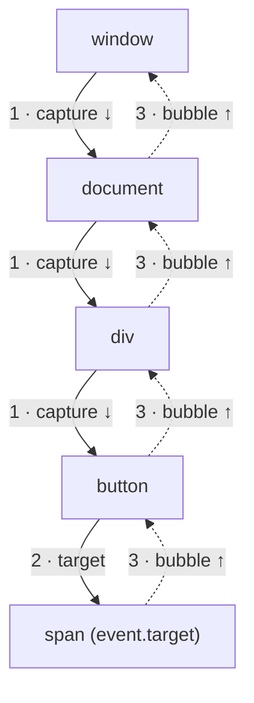

## چرا Event؟

صفحه‌ی وب تا وقتی اتفاقی نیفتد ساکت می‌ماند: کاربر کلیک می‌کند، تایپ می‌کند، اسکرول می‌کند، یک تصویر لودش تمام می‌شود یا جواب یک درخواست شبکه می‌رسد. مرورگر هر کدام از این لحظه‌ها را به شکل یک **Event** (رویداد) اعلام می‌کند و کد شما با ثبت یک تابع که موقع وقوعش صدا زده شود به آن واکنش نشان می‌دهد. به این تابع **Listener** (یا **Handler**) می‌گویند.

این فصل درباره‌ی این است که Listener را چطور وصل کنیم، Event چه مسیری را در درخت DOM طی می‌کند (**Propagation**)، چطور جلویش را بگیریم یا کار پیش‌فرض مرورگر را لغو کنیم، و **Event Delegation**: الگویی که پشت تقریباً همه‌ی لیست‌ها، جدول‌ها و منوهای بهینه است.

<Callout type="note">
دموها خروجی را در یک کادر زیر پیش‌نمایش می‌نویسند. بعضی خودشان اجرا می‌شوند (با `el.click()`) و بعضی منتظرند شما داخل پیش‌نمایش کلیک کنید.
</Callout>

## addEventListener

<Api name="EventTarget.addEventListener()" sig="target.addEventListener(type, listener, options?)" returns="`undefined`." mutates="yes (registers the listener on target)">

- `type` (رشته): اسم Event **بدون** `on`: `"click"`، `"input"`، `"keydown"`. به حروف بزرگ و کوچک حساس است.
- `listener`: تابعی که **Event Object** را می‌گیرد، یا Objectی که متد `handleEvent(event)` دارد.
- `options` (اختیاری): یا یک boolean (`true` یعنی `capture`) یا یک Object:
  - `capture` (پیش‌فرض `false`): به‌جای فاز Bubble در فاز Capture اجرا شود (پایین‌تر توضیح می‌دهیم).
  - `once` (پیش‌فرض `false`): Listener بعد از اولین اجرا خودبه‌خود حذف شود.
  - `passive` (پیش‌فرض `false`، به‌جز چند Event لمسی و wheel): قول می‌دهید `preventDefault()` را صدا نزنید تا مرورگر بتواند بدون منتظر ماندن برای کد شما اسکرول کند.
  - `signal`: یک `AbortSignal`؛ وقتی Abort شود Listener حذف می‌شود.

اضافه کردن **همان تابع** برای همان `type` و همان `capture` برای بار دوم هیچ اثری ندارد.

</Api>

```html live
<button id="btn">Click me</button>
<pre id="log" style="font-size:13px"></pre>
<script>
  const log = (l) => (document.getElementById("log").textContent += l + "\n");
  const btn = document.getElementById("btn");

  function onClick(event) {
    log(event.type + " on " + event.target.id);   // click on btn
  }
  btn.addEventListener("click", onClick);
  btn.addEventListener("click", onClick);          // تکراری: نادیده گرفته می‌شود
  btn.addEventListener("click", () => log("once!"), { once: true });

  btn.click();   // اجرا: "click on btn" و "once!"
  btn.click();   // فقط "click on btn"؛ Listener یک‌باره رفته است
</script>
```

### حذف Listener

`removeEventListener(type, listener, options)` فقط وقتی Listener را حذف می‌کند که **دقیقاً همان Object تابع** و همان مقدار `capture` را بدهید. برای همین یک تابع بی‌نام هیچ‌وقت این‌طوری حذف نمی‌شود:

```js
btn.addEventListener("click", () => save());
btn.removeEventListener("click", () => save());   // ✗ یک تابع دیگر است: چیزی حذف نمی‌شود

btn.addEventListener("scroll", onScroll, true);
btn.removeEventListener("scroll", onScroll);      // ✗ capture فرق دارد (true در برابر false)
```

راه امروزی برای حذف چند Listener با هم، **`AbortController`** است:

```js
const controller = new AbortController();
window.addEventListener("resize", onResize, { signal: controller.signal });
window.addEventListener("keydown", onKey, { signal: controller.signal });

controller.abort();   // هر دو حذف می‌شوند؛ عالی برای Cleanup یک Component
```

### Property‌های onclick و Attributeهای HTML

دو راه قدیمی‌تر هم برای وصل کردن Handler هست: Attribute در HTML مثل `<button onclick="save()">` و Property مثل `btn.onclick = save`. هر دو برای هر Event **فقط یک** Handler قبول می‌کنند (مقداردهی دوباره قبلی را جایگزین می‌کند) و Option ندارند. Attributeهای inline کد را از یک رشته اجرا می‌کنند که معمولاً Content Security Policy جلویش را می‌گیرد. در کد واقعی از `addEventListener` استفاده کنید.

| | `addEventListener` | `el.onclick = fn` | Attribute `onclick="…"` |
| --- | --- | --- | --- |
| چند Handler | بله | نه (آخری برنده است) | نه |
| Optionها (`capture`، `once`، `passive`، `signal`) | بله | نه | نه |
| حذف | `removeEventListener` / `abort()` | `el.onclick = null` | حذف Attribute |
| کار با CSP سخت‌گیر | بله | بله | نه |

## Event Object

هر Listener یک **Event Object** می‌گیرد که توضیح می‌دهد چه اتفاقی افتاده. کلاسش به نوع Event بستگی دارد: `MouseEvent` برای کلیک، `KeyboardEvent` برای کلید و `InputEvent` برای تایپ؛ همه از `Event` ارث می‌برند.

| Property / متد | معنی |
| --- | --- |
| `type` | اسم Event، مثلاً `"click"` |
| `target` | Elementی که Event از آن **شروع شد** (عمیق‌ترین Elementی که کلیک شده) |
| `currentTarget` | Elementی که Listenerش **همین الان** دارد اجرا می‌شود؛ بعد از پایان Dispatch برابر `null` |
| `eventPhase` | `1` در Capture، `2` روی خود Target، `3` در Bubble (`0` وقتی Dispatch نمی‌شود) |
| `bubbles` / `cancelable` | آیا این Event بالا می‌رود / آیا `preventDefault` اثری دارد |
| `defaultPrevented` | اگر کسی `preventDefault()` را صدا زده باشد `true` است |
| `isTrusted` | اگر مرورگر آن را از یک اقدام واقعی کاربر ساخته باشد `true`، اگر کد شما Dispatchش کرده `false` |
| `timeStamp` | میلی‌ثانیه از شروع لود صفحه |
| `composedPath()` | آرایه‌ی Nodeهایی که Event از آن‌ها عبور می‌کند |
| `preventDefault()`، `stopPropagation()`، `stopImmediatePropagation()` | پایین‌تر توضیح می‌دهیم |

داخل Listenerی که با `function` معمولی نوشته شده، `this` برابر `event.currentTarget` است. داخل Arrow Function مقدار `this` از Scope بیرونی می‌آید، پس آنجا از `event.currentTarget` استفاده کنید.

## Propagation: فاز Capture، Target و Bubble

وقتی روی یک `<span>` داخل یک `<button>` داخل یک `<div>` کلیک می‌کنید، در واقع روی دکمه و div هم کلیک کرده‌اید. برای همین مرورگر Event را فقط به span تحویل نمی‌دهد؛ کل مسیر را در **سه فاز** طی می‌کند.



<Steps>
<Step title="فاز Capture">
Event از `window` به سمت **پایین** تا والد Target حرکت می‌کند. Listenerهایی که با `{ capture: true }` ثبت شده‌اند اینجا اجرا می‌شوند؛ از بیرونی‌ترین به داخلی‌ترین.
</Step>
<Step title="فاز Target">
Event به Elementی می‌رسد که اتفاق رویش افتاده (`event.target`). Listenerهای خود این Element اجرا می‌شوند: اول Listenerهای Capture، بعد بقیه.
</Step>
<Step title="فاز Bubble">
Event دوباره به سمت **بالا** تا `window` برمی‌گردد. Listenerهای معمولی (پیش‌فرض، یعنی `capture: false`) اینجا اجرا می‌شوند؛ از داخلی‌ترین به بیرونی‌ترین.
</Step>
</Steps>

```html live
<div id="outer" style="padding:12px;background:#dbeafe">
  outer
  <button id="inner">inner</button>
</div>
<pre id="log" style="font-size:13px"></pre>
<script>
  const log = (l) => (document.getElementById("log").textContent += l + "\n");
  const outer = document.getElementById("outer");
  const inner = document.getElementById("inner");

  outer.addEventListener("click", (e) => log("outer capture, phase " + e.eventPhase), { capture: true });
  outer.addEventListener("click", (e) => log("outer bubble,  phase " + e.eventPhase));
  inner.addEventListener("click", (e) => log("inner,         phase " + e.eventPhase));
  outer.addEventListener("click", function (e) {
    log("target=" + e.target.id + " currentTarget=" + e.currentTarget.id + " this=" + this.id);
  });

  inner.click();
  // outer capture, phase 1
  // inner,         phase 2
  // outer bubble,  phase 3
  // target=inner currentTarget=outer this=outer
</script>
```

### Eventهایی که Bubble نمی‌کنند

بیشتر Eventها بالا می‌روند، اما چندتایی نه، چون بالا رفتنشان معنای زیادی ندارد. هر کدام یک جایگزین Bubble‌شونده یا یک راه‌حل دیگر دارد:

| Bubble نمی‌کند | جایگزین / راه‌حل |
| --- | --- |
| `focus`، `blur` | `focusin`، `focusout` |
| `mouseenter`، `mouseleave` | `mouseover`، `mouseout` (با رفتن بین فرزندها دوباره اجرا می‌شوند) |
| `pointerenter`، `pointerleave` | `pointerover`، `pointerout` |
| `load` و `error` روی تصویر و اسکریپت | با `capture: true` روی یک جدّ گوش بدهید |
| `scroll` روی یک Element | روی خود Element گوش بدهید، یا با `capture: true` روی `document` |

<Callout type="tip">
Listenerهای Capture حتی Eventهای غیر Bubble را هم می‌گیرند، چون فاز Capture همیشه از `window` به پایین اجرا می‌شود. `document.addEventListener("error", handler, true)` خطای لود همه‌ی ``های صفحه را می‌گیرد.
</Callout>

## stopPropagation و stopImmediatePropagation

- **`event.stopPropagation()`**: Event به Element بعدی مسیرش نمی‌رسد. اما بقیه‌ی Listenerهای Element **فعلی** همچنان اجرا می‌شوند.
- **`event.stopImmediatePropagation()`**: همان کار، به‌اضافه‌ی اینکه Listenerهای باقی‌مانده روی Element فعلی هم اجرا نمی‌شوند.

```html live
<div id="parent"><button id="child">child</button></div>
<pre id="log" style="font-size:13px"></pre>
<script>
  const log = (l) => (document.getElementById("log").textContent += l + "\n");
  const child = document.getElementById("child");
  document.getElementById("parent").addEventListener("click", () => log("parent"));

  child.addEventListener("click", (e) => { log("child 1"); e.stopPropagation(); });
  child.addEventListener("click", () => log("child 2"));   // باز هم اجرا می‌شود
  child.click();          // child 1، child 2: والد هیچ‌وقت خبردار نمی‌شود

  log("---");
  const other = document.createElement("button");
  document.getElementById("parent").append(other);
  other.addEventListener("click", (e) => { log("other 1"); e.stopImmediatePropagation(); });
  other.addEventListener("click", () => log("other 2"));   // رد می‌شود
  other.click();          // فقط other 1
</script>
```

<Callout type="mistake">
استفاده از `stopPropagation()` برای «درست کردن» کلیکی که والد را هم فعال می‌کند. این کار هر کد دیگری را که به رسیدن Event به بالا تکیه دارد خراب می‌کند: Analytics، منوهایی که با «کلیک بیرون» بسته می‌شوند، Handlerهای Delegation. بهتر است در والد `event.target` را چک کنید یا از `event.target.closest(...)` استفاده کنید، و فقط وقتی جلوی Propagation را بگیرید که واقعاً صاحب کل مسیر هستید.
</Callout>

## preventDefault: لغو کار پیش‌فرض مرورگر

خیلی از Eventها یک **کار پیش‌فرض** (Default Action) دارند: لینک صفحه را عوض می‌کند، فرم Submit می‌شود و صفحه را دوباره لود می‌کند، Checkbox تیک می‌خورد، کلید یک حرف تایپ می‌کند و چرخ ماوس اسکرول می‌کند. **`event.preventDefault()`** این کار را لغو می‌کند. اما جلوی Propagation را **نمی‌گیرد**؛ این دو از هم مستقل‌اند.

```html live
<a id="link" href="https://example.com">a link</a>
<form id="form"><input name="q" value="dom"><button>Search</button></form>
<pre id="log" style="font-size:13px"></pre>
<script>
  const log = (l) => (document.getElementById("log").textContent += l + "\n");

  document.getElementById("link").addEventListener("click", (e) => {
    e.preventDefault();                       // جابه‌جایی صفحه انجام نمی‌شود
    log("link: defaultPrevented = " + e.defaultPrevented);
  });

  document.getElementById("form").addEventListener("submit", (e) => {
    e.preventDefault();                       // صفحه دوباره لود نمی‌شود
    const data = new FormData(e.currentTarget);
    log("submit: q = " + data.get("q"));      // به‌جایش با JS مدیریتش می‌کنیم
  });

  document.getElementById("link").click();
  document.getElementById("form").requestSubmit();  // مثل زدن دکمه‌ی واقعی، submit را اجرا می‌کند
</script>
```

چند قاعده که باید بدانید:

- `preventDefault()` فقط وقتی کار می‌کند که `event.cancelable` برابر `true` باشد. بعضی Eventها مثل `scroll` لغوشدنی نیستند.
- در Listenerی که با `{ passive: true }` ثبت شده، `preventDefault()` **نادیده گرفته می‌شود** و مرورگر یک هشدار در Console می‌نویسد.
- `return false` فقط در Handlerهای Property و Attribute (`on*`) کار پیش‌فرض را لغو می‌کند. در `addEventListener` هیچ اثری ندارد.

### Listenerهای Passive و اسکرول

برای `touchstart`، `touchmove` و `wheel`، مرورگر تا نفهمد Listener شما `preventDefault()` را صدا می‌زند یا نه، نمی‌تواند اسکرول را شروع کند. یک Listener کند باعث می‌شود اسکرول تکه‌تکه شود. علامت زدنش با `{ passive: true }` به مرورگر می‌گوید منتظر نماند. مرورگرها این Listenerها را وقتی روی `window`، `document` یا `body` باشند به‌طور پیش‌فرض Passive در نظر می‌گیرند؛ اگر آنجا بخواهید جلوی اسکرول را بگیرید، باید صریحاً `{ passive: false }` بدهید.

## Event Delegation

یک لیست ۱۰۰۰ آیتمی را تصور کنید که هر آیتمش دکمه‌ی حذف دارد. وصل کردن ۱۰۰۰ Listener حافظه می‌گیرد و آیتم‌هایی که بعداً اضافه می‌شوند هیچ Listenerی ندارند. **Event Delegation** به‌جایش از Bubbling استفاده می‌کند: **یک** Listener روی یک جدّ مشترک می‌گذارید و داخلش می‌فهمید Event از کدام آیتم آمده.

```html live
<ul id="todos">
  <li data-id="1">Buy milk <button class="del">✕</button></li>
  <li data-id="2">Walk dog <button class="del">✕</button></li>
</ul>
<button id="add">Add item</button>
<pre id="log" style="font-size:13px"></pre>
<script>
  const log = (l) => (document.getElementById("log").textContent += l + "\n");
  const todos = document.getElementById("todos");
  let next = 3;

  // یک Listener برای همه‌ی دکمه‌های فعلی و آینده
  todos.addEventListener("click", (e) => {
    const btn = e.target.closest(".del");         // کلیک ممکن است روی فرزند دکمه باشد
    if (!btn || !todos.contains(btn)) return;     // دکمه‌ی حذفِ داخل همین لیست نیست
    const li = btn.closest("li");
    log("delete #" + li.dataset.id);
    li.remove();
  });

  document.getElementById("add").addEventListener("click", () => {
    todos.insertAdjacentHTML("beforeend", `<li data-id="${next}">Item ${next++} <button class="del">✕</button></li>`);
  });

  document.getElementById("add").click();          // آیتم 3 اضافه می‌شود
  todos.querySelector('[data-id="3"] .del').click(); // delete #3: بدون Listener جدید کار می‌کند
</script>
```

<Steps>
<Step title="روی جدّ گوش بدهید">
یک Listener `click` روی `<ul>`. هر کلیکی داخل هر `<li>` تا آن بالا می‌آید.
</Step>
<Step title="Element موردنظرتان را پیدا کنید">
`e.target` عمیق‌ترین Elementی است که کلیک شده و ممکن است یک آیکن داخل دکمه باشد. `closest(".del")` تا خود دکمه بالا می‌رود، یا `null` برمی‌گرداند.
</Step>
<Step title="مطمئن شوید مال خودتان است">
`todos.contains(btn)` جلوی انطباق با Elementی **بیرون** از ظرف را می‌گیرد (مثلاً وقتی لیست داخل یک ناحیه‌ی `.del` دیگر قرار گرفته باشد).
</Step>
<Step title="داده را از DOM بخوانید">
Attributeهای `data-*` (`li.dataset.id`) می‌گویند باید روی کدام رکورد کار کنید.
</Step>
</Steps>

| | یک Listener برای هر آیتم | Delegation |
| --- | --- | --- |
| حافظه | با تعداد آیتم‌ها زیاد می‌شود | یک Listener |
| آیتم‌هایی که بعداً اضافه می‌شوند | Listener جدید لازم دارند | خودکار کار می‌کنند |
| آیتم‌های حذف‌شده | باید یادتان باشد Cleanup کنید | چیزی برای پاک کردن نیست |
| Eventهای غیر Bubble (`focus`، `mouseenter`) | کار می‌کنند | نسخه‌ی Bubble‌شونده لازم است (`focusin`، `mouseover`) |
| `stopPropagation` داخل آیتم‌ها | بی‌اثر | Delegation را خراب می‌کند |

React دقیقاً از همین ایده استفاده می‌کند: از React 17 برای هر نوع Event یک Listener روی **ظرف root** می‌گذارد و خودش Event را به Componentهای شما می‌رساند.

## ساختن و Dispatch کردن Event خودتان

می‌توانید از داخل کد Event بسازید و اجرایش کنید. **`CustomEvent`** داده‌ی دلخواه شما را در `detail` حمل می‌کند. این‌طوری بخش‌های مستقل صفحه می‌توانند بدون اینکه از هم خبر داشته باشند با هم حرف بزنند.

<Api name="CustomEvent / dispatchEvent" sig="new CustomEvent(type, { detail, bubbles, cancelable, composed }) · target.dispatchEvent(event)" returns="`dispatchEvent` اگر Event لغوشدنی باشد و Listenerی `preventDefault()` را صدا زده باشد `false` برمی‌گرداند، وگرنه `true`." mutates="no">

- `type` (رشته): اسم Event شما. برای اینکه با اسم‌های داخلی آینده تداخل نکند پیشوند یا خط تیره بگذارید: `"cart:add"`، `"item-selected"`.
- `detail` (هر مقداری، پیش‌فرض `null`): داده‌ی شما که با `event.detail` خوانده می‌شود.
- `bubbles` (پیش‌فرض **`false`**): اگر می‌خواهید اجداد (و Delegation) بشنوند، `true` بگذارید.
- `cancelable` (پیش‌فرض `false`): اجازه می‌دهد Listenerها `preventDefault()` را صدا بزنند.
- `composed` (پیش‌فرض `false`): اجازه می‌دهد Event از Shadow Root بیرون بیاید.

</Api>

```html live
<div id="shop"><button id="buy">Buy</button></div>
<pre id="log" style="font-size:13px"></pre>
<script>
  const log = (l) => (document.getElementById("log").textContent += l + "\n");
  const shop = document.getElementById("shop");

  shop.addEventListener("cart:add", (e) => {
    log("added " + e.detail.sku + ", trusted: " + e.isTrusted);  // trusted: false
    if (e.detail.qty > 5) e.preventDefault();                    // وتو می‌کنیم
  });

  const buy = document.getElementById("buy");
  const fire = (qty) => buy.dispatchEvent(
    new CustomEvent("cart:add", { detail: { sku: "pen", qty }, bubbles: true, cancelable: true })
  );

  log("before");
  log("allowed: " + fire(1));   // Listener همین‌جا و همگام اجرا می‌شود → allowed: true
  log("allowed: " + fire(9));   // allowed: false
  log("after");
</script>
```

<Callout type="mistake">
اینکه فکر کنید `dispatchEvent` مثل یک کلیک واقعی ناهمگام است. نیست: همه‌ی Listenerها **داخل** همان صدا زدن `dispatchEvent` اجرا می‌شوند، قبل از خط بعدی کد شما. `el.click()` هم همین‌طور است. برای همین خروجی به ترتیب «before / added / allowed / after» چاپ می‌شود.
</Callout>

## Listenerها و Event Loop

وقتی کاربر واقعاً کلیک می‌کند، مرورگر Dispatch را به شکل یک **Task** اجرا می‌کند. بعد از برگشتن هر Listener، Call Stack خالی است، پس **صف Microtask** خالی می‌شود (ببینید [Event Loop](/javascript/event-loop)) و بعد Listener بعدی اجرا می‌شود. اما وقتی **کد شما** `el.click()` را صدا می‌زند، Listenerها داخل اسکریپت شما اجرا می‌شوند: Stack بین آن‌ها خالی نیست، پس Microtaskها تا تمام شدن اسکریپت صبر می‌کنند.

```html live
<button id="btn">Click me (real click)</button>
<pre id="log" style="font-size:13px"></pre>
<script>
  const log = (l) => (document.getElementById("log").textContent += l + "\n");
  const btn = document.getElementById("btn");
  btn.addEventListener("click", () => { Promise.resolve().then(() => log("  microtask 1")); log("  listener 1"); });
  btn.addEventListener("click", () => { Promise.resolve().then(() => log("  microtask 2")); log("  listener 2"); });

  log("btn.click() from code:");
  btn.click();
  // listener 1، listener 2، microtask 1، microtask 2
  // حالا خودتان روی دکمه کلیک کنید: listener 1، microtask 1، listener 2، microtask 2
</script>
```

این یکی از سوال‌های دام‌دار معروف مصاحبه است و توضیح می‌دهد چرا تست‌هایی که `.click()` را صدا می‌زنند ممکن است کمی متفاوت از کاربر واقعی رفتار کنند.

## Eventهایی که بیشتر از همه استفاده می‌کنید

| گروه | Eventها | نکته |
| --- | --- | --- |
| Mouse | `click`، `dblclick`، `contextmenu`، `mousedown`، `mouseup`، `mousemove`، `mouseover`/`mouseout`، `mouseenter`/`mouseleave` | `click` یعنی `mousedown` + `mouseup` روی همان Element. با فعال کردن از کیبورد (Enter/Space روی دکمه) هم اجرا می‌شود |
| Pointer | `pointerdown`، `pointermove`، `pointerup`، `pointercancel` | یک API برای ماوس، لمس و قلم؛ `event.pointerType` می‌گوید کدام است. به Eventهای جدای Mouse و Touch ترجیحش بدهید |
| Keyboard | `keydown`، `keyup` | `event.key` یعنی کاراکتر یا اسم کلید (`"a"`، `"A"`، `"Enter"`)؛ `event.code` یعنی کلید فیزیکی (`"KeyA"`) که در هر چیدمان کیبوردی یکی است. `keypress` منسوخ شده |
| Form | `input`، `change`، `submit`، `reset`، `invalid` | `input` با هر ویرایش اجرا می‌شود؛ `change` وقتی مقدار نهایی می‌شود (برای متن موقع blur، برای Checkbox و select بلافاصله) |
| Focus | `focus`/`blur`، `focusin`/`focusout` | فقط جفت `focusin`/`focusout` بالا می‌رود |
| Document | `DOMContentLoaded`، `load`، `beforeunload`، `visibilitychange`، `pagehide` | `DOMContentLoaded` یعنی HTML Parse شده؛ `load` یعنی تصویرها، Styleها و Frameها هم لود شده‌اند |
| Window | `resize`، `scroll`، `online`، `offline`، `hashchange`، `popstate` | `resize` و `scroll` ممکن است در هر Frame چند بار اجرا شوند: Throttle کنید یا از Observerها استفاده کنید |

<Callout type="tip">
برای Eventهای پرتکرار (`scroll`، `resize`، `mousemove`، یا `input`ی که جست‌وجو راه می‌اندازد) کار سنگین را با هر Event اجرا نکنید. یا **Throttle** کنید (حداکثر یک بار در هر N میلی‌ثانیه)، یا **Debounce** (فقط وقتی Eventها N میلی‌ثانیه متوقف شدند)، یا کار را با `requestAnimationFrame` زمان‌بندی کنید. Debounce و Throttle را خودتان در [الگوریتم‌ها، سطح ۳](/algorithms/level-3) پیاده می‌کنید.
</Callout>

## اشتباهات رایج

- نوشتن `"onclick"` به‌جای `"click"` در `addEventListener`.
- دادن نتیجه‌ی صدا زدن تابع به‌جای خود تابع: `addEventListener("click", save())` تابع `save` را همان لحظه اجرا می‌کند.
- تلاش برای حذف یک تابع بی‌نام یا تابعی که دوباره ساخته شده با `removeEventListener`.
- قاطی کردن `target` (جایی که شروع شد) و `currentTarget` (جایی که Listener هست).
- استفاده از `e.target.matches(".btn")` در Delegation: وقتی کلیک روی آیکن داخل دکمه باشد شکست می‌خورد. از `closest` استفاده کنید.
- صدا زدن `preventDefault()` در یک Listener Passive، یا استفاده از `return false` با `addEventListener`.
- یادتان برود `bubbles: true` را روی `CustomEvent` بگذارید و تعجب کنید چرا والد خبردار نمی‌شود.
- اضافه کردن Listener در یک Component بدون حذفش در Cleanup (Memory Leak و Handlerهای دوبله).

## سوالات مصاحبه

<QA q="Event Bubbling و Capturing را توضیح دهید." level="junior" n={1}>
<Answer>

Event در سه فاز حرکت می‌کند. **Capture**: از `window` به پایین تا والد Target؛ Listenerهای `capture: true` اجرا می‌شوند. **Target**: Listenerهای خود Element اجرا می‌شوند. **Bubble**: برگشت به بالا تا `window`؛ Listenerهای معمولی از داخلی‌ترین به بیرونی‌ترین اجرا می‌شوند. برای همین کلیک روی دکمه‌ای داخل یک div، Listener کلیک div را هم اجرا می‌کند.

</Answer>
<Mistake>

گفتن اینکه همه‌ی Eventها Bubble می‌کنند. `focus`، `blur`، `mouseenter`، `mouseleave` و `scroll` روی Element این کار را نمی‌کنند.

</Mistake>
<FollowUp>

چطور با یک Listener خطای لود همه‌ی تصویرهای صفحه را می‌گیرید؟

</FollowUp>
</QA>

<QA q="Event Delegation چیست و چرا مفید است؟" level="junior" n={2}>
<Answer>

یعنی به‌جای یک Listener برای هر فرزند، یک Listener روی جدّ مشترک بگذارید و با `event.target.closest(selector)` بفهمید Event از کدام فرزند آمده. حافظه‌ی کمتری می‌گیرد، برای فرزندهایی که بعداً اضافه می‌شوند هم کار می‌کند و وقتی فرزندها حذف می‌شوند Cleanup لازم ندارد. به Bubbling تکیه دارد، پس برای Eventهای غیر Bubble باید از نسخه‌ی Bubble‌شونده‌شان استفاده کرد.

</Answer>
</QA>

<QA q="فرق event.target و event.currentTarget چیست؟" level="junior" n={3}>
<Answer>

`target` Elementی است که Event از آن شروع شد (عمیق‌ترین Elementی که کلیک شده). `currentTarget` Elementی است که Listenerش الان در حال اجراست. فقط در فاز Target با هم برابرند. بعد از تمام شدن Dispatch، `currentTarget` برابر `null` می‌شود؛ پس خواندنش بعداً داخل `setTimeout` یا بعد از یک `await` مقدار `null` می‌دهد.

</Answer>
</QA>

<QA q="فرق preventDefault، stopPropagation و stopImmediatePropagation؟" level="mid" n={4}>
<Answer>

`preventDefault` کار پیش‌فرض مرورگر (رفتن به لینک، Submit فرم، تیک خوردن Checkbox) را لغو می‌کند اما Event به مسیرش ادامه می‌دهد. `stopPropagation` جلوی رسیدن Event به Elementهای بعدی را می‌گیرد، اما کار پیش‌فرض مرورگر انجام می‌شود و بقیه‌ی Listenerهای Element فعلی هم اجرا می‌شوند. `stopImmediatePropagation` علاوه بر این، Listenerهای باقی‌مانده‌ی Element فعلی را هم رد می‌کند.

</Answer>
</QA>

<QA q="وقتی کاربر روی دکمه کلیک می‌کند خروجی‌ها به چه ترتیبی چاپ می‌شوند؟ وقتی کد btn.click() را صدا می‌زند چطور؟" level="senior" n={5}>
<Answer>

```js
btn.addEventListener("click", () => { Promise.resolve().then(() => log("m1")); log("l1"); });
btn.addEventListener("click", () => { Promise.resolve().then(() => log("m2")); log("l2"); });
```

کلیک واقعی: `l1, m1, l2, m2`. مرورگر هر Listener را از Event Loop صدا می‌زند، پس بعد از هر کدام Stack خالی می‌شود و Microtaskها بینشان اجرا می‌شوند. `btn.click()` از داخل کد: `l1, l2, m1, m2`. هر دو Listener همگام و داخل صدا زدن `click()` اجرا می‌شوند و Microtaskها فقط وقتی اسکریپت صدازننده تمام شد اجرا می‌شوند.

</Answer>
<Deep>

قاعده این است: «Microtaskها هر بار که Stack جاوااسکریپت خالی شود اجرا می‌شوند»، نه «بعد از هر Listener». همین درباره‌ی `dispatchEvent` هم صدق می‌کند.

</Deep>
</QA>

<QA q="چطور Handlerهای اسکرول و لمس را طوری می‌نویسید که به Performance ضربه نزنند؟" level="mid" n={6}>
<Answer>

Listenerهای touch و wheel را `{ passive: true }` کنید تا مرورگر قبل از اسکرول منتظرشان نماند. کار را Throttle کنید یا با `requestAnimationFrame` دسته‌بندی کنید، به‌جای اینکه با هر Event انجامش دهید. در Handler اول Layout نخوانید و بعد Style ننویسید. حتی بهتر: محاسبات اسکرول را با `IntersectionObserver` (برای دیده شدن) یا CSS (`position: sticky`، انیمیشن‌های وابسته به اسکرول) جایگزین کنید.

</Answer>
</QA>

## جمع‌بندی

<Recap>

- `addEventListener(type, fn, { capture, once, passive, signal })`: اسم Event بدون `on` است و ثبت دوباره‌ی همان تابع نادیده گرفته می‌شود.
- برای حذف، همان تابع **و** همان `capture` لازم است؛ `AbortController` چند Listener را با هم حذف می‌کند.
- Event اول Capture (پایین رفتن)، بعد Target، بعد Bubble (بالا آمدن) را طی می‌کند؛ Listenerهای معمولی در Bubble اجرا می‌شوند.
- `target` جایی است که شروع شد؛ `currentTarget` (و `this` در تابع معمولی) جایی است که Listener هست.
- `stopPropagation` مسیر را قطع می‌کند؛ `stopImmediatePropagation` بقیه‌ی Listenerهای همین Element را هم رد می‌کند؛ `preventDefault` کار پیش‌فرض را لغو می‌کند. این سه از هم مستقل‌اند.
- `focus`، `blur`، `mouseenter`، `mouseleave` و `scroll` روی Element بالا نمی‌روند؛ از `focusin`/`focusout`، `mouseover`/`mouseout` یا Listener Capture استفاده کنید.
- Delegation یعنی یک Listener روی جدّ + `event.target.closest(selector)`؛ فرزندهای آینده را هم پوشش می‌دهد.
- `CustomEvent` داده را در `detail` می‌برد، بدون `bubbles: true` بالا نمی‌رود و `dispatchEvent` Listenerها را همگام اجرا می‌کند.
- کلیک واقعی Microtaskها را بین Listenerها اجرا می‌کند؛ `el.click()` از داخل کد آن‌ها را بعد از همه‌ی Listenerها اجرا می‌کند.
- برای Eventهای پرتکرار از Listener Passive، Throttle و `requestAnimationFrame` استفاده کنید.

</Recap>
