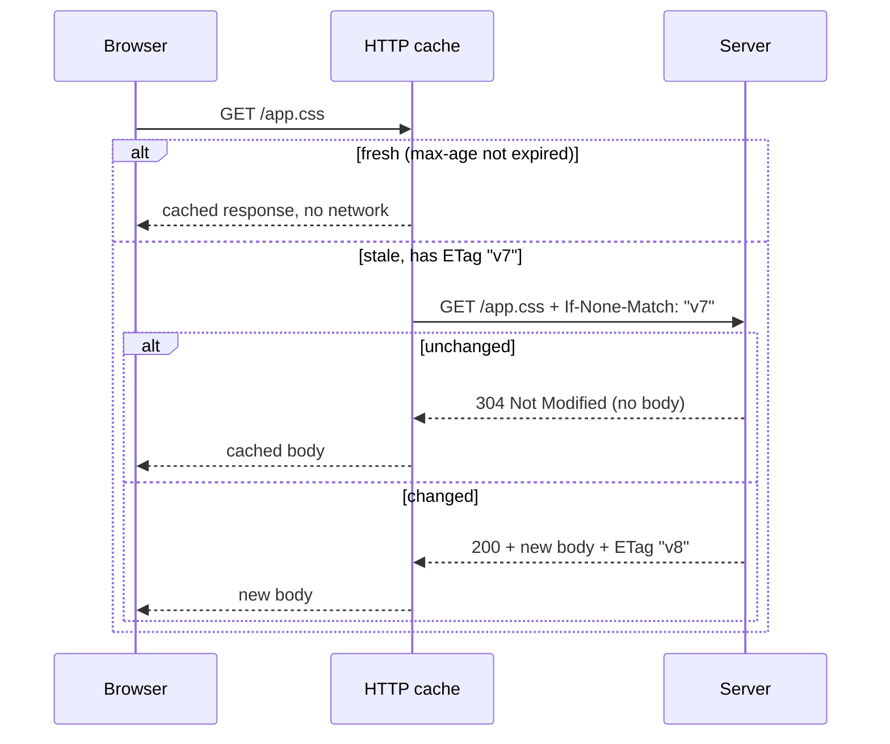
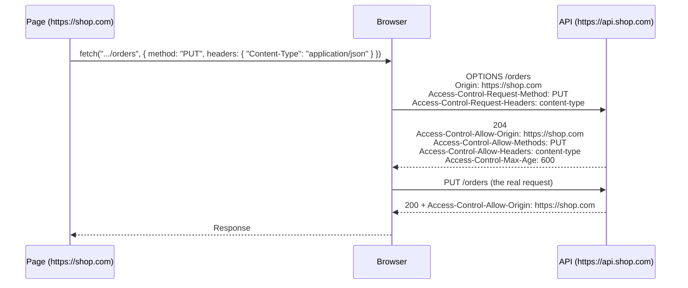

## چرا این فصل مهم است؟

تقریباً هر فرانت‌اندی با یک سرور حرف می‌زند: لود صفحه، گرفتن JSON از یک API، آپلود فایل. همه‌ی این‌ها **HTTP** است. بیشتر باگ‌های این مرز از سه سوءتفاهم می‌آیند: Status Codeها و Headerهای HTTP یعنی چه، `fetch` چه چیزی را خطا حساب می‌کند (و چه چیزی را نه)، و چرا مرورگر بعضی درخواست‌های Cross-origin را مسدود می‌کند (**CORS**). این فصل هر سه را از پایه می‌سازد.

## HTTP در یک تصویر

**HTTP** (HyperText Transfer Protocol) یک پروتکل درخواست–پاسخ است: Client یک **Request** می‌فرستد و سرور دقیقاً یک **Response** برمی‌گرداند. هر دو پیام‌هایی شبیه متن با یک شکل مشترک‌اند: یک خط اول، **Headerها** (جفت‌های اسم–مقدار برای اطلاعات جانبی)، یک خط خالی و یک **Body** اختیاری.

```http
POST /api/orders HTTP/1.1
Host: shop.com
Content-Type: application/json
Authorization: Bearer eyJhbGci...
Accept: application/json

{"sku":"pen","qty":2}
```

```http
HTTP/1.1 201 Created
Content-Type: application/json
Location: /api/orders/981
Cache-Control: no-store

{"id":981,"sku":"pen","qty":2}
```

خط اول Request شامل **Method**، **مسیر** و نسخه است. خط اول Response شامل نسخه و **Status Code** همراه متنش است.

### Methodها

| Method | معنی | Safe | Idempotent | Body دارد |
| --- | --- | --- | --- | --- |
| `GET` | خواندن یک منبع | بله | بله | نه |
| `HEAD` | مثل `GET`، اما فقط Headerها | بله | بله | نه |
| `POST` | ساختن چیزی، یا اجرای یک عملیات | نه | **نه** | بله |
| `PUT` | جایگزینی کامل یک منبع | نه | بله | بله |
| `PATCH` | تغییر بخشی از یک منبع | نه | تضمینی نیست | بله |
| `DELETE` | حذف یک منبع | نه | بله | معمولاً نه |
| `OPTIONS` | پرسیدن اینکه چه چیزهایی مجاز است (در Preflight مربوط به CORS) | بله | بله | نه |

- **Safe** یعنی درخواست چیزی را روی سرور تغییر نمی‌دهد؛ پس مرورگرها و Crawlerها آزادانه می‌توانند بفرستندش (مثلاً برای Prefetch).
- **Idempotent** یعنی دو بار فرستادنش همان اثر یک بار فرستادن را دارد. دو بار حذف سفارش ۹۸۱ باز هم یعنی حذف‌شده؛ اما دو بار POST کردن یک سفارش، **دو** سفارش می‌سازد. برای همین تکرار درخواست بعد از خطای شبکه برای `PUT` امن است ولی برای `POST` خطرناک.

### Status Codeها

رقم اول دسته را مشخص می‌کند:

| بازه | دسته | کدهایی که می‌بینید |
| --- | --- | --- |
| `1xx` | اطلاع‌رسانی | `101 Switching Protocols` (ارتقا به WebSocket)، `103 Early Hints` |
| `2xx` | موفقیت | `200 OK`، `201 Created`، `204 No Content` (موفق، بدون Body) |
| `3xx` | تغییر مسیر | `301` / `308` جابه‌جایی دائمی، `302` / `307` موقت، `304 Not Modified` (از نسخه‌ی کش‌شده‌ات استفاده کن) |
| `4xx` | خطای **Client**: درخواست را درست کنید | `400 Bad Request`، `401 Unauthorized` (وارد نشده)، `403 Forbidden` (وارد شده ولی اجازه ندارد)، `404 Not Found`، `409 Conflict`، `422 Unprocessable Content` (اعتبارسنجی رد شد)، `429 Too Many Requests` |
| `5xx` | خطای **سرور**: شاید بعداً دوباره امتحان کنید | `500 Internal Server Error`، `502 Bad Gateway`، `503 Service Unavailable`، `504 Gateway Timeout` |

`307` و `308` موقع Redirect، Method و Body را حفظ می‌کنند؛ `301` و `302` اجازه می‌دهند مرورگر یک `POST` را به `GET` تبدیل کند.

### Headerهای پرکاربرد

| Header | جهت | کاربرد |
| --- | --- | --- |
| `Content-Type` | هر دو | فرمت Body: `application/json`، `text/html; charset=utf-8`، `multipart/form-data; boundary=…` |
| `Accept` | Request | فرمت‌هایی که Client می‌تواند بپذیرد |
| `Authorization` | Request | اطلاعات احراز هویت، مثل `Bearer <token>` |
| `Cookie` / `Set-Cookie` | Request / Response | ببینید [Browser Storage](/browser/storage#cookie) |
| `Cache-Control`، `ETag`، `Last-Modified` | Response | کش (پایین‌تر) |
| `If-None-Match`، `If-Modified-Since` | Request | اعتبارسنجی دوباره‌ی نسخه‌ی کش‌شده |
| `Content-Encoding` | Response | فشرده‌سازی: `br`، `gzip`، `zstd` |
| `Location` | Response | مقصد Redirect یا آدرس منبع تازه ساخته‌شده |
| `Origin` | Request | Originی که درخواست را شروع کرده (برای CORS و بررسی CSRF) |

### HTTP/1.1، HTTP/2 و HTTP/3

| | HTTP/1.1 | HTTP/2 | HTTP/3 |
| --- | --- | --- | --- |
| لایه‌ی انتقال | TCP | TCP | **QUIC** روی UDP |
| درخواست در هر اتصال | یکی در هر لحظه | چندتا هم‌زمان (**Multiplexing**) | چندتا هم‌زمان |
| Headerها | متن ساده، هر بار تکراری | فشرده (HPACK) | فشرده (QPACK) |
| Head-of-line Blocking | در هر اتصال: پاسخ کند، بعدی را معطل می‌کند | گم شدن یک بسته‌ی TCP همه‌ی Streamها را متوقف می‌کند | فقط Stream آسیب‌دیده منتظر می‌ماند |
| برقراری اتصال | Handshake جدای TCP و TLS | TCP + TLS | Handshake ترکیبی، سریع‌تر روی شبکه‌ی موبایل |

در HTTP/1.1 مرورگرها حدود شش اتصال برای هر Host باز می‌کردند و برنامه‌نویس‌ها برای دور زدنش فایل‌ها را یکی می‌کردند و دامنه‌ها را تقسیم می‌کردند. در HTTP/2 و 3، تعداد زیادی درخواست کوچک روی یک اتصال مشکلی ندارد.

## fetch

**`fetch`** تابع داخلی مرورگر برای فرستادن درخواست HTTP است. یک **Promise** از یک **`Response`** برمی‌گرداند.

<Api name="fetch()" sig="fetch(resource, options?)" returns="یک Promise که به محض رسیدن **Headerها** به یک `Response` Resolve می‌شود (Body ممکن است هنوز در حال دانلود باشد). **فقط** در خطای شبکه، شکست CORS یا Abort رد (Reject) می‌شود، **نه** با Status خطای HTTP مثل 404 یا 500." mutates="no">

- `resource`: یک رشته‌ی URL، یک Object از نوع `URL` یا یک `Request`. URLهای نسبی نسبت به صفحه Resolve می‌شوند.
- `options` (Object اختیاری):
  - `method`: `"GET"` (پیش‌فرض)، `"POST"`، `"PUT"`، `"PATCH"`، `"DELETE"`.
  - `headers`: یک Object ساده، یک `Headers` یا آرایه‌ای از جفت‌ها.
  - `body`: رشته، `FormData`، `URLSearchParams`، `Blob`، `ArrayBuffer` یا یک Stream. با `GET` و `HEAD` مجاز نیست.
  - `credentials`: `"same-origin"` (پیش‌فرض: Cookie فقط به Origin خودتان فرستاده شود)، `"include"` (به Cross-origin هم) یا `"omit"` (هیچ‌وقت).
  - `mode`: `"cors"` (پیش‌فرض برای Cross-origin)، `"same-origin"` (برای Cross-origin شکست بخورد) یا `"no-cors"` (یک پاسخ Opaque که نمی‌توانید بخوانید).
  - `cache`: نحوه‌ی استفاده از HTTP Cache: `"default"`، `"no-store"`، `"reload"`، `"no-cache"`، `"force-cache"`، `"only-if-cached"`.
  - `redirect`: `"follow"` (پیش‌فرض)، `"error"` یا `"manual"`.
  - `signal`: یک `AbortSignal` برای لغو درخواست.
  - `keepalive`: با `true` درخواست می‌تواند بعد از بسته شدن صفحه هم زنده بماند (برای Analytics هنگام خروج)؛ فقط برای Bodyهای کوچک.
  - `priority`: `"high"`، `"low"` یا `"auto"`؛ یک راهنمایی برای مرورگر.

</Api>

```js run
// یک data: URL پاسخش را داخل خودش دارد، پس این کد بدون سرور هم اجرا می‌شود
const res = await fetch('data:application/json,{"name":"Ada","langs":["js","ts"]}');

console.log(res.ok, res.status);               // true 200
console.log(res.headers.get("content-type"));  // application/json
const data = await res.json();                 // خواندن Body یک await دوم است
console.log(data.langs);                       // ['js', 'ts']
```

### دو await: اول Headerها، بعد Body

`fetch` وقتی **Headerها** برسند Resolve می‌شود. Body یک Stream است که جداگانه با یکی از این متدها می‌خوانید و هر کدام یک Promise برمی‌گرداند:

| متد | چه می‌دهد | کاربرد |
| --- | --- | --- |
| `res.json()` | JSON Parseشده (اگر Body JSON معتبر نباشد با `SyntaxError` رد می‌شود) | APIها |
| `res.text()` | یک رشته | HTML، متن ساده، دیباگ |
| `res.blob()` | یک `Blob` | تصویر و فایل (`URL.createObjectURL(blob)`) |
| `res.arrayBuffer()` | بایت‌های خام | فرمت‌های باینری |
| `res.formData()` | `FormData` | پاسخ‌های Multipart (به‌ندرت) |
| `res.body` | یک `ReadableStream` | نمایش پیشرفت، Stream کردن پاسخ‌های بزرگ |

Body **فقط یک بار** خوانده می‌شود. بعد از آن `res.bodyUsed` برابر `true` است و خواندن دوباره رد می‌شود. اگر دو بار لازمش دارید، قبل از خواندن `res.clone()` را صدا بزنید.

### fetch با 404 یا 500 خطا پرتاب نمی‌کند

این رایج‌ترین باگ `fetch` است. `404` یا `500` هنوز یک **تبادل موفق HTTP** است: سرور جواب داده. `fetch` Resolve می‌شود و خودتان باید `res.ok` را چک کنید (برای Statusهای 200 تا 299 برابر `true` است).

```js run
// new Response() یک پاسخ را دستی می‌سازد: برای نشان دادن چیزی که fetch به شما می‌دهد مفید است
const res = new Response('{"error":"not found"}', {
  status: 404,
  statusText: "Not Found",
  headers: { "Content-Type": "application/json" },
});

console.log(res.ok, res.status, res.statusText);  // false 404 Not Found: بدون Exception!
console.log(await res.json());                     // { error: 'not found' }: Body خطا هم خواندنی است

try {
  await res.text();                                // خواندن دوباره‌ی همان Body
} catch (err) {
  console.log(err.name, res.bodyUsed);             // TypeError true
}
```

یک Wrapper کوچک خطاهای HTTP را به Exception تبدیل می‌کند تا صدازننده‌ها بتوانند با یک `try/catch` کار کنند:

```js
class HttpError extends Error {
  constructor(response, body) {
    super(`HTTP ${response.status} ${response.statusText}`);
    this.name = "HttpError";
    this.status = response.status;
    this.body = body;                 // جزئیات خطا از طرف سرور، اگر باشد
  }
}

async function api(path, { body, ...options } = {}) {
  const res = await fetch(path, {
    ...options,
    headers: {
      Accept: "application/json",
      ...(body !== undefined && { "Content-Type": "application/json" }),
      ...options.headers,
    },
    body: body === undefined ? undefined : JSON.stringify(body),
  });

  const isJson = res.headers.get("content-type")?.includes("application/json");
  const data = res.status === 204 ? null : isJson ? await res.json() : await res.text();

  if (!res.ok) throw new HttpError(res, data);
  return data;
}

// استفاده
const order = await api("/api/orders", { method: "POST", body: { sku: "pen", qty: 2 } });
```

### فرستادن داده

| چه می‌فرستید | Body | `Content-Type` |
| --- | --- | --- |
| JSON | `JSON.stringify(obj)` | خودتان ست کنید: `application/json` |
| یک فرم، همراه فایل | `new FormData(formElement)` | **ست نکنید**: مرورگر `multipart/form-data` را همراه Boundary اضافه می‌کند |
| جفت‌های ساده‌ی کلید–مقدار | `new URLSearchParams({ a: 1 })` | خودکار اضافه می‌شود: `application/x-www-form-urlencoded` |
| یک فایل به‌صورت بایت خام | خود `File` / `Blob` | نوع Blob، یا خودتان ست کنید |

<Callout type="mistake">
ست کردن دستی `"Content-Type": "multipart/form-data"` موقع فرستادن `FormData`. این Header باید یک رشته‌ی **Boundary** داشته باشد که بخش‌ها را از هم جدا می‌کند و فقط مرورگر آن را می‌داند. بدونش سرور نمی‌تواند Body را Parse کند. Header را نگذارید.
</Callout>

Query String جایش داخل URL است. با `URLSearchParams` بسازیدش تا کاراکترهای خاص درست Encode شوند:

```js run
const params = new URLSearchParams({ q: "a b&c", page: 2 });
const url = new URL("https://api.example.com/search");
url.search = params;
console.log(url.href);   // https://api.example.com/search?q=a+b%26c&page=2
```

### لغو درخواست و Timeout

`fetch` گزینه‌ی `timeout` ندارد. از یک **`AbortSignal`** استفاده کنید:

- `new AbortController()`: هر وقت خواستید `controller.abort()` را صدا بزنید؛ fetch با `AbortError` رد می‌شود.
- `AbortSignal.timeout(ms)`: سیگنالی که بعد از `ms` میلی‌ثانیه خودش Abort می‌شود؛ fetch با `TimeoutError` رد می‌شود.
- `AbortSignal.any([a, b])`: وقتی هر کدام از سیگنال‌ها Abort شود Abort می‌شود (لغو توسط کاربر **یا** Timeout).

```js run
const controller = new AbortController();
controller.abort();                          // قبل از شروع لغو می‌کنیم
try {
  await fetch("data:text/plain,hi", { signal: controller.signal });
} catch (err) {
  console.log(err.name);                     // AbortError
}

const signal = AbortSignal.timeout(10);      // بعد از 10 میلی‌ثانیه خودش Abort می‌شود
await new Promise((r) => setTimeout(r, 30));
console.log(signal.aborted, signal.reason.name);   // true TimeoutError
```

Abort کردن راه جلوگیری از **Race Condition** در جعبه‌های جست‌وجو هم هست: اگر کاربر اول «re» و بعد «react» را تایپ کند، پاسخ «re» ممکن است **بعد از** پاسخ «react» برسد و رویش بنویسد. هر بار که درخواست جدیدی شروع می‌شود، قبلی را Abort کنید:

```js
let current;
async function search(query) {
  current?.abort();                          // درخواست قبلی را، اگر هست، لغو کن
  current = new AbortController();
  try {
    const res = await fetch(`/api/search?q=${encodeURIComponent(query)}`, { signal: current.signal });
    render(await res.json());
  } catch (err) {
    if (err.name !== "AbortError") throw err;  // Abort قابل انتظار است، شکست نیست
  }
}
```

### fetch کی رد می‌شود؟

`fetch` وقتی هیچ پاسخ HTTPی به دست نیاید با یک `TypeError` رد می‌شود: نبود شبکه، شکست DNS، رد شدن اتصال، یک درخواست Mixed Content مسدودشده، یا شکست **CORS**. متن پیام در هر مرورگر فرق دارد (`"Failed to fetch"` در Chrome، `"NetworkError when attempting to fetch resource."` در Firefox، `"Load failed"` در Safari) و به دلایل امنیتی هیچ‌وقت نمی‌گوید **چرا**. دلیل فقط در Console مربوط به DevTools است.

## HTTP Cache

مرورگر یک **HTTP Cache** از پاسخ‌ها نگه می‌دارد و بر اساس Headerهایی که سرور می‌فرستد دوباره از آن‌ها استفاده می‌کند. کش خوب ارزان‌ترین بهبود Performance است: سریع‌ترین درخواست، درخواستی است که اصلاً فرستاده نشود.

| Directive در `Cache-Control` | معنی |
| --- | --- |
| `max-age=3600` | تا 3600 ثانیه تازه است: بدون پرسیدن از سرور استفاده کن |
| `no-cache` | ذخیره کن، اما قبل از هر استفاده با سرور **اعتبارسنجی** کن |
| `no-store` | هرگز ذخیره نکن (داده‌ی حساس) |
| `private` / `public` | فقط مرورگر می‌تواند کش کند / کش‌های مشترک (CDN) هم می‌توانند |
| `immutable` | هیچ‌وقت عوض نمی‌شود: حتی موقع Reload هم اعتبارسنجی نکن |
| `s-maxage=600` | `max-age` فقط برای کش‌های مشترک (CDN) |
| `stale-while-revalidate=60` | بعد از انقضا تا 60 ثانیه نسخه‌ی کهنه را بده و در پس‌زمینه نسخه‌ی تازه را بگیر |

وقتی نسخه‌ی کش‌شده **کهنه** (Stale) است، مرورگر آن را با یک درخواست شرطی **اعتبارسنجی دوباره** می‌کند. اگر سرور یک `ETag` (اثرانگشت نسخه) یا تاریخ `Last-Modified` داده باشد، مرورگر آن را به شکل `If-None-Match` / `If-Modified-Since` برمی‌گرداند. اگر چیزی عوض نشده باشد، سرور با **`304 Not Modified`** و بدون Body جواب می‌دهد و Body کش‌شده دوباره استفاده می‌شود.



استراتژی استاندارد برای یک فرانت‌اند Buildشده:

- **فایل‌هایی که Hash محتوا در اسمشان است** (`app.3f9a1c.js`): `Cache-Control: public, max-age=31536000, immutable`. نسخه‌ی جدید اسم جدید می‌گیرد، پس قبلی را می‌شود یک سال کش کرد.
- **HTML** (`index.html`): `Cache-Control: no-cache` تا کاربر همیشه آخرین لیست فایل‌های Hashدار را بگیرد.
- **پاسخ‌های API با داده‌ی شخصی**: `private, no-cache` یا `no-store`.

## CORS: درخواست‌های Cross-origin

### Same-origin Policy

به‌طور پیش‌فرض JavaScript روی `https://shop.com` می‌تواند به Originهای دیگر درخواست **بفرستد**، اما نمی‌تواند پاسخشان را **بخواند**. این **Same-origin Policy** (سیاست هم‌مبدأ) است. بدون آن، هر سایتی که باز می‌کردید می‌توانست `fetch("https://yourbank.com/api/balance")` را صدا بزند و چون مرورگر Cookieهای بانک شما را ضمیمه می‌کند، اطلاعات حسابتان را بخواند.

**Origin** یعنی Scheme + Host + Port (ببینید [Browser Storage](/browser/storage#origin-چه-کسی-چه-چیزی-را-میخواند)). `https://shop.com` و `https://api.shop.com` دو Origin **متفاوت** هستند.

### CORS چیست؟

**CORS** (Cross-Origin Resource Sharing) راهی است که **سرور** با آن می‌گوید «به این Originهای دیگر اجازه می‌دهم پاسخ‌هایم را بخوانند». مجموعه‌ای از Headerهای پاسخ است و مرورگر اجرایش می‌کند: درخواست را می‌فرستد، Headerها را نگاه می‌کند و یا پاسخ را به JavaScript شما می‌دهد یا جلویش را می‌گیرد.

```http
GET /api/products HTTP/1.1
Host: api.shop.com
Origin: https://shop.com
```

```http
HTTP/1.1 200 OK
Access-Control-Allow-Origin: https://shop.com
Content-Type: application/json
```

چون `Access-Control-Allow-Origin` با Origin صفحه یکی است، مرورگر اجازه می‌دهد کد پاسخ را بخواند.

### درخواست ساده و Preflight

بعضی درخواست‌ها **ساده** (Simple) حساب می‌شوند، چون یک فرم HTML از قبل از وجود CORS هم می‌توانست بفرستدشان. مرورگر آن‌ها را مستقیم می‌فرستد. درخواستی ساده است که **همه‌ی** این شرط‌ها را داشته باشد:

- Method آن `GET`، `HEAD` یا `POST` باشد؛
- فقط Headerهای مجاز را ست کرده باشد (`Accept`، `Accept-Language`، `Content-Language`، `Content-Type`، `Range`)؛
- `Content-Type`، اگر ست شده، `text/plain`، `application/x-www-form-urlencoded` یا `multipart/form-data` باشد.

هر چیز دیگری، مثل `PUT`/`DELETE`، یک Header `Authorization` یا `Content-Type` از نوع JSON، اول یک **Preflight** راه می‌اندازد: یک درخواست خودکار `OPTIONS` که اجازه می‌گیرد.



| Header پاسخ | معنی |
| --- | --- |
| `Access-Control-Allow-Origin` | Origin مجاز، یا `*` برای هر Originی (همراه Credentials مجاز نیست) |
| `Access-Control-Allow-Methods` | Methodهای مجاز (در Preflight) |
| `Access-Control-Allow-Headers` | Headerهای درخواستِ مجاز (در Preflight) |
| `Access-Control-Allow-Credentials: true` | اجازه‌ی درخواست همراه Cookie یا احراز هویت HTTP |
| `Access-Control-Max-Age` | مرورگر چند ثانیه می‌تواند نتیجه‌ی Preflight را کش کند |
| `Access-Control-Expose-Headers` | Headerهای پاسخی که JavaScript علاوه بر Headerهای پایه‌ی مجاز می‌تواند بخواند |

### Cookie بین Originها

`fetch` در حالت Cross-origin به‌طور پیش‌فرض Cookie نمی‌فرستد. برای فرستادنش **هر دو طرف** باید اجازه بدهند:

- Client: `fetch(url, { credentials: "include" })`؛
- سرور: `Access-Control-Allow-Credentials: true` **و** یک `Access-Control-Allow-Origin` دقیق (`*` رد می‌شود)؛
- خود Cookie هم باید Cross-site مجاز باشد: `SameSite=None; Secure`.

<Callout type="mistake">
«CORS از API من محافظت می‌کند.» نمی‌کند. CORS فقط تعیین می‌کند **JavaScript داخل مرورگر** اجازه دارد پاسخ را بخواند یا نه. یک درخواست ساده همچنان **به سرور می‌رسد** و اجرا می‌شود، حتی اگر مرورگر بعداً پاسخ را پنهان کند. `curl`، Postman و سرورها کلاً CORS را نادیده می‌گیرند. از API با احراز هویت، کنترل دسترسی و دفاع در برابر CSRF محافظت کنید (ببینید [امنیت مرورگر](/browser/security)).
</Callout>

<Callout type="tip">
در محیط توسعه، ساده‌ترین راه‌حل CORS این است که اصلاً با آن روبه‌رو نشوید: بگذارید Dev Server درخواست‌های API را **Proxy** کند تا مرورگر فقط یک Origin ببیند. در Vite: `server: { proxy: { "/api": "http://localhost:8080" } }`. در Production، API را روی همان Origin بگذارید یا Headerهای CORS را روی سرور تنظیم کنید. خطای CORS هیچ‌وقت فقط با کد فرانت‌اند درست نمی‌شود و `mode: "no-cors"` هم درستش نمی‌کند: فقط یک پاسخ خالی **Opaque** به شما می‌دهد که نمی‌توانید بخوانیدش.
</Callout>

## fetch، XMLHttpRequest و axios

| | `fetch` | `XMLHttpRequest` | axios |
| --- | --- | --- | --- |
| سبک | Promise | Event و Callback | Promise (روی XHR یا `fetch`) |
| رد شدن با HTTP 4xx/5xx | نه، `res.ok` را چک کنید | نه | **بله** |
| JSON | `await res.json()` | `JSON.parse(xhr.responseText)` | خودکار |
| لغو | `AbortController` | `xhr.abort()` | `AbortController` |
| Timeout | `AbortSignal.timeout()` | `xhr.timeout` | گزینه‌ی `timeout` |
| پیشرفت آپلود | در دسترس نیست | `xhr.upload.onprogress` | `onUploadProgress` |
| پیشرفت دانلود | خواندن Stream `res.body` | `onprogress` | `onDownloadProgress` |
| Streaming | بله | نه | محدود |
| Interceptor | یک Wrapper بنویسید | نه | داخلی دارد |

## اشتباهات رایج

- موفق حساب کردن یک `fetch` Resolveشده بدون چک کردن `res.ok`.
- فراموش کردن await دوم: `const data = fetch(url).json()` (صدا زدن `.json()` روی یک Promise).
- دو بار خواندن Body؛ اگر لازم است از `res.clone()` استفاده کنید.
- ست کردن دستی `Content-Type` برای `FormData`.
- چسباندن ورودی کاربر به URL بدون `encodeURIComponent` یا `URLSearchParams`.
- تکرار خودکار یک `POST` شکست‌خورده و ساختن رکورد تکراری (از Idempotency Key استفاده کنید).
- نادیده گرفتن Race Condition وقتی درخواست‌ها ممکن است هم‌پوشانی داشته باشند.
- تلاش برای درست کردن خطای CORS با `mode: "no-cors"` یا Headerهای سمت فرانت‌اند، به‌جای تنظیم سرور یا یک Proxy.
- کش کردن طولانی‌مدت `index.html`، طوری که کاربرها هیچ‌وقت نسخه‌ی جدید را نبینند.

## سوالات مصاحبه

<QA q="آیا fetch با پاسخ 404 یا 500 رد می‌شود؟ خطاهای HTTP را چطور مدیریت می‌کنید؟" level="junior" n={1}>
<Answer>

نه. `fetch` فقط وقتی پاسخی دریافت نشود رد می‌شود (خطای شبکه، شکست CORS، Abort). یک 404 یا 500 به‌طور عادی و با `res.ok === false` Resolve می‌شود. `res.ok` یا `res.status` را چک کنید، اگر لازم است Body خطا را بخوانید و Error خودتان را پرتاب کنید؛ معمولاً در یک Wrapper مشترک.

</Answer>
</QA>

<QA q="CORS چیست و چه چیزی باعث درخواست Preflight می‌شود؟" level="mid" n={2}>
<Answer>

Same-origin Policy جلوی خواندن پاسخ Originهای دیگر توسط JavaScript را می‌گیرد. CORS به سرور اجازه می‌دهد با Headerهای پاسخ مثل `Access-Control-Allow-Origin` به Originهای مشخصی اجازه بدهد؛ اجرایش با مرورگر است. وقتی درخواست «ساده» نباشد، اول یک درخواست Preflight از نوع `OPTIONS` فرستاده می‌شود: Methodی غیر از GET/HEAD/POST، Headerهای غیرمجاز مثل `Authorization`، یا `Content-Type`ی غیر از `text/plain`، form-urlencoded یا multipart. سرور باید قبل از اینکه مرورگر درخواست اصلی را بفرستد، به Preflight با Methodها و Headerهای مجاز جواب بدهد.

</Answer>
<Mistake>

فکر کردن به اینکه CORS یک سد امنیتی سمت سرور است. سرور درخواست‌های ساده را همچنان دریافت می‌کند؛ CORS فقط کنترل می‌کند JavaScript مرورگر بتواند پاسخ را بخواند یا نه.

</Mistake>
<FollowUp>

وقتی درخواست باید Cookie هم بفرستد چه چیزی عوض می‌شود؟

</FollowUp>
</QA>

<QA q="فرق PUT، PATCH و POST چیست؟ Idempotent یعنی چه؟" level="junior" n={3}>
<Answer>

`POST` چیزی می‌سازد یا یک عملیات را اجرا می‌کند؛ `PUT` یک منبع را در یک URL مشخص کاملاً جایگزین می‌کند؛ `PATCH` بخشی از آن را تغییر می‌دهد. Idempotent یعنی تکرار درخواست همان اثر یک بار فرستادن را دارد: `PUT` و `DELETE` Idempotent هستند، `POST` نیست (دو POST می‌توانند دو سفارش بسازند). برای همین تکرار خودکار فقط برای درخواست‌های Idempotent امن است، مگر اینکه از Idempotency Key استفاده کنید.

</Answer>
</QA>

<QA q="Cache-Control را برای فایل‌های یک Single-page App چطور تنظیم می‌کنید؟" level="mid" n={4}>
<Answer>

فایل‌های استاتیک Hashدار (`app.3f9a1c.js`، CSS، فونت‌ها، تصویرها) مقدار `public, max-age=31536000, immutable` می‌گیرند، چون هر تغییری اسم فایل جدیدی می‌سازد. `index.html` مقدار `no-cache` می‌گیرد تا مرورگر هر بار اعتبارسنجی‌اش کند (با `ETag` و `304` ارزان است) و همیشه از فایل‌های Hashدار جدید خبردار شود. پاسخ‌های API شخصی `private, no-cache` یا `no-store` می‌گیرند.

</Answer>
</QA>

<QA q="چطور با fetch، Timeout پیاده می‌کنید و از Race Condition جلوگیری می‌کنید؟" level="mid" n={5}>
<Answer>

یک `signal` بدهید: `AbortSignal.timeout(ms)` برای Timeout (با `TimeoutError` رد می‌شود)، یک `AbortController` برای لغو دستی (`AbortError`) و `AbortSignal.any()` برای ترکیبشان. برای Race Condition، مثلاً در جست‌وجوی هم‌زمان با تایپ، هر بار که درخواست جدیدی شروع می‌شود قبلی را Abort کنید، یا پاسخ‌هایی را که مال آخرین درخواست نیستند نادیده بگیرید (با مقایسه‌ی یک شناسه‌ی درخواست).

</Answer>
</QA>

<QA q="از HTTP/1.1 تا HTTP/2 و HTTP/3 چه چیزی عوض شد؟" level="senior" n={6}>
<Answer>

HTTP/2 چند درخواست را روی یک اتصال TCP Multiplex می‌کند و Headerها را فشرده می‌کند؛ پس دیگر به ترفندهایی مثل تقسیم دامنه و یکی کردن فایل‌ها نیازی نیست. اما گم شدن یک بسته‌ی TCP همچنان همه‌ی Streamها را متوقف می‌کند. HTTP/3 روی QUIC و UDP اجرا می‌شود: Streamها مستقل‌اند، پس گم شدن یک بسته فقط Stream خودش را معطل می‌کند، و Handshakeهای لایه‌ی انتقال و TLS ترکیب شده‌اند که برقراری اتصال را، به‌خصوص روی شبکه‌ی موبایل، سریع‌تر می‌کند. اتصال QUIC حتی می‌تواند از تغییر شبکه (Wi‑Fi به اینترنت موبایل) جان سالم به در ببرد.

</Answer>
</QA>

## جمع‌بندی

<Recap>

- هر پیام HTTP یعنی خط اول + Headerها + خط خالی + Body اختیاری؛ پاسخ‌ها یک Status Code دارند.
- GET، HEAD، PUT و DELETE، Idempotent هستند؛ POST نیست، پس کورکورانه تکرارش نکنید.
- 4xx یعنی درخواست را درست کنید و 5xx یعنی سرور شکست خورده؛ 401 یعنی وارد نشده، 403 یعنی اجازه ندارد.
- `fetch` با رسیدن Headerها Resolve می‌شود؛ Body را با یک await دوم (`json()`، `text()`، `blob()`) و فقط یک بار بخوانید.
- `fetch` با 404/500 رد نمی‌شود: همیشه `res.ok` را چک کنید.
- برای `FormData`، `Content-Type` را ست نکنید؛ برای Query String از `URLSearchParams` استفاده کنید.
- برای لغو و Timeout از `AbortController` / `AbortSignal.timeout()` استفاده کنید و درخواست‌های کهنه را Abort کنید تا Race پیش نیاید.
- `Cache-Control` + `ETag` کش HTTP را کنترل می‌کنند: فایل‌های Hashدار یک سال و immutable، HTML با `no-cache`.
- Same-origin Policy جلوی خواندن پاسخ Cross-origin را می‌گیرد؛ Headerهای CORS سرور اجازه‌اش را می‌دهند و درخواست‌های غیرساده با `OPTIONS` Preflight می‌شوند.
- CORS را مرورگر اجرا می‌کند نه سرور: جای احراز هویت یا محافظت CSRF را نمی‌گیرد.

</Recap>
