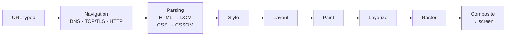
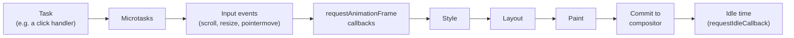

## چرا باید بدانیم مرورگر چطور Render می‌کند؟

«وقتی یک URL تایپ می‌کنید و Enter می‌زنید چه اتفاقی می‌افتد؟» یکی از رایج‌ترین سوال‌های مصاحبه‌ی فرانت‌اند است، چون یک جواب خوب به همه‌چیز سر می‌زند: شبکه، Parse کردن، CSS، JavaScript و گرافیک. شناختن این مسیر مشکلات روزمره را هم توضیح می‌دهد: چرا یک حلقه‌ی طولانی صفحه را قفل می‌کند، چرا انیمیشن `transform` روان می‌ماند ولی انیمیشن `left` تکه‌تکه می‌شود، و چرا بعضی تغییرها ارزان‌اند و بعضی نه.

سه فصل دیگر روی بخش‌هایی از این داستان زوم کرده‌اند؛ این فصل آن‌ها را از اول تا آخر به هم وصل می‌کند:

- [Performance در HTML](/html/performance#critical-rendering-path): کدام منابع جلوی Parse و Render را می‌گیرند.
- [Performance رندر در CSS](/css/rendering-performance): کدام Property کدام مرحله را راه می‌اندازد، Layout Thrashing و `will-change`.
- [Event Loop](/javascript/event-loop): Task، Microtask و جای اجرای `requestAnimationFrame`.

## تصویر کلی: از URL تا پیکسل



هر جعبه یک مرحله است با ورودی و خروجی خودش. دو مرحله‌ی اول برای هر بار لود صفحه یک بار اتفاق می‌افتند (Parse همراه با رسیدن بایت‌ها ادامه پیدا می‌کند). مراحل Render، از Style تا Composite، هر بار که چیزی در صفحه عوض شود دوباره اجرا می‌شوند؛ حداکثر یک بار در هر Frame.

## چه کسی کار را انجام می‌دهد: Processها و Threadها

مرورگر امروزی یک برنامه‌ی واحد نیست؛ گروهی از **Process**ها (برنامه‌های مستقل با حافظه‌ی جداگانه) است که با هم همکاری می‌کنند. معماری Chromium بیشتر از همه مستند شده؛ Firefox و Safari هم همین ایده را با اسم‌های دیگر دنبال می‌کنند.

| Process | مسئولیت |
| --- | --- |
| **Browser Process** | پنجره، تب‌ها، نوار آدرس، بوک‌مارک‌ها و مجوزها؛ هماهنگ‌کننده‌ی بقیه |
| **Network Service** | DNS، اتصال‌ها، HTTP و کش |
| **Renderer Process** | هر چیزی داخل صفحه: Parse، JavaScript، Style، Layout و Paint. برای هر سایت یکی (**Site Isolation**)؛ پس اگر صفحه‌ای Crash کند یا آلوده باشد، نمی‌تواند حافظه‌ی سایت دیگری را بخواند |
| **GPU Process** | با کارت گرافیک حرف می‌زند و تصویر نهایی همه‌ی تب‌ها را می‌کشد |

داخل Renderer Process چند **Thread** (مسیرهای اجرای مستقل که حافظه‌ی مشترک دارند) هست:

- **Main Thread**: JavaScript شما **و** مراحل Style، Layout و Paint را اجرا می‌کند. برای هر صفحه فقط یکی هست؛ برای همین یک اسکریپت کند همه‌چیز را معطل می‌کند.
- **Compositor Thread**: لایه‌های Paint‌شده را تحویل می‌گیرد، اسکرول و بعضی انیمیشن‌ها را مدیریت می‌کند و Frameها را به GPU می‌فرستد. JavaScript اجرا **نمی‌کند**.
- **Raster Worker Threadها**: دستورهای Paint را به پیکسل واقعی تبدیل می‌کنند، به‌صورت کاشی‌کاشی (Tile).

<Callout type="note">
نتیجه‌ی اصلی: هر کاری که Compositor Thread بتواند به‌تنهایی انجام دهد (اسکرول، انیمیشن `transform` و `opacity`) **حتی وقتی Main Thread مشغول است** ادامه پیدا می‌کند. بقیه‌ی کارها منتظر می‌مانند.
</Callout>

## قدم ۱: Navigation

<Steps>
<Step title="URL است یا جست‌وجو؟">
Browser Process چیزی را که تایپ کرده‌اید بررسی می‌کند. `example.com` تبدیل به `https://example.com/` می‌شود و `how to center a div` به موتور جست‌وجو می‌رود. اگر سایت در لیست **HSTS** باشد، قبل از هر درخواستی `http` به `https` ارتقا پیدا می‌کند.
</Step>
<Step title="بررسی کش‌ها">
اگر یک **Service Worker** این URL را کنترل کند، می‌تواند خودش جواب درخواست را بدهد. وگرنه **HTTP Cache** بررسی می‌شود؛ یک جواب کش‌شده‌ی تازه کلاً از شبکه رد می‌شود. جزئیات در [HTTP، Fetch و CORS](/browser/http-fetch).
</Step>
<Step title="پیدا کردن سرور: DNS">
اسم دامنه به یک آدرس IP تبدیل می‌شود: اول کش مرورگر، بعد کش سیستم‌عامل، بعد یک DNS Resolver. این کار از صفر تا بیشتر از صد میلی‌ثانیه طول می‌کشد.
</Step>
<Step title="اتصال: TCP و TLS، یا QUIC">
برای HTTP/1.1 و HTTP/2 یک اتصال TCP باز می‌شود (یک رفت‌وبرگشت) و یک TLS Handshake آن را رمزنگاری می‌کند (در TLS 1.3 یک رفت‌وبرگشت دیگر). HTTP/3 از **QUIC** روی UDP استفاده می‌کند که هر دو را در یک رفت‌وبرگشت انجام می‌دهد. `<link rel="preconnect">` همین مرحله را زودتر انجام می‌دهد.
</Step>
<Step title="درخواست و پاسخ">
مرورگر درخواست HTTP را با Headerها و Cookieها می‌فرستد. سرور با یک Status، Headerها و Body جواب می‌دهد. یک Redirect از نوع `301`/`302`/`307`/`308` کل Navigation را با URL جدید از اول شروع می‌کند.
</Step>
<Step title="Commit">
`Content-Type` پاسخ تعیین می‌کند چه کار شود. برای `text/html`، مرورگر یک Renderer Process برای آن سایت انتخاب می‌کند (یا می‌سازد)، بایت‌ها را برایش Stream می‌کند و نوار آدرس به‌روز می‌شود. از اینجا به بعد کار دست Renderer است.
</Step>
</Steps>

## قدم ۲: Parse

Renderer **بایت** دریافت می‌کند. آن‌ها را با Charset (از `<meta charset="utf-8">` یا Header `Content-Type`) به کاراکتر تبدیل می‌کند، به Token (تگ‌ها) می‌شکند و درخت **DOM** را می‌سازد. جزئیات Parser و اینکه چرا اسکریپت‌های کلاسیک متوقفش می‌کنند در [مبانی HTML](/html/fundamentals#داخل-parser-tokenizer-tree-builder-و-stack-of-open-elements) آمده.

در حالی که HTML دارد می‌رسد، سه کار هم‌زمان انجام می‌شود:

- **Preload Scanner** جلوتر در HTML خام را نگاه می‌کند و دانلود تصویرها، اسکریپت‌ها و Stylesheetها را قبل از اینکه Parser به آن‌ها برسد شروع می‌کند.
- هر Stylesheet به **CSSOM** (CSS Object Model) تبدیل می‌شود: قانون‌ها با Selectorهایشان، آماده‌ی تطبیق.
- اسکریپت‌ها وقتی برسند اجرا می‌شوند: اسکریپت کلاسیک Parser را متوقف می‌کند، اسکریپت‌های `defer` و `module` بعد از Parse اجرا می‌شوند و `async` به محض دانلود.

Parse **تدریجی** است: مرورگر می‌تواند بخش اول یک صفحه‌ی بلند را قبل از رسیدن بقیه‌اش Render کند، مگر اینکه چیزی جلوی Render را بگیرد؛ مثل CSS داخل `<head>`.

## قدم ۳: Style

DOM می‌گوید **چه چیزی** در صفحه هست؛ CSSOM می‌گوید **چه قانون‌هایی** وجود دارد. مرحله‌ی **Style** این دو را ترکیب می‌کند: برای هر Element قانون‌های منطبق را پیدا می‌کند، [Cascade](/css/fundamentals#cascade-الگوریتم-انتخاب-برنده) و Inheritance را اجرا می‌کند و **Computed Style** آن Element را می‌سازد: برای هر CSS Property یک مقدار نهایی.

این همان مقداری است که `getComputedStyle(el)` برمی‌گرداند. وقتی Elementهای زیادی تحت تأثیر باشند گران‌تر است (مثلاً عوض کردن یک کلاس روی `<body>` ممکن است Style کل صفحه را دوباره حساب کند) و همین‌طور وقتی Selectorها پیچیده باشند.

## قدم ۴: Layout

اینکه بدانیم یک جعبه `width: 50%` است برای کشیدنش کافی نیست؛ مرورگر باید موقعیت و اندازه‌ی واقعی را به پیکسل حساب کند. **Layout** (که به آن **Reflow** هم می‌گویند) **Layout Tree** را می‌سازد و هندسه‌ی هر جعبه را در آن محاسبه می‌کند.

Layout Tree با DOM یکی **نیست**:

| در DOM | در Layout Tree؟ | چرا |
| --- | --- | --- |
| `<head>`، `<script>`، `<meta>` | نه | نمایش داده نمی‌شوند (به‌طور پیش‌فرض `display: none`) |
| Elementی با `display: none` | نه، و نوادگانش هم نه | هیچ جعبه‌ای نمی‌سازد |
| Elementی با `visibility: hidden` | **بله** | دیده نمی‌شود ولی هنوز جا می‌گیرد |
| `::before` / `::after` با `content` | **بله** | Node DOM نیستند، اما جعبه می‌سازند |
| متنی که در سه خط می‌شکند | بله، به‌صورت سه Line Box | Layout آن را به خط‌ها تقسیم می‌کند |

```html live
<p id="none" style="display:none">display: none</p>
<p id="hidden" style="visibility:hidden">visibility: hidden</p>
<p id="normal">normal</p>
<pre id="log" style="font-size:13px"></pre>
<script>
  const log = (l) => (document.getElementById("log").textContent += l + "\n");
  for (const id of ["none", "hidden", "normal"]) {
    const el = document.getElementById(id);
    // getClientRects() جعبه‌های Element را می‌دهد: خالی یعنی در Layout Tree نیست
    log(id.padEnd(7) + " boxes: " + el.getClientRects().length + ", height: " + el.offsetHeight);
  }
  // none    boxes: 0, height: 0
  // hidden  boxes: 1, height: (مثل normal)
  // normal  boxes: 1, height: …
</script>
```

Layout معمولاً گران‌ترین مرحله‌ی Render است، چون هندسه‌ی یک جعبه می‌تواند به والدش، فرزندهایش و Siblingهایش وابسته باشد. عوض کردن عرض یک Element ممکن است همه‌ی چیزهای بعد از آن را جابه‌جا کند.

## قدم ۵: Paint

**Paint** هنوز پیکسل تولید نمی‌کند. Layout Tree را پیمایش می‌کند و یک لیست از **دستورهای رسم** ثبت می‌کند که به آن **Display List** می‌گویند: «این مستطیل را سفید پر کن»، «این متن را در (20, 40) بنویس»، «این تصویر را اینجا بکش». ترتیب مهم است: از [Stacking Context و `z-index`](/css/positioning) پیروی می‌کند تا چیزهایی که رو هستند دیرتر کشیده شوند.

ثبت دستورها خیلی ارزان‌تر از تولید پیکسل است و اجازه می‌دهد همان دستورها در یک Zoom دیگر بدون Paint دوباره Raster شوند.

## قدم ۶: Layerize، Raster و Composite

### لایه‌ها

مرورگر صفحه را به **لایه‌ها** (Layer) تقسیم می‌کند؛ چیزی شبیه برگه‌های شفاف در یک ابزار طراحی. یک Element وقتی لایه‌ی خودش را می‌گیرد (به اصطلاح **Promote** می‌شود) که احتمالاً مستقل حرکت کند یا تغییر کند؛ مثلاً:

- `will-change: transform` یا `will-change: opacity` داشته باشد؛
- یک انیمیشن `transform` یا `opacity` رویش در حال اجرا باشد؛
- یک `<video>`، یک `<canvas>` با WebGL یا یک `<iframe>` باشد؛
- `position: fixed` باشد یا یک ظرف اسکرول‌شونده (تا بدون Paint دوباره اسکرول شود)؛
- روی یک لایه‌ی دیگر افتاده باشد و باید بالای آن کشیده شود (Promote ضمنی).

لایه‌ها حافظه مصرف می‌کنند (هر کدام یک Texture روی GPU است)؛ پس Promote کردن همه‌چیز اشتباه است. ببینید [`will-change`](/css/rendering-performance#will-change).

### Raster

**Raster** دستورهای Display List هر لایه را به پیکسل واقعی تبدیل می‌کند. لایه‌ها به **Tile**هایی (مربع‌هایی چندصد پیکسلی) تقسیم می‌شوند که Worker Threadها، معمولاً روی GPU، Rasterشان می‌کنند. Tileهای نزدیک Viewport اول انجام می‌شوند؛ برای همین یک اسکرول خیلی سریع ممکن است برای لحظه‌ای ناحیه‌های خالی (شطرنجی) نشان بدهد.

### Commit و Composite

وقتی Main Thread کار Paint را تمام کرد، نتیجه را (لایه‌ها، Display Listها و Propertyهایشان مثل Transform) به **Compositor Thread** تحویل می‌دهد؛ به این کار **Commit** می‌گویند. Compositor تصمیم می‌گیرد در این Frame هر لایه کجا قرار بگیرد، اسکرول، `transform` و `opacity` را اعمال می‌کند و یک **Compositor Frame** برای GPU Process می‌فرستد که آن را روی صفحه می‌کشد.

راز ارزان بودن انیمیشن‌های `transform` و `opacity` همین‌جاست: تغییر آن‌ها فقط **Propertyهای** یک لایه را عوض می‌کند، پس Compositor بدون اینکه از Main Thread بخواهد Style، Layout یا Paint را دوباره اجرا کند Frame جدید می‌سازد.

### هر تغییر کدام مراحل را راه می‌اندازد

| چه چیزی را عوض می‌کنید | Style | Layout | Paint | Composite |
| --- | --- | --- | --- | --- |
| `width`، `top`، `font-size`، اضافه یا حذف Element | ✓ | ✓ | ✓ | ✓ |
| `color`، `background`، `box-shadow`، `visibility` | ✓ | | ✓ | ✓ |
| `transform`، `opacity` (روی لایه‌ی Promoteشده) | ✓ | | | ✓ |
| اسکرول یک ظرف Composite‌شده | | | | ✓ |

## زندگی یک Frame

نمایشگرها با نرخ ثابتی به‌روز می‌شوند؛ معمولاً 60 هرتز (هر 16.7 میلی‌ثانیه یک Frame) یا در خیلی از گوشی‌ها و لپ‌تاپ‌ها 120 هرتز (8.3 میلی‌ثانیه). مرورگر سعی می‌کند قبل از هر به‌روزرسانی یک Frame جدید آماده کند، البته فقط اگر چیزی عوض شده باشد. کار یک Frame روی Main Thread این شکلی است:



<Steps>
<Step title="اجرای Taskها">
Event Loop تسک‌ها (Event Handlerها، تایمرها، Callbackهای شبکه) را اجرا می‌کند و بعد از هر کدام همه‌ی Microtaskهای منتظر را. ببینید [Event Loop](/javascript/event-loop).
</Step>
<Step title="Inputهای هم‌گام با Frame">
Eventهای پیوسته مثل `scroll`، `resize` و `pointermove` در هر Frame یک بار تحویل داده می‌شوند، نه برای هر رویداد سخت‌افزاری.
</Step>
<Step title="اجرای Callbackهای requestAnimationFrame">
آخرین فرصت برای تغییر DOM قبل از کشیده شدن همین Frame است؛ برای همین جای درست تغییرات بصری همین‌جاست.
</Step>
<Step title="Render">
Style، Layout و Paint، فقط برای چیزهایی که عوض شده‌اند، و بعد Commit به Compositor.
</Step>
<Step title="زمان بیکاری">
اگر تا Frame بعدی وقت باقی مانده باشد، Callbackهای `requestIdleCallback` می‌توانند کارهای کم‌اولویت را انجام دهند.
</Step>
</Steps>

اگر تسک‌های یک Frame بیشتر از بودجه‌ی Frame طول بکشند، مرورگر نمی‌تواند سر وقت Render کند و آن Frame **از دست می‌رود** (Dropped Frame). کاربر این را به شکل لرزش و تکه‌تکه شدن (**Jank**) می‌بیند.

## Main Thread در برابر Compositor، در عمل

دکمه را بزنید: Main Thread را با یک حلقه‌ی مشغول‌کننده ۲ ثانیه قفل می‌کند. جعبه‌ای که با `transform` انیمیت می‌شود به حرکتش ادامه می‌دهد چون Compositor انیمیتش می‌کند. جعبه‌ای که با `left` انیمیت می‌شود یخ می‌زند، چون هر Frame از انیمیشن `left` به Layout روی Main Thread نیاز دارد.

```html live
<style>
  .lane { position: relative; height: 34px; margin: 6px 0; background: #eef2f7; border-radius: 6px; }
  .box  { position: absolute; top: 4px; width: 26px; height: 26px; border-radius: 5px; }
  .t { background: teal; animation: move-t 1.2s ease-in-out infinite alternate; }
  .l { background: crimson; animation: move-l 1.2s ease-in-out infinite alternate; }
  @keyframes move-t { to { transform: translateX(240px); } }
  @keyframes move-l { from { left: 0; } to { left: 240px; } }
</style>
<div class="lane"><div class="box t"></div></div>
<div class="lane"><div class="box l"></div></div>
<button id="block">Block the main thread for 2s</button>
<pre id="log" style="font-size:13px">teal = transform (compositor), red = left (main thread)
</pre>
<script>
  document.getElementById("block").addEventListener("click", () => {
    const end = performance.now() + 2000;
    while (performance.now() < end) {}          // حلقه‌ی مشغول: هیچ کار دیگری روی این Thread اجرا نمی‌شود
    document.getElementById("log").textContent += "main thread free again\n";
  });
</script>
```

## Long Task و پاسخ‌گویی

**Long Task** یعنی هر تسکی که Main Thread را بیشتر از **50 میلی‌ثانیه** مشغول نگه دارد. در این مدت صفحه نمی‌تواند به کلیک یا تایپ جواب بدهد، `requestAnimationFrame` اجرا نمی‌شود و Render اتفاق نمی‌افتد. کاربر تأخیرهای بیشتر از حدود ۱۰۰ میلی‌ثانیه را حس می‌کند.

مرورگرها این را با **INP** (Interaction to Next Paint) اندازه می‌گیرند: فاصله‌ی زمانی از تعامل کاربر تا Frame بعدی که نتیجه‌اش را نشان می‌دهد. یکی از Core Web Vitals است و INP خوب **200 میلی‌ثانیه یا کمتر** است. ببینید [Web Performance](/tooling/web-performance).

راه‌حل این است که **کار طولانی را تکه‌تکه کنید** و بین تکه‌ها به مرورگر فرصت بدهید ورودی را مدیریت کند و Render کند (به این کار **Yield** کردن می‌گویند):

```html live
<button id="go">Process 150,000,000 items in chunks</button>
<button id="ping">Click me while it runs</button>
<pre id="log" style="font-size:13px"></pre>
<script>
  const log = (l) => (document.getElementById("log").textContent += l + "\n");
  document.getElementById("ping").addEventListener("click", () => log("ping handled"));

  // نوبت را به مرورگر بده: این Task را تمام کن و در یک Task جدید ادامه بده
  // (در پروژه‌ی واقعی، هر جا پشتیبانی می‌شود scheduler.yield() بهتر است: جدول پایین را ببینید)
  const yieldToMain = () => new Promise((r) => setTimeout(r, 0));

  document.getElementById("go").addEventListener("click", async () => {
    let sum = 0;
    for (let i = 1; i <= 150_000_000; i++) {
      sum += Math.sqrt(i);
      if (i % 1_000_000 === 0) await yieldToMain();      // اینجا ورودی و Render فرصت اجرا دارند
      if (i % 30_000_000 === 0) log("progress " + i / 1_000_000 + "M");
    }
    log("done, sum = " + Math.round(sum));
  });
</script>
```

| ابزار | چه می‌کند | نکته |
| --- | --- | --- |
| `await scheduler.yield()` | Yield می‌کند و بعد **جلوتر از** بقیه‌ی تسک‌های صف ادامه می‌دهد | در Chromium و Firefox؛ قبل از استفاده وجودش را چک کنید |
| `setTimeout(fn, 0)` | در یک Task جدید، ته صف، ادامه می‌دهد | همه‌جا کار می‌کند؛ Timeoutهای تودرتو حداقل ۴ میلی‌ثانیه می‌شوند |
| `requestAnimationFrame` | قبل از Frame بعدی اجرا می‌شود | فقط برای تغییرات بصری، نه برای تکه‌تکه کردن کار سنگین |
| `requestIdleCallback` | وقتی مرورگر بیکار است اجرا می‌شود | کارهای کم‌اولویت (Analytics، Prefetch)؛ در همه‌ی مرورگرها نیست |
| **Web Worker** | کد را روی یک Thread دیگر اجرا می‌کند | بهترین گزینه برای محاسبات سنگین؛ به DOM دسترسی ندارد و با پیام ارتباط برقرار می‌کند |

## دیدن Pipeline در DevTools

- **پنل Performance**: هنگام کار با صفحه ضبط کنید. ردیف Main Thread بلوک‌های زرد (Scripting)، بنفش (Style و Layout) و سبز (Paint) را نشان می‌دهد. Long Taskها یک گوشه‌ی قرمز دارند. برای Layout نشان می‌دهد کدام Element باعثش شده.
- **کشوی Rendering** (⋮ → More tools → Rendering): **Paint flashing** ناحیه‌هایی را که دوباره Paint شده‌اند سبز می‌کند، **Layer borders** دور لایه‌ها و Tileها خط می‌کشد و **Frame rendering stats** نرخ FPS و حافظه‌ی GPU را نشان می‌دهد.
- **پنل Layers**: همه‌ی لایه‌ها، دلیل Promote شدن هر کدام و حافظه‌ای که مصرف می‌کنند را لیست می‌کند.

## اشتباهات رایج

- فکر کردن به اینکه DOM و Layout Tree یکی‌اند: Elementهای `display: none` جعبه ندارند، Pseudo-elementها دارند.
- انیمیت کردن `top`، `left`، `width` یا `height` به‌جای `transform` و `opacity`.
- Promote کردن همه‌چیز با `will-change` یا `translateZ(0)`؛ هر لایه حافظه‌ی GPU مصرف می‌کند.
- یک حلقه‌ی همگام خیلی بزرگ موقع لود یا داخل یک Click Handler؛ تکه‌تکه‌اش کنید یا به یک Worker ببرید.
- استفاده از `setTimeout(fn, 16)` برای انیمیشن به‌جای `requestAnimationFrame` که با نرخ واقعی Frame هماهنگ است.
- باور به اینکه JavaScript در همان صفحه «موازی» با Render اجرا می‌شود: روی Main Thread نوبتی کار می‌کنند.

## سوالات مصاحبه

<QA q="وقتی یک URL در مرورگر تایپ می‌کنید و Enter می‌زنید چه اتفاقی می‌افتد؟" level="mid" n={1}>
<Answer>

مرورگر تشخیص می‌دهد ورودی URL است یا جست‌وجو و HSTS را اعمال می‌کند. Service Worker و HTTP Cache را بررسی می‌کند، دامنه را با DNS به IP تبدیل می‌کند، اتصال باز می‌کند (TCP + TLS، یا QUIC برای HTTP/3)، درخواست را می‌فرستد و Redirectها را دنبال می‌کند. برای پاسخ HTML، Navigation را به یک Renderer Process تحویل می‌دهد. Renderer، HTML را به DOM تبدیل می‌کند (Preload Scanner منابع را زودتر دانلود می‌کند، CSS تبدیل به CSSOM می‌شود و اسکریپت‌ها ممکن است Parse را متوقف کنند)، Styleها را حساب می‌کند، Layout Tree را می‌سازد و هندسه را محاسبه می‌کند، در Display List Paint می‌کند، صفحه را به لایه‌ها تقسیم می‌کند، Tileها را (معمولاً روی GPU) Raster می‌کند و Compositor تصویر نهایی را روی صفحه می‌چیند.

</Answer>
<Deep>

اشاره کنید در هر مرحله چه چیزی قابل بهینه‌سازی است: DNS و اتصال (`preconnect`، HTTP/2 یا 3)، پاسخ (کش، فشرده‌سازی، CDN)، Parse (اسکریپت‌های `defer`، Critical CSS)، Render (پرهیز از انیمیشن‌هایی که Layout راه می‌اندازند، کوچک نگه داشتن DOM) و Main Thread (تسک‌های کوتاه).

</Deep>
<FollowUp>

در یک لود اول کند، معمولاً زمان کجا صرف می‌شود و چطور پیدایش می‌کنید؟

</FollowUp>
</QA>

<QA q="چرا انیمیت کردن transform روان‌تر از انیمیت کردن left است؟" level="mid" n={2}>
<Answer>

`left` هندسه را عوض می‌کند، پس هر Frame به Style، Layout و Paint روی Main Thread نیاز دارد؛ اگر Main Thread مشغول باشد انیمیشن می‌ایستد. `transform` (مثل `opacity`) روی یک لایه‌ی Promoteشده فقط نحوه‌ی قرار گرفتن یک لایه‌ی موجود توسط Compositor را تغییر می‌دهد؛ پس Frameهای جدید روی Compositor Thread و بدون Layout یا Paint ساخته می‌شوند، حتی وقتی JavaScript در حال اجراست.

</Answer>
</QA>

<QA q="فرق DOM و Layout Tree (Render Tree) چیست؟" level="junior" n={3}>
<Answer>

DOM همه‌ی Nodeهای سند را دارد. Layout Tree فقط چیزهایی را دارد که جعبه می‌سازند: Elementهای `display: none` (و `<head>` و محتوایش) کنار گذاشته می‌شوند، در حالی که Pseudo-elementهای `::before`/`::after` که Node DOM نیستند در آن هستند. Elementهای `visibility: hidden` در Layout Tree می‌مانند چون هنوز جا می‌گیرند.

</Answer>
</QA>

<QA q="Main Thread و Compositor Thread چه هستند؟" level="mid" n={4}>
<Answer>

Main Thread، JavaScript، Style، Layout و Paint را یکی‌یکی اجرا می‌کند. Compositor Thread لایه‌های Paintشده را می‌گیرد و Frame می‌سازد: اسکرول، `transform` و `opacity` را اعمال می‌کند و نتیجه را به GPU می‌فرستد. چون منتظر Main Thread نمی‌ماند، اسکرول و انیمیشن‌های Compositor حتی وسط Long Taskها هم روان می‌مانند؛ مگر اینکه یک Listener غیر Passive برای wheel یا touch، اسکرول را مجبور کند منتظر JavaScript بماند.

</Answer>
</QA>

<QA q="وقتی کاربر روی یک دکمه کلیک می‌کند صفحه یک ثانیه یخ می‌زند. چطور درستش می‌کنید؟" level="senior" n={5}>
<Answer>

اول در پنل Performance ضبطش کنید تا Long Task و محتوایش را پیدا کنید. بعد کار را کم یا تقسیم کنید: کار کمتری انجام دهید (Memoize، پرهیز از محاسبه‌ی تکراری، Virtualize کردن لیست‌های بلند)، حلقه را تکه‌تکه کنید و بین تکه‌ها Yield کنید (`scheduler.yield()` یا `setTimeout`)، اول بازخورد را نشان دهید و کار سنگین را بعد از Paint بعدی انجام دهید، یا محاسبات خالص را به یک Web Worker ببرید. Layoutهای اجباری داخل Handler را هم پیدا کنید. نتیجه را با INP واقعی کاربران بسنجید، نه فقط در محیط تست.

</Answer>
<FollowUp>

چرا `await Promise.resolve()` داخل حلقه کمکی **نمی‌کند**؟

</FollowUp>
</QA>

## جمع‌بندی

<Recap>

- URL → Navigation (کش، DNS، TCP/TLS یا QUIC، HTTP) → Parse (DOM و CSSOM) → Style → Layout → Paint → Layerize → Raster → Composite.
- هر سایت Renderer Process خودش را دارد؛ داخلش یک Main Thread، JavaScript، Style، Layout و Paint را اجرا می‌کند.
- Compositor Thread اسکرول و انیمیشن‌های `transform`/`opacity` را بدون Main Thread انجام می‌دهد.
- Layout Tree شامل Elementهای `display: none` نیست و شامل Pseudo-elementها هست؛ `visibility: hidden` جعبه‌اش را نگه می‌دارد.
- Paint دستورهای رسم را ثبت می‌کند؛ Raster آن‌ها را به‌صورت Tile و معمولاً روی GPU به پیکسل تبدیل می‌کند.
- لایه‌ها حرکت مستقل را ارزان می‌کنند اما حافظه می‌گیرند؛ فقط چیزی را Promote کنید که انیمیت می‌شود.
- در هر Frame: Taskها و Microtaskها، Inputهای هم‌گام با Frame، `requestAnimationFrame`، Style/Layout/Paint، Commit و بعد زمان بیکاری.
- تسک‌های بیشتر از ۵۰ میلی‌ثانیه Long Task هستند و به INP ضربه می‌زنند (خوب: ۲۰۰ میلی‌ثانیه یا کمتر).
- کار طولانی را تکه‌تکه کنید و Yield کنید (`scheduler.yield()`، `setTimeout`) یا آن را به یک Web Worker ببرید.

</Recap>
