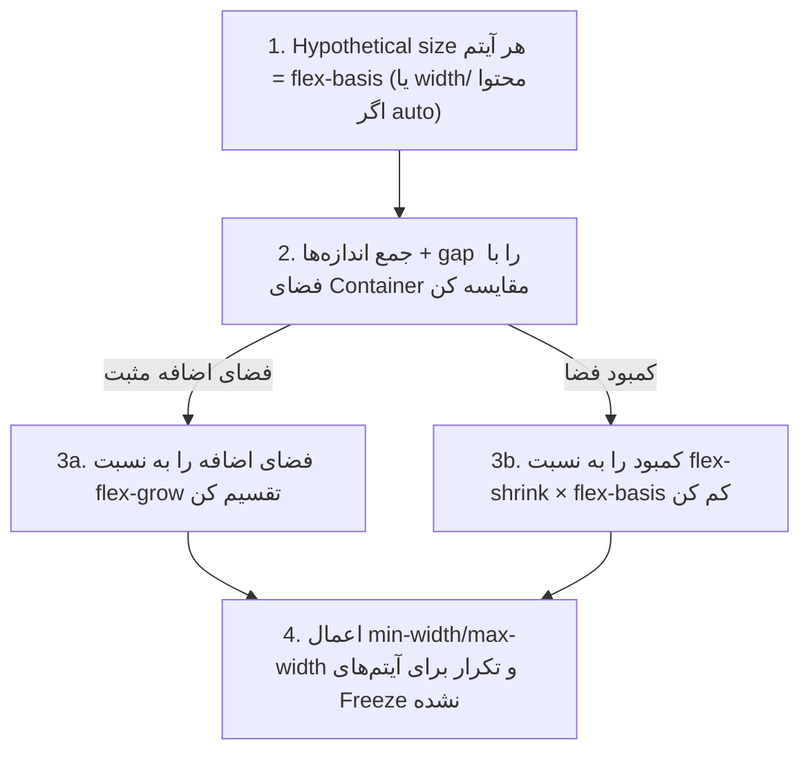

## Flexbox چه مشکلی را حل می‌کند؟

یک نوار بالای سایت را تصور کنید: لوگو در یک طرف، چند لینک وسط، دکمه ورود در طرف دیگر، و همه **از نظر عمودی وسط‌چین**. یا سه کارت کنار هم که **هم‌قد** باشند، هر چقدر هم متنشان فرق کند. قبل از Flexbox این کارهای ساده با ترفندهایی مثل `float`، `display: table-cell` و محاسبه دستی عرض‌ها انجام می‌شد و با کوچک‌ترین تغییر محتوا خراب می‌شد.

**Flexbox** (مخفف Flexible Box Layout؛ چیدمان جعبه انعطاف‌پذیر) یک مدل چیدمان **یک‌بعدی** است: آیتم‌ها را در **یک ردیف** یا **یک ستون** می‌چیند و دو کار را خودکار انجام می‌دهد:

1. **توزیع فضا:** اگر جا اضافه باشد، آن را بین آیتم‌ها تقسیم می‌کند؛ اگر جا کم باشد، آیتم‌ها را کوچک می‌کند تا جا شوند.
2. **هم‌ترازی:** آیتم‌ها را در هر دو جهت (افقی و عمودی) تراز می‌کند.

«یک‌بعدی» یعنی Flexbox در هر لحظه فقط به **یک جهت** فکر می‌کند. اگر به ردیف **و** ستون هم‌زمان نیاز دارید (مثل یک جدول یا گالری)، [Grid](/css/grid) ابزار مناسب‌تری است.

## اولین Flex Container

Flexbox همیشه روی **دو سطح** کار می‌کند:

- **Flex Container:** Elementی که `display: flex` می‌گیرد.
- **Flex Itemها:** **فرزندان مستقیم** آن Container. نوه‌ها تحت تأثیر قرار نمی‌گیرند.

```html live
<style>
  .nav {
    display: flex;           /* ۱. این Element حالا Flex Container است */
    align-items: center;     /* ۲. فرزندان را عمودی وسط‌چین کن */
    gap: 12px;               /* ۳. بین فرزندان ۱۲ پیکسل فاصله بگذار */
    padding: 10px 14px;
    background: #f6f7f8;
    border-radius: 10px;
    font: 14px system-ui;
  }
  .logo { font-weight: 800; font-size: 20px; }
  .login { margin-inline-start: auto; }  /* ۴. همه فضای خالی را بگیر → به انتها هل داده می‌شود */
</style>
<nav class="nav">
  <span class="logo">Logo</span>
  <a href="#">خانه</a>
  <a href="#">مقالات</a>
  <button class="login">ورود</button>
</nav>
```

فقط با چهار خط کار تمام شد. حالا ببینیم وقتی `display: flex` را می‌نویسید دقیقاً چه چیزی عوض می‌شود:

<Steps>
<Step title="فرزندان مستقیم Flex Item می‌شوند">
هر فرزند، حتی یک `span` یا یک تکه متن بدون تگ، یک Flex Item می‌شود. `display` خودشان (block یا inline) دیگر اهمیتی ندارد.
</Step>
<Step title="آیتم‌ها در یک ردیف کنار هم قرار می‌گیرند">
مقدار پیش‌فرض `flex-direction` برابر `row` است. حتی `div`هایی که در حالت عادی زیر هم بودند، کنار هم می‌نشینند.
</Step>
<Step title="عرض آیتم‌ها به اندازه محتوایشان است">
در Flexbox یک `div` دیگر کل عرض را نمی‌گیرد؛ به اندازه محتوایش است (مگر اینکه به آن بگویید رشد کند).
</Step>
<Step title="آیتم‌ها هم‌قد می‌شوند">
مقدار پیش‌فرض `align-items` برابر `stretch` است: همه آیتم‌ها به اندازه بلندترینشان کشیده می‌شوند. «ستون‌های هم‌قد» در Flexbox رایگان است.
</Step>
<Step title="آیتم‌ها به خط بعد نمی‌روند">
مقدار پیش‌فرض `flex-wrap` برابر `nowrap` است: اگر جا کم باشد، آیتم‌ها کوچک می‌شوند، ولی همه در یک خط می‌مانند.
</Step>
</Steps>

## محورها: Main Axis و Cross Axis

کلید فهمیدن Flexbox این است که **به چپ و راست و بالا و پایین فکر نکنید**. همه چیز حول دو محور تعریف می‌شود:

- **Main Axis** (محور اصلی): جهتی که آیتم‌ها پشت سر هم چیده می‌شوند. `flex-direction` تعیینش می‌کند.
- **Cross Axis** (محور عرضی): همیشه **عمود** بر Main Axis.

```text
flex-direction: row                     flex-direction: column
main-start            main-end          ┌───────┐ cross-start → cross-end
   ┌───┐ ┌───┐ ┌───┐  ───► Main Axis    │   1   │  │
   │ 1 │ │ 2 │ │ 3 │                    ├───────┤  │ Main Axis
   └───┘ └───┘ └───┘                    │   2   │  ▼
      │ Cross Axis                      ├───────┤
      ▼                                 │   3   │
                                        └───────┘
```

چرا این‌قدر مهم است؟ چون هر Property فقط روی **یکی** از محورها کار می‌کند. وقتی `flex-direction` را از `row` به `column` عوض کنید، محورها جابه‌جا می‌شوند و `justify-content` که تا الان افقی کار می‌کرد، ناگهان عمودی کار می‌کند.

| | Main Axis | Cross Axis |
| --- | --- | --- |
| چه چیزی تعیینش می‌کند | `flex-direction` | عمود بر Main Axis |
| تراز کردن آیتم‌ها | `justify-content` | `align-items` (همه)، `align-self` (یکی) |
| تراز کردن خطوط (وقتی چند خط داریم) | — | `align-content` |
| اندازه آیتم | `flex-basis`، `flex-grow`، `flex-shrink` | `align-self: stretch` |

**یک نکته RTL:** در `flex-direction: row`، «شروع» محور اصلی در انگلیسی سمت **چپ** و در فارسی سمت **راست** است. پس `justify-content: flex-start` در صفحه فارسی آیتم‌ها را به راست می‌برد، بدون یک خط کد اضافه.

## Playground

همه Propertyهای Container را اینجا امتحان کنید. `flex-direction` را عوض کنید و ببینید `justify-content` و `align-items` چطور نقششان را عوض می‌کنند:

<FlexboxPlayground />

## Propertyهای Container

این Propertyها روی **خود Container** نوشته می‌شوند و روی همه آیتم‌ها اثر دارند:

```css
.container {
  display: flex;                 /* یا inline-flex */
  flex-direction: row;           /* row | row-reverse | column | column-reverse */
  flex-wrap: nowrap;             /* nowrap | wrap | wrap-reverse */
  justify-content: flex-start;   /* تراز در Main Axis */
  align-items: stretch;          /* تراز در Cross Axis */
  align-content: normal;         /* فاصله بین خطوط وقتی wrap شده */
  gap: 1rem;                     /* فاصله بین آیتم‌ها */
}
```

### `display: flex` در برابر `inline-flex`

هر دو فرزندان را با Flexbox می‌چینند. تفاوت در رفتار **خود Container** است: `flex` مثل یک block تمام عرض را می‌گیرد و در خط جدید شروع می‌شود؛ `inline-flex` مثل یک کلمه در جریان متن می‌نشیند و به اندازه محتوایش است. برای دکمه‌ای که آیکون و متن دارد، `inline-flex` مناسب است.

### `flex-direction`: جهت محور اصلی

| مقدار | آیتم‌ها چطور چیده می‌شوند |
| --- | --- |
| `row` (پیش‌فرض) | کنار هم، در جهت متن (فارسی: راست به چپ) |
| `row-reverse` | کنار هم، برعکس جهت متن |
| `column` | زیر هم، از بالا به پایین |
| `column-reverse` | زیر هم، از پایین به بالا |

```html live
<style>
  .demo { display: flex; gap: 6px; margin-bottom: 10px; padding: 6px; background: #f6f7f8; font: 600 14px system-ui; }
  .demo span { padding: 8px 14px; background: #2459e0; color: white; border-radius: 6px; }
</style>
<div class="demo" style="flex-direction: row"><span>1</span><span>2</span><span>3</span></div>
<div class="demo" style="flex-direction: row-reverse"><span>1</span><span>2</span><span>3</span></div>
<div class="demo" style="flex-direction: column"><span>1</span><span>2</span><span>3</span></div>
```

<Callout type="warning">
`row-reverse` و `column-reverse` فقط ترتیب **بصری** را برعکس می‌کنند. ترتیب Tab در کیبورد و ترتیب خواندن Screen Reader همان ترتیب HTML باقی می‌ماند. اگر ترتیب واقعاً مهم است، HTML را عوض کنید.
</Callout>

### `flex-wrap`: یک خط یا چند خط؟

| مقدار | رفتار وقتی جا کم است |
| --- | --- |
| `nowrap` (پیش‌فرض) | همه در یک خط می‌مانند و کوچک می‌شوند؛ اگر نتوانند، از Container بیرون می‌زنند |
| `wrap` | آیتم‌هایی که جا نمی‌شوند به خط **بعدی** می‌روند |
| `wrap-reverse` | مثل `wrap`، ولی خط‌های جدید **بالای** خط قبلی اضافه می‌شوند |

```html live
<style>
  .tags { display: flex; gap: 6px; width: 260px; padding: 6px; border: 2px dashed #aaa; margin-bottom: 10px; font: 13px system-ui; }
  .tags span { padding: 4px 10px; background: #e9edfc; border-radius: 99px; white-space: nowrap; }
</style>
<div class="tags" style="flex-wrap: nowrap"><span>JavaScript</span><span>TypeScript</span><span>React</span><span>CSS</span><span>HTML</span></div>
<div class="tags" style="flex-wrap: wrap"><span>JavaScript</span><span>TypeScript</span><span>React</span><span>CSS</span><span>HTML</span></div>
```

در اولی تگ‌ها از کادر بیرون زده‌اند (چون با `white-space: nowrap` نمی‌توانند کوچک‌تر شوند). در دومی به خط بعد رفته‌اند. Shorthand **`flex-flow`** هر دو را با هم می‌گیرد: `flex-flow: row wrap`.

### `justify-content`: تراز در محور اصلی

فضای **خالی** Main Axis را چطور تقسیم کنیم؟ (اگر آیتم‌ها کل فضا را پر کرده باشند، این Property هیچ اثری ندارد.)

| مقدار | رفتار |
| --- | --- |
| `flex-start` / `start` (پیش‌فرض) | همه به **شروع** محور می‌چسبند |
| `center` | همه در **وسط** |
| `flex-end` / `end` | همه به **انتها** می‌چسبند |
| `space-between` | اولی و آخری به لبه‌ها، فاصله‌های **بین** آیتم‌ها برابر |
| `space-around` | دور **هر** آیتم فاصله برابر؛ پس فاصله لبه‌ها نصف فاصله بین آیتم‌هاست |
| `space-evenly` | **همه** فاصله‌ها، از جمله لبه‌ها، دقیقاً برابر |

```html live
<style>
  .jc { display: flex; padding: 4px; margin-bottom: 6px; background: #f6f7f8; border-radius: 6px; font: 600 12px system-ui; }
  .jc span { padding: 6px 12px; background: #2459e0; color: white; border-radius: 4px; }
  .jc b { width: 120px; font-weight: 500; color: #555; align-self: center; }
</style>
<div class="jc" style="justify-content: flex-start"><span>1</span><span>2</span><span>3</span></div>
<div class="jc" style="justify-content: center"><span>1</span><span>2</span><span>3</span></div>
<div class="jc" style="justify-content: flex-end"><span>1</span><span>2</span><span>3</span></div>
<div class="jc" style="justify-content: space-between"><span>1</span><span>2</span><span>3</span></div>
<div class="jc" style="justify-content: space-around"><span>1</span><span>2</span><span>3</span></div>
<div class="jc" style="justify-content: space-evenly"><span>1</span><span>2</span><span>3</span></div>
```

به ترتیب از بالا: `flex-start`، `center`، `flex-end`، `space-between`، `space-around`، `space-evenly`.

### `align-items`: تراز در محور عرضی

آیتم‌ها در Cross Axis (در `row` یعنی عمودی) کجای خط قرار بگیرند؟

| مقدار | رفتار |
| --- | --- |
| `stretch` (پیش‌فرض) | آیتم‌ها کل ارتفاع خط را پر می‌کنند (به شرطی که `height` ثابت نداشته باشند) |
| `flex-start` | به شروع Cross Axis (بالا) |
| `center` | وسط |
| `flex-end` | به انتهای Cross Axis (پایین) |
| `baseline` | خط کرسی (Baseline) اولین خط متن همه آیتم‌ها هم‌تراز می‌شود |

```html live
<style>
  .ai { display: flex; gap: 6px; height: 80px; padding: 4px; margin-bottom: 6px; background: #f6f7f8; font: 600 13px system-ui; }
  .ai span { padding: 6px 12px; background: #2459e0; color: white; border-radius: 4px; }
  .ai span:nth-child(2) { font-size: 24px; }
</style>
<div class="ai" style="align-items: stretch"><span>stretch</span><span>بزرگ</span><span>c</span></div>
<div class="ai" style="align-items: center"><span>center</span><span>بزرگ</span><span>c</span></div>
<div class="ai" style="align-items: baseline"><span>baseline</span><span>بزرگ</span><span>c</span></div>
```

`baseline` وقتی به کار می‌آید که آیتم‌ها اندازه فونت متفاوتی دارند (مثلاً یک قیمت درشت کنار واحد کوچک) و می‌خواهید **متن‌ها** روی یک خط بنشینند، نه جعبه‌ها.

**ترفند معروف وسط‌چین کامل** حالا معنی پیدا می‌کند:

```css
.center {
  display: flex;
  justify-content: center; /* وسط در Main Axis (افقی) */
  align-items: center;     /* وسط در Cross Axis (عمودی) */
}
```

### `align-content`: فاصله بین خطوط

`align-content` فقط وقتی اثر دارد که **چند خط** داشته باشیم؛ یعنی `flex-wrap: wrap` باشد و آیتم‌ها واقعاً به خط بعد رفته باشند. فضای اضافه Cross Axis را **بین خطوط** تقسیم می‌کند و مقدارهایش مثل `justify-content` است (`flex-start`، `center`، `space-between`، …).

| | `align-items` | `align-content` |
| --- | --- | --- |
| چه چیزی را جابه‌جا می‌کند | آیتم‌ها **داخل** هر خط | **خود خطوط** داخل Container |
| کی اثر دارد | همیشه | فقط وقتی چند خط هست |

### `gap`: فاصله بین آیتم‌ها

`gap` فاصله را **فقط بین** آیتم‌ها می‌گذارد، نه قبل از اولی و بعد از آخری. Margin Collapse هم ندارد. جایگزین ترفندهای قدیمی مثل «`margin-right` برای همه به‌جز آخری».

```css
.list { display: flex; gap: 16px; }            /* هر دو جهت 16px */
.grid { display: flex; flex-wrap: wrap; gap: 24px 12px; } /* بین خطوط 24px، بین آیتم‌ها 12px */
```

## Propertyهای Item

تا اینجا همه چیز روی Container بود. این Propertyها روی **تک‌تک آیتم‌ها** نوشته می‌شوند و تعیین می‌کنند هر آیتم چقدر رشد کند، چقدر کوچک شود و کجا بنشیند. مهم‌ترینشان سه‌تایی `flex-grow`، `flex-shrink` و `flex-basis` است که با هم به این سؤال جواب می‌دهند: **«عرض نهایی این آیتم چقدر است؟»**

```css
.item {
  flex: 1 1 0%;        /* flex-grow flex-shrink flex-basis */
  align-self: center;  /* override کردن align-items */
  order: 2;            /* ترتیب نمایش */
}
```

### الگوریتم اندازه‌گیری Flex

این بخش در مصاحبه‌های Senior زیاد پرسیده می‌شود. مرورگر برای هر خط:



### flex-basis

اندازه **اولیه** آیتم در Main Axis، قبل از تقسیم فضا.

| مقدار | معنا |
| --- | --- |
| `auto` (پیش‌فرض) | از `width` (یا `height` در column) استفاده کن؛ اگر نبود، اندازه محتوا |
| `0` | از صفر شروع کن؛ کل فضا با grow تقسیم می‌شود |
| `200px`، `30%` | مقدار مشخص |
| `content` | اندازه محتوا (حتی اگر width تعریف شده) |

### flex-grow

**نسبت** دریافت فضای **اضافه**. پیش‌فرض `0` (رشد نکن).

مثال: Container 600px، سه آیتم با `flex-basis: 100px`، فضای اضافه = 600 − 300 = 300px.

| آیتم | flex-grow | سهم از 300px | اندازه نهایی |
| --- | --- | --- | --- |
| A | 1 | 75px | 175px |
| B | 2 | 150px | 250px |
| C | 1 | 75px | 175px |

دقت کنید: B **دو برابر سهم اضافه** گرفته، نه دو برابر اندازه. برای اینکه اندازه‌ها دقیقاً متناسب با grow باشند، `flex-basis: 0` لازم است.

### flex-shrink

**نسبت** کوچک شدن وقتی فضا کم است. پیش‌فرض `1`. نکته مهم: کوچک شدن **وزن‌دار با flex-basis** است: `shrink × basis`. آیتم بزرگ‌تر بیشتر کوچک می‌شود.

مثال: Container 400px، دو آیتم: A با basis 300px و B با basis 200px، هر دو shrink 1. کمبود: 500 − 400 = 100px.

- وزن A = 1 × 300 = 300، وزن B = 1 × 200 = 200، مجموع 500
- A کم می‌شود: 100 × 300/500 = **60px** → 240px
- B کم می‌شود: 100 × 200/500 = **40px** → 160px

### Shorthand `flex`

| مقدار | معادل | رفتار |
| --- | --- | --- |
| `flex: initial` (پیش‌فرض) | `0 1 auto` | رشد نمی‌کند، کوچک می‌شود، اندازه از width/محتوا |
| `flex: 1` | `1 1 0%` | همه آیتم‌های `flex: 1` **دقیقاً هم‌اندازه** |
| `flex: auto` | `1 1 auto` | رشد می‌کند، ولی آیتم‌های با محتوای بیشتر بزرگ‌تر می‌مانند |
| `flex: none` | `0 0 auto` | کاملاً انعطاف‌ناپذیر |
| `flex: 0 0 200px` | — | دقیقاً 200px، بدون رشد و کوچک شدن |

<Callout type="interview">
تفاوت `flex: 1` و `flex: auto` سوال محبوبی است. با `flex: 1` مقدار basis صفر است، پس کل فضا به نسبت grow تقسیم می‌شود و ستون‌ها مساوی می‌شوند. با `flex: auto`، basis اندازه محتواست و فقط **فضای باقی‌مانده** مساوی تقسیم می‌شود؛ آیتمی با متن بلندتر عریض‌تر می‌ماند.
</Callout>

```html live
<style>
  .row { display: flex; gap: 8px; margin-bottom: 12px; }
  .row > div { background: #e9edfc; padding: 8px; border: 1px solid #2a4bd7; }
  .one > div { flex: 1; }
  .auto > div { flex: auto; }
</style>
<p>flex: 1 — همه مساوی</p>
<div class="row one"><div>کوتاه</div><div>یک متن خیلی خیلی طولانی‌تر</div><div>متوسط</div></div>
<p>flex: auto — فضای باقی‌مانده مساوی</p>
<div class="row auto"><div>کوتاه</div><div>یک متن خیلی خیلی طولانی‌تر</div><div>متوسط</div></div>
```

### مشکل min-width: auto

**رایج‌ترین باگ Flexbox:** آیتم Flex به‌طور پیش‌فرض `min-width: auto` دارد، یعنی **کوچک‌تر از اندازه محتوایش نمی‌شود**. یک متن طولانی بدون فاصله، یک `pre` یا یک تصویر بزرگ می‌تواند کل Layout را از Container بیرون بزند — حتی با `flex-shrink: 1`.

```css
.main {
  flex: 1;
  min-width: 0;        /* اجازه بده کوچک‌تر از محتوا شود */
}
.title {
  overflow: hidden;
  text-overflow: ellipsis;
  white-space: nowrap; /* حالا ellipsis کار می‌کند */
}
```

```html live
<style>
  .layout { display: flex; gap: 8px; width: 100%; border: 2px dashed #aaa; padding: 6px; margin-bottom: 10px; }
  .side { flex: 0 0 80px; background: #ffd8a8; }
  .main { flex: 1; background: #e9edfc; }
  .fixed .main { min-width: 0; }
  pre { margin: 0; overflow: auto; }
</style>
<div class="layout"><div class="side">side</div><div class="main"><pre>const veryLongLineOfCode = "this line is so long that it pushes the layout out of its container and breaks everything";</pre></div></div>
<div class="layout fixed"><div class="side">side</div><div class="main"><pre>const veryLongLineOfCode = "with min-width: 0 the pre scrolls inside its column instead";</pre></div></div>
```

### align-self و order

- `align-self` هم‌ترازی Cross Axis را برای **یک آیتم** Override می‌کند.
- `order` ترتیب **نمایش** را تغییر می‌دهد (پیش‌فرض 0). **هشدار Accessibility:** ترتیب Tab و Screen Reader همان ترتیب DOM باقی می‌ماند؛ اگر ترتیب بصری با DOM فرق کند، کاربر کیبورد گیج می‌شود (WCAG 2.4.3).

### margin: auto در Flexbox

`margin: auto` در Flex **کل فضای آزاد** را در آن جهت جذب می‌کند — ابزاری قدرتمند:

```css
.navbar { display: flex; gap: 1rem; }
.navbar .logout { margin-inline-start: auto; } /* به انتهای نوار هل داده می‌شود */

.center { display: flex; }
.center > .child { margin: auto; }              /* وسط‌چین کامل افقی و عمودی */
```

## الگوهای واقعی

```css
/* 1. وسط‌چین کامل */
.center { display: flex; justify-content: center; align-items: center; min-height: 100dvh; }

/* 2. Header: لوگو در ابتدا، منو در انتها */
.header { display: flex; align-items: center; justify-content: space-between; gap: 1rem; }

/* 3. Footer چسبیده به پایین صفحه (Sticky footer) */
body { display: flex; flex-direction: column; min-height: 100dvh; }
main { flex: 1; }

/* 4. کارت‌هایی که دکمه‌شان همیشه پایین است */
.card { display: flex; flex-direction: column; }
.card .actions { margin-top: auto; }

/* 5. لیست تگ‌ها که wrap می‌شوند */
.tags { display: flex; flex-wrap: wrap; gap: 0.5rem; }

/* 6. Media Object: تصویر ثابت، متن انعطاف‌پذیر */
.media { display: flex; gap: 1rem; align-items: flex-start; }
.media img { flex: none; width: 64px; }
.media .body { flex: 1; min-width: 0; }
```

## اشتباهات رایج

- فراموش کردن `min-width: 0` و سرریز Layout با متن یا کد طولانی.
- انتظار اینکه `align-content` بدون wrap کار کند.
- استفاده از `order` و به‌هم‌ریختن ترتیب کیبورد.
- استفاده از `flex: 1` وقتی ستون‌ها باید متناسب با محتوا باشند (یا برعکس).
- ساختن Gridهای دوبعدی با Flexbox و محاسبه درصدی عرض‌ها (کار Grid است).
- `height: 100%` روی فرزند Flex به جای اتکا به `stretch`.

## سوالات مصاحبه

<QA q="Main Axis و Cross Axis چیست؟ `justify-content` و `align-items` روی کدام اثر دارند؟" level="junior" n={1}>
<Answer>

Main Axis جهتی است که `flex-direction` تعیین می‌کند (row: افقی، column: عمودی) و Cross Axis عمود بر آن. `justify-content` آیتم‌ها را در Main Axis و `align-items` در Cross Axis هم‌تراز می‌کند. با تغییر `flex-direction` به column، نقش افقی و عمودی آن‌ها جابه‌جا می‌شود.

</Answer>
<Deep>

Main Start به Writing Mode و جهت بستگی دارد: در `direction: rtl` ردیف از راست شروع می‌شود. به همین دلیل مقادیر منطقی `start`/`end` و `flex-start`/`flex-end` وجود دارند و `left`/`right` در Flexbox معنای فیزیکی دارند.

</Deep>
<Mistake>

گفتن اینکه `justify-content` «همیشه افقی» است.

</Mistake>
<FollowUp>

تفاوت `align-items` و `align-content` چیست؟

</FollowUp>
</QA>

<QA q="سه آیتم `flex-basis: 100px` با grow به ترتیب 1، 2، 1 در Container 600px. عرض هرکدام چقدر است؟" level="mid" n={2}>
<Answer>

فضای اضافه 300px است که به نسبت 1:2:1 تقسیم می‌شود: 75، 150 و 75. عرض‌ها: 175px، 250px و 175px.

</Answer>
<Deep>

grow فضای **اضافه** را تقسیم می‌کند، نه کل فضا. اگر basis صفر بود (`flex: 1`، `flex: 2`، `flex: 1`)، کل 600px به نسبت 1:2:1 تقسیم می‌شد: 150، 300 و 150. در shrink، کمبود به نسبت `shrink × basis` توزیع می‌شود. در هر دو حالت `min-width`/`max-width` می‌تواند آیتمی را Freeze کند و الگوریتم برای بقیه دوباره محاسبه می‌شود.

</Deep>
<Mistake>

گفتن «B دو برابر A است». فقط سهم اضافه‌اش دو برابر است.

</Mistake>
<FollowUp>

اگر Container فقط 200px باشد و shrink همه 1، عرض‌ها چقدر می‌شوند؟ (کمبود 100px، هر کدام basis مساوی دارند پس هرکدام ~33.3px کم می‌شوند → حدود 66.7px.)

</FollowUp>
</QA>

<QA q="چرا یک آیتم Flex با متن طولانی از Container بیرون می‌زند با اینکه `flex-shrink: 1` دارد؟" level="senior" n={3}>
<Answer>

چون Flex Itemها به‌طور پیش‌فرض `min-width: auto` دارند که برابر Min-content Size محتواست. آیتم نمی‌تواند کوچک‌تر از طولانی‌ترین کلمه، یک `pre` یا تصویر داخلش شود. راه‌حل: `min-width: 0` (یا `overflow: hidden` که min-width را صفر می‌کند).

</Answer>
<Deep>

این رفتار عمداً برای جلوگیری از روی هم افتادن محتوا طراحی شده است. در Grid هم مشکل مشابهی با `1fr` وجود دارد چون `1fr` یعنی `minmax(auto, 1fr)`؛ راه‌حل آنجا `minmax(0, 1fr)` است. این باگ معمولاً در Layoutهای Sidebar + Content با جدول، Code Block یا Text با `text-overflow: ellipsis` ظاهر می‌شود.

</Deep>
<Mistake>

حل مشکل با `width: 0` یا `overflow-x: hidden` روی body که فقط علامت را پنهان می‌کند.

</Mistake>
<FollowUp>

چرا `text-overflow: ellipsis` داخل یک Flex Item کار نمی‌کند تا `min-width: 0` اضافه شود؟

</FollowUp>
</QA>

<QA q="تفاوت `flex: 1` و `flex: auto` چیست؟" level="mid" n={4}>
<Answer>

`flex: 1` یعنی `1 1 0%`: basis صفر است و کل فضا مساوی تقسیم می‌شود، پس آیتم‌ها هم‌اندازه‌اند. `flex: auto` یعنی `1 1 auto`: basis اندازه محتواست و فقط فضای باقی‌مانده مساوی تقسیم می‌شود، پس آیتم با محتوای بیشتر بزرگ‌تر است.

</Answer>
<Deep>

`flex: 1` حتی با `min-width: auto` ممکن است آیتم‌ها را دقیقاً مساوی نکند اگر محتوای یکی از Min-content بزرگ‌تر از سهمش باشد. برای ستون‌های کاملاً برابر، `flex: 1 1 0; min-width: 0` یا Grid با `repeat(n, minmax(0, 1fr))` مطمئن‌تر است.

</Deep>
<Mistake>

فرض اینکه `flex: 1` و `flex-grow: 1` معادل‌اند. `flex-grow: 1` تنها، basis را `auto` نگه می‌دارد.

</Mistake>
<FollowUp>

مقدار پیش‌فرض `flex` چیست؟ (`0 1 auto`.)

</FollowUp>
</QA>

## جمع‌بندی

<Recap>

- Flexbox چیدمان یک‌بعدی است: یک ردیف یا یک ستون. برای دوبعدی Grid مناسب‌تر است.
- `display: flex` فقط روی فرزندان **مستقیم** اثر دارد؛ آن‌ها کنار هم، به اندازه محتوا، هم‌قد و بدون wrap چیده می‌شوند.
- همه چیز حول Main Axis (`flex-direction`) و Cross Axis (عمود بر آن) است؛ با `column` نقش‌ها جابه‌جا می‌شوند.
- `justify-content` فضای خالی Main Axis را تقسیم می‌کند؛ `align-items` آیتم‌ها را در Cross Axis تراز می‌کند؛ `align-content` فقط برای چند خط است.
- `gap` فقط بین آیتم‌ها فاصله می‌گذارد و جایگزین ترفندهای Margin است.
- `flex-grow` فضای **اضافه** را به نسبت تقسیم می‌کند؛ `flex-shrink` کمبود را به نسبت `shrink × basis` کم می‌کند.
- `flex: 1` یعنی `1 1 0%` (آیتم‌های مساوی)؛ `flex: auto` یعنی `1 1 auto` (متناسب با محتوا).
- آیتم Flex به‌صورت پیش‌فرض `min-width: auto` دارد و از محتوایش کوچک‌تر نمی‌شود؛ `min-width: 0` رایج‌ترین رفع باگ Flexbox است.
- `margin-inline-start: auto` یک آیتم را به انتها هل می‌دهد؛ `order` و `-reverse` ترتیب کیبورد را عوض نمی‌کنند.

</Recap>
