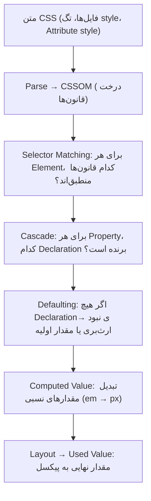
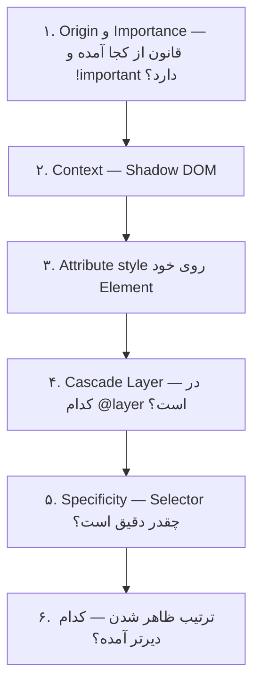

## CSS چیست و چرا لازمش داریم؟

HTML فقط **ساختار و معنا** را مشخص می‌کند: «این یک عنوان است»، «این یک دکمه است». اینکه عنوان چه رنگی باشد، دکمه کجای صفحه قرار بگیرد و روی موبایل چطور دیده شود، کار **CSS** است.

**CSS** مخفف Cascading Style Sheets (برگه‌های سبک آبشاری) است. CSS زبانی **اعلانی (Declarative)** است: شما نمی‌گویید «چطور» رسم کن (مثل «اول یک مستطیل بکش، بعد رنگش کن»)، بلکه می‌گویید نتیجه نهایی «چه» باشد («این دکمه آبی باشد با گوشه‌های گرد»). محاسبه اینکه هر پیکسل چه رنگی بگیرد کار مرورگر است.

```html live
<!-- بدون CSS: فقط ساختار -->
<button>بدون استایل</button>

<!-- با CSS: همان دکمه، ظاهر متفاوت -->
<style>
  .pretty {
    background: #2459e0;   /* رنگ پس‌زمینه */
    color: white;          /* رنگ متن */
    border: none;          /* حذف حاشیه پیش‌فرض */
    padding: 10px 20px;    /* فاصله متن از لبه‌ها */
    border-radius: 8px;    /* گوشه‌های گرد */
    font: 600 16px system-ui;
  }
</style>
<button class="pretty">با استایل</button>
```

مهم‌ترین کلمه در اسم CSS، **Cascading** (آبشاری) است. برای یک Element ممکن است ده‌ها قانون از منابع مختلف وجود داشته باشد که با هم تناقض دارند: یکی می‌گوید متن قرمز باشد، دیگری آبی. CSS یک الگوریتم دقیق دارد که تعیین می‌کند کدام برنده شود. این فصل دقیقاً درباره همین الگوریتم است، چون بیشتر باگ‌های CSS از اینجا می‌آیند: «چرا استایل من اعمال نمی‌شود؟»

## سه راه اضافه کردن CSS به صفحه

```html
<!-- ۱. فایل جداگانه (External): بهترین روش برای پروژه‌های واقعی -->
<link rel="stylesheet" href="styles.css" />

<!-- ۲. داخل صفحه (Internal) با تگ style -->
<style>
  p { color: gray; }
</style>

<!-- ۳. روی خود Element (Inline) با Attribute به اسم style -->
<p style="color: red;">این پاراگراف قرمز است</p>
```

| روش | مزیت | عیب | کی استفاده کنیم |
| --- | --- | --- | --- |
| فایل External | مرورگر آن را Cache می‌کند و بین صفحه‌ها مشترک است؛ HTML تمیز می‌ماند | یک درخواست شبکه اضافه | تقریباً همیشه |
| تگ `<style>` | بدون درخواست اضافه؛ سریع برای CSS بحرانی | Cache نمی‌شود؛ در هر صفحه تکرار می‌شود | CSS حیاتی بالای صفحه (Critical CSS) |
| Attribute `style` | قوی‌ترین اولویت در Cascade (جلوتر می‌بینیم) | قابل استفاده مجدد نیست؛ Media Query و `:hover` ندارد | مقدارهای پویا که JavaScript تنظیم می‌کند |

## آناتومی یک قانون CSS

```css
/* این یک کامنت است؛ مرورگر نادیده‌اش می‌گیرد */

.card > .title:hover {     /* ← Selector: روی کدام Elementها؟ */
  color: #2459e0;          /* ← Declaration = Property: Value; */
  font-size: 1.25rem;      /* ← Declaration دوم */
}
/* └──── Declaration Block (بین آکولادها) ────┘ */
/* کل این بلوک یک Rule (قانون) است */

@media (min-width: 768px) {  /* ← At-rule: دستور ویژه با @ */
  .card { padding: 2rem; }
}
```

هر بخش را دقیق بشناسید چون در ادامه همین اسم‌ها را زیاد می‌شنوید:

- **Rule** (قانون): یک Selector به‌علاوه یک بلوک Declaration.
- **Selector** (انتخابگر): مشخص می‌کند قانون روی **کدام Elementها** اعمال شود. `.card` یعنی «هر Element با کلاس card». همه انواع Selector در فصل [Selectorها](/css/selectors) آمده است.
- **Declaration** (اعلان): یک جفت `property: value` که با `;` تمام می‌شود.
- **Property** (ویژگی): چیزی که می‌خواهید تنظیم کنید، مثل `color`، `margin` یا `width`.
- **Value** (مقدار): مقداری که می‌دهید، مثل `red`، `1rem` یا `calc(100% - 2rem)`.
- **At-rule**: دستورهای ویژه که با `@` شروع می‌شوند و رفتار کلی‌تری دارند: `@media` (شرط اندازه صفحه)، `@supports` (شرط پشتیبانی مرورگر)، `@layer` (لایه‌بندی)، `@container`، `@font-face` (تعریف فونت)، `@keyframes` (انیمیشن)، `@import` (وارد کردن فایل دیگر).

### وقتی مرورگر چیزی را نمی‌فهمد

CSS طوری طراحی شده که خطا کل صفحه را خراب نکند. ولی دو قاعده متفاوت دارد که باید بدانید:

```css
.box {
  color: red;
  colr: blue;         /* Property غلط → فقط همین یک خط نادیده گرفته می‌شود */
  width: 100pixels;   /* Value غلط → فقط همین یک خط نادیده گرفته می‌شود */
  padding: 10px;      /* این‌ها همچنان اعمال می‌شوند */
}

/* یک Selector نامعتبر در فهرست → کل Rule حذف می‌شود! */
.button, .link:unknown-thing {
  color: green;       /* هیچ‌کدام سبز نمی‌شوند، حتی .button */
}

/* :is() و :where() بخشنده (Forgiving) هستند: Selector نامعتبر را فقط کنار می‌گذارند */
:is(.button, .link:unknown-thing) {
  color: green;       /* .button سبز می‌شود */
}
```

همین رفتار پایه یک تکنیک مهم است: می‌توانید برای ویژگی جدید یک مقدار پشتیبان (Fallback) بنویسید. مرورگر قدیمی خط دوم را نمی‌فهمد و خط اول را نگه می‌دارد؛ مرورگر جدید خط دوم را هم می‌فهمد و چون دیرتر آمده برنده می‌شود.

```css
.hero {
  height: 100vh;   /* برای همه مرورگرها */
  height: 100dvh;  /* مرورگرهای جدید این را می‌فهمند و جایگزین می‌کنند */
}
```

## مرورگر با CSS چه کار می‌کند؟

قبل از اینکه به Cascade برسیم، باید ببینیم مرورگر از متن CSS تا پیکسل روی صفحه چه مسیری را طی می‌کند:



<Steps>
<Step title="Parse و ساختن CSSOM">
مرورگر متن همه Stylesheetها را می‌خواند و یک ساختار داده به اسم **CSSOM** (CSS Object Model) می‌سازد؛ مشابه DOM ولی برای قانون‌های CSS. JavaScript هم از طریق `document.styleSheets` به آن دسترسی دارد.
</Step>
<Step title="Selector Matching">
برای هر Element در DOM، مرورگر بررسی می‌کند کدام Selectorها با آن منطبق‌اند. یک نکته جالب: این تطبیق **از راست به چپ** انجام می‌شود. برای `.sidebar ul li a` مرورگر اول هر `a` را پیدا می‌کند و بعد بالا می‌رود تا ببیند داخل `li` و `ul` و `.sidebar` هست یا نه. این‌طوری خیلی سریع Elementهای نامربوط را کنار می‌گذارد.
</Step>
<Step title="Cascade">
حالا برای هر Property هر Element ممکن است چند Declaration متضاد وجود داشته باشد. الگوریتم Cascade دقیقاً **یکی** را انتخاب می‌کند. (بخش بعد.)
</Step>
<Step title="Defaulting">
اگر برای یک Property هیچ Declarationی وجود نداشت، مقدار یا از والد **ارث** می‌رسد (برای Propertyهای ارثی مثل `color`) یا **مقدار اولیه** (Initial Value) آن Property استفاده می‌شود.
</Step>
<Step title="محاسبه مقدار نهایی">
مقدار انتخاب‌شده چند مرحله تبدیل می‌شود تا به پیکسل برسد. مثلاً `2em` به `32px` تبدیل می‌شود و `width: 50%` بعد از Layout به عدد واقعی پیکسل. (جدول پایین.)
</Step>
</Steps>

### مراحل یک مقدار: از Declared تا Actual

اصطلاحات زیر را در مستندات و گاهی در مصاحبه می‌شنوید. ستون آخر دنبال می‌کند `width: 50%` در یک والد ۸۰۰ پیکسلی چه می‌شود:

| مرحله | یعنی چه | مثال |
| --- | --- | --- |
| **Declared Value** | همه Declarationهایی که برای این Property منطبق بودند | `50%` و `300px` |
| **Cascaded Value** | برنده Cascade | `50%` |
| **Specified Value** | Cascaded Value، یا اگر نبود: مقدار ارثی یا اولیه | `50%` |
| **Computed Value** | مقدارهای نسبی تا جایی که بدون Layout ممکن است حل می‌شوند (`em` به px) | `50%` (درصد عرض بدون Layout قابل حل نیست) |
| **Used Value** | بعد از Layout، همه چیز به عدد مطلق تبدیل شده | `400px` |
| **Actual Value** | بعد از گرد کردن به پیکسل‌های واقعی صفحه | `400px` |

`getComputedStyle(element)` در JavaScript با وجود اسمش، برای Propertyهایی مثل `width` در واقع **Used Value** (به اسم دقیق‌تر Resolved Value) را برمی‌گرداند، یعنی عدد پیکسلی.

## Cascade: الگوریتم انتخاب برنده

فرض کنید برای یک پاراگراف، مرورگر این‌ها را پیدا کرده است:

```css
/* از Stylesheet پیش‌فرض مرورگر */
p { color: black; }

/* از فایل شما */
p { color: gray; }
.intro { color: blue; }
```

متن چه رنگی می‌شود؟ Cascade به سؤال‌های زیر **به ترتیب** جواب می‌دهد و به محض اینکه یکی از معیارها برنده را مشخص کرد، بقیه را بررسی نمی‌کند:



در مثال بالا: قانون مرورگر در معیار ۱ می‌بازد (Origin ضعیف‌تری دارد). بین دو قانون شما، معیار ۵ تصمیم می‌گیرد: `.intro` دقیق‌تر از `p` است. پس متن **آبی** می‌شود. حالا هر معیار را جداگانه بررسی می‌کنیم.

### معیار ۱: Origin و Importance

هر Declaration از یکی از سه **Origin** (منبع) می‌آید:

- **User Agent**: Stylesheet پیش‌فرض خود مرورگر. به همین دلیل `h1` بدون هیچ CSS درشت است و لینک‌ها آبی و زیرخط‌دار.
- **User**: تنظیمات کاربر؛ مثلاً کسی که در تنظیمات مرورگر حداقل اندازه فونت را بزرگ کرده یا یک Extension استایل اضافه می‌کند.
- **Author**: کدی که شما (نویسنده صفحه) می‌نویسید.

`!important` بعد از یک مقدار، آن Declaration را به یک لایه «مهم» منتقل می‌کند. ترتیب کامل اولویت، از قوی‌ترین به ضعیف‌ترین:

| اولویت | منبع |
| --- | --- |
| ۱ (قوی‌ترین) | Transitionهای در حال اجرا |
| ۲ | `!important` مرورگر (User Agent) |
| ۳ | `!important` کاربر (User) |
| ۴ | `!important` شما (Author) |
| ۵ | Animationها (`@keyframes`) |
| ۶ | Declarationهای معمولی شما |
| ۷ | Declarationهای معمولی کاربر |
| ۸ (ضعیف‌ترین) | Declarationهای معمولی مرورگر |

دقت کنید: **`!important` ترتیب Originها را برعکس می‌کند.** در حالت عادی کد شما بر تنظیمات کاربر برنده است، ولی `!important` کاربر بر `!important` شما برنده است. دلیلش Accessibility است: کاربری که دید ضعیفی دارد باید بتواند فونت بزرگ را به هر سایتی تحمیل کند، هر کاری که سایت کرده باشد.

### معیار ۳: Attribute `style`

Declarationهایی که مستقیم در Attribute `style` نوشته شده‌اند از **همه** Selectorها، هر چقدر هم دقیق، قوی‌ترند (به شرطی که پای `!important` در میان نباشد).

```html live
<style>
  #title.big.red { color: green; } /* Selector خیلی دقیق */
</style>
<h2 id="title" class="big red" style="color: crimson">style برنده است</h2>
```

### معیار ۴: Cascade Layers

در پروژه‌های بزرگ، CSS از چند منبع می‌آید: Reset، کتابخانه UI، Componentهای شما و کلاس‌های Utility. بدون Layer، برنده بر اساس Specificity مشخص می‌شود و یک Selector دقیق در کتابخانه ممکن است Utility ساده شما را شکست دهد. **`@layer`** به شما اجازه می‌دهد ترتیب اولویت گروه‌ها را صریح تعیین کنید، **مستقل از Specificity**:

```css
/* ۱. ترتیب Layerها را یک بار اعلام می‌کنیم: هر چه دیرتر، قوی‌تر */
@layer reset, base, components, utilities;

/* ۲. قانون‌ها را داخل Layerها می‌گذاریم */
@layer components {
  #main .card .title { color: blue; }  /* Specificity بالا: (1,2,0) */
}

@layer utilities {
  .text-red { color: red; }            /* Specificity پایین: (0,1,0) ولی برنده! */
}
```

```html live
<style>
  @layer components, utilities;
  @layer components { #main .card .title { color: blue; } }
  @layer utilities { .text-red { color: red; } }
</style>
<div id="main"><div class="card"><h3 class="title text-red" style="font: 700 22px system-ui">لایه utilities برنده است</h3></div></div>
```

سه قاعده درباره Layerها:

1. Layerی که **دیرتر** اعلام شده قوی‌تر است، هر چقدر هم Specificity قانون‌های Layer قبلی بالا باشد.
2. CSSی که در **هیچ Layerی نیست** از همه Layerها قوی‌تر است.
3. برای `!important` ترتیب **برعکس** می‌شود: `!important` در Layer اول از `!important` در Layer آخر قوی‌تر است (همان منطق برعکس شدن Originها).

Tailwind v4 دقیقاً از همین مکانیزم برای جدا کردن `base`، `components` و `utilities` استفاده می‌کند. کتابخانه ثالث را هم می‌توانید مستقیم داخل یک Layer وارد کنید: `@import url(lib.css) layer(vendor);`

### معیار ۵: Specificity

**Specificity** (دقیق بودن Selector) نشان می‌دهد یک Selector چقدر «هدفمند» است. منطقش این است: قانونی که دقیق‌تر یک Element را نشانه گرفته احتمالاً عمدی‌تر نوشته شده است. Specificity به‌صورت سه عدد `(A, B, C)` نوشته می‌شود:

| ستون | چه چیزی شمرده می‌شود | مثال |
| --- | --- | --- |
| **A** | ID Selectorها | `#header` |
| **B** | Classها، Attribute Selectorها و Pseudo-classها | `.btn`، `[type="text"]`، `:hover` |
| **C** | Type Selectorها (اسم تگ) و Pseudo-elementها | `div`، `::before` |

**نحوه مقایسه:** ستون به ستون از چپ. اول A را مقایسه کنید؛ هر کس A بیشتری دارد برنده است و کار تمام است. اگر برابر بود B را مقایسه کنید، و بعد C. یعنی یک ID از **هر تعداد** Class قوی‌تر است: `(1,0,0)` از `(0,99,0)` قوی‌تر است. این‌ها عدد ده‌دهی نیستند که جمع شوند.

بیایید Specificity سلکتور `#nav .item:hover > a::before` را قدم به قدم حساب کنیم:

<Steps>
<Step title="Selector را به تکه‌هایش بشکنید">
`#nav` · `.item` · `:hover` · `>` · `a` · `::before`
</Step>
<Step title="هر تکه را در ستون خودش بشمارید">
`#nav` یک ID است → A = 1. `.item` (Class) و `:hover` (Pseudo-class) → B = 2. `a` (تگ) و `::before` (Pseudo-element) → C = 2.
</Step>
<Step title="چیزهای بی‌وزن را کنار بگذارید">
Combinator `>` هیچ وزنی ندارد. همین‌طور فاصله، `+`، `~` و `*`.
</Step>
<Step title="نتیجه">
Specificity برابر **(1, 2, 2)** است.
</Step>
</Steps>

جدول نمونه‌ها برای تمرین:

| Selector | Specificity | چرا |
| --- | --- | --- |
| `*` | (0,0,0) | Universal Selector وزن ندارد |
| `li` | (0,0,1) | یک تگ |
| `ul li` | (0,0,2) | دو تگ؛ فاصله وزن ندارد |
| `.nav li` | (0,1,1) | یک Class و یک تگ |
| `a:hover` | (0,1,1) | Pseudo-class هم‌وزن Class است |
| `input[type="email"]` | (0,1,1) | Attribute Selector هم‌وزن Class است |
| `li::before` | (0,0,2) | Pseudo-element هم‌وزن تگ است |
| `#main .card` | (1,1,0) | یک ID و یک Class |
| `#main #side` | (2,0,0) | دو ID |
| `:not(.a, #b)` | (1,0,0) | `:not()` وزن **قوی‌ترین** آرگومانش را می‌گیرد |
| `:is(.a, #b) p` | (1,0,1) | `:is()` هم وزن قوی‌ترین آرگومان + یک تگ |
| `:where(#b) p` | (0,0,1) | `:where()` **همیشه صفر** است؛ فقط `p` شمرده می‌شود |

قواعد ویژه:

- `*`، Combinatorها (`>`، `+`، `~`، فاصله) و `:where()` هیچ وزنی ندارند.
- `:is()`، `:not()` و `:has()` خودشان وزنی ندارند ولی وزن **قوی‌ترین** Selector داخلشان را می‌گیرند.
- `:nth-child(2 of .x)` وزن یک Pseudo-class به‌علاوه قوی‌ترین Selector داخل `of` را دارد.

<Callout type="tip">
`:where()` ابزار عالی برای نوشتن استایل پایه است که بعداً راحت Override شود. مثلاً `:where(.card) h2 { … }` فقط وزن `(0,0,1)` دارد و هر کلاس ساده‌ای می‌تواند آن را تغییر دهد.
</Callout>

### معیار ۶: ترتیب ظاهر شدن

اگر همه معیارهای قبلی برابر بودند، Declarationی که **دیرتر** در کد آمده برنده است. «دیرتر» یعنی ترتیب در CSS نهایی: پایین‌تر در یک فایل، یا در فایلی که دیرتر Link شده است.

```html live
<style>
  .warning { color: orange; }
  .error   { color: crimson; }  /* هم‌وزن، ولی دیرتر → برنده */
</style>
<!-- ترتیب کلاس‌ها در HTML هیچ اهمیتی ندارد -->
<p class="error warning" style="font: 600 18px system-ui">قرمز می‌شود</p>
<p class="warning error" style="font: 600 18px system-ui">این هم قرمز می‌شود</p>
```

<Callout type="mistake">
ترتیب کلاس‌ها در Attribute `class` (یعنی `class="a b"` در برابر `class="b a"`) **هیچ** اثری روی اولویت ندارد. فقط ترتیب قانون‌ها در CSS مهم است.
</Callout>

### تمرین: همه معیارها با هم

متن پاراگراف زیر چه رنگی می‌شود؟ قبل از دیدن جواب فکر کنید.

```css
/* HTML: <p id="intro" class="lead text">Hello</p> */
#intro      { color: red; }               /* (1,0,0) */
p.lead.text { color: blue; }              /* (0,2,1) */
.lead       { color: orange !important; } /* (0,1,0) + important */
p           { color: green !important; }  /* (0,0,1) + important */
```

<Callout type="interview" title="جواب: نارنجی (orange)">
**معیار ۱** اول بررسی می‌شود: دو Declaration آخر `!important` دارند، پس به لایه «مهم» می‌روند و red و blue با وجود Specificity بالاترشان همین‌جا حذف می‌شوند. حالا بین دو Declaration مهم مسابقه ادامه دارد و به **معیار ۵** می‌رسیم: `.lead` با `(0,1,0)` از `p` با `(0,0,1)` قوی‌تر است. تله رایج این است که فکر کنید «آخرین `!important` برنده است»؛ ترتیب فقط وقتی مهم است که Specificity هم برابر باشد.
</Callout>

همین را زنده امتحان کنید. Declarationها را حذف یا جابه‌جا کنید و ببینید رنگ چطور عوض می‌شود:

```html live
<style>
  #intro      { color: red; }
  p.lead.text { color: blue; }
  .lead       { color: orange !important; }
  p           { color: green !important; }
</style>
<p id="intro" class="lead text" style="font: 700 28px system-ui">Hello</p>
```

## Inheritance (ارث‌بری)

اگر روی `body` بنویسید `color: navy`، همه متن‌های صفحه سرمه‌ای می‌شوند، با اینکه هیچ قانونی مستقیم برای `p` یا `li` ننوشته‌اید. دلیلش **Inheritance** است: وقتی برای یک Property هیچ Declarationی روی Element وجود ندارد، بعضی Propertyها مقدار والد را می‌گیرند.

ولی همه Propertyها ارثی نیستند. قاعده سرانگشتی: **Propertyهای مربوط به متن ارث می‌رسند، Propertyهای مربوط به جعبه و چیدمان نه.**

| ارث می‌رسند (عمدتاً متنی) | ارث نمی‌رسند (جعبه و چیدمان) |
| --- | --- |
| `color`، `font-*`، `line-height`، `letter-spacing`، `text-align`، `direction`، `visibility`، `cursor`، `list-style`، `white-space`، Custom Propertyها (`--x`) | `margin`، `padding`، `border`، `width`، `height`، `background`، `display`، `position`، `overflow`، `opacity`، `transform` |

منطقش ساده است: اگر `border` ارث می‌رسید، یک border روی `body` باعث می‌شد **همه** Elementهای صفحه border بگیرند.

```html live
<style>
  .parent { color: #2459e0; border: 2px solid #2459e0; padding: 12px; font-family: Georgia, serif; }
  .child { margin-top: 8px; }
  .child-2 { border: inherit; padding: 6px; } /* اجبار به ارث‌بری */
</style>
<div class="parent">
  والد: رنگ، فونت و border دارد
  <div class="child">فرزند: رنگ و فونت را ارث برده، ولی border را نه</div>
  <div class="child child-2">فرزند با border: inherit</div>
</div>
```

### ارث‌بری روی Computed Value انجام می‌شود

این نکته کوچک باگ معروفی می‌سازد. فرزند **مقدار محاسبه‌شده** والد را می‌گیرد، نه متنی که نوشته‌اید. مثال کلاسیکش `line-height` است:

```css
/* ✗ با واحد em */
.parent { font-size: 20px; line-height: 1.5em; }  /* در والد محاسبه می‌شود: 30px */
.child  { font-size: 40px; }                      /* فرزند 30px ارث می‌برد → متن روی هم می‌افتد */

/* ✓ عدد بدون واحد */
.parent { font-size: 20px; line-height: 1.5; }    /* خود «1.5» ارث می‌رسد */
.child  { font-size: 40px; }                      /* در فرزند: 1.5 × 40 = 60px ✓ */
```

```html live
<style>
  .box { width: 260px; background: #eef2fd; margin-bottom: 10px; padding: 6px; }
  .em   { font-size: 14px; line-height: 1.5em; }
  .unit { font-size: 14px; line-height: 1.5; }
  .big  { font-size: 28px; }
</style>
<div class="box em"><span class="big">line-height: 1.5em — خطوط این متن بزرگ روی هم می‌افتند</span></div>
<div class="box unit"><span class="big">line-height: 1.5 — فاصله خطوط درست است</span></div>
```

به همین دلیل همیشه `line-height` را **بدون واحد** بنویسید. `150%` هم مثل `1.5em` رفتار می‌کند چون در والد به پیکسل تبدیل می‌شود.

## Global Keywords: پنج مقدار که هر Propertyای می‌پذیرد

این کلمه‌ها برای **همه** Propertyها معتبرند و به شما کنترل دستی روی Defaulting می‌دهند:

| Keyword | رفتار |
| --- | --- |
| `inherit` | مقدار محاسبه‌شده والد را بگیر، حتی برای Propertyهای غیرارثی مثل `border` |
| `initial` | مقدار اولیه‌ای را بگیر که **در مشخصات CSS** تعریف شده (نه مقدار پیش‌فرض مرورگر!) |
| `unset` | اگر Property ارثی است مثل `inherit` رفتار کن، وگرنه مثل `initial` |
| `revert` | به مقداری برگرد که اگر شما هیچ CSSی ننوشته بودید اعمال می‌شد؛ یعنی استایل مرورگر یا کاربر |
| `revert-layer` | قانون‌های Layer فعلی را نادیده بگیر و به مقدار Layer قبلی برگرد |

**تله مهم:** `display: initial` روی یک `div` آن را **inline** می‌کند! چرا؟ چون مقدار اولیه `display` در مشخصات CSS برابر `inline` است. اینکه `div` به‌صورت block نمایش داده می‌شود از Stylesheet مرورگر می‌آید، نه از مشخصات. اگر می‌خواهید به رفتار پیش‌فرض مرورگر برگردید، `revert` بنویسید.

```html live
<style>
  div { background: #e9edfc; margin: 4px 0; padding: 6px; }
  .initial { display: initial; }   /* → inline! */
  .revert  { display: revert; }    /* → block (از Stylesheet مرورگر) */
</style>
<div class="initial">display: initial</div>
<div class="initial">display: initial</div>
<div class="revert">display: revert</div>
```

Property مخصوص **`all`** همه Propertyها را یکجا بازنشانی می‌کند. مثلاً در یک Design System برای ساختن دکمه از صفر:

```css
.my-button {
  all: unset;          /* همه استایل‌های پیش‌فرض دکمه پاک می‌شوند */
  cursor: pointer;     /* حالا فقط چیزهایی را که می‌خواهیم اضافه می‌کنیم */
  padding: 8px 16px;
}
```

## `!important`: کی بله، کی نه

همان‌طور که دیدید `!important` یک Declaration را به لایه «مهم» می‌برد و تقریباً همه چیز را شکست می‌دهد. مشکل اینجاست که تنها راه Override کردنش، یک `!important` دیگر با Specificity بالاتر است. نتیجه یک مسابقه تسلیحاتی است که در آن هر کس `!important` قوی‌تری بنویسد برنده است و CSS غیرقابل نگهداری می‌شود.

**کجا قابل قبول است:**

- کلاس‌های Utility که باید **همیشه** اعمال شوند: `.hidden { display: none !important; }`
- Override کردن استایل Inline یک کتابخانه ثالث که به کدش دسترسی ندارید.
- استایل‌های Accessibility که کاربر تعریف می‌کند.

**جایگزین‌های بهتر:** برای کنترل اولویت از `@layer` استفاده کنید، و برای استایل پایه‌ای که باید راحت Override شود از `:where()`.

## اشتباهات رایج

<Callout type="mistake">
**حل همه مشکل‌های اولویت با `!important` یا ID.** هر بار که Specificity را بالا می‌برید، دفعه بعد باید بالاتر ببرید. اول بفهمید کدام معیار Cascade برنده را مشخص کرده (DevTools در تب Styles، Declarationهای بازنده را خط‌خورده نشان می‌دهد) و بعد مشکل را در همان سطح حل کنید.
</Callout>

<Callout type="mistake">
**`line-height` با واحد `em`، `%` یا `px` روی والدها.** فرزندانی با فونت بزرگ‌تر خطوط فشرده و روی هم پیدا می‌کنند. عدد بدون واحد بنویسید.
</Callout>

<Callout type="mistake">
**استفاده از `initial` به خیال «مقدار پیش‌فرض مرورگر».** `initial` مقدار مشخصات CSS است. برای برگشت به استایل مرورگر از `revert` استفاده کنید.
</Callout>

<Callout type="mistake">
**Selectorهای عمیق و شکننده** مثل `.page .content .sidebar ul li a`. با کوچک‌ترین تغییر در HTML خراب می‌شوند و Specificity بالایی دارند که Override را سخت می‌کند. یک کلاس مستقیم مثل `.sidebar-link` بهتر است.
</Callout>

## سوالات مصاحبه

<QA q="Cascade چیست؟ معیارهایش را به ترتیب بگویید." level="mid" n={1}>
<Answer>

Cascade الگوریتمی است که از بین Declarationهای متضاد برای یک Property، دقیقاً یکی را انتخاب می‌کند. معیارها به ترتیب: **Origin و Importance** ← **Context** (Shadow DOM) ← **Attribute style** ← **Cascade Layer** ← **Specificity** ← **ترتیب ظاهر شدن در کد**. اولین معیاری که برنده را مشخص کند، تصمیم نهایی است.

</Answer>
<Deep>

`!important` ترتیب Originها را برعکس می‌کند: `!important` مرورگر و کاربر از `!important` شما قوی‌ترند. در Layerها هم برعکس می‌شود: `!important` در Layer اول قوی‌تر از Layer آخر است. Animationها از استایل معمولی قوی‌ترند و Transitionها از همه.

</Deep>
<Mistake>

گفتن اینکه Specificity اولین معیار است. Origin، Importance و Layerها قبل از Specificity بررسی می‌شوند.

</Mistake>
<FollowUp>

چطور یک کتابخانه ثالث را طوری وارد می‌کنید که استایل‌های شما همیشه برنده باشند؟ (`@import url(lib.css) layer(vendor);` و تعریف Layerهای خودتان بعد از آن، یا نوشتن استایل‌هایتان بیرون از هر Layer.)

</FollowUp>
</QA>

<QA q="Specificity سلکتور `#nav .item:hover > a::before` چند است؟" level="mid" n={2}>
<Answer>

**(1, 2, 2)**: یک ID (`#nav`)؛ یک Class و یک Pseudo-class (`.item` و `:hover`)؛ یک تگ و یک Pseudo-element (`a` و `::before`). Combinator `>` وزنی ندارد.

</Answer>
<Deep>

مقایسه ستونی است و «رقم نقلی» ندارد: ۱۱ Class هرگز یک ID را شکست نمی‌دهد. `:where()` وزن را صفر می‌کند و برای استایل پایه‌ای که باید راحت Override شود (مثل Reset) ایده‌آل است.

</Deep>
<Mistake>

جمع کردن به شکل عدد ده‌دهی (مثلاً «۱۰۰ + ۲۰ + ۲ = ۱۲۲») و نتیجه گرفتن اینکه ۱۳ Class یک ID را شکست می‌دهد.

</Mistake>
<FollowUp>

Specificity سلکتورهای `:is(#a, .b) span` و `:where(#a) span` را مقایسه کنید. (اولی (1,0,1) و دومی (0,0,1).)

</FollowUp>
</QA>

<QA q="تفاوت `initial`، `inherit`، `unset` و `revert` چیست؟" level="senior" n={3}>
<Answer>

`inherit` مقدار والد را می‌گیرد. `initial` مقدار اولیه مشخصات CSS را. `unset` برای Propertyهای ارثی مثل `inherit` و برای بقیه مثل `initial` رفتار می‌کند. `revert` به استایل مرورگر یا کاربر برمی‌گردد، انگار شما هیچ CSSی ننوشته‌اید.

</Answer>
<Deep>

`display: initial` روی `div` نتیجه‌اش `inline` است، چون مقدار اولیه در مشخصات `inline` است. برای برگرداندن رفتار پیش‌فرض مرورگر باید `revert` بنویسید. `all: revert` برای ساختن یک Component «بی‌طرف» در محیطی با استایل ناشناخته (مثل Widgetی که در سایت‌های دیگر Embed می‌شود) مفید است.

</Deep>
<Mistake>

استفاده از `initial` برای «برگرداندن به حالت پیش‌فرض» و تعجب از اینکه `div`ها inline می‌شوند.

</Mistake>
<FollowUp>

`revert-layer` چه کاربردی دارد؟ (در یک Layer، قانون‌های همان Layer را برای یک Property نادیده می‌گیرد و مقدار Layer قبلی را برمی‌گرداند؛ مثلاً برای اینکه یک Variant در Component، استایل پایه را دست‌نخورده بگذارد.)

</FollowUp>
</QA>

<QA q="چرا `line-height` را بدون واحد می‌نویسیم؟" level="mid" n={4}>
<Answer>

چون ارث‌بری روی Computed Value انجام می‌شود. با `1.5em`، والد یک عدد پیکسلی ثابت حساب می‌کند و همان عدد به فرزند می‌رسد؛ فرزندی با فونت بزرگ‌تر خطوط فشرده و روی هم پیدا می‌کند. عدد بدون واحد به‌عنوان «ضریب» ارث می‌رسد و در هر Element بر اساس `font-size` خودش محاسبه می‌شود.

</Answer>
<Deep>

این یکی از معدود جاهایی است که Computed Value یک عدد بدون واحد باقی می‌ماند. Custom Propertyها هم شبیه‌اند: `--space: 1em` به‌صورت متن خام ارث می‌رسد و در هر Elementی که استفاده شود جداگانه حل می‌شود.

</Deep>
<Mistake>

فکر کردن اینکه `1.5`، `150%` و `1.5em` معادل‌اند. درصد و em هر دو در والد به پیکسل تبدیل می‌شوند.

</Mistake>
</QA>

## جمع‌بندی

<Recap>

- CSS زبانی اعلانی است: شما نتیجه را توصیف می‌کنید و مرورگر محاسبه می‌کند.
- هر Rule یک Selector و یک بلوک Declaration است؛ هر Declaration یک `property: value`.
- Declaration نامعتبر فقط خودش حذف می‌شود؛ Selector نامعتبر در فهرست، کل Rule را حذف می‌کند (به‌جز داخل `:is()` و `:where()`).
- Cascade به ترتیب بررسی می‌کند: Origin و Importance، Context، Attribute style، Layer، Specificity و در آخر ترتیب در کد.
- `!important` ترتیب Originها و Layerها را برعکس می‌کند.
- Specificity سه ستون (ID، Class، تگ) دارد و ستون به ستون مقایسه می‌شود؛ یک ID از هر تعداد Class قوی‌تر است.
- `:where()` وزن صفر دارد؛ `:is()`، `:not()` و `:has()` وزن قوی‌ترین آرگومانشان را می‌گیرند.
- Propertyهای متنی ارث می‌رسند و Propertyهای جعبه نه؛ ارث‌بری روی Computed Value انجام می‌شود، پس `line-height` را بدون واحد بنویسید.
- `initial` مقدار مشخصات CSS است (`display: initial` یعنی inline)؛ برای برگشت به استایل مرورگر `revert` بنویسید.

</Recap>
