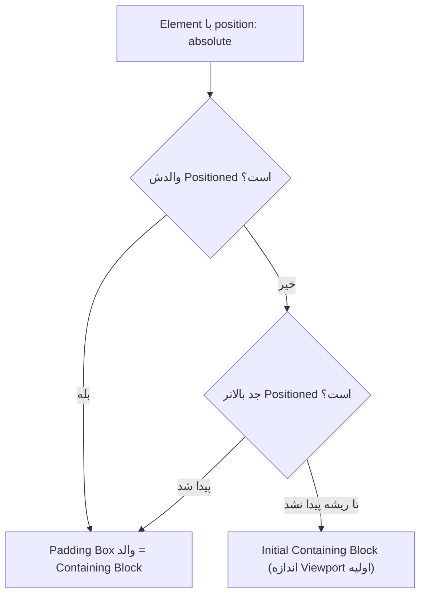
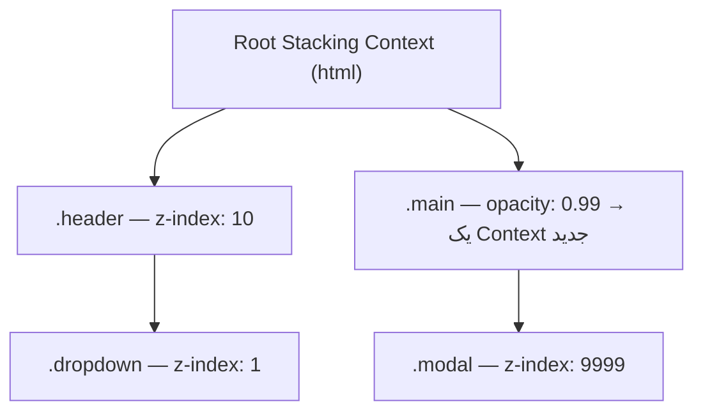

## اول: Normal Flow چیست؟

قبل از اینکه سراغ `position` برویم، باید بدانیم Elementها **بدون** آن کجا قرار می‌گیرند. مرورگر به‌صورت پیش‌فرض Elementها را به ترتیب HTML می‌چیند: Blockها زیر هم، و Inlineها کنار هم در خط (فصل [Box Model](/css/box-model-display)). به این چیدمان طبیعی **Normal Flow** (جریان عادی سند) می‌گویند.

در Normal Flow هر Element **جا می‌گیرد** و بقیه به احترامش کنار می‌روند: اگر پاراگرافی بلندتر شود، همه چیزهای زیرش پایین‌تر می‌روند.

اما گاهی می‌خواهیم Elementی را از این نظم خارج کنیم:

- یک Badge کوچک که گوشه یک کارت بنشیند.
- یک Header که موقع اسکرول بالای صفحه بماند.
- یک Modal که روی همه چیز باز شود.
- یک Tooltip که کنار دکمه ظاهر شود بدون اینکه بقیه صفحه را جابه‌جا کند.

Property **`position`** دقیقاً برای همین است. دو چیز را تعیین می‌کند:

1. Element در Normal Flow **جا بگیرد** یا از آن **خارج شود**.
2. Propertyهای جابه‌جایی (`top`، `right`، `bottom`، `left`) **نسبت به چه چیزی** حساب شوند.

## Propertyهای جابه‌جایی: `top`، `right`، `bottom`، `left` و `inset`

این چهار Property فاصله Element را از **لبه‌های مرجعش** تعیین می‌کنند. مرجع به مقدار `position` بستگی دارد (هر بخش می‌گوید). یک نکته که اول گیج‌کننده است: `top: 20px` یعنی «لبه بالای Element، ۲۰ پیکسل **پایین‌تر** از لبه بالای مرجع»؛ یعنی Element را به سمت **پایین** می‌برد، نه بالا.

```css
.a { top: 20px; }     /* ۲۰px از بالای مرجع → به پایین می‌رود */
.b { left: -10px; }   /* مقدار منفی هم مجاز است → ۱۰px بیرون از لبه چپ */
.c { bottom: 0; right: 0; } /* چسبیده به گوشه پایین-راست مرجع */
```

**`inset`** خلاصه هر چهار تا است و مثل `margin` با ۱ تا ۴ مقدار کار می‌کند:

```css
.overlay { inset: 0; }            /* = top: 0; right: 0; bottom: 0; left: 0 */
.box     { inset: 10px 20px; }    /* بالا و پایین 10px · چپ و راست 20px */
```

برای سایت دوزبانه از نسخه‌های منطقی استفاده کنید: `inset-inline-start` (در فارسی راست، در انگلیسی چپ)، `inset-inline-end`، `inset-block-start` (بالا) و `inset-block-end` (پایین).

## پنج مقدار `position` در یک نگاه

| مقدار | در Normal Flow جا می‌گیرد؟ | جابه‌جایی نسبت به | Stacking Context می‌سازد؟ |
| --- | --- | --- | --- |
| `static` (پیش‌فرض) | بله | — (`top` و `z-index` نادیده گرفته می‌شوند) | خیر |
| `relative` | بله (جای اصلی‌اش خالی می‌ماند) | جای عادی خودش | فقط با `z-index` غیر از `auto` |
| `absolute` | **خیر** | نزدیک‌ترین جدِ Positioned | فقط با `z-index` غیر از `auto` |
| `fixed` | **خیر** | Viewport (پنجره مرورگر) | **همیشه** |
| `sticky` | بله | نزدیک‌ترین Scroll Container | **همیشه** |

«**Positioned**» یعنی Elementی که `position` آن هر چیزی **به‌جز** `static` است. این اصطلاح را زیاد می‌شنوید.

با Playground زیر همه را امتحان کنید. به‌خصوص `absolute` را با والد `static` و `relative` مقایسه کنید، و صفحه را اسکرول کنید تا `sticky` و `fixed` را ببینید:

<PositionPlayground />

حالا هر مقدار را جداگانه و دقیق بررسی می‌کنیم.

## `static`: حالت پیش‌فرض

هر Element به‌صورت پیش‌فرض `position: static` دارد: در Normal Flow می‌نشیند و `top`، `left`، … و `z-index` روی آن **هیچ اثری ندارند**. معمولاً `static` را نمی‌نویسید، مگر برای برگرداندن Elementی که قبلاً Positioned شده بود (مثلاً در یک Media Query).

## `relative`: جابه‌جایی بصری، جای اصلی محفوظ

Element **اول** در جای عادی‌اش در Normal Flow قرار می‌گیرد، **بعد** به اندازه `top`/`left`/… از همان نقطه **به‌صورت بصری** جابه‌جا می‌شود. نکته کلیدی: **جای اصلی‌اش خالی می‌ماند** و Elementهای اطراف اصلاً تکان نمی‌خورند، انگار Element هنوز سر جایش است.

```text
Normal Flow:            B با relative; top: 20px; left: 30px
┌──────┐                ┌──────┐
│  A   │                │  A   │
└──────┘                └──────┘
┌──────┐                ┌ ─ ─ ─┐   ← جای B هنوز رزرو است
│  B   │                      ┌──────┐
└──────┘                └ ─ ─ │  B   │
┌──────┐                ┌─────└──────┘
│  C   │                │  C   │   ← C حرکت نکرده
└──────┘                └──────┘
```

```html live
<style>
  .box { width: 120px; padding: 10px; margin: 6px 0; background: #e9edfc; border: 1px solid #2459e0; font: 14px system-ui; }
  .moved { position: relative; top: 20px; inset-inline-start: 40px; background: #ffd8a8; }
</style>
<div class="box">A</div>
<div class="box moved">B (relative)</div>
<div class="box">C — جابه‌جا نشد</div>
```

**کاربرد اصلی امروز:** جابه‌جا کردن Element با `relative` کم پیش می‌آید. تقریباً همیشه `position: relative` را **بدون** هیچ `top`/`left` می‌نویسیم تا آن Element **مرجع** فرزندان `absolute`اش شود (بخش بعد).

## `absolute`: کاملاً بیرون از جریان

با `absolute` اتفاق‌های زیر می‌افتد:

1. Element **کاملاً از Normal Flow خارج می‌شود**. هم‌نیاهایش طوری چیده می‌شوند که انگار وجود ندارد؛ هیچ جایی برایش رزرو نمی‌شود.
2. `top`/`left`/… نسبت به **Containing Block**اش حساب می‌شوند (پایین‌تر تعریفش می‌کنیم).
3. عرضش دیگر کل عرض را نمی‌گیرد؛ به اندازه محتوایش کوچک می‌شود (Shrink-to-fit).

```html live
<style>
  .card { position: relative; width: 240px; padding: 16px; background: #f6f7f8; border: 1px solid #ccd; border-radius: 10px; font: 14px system-ui; }
  .badge { position: absolute; top: 8px; inset-inline-end: 8px; background: crimson; color: white; padding: 2px 8px; border-radius: 99px; font-size: 12px; }
</style>
<div class="card">
  <span class="badge">جدید</span>
  کارت محصول. Badge گوشه کارت نشسته و متن را کنار نزده.
</div>
```

`.card` با `position: relative` مرجع شد، و `.badge` نسبت به گوشه آن قرار گرفت. حالا `position: relative` را از `.card` پاک کنید و ببینید Badge به گوشه کل صفحه فرار می‌کند.

### Containing Block: مرجع جابه‌جایی

**Containing Block** (بلوک دربرگیرنده) مستطیلی است که موقعیت یک Element (و درصدهای `width` و `top` آن) نسبت به آن حساب می‌شود. برای هر مقدار `position` فرق می‌کند:

| position | Containing Block |
| --- | --- |
| `static` / `relative` / `sticky` | Content Box نزدیک‌ترین جدِ Block |
| `absolute` | **Padding Box** نزدیک‌ترین جدی که Positioned باشد؛ اگر هیچ‌کدام نبود، **Initial Containing Block** (مستطیلی به اندازه Viewport در ابتدای صفحه) |
| `fixed` | Viewport — **مگر** اینکه یک جد `transform`، `perspective`، `filter`، `contain: paint`، `will-change: transform` یا `container-type` داشته باشد |

مرورگر برای پیدا کردن مرجع یک Element با `absolute` این مسیر را طی می‌کند:



**Padding Box** یعنی `top: 0` از لبه داخلی Border شروع می‌شود؛ Padding والد روی جای Element اثری ندارد.

<Callout type="mistake">
باگ کلاسیک: یک Modal با `position: fixed` داخل Elementی است که `transform` دارد (مثلاً کارتی با انیمیشن hover). حالا Modal دیگر نسبت به Viewport ثابت نیست؛ داخل همان کارت گیر می‌کند و با آن اسکرول می‌شود. راه حل: Modal را در ریشه سند رندر کنید (`createPortal` در React)، یا از `<dialog>` با `showModal()` استفاده کنید که در **Top Layer** و بیرون از همه این قواعد نمایش داده می‌شود.
</Callout>

### الگوهای پرکاربرد با `absolute`

```css
/* ۱. پر کردن کامل والد: لایه تیره روی عکس، Skeleton، … */
.overlay { position: absolute; inset: 0; }

/* ۲. وسط‌چین کلاسیک (ابعاد نامشخص) */
.center {
  position: absolute;
  top: 50%;                          /* لبه بالا به وسط والد می‌رود */
  left: 50%;                         /* لبه چپ به وسط والد می‌رود */
  transform: translate(-50%, -50%);  /* نصف اندازه خودش برمی‌گردد → دقیقاً وسط */
}

/* ۳. وسط‌چین با ابعاد مشخص */
.center-modern { position: absolute; inset: 0; margin: auto; width: 200px; height: 100px; }
```

چرا در الگوی ۲ به `transform` نیاز داریم؟ `top: 50%` لبه **بالای** Element را به وسط می‌برد، نه مرکزش را. `translate(-50%, -50%)` (درصد در `translate` نسبت به اندازه **خود Element** است) آن را به اندازه نصف عرض و ارتفاع خودش برمی‌گرداند.

## `fixed`: ثابت روی صفحه

مثل `absolute` از Flow خارج می‌شود، ولی مرجعش **Viewport** است؛ یعنی موقع اسکرول هم سر جایش روی صفحه می‌ماند. کاربردها: Header یا نوار پایین ثابت، دکمه چت، Toast، دکمه «برگشت به بالا».

```css
.chat-button { position: fixed; bottom: 20px; inset-inline-end: 20px; }
```

سه نکته که باید بدانید:

- `fixed` **همیشه** یک Stacking Context جدید می‌سازد (پایین‌تر توضیح داده می‌شود).
- در موبایل، Viewport با باز شدن کیبورد یا جمع شدن نوار آدرس تغییر اندازه می‌دهد؛ Elementهای `bottom: 0` ممکن است پشت کیبورد بروند.
- Header ثابت روی محتوا می‌افتد. باید فضایش را جبران کنید: `padding-top` روی `body`، و `scroll-padding-top` روی `html` تا وقتی روی لینک `#section` کلیک می‌شود، عنوان زیر Header پنهان نشود.

## `sticky`: معمولی تا لحظه چسبیدن

`sticky` ترکیب `relative` و `fixed` است. Element مثل یک Element عادی در Flow جا می‌گیرد، تا وقتی که با اسکرول به **آستانه**‌ای که تعیین کرده‌اید (مثلاً `top: 0`) برسد. از آن لحظه می‌چسبد و ثابت می‌ماند. ولی یک شرط مهم دارد: **فقط تا وقتی والدش روی صفحه است**. وقتی انتهای والد رسید، همراه والد بالا می‌رود.

```text
Scroll Container
┌────────────────────────┐
│ ┌─ parent ───────────┐ │
│ │ [sticky header]  ← │ │  موقع اسکرول به top: 0 می‌چسبد
│ │  ...               │ │
│ │  ...               │ │
│ │ [header با والدش   │ │  وقتی به انتهای parent برسد،
│ └─ بالا می‌رود] ─────┘ │  همراه parent از دید خارج می‌شود
└────────────────────────┘
```

```html live
<style>
  .scroller { height: 220px; overflow-y: auto; border: 1px solid #ccd; border-radius: 8px; font: 14px system-ui; }
  section { padding-bottom: 8px; }
  h4 { position: sticky; top: 0; margin: 0; padding: 8px 12px; background: #2459e0; color: white; }
  p { margin: 8px 12px; }
</style>
<div class="scroller">
  <section><h4>بخش A</h4><p>متن…</p><p>متن…</p><p>متن…</p><p>متن…</p></section>
  <section><h4>بخش B</h4><p>متن…</p><p>متن…</p><p>متن…</p><p>متن…</p></section>
  <section><h4>بخش C</h4><p>متن…</p><p>متن…</p><p>متن…</p><p>متن…</p></section>
</div>
```

داخل کادر اسکرول کنید: هر عنوان تا انتهای بخش خودش می‌چسبد و بعد عنوان بعدی جایش را می‌گیرد. این همان الگوی عنوان‌های لیست مخاطبین در گوشی است.

### چرا `sticky` من کار نمی‌کند؟ (چک‌لیست)

1. **آستانه تعریف نشده:** حداقل یکی از `top`، `bottom`، `left` یا `right` لازم است. بدون آن، `sticky` مثل `relative` رفتار می‌کند.
2. **یک جد `overflow: hidden`، `auto` یا `scroll` دارد:** آن جد Scroll Container می‌شود و Element نسبت به **آن** می‌چسبد. اگر آن جد خودش اسکرول نمی‌خورد، Sticky هیچ‌وقت فعال نمی‌شود. `overflow: clip` همان برش را بدون ساختن Scroll Container انجام می‌دهد و این مشکل را ندارد.
3. **والد هم‌قد خود Element است:** جایی برای چسبیدن نمانده. در Flexbox رایج است، چون `align-items: stretch` فرزند را هم‌قد والد می‌کند؛ با `align-self: start` حل می‌شود.
4. **Element بلندتر از Viewport است:** نمی‌تواند کامل بچسبد.

```css
/* Sidebar چسبان که خودش هم اسکرول می‌خورد */
.sidebar {
  position: sticky;
  top: 1rem;
  align-self: start;                      /* در Flex و Grid ضروری */
  max-height: calc(100dvh - 2rem);
  overflow-y: auto;
}
```

## `z-index` و Stacking Context: کی روی کی است؟

صفحه دوبعدی است، ولی Elementها می‌توانند روی هم بیفتند. پس مرورگر باید تصمیم بگیرد کدام **جلوتر** رسم شود. به این محور سوم (عمق) **محور z** می‌گویند.

### ترتیب پیش‌فرض رسم لایه‌ها

بدون هیچ `z-index`ی، مرورگر لایه‌ها را به این ترتیب، از پایین (عقب) به بالا (جلو)، رسم می‌کند:

1. پس‌زمینه و Border Elementی که ریشه این گروه است
2. فرزندان Positioned با `z-index` منفی
3. Blockهای عادی (غیر Positioned) در Flow
4. Elementهای `float`
5. محتوای Inline (متن و…)
6. فرزندان Positioned با `z-index: auto` یا `0`، به ترتیب DOM
7. فرزندان Positioned با `z-index` مثبت، از کوچک به بزرگ

دو نتیجه مهم: Element Positioned حتی بدون `z-index` روی Elementهای عادی رسم می‌شود. و بین دو Element Positioned با شرایط یکسان، **آنکه در HTML دیرتر آمده جلوتر است**.

### `z-index`

`z-index` یک عدد صحیح (می‌تواند منفی باشد) که ترتیب را عوض می‌کند: بزرگ‌تر یعنی جلوتر. فقط روی Elementهای **Positioned** و **فرزندان Flex و Grid** اثر دارد؛ روی یک Element `static` معمولی بی‌اثر است.

### Stacking Context: مهم‌ترین مفهوم این بخش

اینجا جایی است که بیشتر توسعه‌دهنده‌ها گیر می‌کنند. **Stacking Context** (بافت انباشتگی) یک **گروه بسته** از لایه‌هاست. دو قانون دارد:

1. **`z-index` فقط بین اعضای یک گروه مقایسه می‌شود.**
2. **کل گروه، به‌عنوان یک واحد، با `z-index` ریشه‌اش در گروه بالاتر قرار می‌گیرد.**

یک تشبیه: فکر کنید هر Stacking Context یک **پوشه** است. می‌توانید برگه‌های داخل پوشه را مرتب کنید (z-index داخلی)، ولی هیچ برگه‌ای نمی‌تواند از پوشه‌اش بیرون بیاید و روی پوشه دیگری قرار بگیرد. اگر پوشه A زیر پوشه B است، **همه** برگه‌های A زیر B می‌مانند، حتی اگر روی یکی بنویسید «z-index: 9999».



در این ساختار، `.modal` با `z-index: 9999` **زیر** `.header` می‌ماند! چون `.modal` داخل پوشه `.main` است، و در سطح ریشه پوشه `.main` (بدون z-index) با `.header` (با z-index 10) مقایسه می‌شود و می‌بازد.

همین را زنده ببینید:

```html live
<style>
  .card { position: relative; padding: 16px; margin: 8px; border: 1px solid #ccc; font: 14px system-ui; }
  .a { background: #e9edfc; z-index: 1; }
  .b { background: #fff3bf; z-index: 2; margin-top: -40px; margin-inline-start: 40px; }
  .tooltip { position: absolute; z-index: 999; top: 30px; background: #c92a2a; color: white; padding: 8px; }
</style>
<div class="card a">
  کارت A (z-index: 1)
  <div class="tooltip">Tooltip با z-index: 999، ولی زیر کارت B!</div>
</div>
<div class="card b">کارت B (z-index: 2)</div>
```

کارت A با `position: relative` و `z-index: 1` یک پوشه ساخته است. Tooltip داخل آن پوشه است، پس z-index 999 فقط داخل کارت A معنا دارد. حالا `z-index: 1` را از `.a` پاک کنید: کارت A دیگر پوشه نمی‌سازد و Tooltip می‌تواند با کارت B رقابت کند.

### چه چیزهایی Stacking Context می‌سازند؟

بخشی از این فهرست بدیهی است و بخشی غافلگیرکننده؛ معمولاً همان‌های غافلگیرکننده باگ می‌سازند:

- Element ریشه (`html`)
- `position: absolute` یا `relative` **با** `z-index` غیر از `auto`
- `position: fixed` یا `sticky` (همیشه)
- فرزند Flex یا Grid با `z-index` غیر از `auto`
- `opacity` کمتر از ۱ ← غافلگیرکننده
- `transform`، `filter`، `backdrop-filter`، `perspective`، `clip-path`، `mask` (هر مقداری به‌جز `none`) ← غافلگیرکننده
- `mix-blend-mode` به‌جز `normal`
- `isolation: isolate` (فقط برای همین کار ساخته شده)
- `will-change` با هر کدام از Propertyهای بالا
- `contain: layout` یا `paint`، و `container-type: size` یا `inline-size`

### چرا `z-index` من کار نمی‌کند؟

1. **Element Positioned نیست.** `z-index` روی `static` اثری ندارد (به‌جز فرزندان Flex و Grid).
2. **Element داخل پوشه‌ای است که خودش پایین‌تر قرار دارد.** مثل Tooltip بالا. باید `z-index` را روی **ریشه پوشه** تنظیم کنید، نه روی خود Element.
3. **یک جد ناخواسته پوشه ساخته است.** یک `transform` برای انیمیشن، یک `opacity: 0.99`، یک `will-change`.
4. **یک جد `overflow: hidden` دارد.** این ربطی به Stacking ندارد، ولی رایج‌ترین دلیل این است که «Dropdown من نصفه دیده می‌شود»: هر چه بیرون از آن جد باشد بریده می‌شود، z-index هر چه باشد.

<Callout type="tip">
برای Debug: Chrome DevTools پنل **Layers** و Edge پنل **3D View** را دارند که لایه‌ها و Stacking Contextها را سه‌بعدی نشان می‌دهند.
</Callout>

### راه‌حل‌های پایدار در پروژه واقعی

```css
/* ۱. یک مقیاس مستند z-index در Design System، به‌جای عددهای تصادفی */
:root {
  --z-dropdown: 100;
  --z-sticky: 200;
  --z-overlay: 300;
  --z-modal: 400;
  --z-toast: 500;
}

/* ۲. ایزوله کردن یک Component تا z-indexهای داخلش بیرون نشت نکند */
.card { isolation: isolate; }
```

3. **Portal:** Modal، Tooltip و Dropdown را در انتهای `body` رندر کنید (مثلاً `createPortal` در React) تا داخل هیچ پوشه‌ای گیر نکنند.
4. **Top Layer:** `dialog.showModal()` و Attribute `popover` Element را در لایه‌ای بالای همه چیز نمایش می‌دهند، مستقل از هر z-index و Stacking Contextی.
5. **CSS Anchor Positioning:** قرار دادن Tooltip نسبت به دکمه‌اش فقط با CSS. اول در Chromium آمد و بقیه مرورگرها در حال اضافه کردنش هستند؛ قبل از استفاده در Production جدول پشتیبانی را بررسی کنید.

## اشتباهات رایج

<Callout type="mistake">
**`position: absolute` بدون والد Positioned.** Element به گوشه کل صفحه فرار می‌کند. روی والدی که باید مرجع باشد `position: relative` بگذارید.
</Callout>

<Callout type="mistake">
**بزرگ‌تر کردن `z-index` به‌جای فهمیدن Stacking Context.** `z-index: 99999999` هم کمکی نمی‌کند اگر Element داخل پوشه‌ای باشد که پایین‌تر است.
</Callout>

<Callout type="mistake">
**`sticky` داخل جدی با `overflow: hidden`.** معمولاً یک Wrapper سراسری برای جلوگیری از اسکرول افقی؛ به‌جایش `overflow-x: clip` بنویسید.
</Callout>

<Callout type="mistake">
**انیمیشن با `top` و `left`.** هر فریم Layout دوباره می‌خواهد و انیمیشن تکه‌تکه می‌شود. برای حرکت از `transform: translate()` استفاده کنید (فصل [Performance در CSS](/css/rendering-performance)).
</Callout>

## سوالات مصاحبه

<QA q="تفاوت `relative`، `absolute`، `fixed` و `sticky` را توضیح دهید." level="junior" n={1}>
<Answer>

- `relative` در Flow جا می‌گیرد و نسبت به جای عادی خودش جابه‌جا می‌شود؛ جای اصلی‌اش خالی می‌ماند.
- `absolute` از Flow خارج می‌شود و نسبت به نزدیک‌ترین جد Positioned قرار می‌گیرد.
- `fixed` از Flow خارج می‌شود و نسبت به Viewport ثابت می‌ماند.
- `sticky` در Flow است تا به آستانه‌اش در Scroll Container برسد، بعد تا انتهای والدش می‌چسبد.

</Answer>
<Deep>

Containing Block برای `absolute`، Padding Box جد Positioned است؛ برای `fixed`، Viewport است مگر جدی `transform`، `filter` یا `contain` داشته باشد. `fixed` و `sticky` همیشه Stacking Context می‌سازند. درصد در `top` برای `absolute` نسبت به ارتفاع Containing Block است، ولی درصد در `padding` و `margin` (حتی عمودی) نسبت به **عرض** آن.

</Deep>
<Mistake>

گفتن اینکه `absolute` «نسبت به والد» قرار می‌گیرد. نسبت به نزدیک‌ترین جد **Positioned** است، نه لزوماً والد مستقیم.

</Mistake>
<FollowUp>

چرا یک Element با `position: fixed` موقع اسکرول همراه صفحه حرکت می‌کند؟ (یک جد `transform` یا `filter` دارد.)

</FollowUp>
</QA>

<QA q="Stacking Context چیست و چرا `z-index: 9999` گاهی کار نمی‌کند؟" level="mid" n={2}>
<Answer>

Stacking Context یک گروه بسته از لایه‌هاست؛ `z-index` فقط بین اعضای یک گروه مقایسه می‌شود و کل گروه با `z-index` ریشه‌اش در گروه بالاتر قرار می‌گیرد. اگر Element داخل گروهی باشد که خودش زیر Element دیگری است، هیچ z-index داخلی آن را بالا نمی‌برد. همچنین `z-index` روی Element غیر Positioned (و غیر فرزند Flex/Grid) اثری ندارد.

</Answer>
<Deep>

ساختن ناخواسته Context خیلی رایج است: `opacity`، `transform`، `filter`، `will-change`. برای Debug پنل Layers در Chrome یا 3D View در Edge کمک می‌کند. راه‌حل پایدار: مقیاس مستند z-index، `isolation: isolate` برای Componentها، و Portal یا Top Layer برای Overlayها.

</Deep>
<Mistake>

نوشتن z-indexهای بزرگ‌تر و بزرگ‌تر به‌جای پیدا کردن Context والد.

</Mistake>
<FollowUp>

`isolation: isolate` چه می‌کند و چرا برای Componentهای Design System مفید است؟ (بدون هیچ اثر بصری یک Stacking Context می‌سازد تا z-indexهای داخل Component با بقیه صفحه تداخل نکنند.)

</FollowUp>
</QA>

<QA q="چرا `position: sticky` کار نمی‌کند؟ چطور Debug می‌کنید؟" level="mid" n={3}>
<Answer>

این‌ها را بررسی می‌کنم: آستانه‌ای مثل `top` تعریف شده؟ جدی با `overflow` غیر از `visible` و `clip` هست؟ والد فضای اضافه برای اسکرول دارد یا هم‌قد Element است (مثلاً به خاطر `align-items: stretch` در Flex)؟

</Answer>
<Deep>

Sticky نسبت به نزدیک‌ترین Scroll Container حساب می‌شود. اگر یک Wrapper با `overflow-x: hidden` (معمولاً برای جلوگیری از اسکرول افقی) وجود داشته باشد، همان Wrapper Scroll Container می‌شود و چون خودش اسکرول نمی‌خورد، Sticky هیچ‌وقت فعال نمی‌شود. `overflow: clip` همان برش را بدون ساختن Scroll Container انجام می‌دهد.

</Deep>
<Mistake>

گذاشتن `overflow: hidden` روی `body` یا یک Wrapper سراسری برای حل اسکرول افقی و خراب کردن همه Stickyها.

</Mistake>
<FollowUp>

چطور تشخیص می‌دهید یک Element sticky الان «چسبیده» است؟ (IntersectionObserver روی یک Element نگهبان یا Scroll-state Container Query در CSS.)

</FollowUp>
</QA>

## جمع‌بندی

<Recap>

- Normal Flow چیدمان پیش‌فرض است؛ `position` تعیین می‌کند Element در آن بماند یا خارج شود و مرجع جابه‌جایی‌اش چیست.
- `top: 20px` یعنی ۲۰ پیکسل پایین‌تر از لبه بالای مرجع؛ `inset` خلاصه هر چهار جهت است.
- `static` پیش‌فرض است و `top` و `z-index` را نادیده می‌گیرد.
- `relative` بصری جابه‌جا می‌شود و جایش را نگه می‌دارد؛ کاربرد اصلی‌اش مرجع شدن برای فرزندان `absolute` است.
- `absolute` از Flow خارج می‌شود و نسبت به Padding Box نزدیک‌ترین جد Positioned قرار می‌گیرد.
- `fixed` نسبت به Viewport ثابت است، مگر یک جد `transform` یا `filter` داشته باشد.
- `sticky` تا رسیدن به آستانه عادی است و فقط تا انتهای والدش می‌چسبد؛ `overflow` روی اجداد رایج‌ترین دلیل خرابی آن است.
- `z-index` فقط داخل یک Stacking Context مقایسه می‌شود؛ `opacity`، `transform` و `filter` هم Context می‌سازند.
- برای Overlayها از Portal، `dialog` و `popover` (Top Layer) و `isolation: isolate` استفاده کنید.

</Recap>
