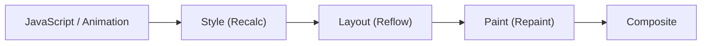

## چرا CSS روی Performance اثر دارد؟

هر تغییر بصری در صفحه — Hover، انیمیشن، اسکرول، تغییر Class با JavaScript — مرورگر را وادار می‌کند بخشی از **Rendering Pipeline** را دوباره اجرا کند. اینکه **کدام Property** را تغییر می‌دهید تعیین می‌کند کدام مراحل اجرا شوند و هزینه چقدر باشد.

برای ۶۰ فریم بر ثانیه، هر فریم حدود **16.7ms** فرصت دارد؛ و چون مرورگر خودش بخشی از آن را مصرف می‌کند، عملاً حدود **10ms** برای کد شما می‌ماند. در نمایشگرهای 120Hz این عدد نصف می‌شود.

## فریم چیست و مرورگر در هر فریم چه می‌کند؟

صفحه نمایش شما (در بیشتر دستگاه‌ها) **۶۰ بار در ثانیه** تصویر را تازه می‌کند. هر تصویر یک **فریم** است، مثل فریم‌های یک فیلم. اگر مرورگر بتواند برای هر تازه‌سازی یک فریم جدید آماده کند، حرکت روان دیده می‌شود. اگر نتواند و یک فریم را جا بیندازد، چشم شما یک «پرش» یا «لرزش» می‌بیند که به آن **Jank** می‌گویند.

۱۰۰۰ میلی‌ثانیه تقسیم بر ۶۰ فریم یعنی هر فریم حدود **۱۶.۷ میلی‌ثانیه** وقت دارد. در این زمان مرورگر باید هم کد JavaScript شما را اجرا کند و هم صفحه را دوباره رسم کند.

دو اصطلاح که در ادامه زیاد می‌بینید:

- **Main Thread** (نخ اصلی): همان یک Threadی که JavaScript شما، محاسبه استایل، Layout و Paint روی آن اجرا می‌شوند. اگر مشغول باشد، همه این کارها منتظر می‌مانند.
- **Compositor Thread**: یک Thread جداگانه که لایه‌های آماده را با کمک **GPU** (پردازنده گرافیکی) روی هم می‌گذارد و نمایش می‌دهد. حتی وقتی Main Thread مشغول است، این Thread می‌تواند کار کند.

راز انیمیشن روان در یک جمله: **کاری کنید که تغییرات فقط به Compositor Thread نیاز داشته باشند.** بقیه این فصل توضیح می‌دهد چطور.

## Pixel Pipeline



| مرحله | چه اتفاقی می‌افتد | هزینه |
| --- | --- | --- |
| **Style** | محاسبه Computed Style هر Element (Selector Matching و Cascade) | به تعداد Elementهای متأثر و پیچیدگی Selectorها بستگی دارد |
| **Layout** (Reflow) | محاسبه هندسه: موقعیت و اندازه هر جعبه | **گران**؛ تغییر یک Element می‌تواند Layout کل زیردرخت یا صفحه را نامعتبر کند |
| **Paint** (Repaint) | رسم پیکسل‌ها: متن، رنگ، Border، Shadow، تصویر، در لایه‌ها | متوسط تا گران؛ به مساحت ناحیه و پیچیدگی (Blur، Shadow بزرگ) بستگی دارد |
| **Composite** | ترکیب لایه‌های رسم‌شده به ترتیب صحیح، معمولاً روی **GPU** و در Compositor Thread | **ارزان** |

## سه مسیر ممکن

### 1. Layout → Paint → Composite (گران‌ترین)

تغییر **هندسه**: `width`، `height`، `margin`، `padding`، `top`/`left`، `font-size`، `border-width`، `display`، `position`، اضافه/حذف Element، تغییر متن.

### 2. Paint → Composite (بدون Layout)

تغییر **ظاهر بدون تغییر هندسه**: `color`، `background-color`، `box-shadow`، `border-radius`، `outline`، `visibility`، `background-image`.

### 3. فقط Composite (ارزان‌ترین)

`transform` و `opacity` (و در اغلب موارد `filter`) — به شرطی که Element در **لایه Compositor خودش** باشد. در این حالت مرورگر فقط لایه از قبل رسم‌شده را جابه‌جا، چرخش، مقیاس یا محو می‌کند؛ Main Thread اصلاً درگیر نمی‌شود.

| می‌خواهید… | به جای | استفاده کنید |
| --- | --- | --- |
| جابه‌جا کنید | `top`، `left`، `margin` | `transform: translate()` |
| بزرگ/کوچک کنید | `width`، `height` | `transform: scale()` |
| بچرخانید | — | `transform: rotate()` |
| محو کنید | `visibility`، `display` | `opacity` |
| Shadow را انیمیت کنید | `box-shadow` | `opacity` روی یک `::after` که Shadow دارد |

```css
/* بد: Layout در هر فریم */
.drawer { transition: left 300ms; left: -300px; }
.drawer.open { left: 0; }

/* خوب: فقط Composite */
.drawer { transition: transform 300ms ease-out; transform: translateX(-100%); }
.drawer.open { transform: translateX(0); }
```

<Callout type="interview">
جمله کلیدی: «در انیمیشن فقط `transform` و `opacity` را تغییر می‌دهم، چون روی Compositor Thread و GPU اجرا می‌شوند و حتی اگر Main Thread مشغول اجرای JavaScript باشد، انیمیشن روان می‌ماند.»
</Callout>

## Reflow و Repaint

- `Reflow (بازچینی)` همان Layout است: محاسبه دوباره هندسه.
- `Repaint (بازرسم)` همان Paint است: رسم دوباره پیکسل‌ها.

**هر Reflow یک Repaint به دنبال دارد، اما هر Repaint نیازمند Reflow نیست.**

## Layout Thrashing (Forced Synchronous Layout)

مرورگر تغییرات Style را جمع می‌کند و Layout را **تنبل (Lazy)** و یک‌جا قبل از فریم بعد انجام می‌دهد. اما اگر بعد از یک **نوشتن** (تغییر Style) بلافاصله یک Property هندسی را **بخوانید**، مرورگر مجبور است همان لحظه Layout را به‌صورت همزمان انجام دهد تا عدد درست را برگرداند.

Propertyهایی که Layout اجباری ایجاد می‌کنند: `offsetWidth/Height/Top/Left`، `clientWidth/Height`، `scrollTop/Height`، `getBoundingClientRect()`، `getComputedStyle()` (برای Propertyهای هندسی)، `innerText`، `focus()` و…

```js
// بد: Read و Write در هم → یک Layout برای هر آیتم (Layout Thrashing)
for (const box of boxes) {
  const width = box.offsetWidth;          // READ → Layout اجباری
  box.style.width = width * 2 + "px";     // WRITE → Layout را نامعتبر می‌کند
}

// خوب: ابتدا همه Readها، سپس همه Writeها → یک Layout
const widths = boxes.map((box) => box.offsetWidth);   // یک Layout
boxes.forEach((box, i) => {
  box.style.width = widths[i] * 2 + "px";             // بدون Layout تا فریم بعد
});
```

```text
Thrashing:   W R▓ W R▓ W R▓ W R▓   (▓ = Layout همزمان، N بار)
Batched:     R R R R▓ W W W W      (یک Layout)
```

کتابخانه‌هایی مثل `fastdom` این الگو را با صف Read/Write خودکار می‌کنند. در انیمیشن‌های JavaScript، Writeها را در `requestAnimationFrame` قرار دهید.

## Layerها و GPU Compositing

مرورگر صفحه را به چند **لایه (Layer)** تقسیم می‌کند. هر لایه جداگانه Paint و سپس روی GPU ترکیب می‌شود. برخی Elementها لایه جداگانه می‌گیرند (Promotion):

- Elementهایی که `transform` یا `opacity` آن‌ها در حال انیمیشن است
- `will-change: transform` یا `will-change: opacity`
- `video`، `canvas`، `iframe`
- `position: fixed` (در برخی شرایط)
- Elementهایی که روی یک لایه دیگر قرار می‌گیرند (Overlap — گاهی «Layer Explosion» ایجاد می‌کند)

### will-change

```css
.card:hover { will-change: transform; }  /* آماده‌سازی قبل از انیمیشن */
.menu { will-change: transform; }         /* Elementی که مدام انیمیت می‌شود */
```

**هشدار:** هر لایه **حافظه GPU** مصرف می‌کند (عرض × ارتفاع × ۴ بایت × DPR²). `will-change` روی صدها Element یا `* { will-change: transform }` حافظه را پر کرده و Performance را **بدتر** می‌کند — به‌خصوص در موبایل. همچنین `will-change: transform` Stacking Context و Containing Block برای `fixed` می‌سازد.

## CSS Containment

`contain` به مرورگر قول می‌دهد که داخل یک Element از بقیه صفحه مستقل است، تا محاسبات را محدود کند:

| مقدار | قول |
| --- | --- |
| `layout` | Layout داخلی روی بیرون اثر ندارد |
| `paint` | فرزندان بیرون از جعبه رسم نمی‌شوند (مثل `overflow: clip`) |
| `size` | اندازه به فرزندان وابسته نیست (باید صریح تعیین شود) |
| `style` | Counterها و Quoteها نشت نمی‌کنند |
| `content` | `layout paint style` |
| `strict` | `size layout paint style` |

### content-visibility

```css
.article-section {
  content-visibility: auto;
  contain-intrinsic-size: auto 800px;   /* اندازه تخمینی برای Scrollbar صحیح */
}
```

Elementهای خارج از Viewport را **رندر نمی‌کند** (Style، Layout و Paint آن‌ها Skip می‌شود) تا زمانی که نزدیک شوند. برای صفحات بلند (مثل همین هندبوک) زمان رندر اولیه را به‌شدت کاهش می‌دهد. `contain-intrinsic-size` جای خالی را رزرو می‌کند تا Scrollbar نپرد؛ `auto` یعنی پس از اولین رندر، اندازه واقعی به خاطر سپرده شود.

## Selector Performance

موتورهای مدرن Selector Matching را بسیار بهینه کرده‌اند (Bloom Filter، Invalidation Sets). در عمل:

- تعداد Elementهایی که Style آن‌ها **نامعتبر می‌شود** مهم‌تر از پیچیدگی Selector است. تغییر یک Class روی `body` می‌تواند Style کل صفحه را دوباره محاسبه کند.
- `:has()` روی Elementهای سطح بالا و Selectorهای `*` عمومی می‌توانند Invalidation را گسترده کنند.
- DOM بزرگ (بیش از ~۱۵۰۰ Node) خودش هزینه Style و Layout را بالا می‌برد.

## Paint گران

- `box-shadow` با Blur بزرگ و `filter: blur()` روی نواحی بزرگ
- `backdrop-filter` (Glassmorphism) — هر فریم پس‌زمینه را دوباره Blur می‌کند
- Gradientهای پیچیده و تمام‌صفحه در حال تغییر
- `background-attachment: fixed` — Paint در هر اسکرول

## احترام به `prefers-reduced-motion`

برای بعضی کاربران (مثلاً کسانی که اختلال دهلیزی گوش داخلی دارند) انیمیشن‌های بزرگ، Parallax و حرکت‌های سریع باعث سرگیجه و حالت تهوع می‌شود. این کاربران در تنظیمات سیستم‌عامل گزینه «کاهش حرکت» را روشن می‌کنند و CSS می‌تواند آن را بخواند:

```css
.card { transition: transform 300ms ease-out; }

@media (prefers-reduced-motion: reduce) {
  .card { transition: none; }               /* بدون حرکت */
  html { scroll-behavior: auto; }           /* اسکرول نرم هم خاموش */
}
```

قاعده خوب: حرکت‌های بزرگ (جابه‌جایی، چرخش، Zoom) را حذف یا کوتاه کنید، ولی تغییرات کوچک و معنادار مثل محو شدن (`opacity`) معمولاً مشکلی ندارند.

## اندازه‌گیری

1. **Chrome DevTools → Performance:** ضبط تعامل؛ بلوک‌های بنفش (Rendering: Style/Layout) و سبز (Paint). هشدار قرمز «Forced reflow» نشان‌دهنده Layout Thrashing است.
2. **Rendering Tab:** Paint flashing (نواحی Repaint سبز می‌شوند)، Layout Shift Regions، Layer borders.
3. **Layers Panel:** لایه‌ها، دلیل Promotion و حافظه مصرفی.
4. **Lighthouse و Web Vitals:** CLS و INP.

```js
// اندازه‌گیری Long Animation Frames (LoAF) در Field
new PerformanceObserver((list) => {
  for (const entry of list.getEntries()) {
    if (entry.duration > 50) console.log("Slow frame", entry.duration, entry.scripts);
  }
}).observe({ type: "long-animation-frame", buffered: true });
```

## اشتباهات رایج

- انیمیشن `width`، `height`، `top` یا `left`.
- Read و Write در هم در حلقه‌ها (Layout Thrashing).
- `will-change` روی همه چیز.
- `transition: all` — همه Propertyها (حتی Layout-triggering) را انیمیت می‌کند.
- انیمیشن `box-shadow` به جای `opacity` یک Pseudo-element.
- نادیده گرفتن `prefers-reduced-motion`.

## سوالات مصاحبه

<QA q="تفاوت Reflow و Repaint چیست؟ کدام Propertyها هرکدام را فعال می‌کنند؟" level="mid" n={1}>
<Answer>

Reflow (Layout) محاسبه دوباره هندسه است و با تغییر Propertyهایی مثل `width`، `margin`، `top`، `font-size` یا افزودن Element رخ می‌دهد. Repaint رسم دوباره پیکسل‌هاست و با `color`، `background`، `box-shadow` رخ می‌دهد. هر Reflow یک Repaint به دنبال دارد ولی نه برعکس. `transform` و `opacity` می‌توانند هر دو را دور بزنند و فقط Composite شوند.

</Answer>
<Deep>

مرورگر Layout را Lazy و Batch انجام می‌دهد، مگر اینکه با خواندن Propertyهای هندسی بعد از نوشتن، آن را مجبور به Layout همزمان کنید. دامنه Reflow می‌تواند با Containment (`contain: layout`) و Layout Boundaryها محدود شود. CSS Triggers (اطلاعات اینکه هر Property کدام مرحله را فعال می‌کند) بین موتورها متفاوت است.

</Deep>
<Mistake>

گفتن اینکه `visibility: hidden` باعث Reflow می‌شود؛ فقط Repaint دارد چون فضا حفظ می‌شود.

</Mistake>
<FollowUp>

Layout Thrashing چیست و چطور از آن جلوگیری می‌کنید؟

</FollowUp>
</QA>

<QA q="چرا انیمیشن با `transform` روان‌تر از `left` است؟" level="mid" n={2}>
<Answer>

تغییر `left` در هر فریم Layout، Paint و Composite را روی Main Thread فعال می‌کند. `transform` روی Elementی که لایه خودش را دارد فقط Composite را فعال می‌کند که روی Compositor Thread و GPU انجام می‌شود؛ حتی اگر Main Thread با JavaScript مشغول باشد، انیمیشن قطع نمی‌شود.

</Answer>
<Deep>

همچنین `transform` با دقت Sub-pixel انیمیت می‌شود در حالی که `left` ممکن است به پیکسل کامل گرد شود و حرکت پله‌ای ایجاد کند. هزینه: لایه جداگانه حافظه GPU مصرف می‌کند و متن داخل لایه‌های مقیاس‌شده ممکن است تار رندر شود.

</Deep>
<Mistake>

فکر کردن اینکه `transform` همیشه GPU است؛ اگر Element لایه جدا نداشته باشد یا انیمیشن با JavaScript هر فریم Style را عوض کند، هنوز Main Thread درگیر است.

</Mistake>
<FollowUp>

FLIP Animation چیست و چطور با `transform` یک تغییر Layout را انیمیت می‌کند؟

</FollowUp>
</QA>

<QA q="`will-change` چیست و چرا استفاده بیش از حد آن مضر است؟" level="senior" n={3}>
<Answer>

یک Hint به مرورگر است که Property مشخص به‌زودی تغییر می‌کند تا از قبل آماده شود (معمولاً Element را به لایه جدا ارتقا می‌دهد). استفاده بیش از حد حافظه GPU را پر می‌کند، زمان Composite را افزایش می‌دهد و در موبایل باعث کندی و حتی Crash می‌شود.

</Answer>
<Deep>

بهترین استفاده: اضافه کردن کوتاه‌مدت قبل از انیمیشن (مثلاً در `:hover` والد یا با JavaScript در `pointerenter`) و حذف پس از اتمام. `will-change` همچنین Stacking Context و Containing Block برای `fixed` می‌سازد که می‌تواند Layout را تغییر دهد.

</Deep>
<Mistake>

`* { will-change: transform; }` یا گذاشتن آن روی همه کارت‌های یک لیست بلند.

</Mistake>
<FollowUp>

`content-visibility: auto` چه تفاوتی با Lazy Rendering با JavaScript (Virtualization) دارد؟

</FollowUp>
</QA>

## جمع‌بندی

<Recap>

- برای ۶۰ فریم بر ثانیه هر فریم حدود ۱۶.۷ میلی‌ثانیه وقت دارد؛ فریم جاافتاده یعنی Jank.
- Pipeline رندر: Style ← Layout ← Paint ← Composite. هر چه از مراحل اول شروع شود، گران‌تر است.
- تغییر هندسه (`width`، `top`، `margin`) هر سه مرحله را اجرا می‌کند؛ تغییر رنگ و Shadow از Paint شروع می‌شود؛ `transform` و `opacity` فقط Composite هستند.
- برای انیمیشن فقط `transform` و `opacity` را تغییر دهید تا روی Compositor Thread و GPU اجرا شود.
- خواندن Propertyهای هندسی بلافاصله بعد از نوشتن استایل، Layout اجباری می‌سازد (Layout Thrashing)؛ اول همه Readها، بعد همه Writeها.
- `will-change` را کوتاه‌مدت و فقط روی Elementهایی که واقعاً انیمیت می‌شوند بگذارید؛ هر لایه حافظه GPU مصرف می‌کند.
- `contain` و `content-visibility: auto` محاسبات را به بخشی از صفحه محدود می‌کنند یا برای بخش‌های خارج از دید Skip می‌کنند.
- `backdrop-filter`، Blur و Shadowهای بزرگ Paint گران دارند.
- `prefers-reduced-motion` را محترم بشمارید و با پنل Performance و Rendering در DevTools اندازه بگیرید، نه حدس بزنید.

</Recap>
