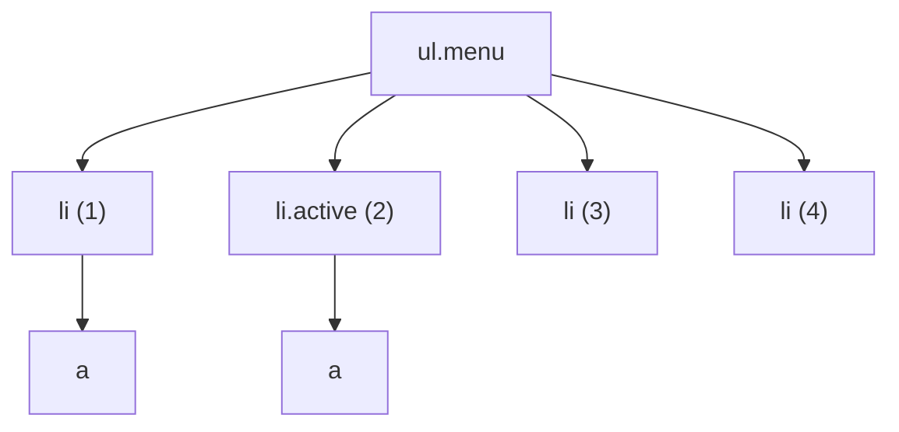

## Selector چیست؟

هر قانون CSS با یک سؤال شروع می‌شود: «این استایل روی **کدام** Elementها اعمال شود؟» جواب این سؤال **Selector** (انتخابگر) است؛ الگویی که مرورگر با تک‌تک Elementهای صفحه مقایسه می‌کند و هر کدام منطبق بود، استایل را می‌گیرد.

```css
/*  ↓ Selector     ↓ استایل */
    .card    { padding: 16px; }
```

Selectorها فقط مال CSS نیستند. همین زبان در JavaScript هم استفاده می‌شود (`document.querySelector(".card")`)، در تست‌ها (Playwright و Testing Library) و در ابزارهایی مثل jQuery. پس هر چه اینجا یاد بگیرید، چند جا به کارتان می‌آید.

این فصل را از ساده‌ترین Selector شروع می‌کنیم و قدم به قدم به Selectorهای قدرتمند امروزی مثل `:has()` می‌رسیم. برای هر Selector، Specificity آن را هم می‌نویسیم؛ اگر هنوز نمی‌دانید Specificity چیست، اول بخش [Specificity در فصل Cascade](/css/fundamentals) را بخوانید.

## Selectorهای پایه

پنج Selector پایه، آجرهای اصلی همه Selectorهای دیگرند.

### Type Selector (اسم تگ)

اسم تگ را بنویسید تا **همه** Elementهای آن نوع انتخاب شوند. Specificity: `(0,0,1)`.

```css
p { line-height: 1.7; }      /* همه پاراگراف‌ها */
button { cursor: pointer; }  /* همه دکمه‌ها */
```

کاربردش بیشتر برای استایل‌های پایه و Reset است. برای استایل Componentها مناسب نیست، چون هر `button` در هر جای سایت را تحت تأثیر قرار می‌دهد.

### Class Selector

نقطه + اسم کلاس. Elementهایی را انتخاب می‌کند که آن کلاس را در Attribute `class` دارند. یک Element می‌تواند چند کلاس داشته باشد و یک کلاس روی چند Element بیاید. Specificity: `(0,1,0)`.

```html live
<style>
  .badge { padding: 2px 8px; border-radius: 99px; background: #e9edfc; font: 600 13px system-ui; }
  .badge.success { background: #d3f9d8; color: #2b8a3e; } /* هر دو کلاس را با هم دارد */
</style>
<span class="badge">عادی</span>
<span class="badge success">موفق</span>
```

`.badge.success` (بدون فاصله) یعنی Elementی که **هر دو** کلاس را دارد. با `.badge .success` (با فاصله) کاملاً فرق دارد؛ آن یعنی «`.success` که داخل `.badge` است». این فاصله در بخش Combinatorها توضیح داده می‌شود.

کلاس‌ها ابزار اصلی استایل‌دهی در پروژه‌های امروزی‌اند: قابل استفاده مجددند و Specificity متوسط و قابل پیش‌بینی دارند.

### ID Selector

`#` + مقدار `id`. هر `id` باید در صفحه **یکتا** باشد. Specificity: `(1,0,0)`، یعنی از هر تعداد کلاس قوی‌تر است.

```css
#main-header { position: sticky; top: 0; }
```

<Callout type="tip">
در CSS از ID برای استایل‌دهی پرهیز کنید. Specificity آن به‌قدری بالاست که بعداً Override کردنش فقط با ID دیگر یا `!important` ممکن است. ID را برای لینک‌های داخلی (`#section`)، اتصال `label` به `input` و Attributeهای Accessibility نگه دارید.
</Callout>

### Universal Selector (`*`)

با **همه** Elementها منطبق است. Specificity: `(0,0,0)`، یعنی هیچ وزنی ندارد.

```css
/* رایج‌ترین کاربرد: Reset مدل جعبه برای همه Elementها */
*, *::before, *::after {
  box-sizing: border-box;
}
```

### Attribute Selector

داخل کروشه، Elementها را بر اساس Attributeهایشان انتخاب می‌کند. Specificity: `(0,1,0)`، هم‌وزن کلاس. هشت شکل دارد:

| الگو | یعنی | مثال | منطبق بر |
| --- | --- | --- | --- |
| `[attr]` | Attribute وجود دارد (با هر مقداری) | `[required]` | `<input required>` |
| `[attr="v"]` | مقدار **دقیقاً** برابر `v` | `[type="email"]` | `<input type="email">` |
| `[attr~="v"]` | `v` یکی از کلمه‌های جداشده با فاصله است | `[data-tags~="new"]` | `data-tags="sale new hot"` |
| `[attr\|="v"]` | برابر `v` یا شروع با `v-` | `[lang\|="en"]` | `en`، `en-US`، `en-GB` |
| `[attr^="v"]` | با `v` **شروع** می‌شود | `a[href^="https://"]` | لینک‌های امن |
| `[attr$="v"]` | با `v` **تمام** می‌شود | `a[href$=".pdf"]` | لینک به فایل PDF |
| `[attr*="v"]` | `v` جایی در مقدار هست | `[class*="col-"]` | `class="col-6"` |
| `[attr="v" i]` | مقایسه بدون حساسیت به حروف بزرگ و کوچک | `[type="EMAIL" i]` | `type="email"` |

```html live
<style>
  a { display: block; margin: 4px 0; font: 15px system-ui; }
  a[href^="http"]:not([href*="example.com"])::after { content: " ↗"; } /* لینک خارجی */
  a[href$=".pdf"]::before { content: "📄 PDF · "; }
  [data-state="open"] { background: #d3f9d8; padding: 4px; }          /* استایل بر اساس State */
</style>
<a href="https://developer.mozilla.org">لینک خارجی</a>
<a href="https://example.com/about">لینک داخلی سایت خودمان</a>
<a href="/files/report.pdf">گزارش سالانه</a>
<div data-state="open">پنل باز</div>
```

استایل‌دهی بر اساس `data-*` و `aria-*` الگوی رایجی در کتابخانه‌های امروزی است. مثلاً Radix UI روی Elementها `data-state="open"` می‌گذارد و شما با `[data-state="open"]` استایل حالت باز را می‌نویسید. مزیتش این است که **وضعیت واقعی** Component و استایل آن هیچ‌وقت از هم جدا نمی‌شوند.

## ترکیب Selectorها

قبل از رفتن سراغ Combinatorها، دو روش ساده ترکیب را بشناسید:

```css
/* ۱. چسباندن (Compound): همه شرط‌ها روی یک Element */
button.primary[disabled] { opacity: 0.5; }
/* یعنی: Elementی که button است و کلاس primary دارد و Attribute disabled دارد */

/* ۲. ویرگول (Selector List): «یا» — قانون برای هر کدام اعمال می‌شود */
h1, h2, h3 { font-family: "Estedad", sans-serif; }
```

در Selector چسبیده، Type Selector باید **اول** بیاید: `button.primary` درست است، `.primarybutton` چیز دیگری است.

## Combinatorها: رابطه بین Elementها

گاهی یک Element را بر اساس **جایگاهش نسبت به Elementهای دیگر** انتخاب می‌کنیم: «لینک‌هایی که داخل منو هستند» یا «پاراگرافی که بلافاصله بعد از عنوان آمده». **Combinator** علامتی است که بین دو Selector می‌آید و این رابطه را بیان می‌کند. چهار نوع دارد. همه را روی این ساختار امتحان می‌کنیم:



### Descendant (نسل): فاصله

`A B` یعنی هر `B` که **جایی داخل** `A` باشد، در هر عمقی (فرزند، نوه، نتیجه…).

- `.menu a` → هر دو `a` را انتخاب می‌کند؛ هر دو داخل `.menu` هستند، با اینکه فرزند مستقیمش نیستند.

### Child (فرزند مستقیم): `>`

`A > B` یعنی `B` که **فرزند مستقیم** `A` باشد؛ فقط یک سطح پایین‌تر.

- `.menu > li` → هر چهار `li`.
- `.menu > a` → **هیچ‌چیز**؛ `a`ها نوه `ul` هستند نه فرزندش.

وقتی Componentها تودرتو هستند (مثلاً منوی داخل منو)، `>` جلوی نشت استایل به سطح‌های پایین‌تر را می‌گیرد.

### Adjacent Sibling (هم‌نیای بلافصل): `+`

**Sibling** (هم‌نیا) یعنی دو Element با والد مشترک؛ مثل خواهر و برادر. `A + B` یعنی `B` که **بلافاصله بعد از** `A` آمده باشد.

- `.active + li` → فقط `li (3)`.

کاربرد کلاسیک: فاصله بین آیتم‌ها بدون اینکه اولی فاصله بگیرد: `li + li { margin-top: 8px; }`

### General Sibling (هم‌نیای عمومی): `~`

`A ~ B` یعنی **همه** `B`هایی که **بعد از** `A` آمده‌اند (نه لزوماً بلافاصله) و والد مشترک دارند.

- `.active ~ li` → `li (3)` و `li (4)`.

### «هم‌نیای قبلی» و «والد»؟

Combinatorها فقط **رو به پایین** (فرزندان) و **رو به جلو** (هم‌نیاهای بعدی) کار می‌کنند. دلیلش Performance بود: مرورگر DOM را از بالا به پایین می‌سازد و وقتی به یک Element می‌رسد، هنوز هم‌نیاهای بعدی را ندیده است. سال‌ها انتخاب والد یا هم‌نیای قبلی غیرممکن بود، تا اینکه `:has()` آمد (پایین‌تر کامل توضیح داده می‌شود): `li:has(+ .active)` یعنی «`li`ای که بلافاصله بعدش `.active` می‌آید»، یعنی `li (1)`.

همه را با هم ببینید و کلاس `active` را جابه‌جا کنید:

```html live
<style>
  li { padding: 4px 8px; margin: 2px 0; list-style: none; border-radius: 4px; font: 15px system-ui; }
  .active { background: #2459e0; color: white; }
  .active + li { background: #ffd8a8; }        /* هم‌نیای بلافصل */
  .active ~ li { border: 2px dashed #e8590c; } /* همه هم‌نیاهای بعدی */
  li:has(+ .active) { background: #d3f9d8; }   /* هم‌نیای قبلی با :has */
</style>
<ul>
  <li>۱ — هم‌نیای قبلی (:has)</li>
  <li class="active">۲ — active</li>
  <li>۳ — هم + و هم ~</li>
  <li>۴ — فقط ~</li>
</ul>
```

| Combinator | Syntax | یعنی | Specificity |
| --- | --- | --- | --- |
| Descendant | `A B` | B جایی داخل A | وزن ندارد |
| Child | `A > B` | B فرزند مستقیم A | وزن ندارد |
| Adjacent sibling | `A + B` | B بلافاصله بعد از A | وزن ندارد |
| General sibling | `A ~ B` | هر B بعد از A | وزن ندارد |

## Pseudo-classها: انتخاب بر اساس وضعیت

بعضی چیزها در HTML نوشته نشده‌اند ولی برای استایل‌دهی لازم‌اند: «ماوس روی این دکمه است»، «این Checkbox تیک خورده»، «این آخرین آیتم لیست است». **Pseudo-class** (شبه‌کلاس) با یک دونقطه (`:`) نوشته می‌شود و Element را بر اساس همین **وضعیت یا موقعیت** انتخاب می‌کند؛ انگار مرورگر خودش یک کلاس موقت به Element می‌دهد و برمی‌دارد. Specificity هر Pseudo-class برابر یک کلاس است: `(0,1,0)`.

### وضعیت‌های تعاملی (ماوس، کیبورد، لمس)

**`:hover`**: وقتی نشانگر ماوس روی Element است. روی صفحه لمسی رفتارش غیرقابل اعتماد است (با یک لمس فعال می‌شود و گاهی فعال می‌ماند)، پس آن را داخل `@media (hover: hover)` بگذارید و هیچ اطلاعات مهمی را فقط با hover نشان ندهید.

**`:active`**: در فاصله فشردن تا رها کردن دکمه ماوس (یا انگشت). برای حس «فشرده شدن» دکمه مناسب است.

**`:focus`**: وقتی Element فوکوس دارد؛ یعنی ورودی کیبورد به آن می‌رسد. با کلیک یا با کلید Tab فعال می‌شود.

**`:focus-visible`**: فوکوس دارد **و** مرورگر تشخیص داده که نشان دادن حلقه فوکوس لازم است؛ در عمل یعنی کاربر با کیبورد کار می‌کند. این بهترین جا برای استایل حلقه فوکوس است: کاربر کیبورد آن را می‌بیند و کاربر ماوس بعد از کلیک یک حلقه زشت نمی‌بیند.

**`:focus-within`**: خود Element یا **یکی از فرزندانش** فوکوس دارد. برای هایلایت کردن کل فرم یا کارت وقتی یکی از inputهایش فعال است.

**`:visited`**: لینکی که کاربر قبلاً بازدید کرده. به دلایل حریم خصوصی فقط Propertyهای رنگی را می‌شود تغییر داد (وگرنه سایت می‌توانست با اندازه‌گیری Layout تاریخچه مرورگر را بخواند).

**`:target`**: Elementی که `id` آن با بخش `#` آدرس فعلی برابر است. اگر آدرس `page.html#faq` باشد، `#faq:target` فعال است. برای هایلایت بخشی که کاربر به آن لینک شده مفید است.

```html live
<style>
  button { font: 600 15px system-ui; padding: 8px 16px; border-radius: 8px; border: 1px solid #ccd; background: white; }
  @media (hover: hover) { button:hover { background: #eef2fd; } }
  button:active { transform: scale(0.96); }
  button:focus-visible { outline: 3px solid #2459e0; outline-offset: 2px; }
  form { padding: 12px; border: 2px solid #e4e6ea; border-radius: 10px; margin-top: 10px; }
  form:focus-within { border-color: #2459e0; }
</style>
<button>ماوس را ببرید، کلیک کنید، Tab بزنید</button>
<form><input placeholder="روی من کلیک کنید — کل فرم هایلایت می‌شود" style="width: 90%" /></form>
```

**ترتیب LVHFA برای لینک‌ها:** این Pseudo-classها Specificity برابر دارند، پس طبق قانون Cascade آخری برنده است. اگر `:hover` را قبل از `:visited` بنویسید، روی لینک‌های بازدیدشده hover کار نمی‌کند. ترتیب درست:

```css
a:link {}          /* L — لینک بازدیدنشده */
a:visited {}       /* V — بازدیدشده */
a:hover {}         /* H — ماوس رویش است */
a:focus-visible {} /* F — فوکوس با کیبورد */
a:active {}        /* A — در لحظه کلیک */
```

### وضعیت‌های فرم

| Pseudo-class | کی فعال است |
| --- | --- |
| `:checked` | Checkbox یا Radio تیک‌خورده، یا `option` انتخاب‌شده |
| `:disabled` / `:enabled` | کنترل غیرفعال (`disabled`) / فعال |
| `:required` / `:optional` | با / بدون Attribute `required` |
| `:valid` / `:invalid` | مقدار با قیدهای Validation (`required`، `type`، `pattern`، `min`…) جور هست / نیست |
| `:user-valid` / `:user-invalid` | همان، ولی **فقط بعد از اینکه کاربر با فیلد کار کرد** |
| `:placeholder-shown` | input خالی است و placeholder دیده می‌شود |
| `:read-only` / `:read-write` | قابل ویرایش نیست / هست |
| `:in-range` / `:out-of-range` | عدد داخل / بیرون بازه `min` و `max` |
| `:indeterminate` | Checkbox در حالت «نامعین» (نه تیک، نه خالی؛ با JavaScript تنظیم می‌شود) |
| `:default` | گزینه پیش‌فرض یک گروه (مثلاً Radioی که از اول `checked` بوده) |

تفاوت `:invalid` و `:user-invalid` در عمل خیلی مهم است:

```html live
<style>
  input { display: block; margin: 6px 0; padding: 6px; font: 14px system-ui; width: 90%; border: 2px solid #ccc; border-radius: 6px; }
  .a:invalid { border-color: crimson; }      /* از همان اول قرمز! */
  .b:user-invalid { border-color: crimson; } /* فقط بعد از تعامل کاربر */
</style>
<input class="a" type="email" required placeholder=":invalid — قبل از هر کاری قرمز است" />
<input class="b" type="email" required placeholder=":user-invalid — چیزی بنویسید و بیرون بروید" />
```

`:invalid` یک فیلد `required` خالی را از لحظه باز شدن صفحه نامعتبر می‌داند و کاربر قبل از تایپ اولین حرف با یک فرم قرمز روبه‌رو می‌شود. `:user-invalid` صبر می‌کند تا کاربر فیلد را تغییر دهد و از آن خارج شود.

یک ترفند رایج با `:placeholder-shown`، **Floating Label** بدون JavaScript است:

```css
/* وقتی input خالی نیست یا فوکوس دارد، label بالا می‌رود */
.input:not(:placeholder-shown) + label,
.input:focus + label {
  transform: translateY(-1.4em) scale(0.85);
}
```

### موقعیت در درخت (Tree-structural)

این گروه Element را بر اساس **جایگاهش بین هم‌نیاها** انتخاب می‌کند:

| Pseudo-class | منطبق بر |
| --- | --- |
| `:first-child` / `:last-child` | اولین / آخرین فرزند والدش |
| `:only-child` | تنها فرزند والدش |
| `:nth-child(An+B)` | فرزندی که شماره‌اش در فرمول `An+B` صدق کند (شمارش از ۱) |
| `:nth-last-child(An+B)` | همان، ولی شمارش از انتها |
| `:first-of-type`، `:last-of-type`، `:only-of-type`، `:nth-of-type()` | همان‌ها، ولی شمارش فقط بین هم‌نیاهای **با همان اسم تگ** |
| `:empty` | Elementی که هیچ فرزندی ندارد؛ حتی یک فاصله متنی (در بیشتر مرورگرها) |
| `:root` | ریشه سند، یعنی `html`؛ با Specificity یک کلاس. جای رایج تعریف CSS Variableها |

#### فرمول `An+B` چطور کار می‌کند؟

مرورگر به `n` به ترتیب مقدارهای `0، 1، 2، 3، …` می‌دهد و هر نتیجه‌ای که عدد مثبت شد، شماره فرزندی است که انتخاب می‌شود. مثلاً برای `2n+1`:

```text
n = 0  →  2×0 + 1 = 1   ← فرزند اول
n = 1  →  2×1 + 1 = 3   ← فرزند سوم
n = 2  →  2×2 + 1 = 5   ← فرزند پنجم
...      نتیجه: فرزندهای فرد
```

و برای `-n+3` (که کمتر شهودی است):

```text
n = 0  →  -0 + 3 = 3   ← سومی
n = 1  →  -1 + 3 = 2   ← دومی
n = 2  →  -2 + 3 = 1   ← اولی
n = 3  →  -3 + 3 = 0   ← فرزند شماره صفر وجود ندارد؛ تمام
...      نتیجه: سه‌تای اول
```

| عبارت | انتخاب |
| --- | --- |
| `:nth-child(3)` | فقط سومی |
| `:nth-child(odd)` یا `2n+1` | ۱، ۳، ۵، … |
| `:nth-child(even)` یا `2n` | ۲، ۴، ۶، … |
| `:nth-child(3n)` | ۳، ۶، ۹، … |
| `:nth-child(n+4)` | از چهارمی به بعد |
| `:nth-child(-n+3)` | سه‌تای اول |
| `:nth-child(n+2):nth-child(-n+5)` | دومی تا پنجمی (اشتراک دو شرط) |
| `:nth-last-child(-n+3)` | سه‌تای آخر |
| `:nth-child(2 of .active)` | دومین Element از بین آن‌هایی که کلاس `active` دارند |

```html live
<style>
  ol { display: flex; gap: 4px; padding: 0; list-style: none; font: 600 14px system-ui; }
  li { width: 32px; height: 32px; display: grid; place-items: center; background: #eef0f3; border-radius: 6px; }
  /* این خط را عوض کنید: odd، 3n، n+4، -n+3، … */
  li:nth-child(odd) { background: #2459e0; color: white; }
</style>
<ol><li>1</li><li>2</li><li>3</li><li>4</li><li>5</li><li>6</li><li>7</li><li>8</li><li>9</li></ol>
```

#### تفاوت `:nth-child` و `:nth-of-type`

این یکی از پرتکرارترین سؤال‌های مصاحبه است. این HTML را در نظر بگیرید:

```html
<div>
  <h2>عنوان</h2>
  <p>p اول</p>
  <p>p دوم</p>
</div>
```

- **`:nth-child`** اول **همه** فرزندان را می‌شمارد، **بعد** شرط تگ را چک می‌کند. `p:nth-child(2)` یعنی «فرزند دوم، اگر `p` باشد» → «p اول».
- `p:nth-child(1)` → **هیچ‌چیز**؛ فرزند اول `h2` است، نه `p`.
- **`:nth-of-type`** فقط هم‌نیاهای **هم‌تگ** را می‌شمارد. `p:nth-of-type(1)` یعنی «اولین `p`» → «p اول».
- `p:first-child` → هیچ‌چیز (به همان دلیل `nth-child(1)`).

```html live
<style>
  .demo > * { margin: 2px 0; padding: 4px 8px; font: 14px system-ui; }
  .a p:nth-child(2)   { background: #ffd8a8; }
  .b p:nth-of-type(2) { background: #c5f6fa; }
</style>
<div class="demo a"><h4>p:nth-child(2)</h4><p>p اول</p><p>p دوم</p></div>
<div class="demo b"><h4>p:nth-of-type(2)</h4><p>p اول</p><p>p دوم</p></div>
```

<Callout type="mistake">
`:nth-of-type` بر اساس **اسم تگ** می‌شمارد، نه کلاس. `.item:nth-of-type(2)` یعنی «Elementی که دومین از نوع تگ خودش است **و** کلاس `item` دارد»، نه «دومین `.item`». برای شمردن بر اساس کلاس از `:nth-child(2 of .item)` استفاده کنید.
</Callout>

## Selectorهای منطقی: `:is()`، `:where()`، `:not()` و `:has()`

این چهار Pseudo-class یک **فهرست Selector** به‌عنوان ورودی می‌گیرند و قدرت CSS را خیلی بیشتر کرده‌اند.

### `:is()`: کوتاه کردن Selectorهای تکراری

`:is(A, B, C)` یعنی «هر کدام از A یا B یا C». به جای تکرار یک الگو چند بار، آن را یک بار می‌نویسید:

```css
/* قبل: سه بار تکرار */
header a:hover, nav a:hover, footer a:hover { color: var(--accent); }

/* بعد */
:is(header, nav, footer) a:hover { color: var(--accent); }
```

**Specificity:** وزن **قوی‌ترین** Selector داخلش. یک تله: `:is(#id, .class)` حتی برای Elementی که فقط با `.class` منطبق است، وزن ID را می‌گیرد.

### `:where()`: همان `:is()` با وزن صفر

دقیقاً مثل `:is()` کار می‌کند، با یک تفاوت: Specificity آن **همیشه صفر** است، هر چه داخلش باشد.

```css
/* Reset با وزن صفر — هر کلاس ساده‌ای می‌تواند Overrideاش کند */
:where(ul, ol)[role="list"] { list-style: none; padding: 0; }
```

| | `:is()` | `:where()` |
| --- | --- | --- |
| Specificity | وزن قوی‌ترین آرگومان | **همیشه صفر** |
| بخشنده (Forgiving) است؟ | بله | بله |
| کاربرد | کوتاه کردن Selector | استایل پایه، Reset و کتابخانه‌ها که باید راحت Override شوند |

**Forgiving** یعنی چه؟ در یک Selector List معمولی، اگر حتی یکی از Selectorها نامعتبر باشد (مثلاً یک Pseudo-class جدید که مرورگر نمی‌شناسد) **کل قانون** نادیده گرفته می‌شود. داخل `:is()` و `:where()` فقط همان Selector نامعتبر کنار گذاشته می‌شود و بقیه کار می‌کنند.

### `:not()`: هر چیزی به‌جز این

Elementهایی را انتخاب می‌کند که با فهرست داخلش منطبق **نیستند**. Specificity: وزن قوی‌ترین آرگومان.

```css
/* همه آیتم‌ها به‌جز آخری خط جداکننده دارند */
li:not(:last-child) { border-bottom: 1px solid var(--line); }

/* دکمه‌ها به‌جز غیرفعال‌ها و نوع ghost */
.btn:not(:disabled, .btn--ghost):hover { filter: brightness(1.1); }
```

دو تله:

- `:not(p)` به‌تنهایی با `html` و `body` هم منطبق است، چون آن‌ها هم `p` نیستند!
- `:not(.dark) span` یعنی «`span`ی که **حداقل یک** جد بدون کلاس `.dark` دارد» (و `html` همیشه چنین جدی است)، نه «`span`ی که هیچ جد `.dark` ندارد». برای معنی دوم: `span:not(.dark span)`.

### `:has()`: انتخاب والد بر اساس فرزند

سال‌ها پرتکرارترین درخواست از CSS این بود: «کارت را وقتی عکس دارد جور دیگری استایل بده» یا «کل فیلد را وقتی input نامعتبر است قرمز کن». تنها راه، JavaScript بود: گوش دادن به رویداد و اضافه کردن کلاس به والد. `:has()` (در همه مرورگرها از ۲۰۲۳) این را ممکن کرد.

`A:has(B)` یعنی «`A`ای که **داخلش** `B` باشد». Selector داخل `:has()` نسبت به خود `A` سنجیده می‌شود، پس می‌توانید با Combinator شروعش کنید: `A:has(> B)` (فرزند مستقیم) یا `A:has(+ B)` (هم‌نیای بعدی).

```css
/* کارتی که عکس دارد */
.card:has(img) { grid-template-rows: 200px auto; }

/* فیلدی که input نامعتبر دارد → پیام خطا نمایش داده شود */
.field:has(input:user-invalid) .error { display: block; }

/* label مربوط به Checkbox تیک‌خورده */
label:has(> input:checked) { font-weight: 700; }

/* وقتی یک Modal باز است، اسکرول صفحه قفل شود */
body:has(dialog[open]) { overflow: hidden; }

/* «Quantity Query»: اگر Grid بیش از ۴ آیتم دارد، ۳ ستونی شود */
.grid:has(> :nth-child(5)) { grid-template-columns: repeat(3, 1fr); }

/* هم‌نیای قبلی: li که بلافاصله بعدش .active است */
li:has(+ .active) { opacity: 0.8; }
```

```html live
<style>
  .field { display: block; border: 2px solid #ccc; padding: 10px; border-radius: 8px; margin-bottom: 8px; font: 14px system-ui; }
  .field:has(input:focus) { border-color: #2459e0; }
  .field:has(input:checked) { background: #d3f9d8; border-color: #2b8a3e; }
  .field:has(input:user-invalid) { border-color: #c92a2a; background: #fff5f5; }
</style>
<label class="field"><input type="checkbox" /> تیک بزنید؛ والد سبز می‌شود</label>
<div class="field"><input type="email" required placeholder="ایمیل نامعتبر وارد کنید و بیرون بروید" style="width: 90%" /></div>
```

<Callout type="warning">
`:has()` می‌تواند پرهزینه باشد: تغییر یک Element ممکن است باعث شود مرورگر استایل همه اجدادش را دوباره حساب کند. از `:has()` روی `body` یا `*` با شرط‌هایی که مرتب عوض می‌شوند (مثل `:has(:hover)` در کل صفحه) پرهیز کنید. `:has()` تودرتو و Pseudo-element داخل آن مجاز نیست. برای مرورگرهای قدیمی می‌توانید با `@supports selector(:has(a)) { … }` Fallback بنویسید.
</Callout>

## Pseudo-elementها: انتخاب بخشی از Element

**Pseudo-class** یک Element **موجود** را در یک وضعیت خاص انتخاب می‌کند. **Pseudo-element** (شبه‌عنصر) چیز دیگری است: **بخشی** از یک Element (مثل خط اول یک پاراگراف) یا یک **جعبه مجازی جدید** را انتخاب می‌کند که در HTML وجود ندارد. با دو دونقطه (`::`) نوشته می‌شود و Specificity آن برابر یک تگ است: `(0,0,1)`.

### `::before` و `::after`

این دو، یک فرزند مجازی **اول** و **آخر** داخل Element می‌سازند. Property **`content`** برایشان **الزامی** است؛ بدون آن، اصلاً ساخته نمی‌شوند (حتی اگر محتوا خالی باشد باید `content: ""` بنویسید).

```text
<button class="btn">            ← Element واقعی
  ::before                       ← فرزند مجازی اول (داخل button، نه بیرونش)
  "ذخیره"                        ← محتوای واقعی
  ::after                        ← فرزند مجازی آخر
</button>
```

```html live
<style>
  .required::after { content: " *"; color: crimson; }
  .card { position: relative; width: 240px; height: 120px; border-radius: 12px; overflow: hidden;
          background: url("data:image/svg+xml,%3Csvg xmlns='http://www.w3.org/2000/svg'%3E%3Crect width='100%25' height='100%25' fill='%2390a4ff'/%3E%3C/svg%3E"); }
  .card::before {           /* لایه تیره روی عکس، بدون HTML اضافه */
    content: "";
    position: absolute;
    inset: 0;
    background: linear-gradient(transparent, rgb(0 0 0 / 0.65));
  }
  .card span { position: absolute; bottom: 10px; inset-inline-start: 12px; color: white; font: 700 16px system-ui; }
</style>
<label class="required" style="font: 15px system-ui">ایمیل</label>
<div class="card"><span>متن روی گرادیان</span></div>
```

یک الگوی رایج دیگر **Stretched Link** است: کل کارت قابل کلیک می‌شود ولی در HTML فقط یک لینک هست:

```css
.card { position: relative; }
.card a::after { content: ""; position: absolute; inset: 0; } /* لایه شفاف روی کل کارت */
```

### بقیه Pseudo-elementها

| Pseudo-element | چه چیزی را انتخاب می‌کند | مثال |
| --- | --- | --- |
| `::first-letter` | اولین حرف یک Block | حرف اول درشت (Drop Cap) در مقاله |
| `::first-line` | اولین خط **نمایش‌داده‌شده** (با تغییر عرض عوض می‌شود) | خط اول پررنگ |
| `::selection` | متنی که کاربر انتخاب کرده | `::selection { background: var(--accent); }` |
| `::placeholder` | متن placeholder یک input | `input::placeholder { color: gray; opacity: 1; }` |
| `::marker` | گلوله یا عدد آیتم‌های لیست | `li::marker { color: var(--accent); }` |
| `::backdrop` | لایه پشت `dialog` مودال یا حالت Fullscreen | `dialog::backdrop { background: rgb(0 0 0 / .5); }` |
| `::file-selector-button` | دکمه «انتخاب فایل» در `input type="file"` | استایل دکمه آپلود |

نکته `::placeholder`: Firefox به‌صورت پیش‌فرض به placeholder شفافیت می‌دهد، پس برای رنگ یکسان در همه مرورگرها `opacity: 1` هم بنویسید.

### قواعد Pseudo-elementها

- `::before` و `::after` روی **Void Elementها** (`img`، `input`، `br`، `hr`) کار نمی‌کنند. این تگ‌ها محتوا ندارند، پس جایی برای فرزند مجازی نیست.
- متن داخل `content` را بعضی Screen Readerها می‌خوانند ولی کاربر نمی‌تواند انتخاب یا کپی‌اش کند. متن مهم را در CSS نگذارید.
- در هر Selector فقط **یک** Pseudo-element مجاز است و باید **آخر** بیاید: `a:hover::after` درست است، `a::after:hover` نه.
- نوشتن قدیمی با یک دونقطه (`:before`) برای سازگاری هنوز کار می‌کند، ولی `::` استاندارد است و Pseudo-class را از Pseudo-element جدا می‌کند.

## Selector در JavaScript

همه Selectorهایی که یاد گرفتید در این چهار متد DOM هم کار می‌کنند:

```js
document.querySelector(".card:has(img)");      // اولین Element منطبق، یا null
document.querySelectorAll("li:nth-child(odd)"); // NodeList ایستا (با تغییر DOM به‌روز نمی‌شود)
element.matches(":focus-visible");              // آیا خود element منطبق است؟ true یا false
element.closest("[data-id]");                   // نزدیک‌ترین جد منطبق (شامل خودش)، یا null
```

`closest` پایه الگوی **Event Delegation** است: یک Listener روی والد، و با `event.target.closest(".item")` پیدا می‌کنید روی کدام آیتم کلیک شده (فصل [Eventها](/browser/events)). Pseudo-elementها از JavaScript انتخاب نمی‌شوند (`querySelector("::before")` کار نمی‌کند)، ولی استایلشان را با `getComputedStyle(el, "::before")` می‌توانید بخوانید.

## اشتباهات رایج

<Callout type="mistake">
**اشتباه گرفتن `:nth-child` و `:nth-of-type`.** اولی همه فرزندان را می‌شمارد و بعد تگ را چک می‌کند؛ دومی فقط هم‌تگ‌ها را می‌شمارد. هیچ‌کدام بر اساس کلاس نمی‌شمارند؛ برای آن `:nth-child(n of .class)` لازم است.
</Callout>

<Callout type="mistake">
**فراموش کردن `content: ""`** در `::before`/`::after`. بدون آن جعبه‌ای ساخته نمی‌شود و استایل‌هایتان بی‌اثر می‌مانند.
</Callout>

<Callout type="mistake">
**`outline: none` روی `:focus` بدون جایگزین.** کاربران کیبورد دیگر نمی‌فهمند کجای صفحه هستند. اگر حلقه پیش‌فرض را دوست ندارید، با `:focus-visible` یک حلقه بهتر طراحی کنید.
</Callout>

<Callout type="mistake">
**استایل خطا با `:invalid`.** فیلدهای `required` از لحظه باز شدن صفحه قرمز می‌شوند. از `:user-invalid` استفاده کنید.
</Callout>

<Callout type="mistake">
**Selectorهای طولانی و وابسته به ساختار DOM** مثل `main > div > div:nth-child(2) ul li a`. با کوچک‌ترین تغییر HTML خراب می‌شوند. یک کلاس معنادار پایدارتر و خواناتر است.
</Callout>

## سوالات مصاحبه

<QA q="تفاوت Pseudo-class و Pseudo-element چیست؟" level="junior" n={1}>
<Answer>

**Pseudo-class** (مثل `:hover` و `:checked`) یک Element **موجود** را بر اساس وضعیت یا موقعیتش انتخاب می‌کند. **Pseudo-element** (مثل `::before` و `::first-line`) **بخشی** از یک Element یا یک جعبه مجازی **جدید** را انتخاب می‌کند که در DOM وجود ندارد. اولی با `:` و دومی با `::` نوشته می‌شود.

</Answer>
<Deep>

Specificity یک Pseudo-class برابر یک کلاس است و یک Pseudo-element برابر یک تگ. Pseudo-elementها از DOM قابل انتخاب نیستند (`querySelector('::before')` کار نمی‌کند)، ولی `getComputedStyle(el, '::before')` استایلشان را برمی‌گرداند.

</Deep>
<Mistake>

گفتن اینکه `::before` قبل از Element و بیرون از آن قرار می‌گیرد. در واقع **اولین فرزند** Element است، داخل آن.

</Mistake>
<FollowUp>

چرا `::before` روی `img` کار نمی‌کند؟ (`img` یک Void Element است و محتوایی ندارد که فرزند مجازی داخلش قرار بگیرد.)

</FollowUp>
</QA>

<QA q="تفاوت `:is()` و `:where()` چیست و کی `:where()` را ترجیح می‌دهید؟" level="mid" n={2}>
<Answer>

هر دو یک فهرست Selector می‌گیرند و Forgiving هستند. `:is()` وزن قوی‌ترین آرگومانش را می‌گیرد و `:where()` همیشه وزن صفر دارد. `:where()` را برای استایل‌های پایه، Reset و استایل کتابخانه‌ها ترجیح می‌دهم تا استفاده‌کننده بتواند با یک کلاس ساده Override کند.

</Answer>
<Deep>

`:is(#id, .class)` حتی وقتی Element فقط با `.class` منطبق است وزن ID را می‌گیرد؛ تله رایجی است. Forgiving بودن یعنی اگر مرورگر یکی از Selectorهای داخل را نشناسد، بقیه همچنان کار می‌کنند؛ برخلاف Selector List معمولی که کل قانون را از بین می‌برد.

</Deep>
<Mistake>

فکر کردن اینکه `:is()` فقط خلاصه‌نویسی است و روی Specificity اثری ندارد.

</Mistake>
<FollowUp>

چطور یک Design System می‌سازید که استایل‌هایش هیچ‌وقت با استایل‌های استفاده‌کننده درگیر Specificity نشوند؟ (`:where()` به‌علاوه `@layer`.)

</FollowUp>
</QA>

<QA q="`:has()` چه مشکلی را حل کرد؟ یک مثال واقعی بزنید." level="senior" n={3}>
<Answer>

امکان انتخاب یک Element بر اساس فرزندان یا هم‌نیاهای بعدی‌اش را داد؛ همان «Parent Selector» که سال‌ها وجود نداشت و به JavaScript نیاز داشت. مثال: `.field:has(input:user-invalid)` برای قرمز کردن کل کادر فیلد، یا `body:has(dialog[open]) { overflow: hidden }` برای قفل کردن اسکرول وقتی Modal باز است.

</Answer>
<Deep>

قبل از `:has()` باید به رویدادها گوش می‌دادیم و به والد کلاس اضافه می‌کردیم. حالا این State در CSS می‌ماند و در React هم Renderهای غیرضروری کمتر می‌شود. از نظر Performance، موتورها Invalidation هوشمند دارند، ولی `:has()` روی Elementهای سطح بالا با شرط‌های پرتغییر می‌تواند محاسبه دوباره استایل را گران کند.

</Deep>
<Mistake>

استفاده از `:has()` بدون Fallback در محصولی که باید مرورگرهای قدیمی‌تر را پشتیبانی کند (`@supports selector(:has(a))`).

</Mistake>
<FollowUp>

با `:has()` چطور «هم‌نیای قبلی» را انتخاب می‌کنید؟ (`a:has(+ b)`)

</FollowUp>
</QA>

<QA q="در یک div با فرزندان `h2, p, p`، سلکتور `p:nth-child(2)` کدام را انتخاب می‌کند؟ و `p:nth-of-type(2)`؟" level="mid" n={4}>
<Answer>

`p:nth-child(2)` **اولین** `p` را انتخاب می‌کند: فرزند دوم والد است و تگش هم `p` است. `p:nth-of-type(2)` **دومین** `p` را انتخاب می‌کند: دومین `p` بین هم‌نیاهای هم‌تگ.

</Answer>
<Deep>

`nth-child` همه فرزندان را می‌شمارد و بعد شرط تگ را بررسی می‌کند؛ `nth-of-type` فقط هم‌نیاهای هم‌تگ را می‌شمارد. با `:nth-child(2 of p.note)` می‌توانید شمارش را به هر Selector دلخواهی، از جمله کلاس، محدود کنید.

</Deep>
<Mistake>

انتظار اینکه `.item:nth-of-type(2)` دومین Element با کلاس `item` را انتخاب کند.

</Mistake>
<FollowUp>

چطور فقط سه آیتم آخر یک لیست را انتخاب می‌کنید؟ (`:nth-last-child(-n+3)`)

</FollowUp>
</QA>

## جمع‌بندی

<Recap>

- Selector تعیین می‌کند قانون روی کدام Elementها اعمال شود؛ همین زبان در `querySelector`، `matches` و `closest` هم کار می‌کند.
- پنج Selector پایه: تگ `(0,0,1)`، کلاس `(0,1,0)`، ID `(1,0,0)`، `*` بدون وزن، و Attribute هم‌وزن کلاس با هشت شکل مختلف.
- چسباندن Selectorها یعنی «و» روی یک Element؛ ویرگول یعنی «یا».
- Combinatorها رابطه را بیان می‌کنند: فاصله (نسل)، `>` (فرزند مستقیم)، `+` (هم‌نیای بلافصل)، `~` (هم‌نیاهای بعدی). خودشان وزنی ندارند.
- Pseudo-classها وضعیت را انتخاب می‌کنند: تعاملی (`:hover`، `:focus-visible`)، فرم (`:checked`، `:user-invalid`)، و ساختاری (`:nth-child`).
- `:nth-child` همه فرزندان را می‌شمارد و بعد تگ را چک می‌کند؛ `:nth-of-type` فقط هم‌تگ‌ها را؛ برای کلاس از `of` استفاده کنید.
- `:is()` وزن قوی‌ترین آرگومان را دارد، `:where()` وزن صفر؛ هر دو Forgiving هستند.
- `:has()` انتخاب والد و هم‌نیای قبلی را ممکن کرده است.
- Pseudo-elementها (`::before`، `::after`، `::marker`، …) بخشی از Element یا جعبه مجازی می‌سازند؛ `content` برای before/after الزامی است.

</Recap>
