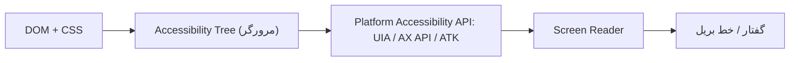

## Accessibility چیست؟

`Accessibility (دسترسی‌پذیری)` که به اختصار **a11y** نوشته می‌شود، یعنی ساخت محصولی که همه افراد — از جمله افراد دارای محدودیت بینایی، شنوایی، حرکتی یا شناختی — بتوانند از آن استفاده کنند. این شامل کاربرانی است که:

- با **Screen Reader (صفحه‌خوان)** مثل NVDA، JAWS، VoiceOver یا TalkBack صفحه را می‌شنوند؛
- فقط با **کیبورد** یا Switch Device کار می‌کنند؛
- با Zoom زیاد یا کنتراست بالا صفحه را می‌بینند؛
- محدودیت موقت دارند (دست شکسته، نور شدید آفتاب روی صفحه).

### چرا مهم است؟

1. **انسانی:** حدود ۱۶٪ جمعیت جهان نوعی معلولیت دارند.
2. **قانونی:** در بسیاری از کشورها الزامی است (ADA در آمریکا، European Accessibility Act از ۲۰۲۵).
3. **کیفیت محصول:** چیزی که برای Accessibility خوب است، معمولاً برای همه بهتر است (کپشن ویدیو، کنتراست خوب، ناوبری با کیبورد).
4. **استاندارد:** `WCAG (Web Content Accessibility Guidelines)` با سطوح A، AA و AAA. هدف رایج صنعت **WCAG 2.2 AA** است.

اصول چهارگانه WCAG با مخفف **POUR**:

| اصل | معنا | مثال |
| --- | --- | --- |
| Perceivable (قابل درک حسی) | اطلاعات باید قابل دیدن/شنیدن باشد | `alt` برای تصاویر، کپشن، کنتراست |
| Operable (قابل کار) | همه کارها با کیبورد ممکن باشد | فوکوس قابل مشاهده، بدون Keyboard Trap |
| Understandable (قابل فهم) | محتوا و رفتار قابل پیش‌بینی | Labelهای واضح، پیام خطای مفید |
| Robust (مستحکم) | با فناوری‌های کمکی سازگار | HTML معتبر، Role و State صحیح |

## Screen Reader چطور کار می‌کند؟



مرورگر از DOM و CSS یک **Accessibility Tree** می‌سازد. Elementهایی که `display: none` یا `visibility: hidden` یا `aria-hidden="true"` دارند از این درخت حذف می‌شوند. Screen Reader از طریق API سیستم‌عامل این درخت را می‌خواند و برای هر Node نقش، نام و وضعیت را اعلام می‌کند: «دکمه، ذخیره، غیرفعال».

## ARIA

`ARIA (Accessible Rich Internet Applications)` مجموعه‌ای از Attributeهاست که **Accessibility Tree را تغییر می‌دهد، نه رفتار را**. ARIA هیچ فوکوس، رویداد کیبورد یا استایلی اضافه نمی‌کند.

سه دسته اصلی:

| دسته | مثال | کار |
| --- | --- | --- |
| Role | `role="tab"`، `role="dialog"`، `role="alert"` | تعیین نوع Element |
| Property | `aria-label`، `aria-labelledby`، `aria-describedby`، `aria-controls` | ویژگی‌های نسبتاً ثابت |
| State | `aria-expanded`، `aria-checked`، `aria-selected`، `aria-busy` | وضعیت‌های متغیر که باید با JS به‌روز شوند |

### `aria-label`

یک نام دسترسی‌پذیر **متنی** مستقیم می‌دهد. برای Elementهایی که متن قابل مشاهده ندارند:

```html
<button aria-label="بستن">
  <svg aria-hidden="true">...</svg>
</button>
```

### `aria-labelledby`

نام را از **محتوای Element(های) دیگر** می‌گیرد. چند ID را با فاصله می‌پذیرد و از `aria-label` و `label` اولویت بالاتری دارد:

```html
<h2 id="billing">آدرس صورتحساب</h2>
<section aria-labelledby="billing">...</section>

<span id="qty-label">تعداد</span>
<span id="qty-unit">(بسته)</span>
<input aria-labelledby="qty-label qty-unit" />  <!-- نام: «تعداد (بسته)» -->
```

### `aria-describedby`

**توضیح** اضافه (نه نام). Screen Reader آن را پس از نام و نقش، معمولاً با مکث، می‌خواند:

```html
<label for="pwd">رمز عبور</label>
<input id="pwd" type="password" aria-describedby="pwd-rules" />
<p id="pwd-rules">حداقل ۸ کاراکتر شامل یک عدد.</p>
```

### ترتیب محاسبه Accessible Name

مرورگر نام را با این اولویت محاسبه می‌کند (به‌طور ساده‌شده):

1. `aria-labelledby`
2. `aria-label`
3. Label بومی: `label` برای inputها، `alt` برای تصویر، `caption` برای جدول، `legend` برای fieldset
4. محتوای متنی (برای Roleهایی مثل button و link)
5. `title` (آخرین راه‌حل؛ قابل اعتماد نیست)

### چه زمانی نباید از ARIA استفاده کرد؟

**پنج قانون ARIA:**

1. اگر Element بومی HTML با معنا و رفتار لازم وجود دارد، **از آن استفاده کنید**، نه ARIA.
2. معنای بومی را تغییر ندهید: `<h2 role="tab">` غلط است؛ `<div role="tab"><h2>…</h2></div>` درست.
3. همه کنترل‌های ARIA تعاملی باید **با کیبورد قابل استفاده** باشند.
4. روی Element قابل فوکوس از `role="presentation"` یا `aria-hidden="true"` استفاده نکنید.
5. همه Elementهای تعاملی باید **Accessible Name** داشته باشند.

```html
<!-- بد: ARIA اضافه -->
<button role="button" aria-label="ارسال">ارسال</button>
<nav role="navigation">...</nav>
<a href="/" role="link">خانه</a>

<!-- بد و خطرناک: پنهان کردن Element قابل فوکوس -->
<a href="/cart" aria-hidden="true">سبد</a>

<!-- خوب -->
<button>ارسال</button>
<nav aria-label="اصلی">...</nav>
```

<Callout type="interview">
آمار WebAIM Million نشان می‌دهد صفحاتی که ARIA دارند، به‌طور میانگین **خطای Accessibility بیشتری** نسبت به صفحات بدون ARIA دارند. ARIA ابزار قدرتمندی است، اما ARIA اشتباه بدتر از نبود ARIA است.
</Callout>

## Keyboard Navigation و Focus

کاربر کیبورد با این کلیدها حرکت می‌کند:

| کلید | کار |
| --- | --- |
| `Tab` / `Shift+Tab` | رفتن به Element قابل فوکوس بعدی/قبلی |
| `Enter` | فعال کردن لینک و دکمه |
| `Space` | فعال کردن دکمه، تیک زدن Checkbox |
| کلیدهای جهت | حرکت داخل Composite Widgetها (Radio، Tab، Menu، Listbox) |
| `Escape` | بستن Dialog، Menu، Popover |

### tabindex

| مقدار | رفتار |
| --- | --- |
| بدون tabindex | فقط Elementهای بومی تعاملی (`a[href]`، `button`، `input`، …) در ترتیب Tab هستند |
| `tabindex="0"` | Element غیرتعاملی را به ترتیب طبیعی Tab اضافه می‌کند |
| `tabindex="-1"` | از ترتیب Tab خارج، ولی با `el.focus()` قابل فوکوس (برای مدیریت فوکوس برنامه‌ای) |
| `tabindex="1"` به بالا | **ضد الگو:** ترتیب Tab را مستقل از DOM تغییر می‌دهد و نگهداری آن تقریباً غیرممکن است |

### Focus Visible

```css
/* هرگز این کار را نکنید: */
*:focus { outline: none; }

/* به جای آن: */
:focus-visible {
  outline: 3px solid var(--focus-color);
  outline-offset: 2px;
}
```

`:focus-visible` فقط زمانی فعال می‌شود که مرورگر تشخیص دهد کاربر به نشانگر فوکوس نیاز دارد (معمولاً هنگام استفاده از کیبورد، نه کلیک ماوس).

### Roving tabindex

در Composite Widgetها (مثل Tab List یا Toolbar) فقط یک آیتم `tabindex="0"` دارد و بقیه `-1`. کلیدهای جهت فوکوس را جابه‌جا می‌کنند. به این ترتیب کاربر با یک Tab وارد Widget و با Tab بعدی خارج می‌شود.

```js
function setupTablist(tablist) {
  const tabs = [...tablist.querySelectorAll('[role="tab"]')];

  tablist.addEventListener("keydown", (event) => {
    const current = tabs.indexOf(document.activeElement);
    // در RTL جهت فلش‌ها برعکس است
    const rtl = getComputedStyle(tablist).direction === "rtl";
    const forward = rtl ? "ArrowLeft" : "ArrowRight";
    const backward = rtl ? "ArrowRight" : "ArrowLeft";

    let next = null;
    if (event.key === forward) next = (current + 1) % tabs.length;
    if (event.key === backward) next = (current - 1 + tabs.length) % tabs.length;
    if (event.key === "Home") next = 0;
    if (event.key === "End") next = tabs.length - 1;
    if (next === null) return;

    event.preventDefault();
    tabs[current].tabIndex = -1;
    tabs[next].tabIndex = 0;
    tabs[next].focus();
  });
}
```

### مدیریت فوکوس در SPA

در SPA، تغییر Route صفحه جدیدی بارگذاری نمی‌کند؛ پس Screen Reader چیزی اعلام نمی‌کند و فوکوس روی لینکی که دیگر وجود ندارد می‌ماند. راه‌حل‌ها:

- پس از Navigation، فوکوس را به `h1` صفحه جدید (با `tabindex="-1"`) یا Container اصلی منتقل کنید.
- عنوان صفحه (`document.title`) را به‌روز کنید.
- لینک «Skip to content» در ابتدای صفحه قرار دهید.

## Accessible Forms

خلاصه قوانین (جزئیات در فصل [فرم‌ها](/html/forms)):

- هر فیلد یک `label` قابل مشاهده دارد.
- Radioها و Checkboxهای مرتبط در `fieldset` با `legend`.
- خطاها متنی، کنار فیلد، متصل با `aria-describedby` و `aria-invalid="true"`.
- `autocomplete` صحیح.
- فیلدهای اجباری هم با `required` و هم با نشانه متنی/بصری.

## Accessible Buttons و Links

```html
<!-- دکمه فقط آیکون: نام لازم است -->
<button type="button" aria-label="افزودن به علاقه‌مندی" aria-pressed="false">
  <svg aria-hidden="true" focusable="false">...</svg>
</button>

<!-- لینک با متن مبهم: بد -->
<a href="/post/1">بیشتر بخوانید</a>

<!-- خوب: متن لینک به‌تنهایی معنا دارد -->
<a href="/post/1">بیشتر درباره Event Loop بخوانید</a>

<!-- یا بخش پنهان بصری -->
<a href="/post/1">بیشتر بخوانید<span class="sr-only"> درباره Event Loop</span></a>

<!-- لینکی که در تب جدید باز می‌شود -->
<a href="https://example.com" target="_blank" rel="noopener">
  مستندات <span class="sr-only">(در تب جدید)</span>
</a>
```

کلاس `sr-only` (Visually Hidden) محتوا را از دید پنهان می‌کند ولی برای Screen Reader نگه می‌دارد:

```css
.sr-only {
  position: absolute;
  width: 1px;
  height: 1px;
  padding: 0;
  margin: -1px;
  overflow: hidden;
  clip-path: inset(50%);
  white-space: nowrap;
  border: 0;
}
```

| تکنیک پنهان‌سازی | دیده می‌شود | Screen Reader می‌خواند | فوکوس‌پذیر |
| --- | --- | --- | --- |
| `display: none` | خیر | خیر | خیر |
| `visibility: hidden` | خیر (فضا اشغال می‌کند) | خیر | خیر |
| `aria-hidden="true"` | بله | خیر | بله (خطرناک) |
| `.sr-only` | خیر | بله | بله |
| `hidden` Attribute | خیر | خیر | خیر |
| `inert` | بله | خیر | خیر |

## Live Regions

برای اعلام تغییرات پویا (پیام موفقیت، خطای سرور، تعداد نتایج):

```html
<div aria-live="polite" id="status"></div>   <!-- منتظر پایان صحبت فعلی -->
<div role="alert">...</div>                   <!-- معادل aria-live="assertive" -->
<div role="status">۳ نتیجه پیدا شد</div>      <!-- polite -->
```

Live Region باید **قبل از تغییر محتوا در DOM وجود داشته باشد**. اگر Element و محتوایش را همزمان اضافه کنید، اکثر Screen Readerها آن را اعلام نمی‌کنند.

## Color و Contrast

| محتوا | حداقل نسبت کنتراست (AA) |
| --- | --- |
| متن معمولی | 4.5:1 |
| متن بزرگ (۲۴px یا ۱۸.۶۶px بولد) | 3:1 |
| اجزای UI و گرافیک (Border فیلد، آیکون) | 3:1 |

هرگز اطلاعات را **فقط با رنگ** منتقل نکنید (مثلاً فیلد خطا فقط قرمز). یک آیکون یا متن اضافه کنید.

## تست Accessibility

1. **خودکار:** axe DevTools، Lighthouse، `eslint-plugin-jsx-a11y`، `@axe-core/playwright`. حدود ۳۰ تا ۴۰ درصد مشکلات را پیدا می‌کنند.
2. **کیبورد:** ماوس را کنار بگذارید و کل Flow را با Tab انجام دهید.
3. **Screen Reader:** NVDA (ویندوز، رایگان)، VoiceOver (macOS/iOS).
4. **Zoom:** ۲۰۰٪ و ۴۰۰٪ (Reflow بدون اسکرول افقی در عرض 320px).
5. **ترجیحات کاربر:** `prefers-reduced-motion`، `prefers-contrast`، `forced-colors`.

## اشتباهات رایج

- حذف outline بدون جایگزین.
- `alt` نامناسب: «تصویر» یا نام فایل. تصویر تزئینی باید `alt=""` داشته باشد (نه بدون alt).
- `aria-label` روی Elementهای غیرتعاملی مثل `div` و `span` (اکثر Screen Readerها نادیده می‌گیرند).
- `aria-hidden="true"` روی Element دارای فرزند قابل فوکوس.
- Modal بدون Focus Trap و بدون بازگرداندن فوکوس.
- `tabindex` مثبت.
- Placeholder به عنوان Label.
- انیمیشن‌های بزرگ بدون احترام به `prefers-reduced-motion`.

## سوالات مصاحبه

<QA q="تفاوت `aria-label`، `aria-labelledby` و `aria-describedby` چیست؟" level="mid" n={1}>
<Answer>

`aria-label` یک رشته متنی مستقیم به‌عنوان نام می‌دهد. `aria-labelledby` نام را از محتوای Element(های) دیگر با ID می‌گیرد و اولویت بالاتری دارد. `aria-describedby` نام نیست، بلکه توضیح تکمیلی است که پس از نام خوانده می‌شود.

</Answer>
<Deep>

`aria-labelledby` می‌تواند به Elementهای پنهان (`hidden`) هم اشاره کند و چند ID را به ترتیب ترکیب کند. نام برای شناسایی Element در لیست‌های Screen Reader (مثلاً لیست Landmarkها یا فرم‌ها) و در Voice Control («کلیک روی ذخیره») استفاده می‌شود؛ توضیح فقط هنگام فوکوس خوانده می‌شود. `aria-label` توسط ابزار ترجمه خودکار مرورگر ترجمه نمی‌شود — یک دلیل دیگر برای ترجیح متن قابل مشاهده.

</Deep>
<Mistake>

استفاده از `aria-label` روی دکمه‌ای که متن قابل مشاهده متفاوتی دارد. کاربر Voice Control متن قابل مشاهده را می‌گوید ولی نام چیز دیگری است (نقض WCAG 2.5.3 Label in Name).

</Mistake>
<FollowUp>

Accessible Name یک `button` حاوی تصویر با `alt` چطور محاسبه می‌شود؟ (از محتوا، شامل `alt` تصویر.)

</FollowUp>
</QA>

<QA q="چه زمانی نباید از ARIA استفاده کرد؟" level="mid" n={2}>
<Answer>

وقتی Element بومی HTML همان معنا و رفتار را دارد (`button`، `nav`، `dialog`، `details`، `input type="checkbox"`). همچنین برای تغییر معنای یک Element معنایی، یا وقتی نمی‌توانید رفتار کیبورد متناظر را پیاده‌سازی کنید.

</Answer>
<Deep>

ARIA فقط Accessibility Tree را تغییر می‌دهد. `role="button"` به Screen Reader قول می‌دهد این Element با Enter و Space کار می‌کند؛ اگر این قول را با JavaScript عملی نکنید، تجربه بدتر از حالت بدون Role است. «No ARIA is better than bad ARIA».

</Deep>
<Mistake>

افزودن Roleهای تکراری مثل `<button role="button">` یا `<ul role="list">` (به‌جز موارد خاص، مثلاً `list-style: none` در Safari که Role لیست را حذف می‌کند).

</Mistake>
<FollowUp>

APG (ARIA Authoring Practices Guide) چیست و برای یک Combobox چه رفتار کیبوردی تعریف می‌کند؟

</FollowUp>
</QA>

<QA q="در یک SPA بعد از تغییر Route چه کاری برای Accessibility لازم است؟" level="senior" n={3}>
<Answer>

انتقال فوکوس به `h1` یا Container محتوای جدید، به‌روزرسانی `document.title`، و در صورت نیاز اعلام تغییر از طریق یک Live Region. همچنین حفظ یا بازگرداندن موقعیت اسکرول به شکل منطقی.

</Answer>
<Deep>

در Navigation سنتی، مرورگر صفحه جدید را بارگذاری و Screen Reader عنوان را اعلام می‌کند و فوکوس به ابتدای سند می‌رود. در SPA هیچ‌کدام رخ نمی‌دهد. Next.js و برخی Routerها یک Route Announcer داخلی دارند که عنوان صفحه را از طریق `aria-live` اعلام می‌کند. انتقال فوکوس به `h1` با `tabindex="-1"` رایج‌ترین الگوست تا کاربر از ابتدای محتوای جدید شروع کند.

</Deep>
<Mistake>

انتقال فوکوس به `body` یا Elementی که در ابتدای Header است؛ کاربر باید دوباره از کل منو عبور کند.

</Mistake>
<FollowUp>

اگر کاربر از یک لیست فیلترشده به صفحه جزئیات برود و Back بزند، فوکوس کجا باید باشد؟

</FollowUp>
</QA>

<QA q="یک دکمه فقط-آیکون را چطور Accessible می‌کنید؟" level="junior" n={4}>
<Answer>

با `button` بومی، Accessible Name از طریق `aria-label` یا متن `sr-only`، `aria-hidden="true"` روی SVG، اندازه حداقل Target (WCAG 2.2: حداقل 24×24 پیکسل، توصیه 44×44) و فوکوس قابل مشاهده. Tooltip هم به کاربران بینا کمک می‌کند.

</Answer>
<Deep>

اگر دکمه Toggle است (مثل لایک) از `aria-pressed` استفاده کنید و نام را ثابت نگه دارید («لایک»)، نه اینکه نام را بین «لایک» و «حذف لایک» عوض کنید و هم‌زمان `aria-pressed` بگذارید. SVG در IE/Edge قدیمی قابل فوکوس بود، به همین دلیل `focusable="false"` هنوز در برخی Codebaseها دیده می‌شود.

</Deep>
<Mistake>

فقط `title` گذاشتن؛ روی موبایل و برای بسیاری از Screen Readerها قابل اعتماد نیست.

</Mistake>
<FollowUp>

تفاوت `aria-pressed` و `aria-expanded` چیست؟ (اولی وضعیت Toggle، دومی باز/بسته بودن ناحیه کنترل‌شده.)

</FollowUp>
</QA>

## جمع‌بندی

<Recap>

- Accessibility یعنی همه، از جمله کاربران Screen Reader، کیبورد و Zoom، بتوانند از محصول استفاده کنند؛ هدف رایج WCAG 2.2 AA است.
- چهار اصل WCAG با مخفف POUR: قابل درک حسی، قابل کار، قابل فهم، مستحکم.
- Screen Reader از Accessibility Tree می‌خواند؛ `display: none` و `aria-hidden="true"` Element را از آن حذف می‌کنند.
- ARIA فقط Accessibility Tree را عوض می‌کند، نه رفتار را؛ فوکوس و کیبورد را باید خودتان اضافه کنید. اگر Element بومی هست، ARIA ننویسید.
- نام دسترسی‌پذیر به ترتیب از `aria-labelledby`، `aria-label`، محتوا/`label`/`alt` و در آخر `title` می‌آید.
- همه کارها باید با کیبورد ممکن باشد؛ `tabindex="0"` به ترتیب Tab اضافه می‌کند، `-1` فقط فوکوس برنامه‌ای، و عدد مثبت ضدالگوست.
- حلقه فوکوس را حذف نکنید؛ با `:focus-visible` طراحی‌اش کنید. در SPA بعد از تغییر صفحه فوکوس را مدیریت کنید.
- Live Regionها (`aria-live`، `role="status"`، `role="alert"`) تغییرات پویا را اعلام می‌کنند.
- کنتراست متن عادی حداقل 4.5:1 است و رنگ نباید تنها راه انتقال اطلاعات باشد؛ با axe، Lighthouse و یک Screen Reader واقعی تست کنید.

</Recap>
