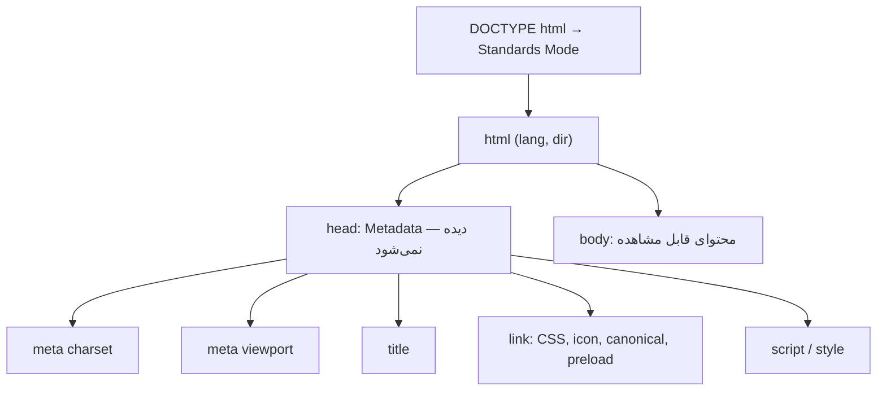

## ساختار کامل یک سند HTML

```html
<!DOCTYPE html>
<html lang="fa" dir="rtl">
  <head>
    <meta charset="UTF-8" />
    <meta name="viewport" content="width=device-width, initial-scale=1" />
    <title>فروشگاه کتاب | صفحه اصلی</title>
    <meta name="description" content="خرید آنلاین کتاب با ارسال سریع" />
    <link rel="canonical" href="https://example.com/" />
    <link rel="icon" href="/favicon.svg" type="image/svg+xml" />
    <link rel="stylesheet" href="/styles.css" />
    <script src="/app.js" defer></script>
  </head>
  <body>
    <!-- محتوای قابل مشاهده -->
  </body>
</html>
```



## DOCTYPE

`<!DOCTYPE html>` یک تگ HTML **نیست**؛ یک دستورالعمل برای مرورگر است که بگوید سند را در **Standards Mode (حالت استاندارد)** رندر کند.

### چرا وجود دارد؟

در دهه ۹۰ مرورگرها رفتارهای غیراستاندارد زیادی داشتند. وقتی مرورگرها استانداردتر شدند، برای اینکه سایت‌های قدیمی خراب نشوند، دو حالت رندر ایجاد شد:

| حالت | زمان فعال شدن | تفاوت مهم |
| --- | --- | --- |
| Standards Mode | با `<!DOCTYPE html>` | رفتار طبق استاندارد CSS |
| Quirks Mode | بدون DOCTYPE | شبیه‌سازی باگ‌های قدیمی؛ مثلاً Box Model متفاوت (عرض شامل Padding و Border)، رفتار عجیب ارتفاع جدول‌ها |
| Almost Standards | برخی DOCTYPEهای قدیمی | فقط تفاوت در رفتار تصاویر داخل سلول جدول |

```js
// در Console مرورگر:
document.compatMode; // "CSS1Compat" = Standards  |  "BackCompat" = Quirks
```

<Callout type="mistake">
حذف DOCTYPE باعث خطای آشکار نمی‌شود، بلکه باعث باگ‌های ظریف چیدمان می‌شود که پیدا کردنشان سخت است. اولین خط هر سند باید `<!DOCTYPE html>` باشد.
</Callout>

## Element ریشه `html`

- `lang`: زبان سند. Screen Reader با آن تلفظ صحیح را انتخاب می‌کند، مرورگر با آن پیشنهاد ترجمه می‌دهد، و CSS با آن `hyphens` و انتخاب فونت (`:lang()`) را انجام می‌دهد.
- `dir`: جهت متن (`rtl`، `ltr` یا `auto`). برای فارسی و عربی ضروری است. Flexbox، Grid و Logical Properties در CSS بر اساس آن جهت را برعکس می‌کنند.

## head

`head` شامل **Metadata (فراداده)** است: اطلاعاتی درباره سند که مستقیماً نمایش داده نمی‌شود. مرورگر، موتور جستجو و شبکه‌های اجتماعی آن را می‌خوانند.

| Element | کاربرد |
| --- | --- |
| `title` | عنوان تب مرورگر، عنوان نتیجه در Google، نام Bookmark و اولین چیزی که Screen Reader می‌خواند |
| `meta` | Metadataهای کلید-مقدار (charset، viewport، description، …) |
| `link` | ارتباط با منابع خارجی: Stylesheet، Icon، Canonical، Preload، Manifest |
| `script` | اسکریپت‌های JavaScript |
| `style` | CSS درون‌خطی |
| `base` | آدرس پایه برای تمام URLهای نسبی (به‌ندرت استفاده می‌شود و ریسک دارد) |

## body

تمام محتوای قابل مشاهده و تعامل‌پذیر داخل `body` قرار می‌گیرد. در DOM از طریق `document.body` و `head` از طریق `document.head` در دسترس است.

## Meta Tagها — بررسی عمیق

### charset

```html
<meta charset="UTF-8" />
```

**چه مشکلی را حل می‌کند؟** مرورگر بایت دریافت می‌کند، نه کاراکتر. اگر Encoding را نداند، باید حدس بزند و حدس اشتباه یعنی نمایش «Ù…تن» به جای متن فارسی.

- باید در **۱۰۲۴ بایت اول** سند باشد، چون مرورگر فقط همین بخش را برای پیدا کردن Encoding اسکن می‌کند. پس آن را اولین فرزند `head` قرار دهید.
- Header `Content-Type: text/html; charset=utf-8` در پاسخ HTTP اولویت بالاتری از meta دارد.
- اگر charset بعد از شروع Parse کشف شود، مرورگر ممکن است Parse را از اول انجام دهد (هزینه Performance).

### viewport

```html
<meta name="viewport" content="width=device-width, initial-scale=1" />
```

**چه مشکلی را حل می‌کند؟** مرورگرهای موبایل به‌طور پیش‌فرض فرض می‌کنند سایت برای دسکتاپ طراحی شده و صفحه را با عرض مجازی حدود **980px** رندر کرده و سپس کوچک می‌کنند. نتیجه: متن ریز و Media Queryهایی که هرگز فعال نمی‌شوند.

| مقدار | معنا |
| --- | --- |
| `width=device-width` | عرض Layout Viewport برابر عرض دستگاه (به CSS Pixel) |
| `initial-scale=1` | بدون Zoom اولیه |
| `maximum-scale=1`، `user-scalable=no` | **غیرفعال کردن Zoom — ضد Accessibility؛ استفاده نکنید** |
| `viewport-fit=cover` | استفاده از کل صفحه در گوشی‌های Notch‌دار، همراه با `env(safe-area-inset-*)` |
| `interactive-widget=resizes-content` | کنترل رفتار Layout هنگام باز شدن کیبورد مجازی |

<Callout type="warning">
غیرفعال کردن Zoom با `user-scalable=no` معیار WCAG 1.4.4 را نقض می‌کند. کاربران کم‌بینا به Zoom نیاز دارند.
</Callout>

### description

```html
<meta name="description" content="آموزش کامل مصاحبه Frontend از HTML تا React" />
```

خلاصه‌ای از صفحه که موتورهای جستجو **ممکن است** به‌عنوان Snippet زیر عنوان نتیجه نشان دهند. روی رتبه مستقیم اثر ندارد اما روی **CTR (نرخ کلیک)** اثر دارد. حدود ۱۵۰ تا ۱۶۰ کاراکتر، یکتا برای هر صفحه.

### robots

```html
<meta name="robots" content="noindex, nofollow" />
```

| مقدار | معنا |
| --- | --- |
| `index` / `noindex` | صفحه در نتایج جستجو باشد یا نه |
| `follow` / `nofollow` | لینک‌های صفحه دنبال شوند یا نه |
| `noarchive` | نسخه Cache نمایش داده نشود |
| `max-snippet:-1`، `max-image-preview:large` | کنترل اندازه پیش‌نمایش |

نکته مهم: `robots.txt` جلوی **Crawl** را می‌گیرد، نه **Index**. اگر صفحه‌ای در robots.txt مسدود باشد، Crawler هرگز `noindex` آن را نمی‌بیند و ممکن است URL آن (بدون محتوا) Index شود. برای حذف از نتایج، اجازه Crawl بدهید و `noindex` بگذارید. برای فایل‌های غیر HTML از Header `X-Robots-Tag` استفاده کنید.

### Open Graph

پروتکل Open Graph (ساخته Facebook) تعیین می‌کند هنگام اشتراک لینک در شبکه‌های اجتماعی و پیام‌رسان‌ها چه پیش‌نمایشی ساخته شود:

```html
<meta property="og:type" content="article" />
<meta property="og:title" content="Event Loop به زبان ساده" />
<meta property="og:description" content="Call Stack، Microtask و Task Queue با مثال" />
<meta property="og:image" content="https://example.com/og/event-loop.png" />
<meta property="og:url" content="https://example.com/js/event-loop" />
<meta property="og:locale" content="fa_IR" />
<meta property="og:site_name" content="هندبوک فرانت‌اند" />
```

- `og:image` باید **URL مطلق** باشد؛ اندازه رایج 1200×630.
- از `property` استفاده می‌شود، نه `name`.
- Crawler شبکه‌های اجتماعی JavaScript اجرا نمی‌کنند؛ پس در یک SPA خالص که meta را با JS می‌سازد، این تگ‌ها دیده نمی‌شوند. راه‌حل: SSR، SSG یا Prerendering.

### Twitter Cards

```html
<meta name="twitter:card" content="summary_large_image" />
<meta name="twitter:title" content="Event Loop به زبان ساده" />
<meta name="twitter:image" content="https://example.com/og/event-loop.png" />
```

X (توییتر) اگر تگ‌های `twitter:*` نباشند، از Open Graph استفاده می‌کند؛ معمولاً فقط `twitter:card` لازم است.

### canonical

```html
<link rel="canonical" href="https://example.com/products/shoes" />
```

**چه مشکلی را حل می‌کند؟ محتوای تکراری (Duplicate Content).** یک صفحه ممکن است با چند URL در دسترس باشد:

```text
https://example.com/products/shoes
https://example.com/products/shoes?utm_source=telegram
https://www.example.com/products/shoes
https://example.com/products/shoes?sort=price
```

Canonical به موتور جستجو می‌گوید نسخه اصلی کدام است، تا اعتبار (Link Equity) بین نسخه‌ها پخش نشود. این یک **Hint** است، نه دستور قطعی.

### theme-color

```html
<meta name="theme-color" content="#F7F8FA" media="(prefers-color-scheme: light)" />
<meta name="theme-color" content="#0E1219" media="(prefers-color-scheme: dark)" />
```

رنگ نوار آدرس و UI مرورگر در موبایل و رنگ پنجره PWA. با `media` می‌توان برای تم روشن و تیره مقدار جدا داد.

### favicon و Iconها

```html
<link rel="icon" href="/favicon.ico" sizes="32x32" />
<link rel="icon" href="/icon.svg" type="image/svg+xml" />
<link rel="apple-touch-icon" href="/apple-touch-icon.png" />  <!-- 180×180 -->
<link rel="manifest" href="/manifest.webmanifest" />           <!-- آیکون‌های PWA -->
```

SVG favicon می‌تواند داخل خودش `prefers-color-scheme` داشته باشد و با تم سیستم عوض شود.

### زبان و جهت

```html
<html lang="fa" dir="rtl">
...
<p>این متن فارسی است و این <span lang="en" dir="ltr">React.useState()</span> انگلیسی.</p>
...
<link rel="alternate" hreflang="en" href="https://example.com/en/" />
<link rel="alternate" hreflang="fa" href="https://example.com/fa/" />
<link rel="alternate" hreflang="x-default" href="https://example.com/" />
```

- `lang` روی بخش‌های داخلی هم قابل تنظیم است تا Screen Reader تلفظ را عوض کند.
- `hreflang` به موتور جستجو می‌گوید نسخه‌های زبانی دیگر کجا هستند.
- `dir="auto"` برای محتوای تولیدشده توسط کاربر مفید است: جهت از اولین کاراکتر قوی تعیین می‌شود.
- Element `bdi` متنی با جهت نامعلوم را ایزوله می‌کند (مثلاً نام کاربری عربی در متن انگلیسی).

### سایر Meta Tagهای مهم

| Tag | کاربرد |
| --- | --- |
| `<meta http-equiv="Content-Security-Policy" content="...">` | تعریف CSP وقتی دسترسی به Header ندارید (محدودیت دارد؛ `frame-ancestors` کار نمی‌کند) |
| `<meta name="referrer" content="strict-origin-when-cross-origin">` | کنترل Header `Referer` |
| `<meta name="color-scheme" content="light dark">` | به مرورگر می‌گوید صفحه از هر دو تم پشتیبانی می‌کند (Scrollbar و فرم‌ها تیره می‌شوند) |
| `<meta name="format-detection" content="telephone=no">` | جلوگیری از تبدیل خودکار اعداد به لینک تماس در iOS |

## link، script و style

### link

`link` یک **رابطه (`rel`)** بین سند و یک منبع را تعریف می‌کند. مهم‌ترین `rel`ها:

| rel | رفتار |
| --- | --- |
| `stylesheet` | CSS را بارگذاری می‌کند — **Render-blocking** است |
| `icon` | Favicon |
| `canonical` | URL اصلی صفحه |
| `preload` | دانلود فوری یک منبع مهم برای همین صفحه |
| `prefetch` | دانلود کم‌اولویت برای Navigation بعدی |
| `preconnect` | برقراری زودهنگام اتصال (DNS + TCP + TLS) |
| `modulepreload` | Preload و Parse یک ES Module |
| `alternate` | نسخه‌های جایگزین (زبان، RSS) |

جزئیات Resource Hintها در فصل [Performance در HTML](/html/performance).

### script

```html
<script src="/app.js"></script>              <!-- Parser-blocking -->
<script src="/app.js" defer></script>        <!-- بعد از Parse، به ترتیب -->
<script src="/analytics.js" async></script>  <!-- به محض دانلود، بدون ترتیب -->
<script type="module" src="/main.js"></script> <!-- به‌طور پیش‌فرض defer -->
```

اسکریپت معمولی **Parser-blocking** است: Parser باید متوقف شود، اسکریپت را دانلود و اجرا کند، چون اسکریپت ممکن است با `document.write` محتوای سند را تغییر دهد.

### style

```html
<style>
  .hero { min-height: 60vh; }
</style>
```

CSS درون‌خطی درخواست شبکه اضافه ندارد. تکنیک `Critical CSS` از همین استفاده می‌کند: CSS لازم برای بخش بالای صفحه (Above the fold) Inline می‌شود و بقیه با تأخیر بارگذاری می‌شود.

## مثال واقعی: head یک صفحه محصول

```html
<head>
  <meta charset="UTF-8" />
  <meta name="viewport" content="width=device-width, initial-scale=1" />
  <title>کفش دویدن مدل X | فروشگاه نمونه</title>
  <meta name="description" content="کفش دویدن سبک با زیره ضربه‌گیر. ارسال رایگان." />
  <link rel="canonical" href="https://shop.example/p/running-shoe-x" />

  <!-- Social -->
  <meta property="og:type" content="product" />
  <meta property="og:title" content="کفش دویدن مدل X" />
  <meta property="og:image" content="https://shop.example/og/shoe-x.jpg" />
  <meta name="twitter:card" content="summary_large_image" />

  <!-- Performance -->
  <link rel="preconnect" href="https://cdn.shop.example" crossorigin />
  <link rel="preload" as="image" href="/img/shoe-x-hero.avif" fetchpriority="high" />
  <link rel="stylesheet" href="/css/main.css" />
  <script type="module" src="/js/main.js"></script>

  <!-- Structured Data برای Rich Results -->
  <script type="application/ld+json">
    { "@context": "https://schema.org", "@type": "Product", "name": "کفش دویدن مدل X",
      "offers": { "@type": "Offer", "price": "2400000", "priceCurrency": "IRR" } }
  </script>
</head>
```

## اشتباهات رایج

- قرار دادن `meta charset` بعد از `title` یا بعد از ۱۰۲۴ بایت اول.
- غیرفعال کردن Zoom در viewport.
- `title` و `description` یکسان برای همه صفحات (رایج در SPAها).
- `og:image` با آدرس نسبی.
- تکیه بر JavaScript برای ساختن meta tagها در حالی که Crawler شبکه‌های اجتماعی JS اجرا نمی‌کنند.
- مسدود کردن صفحه در robots.txt به امید حذف آن از نتایج جستجو.
- فراموش کردن `lang`؛ هم Accessibility و هم ترجمه خودکار آسیب می‌بینند.

## سوالات مصاحبه

<QA q="`<!DOCTYPE html>` چه کاری انجام می‌دهد و اگر حذف شود چه می‌شود؟" level="junior" n={1}>
<Answer>

مرورگر را در Standards Mode قرار می‌دهد. بدون آن صفحه در Quirks Mode رندر می‌شود که رفتارهای قدیمی و غیراستاندارد (مثل Box Model متفاوت) را شبیه‌سازی می‌کند.

</Answer>
<Deep>

DOCTYPE در HTML5 دیگر به DTD اشاره نمی‌کند؛ تنها هدفش انتخاب Rendering Mode است. با `document.compatMode` می‌توان حالت فعلی را بررسی کرد.

</Deep>
<Mistake>

گفتن اینکه DOCTYPE «نسخه HTML» را مشخص می‌کند یا اینکه بدون آن تگ‌های HTML5 کار نمی‌کنند.

</Mistake>
<FollowUp>

در Quirks Mode چه تفاوتی در محاسبه عرض Box وجود دارد؟ (عرض شامل Padding و Border می‌شود، مشابه `box-sizing: border-box`.)

</FollowUp>
</QA>

<QA q="viewport meta دقیقاً چه مشکلی را حل می‌کند؟" level="junior" n={2}>
<Answer>

بدون آن، مرورگر موبایل صفحه را با عرض مجازی حدود 980px رندر و سپس کوچک می‌کند؛ متن ریز می‌شود و Media Queryهای موبایل فعال نمی‌شوند. `width=device-width` عرض Layout Viewport را برابر عرض دستگاه می‌کند.

</Answer>
<Deep>

موبایل دو Viewport دارد: Layout Viewport (مبنای محاسبه CSS و Media Query) و Visual Viewport (بخشی که واقعاً دیده می‌شود و با Zoom تغییر می‌کند). API `window.visualViewport` دومی را در اختیار می‌گذارد؛ برای مثال برای جابه‌جا کردن UI هنگام باز شدن کیبورد.

</Deep>
<Mistake>

اضافه کردن `user-scalable=no` برای «حس Native» که Accessibility را نقض می‌کند.

</Mistake>
<FollowUp>

چرا `100vh` در موبایل مشکل دارد و `dvh` چطور آن را حل می‌کند؟ (به فصل واحدهای CSS مراجعه کنید.)

</FollowUp>
</QA>

<QA q="canonical چیست و چه زمانی لازم است؟" level="mid" n={3}>
<Answer>

`link rel="canonical"` نسخه اصلی یک صفحه را به موتور جستجو معرفی می‌کند تا نسخه‌های تکراری (پارامترهای UTM، فیلتر، www و بدون www) اعتبار را بین خود تقسیم نکنند.

</Answer>
<Deep>

Canonical یک Hint است و Google ممکن است آن را نادیده بگیرد اگر محتوا واقعاً متفاوت باشد. Self-referencing canonical (اشاره هر صفحه به خودش) یک Best Practice است. برای سایت چندزبانه، هر نسخه زبانی canonical خودش را دارد و با `hreflang` به نسخه‌های دیگر لینک می‌دهد — canonical نسخه انگلیسی نباید به نسخه فارسی اشاره کند.

</Deep>
<Mistake>

Canonical کردن همه صفحات Pagination به صفحه اول؛ این باعث می‌شود محتوای صفحات بعدی Index نشود.

</Mistake>
<FollowUp>

تفاوت canonical با Redirect 301 چیست؟ (301 کاربر را هم منتقل می‌کند؛ canonical فقط سیگنالی برای موتور جستجو است.)

</FollowUp>
</QA>

<QA q="چرا Open Graph در یک SPA ممکن است کار نکند و راه‌حل چیست؟" level="senior" n={4}>
<Answer>

Crawler شبکه‌های اجتماعی و پیام‌رسان‌ها HTML اولیه را می‌خوانند و JavaScript اجرا نمی‌کنند. اگر meta tagها در Runtime توسط JS ساخته شوند، Crawler فقط HTML خالی می‌بیند. راه‌حل‌ها: SSR، SSG، Prerendering در زمان Build، یا یک Edge Function که برای User-Agentهای Crawler HTML مخصوص برمی‌گرداند.

</Answer>
<Deep>

Googlebot JavaScript اجرا می‌کند (با تأخیر و در صف Rendering)، اما Crawlerهای Facebook، LinkedIn، Telegram و Slack این کار را نمی‌کنند. در React 19، `<title>` و `<meta>` داخل Component به‌طور خودکار به `head` منتقل می‌شوند و در SSR هم در HTML خروجی قرار می‌گیرند.

</Deep>
<Mistake>

فرض اینکه چون Google صفحه را درست Index کرده، پیش‌نمایش شبکه‌های اجتماعی هم درست است.

</Mistake>
<FollowUp>

چطور یک og:image پویا (مثلاً با عنوان مقاله) تولید می‌کنید؟ (تولید تصویر در Edge، Cache با CDN، URL نسخه‌دار برای Cache-busting.)

</FollowUp>
</QA>

## جمع‌بندی

<Recap>

- `<!DOCTYPE html>` مرورگر را در Standards Mode نگه می‌دارد؛ بدون آن Quirks Mode و رفتارهای قدیمی فعال می‌شود.
- `<html lang="fa" dir="rtl">` زبان و جهت را برای Screen Reader، ترجمه و فونت تعیین می‌کند.
- `head` اطلاعات درباره صفحه است و نمایش داده نمی‌شود؛ `body` محتوای قابل مشاهده است.
- `<meta charset="utf-8">` باید در ۱۰۲۴ بایت اول بیاید تا متن فارسی خراب نشود.
- Meta Tag مربوط به viewport برای موبایل ضروری است؛ Zoom را غیرفعال نکنید.
- `description` متن زیر عنوان در نتایج جستجوست؛ `robots` ایندکس شدن را کنترل می‌کند.
- Open Graph و Twitter Card پیش‌نمایش لینک در شبکه‌های اجتماعی را می‌سازند.
- `canonical` به موتور جستجو می‌گوید نسخه اصلی یک صفحه با چند آدرس کدام است.
- ترتیب `head` مهم است: charset، viewport، title، بعد preload/preconnect و CSS، و Scriptها با `defer`.

</Recap>
